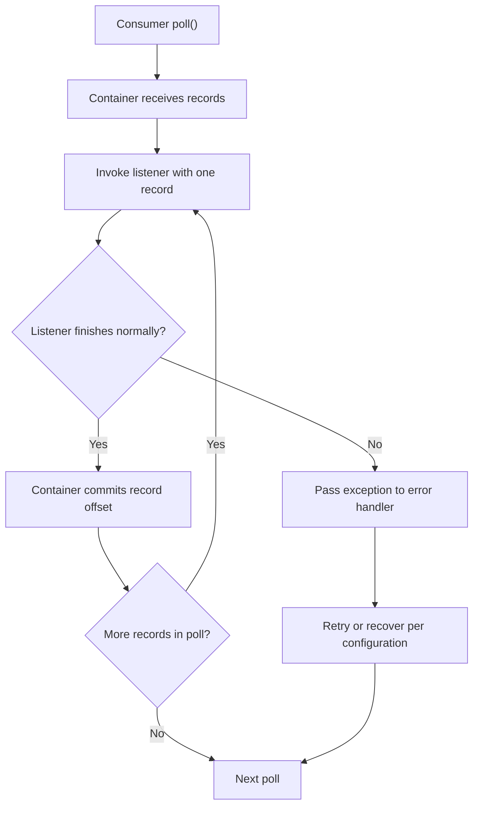

# AckMode RECORD in Spring Kafka

`AckMode.RECORD` instructs the Spring Kafka listener container to commit the offset after the listener successfully processes each individual record. This is an appropriate choice when an application wants commit progress to track each message closely and wants to limit how many records can be replayed after an incident.

This AckMode applies to a **record listener**: the container invokes the listener once for each `ConsumerRecord`. When the listener method returns normally, the container considers that record processed and commits the corresponding offset. If the listener throws an exception, the error-handling flow decides on retry or recovery; a record is not considered successful merely because it was fetched from Kafka.

`RECORD` does not by itself provide business-level exactly-once processing and does not replace idempotency. It determines when the container commits offsets. The application must still design appropriate error handling, side-effect safety, and recovery.

## 1. What Is AckMode?

A Kafka consumer reads records per partition and tracks its read position. For a consumer group, Kafka stores committed offsets per partition so consumers can resume from the acknowledged position after a restart or rebalance.

In Spring Kafka, the listener container manages the consumer loop and can manage offset commits. `ContainerProperties.AckMode` determines how the container records processing progress.

An important point: Kafka commits the offset of the **next record to read**, not the offset of the record just processed. If the listener successfully processes a record at offset `42`, the committed position is normally `43`.

Example:

| Processed Record | Record Offset | Committed Offset |
|---|---:|---:|
| Record A | 40 | 41 |
| Record B | 41 | 42 |
| Record C | 42 | 43 |

Committed offsets are stored per consumer group and partition. There is no single global offset representing the entire topic.

## 2. How Does RECORD Work?

When a consumer calls `poll()`, Kafka may return multiple records from one or more partitions. With a record listener, Spring Kafka passes each record sequentially to the listener method. In `RECORD` mode, the container commits the offset after the listener returns successfully for each record.

Basic processing flow:



Suppose a partition returns records with offsets 100, 101, and 102:

1. The listener processes record 100 and returns normally. The container commits position 101.
2. The listener processes record 101 and returns normally. The container commits position 102.
3. The listener begins processing record 102.

If the application stops before finishing record 102, a restarted consumer can resume from offset 102, provided the previous commit succeeded. Records 100 and 101 do not need to be replayed.

The key point is that **each successful listener return is a processing boundary for the container to commit**. The container does not wait for all records from the `poll()` call to finish as in `AckMode.BATCH`.

## 3. Configuring AckMode.RECORD

It can be configured via Spring Boot or directly on the listener container factory. Choose one configuration approach suitable for the application; if there are multiple factories, ensure the listener uses the factory where AckMode is set.

### 3.1. Configuring with Spring Boot

Example in `application.yml`:

```yaml
spring:
  kafka:
    bootstrap-servers: localhost:9092
    consumer:
      group-id: billing-service
      enable-auto-commit: false
    listener:
      ack-mode: record
```

Key properties:

- `consumer.group-id`: the consumer group that owns the committed offsets.
- `consumer.enable-auto-commit: false`: lets the listener container control when commits happen.
- `listener.ack-mode: record`: commits after each record listener invocation succeeds.

Spring Kafka sets `enable.auto.commit=false` by default starting from version 2.3, unless overridden by application configuration. Declaring it explicitly makes configuration intent clear and avoids relying on defaults from a particular version or another configuration.

### 3.2. Configuring via Listener Container Factory

When creating a `ConcurrentKafkaListenerContainerFactory` manually, set AckMode on `ContainerProperties`:

```java
@Configuration
public class KafkaListenerConfiguration {

    @Bean
    public ConcurrentKafkaListenerContainerFactory<String, OrderCreated>
            kafkaListenerContainerFactory(
                    ConsumerFactory<String, OrderCreated> consumerFactory) {

        ConcurrentKafkaListenerContainerFactory<String, OrderCreated> factory =
                new ConcurrentKafkaListenerContainerFactory<>();

        factory.setConsumerFactory(consumerFactory);
        factory.getContainerProperties().setAckMode(
                ContainerProperties.AckMode.RECORD
        );

        return factory;
    }
}
```

Default listeners may use a factory named `kafkaListenerContainerFactory`. If the application has multiple factories, specify the corresponding factory explicitly:

```java
@KafkaListener(
    topics = "orders.created",
    groupId = "billing-service",
    containerFactory = "kafkaListenerContainerFactory"
)
public void consume(OrderCreated event) {
    // Process event
}
```

Configuring AckMode on one factory does not automatically apply to listeners using a different factory. When inspecting a listener, verify both the `containerFactory` name and the actual configuration of that factory.

## 4. Writing a Record Listener with RECORD

A record listener receives one message per invocation:

```java
@Component
public class OrderCreatedListener {

    private final BillingService billingService;

    public OrderCreatedListener(BillingService billingService) {
        this.billingService = billingService;
    }

    @KafkaListener(
        topics = "orders.created",
        groupId = "billing-service"
    )
    public void onOrderCreated(OrderCreated event) {
        billingService.createPendingPayment(event);
    }
}
```

When `createPendingPayment()` finishes and the listener returns normally, the container can commit the record's offset. If the business method throws an exception, the container delegates the error to the configured error-handling mechanism.

You can receive `ConsumerRecord` directly if you need metadata such as topic, partition, key, timestamp, or offset:

```java
@KafkaListener(
    topics = "orders.created",
    groupId = "billing-service"
)
public void onOrderCreated(
        ConsumerRecord<String, OrderCreated> record) {

    log.info(
        "Processing topic={}, partition={}, offset={}, key={}",
        record.topic(),
        record.partition(),
        record.offset(),
        record.key()
    );

    billingService.createPendingPayment(record.value());
}
```

With `AckMode.RECORD`, the listener does not need to call `Acknowledgment.acknowledge()`. The container decides commit timing based on the listener's return outcome.

### Listener Success Boundary

The container only observes the execution outcome of the listener. Therefore, the listener must return normally only when the required work for the record has reached its designed success state.

The following example can cause lost processing:

```java
@KafkaListener(topics = "orders.created")
public void onOrderCreated(OrderCreated event) {
    executor.submit(() -> billingService.createPendingPayment(event));
    // Listener returns immediately while background work is not yet complete.
}
```

With this pattern, the container may commit the offset immediately after the task is submitted to the executor. If the process stops before the background task finishes, Kafka may not redeliver the record because the offset has already been committed.

If asynchronous processing is required, use an asynchronous listener style supported by your running Spring Kafka version, or design explicit acknowledgment so the offset is acknowledged only after the task completes. Do not let the listener return early while still expecting the container to wait for background work.

## 5. Comparing RECORD with Common AckModes

| AckMode | Offset Commit Timing | Appropriate When |
|---|---|---|
| `RECORD` | After the listener successfully processes each record | Need commit progress tracked per message |
| `BATCH` | After all records from a single `poll()` are processed | Want to reduce commit frequency and accept a larger replay window |
| `TIME` | When the configured time interval is reached | Want to commit on a time cadence |
| `COUNT` | When the configured record count is reached | Want to commit after a number of records |
| `COUNT_TIME` | When either the count or time condition is met | Want to combine both thresholds |
| `MANUAL` | Listener calls acknowledge; container handles commits per manual semantics | Business logic needs to decide acknowledgment timing explicitly |
| `MANUAL_IMMEDIATE` | Listener calls acknowledge to request immediate commit when called on the consumer thread | Need explicit acknowledgment control and immediate commit timing |

`RECORD` and `BATCH` are the two container-managed options most directly weighed against each other.

### RECORD

With a record listener, the container invokes the listener separately for each record and commits after each successful execution. If a poll returns multiple records from the same partition, earlier successfully processed offsets can be acknowledged before the next record finishes.

### BATCH

With `BATCH`, the container waits for the listener to finish processing the records returned in a single poll before committing batch progress. If an error occurs before the batch finishes, multiple already-processed records in that batch may have to be re-read.

### MANUAL and MANUAL_IMMEDIATE

The two manual modes require the listener to accept `Acknowledgment` and call `acknowledge()` according to application logic. They are suitable when acknowledgment conditions cannot be expressed simply by the listener returning normally.

`AckMode.RECORD` is intended for record listeners. With a batch listener, one callback represents the entire batch, so `RECORD` cannot turn each element of the batch into an independent listener return. Choose `BATCH` or error-handling/acknowledgment mechanisms designed for batch listeners.

## 6. How Does RECORD Affect Redelivery?

`RECORD` usually narrows the number of records that can be replayed compared to `BATCH`, because offsets are committed more frequently. However, it still generally falls under at-least-once semantics: a record can be redelivered if side effects completed but the offset commit was not successfully stored by the broker.

Consider three consecutive records in the same partition:

| Scenario | Committed Offset | What Can Happen on Restart |
|---|---:|---|
| Record 100 processed successfully | 101 | Resumes from 101 |
| Record 101 processed successfully | 102 | Resumes from 102 |
| Record 102 produced side effects but process stopped before commit | 102 | Record 102 may be redelivered |
| Commit of offset 103 for record 102 succeeded | 103 | Resumes from 103 |

The final case before commit is the most critical point: the application may have written data to a database or called an external service, while Kafka does not yet know processing finished. When the record is redelivered, the side effect may be executed again.

### 6.1. Duplicate Processing Example

Suppose a listener receives a payment-creation event:

1. The listener writes a payment to the database.
2. The database commits successfully.
3. The application stops before Kafka commits the offset.
4. The consumer restarts and receives the same event again.
5. The listener creates a second payment if business logic is not duplicate-safe.

`AckMode.RECORD` cannot eliminate the window between step 2 and step 3 on its own.

### 6.2. Making Handlers Idempotent

A common approach is using a unique event ID or business key to ensure the same event produces side effects only once.

Conceptual example:

```java
@Transactional
public void createPendingPayment(OrderCreated event) {
    if (processedEventRepository.existsByEventId(event.eventId())) {
        return;
    }

    paymentRepository.save(
        Payment.pending(event.orderId(), event.amount())
    );

    processedEventRepository.save(
        ProcessedEvent.of(event.eventId())
    );
}
```

This example must be implemented with an appropriate unique constraint in the database and inside the same business transaction. Checking `exists` in application code alone without a concurrency constraint can still create duplicates when multiple threads process the same event.

Other options include an inbox table, idempotency keys, conditional upserts, or business operations designed to be safely re-executed.

## 7. Exception Handling and Retries

When a listener throws an exception, the container delegates handling to the error handler. The exact policy depends on handler type, backoff, recoverer, and container configuration.

An error-handling flow may include:

1. The listener receives a record and throws an exception.
2. The error handler classifies the exception.
3. Transient errors are retried according to the configured backoff.
4. If processing succeeds on a retry attempt, the record is considered processed.
5. If retries are exhausted, the recoverer may route the record to a DLT or perform another recovery action.
6. Whether the offset is committed after recovery depends on the error handler and container configuration.

A declarative listener example can keep business logic simple:

```java
@KafkaListener(topics = "orders.created", groupId = "billing-service")
public void onOrderCreated(OrderCreated event) {
    billingService.createPendingPayment(event);
}
```

If `createPendingPayment()` throws an exception, the listener should not silently ignore the error if the record was not actually processed. When an exception is caught and not rethrown, the container sees the listener return normally and may commit the offset under `RECORD`.

Inappropriate example:

```java
@KafkaListener(topics = "orders.created")
public void onOrderCreated(OrderCreated event) {
    try {
        billingService.createPendingPayment(event);
    } catch (Exception ex) {
        log.error("Cannot process order", ex);
        // Does not rethrow the exception and has no recovery.
    }
}
```

If the error has been fully handled under an intentional policy, the listener may return. If the error still requires retry or recovery, let the exception reach the error handler or forward the error via the designed mechanism.

### 7.1. Unlimited Retries Can Stall the Consumer

A permanent data error usually cannot be resolved by retrying forever. Distinguish between:

- Transient errors: timeouts, temporary dependency outages, connection errors.
- Data errors: invalid schema, missing required fields, unconvertible values.
- Business errors: order state does not allow the operation.
- System errors: database or dependency is down.

Define retry count, backoff, retryable exceptions, and post-exhaustion actions. For a DLT, monitor record volume, access permissions, retention, and investigation/replay procedures.

### 7.2. Retries Can Affect Ordering

Kafka preserves record order within a partition. However, when a record is moved to a retry topic or recovered via another flow, subsequent records in the original partition may be processed ahead of the retrying record.

If ordering by `orderId` or aggregate is a business requirement, evaluate the retry strategy, partition key, and recovery approach. `AckMode.RECORD` does not by itself guarantee business ordering across multiple retry topics.

## 8. Auto-Commit and Container-Managed Commits

For `AckMode.RECORD` to behave as expected, the Spring Kafka listener container must manage offsets. Kafka consumers have an `enable.auto.commit` property; when enabled, the Kafka client can commit offsets periodically regardless of listener processing outcomes.

If auto-commit runs while the listener is still processing a record, the consumer may save an offset past completed work. When the application crashes, unprocessed records may not be redelivered as desired.

Therefore, with container-managed acknowledgments, set:

```properties
enable.auto.commit=false
```

In Spring Boot:

```yaml
spring:
  kafka:
    consumer:
      enable-auto-commit: false
    listener:
      ack-mode: record
```

Do not enable auto-commit and assume `AckMode.RECORD` still controls commit timing. Inspect actual consumer configuration, especially when the application has multiple `ConsumerFactory` beans or custom factories.

## 9. Performance and Concurrency

### 9.1. Commit Frequency

`RECORD` commits after each record the listener processes successfully. Compared to `BATCH`, higher commit frequency can increase broker round-trips, processing overhead, and latency at high throughput.

Spring Kafka allows configuring synchronous or asynchronous commits through container properties. Defaults and detailed behavior should be checked against the version in use. If using asynchronous commits, monitor commit callbacks/failures and understand how they affect replay after failures.

Choose `RECORD` when the benefit of per-message commit progress outweighs commit overhead. If throughput is the primary goal, benchmark `RECORD` and `BATCH` under an equivalent workload.

### 9.2. Listener Concurrency

The number of consumer threads can be configured on the listener container factory:

```java
factory.setConcurrency(3);
```

Concurrency creates multiple consumers within the same listener container. Kafka distributes partitions across consumers in the group. One partition can only be assigned to one consumer in the group at a time, so increasing concurrency beyond the number of partitions does not add parallel processing capacity for that topic.

Within each consumer, a record listener normally processes records sequentially in the order received from the partition. If the application offloads work to a thread pool itself, it must re-manage completion boundaries and acknowledgments as described above.

### 9.3. Processing Time and max.poll.interval.ms

A record listener runs on the consumer processing thread. If processing takes too long, the consumer may fail to call `poll()` within `max.poll.interval.ms`, causing the group to treat the consumer as dead and trigger a rebalance.

Even though `RECORD` has committed earlier records, the record currently being processed or unacknowledged can still be redelivered after a rebalance. Measure processing duration, tune `max.poll.interval.ms` and `max.poll.records` to match the workload, and keep processing times within manageable operational bounds.

## 10. RECORD and Kafka Transactions

In a configuration without Kafka transactions, the container commits offsets using the consumer's commit mechanism after the listener finishes a record.

When using a transactional listener container, offset writes can be coordinated with a Kafka transaction. In that case, offsets are included in the transaction and committed together with the transaction per configuration. Exact transaction boundaries depend on listener type and producer/container configuration; do not infer full transaction behavior solely from the name `AckMode.RECORD`.

Kafka transactions can support consume-process-produce flows within Kafka. For example, a consumer reads an event, processes it, and writes an output event; transactions coordinate writing the output with the input offset within Kafka's scope.

If the listener updates an external database and then commits the Kafka offset, a Kafka transaction does not automatically turn the two systems into a single atomic transaction. Outbox/inbox, idempotency, or an appropriate coordination protocol is still required to handle failures between the two systems.

## 11. Testing AckMode.RECORD

Tests should verify commit timing and replay behavior, rather than merely asserting that the listener was called.

A test scenario can be implemented as follows:

1. Start a Kafka broker for integration testing.
2. Create a topic with at least one partition and a dedicated consumer group.
3. Send three consecutive records to the same partition.
4. Use a record listener with `AckMode.RECORD` and record processed offsets.
5. After the listener finishes the first record, check the group's committed offset.
6. Confirm the committed offset is the next offset after the completed record.
7. Trigger an error on a record and verify the error handler performs retry/recovery as configured.
8. Stop the consumer at the boundary between business processing and commit to test replay capability.
9. Confirm the idempotent handler does not produce duplicate side effects.

`AdminClient` can be used to read a consumer group's committed offsets in tests. When checking, match the exact group ID, topic, and partition. Offsets in Kafka represent the next position to read, so the result is always one greater than the offset of the last successfully committed record.

### Scenarios to Cover in Integration Tests

| Scenario | What to Verify |
|---|---|
| Listener returns normally | Record offset is committed |
| Listener throws an exception | Error handler receives the exception; offset follows configured retry/recovery |
| Retry succeeds | Record is processed successfully and progress is committed |
| Retries exhausted, routed to DLT | Record is recovered per policy; original offset is handled as configured |
| Application stops before commit | Record can be redelivered |
| Side effects succeed but commit fails | Reprocessing does not create duplicate side effects |
| Multiple partitions and concurrency | Ordering within each partition is preserved as designed |
| Rebalance while listener is running | Unacknowledged records are recovered properly |

Do not check only the number of times the listener was invoked. Verify committed offsets, database side effects, retry/DLT behavior, and reprocessing behavior after a restart.

## 12. Production Monitoring

When using `RECORD`, monitor both Kafka progress and business outcomes:

- Consumer group lag by topic and partition.
- Committed offsets and offset advance rate.
- Per-record processing time, especially p95/p99.
- Listener failure count and retry count.
- Number of records routed to DLT.
- Commit failures or timeouts.
- Rebalance count and time consumer spends not polling.
- Rate of duplicate events blocked by the idempotency layer.
- Successful business operations compared to consumed record count.

If lag increases even though the listener reports no errors, inspect processing duration, concurrency, partition count, commit latency, and dependency health. If lag is low but side effects are missing, inspect auto-commit, exception catching, async tasks, and commit placement relative to business completion boundaries.

## 13. Configuration Mistakes and Diagnostics

**Setting AckMode.RECORD while the listener uses batch.** RECORD is designed for record listeners. Verify the listener receives one record per invocation; if it receives a list of records, choose an AckMode and error handling suitable for batch listeners.

**Enabling enable.auto.commit.** Auto-commit can write offsets independently of the listener. Set `enable.auto.commit=false` so the container manages progress.

**Catching an exception and not rethrowing it.** The listener returns normally, so the container may commit the record even though business logic failed. Propagate errors to the error handler or perform intentional recovery.

**Submitting work to an executor and returning.** The container may commit before the task finishes. Use a supported async listener model or manual acknowledgment and acknowledge only after work finishes.

**Assuming RECORD eliminates duplicates.** Failures after a database commit but before a Kafka offset commit can still cause a record to be redelivered. Use event IDs and idempotent handlers.

**Increasing concurrency when the topic has too few partitions.** Active concurrent consumers are capped by assigned partitions. Review partition count and actual throughput.

**Processing records for too long.** The consumer may exceed `max.poll.interval.ms` and trigger a rebalance. Measure processing time, tune poll configuration, and split work where appropriate.

**Not checking which factory the listener uses.** One factory may be set to RECORD while the listener actually uses another factory. Verify `containerFactory` and runtime configuration.

## 14. When Should You Choose AckMode.RECORD?

Choose `RECORD` when:

- The listener processes each record independently.
- You want to commit the offset immediately after each record succeeds.
- You want to reduce the scope of records that could be replayed if a later record fails or the process stops.
- You accept higher commit frequency compared to `BATCH`.
- Business work can stay synchronous within the listener boundary or use a supported async/acknowledgment model.

Consider `BATCH` when:

- Throughput is the priority and per-record commit overhead is significant.
- Replaying more records after an incident is acceptable.
- The listener processes batches and business logic is designed for batching.

Consider `MANUAL` or `MANUAL_IMMEDIATE` when:

- Acknowledgment conditions are explicitly governed by business logic.
- Acknowledgment is needed after an asynchronous operation or specialized processing step.
- The engineering team can accurately manage acknowledgment lifecycles and the thread performing acks.

Before deploying, verify listener type, actual factory, `enable.auto.commit`, error handler, commit strategy, and side-effect handling. `AckMode.RECORD` is most effective when the "listener completed successfully" boundary matches the boundary at which the application wants to confirm a record is processed.

## 15. Version-Specific Reference Documentation

Detailed properties and behaviors can vary across Spring Kafka, Spring Boot, and Kafka client versions. When implementing or upgrading, consult version-matched documentation for:

- `ContainerProperties.AckMode` and listener containers.
- Record listeners vs. batch listeners.
- Error handlers, retries, recoverers, and DLTs.
- Consumer `enable.auto.commit`, sync/async commits, and offsets.
- Transactional listener containers and Kafka transactions.
- Spring Boot `spring.kafka.listener.*` and `spring.kafka.consumer.*`.

Do not rely solely on YAML configuration to conclude that runtime uses RECORD. Confirm which factory the listener uses and observe committed offsets in integration tests or staging before rolling changes to production.
