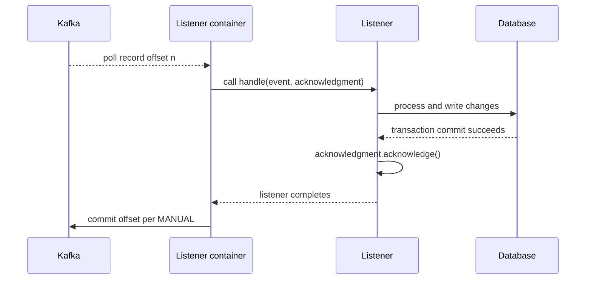

# AckMode MANUAL

In Spring Kafka, `AckMode.MANUAL` delegates to the listener the responsibility of acknowledging that a record has been processed successfully. The listener receives an `Acknowledgment` object and calls `acknowledge()` after business work completes. The listener container receives that acknowledgment and manages offset commits according to manual-mode semantics.

This mode is useful when acknowledgment timing needs to be tied to a specific business step, such as acknowledging only after a database transaction has committed or after a multi-step processing flow has persisted its result. However, `MANUAL` does not automatically create a distributed transaction between Kafka and a database, nor does it guarantee the listener runs only once. The consumer can still receive the record again if the application stops before the offset is committed.

## 1. Meaning of MANUAL

In `RECORD` mode, the container commits the offset automatically after each record listener returns successfully. In `BATCH` mode, the container commits offsets after all records from a single `poll()` have been processed. With `MANUAL`, the listener explicitly calls `Acknowledgment.acknowledge()` to signal that a record or batch is complete. The container queues these acknowledgments into the commit pipeline and commits offsets once the records from the corresponding poll have been acknowledged.

An important point is that `MANUAL` does not mean every call to `acknowledge()` immediately sends a commit command to the broker. Its semantics resemble `BATCH`: acknowledgments are managed alongside the group of records received in the poll. If you need an immediate commit at the moment acknowledge is called on the consumer thread, that is the purpose of `MANUAL_IMMEDIATE`.

| AckMode | Who Decides Acknowledgment Timing? | Commit Meaning |
|---|---|---|
| `RECORD` | Container | Commits after each record listener finishes successfully |
| `BATCH` | Container | Commits after processing all records from one poll |
| `MANUAL` | Listener calls `acknowledge()`; container manages commits | Acknowledgments are queued; commits follow batch-like semantics once the poll's records are acknowledged |
| `MANUAL_IMMEDIATE` | Listener calls `acknowledge()` | Commits immediately when called on the consumer thread; calls from other threads are handed to the container |

Choose `MANUAL` when the application needs to explicitly decide whether a record is ready to be acknowledged, while still letting the container coordinate commits per poll batch. Choose `MANUAL_IMMEDIATE` when business requirements genuinely require an immediate commit at acknowledgment time and the application controls the calling thread. Do not choose a manual mode simply because the name sounds more flexible; each mode has its own semantics and operational consequences.

## 2. Configuring MANUAL in Spring Boot

Spring Boot allows setting the ack mode in listener configuration:

```yaml
spring:
  kafka:
    consumer:
      group-id: payment-service
      enable-auto-commit: false
    listener:
      ack-mode: manual
```

Since Spring Kafka 2.3, if `enable.auto.commit` is not declared, the framework defaults it to `false` so the listener container manages commits. Declaring it explicitly is still helpful because it clarifies that the application does not want the Kafka consumer auto-committing offsets on a schedule independent of listener processing outcomes.

When configuring `ConcurrentKafkaListenerContainerFactory` manually, you can set the mode on `ContainerProperties`:

```java
@Bean
ConcurrentKafkaListenerContainerFactory<String, PaymentEvent>
paymentKafkaListenerContainerFactory(
        ConsumerFactory<String, PaymentEvent> consumerFactory) {

    var factory = new ConcurrentKafkaListenerContainerFactory<String, PaymentEvent>();
    factory.setConsumerFactory(consumerFactory);
    factory.getContainerProperties()
            .setAckMode(ContainerProperties.AckMode.MANUAL);
    return factory;
}
```

When multiple listener factories exist, verify that the listener uses the factory with `AckMode.MANUAL`. You can specify the factory on `@KafkaListener` via `containerFactory`. Configuring one factory does not automatically change the ack mode of other factories.

## 3. Receiving Acknowledgment in the Listener

Spring Kafka can inject `Acknowledgment` as a listener parameter. The listener calls `acknowledge()` after the operation that needs protection has finished:

```java
@KafkaListener(
        topics = "payments",
        groupId = "payment-service",
        containerFactory = "paymentKafkaListenerContainerFactory")
public void handle(
        PaymentEvent event,
        Acknowledgment acknowledgment) {

    paymentService.processAndCommit(event);
    acknowledgment.acknowledge();
}
```

In this example, `processAndCommit()` must return only after the business outcome has been durably persisted. If it writes to a database, the database transaction must commit before the listener calls `acknowledge()`. If the method merely dispatches work to an executor and returns immediately, the container may receive the acknowledgment while the actual work has not yet finished; that defeats the purpose of manual acknowledgment.

Desired sequence:



If the listener hits an exception before acknowledging, the record remains unacknowledged. The container's error handler decides on retry, recovery, or another action. If the listener calls acknowledge first and then executes an operation that can fail, the application risks committing the offset for a record whose business work never completed. Thus, statement ordering inside the listener is part of the delivery guarantee.

## 4. Per-Poll Commits and Impact on Multiple Records

A Kafka consumer typically receives a group of records from one or more partitions in a single `poll()`. With `MANUAL`, the container manages acknowledgments for this group of records and commits under `BATCH`-like semantics once the required records are acknowledged.

Example where a single poll receives three consecutive records in the same partition:

```text
poll() returns: offsets 10, 11, 12

Listener processes and acknowledges offset 10
Listener processes and acknowledges offset 11
Offset 12 not yet acknowledged

Container cannot advance committed offset past an unacknowledged record.
```

The committed offset represents the next position to read. Once offsets `10`, `11`, and `12` have been processed and acknowledged, the container can commit the next position `13`. If the application stops before acknowledging the last record, uncommitted records may be re-read after the consumer restarts or partitions are assigned to another member.

A listener can process records belonging to multiple partitions within the same poll. Kafka stores offsets independently per partition, so commit progress is also managed separately per partition. Do not infer that committing partition A's offset means records in partition B have also been processed.

With a batch listener, the listener receives the whole list of records and can acknowledge the batch once all elements have completed:

```java
@KafkaListener(topics = "inventory-events", groupId = "inventory-projection")
public void handleBatch(
        List<InventoryEvent> events,
        Acknowledgment acknowledgment) {

    inventoryService.applyBatch(events);
    acknowledgment.acknowledge();
}
```

In this example, `applyBatch()` must complete the entire batch before acknowledging. If elements are processed independently and one element fails, the listener must clearly define how to handle the succeeded portion, the failed portion, and the corresponding offset. Only call acknowledge once the entire batch reaches a state where business rules permit acknowledgment.

## 5. Error Handling and Retries

If the listener throws an exception before calling acknowledge, the container receives no successful acknowledgment from the listener for that record. `CommonErrorHandler` or the configured error handler can retry, seek to re-read, route the record to a Dead Letter Topic (DLT), or perform recovery according to application policy.

Example listener that does not swallow errors:

```java
@KafkaListener(topics = "orders", groupId = "order-projection")
public void handle(
        OrderEvent event,
        Acknowledgment acknowledgment) {

    orderProjectionService.apply(event); // throws an exception if processing fails
    acknowledgment.acknowledge();
}
```

When `apply()` fails, the acknowledge line is not executed. The exception returns to the container for the error handler to process. Conversely, the following snippet can cause lost records:

```java
@KafkaListener(topics = "orders", groupId = "order-projection")
public void unsafeHandle(
        OrderEvent event,
        Acknowledgment acknowledgment) {

    try {
        orderProjectionService.apply(event);
    }
    catch (RuntimeException ex) {
        log.error("Failed to process order event", ex);
    }

    acknowledgment.acknowledge();
}
```

In the unsafe example, the exception is caught and the listener still calls acknowledge. The container cannot tell that business processing failed, so it may commit the offset. Only catch an exception and still acknowledge when the application has completed an intentional recovery flow and can prove the record has been handled or durably stored elsewhere.

### Example DefaultErrorHandler Configuration

```java
@Bean
DefaultErrorHandler orderErrorHandler(KafkaTemplate<Object, Object> template) {
    var recoverer = new DeadLetterPublishingRecoverer(template);
    return new DefaultErrorHandler(
            recoverer,
            new FixedBackOff(1_000L, 3L));
}

@Bean
ConcurrentKafkaListenerContainerFactory<String, OrderEvent>
orderKafkaListenerContainerFactory(
        ConsumerFactory<String, OrderEvent> consumerFactory,
        DefaultErrorHandler orderErrorHandler) {

    var factory = new ConcurrentKafkaListenerContainerFactory<String, OrderEvent>();
    factory.setConsumerFactory(consumerFactory);
    factory.setCommonErrorHandler(orderErrorHandler);
    factory.getContainerProperties()
            .setAckMode(ContainerProperties.AckMode.MANUAL);
    return factory;
}
```

This example uses `DefaultErrorHandler` in modern Spring Kafka versions. You must configure suitable serializers for the DLT producer, ensure the destination topic exists, and monitor DLT publish failures. When the recoverer publishes successfully and the error handler marks the record recovered, the container can advance the offset past that record. Treat routing a record to the DLT as a durably persisted recovery outcome, not proof that the original business operation succeeded.

The retry policy should distinguish transient errors from unrecoverable data errors. Timeouts to auxiliary services may suit retries with backoff; malformed data may require a DLT to avoid blocking the partition for too long. Too many retries can increase consumer lag and delay processing of subsequent records.

## 6. MANUAL vs. MANUAL_IMMEDIATE

The two modes are often confused because both use `Acknowledgment`:

| Property | `MANUAL` | `MANUAL_IMMEDIATE` |
|---|---|---|
| How listener acknowledges | Calls `acknowledge()` | Calls `acknowledge()` |
| Commit timing | Acknowledgments are queued; commits follow batch semantics once records from the poll are acknowledged | Commits immediately if acknowledge is called on the consumer thread |
| Calling from another thread | Should not arbitrarily offload acknowledgment to another thread; must follow async ack rules if enabled | Commit request is handed to the container to process; no longer guarantees synchronous immediate commit at the call site |
| Appropriate when | You want the listener to decide when a record is done while still committing per poll | You need an immediate commit at acknowledgment time on the consumer thread |

Example `MANUAL_IMMEDIATE` configuration:

```java
factory.getContainerProperties()
        .setAckMode(ContainerProperties.AckMode.MANUAL_IMMEDIATE);
```

Do not replace `MANUAL` with `MANUAL_IMMEDIATE` merely hoping to reduce duplicates. If the database committed yet the application stops before Kafka commits the offset, the record can still be redelivered depending on timing and commit state. To avoid repeating database effects, the application still needs idempotency or an appropriate transactional design.

One point to watch: when `acknowledge()` is called from a thread other than the consumer thread, commit behavior depends on the ack mode and async acknowledgment configuration. If asynchronous processing is needed, explicitly design the coordination mechanism and test behavior on your Spring Kafka version; do not assume calling `acknowledge()` from any thread commits immediately.

## 7. Acknowledgment with Asynchronous Processing

A common scenario is offloading a record to an executor for longer processing. The listener must not acknowledge immediately upon submitting the task, because the work is not yet complete. There are two main approaches:

1. Wait for the task to finish on the listener thread before acknowledging. This is simple and easy to reason about regarding ordering, though the listener occupies processing time longer and requires suitable poll/timeout settings.
2. Use asynchronous acknowledgments supported in compatible Spring Kafka versions, allowing records to be acknowledged out of order. The container keeps the consumer paused until all missing acknowledgments from the previous poll are received.

Starting in Spring Kafka 2.8, `asyncAcks` can be enabled on container properties:

```java
factory.getContainerProperties().setAsyncAcks(true);
```

When enabled, the application can acknowledge records from the same poll in a completion order different from the receive order. The container tracks missing offsets and pauses fetching additional records until required acknowledgments arrive. This enables parallel processing, though it can reduce throughput if one slow task holds back subsequent acknowledgments.

Illustrative example of offloading work to an executor:

```java
@KafkaListener(topics = "documents", groupId = "document-indexer")
public void handle(
        DocumentEvent event,
        Acknowledgment acknowledgment) {

    executor.execute(() -> {
        try {
            documentIndexer.indexAndCommit(event);
            acknowledgment.acknowledge();
        }
        catch (RuntimeException ex) {
            log.error("Indexing failed for event {}", event.id(), ex);
            // Do not acknowledge: let a dedicated error/recovery policy handle it.
        }
    });
}
```

This is only a sketch of the coordination flow. In a real application, you must manage exceptions from background tasks, bound in-flight tasks, handle shutdown, and ensure the executor does not drop accepted work. If an error occurs on a background thread, the exception does not automatically return to the listener container like an exception thrown directly by the listener; an explicit error-reporting and recovery mechanism is required. Do not acknowledge in the error branch if the record has not been processed or durably stored.

`asyncAcks` has limitations you should know. It requires acknowledgments to be sent for the records of the corresponding poll; the container may pause the consumer while acknowledgments are missing. A single unacknowledged record can prevent progress on subsequent records from being committed. This mechanism does not let the application arbitrarily skip failed records. With async acknowledgments, read your Spring Kafka version's compatibility limits carefully and avoid combining with `nack()` in unsupported ways.

If the workload does not need asynchronous parallelism, waiting for the task to finish before acknowledging is usually easier to operate. If parallel processing is necessary, bound the number of concurrent tasks and monitor how long the consumer stays paused waiting for missing acknowledgments.

## 8. MANUAL Does Not Automatically Provide Exactly-Once

Suppose a listener updates the database and then calls acknowledge:

```text
Kafka delivers record offset 25
        |
        v
Listener updates database
        |
        v
Database commit succeeds
        |
        | Application stops before Kafka commits offset
        v
Consumer restarts and re-reads offset 25
```

The database has saved the change, while Kafka has not recorded the new progress. When the record is redelivered, the listener may apply the same effect a second time. `MANUAL` lets the application place acknowledgment after the business step, but cannot automatically merge a database transaction with a Kafka offset commit.

### Using Idempotency or the Inbox Pattern

A common solution is assigning a stable `eventId` to each event and recording a processed marker in the same database transaction as the business change:

```java
@Transactional
public void apply(OrderEvent event) {
    boolean firstDelivery = processedEventRepository.insertIfAbsent(event.id());
    if (!firstDelivery) {
        return;
    }

    orderRepository.apply(event);
}
```

`insertIfAbsent()` must rely on a unique constraint and an atomic operation. If the transaction rolls back, both the event marker and the business change roll back; the record can be retried. If the transaction commits, a redelivery sees the event already exists and does not repeat the effect. Only after this method returns successfully does the listener call `acknowledge()`.

For consume-transform-produce flows entirely within Kafka, Kafka transactions can coordinate output records and input offsets inside the same transaction. When using Spring Kafka transactions, configure a producer factory with `transactionIdPrefix`, a listener container participating in the transaction, and a `KafkaTemplate` sending outputs in that transaction. Downstream consumers need `isolation.level=read_committed` if they only want committed outputs. `AckMode.MANUAL` alone does not replace this transaction configuration.

## 9. Sync/Async Commits and Related Settings

Containers normally use `commitSync()` by default to commit offsets. You can change behavior via `ContainerProperties.setSyncCommits(false)` to use `commitAsync()`, though error semantics and commit observability must be weighed. Asynchronous commits can reduce waiting on the broker, while callbacks and commit failures must be handled appropriately. Do not change the commit mode solely because `MANUAL` is used; ack mode determines when an offset becomes eligible to commit, whereas sync/async determines how the commit request is sent.

Some related properties:

| Property | Role | When Operating MANUAL |
|---|---|---|
| `enable.auto.commit=false` | Disables Kafka consumer auto-commit | Lets the container manage offsets via acknowledgments |
| `ack-mode=manual` | Selects `AckMode.MANUAL` | Listener must call `acknowledge()` after processing completes |
| `syncCommits` | Chooses sync vs. async commits | Affects how the container sends commit requests to the broker |
| `syncCommitTimeout` | Timeout for synchronous commits | Must align with latency and broker settings |
| `asyncAcks` | Allows out-of-order acknowledgments in supported versions | Consumer may pause until all poll acks arrive |
| `max.poll.interval.ms` | Maximum time allowed between polls | Must account for processing and retry duration to avoid unintended rebalances |

For long processing, `max.poll.interval.ms` must be large enough for expected processing time, though increasing the timeout does not substitute for controlling processing duration and backlog. If a consumer goes too long without polling, Kafka may trigger a rebalance; uncommitted records may be re-read on another consumer.

## 10. Common Implementation Mistakes

### Calling acknowledge Before Business Logic Completes

```java
acknowledgment.acknowledge();
paymentService.charge(event);
```

If charging fails after the offset has been acknowledged, the record may be skipped when the consumer restarts. Move acknowledge below the point where results are durably persisted.

### Catching an Exception and Still Acknowledging

If a listener logs an error yet still acknowledges the record, the container may commit the offset. Do this only when the error branch has completed a durably persisted recovery flow, such as a successful DLT publish and a policy defining the record as recovered.

### Thinking One acknowledge Commits Immediately

`MANUAL` queues acknowledgments into a batch-like commit cycle. If you need immediate commits on the consumer thread, review `MANUAL_IMMEDIATE` and its impact on throughput, ordering, and commit behavior.

### Acknowledging a Batch When Only Partially Processed

With a batch listener, acknowledging the entire batch when some records have not completed can lose the chance to re-read those records. Design partial processing and recovery aligned with batch semantics.

### Running Background Work and Returning from the Listener

If the listener returns without waiting for work to finish, the container may continue processing or committing received acknowledgments while background work is still running. Use an appropriate async acknowledgment mechanism or wait for work to finish before acknowledging.

### Using MANUAL as a Replacement for Idempotency

The application still has a gap between business commits and offset commits. If a record is redelivered within that gap, side effects can repeat. Use event IDs, unique constraints, or idempotency keys for operations needing duplicate protection.

## 11. Observability and Operations

To operate consumers using `MANUAL`, monitor both Kafka state and business processing state:

- Consumer group lag per partition, especially when listeners process slowly or retry for extended periods.
- Commit frequency, commit failures, and latency from record receipt to offset commit.
- Listener exceptions, retries, recovered records, and DLT growth rate.
- Duplicate events detected by inbox tables or unique constraints.
- Time the consumer spends paused when using asynchronous acknowledgments.
- Rebalance count and incidents exceeding `max.poll.interval.ms`.

Processing logs should include topic, partition, offset, key or event ID, consumer group, and failure cause. Avoid logging full sensitive payloads. For DLTs, set alerts on abnormal record growth and establish a controlled replay procedure. During replay, preserve the original event ID so idempotency mechanisms can detect already-applied events.

A simple runbook when consumer lag rises can proceed in order:

1. Identify partitions with lag and check whether the consumer group is continuously rebalancing.
2. Compare listener processing duration against `max.poll.interval.ms` and retry duration.
3. Check whether the listener calls `acknowledge()` after work finishes or is waiting on background tasks.
4. Check for missing acknowledgments if `asyncAcks` is enabled; one unacknowledged record can keep the consumer paused.
5. Check commit errors, retries, and DLT activity to separate slow-processing backlogs from failing-record backlogs.
6. After remediation, verify lag drops and records follow the defined recovery flow.

## 12. When Should You Use MANUAL?

| Scenario | Suitable for MANUAL? | Reason |
|---|---|---|
| Acknowledge only after database transaction commits | Yes | Listener controls the acknowledgment point after business persistence |
| One record requires completing multiple synchronous steps | Yes | Can acknowledge only after the final step |
| Batch listener wants to acknowledge only after the entire batch succeeds | Yes | One acknowledgment can tie to the batch listener outcome |
| Need immediate commit after each acknowledge on the consumer thread | Consider `MANUAL_IMMEDIATE` | `MANUAL` does not guarantee immediate commit at the call site |
| Asynchronous processing, out-of-order completion | Conditionally | Requires supported `asyncAcks`, full task and error management |
| Want atomic DB and Kafka offset commits using AckMode alone | Insufficient | Requires idempotency/inbox or an appropriate transaction solution |

`MANUAL` is appropriate when the listener needs to explicitly acknowledge processing outcomes and accepts the container committing per poll record group. Place `acknowledge()` after business effects complete, let exceptions reach the error handler when processing fails, and protect side effects outside Kafka with idempotency. With these three pieces clearly understood, `AckMode.MANUAL` becomes a reliable offset-control tool in Spring Kafka consumers with strict reliability requirements.
