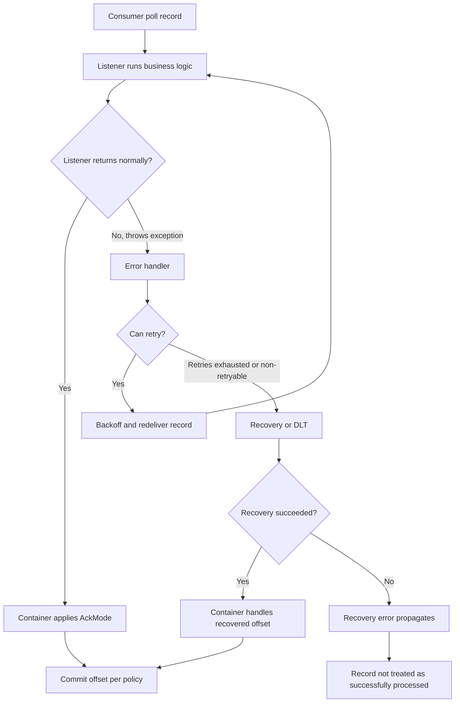
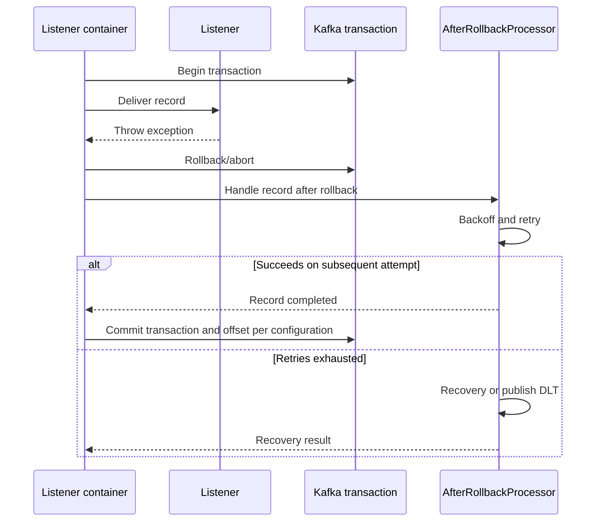

# Offset Commits When a Listener Throws an Exception

In Spring Kafka, when a listener throws an exception, whether the failed record's offset gets committed depends on how the listener container handles the error. The container may retry the record, route it to a dead-letter topic (DLT), skip it per recovery policy, or halt processing for intervention. Each choice affects where the consumer group resumes reading after a restart or rebalance.

It is important to distinguish that **listener failure**, **error handler handling the error**, and **offset commit** are three separate events. A listener throwing an exception does not automatically mean the offset will definitely be committed or definitely not be committed. The container and error handler decide based on `AckMode`, retry policy, recovery outcome, and transaction configuration.

For business-processing consumers, `enable.auto.commit` is normally turned off so the Spring Kafka listener container controls offsets. When a listener throws an exception, the container can keep the record incomplete, invoke the error handler for retry or recovery, and commit only according to configured policy. This lets operations explain clearly why a record was re-read, moved to a DLT, or marked processed.

## 1. What Happens When a Listener Throws an Exception?

A record listener is typically invoked along this flow:

1. The consumer polls records from partitions.
2. The listener container passes a record to the `@KafkaListener` method.
3. The listener executes business logic.
4. If the listener returns normally, the container handles acknowledgment and commits offsets per `AckMode`.
5. If the listener throws an exception, the container passes the error to the error handler.
6. The error handler decides on retry, recovery, DLT routing, or propagating the error further.
7. After the error handler completes, the container decides which offsets may be committed per configuration.



If the listener catches the exception itself and returns normally, the container usually treats that invocation as successful. The example below can advance offsets even when a database update fails:

```java
@KafkaListener(topics = "orders.events")
public void onOrderEvent(OrderEvent event) {
    try {
        orderService.process(event);
    }
    catch (RuntimeException exception) {
        log.error("Could not process order event", exception);
        // Listener returns normally; container does not know business processing failed.
    }
}
```

If you want the container to retry or send the record to a DLT, let the exception propagate out of the listener after logging necessary context:

```java
@KafkaListener(topics = "orders.events")
public void onOrderEvent(OrderEvent event) {
    orderService.process(event); // Exception propagates to listener container.
}
```

Do not catch and swallow exceptions merely to suppress error logs. If an error must map to a valid business state, handle it explicitly and return normally only when the record truly counts as processed by system definitions.

## 2. Offset Commits Depend on AckMode

A committed offset is the next position the consumer group will read in a partition. If record offset `50` is processed successfully, committing offset `51` means the group has confirmed progress past record `50`.

The Spring Kafka listener container supports different `AckMode` values. With `enable.auto.commit=false`, the container uses AckMode to manage commit timing:

| AckMode | When Listener Succeeds | When Listener Throws an Exception |
|---|---|---|
| `RECORD` | Commits after each record succeeds. | Failed record passes to error handler; record is not treated as successful until retry/recovery finishes. |
| `BATCH` | Commits after all records in one poll succeed. | Container/error handler manages offsets processed prior to the error and records needing retry/recovery; unfinished portion may replay. |
| `TIME` | Commits on a time interval after relevant records succeed. | Error handler and container decide which offsets are complete; does not commit simply because the listener threw an error. |
| `COUNT` | Commits when processed record count reaches threshold. | Similarly, the failed record must pass through the error handler before its offset is confirmed. |
| `COUNT_TIME` | Commits at count or time threshold. | Must inspect completed offsets and records undergoing retry/recovery. |
| `MANUAL` | Listener calls `Acknowledgment.acknowledge()` after processing. | If the listener throws before acknowledging, the record is not acknowledged along the normal manual path. |
| `MANUAL_IMMEDIATE` | Acknowledge on consumer thread requests immediate commit. | If unacknowledged, error handler decides retry/recovery; if already acknowledged before throwing, offset may already be committed. |

`BATCH` is the listener container's default AckMode. With a record listener, `RECORD` makes tying commits to individual records more straightforward. `BATCH` reduces commit frequency but may replay more records if a batch fails mid-way. With a batch listener, design a way to pinpoint the failing record inside the batch.

Since Spring Kafka 2.3, the framework defaults `enable.auto.commit=false` when the application does not explicitly configure it. When creating a custom `ConsumerFactory` or passing properties directly, verify the effective value. If `enable.auto.commit=true` is enabled, the Kafka client may commit periodically regardless of listener outcomes; AckMode can no longer precisely control commit timing.

### Record Listener Configuration Example

```yaml
spring:
  kafka:
    consumer:
      group-id: orders-service
      enable-auto-commit: false
      auto-offset-reset: earliest
    listener:
      ack-mode: record
```

With this configuration, the container commits after the record listener succeeds. If the listener throws an exception, the error handler decides retry or recovery. `auto-offset-reset` applies only when the group has no valid offset; it never rewinds an already-committed offset.

## 3. Error Handler Decides Retry and Recovery

Spring Kafka uses the listener container's error handler to process exceptions. For record listeners, `DefaultErrorHandler` is the common choice in Spring Kafka 2.8 and later. In older versions, applications may encounter `SeekToCurrentErrorHandler`. Pick the API matching your running version.

`DefaultErrorHandler` can:

- Classify retryable exceptions vs. exceptions that should not be retried.
- Perform retries with a `BackOff`.
- Seek or reposition the consumer so records are redelivered per policy.
- Invoke a recoverer once retries are exhausted or for non-retryable exceptions.
- Return control to the container after recovery succeeds so the container handles offsets.

### Bounded Retries

The example below configures three retries after the initial attempt, waiting one second between tries, and then routes the record to a DLT:

```java
@Bean
DefaultErrorHandler kafkaErrorHandler(
        KafkaTemplate<Object, Object> kafkaTemplate) {

    DeadLetterPublishingRecoverer recoverer =
            new DeadLetterPublishingRecoverer(
                    kafkaTemplate,
                    (record, exception) -> new TopicPartition(
                            record.topic() + ".DLT",
                            record.partition()));

    DefaultErrorHandler handler = new DefaultErrorHandler(
            recoverer,
            new FixedBackOff(1_000L, 3L));

    handler.addNotRetryableExceptions(
            IllegalArgumentException.class);

    return handler;
}
```

Key imports include `DefaultErrorHandler`, `DeadLetterPublishingRecoverer`, `FixedBackOff`, and `TopicPartition`. The DLT topic must exist and have partitions matching the resolver. When routing to the exact source partition, the DLT needs enough matching partitions. The producer used for DLT publishing must serialize payloads and preserve required headers.

`FixedBackOff(1_000L, 3L)` specifies a fixed one-second delay and three configured retries after the initial attempt. Total possible listener invocations equal the initial delivery plus the retry count, absent changes from the error handler or exception classification.

For transient failures like database timeouts, retries with backoff can help the service recover. For data errors like invalid payloads or incompatible schemas, retrying the exact same payload rarely fixes the root cause. Those errors should be marked non-retryable or routed to a DLT for investigation.

### Successful Recovery and Offset Commits

Once retries are exhausted, the recoverer can send the record to a DLT or perform another recovery action. If recovery finishes and the error handler returns normally, the container can treat the record as handled per recovery policy and commit the corresponding offset.

With `CommonErrorHandler`/`DefaultErrorHandler`, the default `ackAfterHandle` behavior lets the container commit the offset after the error handler completes and returns normally. This behavior can be configured when needed. Clearly distinguish among:

- The listener succeeded in business processing.
- The error handler retried and the listener succeeded on a later attempt.
- The recoverer persisted the record to a DLT or completed recovery successfully.

In the third case, the offset can commit because the record moved to the error-handling pipeline per policy. This does not mean original business processing succeeded; the system must monitor the DLT and replay workflows.

If the recoverer fails—for instance, DLT publishing fails—the recovery error must propagate so the container does not silently mark the record processed. Configure and test behavior when DLT sending fails for your Spring Kafka version, and alert when recovery exceptions occur.

`DefaultErrorHandler` also supports `commitRecovered` in matching configurations; when using this mechanism, the container requires `AckMode.MANUAL_IMMEDIATE`. Enable it only when you understand recovered-record commit timing and verify your version's API. Do not mix `commitRecovered`, `ackAfterHandle`, and manual acknowledgments without clearly defining which component owns commits.

### Marking Certain Exceptions Non-Retryable

Non-retryable exceptions can be registered with `addNotRetryableExceptions(...)`. These exceptions bypass repeated retries and go straight to recovery policy. Classify exceptions by root cause:

- Validation failures or malformed payloads are usually not retried.
- Transient network errors or database timeouts can be retried within bounds.
- Authentication, ACL, or configuration errors usually require fixing the root cause and alerting rather than tight retries.
- Business errors caused by unready upstream data may require bounded retries or a dedicated deferral flow.

## 4. What Happens to Records Before and After a Failing Record?

A single `poll()` can return multiple records, including from multiple partitions. When one record fails, the container must handle previously completed offsets and keep the failed record and unprocessed remainder in an appropriate state.

With a record listener and `AckMode.RECORD`, the container can commit earlier records that succeeded. The failing record goes to the error handler. Depending on how the handler seeks/retries and how the listener proceeds, subsequent records may be re-read or processed after the failing record recovers.

With `AckMode.BATCH`, the container normally commits per batch. When one record in the batch fails, prior completed offsets can be committed before the error handler handles the rest. After recovery, the container continues managing offsets via batch and error handler semantics. Therefore, never assume one exception always replays the entire poll from the start or always skips every record after the failure; behavior depends on listener type, error handler, and version.

### Batch Listeners

With a batch listener, the method receives a list of records. If the listener throws a standard exception, the error handler may not know which exact record in the batch caused the failure, so the entire batch may be redelivered.

To pinpoint the failing record, the listener can throw `BatchListenerFailedException` with the corresponding record or index. The error handler can commit the prefix before the failing record that succeeded, retry/recover the failing record, and handle the remaining portion per policy.

Illustrative example:

```java
@KafkaListener(topics = "orders.events")
public void onBatch(List<ConsumerRecord<String, OrderEvent>> records) {
    for (int index = 0; index < records.size(); index++) {
        ConsumerRecord<String, OrderEvent> record = records.get(index);
        try {
            orderService.processIdempotently(record.value());
        }
        catch (RuntimeException exception) {
            throw new BatchListenerFailedException(
                    "Could not process order event", exception, index);
        }
    }
}
```

Constructor APIs and record-identification details can differ across Spring Kafka versions. Use the overload matching your project version and ensure the batch listener is properly typed. When processing records in parallel inside a batch, explicitly track indices and completion order; never mark a batch complete while any record remains uncompleted.

## 5. Manual Acknowledgment and Exceptions

When using `AckMode.MANUAL` or `MANUAL_IMMEDIATE`, the listener receives `Acknowledgment` and explicitly calls `acknowledge()`. The golden rule is to acknowledge only after business side effects have finished as defined by the system.

```java
@KafkaListener(topics = "orders.events")
public void onOrderEvent(
        OrderEvent event,
        Acknowledgment acknowledgment) {

    orderService.processIdempotently(event);
    acknowledgment.acknowledge();
}
```

If `processIdempotently()` throws an exception, `acknowledgment.acknowledge()` does not execute. The error handler receives the exception and decides on retry or recovery. This prevents committing a record whose business work never completed.

Never put `acknowledgment.acknowledge()` inside `finally`:

```java
try {
    orderService.process(event);
}
finally {
    acknowledgment.acknowledge(); // Dangerous: still runs when process() fails.
}
```

With `MANUAL`, acknowledgments are accumulated by the container and committed per manual/batch semantics. With `MANUAL_IMMEDIATE`, an acknowledgment on the consumer thread requests an immediate commit. If called from another thread, behavior runs through container mechanics and may no longer commit instantaneously. Do not use asynchronous acknowledgments without designing partition pausing, completion order, and shutdown handling.

If a listener acknowledges first and throws an exception afterward, the offset may already be committed depending on mode and call timing. Therefore, never acknowledge before all required guarantees finish.

## 6. Listener Throwing an Exception in a Kafka Transaction

With a transactional listener container, the listener executes inside a Kafka transaction. If the listener throws an exception, the transaction may roll back/abort. Offsets are not committed as a successful transaction; records are handled by `AfterRollbackProcessor`.

`DefaultAfterRollbackProcessor` is the Spring Kafka component used to handle records after rollback. It can seek to redeliver the record, apply retry/backoff, and perform recovery once attempts are exhausted. With a DLT, recovery can be configured to publish the failing record. With advanced transactional setups, the recovered record and offset can be committed inside a new transaction.

High-level flow:



Do not apply `DefaultErrorHandler` behavior verbatim to transactional listeners. For transactions, examine `AfterRollbackProcessor`, transaction manager, timeouts, retries, and recovery transactions. If a listener calls an external database service and then throws an exception, a Kafka rollback cannot undo side effects outside Kafka; business logic still needs idempotency or a coordination pattern such as outbox/inbox.

## 7. DLTs and the Meaning of Committing After Recovery

A DLT holds records that could not be processed on the main flow so operations teams can investigate. Once the recoverer publishes the record to the DLT successfully and the error handler considers recovery complete, the source offset can commit so the consumer moves on to the next record.

This establishes an operational boundary: the record has exited the primary retry flow and entered the error stream. Operations teams need procedures to monitor, fix root causes, and replay.

Information to preserve when routing to a DLT includes:

- Source topic, partition, and offset.
- Original key, timestamp, and headers.
- `eventId` or correlation ID.
- Exception class, error message, and retry count.
- Recovery timestamp and DLT publish status.

If DLT publishing fails, do not commit the source offset as though recovery succeeded. Verify the recoverer detects send-result failures and throws an exception when DLT publishing fails. With `DeadLetterPublishingRecoverer`, send-result checking can be configured using your Spring Kafka version's API.

DLT replays must reuse the same `eventId` so consumers prevent duplicates. Before bulk replaying, fix the root cause, test with a handful of records, rate-limit replays, and monitor business outcomes.

## 8. Retry Topics and Non-Blocking Retries

Spring Kafka supports retry topics via `@RetryableTopic` in compatible versions. When a listener throws an exception, the framework can publish the record to a retry topic with a delay and later forward it to the next topic or DLT.

In this model, the source topic offset can commit once the record has been successfully handed off to the retry topic. Committing the source means the record was transferred to the retry flow, not that original business processing succeeded.

Non-blocking retries prevent a failing record from blocking an entire partition during long backoffs. However, newer records with the same key may be processed before the retrying record. If business logic demands strict ordering, weigh that trade-off and choose blocking retries or an ordering-preserving design.

Do not stack blocking retries, retry topics, and application-level retries without calculating total attempt counts and deadlines. If each layer retries independently, a single fault can generate far more attempts than expected.

## 9. Idempotency and the Gap Between Business Logic and Offsets

Even with auto-commit disabled, a common failure window remains:

1. The listener updates the database successfully.
2. The process stops before the offset commits.
3. The consumer group restarts and receives the record again.
4. The listener executes business logic a second time.

This is at-least-once behavior. To prevent duplicate side effects, use a stable `eventId` and record a processed marker inside the same database transaction as the business update.

For example, an inbox table with a unique constraint on `event_id`. The service executes the insert and business update within one transaction. If the insert signals the event already exists, the service exits without repeating effects. Use atomic inserts or suitable upserts; never do an unprotected check-then-insert across two queries, because two consumers can process the same event concurrently.

If the listener calls an external API, use an idempotency key supported by the target API or write the request to an outbox within the database transaction. An offset commit cannot roll back an already-succeeded API call.

## 10. Reference Configurations

### Record Listener with Retries and DLT

```yaml
spring:
  kafka:
    consumer:
      group-id: orders-service
      enable-auto-commit: false
    listener:
      ack-mode: record
```

```java
@Bean
DefaultErrorHandler errorHandler(
        KafkaTemplate<Object, Object> kafkaTemplate) {
    DeadLetterPublishingRecoverer recoverer =
            new DeadLetterPublishingRecoverer(kafkaTemplate);

    DefaultErrorHandler handler = new DefaultErrorHandler(
            recoverer,
            new ExponentialBackOffWithMaxRetries(3));

    handler.addNotRetryableExceptions(
            IllegalArgumentException.class);
    return handler;
}
```

This example uses exponential backoff with up to three retries. Tune multiplier, initial interval, and maximum interval to match SLAs if fine control is needed. The DLT topic must exist and serializers must be compatible. The error handler can be registered directly on the listener container factory or through application configuration hooks.

### Manual Acknowledgment

```yaml
spring:
  kafka:
    consumer:
      enable-auto-commit: false
    listener:
      ack-mode: manual
```

The listener calls `acknowledge()` only after the service finishes. If an exception happens earlier, the error handler processes the record. Verify recovered-record commit policies when combining with manual mode.

### Transactional Listener

With a transactional listener container, configure `transaction-id-prefix` and an appropriate Kafka transaction manager. A listener exception rolls back the transaction; configure `DefaultAfterRollbackProcessor` to govern retries and recovery. Do not enable auto-commit to substitute for transactional offset management.

## 11. Runbook When Listeners Throw Exceptions and Offsets Misbehave

### Record Skipped Despite Listener Error

1. Check whether the listener catches and swallows exceptions.
2. Check whether `enable.auto.commit` is enabled.
3. Identify the listener container's actual `AckMode` and error handler.
4. Check whether the error handler treats the exception as non-retryable or whether recovery completed.
5. Verify whether the recoverer published to the DLT and the container committed the offset after recovery.
6. Cross-check committed offsets against the source topic, partition, and record.

### Record Redelivered Repeatedly

1. Capture topic, partition, offset, `eventId`, and exception class.
2. Check retry count, backoff, and whether the error handler seeks/re-polls the record.
3. Check whether recovery fails when publishing to the DLT.
4. Determine whether rebalances or restarts are causing uncommitted records to be redelivered.
5. Check consumer idempotency so redeliveries do not repeat business effects.

### Offset Committed Despite Database Transaction Failure

1. Check whether the service throws exceptions out of the listener.
2. Check whether the listener catches exceptions without rethrowing.
3. Confirm the database transaction truly rolled back and exceptions were not converted into success results.
4. Disable auto-commit and pick an appropriate AckMode.
5. Verify the error handler is not recovering or skipping records under the wrong policy.

### Record Appears in DLT Yet Source Offset Has Not Advanced

1. Check DLT publish results and destination record metadata.
2. Check whether the recoverer threw an exception after DLT send failure or header/serializer errors.
3. Check `ackAfterHandle`, `commitRecovered`, and AckMode.
4. Check transactions/`AfterRollbackProcessor` if the listener runs transactionally.
5. Verify DLT records can replay without creating duplicates before letting the consumer proceed.

### Batch Listener Replays Too Many Records

1. Check whether the listener receives batches or individual records.
2. Verify whether exceptions report the failing index/record via `BatchListenerFailedException`.
3. Inspect the error handler and how the container handles the succeeded portion of the batch.
4. Where needed, identify the failing record explicitly and ensure preceding records can commit safely.
5. Use idempotency to tolerate records redelivered during retries.

## 12. Exception Offset-Commit Control Table

| Checkpoint | Question to Answer | Operational Evidence |
|---|---|---|
| Exception propagation | Does the listener propagate errors to the container when business work fails? | Stack traces, listener logs, and exception classes. |
| Auto-commit | Is the Kafka client auto-committing independently? | Effective `enable.auto.commit` in consumer properties. |
| AckMode | Does the container commit per record, batch, or manually? | `ContainerProperties.AckMode` and listener type. |
| Retries | How many times and with what backoff is a record retried? | Retry counts, backoff, and error handler logs. |
| Recovery | Was the record published to DLT or recovered successfully? | DLT metadata, recoverer send results, and recovery exceptions. |
| Commit | Which offset committed after errors or recovery? | Committed offsets per group/topic/partition and commit logs. |
| Transactions | Did the exception roll back the Kafka transaction? | Transaction manager, abort/commit outcomes, and `AfterRollbackProcessor`. |
| Duplicates | If the record is redelivered, is business logic idempotent? | Event IDs, inbox/unique constraints, or idempotency keys. |

When a listener throws an exception, offsets should advance only under an explicit policy: successful processing after retries, recovery persisting the record to a DLT, or an intentional, audited skip decision. Disabling auto-commit, letting the container/error handler manage offsets, verifying recovery outcomes, and designing idempotency make error handling predictable. Operations teams must correlate exceptions, retries, DLTs, and committed offsets to explain accurately why a record was re-read or why the consumer moved on to the next record.
