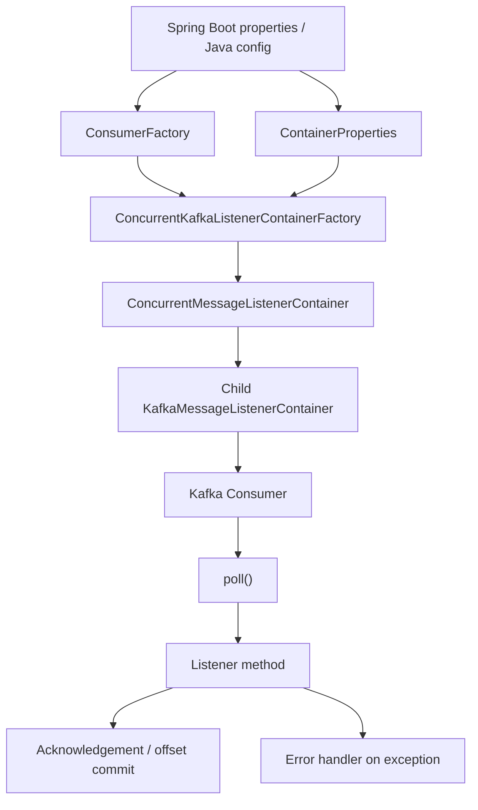

# ContainerProperties in Spring Kafka

`ContainerProperties` is the class that configures the operational behavior of a listener container in Spring Kafka. It determines which topics or partitions the container subscribes to, how offsets are committed, how long to wait in `poll()`, how inactive consumers are detected, how container shutdown is handled, and how advanced mechanisms such as asynchronous acknowledgments or transactions are coordinated.

This class sits at the listener container layer, above the Kafka Java Consumer. It does not replace `ConsumerFactory` and does not hold all Kafka client configurations. To configure `bootstrap.servers`, deserializers, `max.poll.interval.ms`, `max.poll.records`, security, or other consumer properties, the application still configures `ConsumerFactory` or Spring Boot's `spring.kafka.consumer.*`.

In Spring Boot applications, `spring.kafka.listener.*` properties are commonly used to configure the listener container. When finer control is needed, `ContainerProperties` can be configured through `ConcurrentKafkaListenerContainerFactory` or by creating the container directly.

## 1. Position of ContainerProperties in the architecture

A listener container connects the business listener with the Kafka consumer. The container is responsible for calling `poll()`, passing records to the listener, managing acknowledgments, committing offsets, handling consumer lifecycle, and publishing related events.

Components typically coordinate as follows:

| Component | Primary responsibility |
|---|---|
| `ConsumerFactory` | Creates Kafka `Consumer` instances with client properties, deserializers, and connection settings |
| `ContainerProperties` | Configures subscription/assignment and listener container behavior |
| `KafkaMessageListenerContainer` | Manages a single Kafka consumer and processing loop |
| `ConcurrentMessageListenerContainer` | Manages multiple child listener containers according to concurrency configuration |
| `ConcurrentKafkaListenerContainerFactory` | Creates and configures containers, typically used by `@KafkaListener` |
| `@KafkaListener` | Declares a message-receiving method and listener-level subscription metadata |
| `CommonErrorHandler` | Handles exceptions thrown during listener invocation |

Overview diagram:



You can think of `ContainerProperties` as the rulebook for how the container operates. It is not the place for listener business logic, nor is it a duplicate of all Kafka consumer properties.

## 2. Initializing ContainerProperties and choosing the message source

`ContainerProperties` provides primary constructors for three subscription/assignment styles.

### 2.1. Subscribe by topic list

Use a topic list when the consumer group needs to receive partitions allocated by the Kafka group coordinator:

```java
ContainerProperties properties =
        new ContainerProperties("orders.created", "orders.cancelled");
```

The consumer subscribes to the topics and participates in group management. Kafka allocates partitions to consumers in the group at startup or rebalance.

This is the common choice in service applications using `@KafkaListener` or standard listener containers.

### 2.2. Subscribe by pattern

You can subscribe to topics matching a regular expression:

```java
ContainerProperties properties =
        new ContainerProperties(Pattern.compile("orders\\..*"));
```

Patterns are useful when the number of topics may change and topic names follow a convention. Pattern scope must be controlled so the consumer does not accidentally subscribe to unintended topics. Discovering new topics also depends on metadata refresh and Kafka client configuration.

### 2.3. Explicit partition assignment

When exact partitions must be specified, use `TopicPartitionOffset`:

```java
ContainerProperties properties = new ContainerProperties(
        new TopicPartitionOffset("orders.created", 0),
        new TopicPartitionOffset("orders.created", 1)
);
```

This approach uses explicit assignment. The application is responsible for determining which partitions belong to the consumer/container; it does not use the automatic partition allocation of group subscription as when calling `subscribe()`.

Explicit assignment is useful for dedicated processes, replay tools, or workloads requiring partition control. However, ownership and handling must be designed if multiple processes are configured for the same partition. Never let multiple independent consumers process the same partition without a clear coordination mechanism.

You can specify an offset or starting position through `TopicPartitionOffset` constructors/options, depending on the Spring Kafka version. When using explicit offsets, understand offset semantics, reset policies, and behavior when offsets no longer exist due to retention.

## 3. Configuring ContainerProperties via listener container factory

In Spring applications, a common approach is configuring a factory and obtaining `ContainerProperties` from that factory:

```java
@Configuration
public class KafkaListenerConfiguration {

    @Bean
    public ConcurrentKafkaListenerContainerFactory<String, OrderEvent>
            kafkaListenerContainerFactory(
                    ConsumerFactory<String, OrderEvent> consumerFactory,
                    CommonErrorHandler commonErrorHandler) {

        var factory =
                new ConcurrentKafkaListenerContainerFactory<String, OrderEvent>();

        factory.setConsumerFactory(consumerFactory);
        factory.setConcurrency(3);
        factory.setCommonErrorHandler(commonErrorHandler);

        ContainerProperties containerProperties =
                factory.getContainerProperties();

        containerProperties.setAckMode(ContainerProperties.AckMode.RECORD);
        containerProperties.setPollTimeout(1_000);
        containerProperties.setSyncCommitTimeout(Duration.ofSeconds(5));
        containerProperties.setMissingTopicsFatal(false);
        containerProperties.setIdleEventInterval(60_000L);
        containerProperties.setLogContainerConfig(true);

        return factory;
    }
}
```

The example requires corresponding imports such as `ContainerProperties`, `ConcurrentKafkaListenerContainerFactory`, `ConsumerFactory`, `CommonErrorHandler`, and `Duration`. A `CommonErrorHandler` bean must be provided in the application configuration.

Key points to note:

- `factory.setConcurrency(3)` configures the number of child consumers managed by the concurrent container. This is a factory/container property, not a property inside `ContainerProperties`.
- `factory.getContainerProperties()` returns the container configuration object the factory uses when creating listener containers.
- Configuration must be set before the container starts for consistent initial behavior.
- Listeners must use this exact factory. If multiple factories exist, check the `containerFactory` attribute on `@KafkaListener`.

Listener example:

```java
@Component
public class OrderEventListener {

    @KafkaListener(
        topics = "orders.created",
        groupId = "billing-service",
        containerFactory = "kafkaListenerContainerFactory"
    )
    public void onOrderCreated(OrderEvent event) {
        // Business processing
    }
}
```

If the listener uses a different factory, the settings in the example above do not automatically apply to that listener.

## 4. Important property groups

`ContainerProperties` attributes can be grouped by operational purpose. APIs and defaults may vary by Spring Kafka version; check the Javadoc of the version managed by Spring Boot.

### 4.1. Acknowledgement and offset commit

This group determines when and how the container acknowledges processing progress.

| Property | Meaning |
|---|---|
| `ackMode` | Selects `RECORD`, `BATCH`, `TIME`, `COUNT`, `COUNT_TIME`, `MANUAL`, or `MANUAL_IMMEDIATE` |
| `ackCount` | Record count threshold used with count-based AckModes |
| `ackTime` | Time threshold used with time-based AckModes |
| `syncCommits` | Chooses synchronous or asynchronous commits |
| `syncCommitTimeout` | Timeout applied to synchronous commits |
| `commitCallback` | Callback receiving results of asynchronous commits |
| `commitLogLevel` | Log level used for commit messages |
| `asyncAcks` | Allows manual acknowledgments of records within a poll to complete out of order, subject to the limits of this mechanism |

Example:

```java
ContainerProperties properties = factory.getContainerProperties();

properties.setAckMode(ContainerProperties.AckMode.RECORD);
properties.setSyncCommits(true);
properties.setSyncCommitTimeout(Duration.ofSeconds(5));
properties.setCommitLogLevel(LogIfLevelEnabled.Level.DEBUG);
```

With `RECORD`, the container commits after each record listener completes successfully. With `BATCH`, progress is usually committed after finishing the records returned in a single poll. `ackCount` and `ackTime` are mainly meaningful with their respective AckModes; do not set them expecting to alter `RECORD` behavior.

If using asynchronous commits, configure and observe the callback to detect commit failures. Asynchronous commits can reduce consumer thread wait time, but the application needs to understand callback ordering and redelivery possibilities on error.

`asyncAcks` is an advanced option for manual acknowledgment. It allows acknowledging records within a poll in a completion order different from the receive order, but the container must track missing offsets and may pause the consumer until sufficient acknowledgments arrive. This affects throughput and redelivery if the application crashes. Enable it only when the listener genuinely needs asynchronous processing and commit, pause/resume, and recovery behavior have been tested. Do not confuse `asyncAcks` with the container automatically turning a synchronous listener into an asynchronous one.

### 4.2. Polling and execution cadence

| Property | Meaning |
|---|---|
| `pollTimeout` | Maximum time the container waits in a single `poll()` call |
| `idleBetweenPolls` | Additional pause interval between polls |
| `noPollThreshold` | Multiplier used to determine if a consumer may not have polled for an abnormal duration |
| `monitorInterval` | Check interval for the container's poll/consumer status monitor |
| `consumerStartTimeout` | Time the container waits for the consumer thread to start |
| `pauseImmediate` | Controls when pause takes effect relative to remaining records in the current poll |

`pollTimeout` is not the maximum time allowed for a listener to process a record. It is the wait duration of the poll operation when the broker has not returned data yet. Record processing time is also affected by listener logic and Kafka consumer settings such as `max.poll.interval.ms`.

Example:

```java
ContainerProperties properties = factory.getContainerProperties();

properties.setPollTimeout(1_000);
properties.setIdleBetweenPolls(250);
properties.setMonitorInterval(10);
properties.setNoPollThreshold(3.0f);
```

If record processing takes a long time, review `max.poll.interval.ms`, `max.poll.records`, concurrency, and offloading/splitting work. Increasing `pollTimeout` alone does not solve overly slow listener processing.

`monitorInterval` and `noPollThreshold` help detect consumers that may not be polling at the expected cadence. They serve monitoring and alerting; they do not replace Kafka's heartbeat, session timeout, or group member liveness mechanisms.

### 4.3. Idle events and container observability

The container can emit events when no records are received for a period of time. Common properties include:

- `idleEventInterval`: interval for emitting a container-level idle event when there are no records.
- `idlePartitionEventInterval`: interval for emitting an event for a partition with no new data.
- `logContainerConfig`: requests logging container configuration at startup.

Example:

```java
ContainerProperties properties = factory.getContainerProperties();

properties.setIdleEventInterval(60_000L);
properties.setIdlePartitionEventInterval(120_000L);
properties.setLogContainerConfig(true);
```

Applications can listen for idle events to track low-traffic topics, detect stalled producers, or update dashboards. Idle is not necessarily an error: the topic may simply have no messages during that period.

An idle event is not proof that the consumer group is lagging or that the container is dead. Combine it with consumer lag, container state, logs, and metrics.

### 4.4. Topics and authentication errors

Some settings control behavior when the container starts up or encounters connection/access errors:

| Property | Meaning |
|---|---|
| `missingTopicsFatal` | Determines whether the container fails startup when configured topics do not yet exist |
| `authExceptionRetryInterval` | Wait interval before retrying when encountering supported authentication/authorization errors |

Example:

```java
ContainerProperties properties = factory.getContainerProperties();

properties.setMissingTopicsFatal(false);
properties.setAuthExceptionRetryInterval(Duration.ofSeconds(10));
```

If `missingTopicsFatal(false)` is set, the container can keep waiting for the topic to appear instead of failing immediately at startup. This is useful in environments where topics are created by another deployment process. On the downside, if the topic name is wrong, the listener may remain running without receiving messages for a long time. Set up alerts for nonexistent topics and verify access permissions.

`authExceptionRetryInterval` does not replace security configuration. The application still needs proper SASL, SSL, credentials, and ACLs configured in the Kafka client. If permissions cannot recover, continuous retries only delay incident detection.

### 4.5. Shutdown and lifecycle

Shutdown-related properties determine whether the application has time to complete in-flight work.

| Property | Meaning |
|---|---|
| `shutdownTimeout` | Wait time when the container stops in an orderly manner |
| `stopImmediate` | Controls whether stopping occurs after the current record or after remaining records of the poll |
| `consumerStartTimeout` | Wait limit for the consumer thread to start |

Example:

```java
ContainerProperties properties = factory.getContainerProperties();

properties.setShutdownTimeout(15_000L);
properties.setStopImmediate(true);
```

Shutdown must be designed alongside business processing time, dependency timeouts, and application stop time. If the listener calls an external service without a timeout, the container may fail to stop on time even with `shutdownTimeout` set.

`stopImmediate` changes the boundary of work the container tries to finish when stopping. Test with an in-flight record and other records in the current poll to understand the exact number of records processed before stopping in your version.

### 4.6. Rebalance and transactions

Container properties also have integration points for advanced use cases:

- `consumerRebalanceListener`: allows the application to receive callbacks when partitions are revoked or assigned during group subscription. Used to save/restore per-partition state or coordinate resources tied to assignment.
- `transactionManager` or `KafkaAwareTransactionManager` depending on API/version: integrates transactions with the listener container.
- `transactionDefinition`: supplies transaction attributes for transactions initiated by the container.
- `subBatchPerPartition`: for batch listeners in certain transactional configurations, allows splitting batches by partition.

These properties affect processing semantics and must be verified together with listener type, transaction manager, and Spring Kafka version. Do not add a transaction manager just to "enable exactly-once" without clearly defining transaction scope.

Kafka transactions can coordinate consuming and producing within Kafka. They do not automatically create atomic transactions with external databases or HTTP services. If the listener updates a database, design appropriate outbox/inbox or idempotency patterns.

## 5. Configuring with Spring Boot

Spring Boot maps many listener properties into container configuration. Example:

```yaml
spring:
  kafka:
    bootstrap-servers: localhost:9092
    consumer:
      group-id: billing-service
      enable-auto-commit: false
      max-poll-records: 100
      properties:
        max.poll.interval.ms: 300000
    listener:
      ack-mode: record
      concurrency: 3
      poll-timeout: 1s
      missing-topics-fatal: false
      idle-event-interval: 60s
      monitor-interval: 10s
      no-poll-threshold: 3
      shutdown-timeout: 15s
      log-container-config: true
```

In this example:

- `spring.kafka.consumer.*` holds Kafka consumer configuration such as group ID, auto-commit, and client properties.
- `spring.kafka.listener.*` holds listener container configuration such as `AckMode`, concurrency, poll timeout, and shutdown.
- `max.poll.interval.ms` is a Kafka client property, even though it directly impacts listener operability.
- `concurrency` is the number of child consumers managed by the concurrent listener container.

Property names and data types bound by Spring Boot may vary across versions. In particular, newer options like `async-acks`, `idle-between-polls`, or observability properties should be checked against the configuration metadata of the Spring Boot version in use.

If you need configuration not exposed via Spring Boot properties, declare a factory bean and modify `ContainerProperties` directly. Avoid configuring the same property in multiple places without clarity on which value wins.

## 6. Distinguishing ContainerProperties from ConsumerConfig

This is a common point of confusion when configuring Kafka.

| Requirement | Typical configuration location |
|---|---|
| Broker bootstrap servers | `ConsumerConfig.BOOTSTRAP_SERVERS_CONFIG` / `spring.kafka.bootstrap-servers` |
| Consumer group ID | Consumer properties or group ID on listener |
| Key/value deserializers | `ConsumerFactory` / `spring.kafka.consumer.*` |
| `max.poll.records` | Kafka consumer properties |
| `max.poll.interval.ms` | Kafka consumer properties |
| `session.timeout.ms` and heartbeat | Kafka consumer properties |
| Security protocol, SASL, SSL | Kafka client properties |
| AckMode | `ContainerProperties` / `spring.kafka.listener.ack-mode` |
| Container poll timeout | `ContainerProperties` / `spring.kafka.listener.poll-timeout` |
| Idle event interval | `ContainerProperties` / corresponding listener properties |
| Container shutdown timeout | `ContainerProperties` / corresponding listener properties |
| Synchronous commit timeout | `ContainerProperties` |

Kafka consumer properties are passed to the Kafka client when `ConsumerFactory` creates a consumer. Container properties control how Spring manages that consumer. The two configuration layers are closely related but not interchangeable.

For example, setting `pollTimeout` to 2 seconds does not mean `max.poll.interval.ms` is 2 seconds. One property controls how long a single poll waits for data; the other limits the interval between polls before the consumer is considered inactive in the group.

## 7. Combining ContainerProperties with concurrency

`ConcurrentKafkaListenerContainerFactory` can create a `ConcurrentMessageListenerContainer` consisting of multiple child containers. Each child manages a separate Kafka consumer.

Example:

```java
factory.setConcurrency(4);
factory.getContainerProperties().setAckMode(
        ContainerProperties.AckMode.RECORD
);
```

For a topic with four partitions and concurrency 4, each consumer can be assigned one partition if group assignment permits. If the topic has only two partitions, at most two consumers in the group can receive partitions for that topic at the same time; the other two consumers do not increase throughput for this topic.

Concurrency should be chosen based on:

- Partition counts of consumed topics.
- Average processing time and variability of the listener.
- Capacity of the database and dependent services.
- CPU, memory, and connection resources.
- Business ordering required within each partition.

Do not increase concurrency just to "max out CPU". If downstream dependencies are already saturated, adding consumers can increase contention and retries without improving throughput.

## 8. Configuration examples for two use cases

### 8.1. Listener processing record-by-record and committing after each record

This is a common pattern for services processing independent events:

```java
@Bean
ConcurrentKafkaListenerContainerFactory<String, OrderEvent>
        orderListenerFactory(
                ConsumerFactory<String, OrderEvent> consumerFactory) {

    var factory =
            new ConcurrentKafkaListenerContainerFactory<String, OrderEvent>();

    factory.setConsumerFactory(consumerFactory);
    factory.setConcurrency(3);

    ContainerProperties cp = factory.getContainerProperties();
    cp.setAckMode(ContainerProperties.AckMode.RECORD);
    cp.setPollTimeout(1_000);
    cp.setSyncCommits(true);
    cp.setMissingTopicsFatal(false);

    return factory;
}
```

This configuration makes sense when each listener call completes business logic for one record. If business logic writes to a database, the handler must still be idempotent because a database commit can succeed while the Kafka offset is not yet committed.

### 8.2. Listener needing idle state monitoring

A service may need to detect when a topic stops receiving data to update a dashboard:

```java
@Bean
ConcurrentKafkaListenerContainerFactory<String, TelemetryEvent>
        telemetryListenerFactory(
                ConsumerFactory<String, TelemetryEvent> consumerFactory) {

    var factory =
            new ConcurrentKafkaListenerContainerFactory<String, TelemetryEvent>();

    factory.setConsumerFactory(consumerFactory);

    ContainerProperties cp = factory.getContainerProperties();
    cp.setPollTimeout(1_000);
    cp.setIdleEventInterval(30_000L);
    cp.setIdlePartitionEventInterval(60_000L);
    cp.setMonitorInterval(10);
    cp.setNoPollThreshold(3.0f);

    return factory;
}
```

The application can listen to container idle events to record state. Distinguish "no new records" from "consumer unable to poll". Combine idle events with logs, consumer lag, and metrics to avoid false alerts.

## 9. Common configuration mistakes

**Putting consumer properties in ContainerProperties.** Properties such as deserializers, `max.poll.records`, and `max.poll.interval.ms` belong to Kafka consumer configuration. Put them in `ConsumerFactory` or `spring.kafka.consumer.*`.

**Configuring a factory while the listener uses another factory.** Container properties only apply to containers created from that factory. Check `containerFactory` on `@KafkaListener` and actual bean names.

**Confusing pollTimeout with max.poll.interval.ms.** Poll timeout is the data wait time of one poll; max poll interval limits the gap between polls. Long-running listeners must be evaluated against max poll interval.

**Setting ackCount or ackTime while using RECORD.** Those two thresholds serve count/time-based AckModes. They do not turn `RECORD` into batch or time-based commits.

**Enabling asyncAcks without managing async tasks.** The container must wait for missing acknowledgments and may pause the consumer. If tasks fail or never complete, progress can stall.

**Using idle events as the sole health check.** Low-traffic topics can be idle normally. Monitor container state, consumer lag, poll errors, and metrics as well.

**Setting missingTopicsFatal=false without topic monitoring.** The container may wait for an uncreated topic. If the topic name is misspelled, the application stays up without receiving expected data.

**Stopping the container too quickly.** A shutdown timeout shorter than business processing time can interrupt work. Design listener, dependency, and shutdown timeouts together.

**Increasing concurrency beyond partition count.** Extra consumers create no additional parallel processing for the topic. Check partition assignments and downstream capacity.

**Using transactions without defining scope.** Kafka transactions do not automatically cover external databases and services. Clearly define what is inside the transaction and what needs idempotency/outbox.

## 10. How to test ContainerProperties configuration

Tests should verify that the container actually behaves according to the desired configuration, rather than merely checking that beans were created.

An integration test flow may include:

1. Start a Kafka broker for testing.
2. Create topics and partitions per the scenario.
3. Initialize the listener container factory with the `ContainerProperties` under test.
4. Start the listener and wait for the container to receive assignment.
5. Send records and verify listener processing.
6. Check committed offsets when testing `AckMode`.
7. Send failing records to verify error handler, retry, and DLT.
8. Stop the container while the listener is processing to test shutdown and redelivery.
9. Verify idle events or pattern subscription behavior if those are configuration targets.

Aspects to test:

| Configuration group | Evidence to verify |
|---|---|
| Topic subscription | Container receives expected topics/partitions |
| Explicit assignment | Consumer processes only assigned partitions |
| AckMode | Committed offset matches processing boundary |
| Polling | Consumer continues polling as configured without unexpected rebalances |
| Error handler | Retry/recovery/DLT executes per policy |
| Idle events | Events emitted when configured idle interval is reached |
| Missing topics | Startup behavior matches fatal/non-fatal choice |
| Concurrency | Consumer count and partition assignment match expectations |
| Shutdown | Container stops within time limit without unexpected data loss |

For time-dependent configurations, use await conditions with timeouts in tests instead of long fixed sleeps. Ensure tests isolate group IDs and topics so committed offsets from previous runs do not skew results.

## 11. Pre-production configuration checklist

Before promoting a listener container to production, confirm the following:

- Choose the right constructor/subscription mode: topic list, pattern, or explicit partition assignment.
- Confirm the listener uses the intended container factory.
- Configure `ConsumerFactory` separately for brokers, deserializers, security, and consumer properties.
- Choose `AckMode` based on delivery semantics and business processing style.
- Set `enable.auto.commit=false` when the container manages commits.
- Set `pollTimeout`, `max.poll.interval.ms`, and `max.poll.records` based on processing time.
- Choose concurrency based on partition count and dependency capacity.
- Configure error handler, retry, backoff, and DLT.
- Decide how to handle missing topics and authentication.
- Monitor idle state, consumer lag, commit failures, rebalances, and listener latency.
- Set shutdown timeout long enough for listener and dependencies to stop cleanly.
- Test restart, rebalance, retry, duplicates, and shutdown on a test/staging broker.

## 12. Conclusion on the role of ContainerProperties

`ContainerProperties` is the focal configuration point for listener container behavior: topic/partition source, acknowledgments, commits, polling, idle events, consumer monitoring, shutdown, and certain transaction/rebalance integrations. It works together with `ConsumerFactory`, the listener container factory, and error handlers to form an operable consumption pipeline.

When configuring, clearly distinguish Kafka client properties from Spring container properties. Then verify the listener uses the right factory and test actual behavior for offsets, retries, rebalances, and shutdown. This keeps operational decisions explicit in configuration and easier to control as versions or load evolve.

## 13. Version-specific references

Consult documentation for the exact running version when using `ContainerProperties`, as APIs and defaults can change across Spring Kafka releases:

- Spring for Apache Kafka Reference: Listener Containers, Container Properties, Acknowledgment, and Error Handling.
- Spring Kafka Javadoc: `org.springframework.kafka.listener.ContainerProperties`, `KafkaMessageListenerContainer`, `ConcurrentMessageListenerContainer`, and `TopicPartitionOffset`.
- Spring Boot Reference: Kafka properties, especially `spring.kafka.consumer.*` and `spring.kafka.listener.*`.
- Apache Kafka documentation: Consumer configuration, group management, offset commit, and transactions.

Prefer the Spring Kafka version managed by Spring Boot dependency management. If upgrading Spring Kafka or overriding the Kafka client manually, verify compatibility and re-test version-dependent container behaviors.
