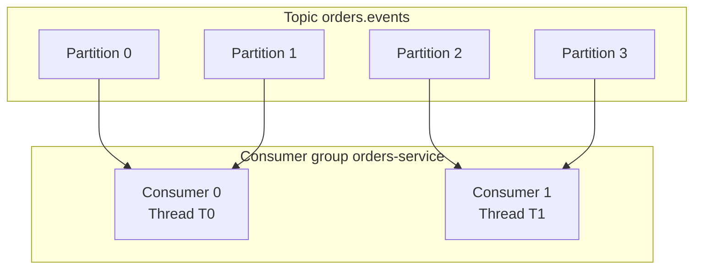
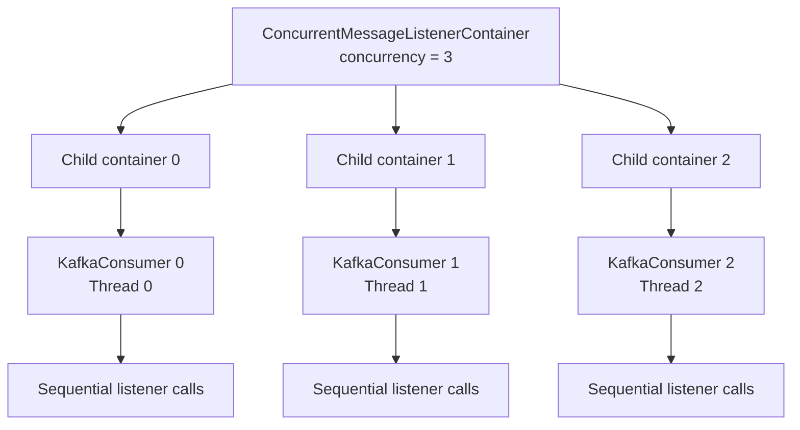

# Single Consumer Thread Processing Partitions

In Kafka, a partition is the unit of load distribution and message ordering preservation. Within a consumer group, at any given time, a partition is assigned to at most one consumer member. That consumer reads the partition's records and processes them on its own consumer thread.

One consumer thread can be assigned multiple partitions. With Spring Kafka's default synchronous listener, that thread invokes the listener sequentially for the records polled by the consumer. Therefore, one thread can alternate between processing records from multiple partitions, yet listener invocations on that thread still execute sequentially. Kafka does not create a separate thread for each partition.

This model directly affects processing order, throughput, and how consumers scale. If one partition has many records or a slow-to-process record, other partitions assigned to the same consumer thread must also wait for the thread to finish its current work. To increase parallel processing capacity, you must balance partition count, consumer thread count, Spring Kafka concurrency, and downstream system capacity.

## 1. Relationship Between Topics, Partitions, Consumers, and Threads

A topic can consist of one or more partitions. Each partition is an ordered log with monotonically increasing offsets. Producers select a partition by key, partitioner, or explicit partition assignment. A consumer group divides the topic's partitions among its members for parallel processing.

In the standard consumer model:

- In the group subscription model, a Kafka consumer joins a consumer group and has a single consumer thread that owns the `poll()` loop.
- One consumer can receive multiple partitions simultaneously.
- Within the same group, a partition is assigned to at most one consumer at a time.
- A single partition is not split concurrently across multiple consumer members in the same group for parallel processing by default.
- One consumer thread can process records from different partitions across poll iterations.
- Different consumer groups can read the same topic independently; the one-consumer-per-partition limit applies only within a single group.

Example of the `orders.events` topic with four partitions and a consumer group with two consumers:



In this example, thread `T0` sequentially processes records from partition 0 and partition 1. Thread `T1` sequentially processes records from partition 2 and partition 3. There is no dedicated thread per partition.

### A Partition Has Only One Owner Within a Group

Kafka uses the group coordinator and partition assignor to decide which consumer owns each partition. When the group is stable, the assignment is retained until changes occur such as consumers joining/leaving the group, subscription changes, or partition count changes.

If the group has fewer consumers than partitions, a consumer will be assigned multiple partitions. If the group has more consumers than partitions, some consumers receive no partitions and remain idle. Adding consumers does not automatically split a single partition into multiple parallel processing streams.

### One Thread Can Process Multiple Partitions

Suppose consumer `C0` is assigned partition 0 and partition 1. A single `poll()` can return records from both partitions. With a synchronous record listener, the container invokes the listener for those records along that consumer's processing flow. While the listener is processing one record, the same consumer thread does not simultaneously invoke the listener for another record.

Records from the two partitions can be interleaved across poll cycles. Kafka only guarantees ordering within each individual partition, without establishing a global order between partition 0 and partition 1. Applications should not rely on the timing or arrival order of records across multiple partitions when processed by the same consumer.

## 2. How Does a Consumer Thread Protect Processing Order?

Kafka appends records in order within each partition. The consumer reads records in ascending offset order within that partition. With a synchronous listener, a single consumer thread processes records sequentially, so listener invocation order within the same partition matches read order.

For example, partition 0 has records `A`, `B`, `C` and partition 1 has `X`, `Y`:

```text
Partition 0:  A(10) -> B(11) -> C(12)
Partition 1:  X(20) -> Y(21)

One consumer thread may process:
  A(10) -> X(20) -> B(11) -> Y(21) -> C(12)

Order within each partition remains:
  P0: A -> B -> C
  P1: X -> Y

There is no guarantee of global ordering between P0 and P1.
```

This matters for stateful business logic. If all changes for an order must be processed in exact order, the producer should use `orderId` as the key so events for the same order land in the same partition. The consumer thread will process that partition's records in order. Do not split the same partition across multiple independent workers unless you have a mechanism to preserve completion order and offset commits.

### Listener Invocation Order vs. Business Completion Order

With a synchronous listener, the container waits for the listener method to return before continuing to the next record on the consumer thread. If the listener calls a service and the service completes its work synchronously, invocation order and completion order typically match.

If the listener dispatches work to an executor and returns immediately, listener invocation order stays sequential, but business work can complete out of order. For example, the listener receives `A`, then `B`; the executor may finish `B` before `A`. In that case, the system can break business ordering even though Kafka still read the partition in the right order.

To offload work to other threads, you must clearly define:

- Whether each partition must be processed sequentially.
- Whether processing can run in parallel across partitions while remaining sequential within each partition.
- How offsets are acknowledged only after all preceding work in the partition has completed.
- What happens when a worker fails, times out, or the application shuts down.
- Whether the consumer is allowed to continue polling while previous work is still pending.

Spring Kafka provides asynchronous processing features and `asyncAcks` in appropriate versions, but they change how the container tracks acknowledgments and may pause the consumer until outstanding acknowledgments complete. Do not build your own executor and acknowledge immediately before work is durable. For most business listeners that need ordering, synchronous processing on the consumer thread is the simplest model to start with.

## 3. How Spring Kafka Organizes Consumer Threads

The Spring Kafka listener container owns the Kafka consumer and the poll loop. When an application uses `@KafkaListener`, the container receives records and invokes the listener method.

`KafkaConsumer` is not thread-safe. Operations such as `poll()`, `commitSync()`, `commitAsync()`, `seek()`, and subscription/assignment management must follow the Kafka client's thread ownership rules. The Spring Kafka container performs these operations on its managed consumer thread. Do not grab a reference to the consumer and call it arbitrarily from another business thread.

With `ConcurrentMessageListenerContainer`, Spring Kafka creates one child container per consumer worker according to the `concurrency` setting. Each child container has its own consumer and consumer thread. The parent container coordinates the child containers and manages their lifecycle.



Each child container runs its own consumer. If `concurrency=3`, Spring Kafka creates three consumer workers for that listener container. Depending on partition count and assignment, each worker can receive one or more partitions, or none at all.

### Configuring Concurrency via Spring Boot

Example:

```yaml
spring:
  kafka:
    consumer:
      group-id: orders-service
      enable-auto-commit: false
      max-poll-records: 100
    listener:
      concurrency: 3
      ack-mode: record
```

`concurrency: 3` instructs the listener container to create three consumer workers. It does not instruct Kafka to create three partitions, nor does it guarantee that each worker gets exactly one partition. Assignment depends on total subscribed partitions and other members in the same group.

You can set a dedicated concurrency per listener:

```java
@KafkaListener(
        id = "ordersListener",
        topics = "${app.kafka.orders-topic}",
        groupId = "orders-service",
        concurrency = "3")
public void onOrderEvent(OrderEvent event) {
    orderService.processIdempotently(event);
}
```

The `concurrency` value on `@KafkaListener` applies to that listener and can override the concurrency value from the container factory. Avoid declaring different concurrencies without understanding the total number of consumers that will join the same group.

### Declaring ConcurrentKafkaListenerContainerFactory

If a dedicated factory is needed, concurrency can be configured on the factory:

```java
@Bean
ConcurrentKafkaListenerContainerFactory<String, OrderEvent>
ordersKafkaListenerContainerFactory(
        ConsumerFactory<String, OrderEvent> consumerFactory) {

    ConcurrentKafkaListenerContainerFactory<String, OrderEvent> factory =
            new ConcurrentKafkaListenerContainerFactory<>();

    factory.setConsumerFactory(consumerFactory);
    factory.setConcurrency(3);
    factory.getContainerProperties().setAckMode(
            ContainerProperties.AckMode.RECORD);

    return factory;
}
```

A listener can select this factory using the `containerFactory` attribute:

```java
@KafkaListener(
        topics = "${app.kafka.orders-topic}",
        containerFactory = "ordersKafkaListenerContainerFactory")
public void onOrderEvent(OrderEvent event) {
    orderService.processIdempotently(event);
}
```

Bean names, key/value types, and serializers must match the application configuration. The example uses `AckMode.RECORD` to indicate committing after each record processed successfully by the listener; an error handler and idempotency are still required for retry/rebalance scenarios.

## 4. Partition Count Limits Parallelism Within a Group

Within a consumer group, a partition is assigned to at most one consumer member. Therefore, the number of consumer workers that can do useful work cannot exceed the number of subscribed partitions in the group.

Example of a topic with four partitions:

| Consumer workers in group | Partition count | Consequence |
|---:|---:|---|
| 1 | 4 | One consumer thread processes all four partitions across poll cycles. |
| 2 | 4 | Typically distributes roughly two partitions per worker, depending on assignor. |
| 4 | 4 | Can have one partition per worker. |
| 6 | 4 | At most four workers receive partitions; the remaining two workers sit idle. |

With multiple application instances, calculate the total number of consumers in the group, not just the concurrency of one instance. For example, four pods with `concurrency=3` each create a total of twelve consumer members in the same group if they share the same `group.id`. For a topic with eight partitions, at most eight consumers receive partitions; at least four consumers have no assignment in a stable group state.

If a listener subscribes to multiple topics, the relevant partition count is the total partitions of the subscribed topics in the group. Exact distribution depends on the partition assignor and member subscriptions.

### When Throughput Needs to Increase

If one consumer thread handles multiple partitions and downstream still has capacity, increasing concurrency can increase parallelism across partitions. However, if concurrency already equals or exceeds the partition count, adding more consumers will not increase the number of partitions processed simultaneously.

To increase parallelism beyond the current limit, you can increase the topic's partition count if business rules and data policies allow. Consider:

- Whether the new partition count is sufficient to distribute across the desired number of consumers.
- Whether the producer key/partitioner still preserves per-entity ordering requirements.
- Whether increasing partitions changes key-to-partition mapping.
- Whether consumer state, retention, storage, replication, and broker overhead can accommodate it.
- Whether downstream databases/APIs can handle the higher concurrency.

With a hash-based key partitioner, increasing the partition count can map a key to a different partition for new messages. Older messages for that key remain in the old partition, so per-key ordering can be split across two partitions during the transition period. This is why increasing partitions must be evaluated as a design change, not just a simple scaling action.

## 5. One Consumer Thread Receiving Multiple Partitions: Performance Impact

When one consumer owns multiple partitions, a single `poll()` can return records from multiple partitions. The container invokes the listener for those records on the consumer thread. If the listener processes slowly, all partitions assigned to that consumer can be affected.

For example, consumer `C0` is assigned partition 0 and partition 1. Partition 0 has a record requiring an external service call that takes 3 seconds. While the listener is processing this record, thread `C0` cannot yet invoke the listener for the next record from partition 1. Partition 1 can build up lag even though its own data has no issues.

This is the phenomenon where a hot partition or slow record blocks other partitions on the same consumer. Analyze lag per partition and listener processing time, rather than looking only at total group lag.

### `max.poll.records` and Poll Processing Time

`max.poll.records` limits how many records a consumer returns in one poll, summed across all assigned partitions. With a synchronous listener, the container may have to invoke the listener for many records before the next poll. If each record takes a long time, total processing time can exceed `max.poll.interval.ms`.

For example, `max.poll.records=100` and average processing time is 200 ms/record. When all records are processed sequentially, one batch can take around 20 seconds, excluding network, database, GC, and retries. Use p95/p99 or actual maximum processing times to establish a safe margin, rather than relying only on averages.

If the time between polls exceeds `max.poll.interval.ms`, the consumer may be considered no longer making progress and the group performs a rebalance. Partitions may then be reassigned to other members; uncommitted records may be reprocessed.

### Hot Partitions and Skew

Partitions experience uneven load when certain keys generate many more messages than others. If all messages for a hot key go to the same partition, the consumer owning that partition can become overloaded while other consumers stay idle.

Remediation approaches include:

- Reviewing whether the key truly needs strict ordering across the entire entity.
- Distributing keys appropriately to prevent one partition from receiving most traffic.
- Increasing partitions when compatible with ordering requirements and operational capacity.
- Optimizing record processing time and downstream queries.
- Limiting batch size so the consumer can poll at a steady cadence.
- Scaling consumers according to partition assignment and downstream capacity.

Do not change keys arbitrarily if ordering by order, account, or entity is a business requirement.

## 6. Can a Single Partition Be Processed in Parallel?

Under the default consumer group model, one partition is assigned to one consumer member. That consumer thread reads the partition in order. Kafka does not automatically split a single partition across multiple consumers in the same group for parallel processing.

If a hot partition must be accelerated, you can consider offloading processing to a worker pool, but you must clearly separate reading, processing, and offset commits. If workers process records in parallel, a higher-offset record can finish before a lower-offset record. If the higher offset is committed first, Kafka may skip the lower-offset record upon restart even though that work never finished.

Example:

```text
Partition 0:  A(offset 10) -> B(offset 11) -> C(offset 12)

Worker pool receives:
  Worker 1: A (slow 3 seconds)
  Worker 2: B (fast 100 ms)
  Worker 3: C (fast 200 ms)

Completion order may be: B -> C -> A
```

If the consumer commits offset `13` when `B` and `C` are done but `A` is not finished, after a restart Kafka may resume from `13` and never redeliver `A`. Therefore, when processing in parallel within the same partition, you need a mechanism to track completion by offset and only commit the next offset of a contiguous completed sequence.

Design options:

1. Keep processing sequential within a partition and increase partitions to parallelize across keys.
2. Use a worker pool while maintaining a separate per-partition queue and preserving order within each queue.
3. Use asynchronous acknowledgment support provided by Spring Kafka in appropriate versions, understanding `asyncAcks`, consumer pausing, and how offset gaps are handled.
4. Move heavy tasks to a separate processing topic/queue if business rules allow decoupling order or using another coordination key.

Do not call `KafkaConsumer` directly from worker threads. Kafka consumer is not thread-safe; consumer operations must still execute on the container-managed consumer thread. Worker threads should only process handed-off data and report results through a safe coordination mechanism.

## 7. Rebalances and Consumer Thread Lifecycle

When group membership or partition assignment changes, Kafka performs a rebalance. The container may receive partition revoked/assigned callbacks, stop processing old partitions, and continue with the new assignment.

Common causes:

- Adding or removing application instances.
- Increasing/decreasing `concurrency` or scaling deployments.
- Consumer restarts or connection loss.
- Listener processing taking too long and exceeding `max.poll.interval.ms`.
- Topic subscription or partition count changes.
- Session timeouts or failed heartbeats.

When a partition is revoked, the application must ensure in-flight work completes or remains in a safely retryable state. With synchronous processing on the consumer thread, the container can coordinate shutdown/revocation through its lifecycle. With work offloaded to a worker pool, you must have a mechanism to stop accepting new work, wait for current work or persist pending state, and avoid committing offsets ahead of actual progress.

### Cooperative Rebalance

Assignors such as `CooperativeStickyAssignor` support cooperative rebalancing, where partitions are only revoked when assignment changes are needed. This mechanism can reduce the number of partitions paused simultaneously during rebalances. It does not change the requirement that a partition has only one consumer owner in the group at a time.

### Static Membership

`group.instance.id` can help preserve membership across brief restarts and reduce rebalances. Static membership does not change the relationship between partitions and consumer threads: each partition still belongs to only one member in the group. If an instance fails to return before the session timeout, the coordinator can still evict the member and reassign its partitions.

## 8. Choosing Concurrency Based on Partitions and Downstream Capacity

Concurrency should be chosen based on three factors:

- Number of partitions available for assignment to the group.
- Record processing time and target throughput.
- Capacity of databases, HTTP services, thread pools, and backing systems.

For example, a topic has 12 partitions, the application runs three pods, and each pod has `concurrency=2`. The group has six consumers total, so each consumer can receive roughly two partitions depending on the assignor. If concurrency is increased to four per pod, the group has 12 consumers and can have one consumer per partition. If increased to six per pod, the group has 18 consumers, but at most 12 consumers receive partitions; the remaining six have no work.

Do not increase concurrency without measuring downstream systems. More concurrent consumer threads generate more database queries, connections, HTTP requests, and logs. If downstream begins throttling or timing out, listener duration increases, consumers can exceed the poll interval, and more rebalances occur.

### Estimating Throughput

Suppose each consumer thread processes sequentially with an average time of `t` seconds per record. The simple theoretical throughput of one thread is approximately:

\[
\text{throughput}_{thread} \approx \frac{1}{t}
\]

If `t = 0.05` seconds, one thread can process roughly 20 records/second under ideal conditions. With `n` consumer threads holding partition assignments and sufficient downstream capacity:

\[
\text{throughput}_{group} \approx n \times \frac{1}{t}
\]

This is only an estimate to understand the effect of concurrency. Actual throughput also depends on batch fetching, poll duration, record size, serializers, network, commits, rebalances, partition skew, and downstream limits. The number of useful threads cannot exceed the number of partitions assigned to the group.

### Experimenting with Concurrency Increases

Increase concurrency step by step and record:

- Per-partition consumer lag before and after the change.
- Record processing latency p50/p95/p99.
- Number of consumers with assignments and number of idle consumers.
- Database pool utilization, query latency, and downstream errors.
- Rebalance count, poll interval, and commit latency.
- Producer and consumer throughput.

If throughput stops improving while downstream latency and rebalances increase, concurrency may have exceeded backing system capacity.

## 9. Observing Consumer Threads and Partition Assignments

To investigate a consumer thread processing multiple partitions, correlate group state with listener and downstream metrics.

| Scope | Metrics/logs to monitor | What to detect |
|---|---|---|
| Group | `group.id`, member ID, consumer count, partition assignment | Which consumer owns which partitions; whether any consumers are idle. |
| Thread/container | Listener ID, thread name, container state, concurrency | Actual worker count and whether consumer threads are stuck. |
| Partition | Per-partition lag, records consumed, record age | Hot partitions or concentrated backlog. |
| Listener | Processing duration p50/p95/p99, exceptions, retries | One slow record blocking other partitions on the same consumer. |
| Poll | `max.poll.records`, time between polls, poll duration | Whether consumers risk exceeding `max.poll.interval.ms`. |
| Commit | Commit latency, committed offset, and acknowledgments | Whether offsets advance in line with processing results. |
| Downstream | DB pool, query latency, HTTP latency, throttling | Consumer slowed down by backing systems. |
| Rebalance | Frequency, duration, and partitions revoked/assigned | Whether assignments are stable. |

Logs should include `group.id`, listener ID, thread name, topic, partition, offset, an appropriate key, event ID, and processing duration. With multiple consumer workers, thread name and partition help identify which worker is processing a slow record. Avoid logging sensitive payloads.

Consumer lag must be analyzed per partition. Total lag can climb due to a single hot partition while all other partitions keep up. When lag rises only on specific partitions, inspect key distribution, assignment, and processing time on the consumer owning those partitions.

## 10. Scenario-Based Runbook

### One Consumer Thread Is Slow and Multiple Partitions Build Up Lag Together

1. Identify the consumer member and thread owning the partitions with rising lag.
2. Check listener processing latency and which records are taking the most time.
3. Check database/API latency, connection pools, locks, and downstream throttling.
4. Compare `max.poll.records` and total processing time between polls against `max.poll.interval.ms`.
5. Optimize slow operations, reduce batch size, or increase concurrency if spare partitions and downstream capacity exist.
6. Monitor per-partition lag individually after the change.

### Increased Concurrency, Yet Some Consumers Receive No Partitions

1. Count the total number of subscribed partitions in the group.
2. Count total consumers across all pods/instances and each listener's concurrency.
3. Compare consumer count with partition count; surplus consumers receive no assignment.
4. If additional parallelism is required, evaluate increasing partitions and the impact on key ordering.
5. Adjust concurrency to avoid creating redundant consumers.

### One Hot Partition While Other Partitions Have Low Load

1. Check lag and throughput per partition.
2. Identify which keys generate the most records and how the partitioner distributes keys.
3. Check whether a hot key requires strict ordering.
4. Consider changing key strategy, adding partitions, or splitting workloads if business rules permit.
5. Verify the impact on key ordering and existing data before changing partition count.

### Consumer Exceeds max.poll.interval.ms

1. Measure actual batch processing time, especially p95/p99 and abnormally slow records.
2. Check `max.poll.records`, listener blocking, and downstream latency.
3. Reduce records per poll or optimize work so the consumer polls at a healthy cadence.
4. Only adjust `max.poll.interval.ms` when long processing times are an intentional requirement and rebalance/failover impacts have been assessed.
5. Monitor rebalances, duplicate deliveries, and committed offsets after the change.

### Business Ordering Reversed When Using a Worker Pool

1. Record the partition, offset, and event ID of records completed out of order.
2. Determine whether the listener returned before background work completed.
3. Verify whether offsets were acknowledged/committed before preceding records finished.
4. Maintain sequential queues per partition or switch back to synchronous processing.
5. If using async acknowledgments, verify `asyncAcks`, pause behavior, and offset gap handling for your Spring Kafka version.
6. Add idempotency and test restarts/rebalances while work is still pending.

## 11. Checklist for Single Consumer Thread Processing Partitions

| Checkpoint | Question to answer | Operational evidence |
|---|---|---|
| Ownership | Which consumer member owns each partition? | Group assignment and member ID. |
| Threading | Does each consumer have one consumer thread managing polls and the listener? | Thread name, container state, and consumer metrics. |
| Ordering | Is intra-partition order preserved through processing and commits? | Topic/partition/offset, event ID, and processing timeline. |
| Concurrency | Does total consumer thread count match partition count appropriately? | Replica count, concurrency, and partition count. |
| Poll | Does the listener finish fast enough to continue polling? | Processing duration, `max.poll.records`, and `max.poll.interval.ms`. |
| Hot partition | Is load skewed by partition or key? | Per-partition lag, throughput, and key distribution. |
| Downstream | Can databases/APIs sustain the number of concurrent workers? | Pool utilization, latency, and throttle/error rate. |
| Rebalance | Are partitions reassigned frequently or held too long? | Rebalance events, assignments, and session/poll metrics. |
| Offset | Do commits advance only past completed records per policy? | AckMode, committed offsets, and pending work. |

In Spring Kafka, a single consumer thread processes records from the partitions assigned to that consumer. This model preserves processing order within each partition when the listener runs synchronously, without establishing global order across partitions. To increase throughput, coordinate partition count, concurrency, and downstream capacity; if processing is handed off to multiple threads within the same partition, completion ordering and offset commits must be managed explicitly.
