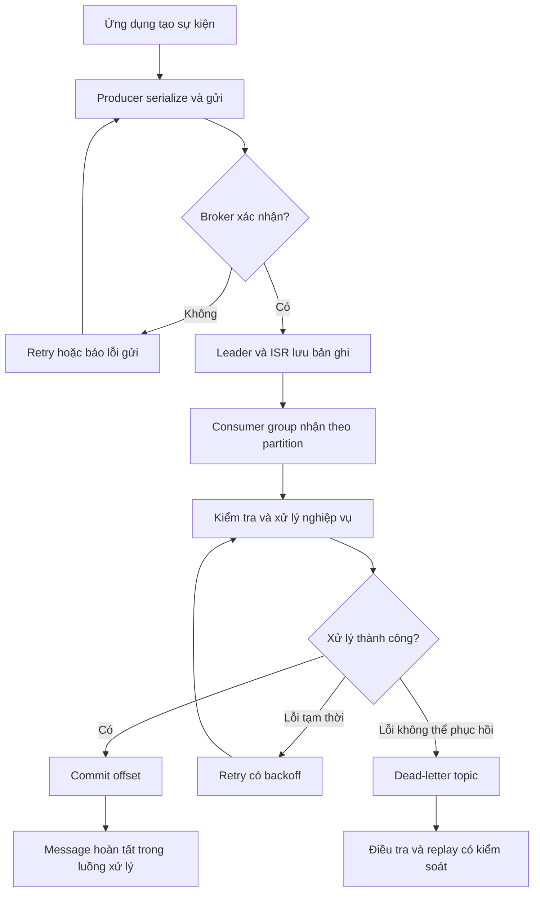

# Điểm kiểm soát trong vòng đời message

Trong Spring Kafka, một message đi qua nhiều thành phần trước khi được xử lý xong: ứng dụng tạo sự kiện, Kafka producer gửi dữ liệu, broker ghi nhận và nhân bản dữ liệu, consumer nhận message, ứng dụng thực hiện nghiệp vụ rồi commit offset. Khi có lỗi, message có thể được thử lại, chuyển sang dead-letter topic (DLT) hoặc được phát lại sau khi sự cố được khắc phục.

Vận hành tin cậy đòi hỏi kiểm soát từng chặng của vòng đời này. Cần phân biệt hai mốc xác nhận thường bị nhầm lẫn:

- **Producer acknowledgement** xác nhận broker đã nhận bản ghi theo mức bảo đảm được cấu hình. Nó không có nghĩa consumer đã xử lý nghiệp vụ.
- **Consumer offset commit** ghi nhận vị trí consumer đã xử lý đến đâu trong một partition. Nó không chứng minh một tác động bên ngoài Kafka, chẳng hạn cập nhật cơ sở dữ liệu, đã được commit nguyên tử cùng offset.

Hai mốc này độc lập. Một message có thể đã được broker lưu nhưng chưa được consumer xử lý; hoặc nghiệp vụ đã chạy xong nhưng offset chưa được commit, khiến message được giao lại. Các điểm kiểm soát dưới đây giúp nhận diện và quản lý những khoảng thời gian đó.



## 1. Trước khi gửi: kiểm soát hợp đồng và định danh message

Độ tin cậy bắt đầu từ dữ liệu mà producer tạo ra. Trước khi gửi, ứng dụng cần xác định rõ cấu trúc sự kiện, ý nghĩa của key, cách đánh phiên bản schema và thông tin giúp truy vết.

Một sự kiện nên có định danh ổn định như `eventId`, thời điểm phát sinh, loại sự kiện và phiên bản schema. Nếu một yêu cầu nghiệp vụ có thể được gửi lại sau timeout, lần gửi lại nên giữ cùng `eventId` để consumer nhận biết đó là cùng một sự kiện. Không nên dùng offset Kafka làm định danh nghiệp vụ vì offset chỉ có ý nghĩa trong một partition của một topic.

Kafka dùng message key để chọn partition theo partitioner. Các message có cùng key thường đi vào cùng partition và giữ thứ tự tương đối trong partition đó. Vì vậy:

- Chọn key theo thực thể cần bảo toàn thứ tự, ví dụ `orderId` cho các sự kiện của một đơn hàng.
- Tránh key rỗng hoặc một key chung cho mọi message nếu điều đó làm dồn tải vào một partition.
- Không giả định Kafka bảo đảm thứ tự toàn cục giữa nhiều partition.
- Khi tăng số partition, phép ánh xạ key sang partition có thể thay đổi; cần đánh giá ảnh hưởng đến thứ tự của các sự kiện đang được xử lý.

Payload cũng cần được kiểm soát. Xác thực trường bắt buộc, giới hạn kích thước, quy ước thời gian và khả năng tương thích schema trước khi publish sẽ giảm số message lỗi ở phía consumer. Với hệ thống có schema registry, cần áp dụng chính sách tương thích phù hợp để producer mới không làm consumer đang chạy thất bại.

### Cấu hình producer

Với luồng nghiệp vụ cần độ bền cao, cấu hình thường dùng là `acks=all` và bật idempotence:

```yaml
spring:
  kafka:
    producer:
      acks: all
      properties:
        "enable.idempotence": true
        "max.in.flight.requests.per.connection": 5
        "delivery.timeout.ms": 120000
        "request.timeout.ms": 30000
```

`acks=all` yêu cầu leader chờ các replica hiện nằm trong ISR xác nhận theo giao thức Kafka. Cấu hình này cần đi cùng `min.insync.replicas` ở topic hoặc broker để quy định số replica tối thiểu phải còn đồng bộ trước khi broker chấp nhận ghi. Ví dụ topic có replication factor là 3 và `min.insync.replicas=2`: khi ISR giảm dưới 2, producer với `acks=all` sẽ nhận lỗi thay vì tiếp tục ghi với mức dự phòng thấp hơn chính sách.

`enable.idempotence=true` giúp Kafka loại bỏ bản ghi trùng phát sinh từ việc producer retry trong cùng phiên producer. Nó không thay thế `eventId`, không tự loại trùng khi ứng dụng chủ động gửi lại cùng sự kiện sau khi khởi động lại, và không làm cho thao tác ghi cơ sở dữ liệu trở thành exactly-once.

`delivery.timeout.ms` giới hạn tổng thời gian producer cố gắng hoàn tất việc gửi, bao gồm thời gian chờ và retry. Khi hết thời gian, ứng dụng phải xử lý kết quả thất bại. Không nên bỏ qua future hoặc callback của `KafkaTemplate.send()`: gửi bất đồng bộ có thể trả quyền điều khiển trước khi broker xác nhận, nên lỗi chỉ xuất hiện sau đó. Với Spring Kafka 3.x, API gửi trả về `CompletableFuture`; các phiên bản cũ có thể dùng kiểu future khác.

Nếu producer không thể gửi, cần ghi nhận lỗi có cấu trúc gồm topic, key hoặc `eventId`, loại exception và correlation ID. Chỉ retry những lỗi có khả năng hồi phục; lỗi schema hoặc dữ liệu không hợp lệ cần được xử lý ở tầng ứng dụng thay vì retry vô hạn.

## 2. Tại broker: kiểm soát xác nhận, nhân bản và lưu giữ

Mỗi partition có một leader nhận request đọc/ghi và các follower replica sao chép dữ liệu. Tập replica đang bắt kịp leader được gọi là ISR (in-sync replicas). Producer acknowledgement phản ánh chính sách xác nhận tại thời điểm ghi, vì vậy cần vận hành đồng thời các cấu hình sau:

| Điểm kiểm soát | Ý nghĩa vận hành |
|---|---|
| `replication.factor` | Số replica được tạo cho partition. Mức 3 thường được chọn cho workload production cần chịu lỗi một broker, tùy hạ tầng và chi phí. |
| `min.insync.replicas` | Số replica tối thiểu trong ISR khi producer dùng `acks=all`. Khi không đạt, ghi mới có thể bị từ chối để bảo vệ độ bền dữ liệu. |
| `unclean.leader.election.enable` | Khi tắt, Kafka tránh bầu một replica chưa đồng bộ làm leader, giảm nguy cơ mất các bản ghi đã xác nhận nhưng có thể giảm khả năng sẵn sàng trong một số sự cố. |
| Rack awareness | Phân bố replica qua các rack hoặc vùng lỗi khác nhau để tránh một sự cố hạ tầng làm mất đồng thời nhiều replica. |
| Disk và network | Theo dõi dung lượng, độ trễ I/O, lỗi đĩa và lưu lượng sao chép để phát hiện replica bắt đầu tụt lại. |

Replication factor cao không tự bảo đảm độ bền nếu các replica cùng nằm trên một miền lỗi hoặc broker không đủ tài nguyên để theo kịp. Ngược lại, đặt `min.insync.replicas` quá cao so với replication factor có thể làm ghi bị từ chối thường xuyên khi bảo trì hoặc broker gặp sự cố. Chính sách cần cân bằng giữa khả năng chịu lỗi và khả năng tiếp tục nhận ghi.

### Chính sách lưu giữ topic

Retention quyết định message còn có thể được đọc lại trong bao lâu. Với `cleanup.policy=delete`, Kafka xóa segment cũ theo `retention.ms` và/hoặc `retention.bytes`. Thời gian lưu cần đủ cho thời gian consumer gián đoạn, xử lý backlog và nhu cầu replay đã dự kiến. Nếu retention ngắn hơn thời gian khôi phục, consumer có thể mất cơ hội đọc các message chưa xử lý.

Với `cleanup.policy=compact`, Kafka giữ lại giá trị mới nhất theo key sau quá trình compaction; nó phù hợp với topic biểu diễn trạng thái hiện tại. Compaction không phải kho lưu trữ lịch sử sự kiện đầy đủ. Có thể kết hợp `compact,delete` khi cần cả compaction và giới hạn tuổi dữ liệu.

Khi thiết kế topic, cần xác định trước số partition, replication factor, retention, cleanup policy, giới hạn kích thước message và ACL. Số partition ảnh hưởng song song xử lý và thứ tự theo key; thay đổi số partition là quyết định vận hành có thể tác động đến cách phân phối key.

### Quyền truy cập và bảo vệ dữ liệu

Producer và consumer nên dùng principal riêng với quyền tối thiểu cần thiết: producer được ghi vào topic được chỉ định, consumer được đọc topic và group tương ứng. Bật TLS để bảo vệ kết nối; dùng SASL hoặc cơ chế xác thực được nền tảng hỗ trợ. Không ghi password, token hoặc payload nhạy cảm vào log. Cần quản lý vòng đời chứng thư và credential để việc hết hạn không gây gián đoạn bất ngờ.

## 3. Khi consumer nhận message: kiểm soát group và partition

Consumer group là đơn vị phối hợp đọc dữ liệu. Trong cùng một group, tại một thời điểm, mỗi partition được giao cho tối đa một consumer member. Vì vậy số consumer thực sự xử lý song song trong một group không vượt quá số partition đang được gán cho group đó. Tăng `concurrency` vượt số partition không làm tăng thông lượng tương ứng.

`group.id` phải ổn định giữa các lần triển khai nếu ứng dụng muốn tiếp tục từ offset đã commit. Đổi group ID tạo một consumer group mới và hành vi khởi đầu sẽ phụ thuộc `auto.offset.reset` khi group chưa có offset hợp lệ. `earliest` chọn vị trí sớm nhất còn được lưu; `latest` chọn dữ liệu mới được ghi sau thời điểm khởi tạo. Thuộc tính này không tự reset offset đã commit của một group đang tồn tại.

Khi member tham gia hoặc rời group, Kafka thực hiện rebalance và phân phối lại partition. Rebalance là cơ chế bình thường, nhưng rebalance liên tục làm giảm thời gian xử lý hữu ích và có thể tạo độ trễ. Các nguyên nhân phổ biến gồm:

- Consumer bị dừng, restart hoặc mất kết nối thường xuyên.
- Xử lý một poll quá lâu, vượt `max.poll.interval.ms`.
- Thời gian chờ giữa heartbeat và session timeout không phù hợp với điều kiện mạng hoặc tải.
- Thay đổi cấu hình, số member hoặc topic subscription liên tục.

`max.poll.records` giới hạn số record trả về trong một lần poll. Cần chọn giá trị sao cho tổng thời gian xử lý một batch có biên an toàn so với `max.poll.interval.ms`. Nếu mỗi record gọi dịch vụ ngoài hoặc truy vấn database chậm, giảm batch size, tối ưu nghiệp vụ hoặc thiết kế xử lý có kiểm soát sẽ an toàn hơn việc chỉ tăng timeout.

Trong Spring Kafka, `concurrency` của listener container tạo các consumer worker. Giá trị phù hợp phụ thuộc số partition, năng lực downstream và thời gian xử lý. Tăng concurrency có thể làm database hoặc dịch vụ phụ trợ quá tải, từ đó khiến toàn hệ thống chậm hơn.

## 4. Trong lúc xử lý: kiểm soát offset và thời điểm xác nhận

Offset là vị trí của record trong một partition. Offset được commit là vị trí tiếp theo mà consumer group sẽ đọc khi khởi động lại, không phải mã định danh duy nhất của message trên toàn cluster.

Để kiểm soát thời điểm commit trong ứng dụng Spring Kafka, thường tắt auto commit của Kafka client và để listener container quản lý acknowledgement:

```yaml
spring:
  kafka:
    consumer:
      enable-auto-commit: false
      auto-offset-reset: earliest
    listener:
      ack-mode: record
```

Các `AckMode` thường gặp trong Spring Kafka:

| Ack mode | Thời điểm container ghi nhận offset |
|---|---|
| `RECORD` | Sau khi listener xử lý xong từng record; dùng với record listener. |
| `BATCH` | Sau khi listener xử lý xong toàn bộ batch được poll. |
| `TIME` / `COUNT` / `COUNT_TIME` | Commit theo thời gian, số record hoặc kết hợp hai điều kiện. |
| `MANUAL` | Listener gọi `Acknowledgment.acknowledge()`; container commit theo quy tắc của chế độ manual. |
| `MANUAL_IMMEDIATE` | Yêu cầu commit ngay khi acknowledge trên consumer thread; cần hiểu rõ thread thực hiện acknowledgement. |

`BATCH` có thể giảm số lần commit nhưng nếu ứng dụng lỗi giữa batch, một phần record đã xử lý có thể được giao lại. `RECORD` làm rõ ranh giới xử lý từng record hơn, đổi lại có thể tăng tần suất commit. Với batch listener, cần chọn chế độ phù hợp với cách listener xử lý batch và kiểm soát lỗi một phần.

### Hiểu đúng các mức bảo đảm giao nhận

**At-most-once** có thể xảy ra khi offset được commit trước khi nghiệp vụ hoàn tất. Nếu ứng dụng dừng sau commit nhưng trước khi lưu kết quả nghiệp vụ, message có thể bị bỏ qua khi khởi động lại.

**At-least-once** thường là lựa chọn thực tế cho consumer: chỉ commit sau khi xử lý thành công. Nếu ứng dụng lưu kết quả nghiệp vụ rồi dừng trước khi offset được commit, Kafka sẽ giao lại message. Điều này tránh mất message trong luồng xử lý nhưng cho phép xử lý trùng.

**Exactly-once** cần được giới hạn trong phạm vi cụ thể. Kafka transactions có thể kết hợp việc đọc từ Kafka, ghi message sang Kafka khác và commit offset trong cùng một transaction Kafka. Cơ chế này không tự tạo transaction nguyên tử giữa Kafka và một cơ sở dữ liệu quan hệ hoặc API bên ngoài.

Vì vậy, consumer ghi database nên thiết kế nghiệp vụ idempotent. Một cách phổ biến là lưu `eventId` vào bảng inbox với unique constraint trong cùng transaction database với cập nhật nghiệp vụ. Nếu `eventId` đã tồn tại, consumer biết sự kiện đã được áp dụng và có thể hoàn tất xử lý mà không lặp lại tác động. Một lựa chọn khác là upsert theo khóa nghiệp vụ và kiểm soát phiên bản hoặc trạng thái chuyển tiếp.

Ví dụ sau minh họa thứ tự xử lý với manual acknowledgement. `orderService.processIdempotently()` nên hoàn tất transaction database trước khi phương thức trả về:

```java
@KafkaListener(topics = "${app.kafka.orders-topic}")
public void onOrderCreated(
        ConsumerRecord<String, OrderCreated> record,
        Acknowledgment acknowledgment) {

    // Service thực hiện transaction DB và chống xử lý trùng bằng eventId.
    orderService.processIdempotently(record.value());

    // Chỉ acknowledge sau khi transaction nghiệp vụ đã hoàn tất.
    acknowledgment.acknowledge();
}
```

Listener trên cần được cấu hình `AckMode.MANUAL` hoặc chế độ manual phù hợp. Nếu service ném exception, listener không acknowledge; error handler của container sẽ quyết định retry hoặc chuyển message sang DLT. Không nên acknowledge trong `finally`, vì như vậy lỗi nghiệp vụ cũng có thể dẫn đến commit offset.

## 5. Khi xử lý lỗi: phân loại, retry và DLT

Không phải lỗi nào cũng nên retry. Phân loại lỗi trước khi chọn chính sách giúp tránh tạo tải lặp lại và kéo dài thời gian xử lý.

| Nhóm lỗi | Ví dụ | Hướng xử lý |
|---|---|---|
| Tạm thời | Database timeout, dịch vụ phụ trợ trả 503, lỗi mạng ngắn hạn | Retry có giới hạn, backoff và jitter. |
| Dữ liệu không hợp lệ | Thiếu trường bắt buộc, sai định dạng, schema không tương thích | Đánh dấu không retry hoặc chuyển DLT để điều tra. |
| Lỗi nghiệp vụ có thể khắc phục | Trạng thái tham chiếu chưa sẵn sàng, phụ thuộc chưa được tạo | Chọn retry có thời hạn hoặc luồng xử lý chờ riêng. |
| Lỗi cấu hình/hạ tầng kéo dài | Sai ACL, credential hết hạn, topic không tồn tại | Cảnh báo và khắc phục nguyên nhân; retry liên tục thường không giúp ích. |

### Retry đồng bộ trong cùng partition

Với blocking retry, consumer thử xử lý lại record lỗi trước khi đi tiếp trong partition đó. Cách này giữ thứ tự xử lý tốt hơn cho partition nhưng một message lỗi có thể chặn các message phía sau. Cần đặt số lần thử, khoảng chờ và thời gian tối đa rõ ràng.

Ví dụ cấu hình `DefaultErrorHandler` với ba lần retry sau lần xử lý ban đầu và chuyển message sang topic DLT khi hết lượt:

```java
@Bean
DefaultErrorHandler kafkaErrorHandler(
        KafkaTemplate<Object, Object> kafkaTemplate) {

    DeadLetterPublishingRecoverer recoverer =
            new DeadLetterPublishingRecoverer(
                    kafkaTemplate,
                    (record, exception) -> new TopicPartition(
                            record.topic() + ".DLT",
                            record.partition()));

    DefaultErrorHandler handler = new DefaultErrorHandler(
            recoverer,
            new FixedBackOff(1_000L, 3L));

    handler.addNotRetryableExceptions(
            IllegalArgumentException.class);

    return handler;
}
```

Ví dụ cần import `DefaultErrorHandler`, `DeadLetterPublishingRecoverer`, `FixedBackOff` và `TopicPartition` từ các package tương ứng. Topic DLT phải tồn tại và có đủ partition nếu resolver gửi record về đúng số partition gốc. Nếu số partition không khớp, cần định tuyến sang partition hợp lệ theo một resolver phù hợp. Cũng cần bảo đảm producer dùng để publish DLT có serializer tương thích với payload và header gốc.

Backoff cố định dễ dự đoán; exponential backoff có thể giảm áp lực lên dịch vụ đang phục hồi. Jitter giúp nhiều consumer không đồng loạt retry cùng thời điểm. Tổng thời gian retry phải phù hợp với SLA và retention của topic.

### Retry topic không chặn luồng chính

Với non-blocking retry, message lỗi được chuyển sang retry topic có thời gian chờ riêng; consumer của topic gốc có thể tiếp tục đọc các message sau. Cách này hữu ích khi lỗi cần chờ lâu, nhưng message sau có thể được xử lý trước message đang retry. Nếu nghiệp vụ yêu cầu thứ tự nghiêm ngặt theo key, cần cân nhắc tác động này và thiết kế điều phối phù hợp.

Spring Kafka hỗ trợ mô hình retry topic qua `@RetryableTopic` ở các phiên bản phù hợp. Khi dùng, cần xác định rõ số attempt, backoff, tên retry topic, DLT, cách định tuyến partition và cách xử lý khi publish sang retry topic thất bại. Không nên kết hợp nhiều cơ chế retry mà không xác định rõ tổng số lần thử và nơi lưu message.

### DLT là nơi điều tra, không phải nơi bỏ quên message

DLT giữ lại message không thể xử lý theo chính sách hiện tại để đội vận hành phân tích. Khi publish DLT, cần giữ đủ thông tin nguồn như topic, partition, offset, key, timestamp, `eventId`, exception và số lần thử. Spring Kafka có thể bổ sung các header mô tả nguồn và exception thông qua dead-letter recoverer.

Quy trình vận hành DLT nên gồm:

1. Theo dõi số lượng message vào DLT theo topic, loại exception và thời gian.
2. Xác định nguyên nhân là dữ liệu, code, cấu hình hay dịch vụ phụ trợ.
3. Sửa nguyên nhân và xác định message có còn hợp lệ để xử lý hay không.
4. Replay theo lô nhỏ, có giới hạn tốc độ và theo dõi kết quả.
5. Dùng `eventId` hoặc cơ chế idempotency để replay không nhân đôi tác động nghiệp vụ.
6. Lưu dấu vết người thực hiện, thời điểm và số message đã replay.

Không replay hàng loạt khi chưa hiểu nguyên nhân gốc. Nếu message sai schema hoặc chứa dữ liệu không hợp lệ, replay chỉ tạo thêm lỗi. Nếu DLT publish thất bại, cần để lỗi đó được phát hiện và xử lý; không được coi message đã được thu hồi thành công khi bản sao DLT chưa được lưu chắc chắn.

## 6. Khi group thay đổi: kiểm soát rebalance và triển khai

Rebalance có thể xảy ra khi thêm hoặc bỏ consumer, thay đổi subscription, member mất heartbeat hoặc vượt thời gian poll cho phép. Trong lúc rebalance, partition được thu hồi rồi giao lại; message chưa commit có thể được xử lý lại bởi member mới.

Để giảm rebalance không cần thiết:

- Giữ thời gian xử lý mỗi poll thấp hơn `max.poll.interval.ms` với biên an toàn.
- Điều chỉnh `max.poll.records` theo thời gian xử lý thực tế, không chỉ theo thông lượng mong muốn.
- Dùng timeout heartbeat/session phù hợp với độ trễ mạng và cấu hình cluster.
- Triển khai graceful shutdown để listener container dừng nhận việc mới, hoàn tất phần xử lý có thể hoàn tất và commit offset theo cấu hình.
- Tránh rollout đồng loạt quá nhiều instance nếu workload nhạy với rebalance.
- Theo dõi tần suất rebalance và thời gian group ổn định sau mỗi lần triển khai.

Khi xử lý nghiệp vụ lâu hơn thời gian poll, không nên tùy tiện chuyển công việc sang thread nền rồi acknowledge ngay. Consumer có thể commit offset trong khi công việc nền chưa hoàn tất, hoặc xử lý các offset cùng partition sai thứ tự. Nếu cần xử lý bất đồng bộ, phải thiết kế rõ việc quản lý offset, giới hạn số công việc đang chạy, thứ tự hoàn tất và hành vi khi shutdown.

Khi cần bảo trì, có thể pause listener container hoặc dừng consumer theo quy trình triển khai. Việc pause giúp ngừng nhận thêm dữ liệu trong khi vẫn duy trì trạng thái consumer theo cơ chế của container; hành vi cụ thể cần kiểm tra theo phiên bản Spring Kafka và cách điều khiển được sử dụng. Không nên dùng việc reset offset như biện pháp đầu tiên để chữa lag.

## 7. Khi cần giao dịch Kafka: kiểm soát transaction và exactly-once

Kafka producer transaction cho phép ghi nhiều record vào nhiều partition/topic và commit hoặc abort chúng như một đơn vị. Spring Kafka hỗ trợ cấu hình transactional producer và tích hợp transaction với listener container.

Trong mô hình consume-transform-produce, container có thể bắt đầu Kafka transaction, listener đọc record, gửi kết quả sang topic đích, rồi commit offset của record đầu vào cùng transaction. Consumer downstream đặt `isolation.level=read_committed` sẽ chỉ đọc các record thuộc transaction đã commit, tránh nhìn thấy dữ liệu từ transaction bị abort.

Một số điểm cần kiểm soát:

- `transactionIdPrefix` phải tạo transactional ID duy nhất cho từng producer instance đang hoạt động để tránh fencing lẫn nhau.
- Transaction cần ngắn và có giới hạn; transaction kéo dài có thể gây timeout và giữ dữ liệu chưa hiển thị với consumer `read_committed`.
- Theo dõi lỗi fencing, transaction timeout và tỷ lệ abort.
- Chỉ bật `read_committed` khi luồng đọc cần tuân theo trạng thái transaction; hiểu rằng dữ liệu chưa commit sẽ chưa hiển thị.
- Kafka transaction không bao trùm database, HTTP API hoặc hệ thống ngoài Kafka.

Nếu nghiệp vụ vừa cập nhật database vừa publish event, có thể dùng transactional outbox: ghi thay đổi nghiệp vụ và bản ghi outbox trong cùng transaction database, sau đó một publisher riêng đọc outbox và gửi sang Kafka. Consumer nhận event vẫn cần idempotency. Mô hình này tránh khoảng trống giữa commit database và publish Kafka mà không giả định có distributed transaction tự động.

## 8. Quan sát vòng đời message bằng metrics, log và trace

Một hệ thống có thể có consumer lag cao vì producer tăng tải, consumer xử lý chậm, downstream gặp sự cố hoặc partition mất cân bằng. Chỉ nhìn một metric không đủ để kết luận. Cần liên kết chỉ số broker, producer, consumer và nghiệp vụ.

| Lớp | Chỉ số cần theo dõi | Điều cần phát hiện |
|---|---|---|
| Producer | Số record gửi, send rate, request latency, retry, error và timeout | Broker không nhận kịp, lỗi xác thực, lỗi serialize hoặc lỗi ghi. |
| Broker | Offline partition, under-replicated partition, ISR shrink, request latency, disk và network | Mất dự phòng, replica tụt lại, tài nguyên sắp cạn hoặc broker chậm. |
| Consumer | Lag theo partition, records consumed rate, commit latency, poll interval, rebalance và heartbeat | Consumer không theo kịp, commit chậm hoặc group không ổn định. |
| Listener/application | Thời gian xử lý, exception theo loại, retry count, DLT rate, downstream latency | Nghiệp vụ chậm, message độc, lỗi phụ thuộc hoặc dữ liệu không hợp lệ. |
| Nghiệp vụ | Số event phát sinh, số event hoàn tất, tuổi của event chưa xử lý | Message đã qua Kafka nhưng chưa tạo ra kết quả nghiệp vụ đúng hạn. |

Các metric Kafka phổ biến có thể lấy qua JMX hoặc hệ thống giám sát được nền tảng tích hợp, ví dụ `records-lag-max`, tốc độ consume, commit latency, `UnderReplicatedPartitions`, `OfflinePartitionsCount` và số lần ISR shrink. Tên metric và cách expose phụ thuộc phiên bản client, broker và hệ thống metrics. Spring Kafka cũng có thể đưa thông tin listener/container vào Micrometer khi được cấu hình phù hợp.

Log nên có các trường cấu trúc như `eventId`, topic, partition, offset, group ID, key, listener ID, attempt và exception class. Không log toàn bộ payload nếu chứa dữ liệu cá nhân, bí mật hoặc thông tin xác thực. Correlation ID và trace context nên được truyền qua header để nối trace từ dịch vụ phát sinh sự kiện đến consumer.

Consumer lag cần được đọc cùng tốc độ xử lý. Lag tăng liên tục cho thấy consumer đang không theo kịp producer; lag cao nhưng giảm đều có thể là backlog đang được xử lý. Có thể ước lượng thời gian bắt kịp bằng backlog chia cho tốc độ xử lý ròng (consumer throughput trừ producer throughput), khi tốc độ ròng dương và tương đối ổn định. Đặt cảnh báo theo tuổi message hoặc SLA nghiệp vụ thường hữu ích hơn một ngưỡng lag cố định cho mọi topic.

## 9. Cấu hình Spring Boot tham khảo

Ví dụ dưới đây minh họa các điểm cấu hình cơ bản cho một consumer group cần kiểm soát commit và một producer cần xác nhận ghi. Giá trị thực tế phải được điều chỉnh theo số partition, kích thước message, độ trễ downstream, SLA và chính sách của Kafka cluster.

```yaml
spring:
  kafka:
    bootstrap-servers: ${KAFKA_BOOTSTRAP_SERVERS}
    producer:
      acks: all
      properties:
        "enable.idempotence": true
        "max.in.flight.requests.per.connection": 5
        "delivery.timeout.ms": 120000
    consumer:
      group-id: order-service
      enable-auto-commit: false
      auto-offset-reset: earliest
      max-poll-records: 100
      properties:
        "max.poll.interval.ms": 300000
    listener:
      ack-mode: record
      concurrency: 3
```

Trong cấu hình trên, `concurrency: 3` chỉ có thể tận dụng đủ ba consumer worker nếu group được cấp ít nhất ba partition và downstream chịu được tải tương ứng. `auto-offset-reset: earliest` chỉ tác động khi group không có offset hợp lệ; nó không phải lệnh tua lại offset. `ack-mode: record` phù hợp với record listener và chỉ commit sau khi listener xử lý xong record theo cơ chế container.

Nếu ứng dụng đọc dữ liệu được ghi bằng Kafka transaction và chỉ muốn thấy transaction đã commit, đặt thêm `isolation.level=read_committed` trong consumer properties. Nếu không dùng transactional producer, không nên bật cấu hình này chỉ vì nghĩ rằng nó làm consumer “an toàn hơn” trong mọi trường hợp.

Các thông tin xác thực, TLS truststore/keystore và cơ chế SASL nên được cung cấp qua secret management hoặc biến môi trường phù hợp. Không commit credential thật vào file cấu hình hoặc repository.

## 10. Runbook theo triệu chứng

### Producer báo timeout hoặc lỗi gửi

1. Xác định topic, `eventId`, key và thời điểm gửi; kiểm tra lỗi từ future/callback của `KafkaTemplate`.
2. Kiểm tra broker availability, request latency, network, ACL và tình trạng ISR.
3. Nếu lỗi liên quan `NotEnoughReplicas` hoặc ISR, kiểm tra replica và `min.insync.replicas` trước khi cân nhắc thay đổi cấu hình.
4. Xác định ứng dụng có retry hoặc gửi lại cùng event hay không; giữ `eventId` ổn định để consumer có thể chống trùng.

### Consumer lag tăng

1. So sánh lag theo từng partition để tìm partition nóng hoặc consumer member bị lệch tải.
2. Đối chiếu producer rate, consumer rate và tuổi của message; xác định backlog tăng do tải mới hay do xử lý chậm.
3. Kiểm tra thời gian xử lý listener, database/API latency, retry và rebalance.
4. Nếu downstream còn năng lực, tăng consumer instance hoặc concurrency trong giới hạn số partition. Nếu downstream đang quá tải, khắc phục downstream hoặc giảm tốc độ nhận trước khi scale consumer.
5. Theo dõi tốc độ giảm lag và tuổi message sau khi thay đổi.

### DLT tăng đột biến

1. Phân nhóm theo exception, source topic và phiên bản ứng dụng.
2. Lấy một số message đại diện, kiểm tra header nguồn, schema và payload theo chính sách bảo vệ dữ liệu.
3. Xác định lỗi dữ liệu hay lỗi hệ thống; sửa nguyên nhân trước khi replay.
4. Replay thử số lượng nhỏ, theo dõi kết quả nghiệp vụ và mức độ trùng lặp, rồi mới tăng quy mô.

### Rebalance xảy ra liên tục

1. Kiểm tra log group membership, heartbeat, session timeout và lý do member rời group.
2. Đo thời gian xử lý poll lớn nhất và so sánh với `max.poll.interval.ms`.
3. Kiểm tra rollout, restart, autoscaling và thay đổi subscription.
4. Điều chỉnh batch size, xử lý downstream hoặc timeout dựa trên số đo; sau đó quan sát độ ổn định của group.

### Partition mất replica hoặc ISR suy giảm

1. Xác định partition bị ảnh hưởng, leader hiện tại và replica nào đang tụt lại.
2. Kiểm tra sức khỏe broker, disk, network, log của broker và tình trạng rack.
3. Khôi phục broker hoặc replica theo quy trình nền tảng; theo dõi ISR trở lại trạng thái mong muốn.
4. Nếu producer bị từ chối ghi do `min.insync.replicas`, đánh giá rủi ro dữ liệu trước khi thay đổi chính sách. Không hạ mức bảo vệ chỉ để xóa cảnh báo.

### Cần tua lại hoặc bỏ qua message

Thay đổi offset bằng công cụ quản trị consumer group có thể làm message được xử lý lại hoặc bị bỏ qua. Trước khi thực hiện, phải xác định group, topic, partition, offset đích và tác động nghiệp vụ; dừng hoặc cô lập consumer group theo quy trình; lưu lại offset hiện tại; có người chịu trách nhiệm phê duyệt theo chính sách vận hành; rồi xác minh kết quả sau thao tác. Không chạy reset offset trên group đang hoạt động nếu chưa hiểu cơ chế và ảnh hưởng của lệnh.

## 11. Bảng kiểm soát theo từng chặng

| Chặng vòng đời | Câu hỏi vận hành | Bằng chứng nên lưu |
|---|---|---|
| Tạo sự kiện | Sự kiện có schema, `eventId`, key và dữ liệu hợp lệ không? | Schema version, event ID, correlation ID và kết quả validation. |
| Producer gửi | Broker đã xác nhận theo chính sách chưa? Lỗi gửi có được quan sát không? | Send result, latency, retry và exception. |
| Broker lưu | ISR và replication có đáp ứng mức dự phòng không? Retention có đủ dài không? | Topic config, ISR state, under-replicated/offline partition và dung lượng. |
| Consumer nhận | Group có ổn định và partition có được phân phối hợp lý không? | Group membership, assignment, poll và rebalance metrics. |
| Xử lý nghiệp vụ | Tác động nghiệp vụ đã hoàn tất trước khi commit offset chưa? Có chống trùng không? | Event ID, transaction result, processing duration và deduplication result. |
| Retry/DLT | Lỗi có được phân loại, giới hạn retry và lưu dấu vết không? | Attempt, backoff, exception, DLT source metadata và replay history. |
| Hoàn tất | Offset đã commit và kết quả nghiệp vụ có thể đối chiếu không? | Committed offset, consumer lag và business completion metric. |

Điểm kiểm soát quan trọng nhất là giữ cho trạng thái message có thể giải thích được ở mọi thời điểm: message đã được producer gửi chưa, broker đã xác nhận chưa, consumer nào đang sở hữu partition, nghiệp vụ đã hoàn tất chưa, offset đã commit chưa, và nếu thất bại thì message đang retry hay nằm ở DLT. Khi các trạng thái này được ghi nhận bằng cấu hình rõ ràng, metrics, log và quy trình replay có kiểm soát, đội vận hành có thể xử lý sự cố mà vẫn bảo toàn tính đúng đắn của dữ liệu.
