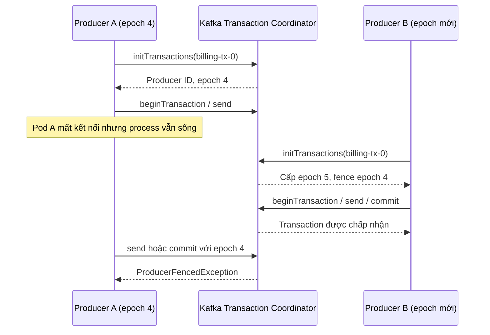

# Producer fencing trong Kafka và Spring Kafka

Producer fencing là cơ chế Kafka ngăn một transactional producer cũ tiếp tục ghi hoặc commit transaction sau khi một producer mới đã tiếp quản cùng `transactional.id`. Broker nhận diện từng thế hệ producer bằng producer ID và epoch. Khi một producer mới khởi tạo với cùng transactional ID, Kafka cấp epoch mới và fence producer cũ. Các thao tác transactional tiếp theo từ producer cũ có thể thất bại với `ProducerFencedException`.

Cơ chế này bảo vệ hệ thống trước tình huống một producer cũ vẫn còn chạy sau khi ứng dụng đã restart, failover hoặc được thay thế. Nếu cả producer cũ và producer mới cùng ghi dữ liệu, chúng có thể tạo ra hai luồng kết quả cạnh tranh. Fencing bảo đảm chỉ thế hệ producer mới nhất được broker chấp nhận cho transactional ID đó.

Trong Spring Kafka, vấn đề này thường liên quan đến cấu hình `transactionIdPrefix`, cách `DefaultKafkaProducerFactory` tạo transactional producer và việc triển khai nhiều instance của cùng một service. Cấu hình prefix trùng giữa các instance đang chạy đồng thời là nguyên nhân phổ biến gây fencing lặp lại.

## 1. Vì sao Kafka cần producer fencing?

Một ứng dụng có thể mất kết nối với broker mà tiến trình cũ vẫn tiếp tục chạy. Ví dụ:

- Pod A bị mất kết nối mạng trong lúc đang gửi transaction.
- Bộ điều phối cho rằng Pod A không còn hoạt động và khởi động Pod B thay thế.
- Pod B bắt đầu gửi dữ liệu với cùng transactional identity.
- Sau đó Pod A kết nối lại và cố tiếp tục transaction cũ.

Nếu broker chấp nhận cả hai producer, các transaction từ tiến trình cũ có thể cạnh tranh với tiến trình mới. Kết quả có thể làm sai thứ tự hoặc tạo ra trạng thái mà ứng dụng không mong muốn.

Kafka giải quyết tình huống này bằng producer fencing. Broker lưu trạng thái transactional ID và epoch hiện tại. Producer mang epoch cũ bị từ chối khi epoch mới đã được cấp.

Fencing đặc biệt quan trọng với transactional producer vì ứng dụng kỳ vọng transaction có một chủ sở hữu hợp lệ tại một thời điểm. Nó giúp loại bỏ producer cũ còn tồn tại sau failover, thường được gọi là *zombie producer*.

## 2. transactional.id, producer ID và epoch

Ba khái niệm này có liên quan trực tiếp đến fencing.

| Thành phần | Vai trò |
|---|---|
| `transactional.id` | Định danh logic của một transactional producer; được dùng để khôi phục transaction và fence thế hệ cũ |
| Producer ID | Định danh nội bộ do Kafka cấp cho producer |
| Producer epoch | Số thế hệ của producer; epoch mới làm mất hiệu lực các request transactional từ epoch cũ |

Một transactional producer khởi tạo bằng `initTransactions()`. Kafka liên hệ transactional ID với producer ID và epoch. Khi producer mới khởi tạo bằng cùng transactional ID, transaction coordinator cấp thế hệ mới và làm vô hiệu thế hệ cũ.

Ví dụ minh họa:

| Thời điểm | Producer | transactional.id | Epoch | Trạng thái |
|---|---|---|---:|---|
| T1 | Producer A | `billing-tx-0` | 4 | Đang hoạt động |
| T2 | Producer B | `billing-tx-0` | 5 | Được khởi tạo mới |
| T3 | Producer A | `billing-tx-0` | 4 | Bị fence |
| T4 | Producer B | `billing-tx-0` | 5 | Là thế hệ hợp lệ hiện tại |

Epoch là chi tiết do Kafka quản lý. Ứng dụng không tự chọn hoặc tăng epoch bằng tay. Ứng dụng cấu hình transactional ID; Kafka điều phối producer ID và epoch khi producer khởi tạo transaction.

Điểm cần nhớ: cùng một transactional ID có thể được tái sử dụng theo thời gian để producer mới tiếp quản producer cũ. Nhưng không được để hai instance độc lập cùng sử dụng transactional ID đó như hai producer đang hoạt động song song.

## 3. Luồng fencing diễn ra như thế nào?

Giả sử service Billing có một transactional producer với ID `billing-tx-0`.

1. Producer A gọi `initTransactions()`, nhận producer ID và epoch hiện tại.
2. Producer A bắt đầu transaction và gửi một số record.
3. Pod A bị mất kết nối hoặc không còn được xem là instance đang phục vụ.
4. Pod B khởi động và tạo producer mới với cùng `transactional.id`.
5. Producer B gọi `initTransactions()`; Kafka cấp epoch mới và fence producer A.
6. Producer A tiếp tục gửi hoặc commit bằng epoch cũ.
7. Broker từ chối thao tác của A; client có thể nhận `ProducerFencedException`.
8. Producer B tiếp tục làm việc với epoch mới.

Sơ đồ:



Thời điểm exception xuất hiện có thể là lúc gửi record, commit transaction hoặc một thao tác transactional tiếp theo. Không nên giả định fencing luôn xảy ra ngay tại câu lệnh khởi tạo producer cũ.

## 4. ProducerFencedException có ý nghĩa gì?

`ProducerFencedException` cho biết producer đã bị broker fence, thường vì một producer khác được khởi tạo với cùng transactional ID và epoch mới hơn.

Đây là lỗi nghiêm trọng đối với instance producer đó. Producer đã bị fence không thể tiếp tục transaction như bình thường. Ứng dụng không nên chỉ retry lệnh `send()` hoặc `commitTransaction()` trên chính instance producer cũ.

Cách xử lý ở tầng Kafka client:

- Xem producer bị fence là không còn sử dụng được.
- Đóng và loại bỏ instance producer cũ.
- Tạo producer mới thông qua factory/cấu hình đúng.
- Bảo đảm không còn một instance độc lập khác tiếp tục cạnh tranh cùng transactional ID.
- Chỉ tiếp tục xử lý khi producer mới khởi tạo transaction thành công.

Với Spring Kafka, nên để `ProducerFactory` và `KafkaTemplate` quản lý vòng đời transactional producer. Khi nhận fencing exception, cần xử lý transaction thất bại theo cấu hình Spring Kafka và điều tra nguyên nhân trùng transactional ID. Tạo producer mới liên tục mà không sửa nguyên nhân collision chỉ làm lỗi fencing lặp lại.

Không nên bắt `ProducerFencedException` rồi ghi log và trả về bình thường. Cách đó có thể che giấu transaction chưa được commit và khiến luồng nghiệp vụ hiểu nhầm message đã được phát thành công.

## 5. Phân biệt fencing với idempotence

Idempotent producer và producer fencing cùng tham gia vào độ tin cậy của Kafka producer nhưng giải quyết hai vấn đề khác nhau.

| Cơ chế | Bảo vệ điều gì? | Phạm vi |
|---|---|---|
| Idempotent producer | Hạn chế record trùng do retry gửi trong cùng producer session | Producer ID, sequence number và partition |
| Transaction | Ghi nhiều record theo một đơn vị commit/abort | Transactional producer và transaction coordinator |
| Producer fencing | Ngăn producer cũ tiếp tục thao tác sau khi một thế hệ mới tiếp quản cùng transactional ID | transactional ID và producer epoch |

Ví dụ, producer gửi một record nhưng không nhận được response do timeout. Idempotent producer giúp Kafka nhận diện retry thuộc cùng chuỗi sequence và tránh ghi trùng trong phạm vi cơ chế idempotence.

Trong khi đó, fencing xử lý tình huống một tiến trình cũ và một tiến trình mới cùng cố sử dụng transactional ID. Idempotence không thay thế fencing vì hai producer session khác nhau có thể có các producer ID/epoch khác nhau.

Đối với transactional producer, Kafka yêu cầu các thuộc tính idempotence phù hợp và client xử lý các sequence nội bộ. Tuy nhiên, ứng dụng vẫn phải cấu hình transactional ID đúng và không để các instance đang hoạt động dùng chung ID.

## 6. Phân biệt transactional.id với client.id và group.id

Khi chẩn đoán fencing, cần nhìn đúng loại ID.

| ID | Mục đích | Có trực tiếp gây producer fencing không? |
|---|---|---|
| `transactional.id` | Định danh transactional producer | Có; dùng trùng giữa các producer đang hoạt động có thể fence producer cũ |
| `client.id` | Định danh client trong log, metrics và quota | Không tự nó gây fencing |
| `group.id` | Định danh consumer group | Không; điều phối membership, partition assignment và offset |
| `clientIdPrefix` trong Spring Kafka | Prefix để tạo client ID cho consumer | Không thay thế transactional ID |
| `transactionIdPrefix` trong Spring Kafka | Prefix để tạo transactional ID cho producer | Có liên quan trực tiếp đến việc tránh collision |

Đổi `client.id` không sửa được lỗi trùng `transactional.id`. Tương tự, thay đổi `group.id` không giải quyết fencing ở phía producer.

Với Spring Kafka, hãy kiểm tra giá trị `transactionIdPrefix` và các suffix được producer factory tạo ra. Đây thường là nơi cần sửa khi triển khai nhiều instance.

## 7. Cấu hình transactional producer trong Spring Kafka

Spring Kafka dùng `ProducerFactory` để tạo producer. Khi cấu hình transaction, factory cần có transactional ID prefix. `DefaultKafkaProducerFactory` tạo các transactional ID từ prefix và suffix được quản lý bởi factory.

### 7.1. Cấu hình với Spring Boot

Ví dụ:

```yaml
spring:
  kafka:
    bootstrap-servers: localhost:9092
    producer:
      transaction-id-prefix: ${WORKER_ID:billing-local}-billing-tx-
```

Ở đây, `WORKER_ID` là định danh của một logical producer instance/worker slot. Các worker chạy đồng thời phải có ID khác nhau. Nếu một instance mới thay thế đúng worker slot cũ và cần fence producer cũ còn sống, instance mới phải kế thừa cùng `WORKER_ID` để dùng lại transactional ID namespace đó. Với pod thay thế có UID mới, UID riêng sẽ tạo namespace mới và không fence producer dùng UID cũ.

Ví dụ:

| Instance | transaction-id-prefix |
|---|---|
| Pod A | `billing-pod-a-billing-tx-` |
| Pod B | `billing-pod-b-billing-tx-` |
| Pod C | `billing-pod-c-billing-tx-` |

Nếu ba pod dùng cùng prefix và tạo cùng suffix, chúng có thể tạo ra transactional ID trùng nhau và fence lẫn nhau.

Giá trị fallback `billing-local` trong ví dụ chỉ tiện cho môi trường phát triển một instance. Không dùng cùng fallback cho nhiều instance chạy song song.

### 7.2. Cấu hình bằng DefaultKafkaProducerFactory

Khi tự tạo producer factory, đặt prefix rõ ràng:

```java
@Bean
public ProducerFactory<String, OrderEvent> producerFactory(
        Map<String, Object> producerProperties,
        @Value("${app.instance-id}") String instanceId) {

    DefaultKafkaProducerFactory<String, OrderEvent> factory =
            new DefaultKafkaProducerFactory<>(producerProperties);

    factory.setTransactionIdPrefix(instanceId + "-orders-tx-");

    return factory;
}
```

Thuộc tính `app.instance-id` cần khác nhau giữa các logical producer đang hoạt động đồng thời. Có thể lấy từ StatefulSet ordinal, worker/shard ID hoặc một định danh triển khai được quản lý. Nếu replacement phải tiếp quản cùng logical producer để fence tiến trình cũ, hãy giữ lại ID của worker slot đó qua lần restart.

Nếu Spring Boot đã tự cấu hình `ProducerFactory` từ `spring.kafka.producer.transaction-id-prefix`, không cần tạo thêm factory chỉ để đặt lại cùng thuộc tính. Chọn một nguồn cấu hình nhất quán để tránh tạo nhiều factory với transactional ID không rõ ràng.

### 7.3. Dùng KafkaTemplate trong transaction

Khi producer factory đã được cấu hình transactional, `KafkaTemplate` có thể gửi record trong transaction:

```java
@Service
public class OrderEventPublisher {

    private final KafkaTemplate<String, OrderEvent> kafkaTemplate;

    public OrderEventPublisher(
            KafkaTemplate<String, OrderEvent> kafkaTemplate) {
        this.kafkaTemplate = kafkaTemplate;
    }

    public void publish(OrderEvent event) {
        kafkaTemplate.executeInTransaction(operations -> {
            operations.send(
                "orders.audit",
                event.orderId(),
                event
            );
            operations.send(
                "orders.events",
                event.orderId(),
                event
            );
            return true;
        });
    }
}
```

Hai lần gửi trong callback được thực hiện trong cùng một Kafka transaction. Nếu transaction commit thành công, consumer dùng isolation level `read_committed` có thể đọc các record đã commit. Nếu transaction bị abort, record thuộc transaction bị abort không được consumer `read_committed` trả về.

Fencing có thể khiến transaction này không commit được. Không nên bắt exception rồi trả về như thể callback đã hoàn tất thành công.

## 8. Vì sao transactionIdPrefix phải duy nhất giữa các instance?

Trong Spring Kafka, transactional ID thường được tạo bằng cách ghép prefix với suffix do producer factory quản lý. Ví dụ:

```text
billing-pod-a-billing-tx-0
billing-pod-a-billing-tx-1
billing-pod-b-billing-tx-0
billing-pod-b-billing-tx-1
```

Các suffix giúp phân biệt producer transactional được tạo bởi cùng factory. Prefix riêng biệt giúp tránh hai factory ở hai instance khác nhau cùng sinh ra một transactional ID.

Giả sử Pod A và Pod B cùng dùng prefix `billing-tx-`. Nếu cả hai factory đều cấp suffix `0`, chúng có thể cùng dùng `billing-tx-0`. Khi producer của Pod B khởi tạo transaction, nó có thể fence producer cùng ID của Pod A.

Quy tắc triển khai:

- Prefix phải duy nhất giữa các logical producer độc lập đang hoạt động đồng thời.
- Prefix cần ổn định cho cùng một logical producer qua lần restart/failover nếu producer mới phải fence tiến trình cũ.
- Các producer con trong cùng factory cần có suffix riêng.
- Không dùng một prefix tĩnh giống nhau cho các worker độc lập chỉ vì chúng thuộc cùng deployment.
- Không tạo prefix ngẫu nhiên mới cho từng thao tác gửi; prefix thuộc về instance/factory, không phải từng message.

### 8.1. Rolling deployment

Rolling deployment thường có khoảng thời gian phiên bản cũ và mới cùng tồn tại. Nếu phiên bản mới là một logical producer độc lập chạy song song với phiên bản cũ, hãy cấp prefix riêng cho từng instance. Nếu phiên bản mới thay thế cùng một logical producer và cần fence tiến trình cũ, việc tái sử dụng transactional ID namespace là có chủ đích: producer mới sẽ fence producer cũ. Hãy bảo đảm chỉ có một owner hợp lệ cho logical producer đó và cấu hình rollout phù hợp với semantics này.

### 8.2. Failover và zombie producer

Nếu một instance bị mất liên lạc nhưng tiến trình vẫn còn chạy, instance thay thế có thể được khởi động. Với transactional ID phù hợp cho cùng logical producer, producer mới có thể fence producer cũ.

Fencing là hàng rào cuối cùng chống zombie producer. Nó không thay thế health check, leader election hoặc orchestration. Ứng dụng vẫn cần xác định instance nào có quyền thực hiện nghiệp vụ và cấu hình transactional ID đúng với mô hình triển khai.

## 9. Spring Kafka quản lý transactional producer như thế nào?

`DefaultKafkaProducerFactory` có thể tạo và quản lý transactional producer cho `KafkaTemplate` hoặc listener container. Với transactional producer, factory quản lý các transactional ID dựa trên prefix và suffix.

Một số điểm vận hành cần chú ý:

- `transactionIdPrefix` định nghĩa namespace transactional ID của factory.
- Factory quản lý producer được mượn cho transaction và thu hồi khi transaction kết thúc.
- Producer bị fence không nên được tái sử dụng như một producer bình thường.
- Với concurrent listener container, cần đủ transactional producer cho số transaction đồng thời mà ứng dụng yêu cầu.
- Các phiên bản Spring Kafka mới có cơ chế quản lý suffix/cache cho transactional producer; kiểm tra `maxCache` hoặc `TransactionIdSuffixStrategy` theo phiên bản nếu cấu hình giới hạn số producer.
- Thiếu producer khả dụng trong cache là vấn đề cấp phát tài nguyên khác với fencing; không xử lý hai lỗi này bằng cùng một cách.

Không tự chia sẻ một `KafkaProducer` transactional duy nhất giữa nhiều thread. Hãy để `ProducerFactory` và `KafkaTemplate` quản lý producer theo mô hình Spring Kafka hỗ trợ.

Nếu ứng dụng tự tạo producer bằng Kafka client, ứng dụng phải quản lý đầy đủ `initTransactions()`, `beginTransaction()`, `commitTransaction()`, `abortTransaction()` và đóng producer khi không còn sử dụng.

## 10. Producer fencing trong transactional listener

Spring Kafka có thể bắt đầu transaction cho listener container. Khi listener xử lý record hoặc batch và gửi thêm record Kafka trong cùng transaction, container phối hợp việc ghi output và offset input theo cấu hình transactional.

Một luồng khái quát:

1. Container lấy record từ Kafka.
2. Container bắt đầu transaction.
3. Listener xử lý record.
4. Listener có thể gửi event kết quả bằng `KafkaTemplate` tham gia transaction.
5. Container commit transaction và offset theo cấu hình.
6. Nếu listener thất bại hoặc transaction bị fence, transaction không được commit như bình thường.

Khi dùng transaction manager cho listener container, cấu hình factory theo API của phiên bản Spring Kafka đang chạy. Ví dụ với `KafkaTransactionManager`:

```java
@Bean
public KafkaTransactionManager<String, OrderEvent> kafkaTransactionManager(
        ProducerFactory<String, OrderEvent> producerFactory) {

    return new KafkaTransactionManager<>(producerFactory);
}
```

Với các phiên bản Spring Kafka hiện hành, transaction manager có thể được gắn vào container properties qua API dành cho Kafka-aware transaction manager. Cần đối chiếu đúng phiên bản khi cấu hình listener factory.

Nếu transactional listener bị `ProducerFencedException`, transaction hiện tại không thể hoàn tất thành công. Hãy để lỗi đi qua cơ chế transaction/error handling phù hợp để container rollback hoặc phục hồi theo chính sách đã định. Sau đó điều tra collision của transactional ID trước khi tiếp tục.

## 11. Phân biệt producer fencing với các lỗi khác

Không phải mọi lỗi transaction đều là producer fencing. Phân loại đúng lỗi giúp tránh restart hoặc retry không cần thiết.

| Lỗi | Ý nghĩa thường gặp | Hướng xử lý |
|---|---|---|
| `ProducerFencedException` | Producer cũ bị thế hệ mới fence vì cùng transactional ID | Loại bỏ producer cũ; tìm và sửa collision |
| `InvalidProducerEpochException` | Request dùng producer epoch không còn hợp lệ | Kiểm tra producer lifecycle và transactional ID; producer cũ không thể tiếp tục |
| `OutOfOrderSequenceException` | Sequence của record không đúng kỳ vọng | Điều tra retry, trạng thái producer và lỗi sequence |
| `TimeoutException` trong thao tác transaction | Thao tác không hoàn tất trong thời gian chờ; có thể liên quan đến transaction timeout hoặc broker/network | Kiểm tra thời gian transaction, `transaction.timeout.ms`, broker và network; không tự kết luận là fencing |
| `TransactionalIdAuthorizationException` | Principal không được phép sử dụng transactional ID | Kiểm tra ACL và quyền transactional ID |
| `FencedInstanceIdException` | Consumer có static member ID bị fence trong group | Điều tra static membership và member ID; đây là lỗi consumer group, khác producer fencing |

Một `TimeoutException` có thể xuất hiện trong hệ thống đang có vấn đề về mạng hoặc broker. Không nên tự động coi timeout là dấu hiệu transactional ID bị trùng. Tương tự, `FencedInstanceIdException` liên quan đến consumer group static membership, không phải `ProducerFencedException` của transactional producer.

## 12. Chẩn đoán ProducerFencedException trong production

Khi gặp fencing, thu thập thông tin theo thứ tự sau.

### 12.1. Xác định transactional ID thực tế

Tìm log khởi tạo producer hoặc thông tin cấu hình để xác định transactional ID đầy đủ, gồm prefix và suffix. Không chỉ nhìn vào `transactionIdPrefix`; cần biết ID cuối cùng mà producer sử dụng.

Đối chiếu các instance đang chạy:

| Instance | Prefix | Suffix | transactional.id |
|---|---|---|---|
| Pod A | `billing-pod-a-tx-` | `0` | `billing-pod-a-tx-0` |
| Pod B | `billing-pod-b-tx-` | `0` | `billing-pod-b-tx-0` |

Nếu hai instance có cùng transactional ID, đã tìm thấy nguyên nhân collision có khả năng cao.

### 12.2. Kiểm tra vòng đời instance

Xem deployment và log quanh thời điểm lỗi:

- Có rolling deployment hoặc autoscaling không?
- Pod cũ đã dừng hoàn toàn chưa?
- Có hai ứng dụng cùng dùng một cấu hình environment variable không?
- Có tiến trình cũ bị treo sau network partition không?
- Có nhiều `ProducerFactory` dùng chung prefix ngoài dự kiến không?
- Có code tự tạo producer bên ngoài Spring Kafka factory không?

Fencing lặp lại theo chu kỳ có thể là dấu hiệu các instance liên tục thay phiên fence nhau do prefix bị dùng chung.

### 12.3. Đối chiếu broker và transaction coordinator

Kiểm tra broker logs và trạng thái transaction coordinator quanh thời điểm producer được khởi tạo. Đối chiếu transactional ID, thời điểm init, producer epoch và instance đang triển khai.

Không chỉ nhìn stack trace ở ứng dụng: exception có thể được bọc trong exception của Spring transaction hoặc listener. Tìm root cause và transactional ID liên quan.

### 12.4. Kiểm tra transaction timeout và thời gian xử lý

Transaction chạy quá lâu có thể bị timeout hoặc abort. Điều này cần được phân biệt với fencing do producer mới dùng cùng transactional ID.

Đo thời gian từ `beginTransaction()` đến commit/abort, kiểm tra `transaction.timeout.ms` và thời gian xử lý listener. Không kéo dài transaction để bao trùm các thao tác network hoặc database không có giới hạn thời gian.

## 13. Quy trình khắc phục

Khi xác nhận producer bị fence:

1. Xác định transactional ID đầy đủ của producer bị lỗi.
2. Tìm instance khác đang sử dụng cùng ID.
3. Nếu đây là các logical producer độc lập, cấp prefix riêng cho từng instance; nếu producer mới đang thay thế cùng logical producer và cần fence producer cũ, giữ đúng transactional ID namespace của worker slot đó.
4. Xác nhận producer factory tạo suffix riêng cho các producer đồng thời trong cùng instance.
5. Dừng hoặc loại bỏ instance cũ theo quy trình deployment.
6. Để producer factory tạo transactional producer hợp lệ và khởi tạo transaction mới.
7. Kiểm tra transaction trước đó đã abort hoặc được xử lý theo cơ chế recovery của Kafka.
8. Theo dõi log để xác nhận lỗi fencing không còn lặp lại.
9. Kiểm tra record output và committed offset để xác nhận nghiệp vụ được phục hồi đúng.

Nếu nguyên nhân là hai pod cùng prefix, chỉ restart một pod có thể không giải quyết triệt để. Khi pod khởi động lại, nó có thể tiếp tục va chạm với pod còn lại. Phải sửa cấu hình ID trước khi rollout lại.

Không xóa hoặc đổi transactional ID tùy tiện như một cách che lỗi. Transactional ID có vai trò trong khôi phục transaction sau restart. Chọn ID theo logical producer và vòng đời instance, rồi giữ quy tắc đó nhất quán.

## 14. Ví dụ tái hiện fencing bằng Kafka client thuần

Ví dụ sau mô tả hai producer được tạo độc lập với cùng transactional ID. Đây là kịch bản kiểm thử có chủ đích; không chạy hai producer như vậy trong production.

```java
Properties properties = new Properties();
properties.put(ProducerConfig.BOOTSTRAP_SERVERS_CONFIG, bootstrapServers);
properties.put(ProducerConfig.KEY_SERIALIZER_CLASS_CONFIG,
               StringSerializer.class);
properties.put(ProducerConfig.VALUE_SERIALIZER_CLASS_CONFIG,
               StringSerializer.class);
properties.put(ProducerConfig.TRANSACTIONAL_ID_CONFIG, "billing-tx-0");

// Producer A khởi tạo thế hệ đầu tiên.
KafkaProducer<String, String> producerA =
        new KafkaProducer<>(properties);

producerA.initTransactions();
producerA.beginTransaction();
producerA.send(new ProducerRecord<>(
        "billing.events", "order-1", "created"
));

// Producer B dùng cùng transactional.id và khởi tạo thế hệ mới.
KafkaProducer<String, String> producerB =
        new KafkaProducer<>(properties);

producerB.initTransactions();

// Từ thời điểm này, producer A đã bị fence.
// Một thao tác transactional tiếp theo của A có thể ném ProducerFencedException.
```

Trong test thực tế, hãy đóng cả hai producer trong khối `finally` hoặc `try-with-resources`, đồng thời xử lý transaction còn mở. Mục tiêu của ví dụ là chứng minh hai producer đồng thời không thể cùng làm chủ một transactional ID.

Khi producer B gọi `initTransactions()`, Kafka điều phối transaction ID và epoch mới. Producer A mang epoch cũ không còn quyền commit transaction.

## 15. Kiểm thử fencing trong ứng dụng Spring Kafka

Một integration test có thể xác nhận ứng dụng xử lý đúng khi producer bị fence:

1. Khởi chạy Kafka broker dùng cho test.
2. Tạo hai producer factory độc lập với cùng transactional ID prefix và suffix để mô phỏng collision.
3. Khởi tạo transaction từ factory A.
4. Khởi tạo producer từ factory B với transactional ID trùng.
5. Thực hiện thao tác transactional từ producer A và xác nhận lỗi fencing.
6. Xác nhận producer A không tiếp tục được dùng như producer khỏe mạnh.
7. Tạo factory với prefix riêng cho instance mới.
8. Xác nhận producer mới gửi và commit transaction thành công.
9. Kiểm tra consumer `read_committed` chỉ nhận record thuộc transaction đã commit.
10. Kiểm tra log và metric ghi nhận lỗi, rollback và recovery.

Test nên cô lập transactional ID và topic riêng. Không dùng transactional ID cố định trùng với môi trường dev hoặc staging đang chạy song song.

Các điều cần xác nhận:

| Kịch bản | Kết quả mong đợi |
|---|---|
| Hai producer đồng thời dùng cùng transactional ID | Producer thế hệ cũ bị fence |
| Producer cũ tiếp tục commit | Transaction thất bại với fencing error |
| Producer mới dùng ID riêng | Có thể khởi tạo và commit transaction |
| Transaction bị abort | Consumer `read_committed` không đọc output đã abort |
| Nhiều instance có prefix riêng | Không fence lẫn nhau chỉ vì cùng ứng dụng |
| Một instance có nhiều producer con | Suffix tạo transactional ID riêng cho từng producer đồng thời |

Không chỉ assert rằng exception xuất hiện. Cần kiểm tra producer mới có thể tiếp tục, transaction cũ không commit và output không tạo ra tác dụng phụ ngoài ý muốn.

## 16. Những sai lầm thường gặp

**Dùng cùng transactionIdPrefix cho tất cả pod.** Các factory có thể tạo transactional ID trùng nhau. Mỗi instance đồng thời cần prefix riêng.

**Dùng clientIdPrefix để sửa producer fencing.** Client ID không thay thế transactional ID. Hãy kiểm tra `transactionIdPrefix` và transactional ID cuối cùng.

**Retry mãi trên producer đã bị fence.** Producer cũ ở trạng thái không hợp lệ. Hãy loại bỏ instance producer đó và xử lý nguyên nhân collision.

**Tạo transactional ID ngẫu nhiên cho từng message.** Điều này phá vỡ mô hình logical producer và làm việc khôi phục transaction sau restart khó kiểm soát. Prefix nên gắn với instance/factory.

**Dùng cùng prefix cho các logical producer độc lập trong rolling deployment.** Chúng có thể fence lẫn nhau. Cấp prefix riêng cho các producer chạy song song; chỉ tái sử dụng cùng namespace khi instance mới đang tiếp quản đúng logical producer cũ và fencing là chủ đích.

**Bắt và nuốt ProducerFencedException.** Transaction có thể thất bại nhưng ứng dụng lại báo thành công. Để lỗi đi qua transaction/error handling phù hợp.

**Nhầm fencing với transaction timeout.** Timeout và fencing có nguyên nhân, trạng thái producer và cách khắc phục khác nhau. Đọc root cause và transactional ID.

**Tự chia sẻ một KafkaProducer transactional giữa nhiều thread.** Để Spring Kafka factory quản lý producer theo transaction và thread model được hỗ trợ.

**Không kiểm tra producer ID được tạo từ prefix và suffix.** Prefix trong YAML chưa đủ để xác định collision; cần quan sát transactional ID đầy đủ ở runtime.

## 17. Nguyên tắc vận hành cần nhớ

Producer fencing là cơ chế bảo vệ transaction khỏi producer cũ hoặc producer cạnh tranh cùng transactional ID. Kafka dùng producer epoch để xác định thế hệ hợp lệ; producer mang epoch cũ bị từ chối.

Với Spring Kafka, hãy đặt `transactionIdPrefix` duy nhất cho từng instance đang chạy đồng thời, để producer factory quản lý suffix và vòng đời producer, đồng thời theo dõi `ProducerFencedException` như một lỗi cần điều tra cấu hình và ownership. Không dùng retry trên producer đã bị fence như một cách phục hồi.

Producer fencing hỗ trợ tính đúng đắn của Kafka transaction, nhưng không tự giải quyết mọi vấn đề duplicate hoặc transaction xuyên database. Vẫn cần idempotent handler, outbox/inbox khi có tác dụng phụ bên ngoài Kafka, và kiểm thử restart/failover trong môi trường gần production.

## 18. Tài liệu cần đối chiếu theo phiên bản

Khi triển khai, đối chiếu tài liệu đúng phiên bản Kafka và Spring Kafka về:

- Apache Kafka Producer API: `transactional.id`, `initTransactions()`, `beginTransaction()`, `commitTransaction()`, `abortTransaction()` và `ProducerFencedException`.
- Apache Kafka design documentation: transaction coordinator, producer ID, producer epoch và fencing.
- Spring for Apache Kafka Reference: transactions, `KafkaTransactionManager`, `DefaultKafkaProducerFactory` và `transactionIdPrefix`.
- Spring Boot Reference: `spring.kafka.producer.transaction-id-prefix` và consumer isolation level.
- Kafka consumer configuration: `isolation.level=read_committed` để chỉ đọc transaction đã commit.

Các chi tiết như suffix strategy, producer cache và API cấu hình transaction manager thay đổi theo phiên bản Spring Kafka. Ưu tiên phiên bản do Spring Boot dependency management quản lý và kiểm tra Javadoc tương ứng trước khi nâng cấp.
