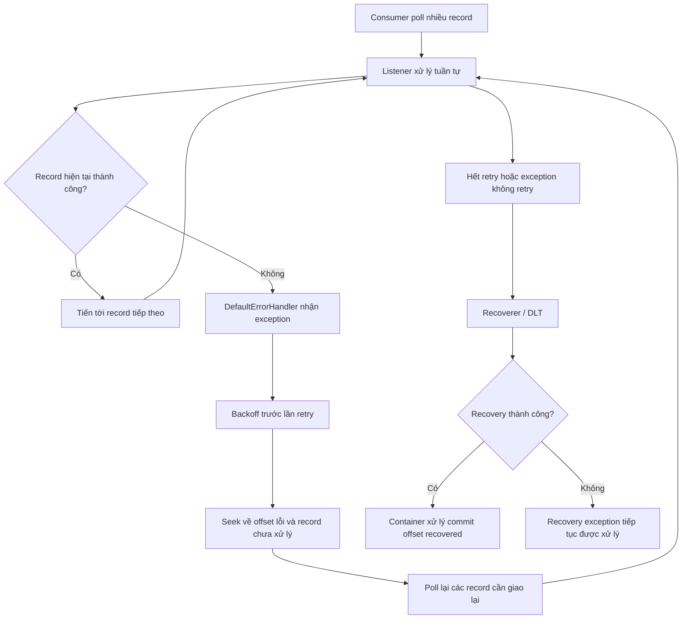

# Retry record theo partition

Trong Spring Kafka, `DefaultErrorHandler` có thể retry một record bị lỗi bằng cách đưa consumer trở lại offset cần xử lý trong partition. Cách retry này dựa trên vị trí offset của từng partition, vì Kafka chỉ bảo đảm thứ tự record bên trong một partition. Khi listener ném exception, error handler quyết định record nào cần được đọc lại, chờ bao lâu giữa các lần thử và điều gì xảy ra khi hết số lần retry.

Retry theo partition giúp giữ thứ tự xử lý của các record trong luồng chính. Nếu record tại offset `25` thất bại, consumer không nên commit vượt qua offset đó khi nghiệp vụ chưa hoàn tất. Với cơ chế seek mặc định, error handler đưa vị trí đọc của partition về record lỗi và các record chưa xử lý phía sau để chúng được giao lại. Sau khi record lỗi xử lý thành công hoặc được recovery theo chính sách, consumer mới tiếp tục tiến qua các offset tiếp theo.

Điều này không có nghĩa mỗi partition có một retry thread riêng. Một Kafka consumer thread có thể sở hữu nhiều partition; khi listener đồng bộ gặp lỗi và error handler đang backoff/retry, thread đó có thể bị giữ lại, làm chậm cả các partition khác được gán cho cùng consumer. Cần hiểu cả ranh giới offset theo partition và phạm vi ảnh hưởng của consumer thread khi chọn retry policy.

## 1. Vì sao retry phải gắn với partition và offset?

Mỗi partition là một log có thứ tự riêng. Record được định vị bằng tổ hợp topic, partition và offset. Ví dụ:

```text
orders.events, partition 0:
  offset 20 -> OrderCreated(A)
  offset 21 -> OrderUpdated(A)
  offset 22 -> OrderPaid(A)

orders.events, partition 1:
  offset 11 -> OrderCreated(B)
  offset 12 -> OrderCancelled(B)
```

Kafka không có một offset toàn cục cho tất cả partition. Offset `22` của partition 0 không có quan hệ thứ tự với offset `12` của partition 1. Consumer group commit vị trí cho từng partition.

Giả sử listener xử lý offset `20` thành công nhưng offset `21` thất bại. Consumer không thể đơn giản commit offset `23` cho partition 0 vì như vậy Kafka sẽ xem cả offset `21` và `22` đã được xác nhận. Khi process restart, group có thể tiếp tục sau offset `22`, bỏ qua record chưa được xử lý.

Retry theo partition bảo vệ tiến độ này: record lỗi và phần chưa hoàn tất trong partition được giao lại theo offset. Khi listener xử lý thành công record lỗi, các record tiếp theo mới có thể được xử lý theo thứ tự. Cách làm này phù hợp với nghiệp vụ cần bảo toàn thứ tự như các thay đổi trạng thái đơn hàng, tài khoản hoặc aggregate.

## 2. DefaultErrorHandler và cơ chế seek mặc định

Với record listener, Spring Kafka gọi `DefaultErrorHandler` khi listener ném exception. Ở chế độ seek mặc định, handler yêu cầu consumer quay lại vị trí của record lỗi và các record còn lại trong poll chưa được xử lý. Lần poll tiếp theo sẽ giao lại record lỗi và phần còn lại theo assignment của consumer.

Ví dụ consumer poll nhận:

```text
Partition 0: offset 10, 11, 12
Partition 1: offset 30, 31
```

Listener xử lý thành công offset `10`, sau đó offset `11` ném exception. Container chuyển exception đến `DefaultErrorHandler`. Handler có thể giữ tiến độ offset `10`, seek partition 0 về offset `11` và seek các partition có record còn lại về vị trí chưa xử lý tương ứng. Khi poll tiếp theo diễn ra, consumer đọc lại phần chưa hoàn tất.



Seek là thao tác đặt vị trí đọc của consumer cho partition. Nó không xóa record khỏi Kafka và không tạo bản sao mới trong topic. Record được giao lại từ log gốc, giữ nguyên topic, partition và offset nguồn.

### Retry record lỗi trước khi đi tiếp

Với listener đồng bộ, handler thực hiện retry theo luồng xử lý của consumer. Khi record lỗi được seek về vị trí cần đọc lại, record đó sẽ được giao lại trong poll tiếp theo. Record phía sau trong cùng partition chưa được xem là hoàn tất nếu nó chưa được xử lý thành công.

Nếu lỗi tạm thời được khắc phục ở lần retry, listener tiếp tục xử lý record lỗi và sau đó xử lý các record phía sau. Nếu lỗi vẫn tồn tại đến khi hết retry, handler gọi recoverer theo cấu hình, ví dụ chuyển record lỗi sang DLT.

### Các partition khác trong cùng poll

Một poll có thể trả record từ nhiều partition. Khi listener lỗi ở một record, các record còn lại của poll chưa được xử lý cũng cần được xử lý lại theo vị trí tương ứng. Điều này giúp container không bỏ qua dữ liệu chưa hoàn tất.

Tuy nhiên, không có thứ tự toàn cục giữa các partition. Handler quản lý vị trí riêng của từng partition; một record offset thấp hơn trong partition 0 không nhất thiết phải được xử lý trước mọi record trong partition 1. Thứ tự chỉ được bảo đảm bên trong từng partition.

## 3. Cấu hình DefaultErrorHandler với retry và backoff

`DefaultErrorHandler` cho phép cấu hình `BackOff` để quyết định khoảng chờ và số lần thử lại. Nên khai báo rõ retry policy thay vì phụ thuộc vào giá trị mặc định, vì số lần thử và thời gian chờ phải phù hợp với SLA và loại lỗi.

Ví dụ cấu hình ba lần retry sau lần gọi đầu tiên, chờ cố định một giây giữa các lần thử và chuyển record sang DLT khi hết lượt:

```java
@Bean
DefaultErrorHandler kafkaErrorHandler(
        KafkaTemplate<Object, Object> kafkaTemplate) {

    DeadLetterPublishingRecoverer recoverer =
            new DeadLetterPublishingRecoverer(
                    kafkaTemplate,
                    (record, exception) -> new TopicPartition(
                            record.topic() + ".DLT",
                            record.partition()));

    DefaultErrorHandler handler = new DefaultErrorHandler(
            recoverer,
            new FixedBackOff(1_000L, 3L));

    return handler;
}
```

Các lớp cần import gồm `DefaultErrorHandler`, `DeadLetterPublishingRecoverer`, `FixedBackOff` và `TopicPartition`. Ví dụ sử dụng resolver gửi record sang topic có hậu tố `.DLT` và giữ nguyên partition nguồn. Topic DLT phải tồn tại và có đủ partition tương ứng; nếu không, hãy chọn partition hợp lệ bằng resolver riêng.

`FixedBackOff(1_000L, 3L)` có khoảng chờ một giây và tối đa ba lần retry sau lần xử lý ban đầu. Nếu mỗi lần retry vẫn thất bại, recoverer được gọi. Tổng thời gian giữ record trong retry còn phụ thuộc thời gian listener thực thi, thời gian publish DLT và cách container xử lý poll.

### Exponential backoff

Với lỗi phụ thuộc dịch vụ bên ngoài, exponential backoff có thể giảm áp lực lên database hoặc API đang phục hồi. Khoảng chờ tăng sau mỗi lần thất bại và có thể giới hạn bằng thời gian tối đa.

```java
@Bean
DefaultErrorHandler kafkaErrorHandler(
        KafkaTemplate<Object, Object> kafkaTemplate) {

    DeadLetterPublishingRecoverer recoverer =
            new DeadLetterPublishingRecoverer(kafkaTemplate);

    ExponentialBackOffWithMaxRetries backOff =
            new ExponentialBackOffWithMaxRetries(5);
    backOff.setInitialInterval(500L);
    backOff.setMultiplier(2.0);
    backOff.setMaxInterval(8_000L);

    return new DefaultErrorHandler(recoverer, backOff);
}
```

Ví dụ trên cho tối đa năm lần retry với khoảng chờ bắt đầu 500 ms, nhân đôi sau mỗi lần và không vượt 8 giây. Các giá trị là minh họa; chọn chúng dựa trên thời gian phục hồi dự kiến, SLA và tổng thời gian message có thể bị giữ lại.

Nếu nhiều consumer cùng retry tại một thời điểm, backoff cố định có thể làm các request dồn vào downstream theo từng đợt. Có thể thêm jitter ở tầng retry phù hợp hoặc phân tán lịch retry để giảm hiện tượng đồng bộ.

## 4. Phân loại exception trước khi retry

Không phải exception nào cũng nên retry. `DefaultErrorHandler` hỗ trợ phân loại lỗi có thể retry và lỗi không retry. Exception không retry đi thẳng đến recoverer theo policy thay vì giữ partition chờ nhiều lần thử vô ích.

Ví dụ lỗi validation vĩnh viễn có thể được chuyển thẳng DLT:

```java
handler.addNotRetryableExceptions(
        IllegalArgumentException.class,
        BusinessValidationException.class);
```

Trong ứng dụng lớn, nên dùng exception domain cụ thể thay vì đánh dấu `IllegalArgumentException` nếu loại exception này còn được dùng cho lỗi lập trình hoặc tình huống có thể khắc phục. Ví dụ:

| Nhóm exception | Ví dụ | Retry? |
|---|---|---|
| Lỗi tạm thời | Database timeout, network disconnect ngắn | Có giới hạn và backoff. |
| Dependency chưa sẵn sàng | Customer event chưa được áp dụng | Có thể retry theo deadline và yêu cầu thứ tự. |
| Validation vĩnh viễn | Quantity âm, currency không hỗ trợ | Không retry cùng payload; recovery/quarantine. |
| Schema/deserialize failure | Payload sai cấu trúc | Thường không retry; lưu bằng chứng và điều tra. |
| Lỗi xác thực/cấu hình | ACL thiếu quyền, credential sai | Khắc phục cấu hình; retry dày đặc không hữu ích. |

Một lỗi nghiệp vụ có thể là tạm thời nếu phụ thuộc vào event khác. Ví dụ `OrderCreated` đến trước `CustomerCreated`; consumer có thể cần chờ customer được đồng bộ. Nếu retry blocking, record đơn hàng có thể chặn các record phía sau trong partition. Cần kiểm tra thứ tự sự kiện và chọn retry topic hoặc luồng chờ nếu blocking có thể ngăn chính event giải quyết dependency.

## 5. Recovery khi hết retry và commit offset

Khi số lần retry đã hết hoặc exception không retry, `DefaultErrorHandler` gọi recoverer. Recoverer có thể publish record sang DLT, ghi nhận lỗi hoặc thực hiện hành động recovery khác.

Nếu recoverer hoàn tất thành công và error handler trả về bình thường, listener container có thể xem record đã được xử lý theo recovery policy và commit offset tương ứng. Điều đó có nghĩa record đã được bàn giao cho luồng lỗi theo chính sách; không có nghĩa nghiệp vụ gốc thành công.

`CommonErrorHandler`/`DefaultErrorHandler` có thuộc tính `ackAfterHandle`, mặc định là `true`. Khi error handler xử lý xong và trả về bình thường, container có thể commit offset của record được xử lý/recovered theo quy tắc container. Có thể đặt `ackAfterHandle(false)` nếu muốn thay đổi hành vi commit sau khi handler trả về; phải hiểu rõ ai sẽ chịu trách nhiệm xác nhận record trong cấu hình đó.

`commitRecovered` là cơ chế riêng để commit record đã recover trong những cấu hình phù hợp. Khi dùng `commitRecovered=true`, container cần `AckMode.MANUAL_IMMEDIATE`. Không bật thuộc tính này một cách tùy tiện cùng manual acknowledgement; xác định rõ việc commit recovered record được thực hiện ở đâu và vào thời điểm nào.

### DLT publish thất bại

Nếu recoverer không thể publish record sang DLT do broker, ACL, serializer hoặc timeout, recovery chưa hoàn tất. Cần để lỗi recovery được phát hiện và xử lý, không coi record nguồn đã được lưu vào DLT thành công. Nếu offset nguồn được commit khi bản sao DLT chưa tồn tại, message có thể bị mất khỏi luồng xử lý chính mà không có bản lưu để điều tra.

Với `DeadLetterPublishingRecoverer`, kiểm tra kết quả gửi theo API của phiên bản Spring Kafka đang dùng. Cấu hình recoverer và error handler để lỗi gửi DLT được truyền ra khi cần, đồng thời cảnh báo khi recovery exception xảy ra.

### Metadata DLT

Khi chuyển record sang DLT, giữ thông tin nguồn để có thể truy vết:

- Topic, partition và offset gốc.
- Key, timestamp và headers gốc.
- `eventId` và correlation ID.
- Exception class, thông điệp lỗi đã được kiểm soát và số lần retry.
- Thời điểm recovery và phiên bản ứng dụng.

Spring Kafka có thể bổ sung các header nguồn và exception thông qua `KafkaHeaders`, ví dụ `DLT_ORIGINAL_TOPIC`, `DLT_ORIGINAL_PARTITION`, `DLT_ORIGINAL_OFFSET` và `DLT_EXCEPTION_FQCN`. Tên và API cụ thể cần đối chiếu theo phiên bản. Không ghi payload nhạy cảm hoặc credential vào header DLT.

## 6. Retry blocking giữ thứ tự nhưng có thể chặn consumer thread

Retry theo seek thường được gọi là blocking retry vì consumer thread xử lý backoff và retry trước khi tiếp tục luồng record chưa hoàn tất. Cơ chế này giữ thứ tự trong partition, nhưng thời gian chờ có thể ảnh hưởng các partition khác được gán cho cùng consumer.

Giả sử một consumer được gán partition 0, 1 và 2. Listener xử lý partition 0 gặp lỗi và backoff 30 giây. Trong khoảng này, consumer thread có thể bị giữ trong error handling; các partition 1 và 2 cũng có thể không được xử lý trong thời gian dự kiến. Nếu consumer có nhiều partition, một record lỗi có thể làm lag tăng trên nhiều partition cùng consumer.

### Backoff dài và ContainerPausingBackOffHandler

Backoff handler mặc định có thể chờ trên consumer thread. Với khoảng chờ dài, việc giữ thread có thể ảnh hưởng heartbeat/poll và dẫn đến vượt `max.poll.interval.ms` tùy cấu hình.

Spring Kafka cung cấp `ContainerPausingBackOffHandler` trong các phiên bản phù hợp. Handler này pause listener container trong khoảng backoff và tiếp tục poll để giữ consumer group hoạt động, sau đó resume để retry. Thời gian pause thực tế phụ thuộc chu kỳ poll và cấu hình container.

Ví dụ cấu hình:

```java
@Bean
DefaultErrorHandler kafkaErrorHandler(
        KafkaTemplate<Object, Object> kafkaTemplate) {

    DeadLetterPublishingRecoverer recoverer =
            new DeadLetterPublishingRecoverer(kafkaTemplate);

    ExponentialBackOffWithMaxRetries backOff =
            new ExponentialBackOffWithMaxRetries(4);
    backOff.setInitialInterval(10_000L);
    backOff.setMultiplier(2.0);
    backOff.setMaxInterval(60_000L);

    return new DefaultErrorHandler(
            recoverer,
            backOff,
            new ContainerPausingBackOffHandler());
}
```

Kiểm tra constructor và package của `ContainerPausingBackOffHandler` theo phiên bản Spring Kafka đang sử dụng. Cần tính đến `pollTimeout` của container khi đánh giá độ chính xác của thời gian chờ.

Pause container không tạo thêm consumer thread. Nó giúp container duy trì poll trong khi chờ, nhưng record lỗi vẫn đang chờ retry và partition chưa được giải phóng cho consumer khác chỉ vì đã pause.

## 7. SeekAfterError và retained records

Ở chế độ mặc định, `DefaultErrorHandler` dùng seek để đặt lại vị trí đọc của consumer. Trong các phiên bản Spring Kafka hỗ trợ `seekAfterError=false`, handler có thể giữ lại các record chưa xử lý trong bộ nhớ của container thay vì seek consumer về offset cũ. Container thực hiện một lần poll để duy trì consumer group rồi giao lại các record được giữ.

Hai cách có khác biệt vận hành:

| Cách xử lý | Cơ chế | Điểm cần chú ý |
|---|---|---|
| Seek (mặc định) | Đặt consumer position về offset lỗi và các record chưa xử lý | Record được lấy lại từ Kafka ở poll tiếp theo; cần quan sát seek/re-delivery. |
| Retained records (`seekAfterError=false`) | Giữ các record chưa xử lý trong bộ nhớ và giao lại sau một poll duy trì group | Tăng nhu cầu bộ nhớ theo số lượng/kích thước record đang giữ; cần đánh giá khi batch lớn hoặc record lớn. |

Ví dụ:

```java
DefaultErrorHandler handler = new DefaultErrorHandler(
        recoverer,
        new FixedBackOff(1_000L, 3L));

handler.setSeekAfterError(false);
```

Chỉ dùng thuộc tính này khi phiên bản Spring Kafka hỗ trợ. Cách retained records không biến retry thành xử lý song song; consumer thread vẫn điều phối listener và các lần giao lại. Cần theo dõi heap và kích thước batch nếu chọn giữ record trong bộ nhớ.

## 8. Batch listener và record lỗi trong partition

Với batch listener, một lần gọi listener có thể nhận nhiều record từ nhiều partition. Nếu listener ném exception thông thường, error handler có thể không biết chính xác record nào trong batch gây lỗi. Trong trường hợp đó, toàn bộ batch có thể được retry theo policy.

Nếu listener biết record lỗi, có thể ném `BatchListenerFailedException` kèm record hoặc index của record đó. `DefaultErrorHandler` có thể commit phần record trước lỗi đã xử lý thành công và seek/retry record lỗi cùng phần còn lại.

```java
@KafkaListener(topics = "orders.events")
public void onBatch(List<ConsumerRecord<String, OrderEvent>> records) {
    for (int index = 0; index < records.size(); index++) {
        ConsumerRecord<String, OrderEvent> record = records.get(index);
        try {
            orderService.processIdempotently(record.value());
        }
        catch (RuntimeException exception) {
            throw new BatchListenerFailedException(
                    "Could not process order event", exception, index);
        }
    }
}
```

Constructor của `BatchListenerFailedException` có thể khác theo phiên bản; dùng overload tương ứng. Batch listener cần được cấu hình đúng kiểu. Nếu xử lý song song các record trong batch, index lỗi và thứ tự hoàn tất phải được quản lý chính xác; không báo một record lỗi khi các record trước nó chưa hoàn tất.

### Nhiều partition trong cùng batch

Một batch có thể chứa record từ nhiều partition. Error handler cần giữ tiến độ offset riêng cho từng partition. Không cộng hoặc so sánh offset giữa partition khác nhau. Khi có lỗi, hãy xác định record lỗi bằng cả topic, partition và offset hoặc index trong batch theo API hỗ trợ.

## 9. Retry theo partition khác retry topic như thế nào?

Retry theo seek giữ record lỗi trong luồng chính và xử lý lại trước khi consumer tiếp tục qua phần chưa hoàn tất của partition. Điều này giúp giữ thứ tự trong partition nhưng có thể chặn record phía sau và ảnh hưởng consumer thread.

Non-blocking retry với `@RetryableTopic` chuyển record sang retry topic để xử lý sau. Consumer của topic gốc có thể tiếp tục với record phía sau; do đó record mới hơn có thể được xử lý trước record đang retry. Đây là trade-off quan trọng khi nghiệp vụ phụ thuộc thứ tự.

| Tiêu chí | Retry theo partition/seek | Retry topic |
|---|---|---|
| Nơi lưu record chờ retry | Topic gốc, tại offset cần xử lý lại | Topic retry riêng |
| Thứ tự trong partition gốc | Giữ luồng record chưa hoàn tất theo offset | Có thể xử lý record sau trước record đang retry |
| Ảnh hưởng consumer | Backoff/retry có thể giữ consumer thread | Consumer topic gốc có thể tiếp tục; retry topic có consumer riêng |
| Thời gian chờ dài | Cần backoff handler phù hợp, có thể pause container | Có thể định tuyến qua các retry topic với delay |
| Độ phức tạp vận hành | Quản lý seek, retry và recovery trong container | Quản lý nhiều topic, routing, retention và ordering |

Không kết hợp blocking retry và retry topic một cách tùy tiện. Hãy xác định tổng số lần thử, deadline, nơi lưu message và hành vi sau khi hết retry.

## 10. Offset, idempotency và xử lý trùng

Retry theo partition có thể giao lại cùng một record nhiều lần. Ngay cả khi listener xử lý thành công, process vẫn có thể dừng trước khi offset commit. Sau restart, Kafka giao lại record từ committed offset cũ.

Vì vậy, consumer cần idempotency. Một cách phổ biến là dùng `eventId` ổn định và ghi vào inbox table có unique constraint trong cùng transaction database với cập nhật nghiệp vụ. Khi retry hoặc replay, event ID đã tồn tại sẽ ngăn tác động nghiệp vụ bị lặp.

Không dùng offset làm định danh nghiệp vụ duy nhất vì offset chỉ duy nhất trong phạm vi partition của topic. Một khóa nhận diện nguồn có thể là topic + partition + offset, nhưng event ID ổn định hữu ích hơn khi cùng sự kiện được publish lại hoặc chuyển sang DLT/retry topic.

Nếu listener gọi API ngoài Kafka, hãy dùng idempotency key mà API đích hỗ trợ hoặc lưu yêu cầu vào outbox trong transaction database. Kafka offset commit không thể rollback một API call đã thành công.

## 11. Cấu hình tham khảo đầy đủ

Ví dụ Spring Boot cho record listener với auto commit tắt và container concurrency bằng hai:

```yaml
spring:
  kafka:
    consumer:
      group-id: orders-service
      enable-auto-commit: false
      max-poll-records: 100
      properties:
        "max.poll.interval.ms": 300000
    listener:
      ack-mode: record
      concurrency: 2
```

Error handler được cấu hình với retry có giới hạn:

```java
@Bean
DefaultErrorHandler ordersErrorHandler(
        KafkaTemplate<Object, Object> kafkaTemplate) {

    DeadLetterPublishingRecoverer recoverer =
            new DeadLetterPublishingRecoverer(
                    kafkaTemplate,
                    (record, exception) -> new TopicPartition(
                            record.topic() + ".DLT",
                            record.partition()));

    ExponentialBackOffWithMaxRetries backOff =
            new ExponentialBackOffWithMaxRetries(4);
    backOff.setInitialInterval(1_000L);
    backOff.setMultiplier(2.0);
    backOff.setMaxInterval(10_000L);

    DefaultErrorHandler handler =
            new DefaultErrorHandler(recoverer, backOff);

    handler.addNotRetryableExceptions(
            BusinessValidationException.class);

    return handler;
}
```

Các giá trị timeout, retry và concurrency trong ví dụ cần được điều chỉnh theo SLA, partition count, tốc độ publish và năng lực downstream. DLT cần được tạo trước, có replication/retention phù hợp và ACL cho producer gửi DLT cũng như operator replay.

Không áp dụng `DefaultErrorHandler` như error handler thông thường cho transactional listener container mà không kiểm tra mô hình transaction. Với listener transactional, lỗi thường làm transaction rollback và được xử lý bởi `AfterRollbackProcessor`/`DefaultAfterRollbackProcessor` theo cấu hình riêng.

## 12. Observability cho retry theo partition

Đội vận hành cần biết partition nào đang retry, record nào bị lỗi, đã thử bao nhiêu lần và offset có tiến sau recovery hay không.

| Phạm vi | Tín hiệu cần theo dõi | Ý nghĩa |
|---|---|---|
| Record lỗi | Topic, partition, offset, key, `eventId`, exception type | Xác định chính xác record đang chặn luồng. |
| Retry | Attempt count, backoff duration, thời gian từ lần lỗi đầu | Phát hiện retry kéo dài hoặc lỗi lặp liên tục. |
| Partition | Lag, committed offset, current position, assignment | Xác định partition có tiến triển hay đang bị giữ tại một offset. |
| Consumer | Thread name, listener ID, poll interval, processing duration | Phát hiện một consumer thread bị giữ bởi backoff hoặc listener chậm. |
| Recovery | DLT publish result, recovery exception, recovered count | Xác nhận record đã được lưu bền vững trước khi offset nguồn tiến. |
| Downstream | Database/API latency, timeout, pool utilization | Tìm nguyên nhân gốc khiến listener thất bại. |
| Group | Rebalance count, revoked/assigned partition, consumer lag | Phát hiện retry kéo dài gây ảnh hưởng group. |

Log nên có topic, partition, offset, event ID, attempt, backoff, exception class, consumer group và thread name. Không log toàn bộ payload nếu có dữ liệu nhạy cảm. Metric label nên có cardinality hữu hạn như topic, exception type hoặc error category; dùng event ID và offset trong log/trace thay vì label metric.

Đặt cảnh báo khi cùng một partition giữ lag tăng kéo dài, một offset lỗi lặp quá số lần dự kiến, DLT publish thất bại, retry age vượt SLA hoặc consumer thường xuyên vượt `max.poll.interval.ms`.

## 13. Runbook theo tình huống

### Một record liên tục được giao lại

1. Ghi nhận topic, partition, offset, event ID và exception class.
2. Xác định lỗi xảy ra trong listener hay trong error handler/recoverer.
3. Kiểm tra BackOff, số attempt, exception classification và trạng thái seek.
4. Xác định lỗi tạm thời hay permanent; sửa nguyên nhân hoặc đưa exception vào nhóm không retry.
5. Kiểm tra offset nguồn có tiến sau recovery và DLT publish có thành công không.

### Lag tăng trên nhiều partition của cùng consumer

1. Xác định các partition được gán cho consumer/thread đang xử lý record lỗi.
2. Kiểm tra backoff hiện tại và thời gian listener xử lý.
3. Kiểm tra consumer thread có bị giữ trong blocking retry hay không.
4. Nếu backoff dài, đánh giá `ContainerPausingBackOffHandler` hoặc retry topic phù hợp với ordering requirement.
5. Theo dõi lag theo partition sau khi thay đổi policy.

### Record phía sau bị chặn bởi dependency chưa sẵn sàng

1. Xác định record lỗi đang chờ dependency nào.
2. Kiểm tra event cần tạo dependency có nằm phía sau trong cùng partition không.
3. Nếu blocking retry ngăn event đó được xử lý, cân nhắc retry topic hoặc luồng chờ riêng.
4. Đặt retry deadline và hành động khi hết hạn.
5. Kiểm tra thứ tự nghiệp vụ sau khi thay đổi retry strategy.

### Offset tiến sau khi DLT publish thất bại

1. Ghi lại source topic/partition/offset và exception recovery.
2. Kiểm tra DLT producer, serializer, topic, partition resolver và ACL.
3. Kiểm tra error handler có nhận diện send failure hay không.
4. Xác nhận offset nguồn không được commit như recovery thành công khi DLT chưa được lưu.
5. Khôi phục publish, để record được xử lý lại và đối chiếu DLT metadata.

### Retry làm consumer vượt max.poll.interval.ms

1. Đối chiếu tổng thời gian backoff, xử lý listener và `max.poll.interval.ms`.
2. Xác định backoff handler đang sleep trên consumer thread hay pause container.
3. Nếu delay dài, xem xét `ContainerPausingBackOffHandler` hoặc retry topic.
4. Chỉ tăng `max.poll.interval.ms` khi đã đo thời gian xử lý và đánh giá failover.
5. Theo dõi rebalance, lag và duplicate delivery sau điều chỉnh.

## 14. Bảng kiểm soát retry record theo partition

| Điểm kiểm soát | Câu hỏi cần trả lời | Bằng chứng vận hành |
|---|---|---|
| Partition identity | Record lỗi thuộc topic, partition và offset nào? | ConsumerRecord metadata và event ID. |
| Seek | Handler có seek về offset lỗi và phần chưa xử lý không? | Error handler logs, consumer position và redelivery. |
| Ordering | Record phía sau có bị xử lý trước record lỗi không? | Timeline theo partition/offset. |
| Retry policy | Số lần thử, backoff và exception classification có phù hợp không? | BackOff config, attempt count và exception type. |
| Consumer thread | Blocking retry có ảnh hưởng partition khác cùng consumer không? | Thread name, processing latency và lag theo partition. |
| Recovery | DLT đã được publish thành công trước khi commit offset nguồn chưa? | DLT send result, recovery exception và committed offset. |
| Batch | Listener có xác định đúng record lỗi trong batch không? | `BatchListenerFailedException`, index và partition metadata. |
| Transaction | Listener có chạy trong Kafka transaction không? | Transaction manager và AfterRollbackProcessor config. |
| Idempotency | Record giao lại có lặp tác động nghiệp vụ không? | Inbox/deduplication, event ID và kết quả nghiệp vụ. |

Retry record theo partition giúp giữ tiến độ và thứ tự trong từng partition khi listener gặp lỗi. `DefaultErrorHandler` kết hợp seek, backoff, exception classification và recoverer để quyết định record nào được giao lại và khi nào offset có thể tiến. Khi vận hành, cần theo dõi cả partition đang retry lẫn consumer thread sở hữu nó, vì một lần backoff có thể làm chậm các partition khác trên cùng consumer. Retry có giới hạn, recovery bền vững, idempotency và quan sát offset theo partition giúp luồng xử lý phục hồi mà không bỏ qua message chưa hoàn tất.
