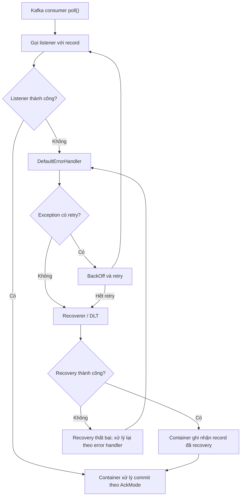

# DefaultErrorHandler và Boot auto-configuration

`DefaultErrorHandler` là implementation của `CommonErrorHandler` trong Spring Kafka, dùng để quyết định cách listener container xử lý record khi listener ném exception. Nó kết hợp chính sách retry, backoff và recovery để ứng dụng có thể thử lại lỗi tạm thời, phân loại lỗi không nên retry và chuyển record không thể xử lý sang dead-letter topic (DLT).

Trong Spring Boot, listener container factory mặc định được cấu hình tự động từ các thuộc tính `spring.kafka.*`. Nếu ứng dụng khai báo một bean `CommonErrorHandler`, Boot có thể gắn bean đó vào factory tự động cấu hình. Vì `DefaultErrorHandler` triển khai `CommonErrorHandler`, ứng dụng thường chỉ cần khai báo bean `DefaultErrorHandler` để áp dụng một chính sách lỗi dùng chung cho các listener mặc định.

Cần phân biệt hai việc: Boot tạo và cấu hình listener container factory; ứng dụng quyết định chính sách retry/recovery phù hợp với nghiệp vụ. Việc có auto-configuration không có nghĩa mọi exception đều được retry theo chính sách mong muốn của doanh nghiệp.

## 1. DefaultErrorHandler nằm ở đâu trong luồng xử lý?

Listener container gọi Kafka consumer để nhận record, sau đó chuyển record đến phương thức listener. Nếu listener trả về bình thường, container tiếp tục theo AckMode và commit policy đã cấu hình. Nếu listener ném exception, container chuyển lỗi cho `CommonErrorHandler`.

`DefaultErrorHandler` xử lý record thất bại theo các bước tổng quát:

1. Nhận exception và record (hoặc batch) liên quan.
2. Xác định exception có được retry hay thuộc nhóm không retry.
3. Áp dụng `BackOff` để quyết định số lần và khoảng chờ retry.
4. Nếu một lần retry thành công, container tiếp tục xử lý theo luồng bình thường.
5. Nếu hết retry, gọi recoverer để xử lý record thất bại.
6. Sau recovery thành công, container xử lý offset theo cấu hình error handler và listener container.

Sơ đồ record listener:



Sơ đồ mô tả ý tưởng chung. Chi tiết seek, commit, pause và redelivery phụ thuộc listener type, AckMode, BackOffHandler, recoverer và phiên bản Spring Kafka.

## 2. DefaultErrorHandler và CommonErrorHandler

Từ Spring Kafka 2.8, `DefaultErrorHandler` là error handler tiêu chuẩn cho record và batch listener. Nó thay thế các error handler cũ như `SeekToCurrentErrorHandler` trong các cấu hình hiện đại.

`CommonErrorHandler` là interface chung mà listener container sử dụng. Một ứng dụng có thể cung cấp implementation riêng, nhưng trong nhiều hệ thống, `DefaultErrorHandler` đáp ứng được các nhu cầu retry và recovery thông dụng.

| Thành phần | Trách nhiệm |
|---|---|
| `CommonErrorHandler` | Hợp đồng xử lý exception mà listener container gọi |
| `DefaultErrorHandler` | Retry, backoff, phân loại exception và gọi recoverer |
| `BackOff` | Xác định thời gian chờ và số lần thử lại |
| `ConsumerRecordRecoverer` | Xử lý record sau khi retry không còn tiếp tục |
| `DeadLetterPublishingRecoverer` | Gửi record thất bại sang DLT |
| `ConcurrentKafkaListenerContainerFactory` | Gắn error handler vào container được tạo từ factory |

`DefaultErrorHandler` không xử lý logic nghiệp vụ thay cho listener. Listener vẫn chịu trách nhiệm ném exception khi nghiệp vụ chưa hoàn tất và không được âm thầm bỏ qua lỗi nếu muốn error handler retry.

## 3. Hành vi mặc định

Khi tạo `DefaultErrorHandler` mà không truyền tham số, handler dùng chính sách mặc định của Spring Kafka. Trong các phiên bản hiện đại, cấu hình mặc định thường tương đương `FixedBackOff(0L, 9L)`: lần gọi listener đầu tiên cộng với tối đa chín lần retry, không chờ giữa các lần retry. Sau khi hết retry, recoverer mặc định ghi log record thất bại.

Điều này có nghĩa một record có thể được listener gọi tổng cộng mười lần trong tình huống lỗi liên tục: một lần ban đầu và chín lần retry. Hãy xác nhận Javadoc của phiên bản đang chạy trước khi dựa vào default này trong production.

Không nên coi số lần retry mặc định là chính sách nghiệp vụ. Một lỗi timeout có thể cần backoff; một lỗi dữ liệu cố định thường không có ích khi retry liên tục. Ứng dụng nên cấu hình số lần thử và hành động cuối cùng dựa trên loại exception và mức độ quan trọng của event.

## 4. Cấu hình retry bằng BackOff

Spring Kafka dùng abstraction `BackOff` để xác định thời gian chờ và số lần retry.

### 4.1. FixedBackOff

`FixedBackOff` lặp lại với một khoảng chờ cố định:

```java
BackOff backOff = new FixedBackOff(
        1_000L, // chờ 1 giây giữa các lần retry
        3L      // tối đa 3 lần retry sau lần gọi đầu
);

DefaultErrorHandler errorHandler =
        new DefaultErrorHandler(backOff);
```

Với cấu hình này, listener có một lần xử lý ban đầu và tối đa ba lần retry. Nếu tất cả lần gọi đều thất bại, handler chuyển sang recovery.

### 4.2. ExponentialBackOffWithMaxRetries

Khi lỗi phụ thuộc có thể cần thời gian phục hồi tăng dần, dùng exponential backoff:

```java
ExponentialBackOffWithMaxRetries backOff =
        new ExponentialBackOffWithMaxRetries(5);

backOff.setInitialInterval(500L);
backOff.setMultiplier(2.0);
backOff.setMaxInterval(10_000L);

DefaultErrorHandler errorHandler =
        new DefaultErrorHandler(backOff);
```

Khoảng chờ tăng từ 500 ms, nhân đôi qua mỗi lần retry và bị giới hạn ở 10 giây. Số lần retry tối đa được chỉ định khi tạo `ExponentialBackOffWithMaxRetries`.

Exponential backoff giúp giảm áp lực lên dịch vụ đang gặp sự cố. Tuy nhiên, tổng thời gian retry phải phù hợp với timeout của nghiệp vụ, `max.poll.interval.ms`, thời gian xử lý của consumer và yêu cầu độ trễ.

### 4.3. Backoff không đồng nghĩa với timeout nghiệp vụ

Backoff chỉ quyết định khi nào thử lại. Nó không tự đặt timeout cho database, HTTP call hoặc logic trong listener. Hãy cấu hình timeout riêng cho dependency để một lần xử lý không bị treo vô hạn.

Nếu khoảng chờ retry dài hơn thời gian poll cho phép, cân nhắc `ContainerPausingBackOffHandler`. Cơ chế này dùng pause/resume container để hỗ trợ backoff dài mà không giữ consumer thread ngủ trong toàn bộ khoảng chờ. Việc pause vẫn phải được kiểm tra với polling, heartbeat và thời gian xử lý thực tế.

## 5. Phân loại exception: lỗi nào retry, lỗi nào bỏ qua retry?

Không phải mọi exception đều có cùng ý nghĩa. `DefaultErrorHandler` có cơ chế phân loại exception để quyết định retry.

Một số lỗi thường được coi là không retry theo cấu hình mặc định của Spring Kafka, gồm các lỗi chuyển đổi/deserialization hoặc lỗi không thể khắc phục bằng cách giao lại cùng record, chẳng hạn:

- `DeserializationException`
- `MessageConversionException`
- `ConversionException`
- `MethodArgumentResolutionException`
- `NoSuchMethodException`
- `ClassCastException`

Danh sách cụ thể có thể thay đổi theo phiên bản. Ý tưởng chung là lỗi dữ liệu hoặc lỗi ánh xạ cố định thường được chuyển sang recovery sớm, còn lỗi tạm thời có thể retry.

### 5.1. Đánh dấu exception không retry

Dùng `addNotRetryableExceptions()` để bổ sung các loại exception không nên retry:

```java
DefaultErrorHandler errorHandler =
        new DefaultErrorHandler(
                new FixedBackOff(1_000L, 3L)
        );

errorHandler.addNotRetryableExceptions(
        InvalidOrderException.class,
        UnsupportedEventVersionException.class
);
```

Nếu listener ném `InvalidOrderException`, handler chuyển sang recovery theo cấu hình thay vì chờ ba lần retry.

### 5.2. Đánh dấu exception có thể retry

Dùng `addRetryableExceptions()` cho các loại exception cần được retry theo BackOff:

```java
errorHandler.addRetryableExceptions(
        TemporaryInventoryUnavailableException.class,
        RemoteServiceTimeoutException.class
);
```

Việc phân loại cần xét exception lồng nhau. Ví dụ, listener có thể ném `RuntimeException` bao quanh `SocketTimeoutException`. Hãy xác nhận handler phân loại đúng exception cause trong cấu trúc lỗi thực tế.

### 5.3. Cấu hình bảng phân loại

Khi cần kiểm soát toàn bộ chính sách, có thể dùng `setClassifications()` với map exception và cờ retry:

```java
Map<Class<? extends Throwable>, Boolean> classifications =
        new HashMap<>();

classifications.put(InvalidOrderException.class, false);
classifications.put(RemoteServiceTimeoutException.class, true);

errorHandler.setClassifications(classifications, true);
```

Tham số mặc định ở đây xác định cách xử lý các exception không có trong map. Đặt `true` có nghĩa exception chưa phân loại được retry; đặt `false` có nghĩa không retry. Hãy chọn rõ giá trị mặc định để không vô tình retry mọi lỗi không dự kiến.

Nếu dùng `addNotRetryableExceptions()` hoặc `addRetryableExceptions()`, hãy kiểm tra quy tắc mặc định của handler để hiểu exception chưa được khai báo sẽ đi theo nhánh nào.

## 6. Recoverer và dead-letter topic

Khi retry hết hoặc exception được phân loại là không retry, handler gọi recoverer. Recoverer là nơi ứng dụng quyết định phải làm gì với record không thể xử lý.

### 6.1. Recoverer mặc định

Nếu không truyền recoverer, `DefaultErrorHandler` dùng logging recoverer. Nó ghi lại thông tin record và exception sau khi retry kết thúc.

Logging giúp điều tra nhưng không tạo ra một luồng xử lý lại bền vững. Nếu message quan trọng, cần cân nhắc DLT hoặc một kho lưu trữ lỗi có thể truy vấn.

### 6.2. DeadLetterPublishingRecoverer

`DeadLetterPublishingRecoverer` gửi record lỗi sang một topic khác. Cấu hình phổ biến:

```java
@Bean
DefaultErrorHandler kafkaErrorHandler(
        KafkaTemplate<Object, Object> kafkaTemplate) {

    DeadLetterPublishingRecoverer recoverer =
            new DeadLetterPublishingRecoverer(kafkaTemplate);

    FixedBackOff backOff = new FixedBackOff(1_000L, 3L);

    return new DefaultErrorHandler(recoverer, backOff);
}
```

Với resolver mặc định, record thường được gửi sang topic có hậu tố `.DLT`, cùng partition number nếu topic đích có partition tương ứng. Ví dụ `orders.created` có thể được chuyển sang `orders.created.DLT`.

Trong production, nên kiểm tra topic DLT đã được tạo và có đủ partition. Có thể cấu hình destination resolver riêng nếu cần quy ước tên topic, partition hoặc route theo loại lỗi.

### 6.3. Tùy chỉnh destination resolver

Có thể chọn DLT dựa trên topic và partition:

```java
DeadLetterPublishingRecoverer recoverer =
        new DeadLetterPublishingRecoverer(
                kafkaTemplate,
                (record, exception) ->
                        new TopicPartition(
                                record.topic() + ".DLT",
                                record.partition()
                        )
        );
```

Đây là ví dụ đơn giản gửi vào DLT cùng partition index. Nếu topic đích không có partition tương ứng, publish có thể thất bại. Với nhiều topic có số partition khác nhau, resolver cần tính toán partition đích hợp lệ hoặc dùng chiến lược routing khác.

### 6.4. Metadata trong DLT

Spring Kafka có thể thêm headers mô tả record gốc và exception, chẳng hạn topic/partition/offset gốc, exception class, exception message và stack trace. Các header này giúp nhóm vận hành tìm nguyên nhân và quyết định replay.

Khi đọc DLT, không chỉ nhìn payload. Hãy kiểm tra header để biết record đến từ topic nào, offset nào, lỗi nào và đã đi qua quy trình retry nào.

### 6.5. DLT không tự giải quyết lỗi

Một record được publish vào DLT vẫn cần quy trình vận hành:

- Alert khi số lượng DLT tăng.
- Dashboard theo dõi DLT theo topic và loại exception.
- Quy trình điều tra payload và dữ liệu liên quan.
- Cách sửa dữ liệu hoặc code trước khi replay.
- Cơ chế replay có idempotency để tránh tác dụng phụ trùng.
- Retention và quyền truy cập phù hợp.

Không nên replay tự động vô hạn một record chưa sửa nguyên nhân gốc. Điều đó có thể tạo vòng lặp lỗi và tăng tải cho hệ thống.

## 7. Commit offset sau retry và recovery

Retry và recovery liên quan trực tiếp đến offset. Cần phân biệt record đã được xử lý thành công, record đang chờ retry và record đã được recover.

Với record listener, container và error handler phối hợp seek/commit để record thất bại có thể được giao lại. Mặc định, `DefaultErrorHandler` thường seek về offset của record thất bại và các record chưa xử lý trong poll để consumer đọc lại sau đó.

Khi recoverer trả về bình thường, handler xem recovery đã thành công. `DefaultErrorHandler` có cấu hình `ackAfterHandle` để quyết định container có commit offset của record được handler xử lý xong hay không; mặc định là true. Với các chế độ acknowledgement đặc biệt, cần xem thêm `commitRecovered` và yêu cầu AckMode tương ứng.

Không nên tự giả định rằng DLT publish và offset commit là một transaction nguyên tử trong mọi cấu hình. Nếu cần phối hợp Kafka output và offset đầu vào theo transaction, hãy thiết kế transactional listener container và producer transaction rõ ràng.

### 7.1. Recovery thất bại

Nếu recoverer ném exception, recovery chưa hoàn tất. Handler có thể đưa record trở lại luồng retry theo chính sách phục hồi. Vì vậy, DLT publisher cũng cần có retry/monitoring phù hợp; nếu DLT broker hoặc topic gặp sự cố, không được coi record đã được xử lý thành công.

### 7.2. Seek sau lỗi và giữ record trong bộ nhớ

Mặc định, error handler dùng seek để consumer đọc lại record lỗi và các record chưa xử lý. Trong các phiên bản Spring Kafka hỗ trợ, có thể đặt `seekAfterError=false` để container giữ các record chưa xử lý trong bộ nhớ và chuyển lại cho listener sau một lần poll cần thiết.

Cách giữ record có thể giảm một số seek, nhưng thay đổi cách container quản lý record đang chờ. Nó không loại bỏ retry, backoff, commit hoặc khả năng redelivery. Kiểm thử với lượng record lớn, rebalance và shutdown trước khi thay đổi trong production.

## 8. Record listener và batch listener

`DefaultErrorHandler` hỗ trợ cả record listener và batch listener, nhưng container cần biết record nào trong batch đã thất bại.

### 8.1. Record listener

Với record listener, một lần gọi callback nhận một record. Nếu callback ném exception, error handler biết chính xác record đang thất bại và có thể retry record đó theo chính sách.

### 8.2. Batch listener

Với batch listener, một lần callback nhận nhiều record. Nếu listener ném exception chung mà không chỉ ra record thất bại, handler không thể biết phần tử nào gây lỗi. Trong trường hợp đó, batch có thể được retry như một đơn vị.

Nếu listener xác định được record lỗi, có thể ném `BatchListenerFailedException` với record hoặc index tương ứng:

```java
@KafkaListener(topics = "orders.created")
public void consume(List<ConsumerRecord<String, OrderCreated>> records) {
    for (int index = 0; index < records.size(); index++) {
        ConsumerRecord<String, OrderCreated> record = records.get(index);

        try {
            orderService.process(record.value());
        }
        catch (Exception ex) {
            throw new BatchListenerFailedException(
                    "Cannot process order",
                    ex,
                    index
            );
        }
    }
}
```

Khi có thông tin index, handler có thể xử lý các record trước phần tử lỗi và áp dụng retry/recovery cho record thất bại cùng phần còn lại theo cơ chế batch.

Không được bắt exception rồi bỏ qua nếu record chưa được xử lý. Với batch listener, hãy xác định rõ phần tử đã hoàn tất, phần tử lỗi và phần tử chưa chạy để tránh commit offset vượt quá tiến độ nghiệp vụ.

## 9. Tích hợp với Spring Boot auto-configuration

Spring Boot tự động cấu hình các thành phần Kafka khi có dependency và các điều kiện auto-configuration phù hợp. Trong cấu hình listener thông thường, Boot tạo một `ConcurrentKafkaListenerContainerFactory` mặc định (thường có tên `kafkaListenerContainerFactory`) và áp dụng các thuộc tính `spring.kafka.*`.

Một bean triển khai `CommonErrorHandler` có thể được gắn vào factory được Boot auto-configure. Vì `DefaultErrorHandler` triển khai interface này, có thể khai báo bean để cung cấp chính sách retry/recovery dùng chung.

### 9.1. Khai báo DefaultErrorHandler bean

Ví dụ:

```java
@Configuration
public class KafkaErrorConfiguration {

    @Bean
    public CommonErrorHandler commonKafkaErrorHandler(
            KafkaTemplate<Object, Object> kafkaTemplate) {

        DeadLetterPublishingRecoverer recoverer =
                new DeadLetterPublishingRecoverer(kafkaTemplate);

        FixedBackOff backOff =
                new FixedBackOff(1_000L, 3L);

        DefaultErrorHandler handler =
                new DefaultErrorHandler(recoverer, backOff);

        handler.addNotRetryableExceptions(
                InvalidOrderException.class
        );

        handler.addRetryableExceptions(
                RemoteServiceTimeoutException.class
        );

        return handler;
    }
}
```

Spring Boot có thể phát hiện bean `CommonErrorHandler` và cấu hình nó vào listener container factory mặc định. Việc trả về kiểu interface giúp thể hiện rõ bean này được dùng như một error handler chung.

Có thể khai báo return type là `DefaultErrorHandler` nếu cần inject implementation cụ thể ở nơi khác. Điều quan trọng là bean phải được Spring quản lý và có thể được factory configurer tìm thấy dưới kiểu `CommonErrorHandler`.

### 9.2. Cấu hình consumer và listener qua YAML

Các thuộc tính nền tảng vẫn cấu hình bằng `application.yml`:

```yaml
spring:
  kafka:
    bootstrap-servers: localhost:9092
    consumer:
      group-id: orders-service
      enable-auto-commit: false
      key-deserializer: org.apache.kafka.common.serialization.StringDeserializer
      value-deserializer: org.springframework.kafka.support.serializer.JsonDeserializer
      properties:
        spring.json.trusted.packages: "com.example.events"
    listener:
      ack-mode: record
      concurrency: 3
      poll-timeout: 1s
```

YAML trên cấu hình Kafka consumer và listener container. Chính sách retry, exception classification và DLT recoverer được khai báo trong bean `CommonErrorHandler` ở ví dụ trước.

Không nhầm `spring.kafka.listener.ack-mode` với cấu hình retry. AckMode quyết định thời điểm container commit offset theo luồng xử lý; error handler quyết định retry/recovery khi listener ném exception.

### 9.3. Boot auto-configuration không tự biết chính sách nghiệp vụ

Boot có thể tạo factory, consumer factory, Kafka template và kết nối các bean mở rộng. Tuy nhiên, Boot không thể tự biết loại lỗi nào là tạm thời đối với nghiệp vụ cụ thể, bao nhiêu lần retry là phù hợp, hay record nào cần chuyển đến DLT nào.

Hãy khai báo `DefaultErrorHandler` bean với BackOff, recoverer và exception classification phù hợp. Nếu không có bean tùy chỉnh, hành vi lỗi phụ thuộc error handler mặc định của Spring Kafka/container và phiên bản đang chạy.

## 10. Tùy chỉnh listener container factory trong Spring Boot

Có trường hợp ứng dụng cần một factory riêng, ví dụ listener orders dùng DLT và retry riêng, trong khi listener audit chỉ log lỗi hoặc có concurrency khác.

Khi tự khai báo factory, có hai cách thường gặp.

### 10.1. Dùng ConcurrentKafkaListenerContainerFactoryConfigurer

Đây là cách phù hợp nếu muốn giữ các thiết lập auto-configured của Boot:

```java
@Bean
public ConcurrentKafkaListenerContainerFactory<String, OrderCreated>
        ordersListenerFactory(
                ConcurrentKafkaListenerContainerFactoryConfigurer configurer,
                ConsumerFactory<String, OrderCreated> consumerFactory,
                CommonErrorHandler commonErrorHandler) {

    var factory =
            new ConcurrentKafkaListenerContainerFactory<String, OrderCreated>();

    configurer.configure(factory, consumerFactory);

    factory.setConcurrency(3);
    factory.setCommonErrorHandler(commonErrorHandler);

    return factory;
}
```

`configurer.configure()` áp dụng các thuộc tính Spring Boot và các thành phần cấu hình được hỗ trợ cho factory. Dòng `setCommonErrorHandler()` thể hiện rõ error handler được dùng cho factory tùy chỉnh.

Sau đó gắn factory vào listener:

```java
@KafkaListener(
    topics = "orders.created",
    groupId = "orders-service",
    containerFactory = "ordersListenerFactory"
)
public void onOrderCreated(OrderCreated event) {
    orderService.process(event);
}
```

Nếu chỉ khai báo bean `CommonErrorHandler` nhưng tự tạo factory mà không dùng Boot configurer và cũng không gọi `setCommonErrorHandler()`, đừng giả định factory tùy chỉnh sẽ tự nhận handler. Kiểm tra cấu hình thực tế của factory.

### 10.2. Nhiều factory với chính sách lỗi khác nhau

Một ứng dụng có thể có nhiều listener factory:

| Factory | Listener | Error policy |
|---|---|---|
| `ordersListenerFactory` | Orders | Retry timeout, DLT sau khi hết retry |
| `auditListenerFactory` | Audit | Chính sách lưu trữ lỗi riêng |
| `notificationsListenerFactory` | Notifications | Backoff dài hơn cho dependency ngoài |

Mỗi listener phải chỉ định đúng factory. Không nên gắn cùng một error handler mutable vào nhiều factory nếu sau khi tạo bean còn sửa trạng thái handler theo từng listener. Nếu chính sách khác nhau, tạo các bean handler riêng và cấu hình rõ factory tương ứng.

### 10.3. Khi nào Boot auto-configuration lùi lại?

Spring Boot thường dùng điều kiện `@ConditionalOnMissingBean` để cho phép ứng dụng thay thế các bean mặc định. Khi tự khai báo listener container factory có tên hoặc kiểu phù hợp với bean mặc định, auto-configuration có thể back off.

Điều này có nghĩa ứng dụng có thể vô tình mất một số cấu hình tự động nếu tự tạo factory hoàn toàn thủ công. Nếu muốn tùy chỉnh một phần, ưu tiên dùng `ConcurrentKafkaListenerContainerFactoryConfigurer` rồi bổ sung thiết lập riêng.

Khi auto-configuration không hoạt động như kỳ vọng, kiểm tra condition evaluation report, bean name, bean type và factory thực sự được listener sử dụng.

## 11. Các thuộc tính Boot nào liên quan đến error handling?

Các thuộc tính `spring.kafka.listener.*` thường điều khiển container, ví dụ:

- `ack-mode`: AckMode.
- `concurrency`: số consumer con.
- `poll-timeout`: thời gian chờ poll.
- `missing-topics-fatal`: hành vi khi topic không tồn tại.
- `idle-event-interval`: chu kỳ idle event.
- Các thuộc tính listener khác tùy phiên bản Spring Boot.

Các thuộc tính này không thay thế toàn bộ cấu hình `DefaultErrorHandler`. Đặc biệt, BackOff, recoverer và phân loại exception thường được cấu hình bằng Java bean.

Một số phiên bản Spring Boot có thể bổ sung property hoặc customizer mới. Luôn đối chiếu `KafkaProperties.Listener` và tài liệu cấu hình của đúng phiên bản Boot đang chạy, thay vì giả định một YAML property tồn tại ở mọi phiên bản.

## 12. Những lưu ý quan trọng về delivery semantics

### 12.1. Retry có thể tạo duplicate

Giả sử listener ghi database thành công rồi tiến trình dừng trước khi offset được commit. Khi record được giao lại, listener có thể thực hiện cùng thao tác lần nữa.

`DefaultErrorHandler` không tự tạo exactly-once cho database. Với tác dụng phụ quan trọng, dùng event ID, unique constraint, idempotency key hoặc inbox table để handler có thể chạy lại an toàn.

### 12.2. Recovery và offset không phải lúc nào cũng là một transaction

Nếu recoverer publish sang DLT và container commit offset đầu vào, cần hiểu transaction boundaries. Nếu publish DLT thành công nhưng commit offset thất bại, record có thể được xử lý lại và publish trùng. Nếu commit quá sớm, có thể mất cơ hội phục hồi khi publish chưa bền vững.

Với yêu cầu phối hợp consume, publish DLT và offset trong Kafka transaction, hãy cấu hình transactional listener container và recoverer theo đúng tài liệu phiên bản. Với database ngoài Kafka, vẫn cần outbox/inbox hoặc idempotency.

### 12.3. Retry làm tăng thời gian xử lý

Một record có nhiều lần retry sẽ làm tăng thời gian trước khi consumer xử lý xong partition. Backoff quá dài có thể ảnh hưởng lag và thời gian giữa các lần poll. Với retry delay dài, xem xét retry topic pattern hoặc pausing backoff handler phù hợp.

### 12.4. Retry topic và DefaultErrorHandler là hai mô hình khác nhau

`DefaultErrorHandler` thường thực hiện retry tại consumer/container bằng cách giữ hoặc seek record để giao lại. Retry topic pattern chuyển record sang các topic retry có delay rồi mới đưa về luồng xử lý.

Hai mô hình có trade-off khác nhau về thứ tự, độ trễ, topic vận hành và khả năng mở rộng. Không bật cả hai một cách thiếu chủ đích vì có thể tạo nhiều tầng retry và làm khó dự đoán số lần xử lý.

## 13. Kiểm thử DefaultErrorHandler

Kiểm thử nên xác nhận cả số lần gọi listener, committed offset và kết quả recovery.

Một kịch bản integration test:

1. Khởi chạy Kafka broker cho test.
2. Tạo topic nguồn và topic DLT.
3. Cấu hình listener với `DefaultErrorHandler` dùng BackOff ngắn.
4. Gửi record làm listener thất bại trong một số lần đầu rồi thành công.
5. Xác nhận listener được gọi đúng số lần và record cuối cùng được xử lý.
6. Gửi record luôn thất bại.
7. Xác nhận handler gọi recoverer sau khi hết retry.
8. Kiểm tra record xuất hiện trong DLT cùng metadata cần thiết.
9. Kiểm tra committed offset của consumer group.
10. Khởi động lại consumer và xác nhận record đã recovery không bị xử lý lặp ngoài dự kiến.

Bảng kiểm thử gợi ý:

| Kịch bản | Kết quả cần xác nhận |
|---|---|
| Listener thành công lần đầu | Không có retry; offset tiến lên |
| Lỗi tạm thời, retry thành công | Số lần gọi đúng BackOff; record hoàn tất |
| Lỗi không retry | Chuyển recovery ngay |
| Hết retry | Recoverer được gọi |
| DLT publish thành công | Record có mặt ở DLT với headers gốc |
| DLT publish thất bại | Recovery không bị coi là thành công |
| Batch listener ném BatchListenerFailedException | Handler nhận diện record/index lỗi |
| Factory Boot mặc định | CommonErrorHandler bean được gắn |
| Factory tùy chỉnh | Handler được gắn tường minh hoặc qua configurer |
| Restart/rebalance | Offset và redelivery khớp delivery semantics |

Tránh kiểm thử chỉ bằng cách chờ một khoảng sleep cố định. Dùng latch, condition polling có timeout hoặc consumer test riêng để xác nhận record đã xuất hiện ở DLT và offset đã được commit.

## 14. Quan sát và vận hành trong production

Các chỉ số nên theo dõi:

- Số lần listener exception theo topic, group và loại exception.
- Số retry và thời gian từ lần giao đầu đến lần xử lý thành công.
- Số record được recover và số record publish vào DLT.
- Lỗi khi publish DLT hoặc commit offset.
- Consumer group lag và thời gian xử lý listener.
- Phân bố lỗi theo phiên bản ứng dụng và dependency.
- Số record DLT tồn đọng và tuổi của record cũ nhất.
- Tỷ lệ record được replay và số tác dụng phụ trùng bị idempotency chặn.

Log nên có topic, partition, offset, key hoặc event ID, exception class và attempt number khi có thể. Tránh ghi payload nhạy cảm hoặc toàn bộ stack trace vào nơi không được bảo vệ.

Khi DLT tăng đột ngột, kiểm tra thay đổi schema, deployment, dependency và dữ liệu đầu vào. Khi retry tăng nhưng DLT chưa tăng, kiểm tra dependency tạm thời, backoff và consumer lag. Khi DLT publish thất bại, kiểm tra quyền ghi topic, serializer, partition count và trạng thái broker.

## 15. Những lỗi cấu hình thường gặp

**Khai báo bean nhưng không đúng kiểu CommonErrorHandler.** Boot cần phát hiện được bean theo interface mà listener factory sử dụng. Đảm bảo bean được Spring quản lý và không bị điều kiện cấu hình loại bỏ.

**Tự tạo factory nhưng không gắn error handler.** Bean handler tồn tại không đảm bảo mọi factory đều dùng nó. Dùng Boot configurer hoặc gọi `setCommonErrorHandler()` trên factory tùy chỉnh.

**Đặt retry quá nhiều hoặc backoff quá ngắn.** Điều này có thể gây áp lực lên dependency đang lỗi. Chọn retry theo loại exception, giới hạn tổng thời gian và giám sát lag.

**Retry exception dữ liệu không thể sửa bằng retry.** Payload sai schema hoặc event không hợp lệ thường nên được chuyển recovery/DLT sớm. Dùng exception classification.

**Catch exception rồi trả về bình thường.** Container có thể coi listener thành công và commit offset. Hãy ném exception để error handler xử lý, hoặc thực hiện recovery rõ ràng.

**Nghĩ rằng DLT là nơi kết thúc trách nhiệm.** DLT cần alert, ownership, retention, điều tra và replay process.

**Dùng DLT không đủ partition.** Nếu resolver gửi cùng partition number mà topic DLT có ít partition hơn, publish có thể thất bại. Tạo topic đích phù hợp hoặc dùng resolver riêng.

**Không tính thời gian retry vào poll interval.** Backoff dài và listener chậm có thể ảnh hưởng polling/consumer group. Xem xét `ContainerPausingBackOffHandler`, retry topic hoặc điều chỉnh cấu hình theo workload.

**Dùng chung handler cho các listener có chính sách khác nhau.** Một listener có thể cần retry ngắn, listener khác cần DLT riêng. Tách handler và factory nếu policy khác biệt.

**Cho rằng Boot luôn tạo DefaultErrorHandler tùy chỉnh.** Boot auto-configures factory và có thể gắn CommonErrorHandler bean; ứng dụng vẫn phải khai báo policy khi muốn hành vi retry/recovery riêng.

## 16. Quy trình chọn và triển khai chính sách lỗi

Khi tạo một listener mới, có thể triển khai theo thứ tự:

1. Xác định exception nào là tạm thời, exception nào là lỗi dữ liệu hoặc nghiệp vụ.
2. Chọn BackOff và số lần retry dựa trên SLO và thời gian phục hồi dependency.
3. Chọn recoverer: log, DLT hoặc xử lý lưu trữ chuyên biệt.
4. Xác định DLT naming, partition mapping, serializer, retention và ACL.
5. Khai báo `DefaultErrorHandler` bean để Boot gắn vào factory mặc định, hoặc gắn tường minh vào factory riêng.
6. Xác nhận listener không nuốt exception và handler nhận được lỗi đúng loại.
7. Kiểm thử retry, recovery, offset commit, restart và duplicate.
8. Thiết lập alert và quy trình xử lý DLT.

Chính sách retry nên được xem như một phần của hợp đồng vận hành cho từng loại event. Số lần thử, thời gian chờ và recovery cần được giải thích cho nhóm trực ca và nhóm sở hữu nghiệp vụ.

## 17. Tài liệu tham chiếu theo phiên bản

Khi triển khai hoặc nâng cấp, đối chiếu tài liệu đúng phiên bản của:

- Spring for Apache Kafka Reference — Handling Exceptions, DefaultErrorHandler, BackOff và DeadLetterPublishingRecoverer.
- Spring Kafka Javadoc — `DefaultErrorHandler`, `CommonErrorHandler`, `ConsumerRecordRecoverer`, `ContainerPausingBackOffHandler` và `DeadLetterPublishingRecoverer`.
- Spring Boot Reference — Kafka auto-configuration, `ConcurrentKafkaListenerContainerFactoryConfigurer` và nhóm `spring.kafka.listener.*`.
- Apache Kafka documentation — consumer groups, offset commits, transactions và topic configuration.

`DefaultErrorHandler` được giới thiệu trong Spring Kafka 2.8. Tên property, default retry, API classification và hành vi recovery có thể khác giữa các phiên bản. Ưu tiên phiên bản Spring Kafka do Spring Boot dependency management quản lý; nếu ghi đè dependency, kiểm tra tương thích và chạy lại integration test cho retry, DLT và offset commit.
