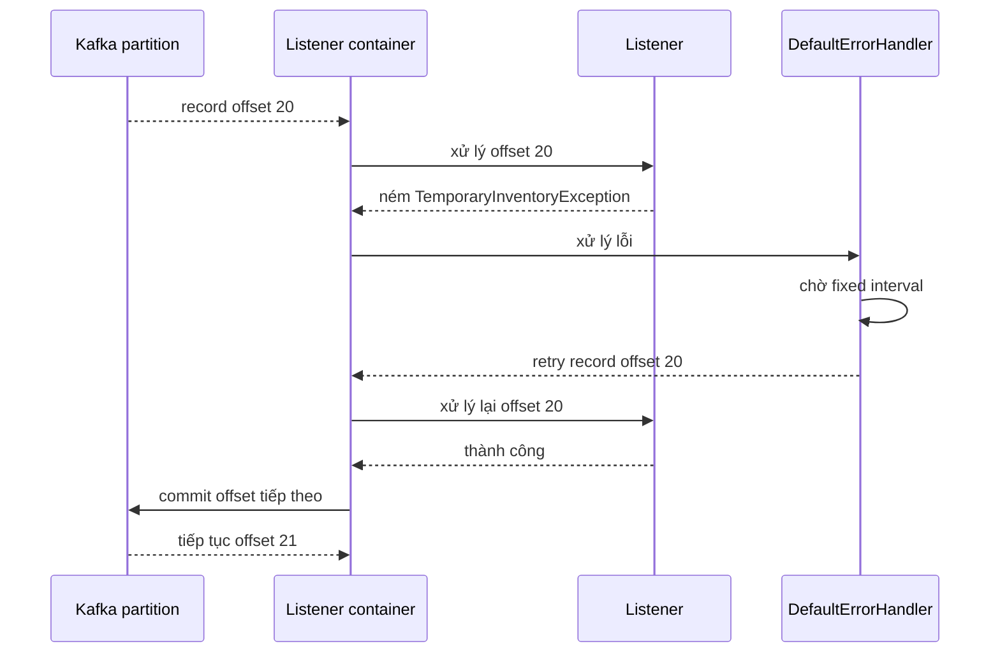

# Backoff cố định

Trong Spring Kafka, backoff xác định khoảng thời gian chờ trước khi consumer thử xử lý lại một record thất bại. Với **fixed backoff**, mọi lần retry đều dùng cùng một khoảng chờ, bất kể record đã thất bại bao nhiêu lần. Cách này dễ dự đoán, dễ cấu hình và phù hợp khi dependency thường phục hồi trong một khoảng thời gian ngắn, tương đối ổn định.

Spring Kafka thường kết hợp `FixedBackOff` của Spring Framework với `DefaultErrorHandler`. Khi listener ném exception, error handler phân loại exception, chờ theo backoff rồi thử lại record. Khi hết số lần retry, handler gọi recoverer, chẳng hạn publish record sang Dead Letter Topic (DLT).

Fixed backoff chỉ điều khiển thời gian giữa các lần thử. Nó không tự quyết định lỗi nào nên retry, không bảo đảm tác động nghiệp vụ không bị lặp và không thay thế chính sách recovery. Các phần này cần được thiết kế cùng nhau.

## 1. Fixed backoff hoạt động như thế nào?

Giả sử listener xử lý một record nhưng dịch vụ phụ trợ tạm thời trả về timeout. Với fixed backoff một giây và ba lần retry, luồng xử lý có dạng:

```text
Lần giao đầu tiên: xử lý thất bại
          |
          | chờ 1 giây
          v
Retry 1: xử lý thất bại
          |
          | chờ 1 giây
          v
Retry 2: xử lý thất bại
          |
          | chờ 1 giây
          v
Retry 3: xử lý thất bại
          |
          v
Hết retry budget -> gọi recoverer (ví dụ publish DLT)
```

Khoảng nghỉ không tăng sau mỗi lần thất bại. Đây là điểm khác biệt quan trọng so với exponential backoff, trong đó thời gian chờ tăng dần.

| Lần gọi listener | Thời điểm tương đối | Kết quả giả định |
|---|---:|---|
| Giao lần đầu | 0 giây | Thất bại |
| Retry 1 | Sau 1 giây | Thất bại |
| Retry 2 | Sau 2 giây | Thất bại |
| Retry 3 | Sau 3 giây | Thất bại |
| Recovery | Sau lần thử cuối | Chuyển sang DLT hoặc hành động phục hồi khác |

Trong ví dụ này có bốn lần gọi listener: một lần giao đầu tiên và ba lần retry. Tổng thời gian chờ backoff là khoảng ba giây; thời gian xử lý thực tế của từng lần thử được cộng thêm vào tổng thời gian.

## 2. FixedBackOff trong Spring Framework

`FixedBackOff` nằm trong package `org.springframework.util.backoff`. Constructor nhận hai tham số:

```java
new FixedBackOff(interval, maxAttempts)
```

| Tham số | Ý nghĩa |
|---|---|
| `interval` | Khoảng chờ cố định giữa hai lần retry, tính bằng milliseconds |
| `maxAttempts` | Số lần retry tối đa sau lần giao ban đầu |

Ví dụ:

```java
FixedBackOff backOff = new FixedBackOff(1_000L, 3L);
```

`1_000L` là một giây. `3L` là ba lần retry, không phải tổng số lần listener được gọi. Nếu lần giao ban đầu cũng thất bại, listener có thể được gọi tổng cộng bốn lần trước khi recovery.

Một số trường hợp biên:

```java
// Không retry; chuyển sang recovery sau lần giao đầu tiên thất bại.
new FixedBackOff(1_000L, 0L);

// Retry liên tục không giới hạn; cần cân nhắc rất kỹ trước khi dùng.
new FixedBackOff(1_000L, FixedBackOff.UNLIMITED_ATTEMPTS);
```

Không giới hạn retry có thể khiến một poison record giữ partition rất lâu và ngăn các record phía sau được xử lý. Với consumer production, nên đặt retry budget hữu hạn và có recovery rõ ràng.

## 3. Cấu hình DefaultErrorHandler với fixed backoff

Trong Spring Kafka hiện đại, `DefaultErrorHandler` là common error handler cho listener container không sử dụng transaction rollback flow. Handler nhận một `BackOff` và có thể nhận thêm recoverer để xử lý record sau khi retry hết.

Ví dụ cấu hình một giây giữa các lần retry, tối đa ba lần retry, sau đó publish DLT:

```java
@Configuration
public class KafkaErrorConfiguration {

    @Bean
    DefaultErrorHandler orderErrorHandler(
            KafkaTemplate<Object, Object> kafkaTemplate) {

        DeadLetterPublishingRecoverer recoverer =
                new DeadLetterPublishingRecoverer(kafkaTemplate);

        FixedBackOff backOff = new FixedBackOff(1_000L, 3L);
        DefaultErrorHandler handler =
                new DefaultErrorHandler(recoverer, backOff);

        handler.addNotRetryableExceptions(
                InvalidOrderPayloadException.class,
                UnsupportedOrderVersionException.class);

        handler.addRetryableExceptions(
                TemporaryInventoryException.class,
                TransientDataAccessException.class);

        return handler;
    }
}
```

Gắn handler vào listener container factory:

```java
@Bean
ConcurrentKafkaListenerContainerFactory<String, OrderEvent>
ordersListenerFactory(
        ConsumerFactory<String, OrderEvent> consumerFactory,
        DefaultErrorHandler orderErrorHandler) {

    var factory = new ConcurrentKafkaListenerContainerFactory<String, OrderEvent>();
    factory.setConsumerFactory(consumerFactory);
    factory.setCommonErrorHandler(orderErrorHandler);
    factory.getContainerProperties()
            .setAckMode(ContainerProperties.AckMode.RECORD);
    return factory;
}
```

Listener dùng factory này:

```java
@KafkaListener(
        id = "orders-listener",
        topics = "orders",
        groupId = "order-projection",
        containerFactory = "ordersListenerFactory")
public void handle(OrderEvent event) {
    orderProjectionService.apply(event);
}
```

Nếu `apply()` ném exception, container chuyển lỗi cho `DefaultErrorHandler`. Handler áp dụng phân loại exception và backoff đã cấu hình. Khi record được xử lý thành công ở một lần retry, listener kết thúc bình thường và container tiếp tục commit offset theo ack mode. Khi hết retry budget, recoverer được gọi.

## 4. Hiểu đúng số lần retry

Một nhầm lẫn thường gặp là coi `maxAttempts` là tổng số lần gọi listener. Với `FixedBackOff`, `maxAttempts` biểu thị số lần retry sau lần giao đầu tiên.

| Cấu hình | Lần giao ban đầu | Số lần retry | Tổng lần gọi tối đa khi đều thất bại |
|---|---:|---:|---:|
| `new FixedBackOff(500L, 0L)` | 1 | 0 | 1 |
| `new FixedBackOff(500L, 1L)` | 1 | 1 | 2 |
| `new FixedBackOff(1_000L, 3L)` | 1 | 3 | 4 |
| `new FixedBackOff(2_000L, 5L)` | 1 | 5 | 6 |

Với `new FixedBackOff(2_000L, 5L)`, nếu tất cả lần gọi đều thất bại thì tổng thời gian chờ backoff là khoảng mười giây. Tổng thời gian xử lý còn bao gồm thời gian listener chạy ở sáu lần gọi và thời gian recovery.

Khi ước lượng thời gian, hãy dùng công thức:

```text
Tổng thời gian gần đúng
  = (số lần retry x interval)
  + tổng thời gian xử lý mỗi lần
  + thời gian recovery
```

Đây là ước lượng, không phải deadline chính xác. Scheduler, thời gian pause/resume, network latency và commit/rebalance có thể làm thời gian thực tế dài hơn.

## 5. Chọn khoảng chờ cố định phù hợp

Fixed backoff phù hợp khi thời gian phục hồi của dependency tương đối ổn định và khoảng chờ có thể xác định trước. Ví dụ:

- Một dịch vụ nội bộ thường hồi phục trong khoảng một đến hai giây sau một lỗi kết nối ngắn.
- Database connection pool có thể tạm thời cạn connection nhưng thường được giải phóng nhanh.
- Một thao tác ghi gặp xung đột ngắn hạn và có khả năng thành công sau một khoảng nghỉ nhỏ.
- Một API nội bộ có giới hạn tốc độ ổn định và ứng dụng đã xác định được nhịp retry phù hợp.

Không nên chọn khoảng chờ chỉ dựa trên cảm giác. Cần đo latency và thời gian outage thực tế của dependency, đồng thời cân nhắc SLO của consumer.

| Đặc điểm dependency | Hướng chọn fixed interval |
|---|---|
| Lỗi kết nối ngắn, thường hồi phục nhanh | Khoảng nghỉ ngắn, retry budget nhỏ |
| Hệ thống có rate limit ổn định | Chọn khoảng nghỉ đủ để giảm áp lực gọi lại; tôn trọng hướng dẫn của dịch vụ nếu có |
| Dependency thường outage nhiều chục giây | Fixed interval ngắn có thể tạo nhiều lần gọi vô ích; cân nhắc pause/retry topic hoặc backoff tăng dần |
| Lỗi dữ liệu không đổi khi retry | Không dùng fixed retry; phân loại non-retryable và recovery ngay |
| Không biết nguyên nhân hoặc thời gian phục hồi | Retry hữu hạn, log đầy đủ và chuyển recovery để điều tra |

## 6. Phân loại exception trước khi retry

Fixed backoff chỉ quy định thời gian chờ khi handler quyết định retry. Exception classifier quyết định một lỗi có được retry hay không.

Ví dụ lỗi tạm thời và lỗi permanent:

```java
public class TemporaryInventoryException extends RuntimeException {
    public TemporaryInventoryException(String message, Throwable cause) {
        super(message, cause);
    }
}

public class InvalidOrderPayloadException extends RuntimeException {
    public InvalidOrderPayloadException(String message) {
        super(message);
    }
}
```

Trong handler ở phần trước, `TemporaryInventoryException` được phân loại retryable, còn `InvalidOrderPayloadException` được phân loại non-retryable. Record có payload sai không thể trở nên hợp lệ chỉ vì chờ một giây; retry sẽ làm chậm partition mà không cải thiện khả năng thành công.

`DefaultErrorHandler` có một số exception mặc định được xem là fatal/non-retryable, tùy phiên bản Spring Kafka. Khi cấu hình, hãy kiểm tra classifier mặc định của phiên bản đang dùng và tránh vô tình ghi đè quy tắc đó. Một exception có thể bị bọc trong exception khác; hãy quan sát cause chain thực tế để phân loại đúng.

## 7. Fixed backoff và xử lý record theo thứ tự

Với record listener, khi một record thất bại, error handler có thể seek để record đó được đọc lại sau backoff. Trong thời gian retry blocking, các record phía sau cùng partition có thể bị trì hoãn. Điều này giữ được thứ tự xử lý theo partition, nhưng một record lỗi có thể làm chậm cả luồng.



Với `AckMode.RECORD`, offset của record chỉ được commit sau khi listener hoàn tất thành công hoặc error handler đã recover record theo chính sách. Nếu record được chuyển sang DLT thành công, handler có thể cho phép tiến offset qua record lỗi. Nếu publish DLT thất bại, recovery không được xem là hoàn tất.

Với batch listener, cần xác định record nào trong batch gây lỗi. Nếu listener ném exception chung, handler có thể phải retry cả batch. `BatchListenerFailedException` có thể chỉ rõ record hoặc index bị lỗi để `DefaultErrorHandler` xử lý phần đã hoàn tất và phần lỗi phù hợp hơn.

## 8. Fixed backoff và DLT recovery

Sau khi hết retry budget, recoverer có thể publish record sang DLT. Cấu hình mặc định của `DeadLetterPublishingRecoverer` thường định tuyến từ topic gốc sang topic có hậu tố `.DLT` và giữ partition tương ứng. Topic DLT cần tồn tại và có đủ partition cho cách định tuyến đó, hoặc ứng dụng cần cung cấp destination resolver riêng.

Ví dụ tạo DLT recoverer:

```java
DeadLetterPublishingRecoverer recoverer =
        new DeadLetterPublishingRecoverer(kafkaTemplate);

DefaultErrorHandler handler = new DefaultErrorHandler(
        recoverer,
        new FixedBackOff(1_000L, 3L));
```

Khi publish DLT thành công, record đã được lưu vào luồng recovery và error handler có thể xem nó là recovered. Khi publish thất bại, lỗi recovery cần được xử lý như lỗi thực sự; không được âm thầm commit offset như thể record đã được lưu an toàn.

DLT nên giữ metadata nguồn như topic, partition, offset, key, event ID, exception class và timestamp. Quy trình vận hành cần có cách điều tra, sửa dữ liệu hoặc consumer rồi replay có kiểm soát. Khi replay, giữ event ID để idempotency có thể ngăn lặp tác động nghiệp vụ.

## 9. Ảnh hưởng của fixed backoff tới consumer và partition

Retry tại chỗ với fixed backoff thường giữ luồng xử lý ở record lỗi trong thời gian chờ và retry. Nếu interval lớn hoặc retry budget cao, consumer có thể không xử lý được record phía sau cùng partition trong một khoảng thời gian dài. Consumer lag tăng dù listener chỉ có một record lỗi.

Ví dụ một record cần sáu lần gọi, mỗi lần xử lý hai giây và có năm lần nghỉ hai giây:

```text
Thời gian xử lý: 6 x 2 giây = 12 giây
Thời gian backoff: 5 x 2 giây = 10 giây
Tổng trước recovery: khoảng 22 giây
```

Trong thời gian này, record phía sau trên partition đó có thể phải chờ. Với nhiều partition, các partition khác vẫn có thể tiếp tục tiến triển tùy assignment và consumer concurrency.

Hãy xem xét:

- `max.poll.interval.ms` và thời gian xử lý/retry dài nhất dự kiến.
- Số partition và concurrency của consumer group.
- Consumer lag và thời gian một record giữ partition.
- Tải mà retry tạo ra trên dependency đang gặp lỗi.
- Khả năng chấp nhận việc record phía sau bị trì hoãn để giữ thứ tự.

Spring Kafka có cơ chế backoff handler cho container. Với khoảng chờ dài, các phiên bản phù hợp có thể dùng `ContainerPausingBackOffHandler` để pause container thay vì chỉ giữ consumer thread chờ. Khi dùng, cần kiểm tra phiên bản API và cách pause/poll duy trì membership của consumer. Backoff handler không làm thay đổi fixed interval hay retry budget; nó thay đổi cách container thực hiện thời gian chờ.

## 10. Tránh retry đồng loạt và áp lực lên dependency

Fixed backoff khiến các record lỗi cùng thời điểm có thể retry gần như đồng loạt. Nếu một outage làm hàng nghìn record thất bại trong một khoảng ngắn, chúng có thể cùng chờ một giây rồi gọi lại dependency gần như cùng lúc. Điều này tạo retry storm và làm dịch vụ đang phục hồi quá tải trở lại.

Một số cách giảm rủi ro:

- Giới hạn số lần retry và khoảng thời gian retry tổng thể.
- Chọn interval dựa trên năng lực phục hồi của dependency, không chỉ latency trung bình.
- Dùng circuit breaker hoặc rate limiter ở tầng gọi dependency khi phù hợp.
- Dùng backoff có jitter nếu nhiều consumer/record thường retry cùng thời điểm.
- Chuyển sang retry topic hoặc workflow trì hoãn khi cần chờ lâu mà không muốn giữ partition gốc.
- Theo dõi số lần retry và tỷ lệ lỗi theo dependency để phát hiện retry storm.

Fixed backoff không có jitter. Nếu cần khoảng chờ biến thiên, hãy chọn một `BackOff` khác hoặc triển khai backoff phù hợp thay vì kỳ vọng `FixedBackOff` tự thêm ngẫu nhiên.

## 11. Khi nào fixed backoff không phù hợp?

Fixed backoff đơn giản nhưng không phù hợp với mọi tình huống.

| Tình huống | Hạn chế của fixed backoff | Hướng cân nhắc |
|---|---|---|
| Outage dài hoặc thời gian phục hồi không biết trước | Retry cùng nhịp có thể gọi dependency quá sớm | Exponential backoff, circuit breaker hoặc retry topic |
| Nhiều consumer cùng retry sau một outage | Retry đồng bộ có thể tạo retry storm | Backoff có jitter hoặc điều phối retry |
| Record cần chờ nhiều phút/giờ | Giữ partition trong thời gian dài | Non-blocking retry topic hoặc workflow trì hoãn |
| Lỗi payload không thể sửa bằng retry | Mỗi lần thử đều thất bại như nhau | Non-retryable classification và DLT |
| Mỗi event type cần retry budget khác nhau | Một `FixedBackOff` chung không thể hiện policy riêng | Tách listener/container hoặc error handling tùy biến |

Không nên tăng interval vô hạn để biến fixed backoff thành cơ chế xử lý outage dài. Khoảng chờ dài có thể làm consumer không phục vụ các record khác và khiến thời gian phục hồi khó dự đoán.

## 12. Fixed backoff khác retry topic như thế nào?

Retry blocking với `DefaultErrorHandler` thường thử lại record trong luồng xử lý của container. Retry topic chuyển record sang topic phụ trợ để được xử lý lại sau thời gian trì hoãn. Hai cơ chế giải quyết hai nhu cầu khác nhau.

| Tiêu chí | Fixed backoff tại chỗ | Retry topic |
|---|---|---|
| Nơi giữ record khi chờ | Luồng xử lý của container/partition gốc | Topic retry riêng |
| Cách chờ | Backoff handler điều phối khoảng nghỉ | Consumer retry topic nhận record theo lịch/độ trễ được thiết kế |
| Ảnh hưởng partition gốc | Có thể trì hoãn record phía sau | Có thể cho partition gốc tiếp tục xử lý |
| Thứ tự event | Dễ giữ thứ tự theo partition hơn khi retry tại chỗ | Có thể thay đổi thứ tự giữa các record cùng key |
| Vận hành | Ít topic phụ trợ, cấu hình đơn giản | Cần quản lý retry topics, routing, retention và replay |

Với lỗi ngắn và cần giữ thứ tự, fixed backoff tại chỗ thường đủ. Với lỗi dài và cần cho record phía sau tiếp tục, retry topic có thể phù hợp hơn nếu nghiệp vụ chấp nhận thay đổi thứ tự.

## 13. Fixed backoff trong listener transactional

Nếu listener container chạy trong Kafka transaction, exception listener thường làm transaction rollback. Luồng retry/recovery khi đó khác với consumer không transactional. `DefaultErrorHandler` thường được dùng cho listener không transactional; với transaction rollback flow, Spring Kafka sử dụng `DefaultAfterRollbackProcessor` để điều phối retry sau rollback và recovery.

Ví dụ khởi tạo after-rollback processor với backoff cố định:

```java
DefaultAfterRollbackProcessor<String, OrderEvent> processor =
        new DefaultAfterRollbackProcessor<>(
                recoverer,
                new FixedBackOff(1_000L, 3L));

factory.setAfterRollbackProcessor(processor);
```

Đoạn code minh họa API tổng quát; cách tạo recoverer, transaction manager và factory phải khớp với phiên bản Spring Kafka đang dùng. Khi recovery cần publish DLT và commit offset trong transaction, phải cấu hình after-rollback processor và Kafka transaction phù hợp để kết quả recovery được lưu nhất quán.

Không nên gắn một `DefaultErrorHandler` non-transactional vào transactional listener rồi kỳ vọng nó thay thế rollback processor. Hãy xác định listener có chạy trong Kafka transaction hay không trước khi chọn cơ chế retry.

Kafka transaction có thể bảo vệ output Kafka và offset đầu vào trong cùng transaction. Nó không tự bao phủ database hoặc HTTP API. Nếu listener có side effect ngoài Kafka, cần idempotency hoặc inbox/outbox để xử lý an toàn khi transaction rollback và record được giao lại.

## 14. Quan sát fixed backoff trong production

Các chỉ số sau giúp đánh giá fixed backoff có phù hợp hay không:

- Số lần retry theo topic, partition và exception class.
- Thời gian trung bình và percentile từ lần giao đầu đến thành công/recovery.
- Consumer lag trong lúc retry và sau khi dependency phục hồi.
- Tỷ lệ record được xử lý thành công ở retry 1, retry 2 hoặc retry cuối.
- Số record được chuyển sang DLT và lỗi publish DLT.
- Tần suất retry đồng thời và tải phát sinh lên dependency.
- Số lần rebalance hoặc lỗi liên quan tới `max.poll.interval.ms`.

Log nên có topic, partition, offset, key hoặc event ID, exception class, delivery attempt và thời điểm retry. Tránh log payload nhạy cảm. Metric tag nên có cardinality thấp; không dùng event ID làm nhãn metric vì số lượng event có thể rất lớn.

Có thể gắn `RetryListener` vào `DefaultErrorHandler` để ghi nhận lần retry:

```java
handler.setRetryListeners((record, exception, deliveryAttempt) -> {
    log.warn(
            "Kafka retry topic={} partition={} offset={} attempt={} cause={}",
            record.topic(),
            record.partition(),
            record.offset(),
            deliveryAttempt,
            exception.getClass().getSimpleName());
});
```

Chữ ký callback và API metric có thể khác theo phiên bản Spring Kafka. Dùng API tương ứng trong dự án và tránh để logging đồng bộ quá nặng làm chậm consumer thread.

## 15. Runbook khi record retry quá nhiều

Khi một loại record liên tục retry, hãy xử lý theo trình tự:

1. Xác định topic, partition, offset, event ID và exception class của record.
2. Xác định lỗi transient hay permanent bằng cách kiểm tra dependency và payload.
3. Tính số lần retry thực tế và tổng thời gian backoff từ cấu hình `FixedBackOff`.
4. Kiểm tra consumer lag và xem record lỗi có đang chặn record phía sau cùng partition không.
5. Nếu lỗi permanent, chuyển sang non-retryable classification và recovery/DLT phù hợp.
6. Nếu lỗi transient, kiểm tra interval có quá ngắn so với thời gian phục hồi và retry có tạo áp lực thêm không.
7. Khi hết retry budget, xác nhận DLT publish thành công và lưu đủ metadata để điều tra.
8. Sau khi dependency phục hồi hoặc dữ liệu được sửa, replay có kiểm soát và xác nhận idempotency ngăn tác động trùng.

Không chỉ tăng `maxAttempts` khi thấy DLT tăng. Nhiều retry hơn có thể kéo dài backlog và làm dependency quá tải. Trước hết cần xác định nguyên nhân và xem khoảng chờ cố định có phản ánh thời gian phục hồi thực tế hay không.

## 16. Nguyên tắc thiết kế

- Chọn `FixedBackOff` khi thời gian phục hồi đủ ổn định để dùng cùng một khoảng nghỉ.
- Nhớ rằng `maxAttempts` là số lần retry sau lần giao ban đầu.
- Đặt retry budget hữu hạn và tính cả thời gian xử lý từng lần.
- Phân loại exception trước khi áp dụng backoff; lỗi permanent không nên retry vô ích.
- Dùng recoverer/DLT có thể quan sát khi retry budget hết.
- Kiểm tra tác động của retry blocking tới partition ordering, consumer lag và `max.poll.interval.ms`.
- Dùng backoff có jitter hoặc retry topic khi fixed interval tạo retry storm hoặc giữ partition quá lâu.
- Chọn error handler phù hợp với listener transactional hay non-transactional.
- Bảo vệ side effect ngoài Kafka bằng idempotency/inbox/outbox.
- Theo dõi retry attempt, thời gian recovery, DLT và tải dependency.

Fixed backoff là lựa chọn đơn giản khi lỗi thường phục hồi trong khoảng thời gian tương đối ổn định. Trong Spring Kafka, hãy kết hợp `FixedBackOff` với error handler, exception classification và recoverer rõ ràng; tính đúng số lần retry, thời gian chờ và ảnh hưởng tới partition. Khi lỗi kéo dài, không đồng đều hoặc cần retry theo từng loại record, hãy chọn cơ chế backoff hoặc retry routing phù hợp hơn thay vì chỉ tăng số lần thử.
