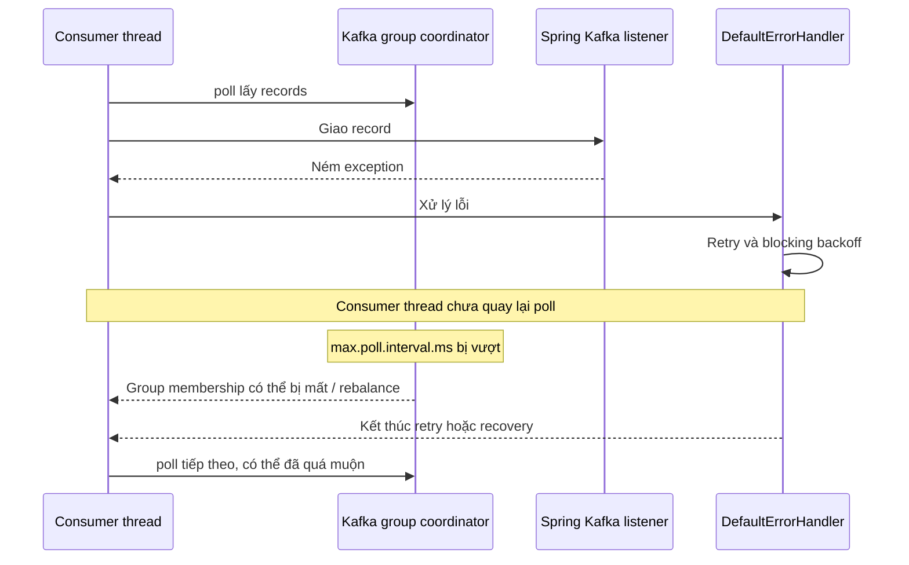
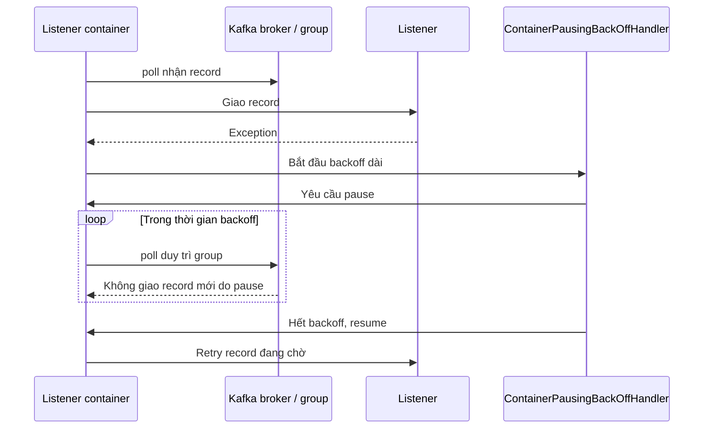

# Retry không làm vượt max.poll.interval.ms

Trong Spring Kafka, retry là cách cho consumer xử lý lại message khi lỗi có thể phục hồi. Nhưng nếu listener xử lý quá lâu hoặc chờ quá nhiều lần retry trước khi consumer được gọi `poll()` lần tiếp theo, Kafka có thể coi consumer không còn tiến triển. Khi thời gian giữa các lần `poll()` vượt `max.poll.interval.ms`, consumer có nguy cơ mất quyền sở hữu partition, gây rebalance và khiến record chưa commit được giao lại.

Vì vậy, thiết kế retry phải xét **ngân sách thời gian của vòng poll**, bên cạnh số lần thử và khoảng backoff. Với retry ngắn, `DefaultErrorHandler` có thể xử lý trong luồng listener. Với retry dài, có thể dùng cơ chế pause container nhưng vẫn duy trì poll, hoặc đưa message sang retry topic để consumer của topic gốc tiếp tục hoạt động. Mục tiêu là giữ consumer group ổn định mà vẫn bảo toàn offset và trạng thái nghiệp vụ.

## 1. max.poll.interval.ms bảo vệ điều gì?

`max.poll.interval.ms` là khoảng thời gian tối đa giữa hai lần gọi `KafkaConsumer.poll()` trong mô hình consumer group. Nó là tín hiệu cho biết ứng dụng còn chủ động lấy dữ liệu và tiến triển xử lý hay không. Giá trị mặc định thường gặp của Kafka consumer là `300000` ms (5 phút), nhưng ứng dụng phải kiểm tra cấu hình hiệu lực của phiên bản đang chạy.

Một consumer Spring Kafka thông thường có một thread chịu trách nhiệm gọi `poll()` rồi gọi listener cho các record nhận được. Khi listener đồng bộ hoặc error handler đang chờ retry, thread đó chưa quay lại vòng poll. Kafka không biết listener đang chờ database phục hồi, đang sleep hay bị deadlock; nó chỉ nhìn thấy khoảng thời gian từ lần poll trước đã kéo dài.

Các thuộc tính dễ nhầm:

| Cấu hình | Ý nghĩa | Tác động đến retry |
|---|---|---|
| `max.poll.interval.ms` | Giới hạn thời gian giữa các lần `poll()` | Listener hoặc retry chặn poll quá lâu có thể làm consumer mất membership. |
| `max.poll.records` | Số record tối đa trả về trong một lần poll | Batch càng lớn, tổng thời gian xử lý trước poll kế tiếp có thể càng dài. |
| `session.timeout.ms` | Khoảng chờ heartbeat trước khi coordinator xem member đã mất | Chi phối phát hiện mất member; không thay thế deadline poll. |
| `heartbeat.interval.ms` | Chu kỳ heartbeat với group coordinator trong giao thức phù hợp | Heartbeat có thể vẫn chạy khi listener chậm, nhưng không xóa vi phạm max-poll interval. |
| `pollTimeout` của Spring Kafka container | Thời gian chờ trong từng lần poll của container | Ảnh hưởng độ trễ phản ứng với pause/resume và một số cơ chế backoff. |
| `auto.offset.reset` | Chọn điểm bắt đầu nếu group không có offset hợp lệ | Không phải công cụ khắc phục retry vượt poll interval. |

Heartbeat và poll phục vụ hai mục đích khác nhau. Consumer có thể gửi heartbeat trong khi thread nghiệp vụ đang xử lý. Tuy nhiên, khi vượt `max.poll.interval.ms`, client có thể chủ động rời group hoặc ngừng heartbeat theo loại membership. Với static member (`group.instance.id`), việc ngừng heartbeat có thể khiến partition chưa được chuyển cho member khác cho đến khi `session.timeout.ms` hết hạn. Dù ở trường hợp nào, xử lý quá lâu vẫn là vấn đề cần khắc phục.

## 2. Retry blocking tạo cửa sổ vượt poll interval như thế nào?

Ví dụ consumer poll được 50 record. Listener xử lý từng record trong 150 ms, nhưng một record gặp lỗi và `DefaultErrorHandler` thử lại nhiều lần với khoảng chờ 90 giây. Nếu tổng thời gian xử lý, backoff, recovery và các chi phí khác vượt `max.poll.interval.ms`, lần poll kế tiếp đến quá muộn.



Hệ quả có thể gồm:

- Kafka báo lỗi liên quan max poll interval hoặc consumer bị thu hồi partition.
- Consumer group rebalance, thay đổi assignment và giảm thông lượng.
- Offset commit của member cũ bị từ chối vì không còn quyền sở hữu hoặc generation đã thay đổi.
- Record chưa commit được consumer khác đọc lại; tác động nghiệp vụ đã hoàn tất có thể bị thực hiện trùng.
- Các partition khác trên cùng consumer thread cũng tăng lag vì thread bị giữ trong retry.

Một lần retry dài không nhất thiết gây mất group ngay khi quá ngưỡng thời gian trên đồng hồ; hành vi coordinator còn phụ thuộc giao thức group, membership và session timeout. Nhưng ứng dụng không được dựa vào khoảng trễ đó để coi retry là an toàn.

## 3. Tính ngân sách thời gian cho một vòng poll

Cần tính **thời gian xấu nhất hợp lý** từ sau một lần `poll()` cho đến trước lần `poll()` kế tiếp, bao gồm xử lý các record và mọi hoạt động chặn consumer thread:

```text
T_vong_poll = T_xu_ly_records
            + T_backoff_blocking
            + T_retry_execution
            + T_recovery_or_DLT
            + T_commit_and_overhead

Yêu cầu vận hành:
T_vong_poll < max.poll.interval.ms - bien_an_toan
```

Không nên dùng riêng thời gian xử lý trung bình. Một batch có thể có nhiều record lỗi, mỗi record lại tiêu tốn toàn bộ retry budget. Độ trễ p95/p99 của database, garbage collection, network và callback đồng bộ đều có thể kéo dài thời gian thực tế.

### Ví dụ 1: Retry ngắn trong ngân sách

Giả sử:

| Thành phần | Thời gian dự kiến |
|---|---:|
| 50 record, mỗi record xử lý 100 ms | 5 giây |
| Một record lỗi, hai lần chờ retry 1 giây | 2 giây |
| Hai lần thử lại, mỗi lần 200 ms | 0,4 giây |
| Commit, logging và biến động tạm tính | 3 giây |
| **Tổng ước lượng** | **10,4 giây** |

Với `max.poll.interval.ms=300000` (300 giây), kịch bản này còn biên đáng kể. Tuy nhiên, nếu cả 50 record đều thất bại và mỗi record trải qua hai lần retry, tổng thời gian sẽ khác hoàn toàn; cần kiểm thử tình huống lỗi hàng loạt.

### Ví dụ 2: Retry dài gây nguy cơ rebalance

Giả sử listener gọi API ngoài chờ tối đa 45 giây, sau đó retry ba lần với mỗi khoảng backoff 60 giây. Chỉ riêng một record đã có thể tiêu tốn khoảng `4 × 45 + 3 × 60 = 360` giây, chưa tính xử lý các record khác. Nếu `max.poll.interval.ms=300000`, thiết kế này vượt ngân sách ngay cả khi batch chỉ có một record lỗi.

Giải pháp không đơn thuần là tăng `max.poll.interval.ms`. Cần giới hạn timeout của lời gọi API, rút ngắn retry blocking, đưa delay dài ra khỏi consumer thread hoặc dùng cơ chế pause nhưng vẫn duy trì poll.

### Xác định biên an toàn

Giữ một biên cho scheduler, GC, network, transaction, commit và recovery. Biên cần dựa trên số đo môi trường; không có một tỷ lệ phần trăm phù hợp mọi ứng dụng. Nếu tải bình thường đã dùng gần hết `max.poll.interval.ms`, một đợt latency tăng nhỏ cũng có thể kích hoạt rebalance.

## 4. Giới hạn số record bằng max.poll.records

`max.poll.records` giới hạn số record mà Kafka client trả về trong một lần poll, tính trên các partition được gán cho consumer. Với listener đồng bộ, nhiều record hơn đồng nghĩa consumer thread có thể phải xử lý nhiều công việc hơn trước khi poll tiếp.

Ví dụ Spring Boot:

```yaml
spring:
  kafka:
    consumer:
      group-id: payment-service
      enable-auto-commit: false
      max-poll-records: 25
      properties:
        "max.poll.interval.ms": 300000
    listener:
      ack-mode: record
      concurrency: 3
```

`max-poll-records: 25` giúp hạn chế lượng công việc mỗi poll nhưng không giới hạn thời gian xử lý của một record. Nếu một record gọi API treo lâu hoặc backoff kéo dài hơn poll interval, consumer vẫn có thể vi phạm deadline.

Giảm `max.poll.records` có thể làm tăng số lần poll và chi phí xử lý mỗi batch, nhưng thường là bước hiệu quả khi listener đồng bộ xử lý record nặng. Hãy đo throughput, latency, commit frequency và lag trước/sau khi điều chỉnh.

## 5. DefaultErrorHandler với blocking retry ngắn

Với Spring Kafka 2.8 trở lên, `DefaultErrorHandler` là cơ chế xử lý lỗi phổ biến. Nó có thể retry record với `BackOff`, sau đó gọi `ConsumerRecordRecoverer` khi hết số lần thử. Ở cách retry blocking, consumer thread thực hiện vòng xử lý lỗi và có thể bị chặn trong khoảng backoff.

Một cấu hình cho lỗi tạm thời, retry tối đa hai lần với khoảng chờ 500 ms:

```java
@Bean
DefaultErrorHandler shortRetryErrorHandler(
        KafkaTemplate<Object, Object> dltTemplate) {

    DeadLetterPublishingRecoverer recoverer =
            new DeadLetterPublishingRecoverer(dltTemplate);

    DefaultErrorHandler handler = new DefaultErrorHandler(
            recoverer,
            new FixedBackOff(500L, 2L));

    handler.addNotRetryableExceptions(
            PermanentBusinessException.class);

    return handler;
}
```

`FixedBackOff(500L, 2L)` biểu diễn hai lần retry sau lần listener đầu tiên, với khoảng chờ 500 ms. `PermanentBusinessException` là exception nghiệp vụ ví dụ do ứng dụng tự định nghĩa. Topic DLT do recoverer sử dụng phải được provision và có serializer, ACL, partition phù hợp.

Trong môi trường thực tế, một lần xử lý lỗi còn có thể tốn thời gian gọi database hoặc publish DLT. Vì vậy, `FixedBackOff` ngắn không tự bảo đảm toàn bộ vòng poll nằm trong giới hạn. Cần đo cả thời gian của mỗi attempt.

### Phân loại lỗi trước khi retry

| Nhóm lỗi | Ví dụ | Chiến lược gợi ý |
|---|---|---|
| Lỗi tạm thời rất ngắn | Kết nối database chập chờn, HTTP 503 thoáng qua | Blocking retry ngắn với số attempt có giới hạn. |
| Phụ thuộc cần vài chục giây hoặc phút | Service đang triển khai, dữ liệu tham chiếu chưa sẵn sàng | Pause có duy trì poll hoặc retry topic với thời gian chờ dài. |
| Lỗi dữ liệu vĩnh viễn | Schema không hợp lệ, business validation không thể sửa bằng chờ | Không retry lặp; recovery/quarantine/DLT. |
| Lỗi cấu hình | Sai ACL, TLS, credential | Cảnh báo và sửa cấu hình; retry dày đặc không hữu ích. |
| Lỗi không rõ kết quả | HTTP timeout nhưng phía đích có thể đã thực hiện tác động | Retry với idempotency key và truy vết trạng thái nghiệp vụ. |

Không tăng số lần retry chỉ vì muốn giảm lượng message vào DLT. Retry càng lâu có thể làm partition bị giữ, kéo theo lag và rebalance.

## 6. Retry dài bằng ContainerPausingBackOffHandler

Với các khoảng backoff dài, Spring Kafka cung cấp `ContainerPausingBackOffHandler` ở những phiên bản hỗ trợ. Thay vì giữ consumer thread ngủ một lần quá lâu, cơ chế này yêu cầu container pause trong khoảng chờ và tiếp tục `poll()` khi cần để duy trì membership. Sau thời gian backoff, container resume và thực hiện retry.

Sự khác biệt quan trọng: **pause việc nhận/xử lý record không đồng nghĩa dừng gọi `poll()`**. Consumer phải tiếp tục poll theo nhịp đủ ngắn để không vượt `max.poll.interval.ms`. Khi container đã pause assignment, những lần poll duy trì group có thể không giao thêm record mới cho listener.



Cấu hình nguyên tắc là truyền một `BackOffHandler` đã thiết lập cho pause vào `DefaultErrorHandler`, cùng với recoverer và policy `BackOff`. API khởi tạo `ContainerPausingBackOffHandler` và các dependency quản lý pause có thể khác theo phiên bản Spring Kafka, nên cần dùng constructor phù hợp với version thực tế.

```java
// pausingBackOffHandler là BackOffHandler đã được cấu hình
// để pause/resume listener container theo API của phiên bản đang dùng.
DefaultErrorHandler handler = new DefaultErrorHandler(
        recoverer,
        new FixedBackOff(45_000L, 2L),
        pausingBackOffHandler);
```

Đoạn code thể hiện cách nối các thành phần, chưa bao gồm phần tạo bean `pausingBackOffHandler`. Trong production, cần cấu hình đầy đủ lifecycle, pause service và scheduler nếu phiên bản yêu cầu.

Một số điểm vận hành cần nhớ:

- Thời gian backoff thực tế có thể bị ảnh hưởng bởi `pollTimeout` của listener container.
- Pause container có thể ảnh hưởng tất cả partition mà container con đang quản lý, dù chỉ một partition có record lỗi.
- Pause giữ membership nhưng không giải phóng record lỗi khỏi luồng xử lý; lag vẫn có thể tăng.
- Nếu listener hoặc recoverer đã chặn consumer thread quá lâu **trước** khi cơ chế pause được kích hoạt, pause không khắc phục được khoảng thời gian đã mất.
- Phải kiểm tra version và hành vi khi shutdown/rebalance trong lúc container đang pause.

`ContainerPausingBackOffHandler` hữu ích khi muốn giữ retry tại topic gốc và chờ lâu nhưng vẫn duy trì consumer group. Nếu workload không chịu được việc pause các partition cùng container, cân nhắc tách workload hoặc retry topic.

## 7. Non-blocking retry bằng retry topic

Khi message cần chờ hàng chục giây hoặc hàng phút, một cách khác là chuyển message sang retry topic. Spring Kafka hỗ trợ mô hình này qua `@RetryableTopic` trong các phiên bản phù hợp. Record lỗi được publish sang retry topic theo lịch backoff; consumer của topic gốc có thể tiếp tục poll và xử lý record mới.

Ví dụ:

```java
@RetryableTopic(
        attempts = "4",
        backoff = @Backoff(delay = 30_000, multiplier = 2.0))
@KafkaListener(topics = "orders.events", groupId = "orders-service")
public void handle(OrderEvent event) {
    orderService.processIdempotently(event);
}
```

Ví dụ minh họa bốn lần xử lý tổng cộng theo chính sách retry topic, với delay tăng dần. Số attempt, naming, DLT và độ chính xác thời gian cần kiểm tra theo version/framework config. Phải provision topic, replication, retention, serializer và ACL phù hợp nếu môi trường không tự tạo topic.

### Lợi ích và đánh đổi

| Tiêu chí | Blocking retry | Pause và tiếp tục poll | Retry topic |
|---|---|---|---|
| Record đang chờ | Giữ trong luồng xử lý topic gốc | Giữ chờ tại container/topic gốc | Chuyển sang topic retry |
| Nhịp poll | Có nguy cơ bị chặn bởi backoff | Duy trì poll khi pause hoạt động đúng | Consumer topic gốc tiếp tục poll |
| Thứ tự theo key/partition | Thường giữ record lỗi trước record sau | Giữ luồng topic gốc trong khi pause | Có thể xử lý record sau trước record đang retry |
| Ảnh hưởng tới partition khác | Có thể ảnh hưởng partition cùng consumer | Có thể pause các partition cùng container | Topic gốc tiếp tục; cần vận hành thêm topic/consumer |
| Thời gian delay dài | Nguy cơ vượt `max.poll.interval.ms` | Phù hợp nếu cấu hình pause/poll đúng | Phù hợp với delay dài, phụ thuộc topology |

Non-blocking retry **không bảo đảm thứ tự tuyệt đối**: record phía sau ở topic gốc có thể được xử lý trước record đã chuyển sang retry topic. Nếu một chuỗi trạng thái phải xử lý tuần tự theo key, cần thiết kế cơ chế điều phối, lưu trạng thái pending hoặc chọn retry blocking/pause phù hợp.

Theo tài liệu của các dòng Spring Kafka hỗ trợ cơ chế này, cần lưu ý giới hạn với batch listener và container transaction; không mặc nhiên áp dụng cấu hình retry topic cho mọi kiểu listener. Khi dùng Kafka transaction consume-transform-produce, cần đánh giá cơ chế transaction/rollback và `AfterRollbackProcessor` riêng.

## 8. Đừng dùng Thread.sleep dài trong listener

Một anti-pattern phổ biến là tự sleep trong listener sau khi gọi downstream thất bại:

```java
@KafkaListener(topics = "orders.events")
public void handle(OrderEvent event) throws InterruptedException {
    try {
        externalService.call(event);
    }
    catch (TemporaryServiceException exception) {
        Thread.sleep(360_000L); // Giữ consumer thread 6 phút.
        externalService.call(event);
    }
}
```

Nếu `max.poll.interval.ms` là 5 phút, riêng `sleep()` đã vượt ngưỡng. Trong thời gian này, consumer không poll tiếp; các partition cùng consumer có thể bị chậm và offset chưa được commit. Đoạn mã còn thiếu giới hạn attempt, backoff, xử lý interruption và error classification.

Thay vào đó, hãy để listener ném exception cho `DefaultErrorHandler`, cấu hình số lần retry và backoff có kiểm soát, rồi dùng pausing backoff hoặc retry topic nếu thời gian chờ dài. Không nên bắt lỗi rồi trả về bình thường nếu nghiệp vụ chưa hoàn tất, vì container có thể commit offset như một record thành công.

### Timeout của downstream cũng nằm trong ngân sách

Nếu mỗi attempt gọi API có timeout 2 phút, chỉ hai lần gọi đã chiếm gần hết poll budget 5 phút. Backoff ngắn không giải quyết được nguyên nhân. Cần cấu hình HTTP connect/read timeout, database query timeout và transaction timeout dựa trên SLA; phân loại lỗi không rõ kết quả để retry an toàn bằng idempotency key.

## 9. Offset commit và xử lý trùng sau khi retry

Khi retry giữ record chưa hoàn tất, không nên commit offset vượt record đó. Với `enable.auto.commit=false`, Spring Kafka listener container dùng `AckMode` và error handler để quản lý commit sau xử lý hoặc recovery.

```yaml
spring:
  kafka:
    consumer:
      enable-auto-commit: false
    listener:
      ack-mode: record
```

Với record listener và `AckMode.RECORD`, container commit sau khi listener xử lý thành công từng record. Nếu listener ném exception, `DefaultErrorHandler` xử lý retry/recovery; offset của record lỗi chỉ nên tiến theo chính sách đó. Nếu recoverer chuyển record sang DLT thành công và handler xem recovery đã hoàn tất, container có thể commit offset nguồn để tiếp tục luồng chính.

Không gọi `acknowledgment.acknowledge()` trước khi công việc nghiệp vụ hoàn tất chỉ để giữ poll chạy nhanh. Acknowledge sớm có thể khiến Kafka bỏ qua record sau restart dù công việc đang chạy dở. Nếu dùng `MANUAL_IMMEDIATE`, hậu quả của acknowledgement sớm càng rõ vì commit có thể diễn ra ngay trên consumer thread.

Ngay cả khi commit sau nghiệp vụ, một sự cố có thể xảy ra giữa hai bước:

1. Database transaction đã commit thành công.
2. Consumer process bị dừng trước khi offset commit.
3. Kafka giao lại cùng record từ committed offset cũ.

Đây là lý do consumer cần idempotency. Có thể lưu `eventId` vào bảng inbox với unique constraint trong cùng transaction database với cập nhật nghiệp vụ, hoặc dùng idempotency key được downstream hỗ trợ. Kafka transaction không tự tạo transaction nguyên tử với database hay HTTP API.

### Khi record được đưa sang DLT

Nếu hết retry và message chuyển DLT, commit offset topic gốc thể hiện record đã được bàn giao cho luồng recovery, **không** có nghĩa nghiệp vụ đã thành công. Cần kiểm tra kết quả publish DLT, giữ metadata topic/partition/offset nguồn và có quy trình replay. Nếu publish DLT thất bại, phải phát hiện exception recovery thay vì âm thầm bỏ qua record.

## 10. Concurrency và phạm vi ảnh hưởng khi retry

Trong một consumer group, tại một thời điểm, một partition chỉ được gán cho một consumer member. Một consumer thread có thể xử lý nhiều partition. Khi thread bị giữ trong blocking retry, các partition được gán cho thread đó cũng có thể tăng lag.

Spring Kafka `ConcurrentMessageListenerContainer` tạo nhiều consumer con theo `concurrency`. Ví dụ topic có sáu partition, một listener với `concurrency=3` có thể phân phối khoảng hai partition cho mỗi consumer, tùy assignor và các member khác.

Tăng concurrency có thể giảm số partition bị ảnh hưởng bởi một consumer thread chậm, nhưng không làm một partition tự động được chia cho nhiều consumer trong cùng group. Đồng thời, tăng concurrency có thể gây quá tải database hoặc API, làm timeout nhiều hơn và khiến retry trở nên nặng hơn.

Khi một partition có nhiều record lỗi, hãy xem xét lỗi dữ liệu hay lỗi downstream. Nếu là lỗi dữ liệu vĩnh viễn, retry dài chỉ làm lag tăng. Nếu là một dịch vụ ngoài bị gián đoạn, giới hạn số request đồng thời, dùng backpressure và cân nhắc circuit breaker ở tầng ứng dụng để tránh tạo thêm tải.

## 11. Quan sát nguy cơ vượt max.poll.interval.ms

Không chỉ đo `consumer lag`. Cần biết thời gian giữa các poll, thời gian listener xử lý và lượng thời gian dành cho retry.

| Nguồn | Tín hiệu cần theo dõi | Ý nghĩa |
|---|---|---|
| Consumer client | Poll interval metrics, `poll-idle-ratio-avg`, `last-poll-seconds-ago` nếu hệ thống xuất ra | Phát hiện consumer không quay lại poll đúng nhịp. |
| Listener | Processing duration p95/p99, thời gian gọi downstream | Xác định record chậm hoặc batch xử lý quá dài. |
| Error handler | Retry count, backoff duration, thời gian từ lỗi đầu tiên đến recovery | Biết lỗi đang giữ consumer thread bao lâu. |
| Consumer group | Rebalance count, member lost, partition revoked/assigned | Phát hiện deadline poll dẫn đến thay đổi membership. |
| Partition | Lag, committed offset, age of oldest record | Phát hiện partition bị giữ trong retry hoặc pause. |
| Downstream | HTTP/DB timeout, pool utilization, circuit breaker state | Xác định nguồn gây retry và mức áp lực phụ trợ. |
| DLT/retry topic | Publish failure, pending count, message age | Phát hiện recovery chậm hoặc retry backlog tăng. |

Tên metric và cách expose phụ thuộc phiên bản Kafka client, Spring Kafka và hệ thống giám sát. Kafka client metrics qua JMX/Micrometer có thể cung cấp các chỉ số poll; application logs nên ghi timestamp và thời lượng từng phase để đối chiếu.

Log theo `eventId`, group ID, listener ID, topic, partition, offset, consumer thread, exception class, attempt và backoff. Không đưa event ID vào metric label có cardinality cao; dùng nhãn hữu hạn như topic, exception category và retry stage. Không ghi payload hoặc token nhạy cảm vào log.

### Cảnh báo có giá trị

Nên cảnh báo khi thời gian kể từ lần poll gần chạm `max.poll.interval.ms`, khi một record retry vượt SLA hoặc khi rebalance tăng kèm processing latency tăng. Nếu consumer đang pause, theo dõi cả trạng thái pause, tần suất poll duy trì group và tuổi backlog. Lag cao trong lúc pause có thể là kết quả dự kiến của retry, nhưng phải có giới hạn thời gian và quy trình xử lý.

## 12. Runbook khi retry làm consumer bị rebalance

### Triệu chứng: log báo vượt max.poll.interval.ms

1. Xác định consumer group, member, listener ID, thread, topic/partition/offset đang xử lý.
2. Đối chiếu timestamp của lần poll cuối, thời gian listener chạy và thời điểm rebalance.
3. Kiểm tra `max.poll.records`, `max.poll.interval.ms`, timeout downstream, số attempt và tổng blocking backoff.
4. Nếu lỗi do retry dài, rút ngắn blocking retry hoặc chuyển sang `ContainerPausingBackOffHandler`/retry topic.
5. Theo dõi thời gian giữa poll và rebalance sau thay đổi; kiểm tra record có được giao lại hay không.

### Triệu chứng: retry chặn nhiều partition

1. Liệt kê partition assignment của consumer có record lỗi.
2. Xem retry policy đang sleep trong consumer thread hay có pause container.
3. Đo lag riêng từng partition và thời gian retry của record lỗi.
4. Cân nhắc rút ngắn delay blocking, tăng concurrency trong giới hạn partition và downstream, hoặc tách retry sang topic.
5. Xác minh thứ tự theo key còn phù hợp nếu chuyển sang non-blocking retry.

### Triệu chứng: tăng max.poll.interval.ms nhưng vẫn lỗi

1. Kiểm tra giá trị cấu hình hiệu lực trong consumer properties, không chỉ YAML dự kiến.
2. Tìm lời gọi downstream không có timeout hoặc deadlock khiến listener chạy không giới hạn.
3. Kiểm tra batch size, số record cùng retry và các chờ trong transaction/commit.
4. Đặt deadline hữu hạn cho từng attempt và tách delay dài khỏi vòng poll.
5. Chỉ tăng max-poll interval khi thời gian xử lý dài có chủ đích, có biên an toàn và đã đánh giá thời gian failover.

### Triệu chứng: mất assignment hoặc commit failed sau retry

1. Kiểm tra log `CommitFailedException`, rebalance và thời điểm mất membership.
2. Xác định record nào đã hoàn tất nghiệp vụ nhưng chưa commit offset.
3. Bảo đảm consumer idempotent trước khi nhận lại record.
4. Khắc phục poll interval hoặc retry policy; không reset offset tùy tiện.
5. Theo dõi committed offset và kết quả nghiệp vụ sau khi group ổn định.

### Triệu chứng: pause duy trì group nhưng backlog tăng quá lâu

1. Xác nhận container vẫn gọi poll trong lúc pause và session còn ổn định.
2. Xác định nguyên nhân gốc: dependency chưa phục hồi, lỗi data hay DLT không publish được.
3. Đối chiếu tuổi message với SLA và giới hạn thời gian retry.
4. Nếu thời gian chờ dự kiến rất dài, cân nhắc retry topic hoặc quy trình xử lý riêng.
5. Khi resume, kiểm tra throughput, thứ tự nghiệp vụ, offset commit và DLT outcome.

## 13. Bảng kiểm soát trước khi triển khai

| Điểm kiểm soát | Câu hỏi vận hành | Bằng chứng cần có |
|---|---|---|
| Poll budget | Tổng xử lý, retry và recovery có đủ ngắn so với max-poll interval không? | Timing theo batch, p99 listener duration và retry policy. |
| Batch size | `max.poll.records` có phù hợp độ trễ mỗi record không? | Batch duration và records per poll. |
| Downstream | Mọi lời gọi I/O có timeout hữu hạn không? | HTTP/DB timeout config và latency metrics. |
| Retry type | Delay ngắn dùng blocking; delay dài dùng pause hoặc retry topic đúng yêu cầu không? | Error handler/BackOffHandler hoặc retry topic configuration. |
| Group health | Consumer có tiếp tục poll khi pause không? | Poll metrics, pause status và rebalance events. |
| Ordering | Retry topic có làm record cùng key vượt thứ tự không? | Topic/partition/offset timeline và state transitions. |
| Offset | Chỉ commit khi nghiệp vụ hoặc recovery hoàn tất theo policy không? | AckMode, committed offsets và DLT send results. |
| Duplicate | Record giao lại sau rebalance có được xử lý idempotent không? | Event ID, inbox/unique constraint hoặc downstream idempotency key. |
| Operations | Có cảnh báo khi thời gian retry, lag hoặc poll interval vượt SLA không? | Dashboard, alert và incident runbook. |

Để retry không làm vượt `max.poll.interval.ms`, hãy xem mỗi vòng poll là một ngân sách thời gian hữu hạn. Giảm kích thước batch khi cần, giới hạn timeout của từng attempt, chỉ blocking retry trong khoảng ngắn và sử dụng pause container có poll duy trì group hoặc retry topic khi cần chờ dài. Kết hợp error classification, commit offset sau xử lý, idempotency và quan sát poll/rebalance sẽ giúp consumer phục hồi lỗi mà không liên tục mất partition ownership.
