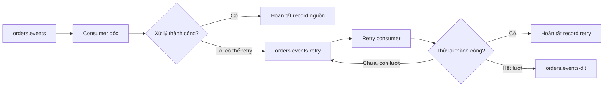
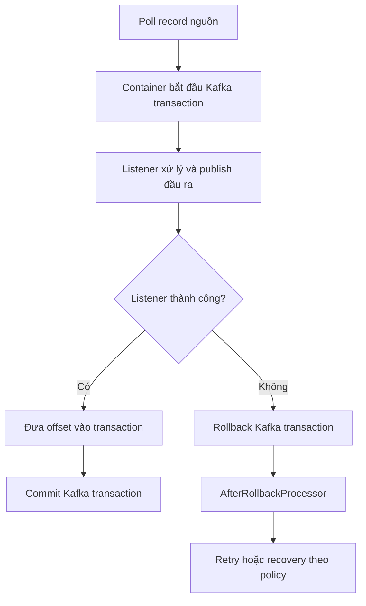
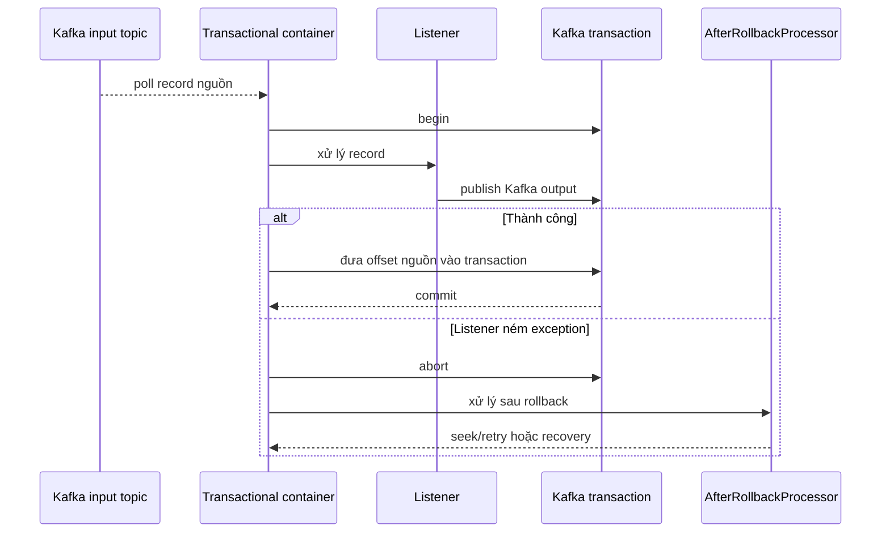

# Non-blocking retry không kết hợp container transaction

Trong Spring Kafka, **non-blocking retry** cho phép chuyển một record xử lý thất bại sang retry topic, chờ đến thời điểm phù hợp rồi xử lý lại mà không giữ consumer của topic gốc trong một khoảng backoff dài. Cơ chế phổ biến được khai báo bằng `@RetryableTopic` hoặc `RetryTopicConfiguration`.

Một giới hạn kiến trúc quan trọng của Spring Kafka là **non-blocking retry không được hỗ trợ khi kết hợp với Kafka container transactions**. Đây là giới hạn của sự tích hợp retry-topic với listener container có transaction, không phải tuyên bố rằng Kafka transaction nói chung không thể ghi vào nhiều topic hoặc rằng transactional producer không bao giờ có thể gửi record sang topic retry. Khi thiết kế luồng xử lý, phải chọn cơ chế phù hợp với yêu cầu atomicity, thứ tự và khả năng phục hồi.

Nếu ứng dụng muốn dùng `@RetryableTopic`, hãy dùng listener container không chạy Kafka transaction và bảo vệ nghiệp vụ bằng idempotency, outbox/inbox hoặc một thiết kế xử lý nhất quán tương ứng. Nếu cần transaction Kafka để gộp việc consume–process–produce và commit offset trong một transaction, hãy giữ retry trong mô hình transactional container, thường là rollback và retry bằng `DefaultAfterRollbackProcessor`, thay vì ghép trực tiếp `@RetryableTopic` vào container đó.

## 1. Hai mô hình giải quyết hai bài toán khác nhau

### Non-blocking retry: tách việc chờ khỏi consumer topic gốc

Giả sử consumer đọc record từ `orders.events`, gọi dịch vụ nghiệp vụ nhưng gặp lỗi tạm thời. Với blocking retry, consumer có thể chờ backoff rồi thử lại record đó ngay trong luồng xử lý hiện tại. Khi backoff dài, các record khác trên cùng consumer thread cũng có thể bị chậm.

Non-blocking retry chọn cách khác: record lỗi được chuyển sang retry topic; consumer gốc có thể tiếp tục xử lý các record mới. Một listener khác đọc retry topic và chỉ chuyển record cho nghiệp vụ khi đến thời điểm retry. Sau số lần thử quy định, record có thể được chuyển sang dead-letter topic (DLT).



Các topic và số chặng retry thực tế phụ thuộc naming strategy, backoff policy và cấu hình Spring Kafka. Mũi tên trên biểu diễn quy trình logic, không phải một Kafka transaction bao trùm mọi bước.

### Kafka container transaction: ghép publish và offset vào một ranh giới

Trong luồng consume–transform–produce, một Spring Kafka listener container có thể mở Kafka transaction để liên kết các record đầu ra với offset của record đầu vào. Khi transaction commit thành công, các record đầu ra và offset nguồn được commit cùng transaction Kafka. Khi transaction abort, kết quả ghi trong transaction chưa được công bố như một giao dịch thành công; offset nguồn cũng không được xác nhận như một transaction thành công.



Kafka transaction bảo đảm tính nguyên tử trong phạm vi thao tác Kafka được đưa vào cùng transaction. Nó không tự bao trùm một database transaction, HTTP request hoặc tác động ngoài Kafka. Nếu listener cập nhật database, ứng dụng vẫn cần thiết kế tính nhất quán và idempotency riêng.

## 2. Vì sao không ghép @RetryableTopic vào transactional listener container?

Với non-blocking retry, một record lỗi được bàn giao sang một topic khác, sau đó consumer của topic nguồn tiến tiếp. Đó là cơ chế chuyển giao bất đồng bộ giữa các listener/container và các topic khác nhau. Trong khi đó, transactional listener container vận hành theo mô hình lỗi làm rollback Kafka transaction, rồi dùng xử lý sau rollback để quyết định cách đọc lại hoặc recovery.

Hai cơ chế có ranh giới xử lý lỗi khác nhau:

| Khía cạnh | Non-blocking retry bằng retry topic | Container transaction |
|---|---|---|
| Khi listener ném exception | Retry infrastructure định tuyến record sang retry topic hoặc DLT theo policy | Transaction hiện tại bị rollback/abort; xử lý sau rollback quyết định retry/recovery. |
| Đơn vị chờ | Retry topic và consumer riêng; topic nguồn có thể tiếp tục | Record nguồn vẫn nằm trong quy trình transactional listener. |
| Offset nguồn | Cần hoàn tất/bàn giao record nguồn để tiếp tục; không mặc nhiên có atomicity với việc publish retry | Offset được đưa vào Kafka transaction khi transaction xử lý thành công. |
| Thứ tự | Record sau có thể được xử lý trước record đang chờ retry | Retry trong partition nguồn thường giúp giữ thứ tự trước khi tiến tiếp. |
| Thành phần chủ đạo | `@RetryableTopic`, retry topic infrastructure, DLT handler | `KafkaTransactionManager`, listener container và `DefaultAfterRollbackProcessor`. |

Spring Kafka không cung cấp một chế độ cấu hình tích hợp để trộn trực tiếp non-blocking retry với container transaction rồi mặc nhiên nhận đầy đủ ngữ nghĩa transaction của cả hai. **Không được xem việc bật `transaction-id-prefix` và thêm `@RetryableTopic` là cách tạo retry exactly-once.** Tùy phiên bản và cách wiring, cấu hình có thể không được hỗ trợ hoặc vận hành khác kỳ vọng; vì vậy đây là một ràng buộc thiết kế cần xử lý ngay từ đầu.

Một cách diễn giải chính xác là: Spring Kafka hỗ trợ retry topic cho listener không dùng Kafka container transaction; Spring Kafka hỗ trợ Kafka transaction và xử lý rollback; nhưng **tính năng non-blocking retry chuẩn không kết hợp với Kafka container transaction**. Khả năng viết một giải pháp Kafka transactional tùy chỉnh, tự tạo topic và điều phối commit, là một vấn đề kiến trúc riêng và không tương đương với việc dùng `@RetryableTopic` mặc định.

## 3. Nhận diện container đang thực sự dùng transaction

Một ứng dụng có thể tạo `KafkaTemplate` transactional mà không phải mọi listener đều chạy trong container transaction. Ngược lại, một cấu hình Spring Boot có producer transaction ID prefix có thể dẫn đến việc framework tự cấu hình transaction manager và áp dụng cho listener container theo điều kiện auto-configuration.

Các dấu hiệu cần kiểm tra:

- Producer factory có `transactionIdPrefix` hoặc cấu hình `spring.kafka.producer.transaction-id-prefix` hay không.
- Ứng dụng có bean `KafkaTransactionManager` dành cho producer factory tương ứng không.
- Listener container factory được cấu hình transaction manager hay không.
- `@KafkaListener` đang dùng container factory nào; có dùng factory mặc định bị auto-configure transaction không.
- Log lúc listener chạy có begin/commit/abort Kafka transaction và exception từ transaction manager không.
- Retry topic infrastructure có đang tạo các endpoint listener và container riêng, hoặc có cảnh báo xung đột với transaction không.

Không chỉ nhìn tên bean hoặc annotation để kết luận. Hai listener trong cùng ứng dụng có thể dùng hai container factory khác nhau: một transactional, một non-transactional. Điều cần xác nhận là **container factory hiệu lực của chính listener sử dụng non-blocking retry**.

### Ví dụ cấu hình có nguy cơ ghép nhầm

```yaml
spring:
  kafka:
    producer:
      transaction-id-prefix: ${INSTANCE_ID:local}-orders-tx-
    consumer:
      enable-auto-commit: false
```

Nếu ứng dụng đồng thời dùng `@RetryableTopic` trên listener và listener container được cấu hình sử dụng Kafka transaction manager, đó là tổ hợp không được hỗ trợ. Prefix trên chỉ là ví dụ; trong môi trường nhiều replica, mỗi instance transactional producer cần định danh không trùng nhau.

Không suy ra rằng chỉ cần xóa annotation `@Transactional` trong service là listener đã non-transactional. Container transaction có thể được cấu hình tại `ConcurrentKafkaListenerContainerFactory` hoặc bởi auto-configuration, độc lập với transaction annotation của service.

## 4. Lựa chọn A: Non-blocking retry với container không có Kafka transaction

Khi cần thời gian chờ dài và muốn consumer nguồn tiếp tục, chọn retry topic với container không dùng Kafka transaction. Cấu hình minh họa dưới đây áp dụng cho Spring Kafka hỗ trợ `@RetryableTopic`:

```yaml
spring:
  kafka:
    consumer:
      group-id: orders-service
      enable-auto-commit: false
      auto-offset-reset: earliest
    listener:
      ack-mode: record
      concurrency: 3
```

Trong thiết kế này, **listener container của luồng retry topic không được gắn `KafkaTransactionManager`**. Nếu application có cả luồng transactional khác, hãy dùng container factory riêng và kiểm tra chính xác factory được gán cho từng listener. Không vô hiệu hóa transaction toàn ứng dụng nếu các luồng khác vẫn cần nó.

Ví dụ listener có non-blocking retry:

```java
@RetryableTopic(
        attempts = "4",
        backoff = @Backoff(delay = 2_000L, multiplier = 2.0),
        exclude = PermanentBusinessException.class)
@KafkaListener(
        topics = "orders.events",
        groupId = "orders-service")
public void consume(OrderEvent event) {
    orderService.processIdempotently(event);
}
```

`PermanentBusinessException` là exception ứng dụng tự định nghĩa cho lỗi không khắc phục được bằng retry. `attempts="4"` trong cấu hình retry topic biểu diễn tổng số lần xử lý theo semantics của annotation ở dòng Spring Kafka tương ứng; xem API của phiên bản thực tế để thiết lập đúng số attempt/backoff và chính sách DLT.

Với mỗi lần lỗi tạm thời, hạ tầng non-blocking retry chuyển message sang topic retry phù hợp. Nếu hết lượt, message được bàn giao đến DLT hoặc xử lý theo DLT strategy. Cần provision topic, replication, retention, ACL và serializer theo môi trường. Không giả định framework luôn được phép tự tạo topic production.

### Không tự thiết lập error handler chồng chéo

`@RetryableTopic` thiết lập một retry topology và các error-handler cần thiết để chuyển message sang retry topic. Nếu cùng listener còn bị áp một `DefaultErrorHandler` có blocking retry dài, một record có thể bị thử nhiều lần ở topic gốc trước khi chuyển retry topic. Tổng số attempt và thời gian vì thế lớn hơn mong đợi.

Hãy xác định rõ liệu có muốn một số lần blocking retry ngắn trước khi non-blocking retry hay không và cấu hình đúng cơ chế được Spring Kafka hỗ trợ. Không kết hợp các bộ retry độc lập chỉ vì chúng cùng có tên "retry".

### Không dùng container transaction không có nghĩa bỏ toàn bộ tính đúng đắn

Với retry topic không có Kafka container transaction, phải thiết kế nghiệp vụ theo hướng có thể xảy ra giao lại. Một record có thể được chuyển sang retry topic rồi record nguồn được đọc lại nếu hệ thống gặp sự cố trước khi offset nguồn được xác nhận. Việc publish retry và commit offset nguồn không nên được coi là một transaction Kafka nguyên tử trừ khi có một giải pháp rõ ràng thực hiện điều đó.

Các cơ chế bảo vệ quan trọng gồm `eventId` ổn định, idempotent consumer, producer reliability, kiểm tra lỗi publish retry/DLT và giám sát backlog. Đối với tác động database, inbox/outbox có thể là lớp đảm bảo bền vững phù hợp.

## 5. Lựa chọn B: Kafka container transaction với blocking retry sau rollback

Nếu bài toán yêu cầu commit offset nguồn và publish Kafka output trong cùng transaction, nên giữ container transaction rồi dùng cơ chế rollback/retry của Spring Kafka thay vì non-blocking retry.

Một luồng điển hình:

1. Listener container nhận record và bắt đầu Kafka transaction.
2. Listener thực hiện chuyển đổi, publish record đầu ra qua transactional `KafkaTemplate` tham gia transaction.
3. Nếu thành công, container đưa offset của record nguồn vào transaction và commit.
4. Nếu listener ném exception, transaction bị abort và offset không được xác nhận như một giao dịch thành công.
5. `DefaultAfterRollbackProcessor` điều phối việc giao lại record, backoff hoặc recovery sau khi transaction rollback.



`DefaultAfterRollbackProcessor` là cơ chế phù hợp để điều phối retry sau rollback của listener transactional. Nó có thể sử dụng `BackOff` để giới hạn số lần thử, và recoverer để chuyển record không thể xử lý sang luồng lỗi. Thiết kế recovery có thể phức tạp hơn retry thông thường nếu muốn ghi DLT và offset recovered trong một Kafka transaction mới; cần cấu hình transaction-aware recoverer/procedure theo API của phiên bản đang dùng.

### Code listener cho luồng consume–transform–produce

```java
@KafkaListener(
        topics = "orders.commands",
        containerFactory = "transactionalListenerFactory")
public void transform(ConsumerRecord<String, OrderCommand> record) {
    OrderResultEvent result = orderTransformer.transform(record.value());
    kafkaTemplate.send("orders.results", record.key(), result);
}
```

Ở ví dụ này, `transactionalListenerFactory` là một container factory **đã được cấu hình Kafka transaction manager đúng producer factory**. `kafkaTemplate` phải dùng producer factory/transaction phù hợp để record đầu ra tham gia cùng transaction. Đoạn code chỉ mô tả listener; transaction manager, producer transaction ID prefix, timeout, retry và recovery cần được cấu hình riêng. Không gắn `@RetryableTopic` lên listener này.

Các consumer downstream muốn không đọc record trong transaction bị abort cần cấu hình `isolation.level=read_committed`. Kafka exactly-once theo transaction chỉ áp dụng với các thao tác Kafka được phối hợp đúng; service cập nhật database hoặc gửi HTTP bên ngoài vẫn có cửa sổ lỗi riêng.

### Blocking retry và max.poll.interval.ms

Một transaction được rollback rồi retry không miễn trừ consumer khỏi yêu cầu poll đúng nhịp. Retry kéo dài, listener chặn hoặc backoff quá lớn có thể khiến consumer vượt `max.poll.interval.ms`, rebalance hoặc mất khả năng commit. Chọn thời gian xử lý và retry trong ngân sách poll; nếu backoff rất dài, đánh giá cơ chế pause có tiếp tục poll hoặc một kiến trúc xử lý riêng theo API hỗ trợ của phiên bản transaction container.

Không khẳng định mọi `BackOffHandler` của non-transactional `DefaultErrorHandler` đều áp dụng nguyên xi cho `DefaultAfterRollbackProcessor`. Cần kiểm tra constructor, tính năng pause và hành vi recovery được hỗ trợ trong phiên bản Spring Kafka đang chạy.

## 6. Lựa chọn C: Tách transaction nghiệp vụ khỏi retry topology

Nhiều service vừa cần database transaction, vừa muốn non-blocking retry vì dependency có thể gián đoạn hàng phút. Trường hợp này không nhất thiết cần Kafka **container transaction**.

Có thể để consumer xử lý không có Kafka transaction, nhưng service vẫn dùng database transaction:

```java
@KafkaListener(topics = "payments.events")
public void onPayment(PaymentEvent event) {
    paymentService.applyIdempotently(event);
}

@Service
public class PaymentService {
    @Transactional
    public void applyIdempotently(PaymentEvent event) {
        inboxRepository.insertEventIfAbsent(event.eventId());
        paymentRepository.apply(event);
    }
}
```

Đây là code minh họa. `insertEventIfAbsent` phải được hiện thực bằng thao tác database nguyên tử (unique constraint/upsert phù hợp) và phải ngăn thực hiện `apply` nếu event đã được xử lý trước đó; hai thao tác cần nằm trong cùng transaction database. Phần service dùng `@Transactional` ở đây là **database transaction**, không phải Kafka container transaction. Không nên đồng nhất hai loại transaction chỉ vì cùng dùng chữ "transaction".

Nếu service phải vừa cập nhật database vừa phát event Kafka, transactional outbox là mô hình phù hợp:

1. Trong cùng database transaction, ghi thay đổi nghiệp vụ và bản ghi outbox có `eventId`.
2. Commit database transaction.
3. Outbox publisher gửi event sang Kafka bằng retry có giới hạn và theo dõi kết quả.
4. Khi Kafka gửi thành công, đánh dấu outbox đã publish; nếu kết quả không chắc chắn, có thể gửi lại cùng event ID.
5. Consumer đích áp dụng idempotency để chống tác động trùng.

Outbox không tự bảo đảm mỗi Kafka record chỉ xuất hiện một lần; nó giúp tránh mất sự kiện sau database commit và cho phép retry bền vững. Cần kiểm soát trạng thái outbox, backlog và replay.

### Đưa tác vụ dài sang workflow riêng

Nếu record cần chờ một điều kiện nghiệp vụ lâu, ví dụ thanh toán đối soát theo giờ, có thể nhận record nguồn, ghi trạng thái pending bền vững rồi dùng scheduler/workflow xử lý sau. Consumer có thể commit sau khi bàn giao bền vững; không cần giữ Kafka transaction mở hàng giờ hoặc ghép retry topic vào container transaction.

Phải xác định rõ thời điểm nào được xem là hoàn tất: hoàn tất xử lý nghiệp vụ hay hoàn tất việc đưa vào workflow. Đổi định nghĩa này mà không ghi rõ có thể khiến hệ thống báo "processed" quá sớm dù nghiệp vụ còn pending.

## 7. So sánh các lựa chọn kiến trúc

| Yêu cầu chính | Hướng tiếp cận | Điều cần kiểm soát |
|---|---|---|
| Delay retry dài, muốn topic nguồn không bị chặn | Non-blocking retry topic, container không có Kafka transaction | Idempotency, ordering, retry backlog, publish/commit failure windows. |
| Consume–transform–produce cần atomic Kafka outputs + input offsets | Kafka container transaction với rollback và `DefaultAfterRollbackProcessor` | Transaction ID, timeout, after-rollback retry/recovery, read-committed. |
| Database update cần an toàn khi Kafka redelivery | Non-transactional Kafka listener + database transaction/inbox | Unique event ID, commit DB trước khi listener trả về, deduplication. |
| Database update và phát event Kafka | Transactional outbox + publisher | Outbox lag, send result, retry và consumer idempotency. |
| Một số record chờ điều kiện nhiều phút/giờ | Pending-workflow bền vững hoặc retry topic | Deadline, state transition, reprocessing/replay policy. |
| Cần thứ tự nghiêm ngặt trong một partition | Blocking retry hoặc transactional rollback/retry | Backoff giới hạn, tránh vượt max-poll interval, không cho record sau vượt record lỗi. |

Nếu yêu cầu vừa là **non-blocking retry qua topic** vừa là **atomic consume–produce trong cùng Kafka transaction**, không nên tuyên bố có thể đáp ứng bằng cách ghép hai annotation hoặc hai manager. Cần thay đổi kiến trúc hoặc thiết kế một giải pháp tùy chỉnh với bằng chứng về transaction, recovery và offset trong mọi trường hợp lỗi.

## 8. Các cửa sổ lỗi cần hiểu khi không có container transaction

Khi bỏ Kafka container transaction để dùng non-blocking retry, các cửa sổ lỗi vẫn tồn tại. Hãy thiết kế chúng thành tình huống được hỗ trợ chứ không xem chúng là ngoại lệ bất thường.

| Thời điểm sự cố | Điều có thể xảy ra | Biện pháp giảm rủi ro |
|---|---|---|
| Nghiệp vụ đã commit database, offset nguồn chưa commit | Record được giao lại và xử lý trùng | Inbox idempotency trong database transaction. |
| Retry record đã được publish, offset nguồn chưa ghi nhận | Cả bản gốc và bản retry có thể cùng được đọc | Giữ `eventId`, deduplicate theo nghiệp vụ. |
| Publish retry/DLT thất bại nhưng recovery coi là xong | Record có thể bị bỏ khỏi luồng chính mà không có bản recovery bền vững | Theo dõi future/result và cấu hình recoverer xử lý lỗi publish. |
| Hết số lần retry, DLT tồn tại nhưng không ai xử lý | Message bị bỏ quên trong DLT | Dashboard, retention, owner, runbook và SLA xử lý DLT. |
| Retry topic xử lý record sau khi các record mới ở topic nguồn đã đi tiếp | Trạng thái nghiệp vụ có thể vượt thứ tự | Kiểm tra key-order requirement, version guard hoặc chọn blocking retry. |

Các cửa sổ này nhắc rằng "không blocking" nói về tiến độ đọc topic nguồn, **không** đồng nghĩa exactly-once hay không có duplicate.

### Offset commit sau khi chuyển sang retry topic

Trong mô hình non-blocking retry, việc xử lý record nguồn có thể được xem là hoàn tất khi bản ghi đã được bàn giao cho retry topic theo policy. Khi đó offset nguồn được phép tiến để các record sau không bị chặn. Tuy nhiên, đây là thành công của bước **bàn giao**, không phải thành công của nghiệp vụ cuối cùng.

Do đó cần có hai loại số liệu riêng: record được accepted/retried/dead-lettered và record thực sự được áp dụng thành công vào trạng thái nghiệp vụ. Nếu chỉ đo offset lag của topic nguồn, dashboard có thể hiển thị consumer khỏe trong khi retry backlog và DLT đang tăng.

## 9. Ordering: rủi ro khi tách retry topic

Kafka bảo toàn thứ tự trong một partition của một topic. Khi record lỗi được chuyển sang retry topic, nó không còn nằm trong cùng luồng xử lý tuần tự với các record mới tiếp tục đến topic gốc.

Ví dụ với cùng `orderId`:

```text
Topic nguồn, partition 0:
  offset 41: OrderCreated(order-7)  -> xử lý thất bại, chuyển retry
  offset 42: OrderPaid(order-7)     -> xử lý thành công trước

Retry topic:
  OrderCreated(order-7)            -> chạy lại sau 30 giây
```

Nếu state machine yêu cầu `OrderCreated` trước `OrderPaid`, một listener non-blocking retry có thể gặp lỗi thứ tự. Đây là trade-off cốt lõi: tốc độ xử lý record khác được cải thiện, nhưng thứ tự nghiệp vụ của record chờ retry không còn được bảo toàn tự động.

Các cách giảm rủi ro:

- Dùng event version/sequence và từ chối hoặc lưu pending khi thấy event nhảy version.
- Lưu trạng thái chờ bền vững theo aggregate ID rồi giải phóng khi dependency sẵn sàng.
- Chọn blocking retry nếu không thể chấp nhận record sau vượt record lỗi.
- Tách topic/workflow theo yêu cầu thứ tự thay vì dùng một retry policy cho mọi luồng.
- Dùng idempotency để không lặp tác động khi record lỗi được giao lại sau khi trạng thái đã thay đổi.

Không tăng số partition hoặc đổi key tùy tiện chỉ để tránh nghẽn retry; key distribution là quyết định về thứ tự và khả năng scale của toàn luồng.

## 10. Transactional listener vẫn cần giới hạn thời gian và idempotency

Chọn Kafka container transaction không có nghĩa có thể giữ một transaction mở tùy ý lâu. Một Kafka transaction có `transaction.timeout.ms`, còn consumer có `max.poll.interval.ms`; các timeout này bảo vệ các phần khác nhau của hệ thống.

Nếu listener thực hiện nhiều cuộc gọi blocking trong transaction, nó có thể vượt transaction timeout hoặc poll interval. Transaction abort rồi retry, khiến xử lý lặp lại, kéo theo lag và rebalance.

Với transactional listener, nên:

- Giữ logic transform/publish trong Kafka transaction ngắn và có timeout rõ ràng.
- Sử dụng `DefaultAfterRollbackProcessor`/retry phù hợp cho lỗi có thể phục hồi.
- Không cho số lần retry và backoff làm consumer mất khả năng poll đúng hạn.
- Theo dõi abort, commit, fencing và thời gian transaction.
- Không coi Kafka transaction là thay thế cho idempotency ở database hoặc HTTP service.

Nếu bắt buộc phải gọi API ngoài tốn nhiều phút, hãy cân nhắc đổi ranh giới xử lý: lưu pending request hoặc phát command sang một hệ thống xử lý phù hợp thay vì kéo dài Kafka transaction.

## 11. Observability cho hai cơ chế retry/transaction

Đội vận hành cần phân biệt một record đang chờ retry topic với một record bị rollback trong transactional container.

| Phạm vi | Chỉ số/log cần theo dõi | Ý nghĩa |
|---|---|---|
| Retry topic | Retry count, topic backlog, age của record chờ | Xác định non-blocking retry có đang tích tụ không. |
| DLT | Số record, publish failure, error code, replay outcome | Bảo đảm message không bị bỏ quên và có thể khôi phục. |
| Consumer group | Group lag, assignment, rebalance, poll interval | Xác nhận consumer nguồn còn tiến triển bình thường. |
| Kafka transaction | Begin/commit/abort, transaction timeout, producer fencing | Xác nhận listener transactional hoạt động theo ranh giới mong đợi. |
| Nghiệp vụ | Accepted, pending, applied, rejected, duplicated | Phân biệt bàn giao retry với kết quả nghiệp vụ. |
| Database/outbox | Inbox duplicate detection, outbox pending/age, publish result | Phát hiện cửa sổ lỗi giữa Kafka và DB. |
| Ordering | Aggregate ID, event version, out-of-order count | Phát hiện retry topic phá vỡ thứ tự theo key. |

Log có cấu trúc nên giữ `eventId`, source topic/partition/offset, current retry topic, attempt, exception class, group ID, transaction ID (khi cần) và correlation ID. Không đưa event ID làm metric label có cardinality cao; dùng nó trong log/trace và chọn các label hữu hạn cho metrics. Tránh ghi payload nhạy cảm hoặc credential.

Đặt cảnh báo khi retry age vượt SLA, retry backlog tăng kéo dài, DLT publish thất bại, transaction abort tăng đột biến hoặc có out-of-order business transition. Khi luồng dùng container transaction, cảnh báo lỗi transaction riêng với lỗi publish/retry-topic thông thường.

## 12. Quy trình triển khai an toàn khi lựa chọn giữa hai mô hình

### Chuyển từ transactional listener sang non-blocking retry

1. Xác định vì sao ứng dụng dùng Kafka container transaction: có cần atomic publish + offset hay chỉ do cấu hình mặc định?
2. Liệt kê tất cả Kafka output, database update và API call đang nằm trong luồng listener.
3. Nếu bỏ Kafka container transaction, thiết kế lại cửa sổ lỗi bằng inbox/outbox và idempotency ở hệ thống đích.
4. Tạo listener container factory không có Kafka transaction manager cho luồng dùng `@RetryableTopic`.
5. Cấu hình retry topics, DLT, số attempt, backoff, retention và ACL.
6. Kiểm thử duplicate, crash sau publish retry, crash trước offset commit, retry topic lag và out-of-order.
7. Triển khai từng bước, theo dõi cả business success rate và retry/DLT backlog.

Không bỏ transaction chỉ để framework khởi động được nếu trước đó hệ thống thực sự phụ thuộc atomicity giữa output và offset. Bỏ transaction là thay đổi delivery semantics và phải được phản ánh trong thiết kế nghiệp vụ.

### Chuyển từ retry topic sang transactional listener

1. Xác định yêu cầu atomicity Kafka và phạm vi record đầu ra cần commit cùng offset nguồn.
2. Cấu hình producer transactional, `KafkaTransactionManager` và listener container factory tương ứng.
3. Gỡ `@RetryableTopic` khỏi listener transactional; thay bằng rollback/retry/recovery có kiểm soát.
4. Cấu hình `DefaultAfterRollbackProcessor` phù hợp với phiên bản và policy recovery.
5. Chọn `isolation.level=read_committed` cho downstream cần không nhìn thấy record thuộc aborted transaction.
6. Kiểm thử rollback, commit failure, transaction timeout, fencing, lỗi publish đầu ra và recovery DLT.
7. Theo dõi transaction commit/abort cùng offset, lag và duplicate outcome sau triển khai.

Nếu ứng dụng có nhiều luồng, có thể triển khai cả hai kiểu trong **những container khác nhau**. Ranh giới phải rõ ràng: listener nào transactional và listener nào dùng retry topic; không ghép cả hai cơ chế vào cùng một transactional listener container.

## 13. Runbook xử lý lỗi cấu hình và sự cố production

### @RetryableTopic không hoạt động như kỳ vọng khi ứng dụng bật transaction

1. Xác định `@KafkaListener` dùng container factory nào.
2. Kiểm tra factory đó có Kafka transaction manager hay không.
3. Kiểm tra `transaction-id-prefix`, producer factory và auto-configuration liên quan.
4. Chọn lại kiến trúc: retry topic với container không transaction, hoặc transactional rollback/retry.
5. Không chỉ đổi annotation để né lỗi; kiểm tra atomicity và idempotency trước khi triển khai.

### Record gốc bị giao lại dù bản retry đã xuất hiện

1. Ghi lại event ID, source topic/partition/offset và retry topic hiện tại.
2. Đối chiếu thời điểm publish retry với committed offset của consumer gốc.
3. Kiểm tra restart, rebalance, commit failure và kết quả gửi retry.
4. Xác nhận consumer xử lý idempotent với cùng event ID trên mọi topic.
5. Kiểm tra DLT/retry recoverer và giám sát cửa sổ bàn giao trong lần triển khai sau.

### Nghiệp vụ chạy sai thứ tự sau khi dùng retry topic

1. Tập hợp timeline của event cùng key, gồm record nguồn và các lần retry.
2. Xác định record sau đã được xử lý trước record lỗi hay chưa.
3. Kiểm tra domain có version guard, state precondition và pending state không.
4. Nếu thứ tự là yêu cầu nghiêm ngặt, cân nhắc blocking retry hoặc thiết kế serializing theo aggregate.
5. Kiểm tra idempotency và replay cẩn thận để không ghi trạng thái cũ đè trạng thái mới.

### Kafka transaction abort liên tục hoặc retry kéo dài

1. Xác định exception gốc, thời gian xử lý record và transaction duration.
2. Kiểm tra `transaction.timeout.ms`, `max.poll.interval.ms` và downstream timeouts.
3. Kiểm tra policy của `DefaultAfterRollbackProcessor`, số lần retry và recovery.
4. Xác định lỗi vĩnh viễn có bị retry quá nhiều không; đưa sang recovery theo policy.
5. Không thay bằng `@RetryableTopic` trên chính transactional container; đánh giá đổi kiến trúc nếu cần chờ dài.

### DLT publish thất bại nhưng topic nguồn đã tiến offset

1. Kiểm tra error handler/recoverer có xác nhận kết quả gửi DLT hay không.
2. Kiểm tra topic/partition đích, serializer, ACL, broker health và timeout.
3. Đối chiếu record nguồn với DLT theo event ID và metadata.
4. Xác định cơ chế retry/recovery đã có an toàn trước mất dữ liệu hay chưa.
5. Khắc phục lỗi bàn giao và replay/restore có kiểm soát nếu cần.

## 14. Bảng kiểm soát trước khi đưa vào production

| Điểm kiểm soát | Câu hỏi cần trả lời | Bằng chứng |
|---|---|---|
| Compatibility | Listener dùng `@RetryableTopic` có chạy trong Kafka container transaction không? | Container factory và transaction manager hiệu lực. |
| Atomicity | Cần atomic Kafka output + offset, hay chỉ cần retry có delay? | Luồng dữ liệu và transaction boundary document. |
| Retry model | Blocking/after-rollback hay retry topic đã được chọn rõ ràng? | Retry configuration, attempt/backoff và topology. |
| Producer | Transactional producer có được dùng đúng phạm vi không? | Producer factory, transaction ID prefix và logs. |
| Offset | Record nguồn được commit khi nào sau xử lý hoặc bàn giao retry? | Committed offset, send result và exception logs. |
| Idempotency | Cùng event từ topic nguồn/retry có tạo duplicate nghiệp vụ không? | Event ID, inbox constraint, integration tests. |
| Ordering | Record cùng key có thể vượt nhau qua retry topic không? | Version/state guard và timeline thử nghiệm. |
| DLT | Recovery publish thất bại có bị phát hiện không? | DLT send result, alert, retention và replay runbook. |
| Transaction failure | Rollback, abort, fencing và recovery được xử lý đúng không? | Transaction metrics và fault injection tests. |
| Operations | Retry backlog, DLT backlog và business success được đo riêng không? | Dashboards, alert thresholds và owner. |

Giới hạn **non-blocking retry không kết hợp Kafka container transaction** cần được xem là một lựa chọn kiến trúc, không phải lỗi có thể khắc phục bằng cách đổi vài tham số. Nếu cần retry chờ dài mà topic nguồn vẫn tiến, dùng retry topic trên container không transactional và xây dựng tính đúng đắn bằng idempotency, outbox/inbox và giám sát bàn giao. Nếu cần Kafka transaction cho consume–transform–produce, dùng transactional listener cùng cơ chế rollback/retry phù hợp. Hiểu rõ ranh giới này giúp tránh các cấu hình không được hỗ trợ và bảo vệ message qua restart, rebalance, duplicate hoặc recovery thất bại.
