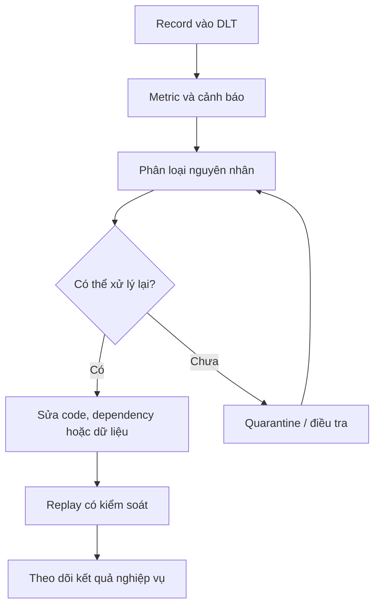

# DeadLetterPublishingRecoverer trong Spring Kafka

`DeadLetterPublishingRecoverer` là thành phần của Spring Kafka chuyên **đưa một record không xử lý được sang topic đích**, thường gọi là dead-letter topic (DLT). Nó thực thi `ConsumerRecordRecoverer`: sau khi listener thất bại và chính sách retry quyết định không thử lại nữa, recoverer tạo một record mới, gửi bằng `KafkaOperations` (thường là `KafkaTemplate`) và bổ sung metadata giúp điều tra lỗi.

Trong mô hình vận hành đáng tin cậy, mục đích của DLT là giữ lại bằng chứng và dữ liệu đầu vào để phân tích, sửa lỗi hoặc replay có kiểm soát. Chuyển sang DLT **không có nghĩa nghiệp vụ đã hoàn tất**. Cần theo dõi riêng record thành công, record đã recovery vào DLT và record mà bản thân thao tác recovery cũng thất bại.

Một cấu hình thường gặp là:

```text
Kafka topic gốc
    |
    v
@KafkaListener
    |
    +-- Xử lý thành công --> container xác nhận tiến độ theo AckMode
    |
    +-- Ném exception
            |
            v
       DefaultErrorHandler
            |
            +-- Retry theo BackOff --> gọi listener lại
            |
            +-- Hết retry hoặc lỗi không retry
                    |
                    v
             DeadLetterPublishingRecoverer
                    |
                    +-- Publish thành công --> xử lý offset theo chính sách
                    |
                    +-- Publish lỗi --> recovery chưa hoàn tất
```

Để dùng đúng, cần hiểu đồng thời cách chọn DLT, cấu hình producer, serializer, headers, xử lý lỗi khi gửi, offset commit và quy trình đọc lại dữ liệu.

## 1. Vị trí của DeadLetterPublishingRecoverer

Spring Kafka phân chia các trách nhiệm thành ba tầng:

| Thành phần | Vai trò |
|---|---|
| `@KafkaListener` | Chạy nghiệp vụ cho record nhận được |
| `DefaultErrorHandler` | Quyết định retry bao nhiêu lần, chờ bao lâu và khi nào recovery |
| `DeadLetterPublishingRecoverer` | Publish record thất bại sang topic đích |
| `KafkaTemplate` hoặc `KafkaOperations` | Gửi record sang Kafka bằng producer được cấu hình |
| Listener container | Phối hợp poll, acknowledgement, commit offset và vòng đời consumer |
| DLT consumer/replay process | Điều tra hoặc xử lý lại record sau khi đã vào DLT |

`DeadLetterPublishingRecoverer` không tự kích hoạt chỉ vì ứng dụng có Kafka hoặc một topic tên `*.DLT`. Phải có đường xử lý lỗi gọi đến recoverer, ví dụ gắn nó vào `DefaultErrorHandler`.

Cũng không nên nhầm `DeadLetterPublishingRecoverer` với `@RetryableTopic`. Cơ chế retry topic của Spring Kafka có thể thiết lập hạ tầng DLT và recoverer riêng. Khi chọn non-blocking retry bằng retry topic, cần kiểm tra cụ thể cấu hình của luồng đó thay vì giả định bean `DefaultErrorHandler` tùy chỉnh kiểm soát toàn bộ lịch retry.

## 2. Khi nào record được đưa vào DLT?

Một listener thường chỉ cần xử lý dữ liệu và để exception đi lên error handler:

```java
@Component
public class OrderListener {

    private final OrderService orderService;

    public OrderListener(OrderService orderService) {
        this.orderService = orderService;
    }

    @KafkaListener(
        topics = "orders.created",
        groupId = "billing-service"
    )
    public void handle(OrderCreated event) {
        orderService.apply(event);
    }
}
```

Nếu `apply()` ném exception, `DefaultErrorHandler` được phép retry. Sau khi hết số lần thử, hoặc ngay lập tức với exception được phân loại `not retryable`, recoverer được gọi.

Ví dụ tình huống:

1. Event `orders.created` chứa dữ liệu không hợp lệ.
2. Listener ném `InvalidOrderException`.
3. Error handler xác định loại exception này không cần retry.
4. Recoverer gửi message đến `orders.created.DLT`.
5. Một consumer hoặc quy trình vận hành theo dõi DLT để điều tra và xử lý sau.

Nếu listener bắt exception rồi trả về bình thường mà chưa thực hiện recovery, container có thể xem record đã được xử lý thành công và tiến độ offset vẫn tăng. Vì vậy, cần **ném lại lỗi chưa được giải quyết** để error handler làm việc.

## 3. Cấu hình cơ bản với DefaultErrorHandler

Một cấu hình dễ hiểu dùng `DefaultErrorHandler`, `FixedBackOff` và `DeadLetterPublishingRecoverer`:

```java
@Configuration
public class KafkaRecoveryConfiguration {

    @Bean
    public CommonErrorHandler commonErrorHandler(
            KafkaTemplate<Object, Object> dltKafkaTemplate) {

        DeadLetterPublishingRecoverer recoverer =
                new DeadLetterPublishingRecoverer(dltKafkaTemplate);

        FixedBackOff backOff =
                new FixedBackOff(1_000L, 2L);

        DefaultErrorHandler handler =
                new DefaultErrorHandler(recoverer, backOff);

        handler.addNotRetryableExceptions(
                InvalidOrderException.class,
                UnsupportedEventVersionException.class
        );

        return handler;
    }
}
```

Cấu hình này giả định ứng dụng đã có `KafkaTemplate<Object,Object>` với producer factory và serializer có thể gửi key/value thực tế sang DLT. Cần có các import từ Spring Kafka và Spring Framework tương ứng.

`FixedBackOff(1_000L, 2L)` nghĩa là tối đa hai lần retry sau lần xử lý đầu, với khoảng chờ dự kiến một giây. Một record liên tục lỗi có thể được gọi listener tổng cộng ba lần trước recovery.

Hai exception được đánh dấu `not retryable` sẽ đi trực tiếp tới recoverer, không phải chờ đủ hai lần retry.

Trong Spring Boot, một bean `CommonErrorHandler` có thể được factory mặc định do Boot auto-configure phát hiện và gắn vào listener container. Nếu tự tạo `ConcurrentKafkaListenerContainerFactory`, cần xác nhận nó dùng Boot configurer hoặc gắn handler tường minh:

```java
factory.setCommonErrorHandler(commonErrorHandler);
```

Không nên giả định mọi factory tùy chỉnh tự động nhận bean error handler.

## 4. Quy tắc chọn topic và partition mặc định

Với constructor đơn giản `new DeadLetterPublishingRecoverer(kafkaTemplate)`, resolver mặc định sử dụng:

- Topic đích: **tên topic nguồn + `.DLT`**.
- Partition đích: **cùng số partition** với record gốc.

Ví dụ:

| Topic nguồn | Partition nguồn | Topic DLT | Partition DLT |
|---|---:|---|---:|
| `orders.created` | 0 | `orders.created.DLT` | 0 |
| `orders.created` | 3 | `orders.created.DLT` | 3 |
| `payments.accepted` | 1 | `payments.accepted.DLT` | 1 |

Đây là lý do topic DLT thường cần **ít nhất số partition bằng topic nguồn**. Nếu resolver yêu cầu partition 3 nhưng DLT chỉ có partition 0 và 1, thao tác publish có thể thất bại.

Giữ cùng partition giúp dễ liên hệ bản ghi lỗi với partition gốc, nhưng DLT vẫn là một topic riêng. DLT không tự bảo đảm thứ tự xử lý lại giữa record lỗi và record bình thường trong topic nguồn.

### 4.1. Tạo DLT trước khi consumer chạy

Trong môi trường production, nên cấp topic DLT bằng IaC, Kafka Admin hoặc quy trình quản lý topic đã thống nhất. Ví dụ topic nguồn có bốn partition:

```text
orders.created       -> partitions: 0, 1, 2, 3
orders.created.DLT   -> partitions: 0, 1, 2, 3
```

Ngoài partition count, cần quyết định replication factor, retention, ACL, giới hạn dung lượng và người sở hữu vận hành.

Nếu tắt broker auto-create và DLT chưa tồn tại, recoverer không có nơi gửi. Nếu bật auto-create nhưng cấu hình mặc định của cluster không phù hợp, topic DLT có thể được tạo với số partition hoặc replication factor khác yêu cầu.

## 5. Chọn DLT bằng destination resolver

Khi cần định tuyến lỗi theo nghiệp vụ hoặc chuẩn đặt tên của hệ thống, truyền một hàm nhận record và exception, trả về `TopicPartition`:

```java
DeadLetterPublishingRecoverer recoverer =
        new DeadLetterPublishingRecoverer(
                dltKafkaTemplate,
                (record, exception) -> new TopicPartition(
                        record.topic() + ".DLT",
                        record.partition()
                )
        );
```

Resolver trên tương đương ý tưởng mặc định: cùng partition và topic có hậu tố `.DLT`.

### 5.1. Định tuyến nhiều loại lỗi

Ví dụ ứng dụng có DLT chung cho schema và DLT riêng cho dependency:

```java
DeadLetterPublishingRecoverer recoverer =
        new DeadLetterPublishingRecoverer(
                dltKafkaTemplate,
                (record, exception) -> {
                    Throwable cause = exception.getCause() != null
                            ? exception.getCause()
                            : exception;

                    if (cause instanceof InvalidOrderException) {
                        return new TopicPartition(
                                "orders.invalid.DLT", -1
                        );
                    }

                    return new TopicPartition(
                            "orders.processing.DLT", -1
                    );
                }
        );
```

Khi resolver trả về partition âm (thường dùng `-1`), recoverer không ép một partition cụ thể vào `ProducerRecord`; Kafka producer chọn partition theo quy tắc partitioning bình thường.

Cách này hữu ích khi DLT có số partition khác topic gốc. Tuy nhiên, nếu dùng key để giữ thứ tự, cần hiểu thuật toán partitioning và số partition đích; thứ tự theo key trên DLT không tự giống thứ tự trên topic gốc.

Các loại exception có thể được bọc trong exception khác. Ví dụ trên chỉ kiểm tra một cấp cause để minh họa; production cần cách phân loại thống nhất với error handler, tránh route sai do chuỗi cause dài.

### 5.2. Nguyên tắc thiết kế resolver

Resolver nên nhanh, xác định được topic và partition đích, không gọi dịch vụ ngoài có độ trễ cao trong đường recovery. Nếu việc định tuyến phụ thuộc dữ liệu nghiệp vụ, hãy giữ quy tắc rõ ràng và kiểm thử đủ các loại lỗi.

Không tạo topic đích mới cho từng event ID hoặc exception message. Hệ thống có thể phát sinh quá nhiều topic và vượt khả năng giám sát.

## 6. KafkaTemplate và serializer dành cho DLT

Recoverer dùng `KafkaOperations` để publish. Vì vậy, DLT producer cần có serializer tương thích với key và value mà recoverer chuyển đi.

Giả sử listener nhận JSON đã deserialize thành `OrderCreated`. Khi gửi lại DLT, value có thể là đối tượng `OrderCreated`; một producer dùng `JsonSerializer` có thể phù hợp:

```java
Map<String, Object> producerProperties = new HashMap<>();
producerProperties.put(
        ProducerConfig.BOOTSTRAP_SERVERS_CONFIG,
        bootstrapServers
);
producerProperties.put(
        ProducerConfig.KEY_SERIALIZER_CLASS_CONFIG,
        StringSerializer.class
);
producerProperties.put(
        ProducerConfig.VALUE_SERIALIZER_CLASS_CONFIG,
        JsonSerializer.class
);
producerProperties.put(
        ProducerConfig.ACKS_CONFIG,
        "all"
);

ProducerFactory<String, Object> producerFactory =
        new DefaultKafkaProducerFactory<>(producerProperties);

KafkaTemplate<String, Object> dltTemplate =
        new KafkaTemplate<>(producerFactory);
```

Đoạn này minh họa lựa chọn serializer; trong ứng dụng Spring Boot, các bean producer factory/template cần được cấu hình và quản lý phù hợp. Nếu DLT có nhiều dạng value, một serializer duy nhất có thể không đáp ứng tất cả.

### 6.1. Payload bị lỗi deserialization

Có tình huống lỗi phát sinh **trước khi listener được gọi** vì value không thể deserialize. Để đưa record lỗi như vậy vào cơ chế xử lý của Spring Kafka, thường dùng `ErrorHandlingDeserializer` bao quanh deserializer thực.

Ví dụ consumer configuration:

```yaml
spring:
  kafka:
    consumer:
      key-deserializer: org.apache.kafka.common.serialization.StringDeserializer
      value-deserializer: org.springframework.kafka.support.serializer.ErrorHandlingDeserializer
      properties:
        spring.deserializer.value.delegate.class: org.springframework.kafka.support.serializer.JsonDeserializer
        spring.json.trusted.packages: "com.example.events"
```

`ErrorHandlingDeserializer` giúp container nhận thông tin lỗi deserialization dưới dạng headers thay vì để exception từ Kafka consumer làm hỏng luồng poll. Khi được recoverer chuyển đến DLT, Spring Kafka có thể sử dụng lại raw bytes gốc từ thông tin lỗi deserialization thay vì một object đã deserialize.

Khi đó, value gửi sang DLT có thể là **`byte[]`**, trong khi các record lỗi nghiệp vụ khác có value là Java object. Nếu DLT producer chỉ có `JsonSerializer` cho object, nó có thể không phù hợp với mọi trường hợp. Một cấu hình phổ biến là dùng `DelegatingByTypeSerializer` hoặc nhiều template được chọn theo kiểu value để xử lý cả `byte[]` và đối tượng nghiệp vụ.

Điểm cần nhớ: producer gửi được record bình thường chưa chắc gửi được record lỗi deserialization. Kiểm thử riêng trường hợp payload JSON bị hỏng, key deserialization lỗi và header lỗi tương ứng.

### 6.2. Nhiều template cho nhiều kiểu value

`DeadLetterPublishingRecoverer` hỗ trợ các constructor/cơ chế chọn `KafkaOperations` dựa trên kiểu dữ liệu hoặc record, tùy phiên bản Spring Kafka.

Điều này hữu ích khi:

- Topic DLT nhận nhiều value class.
- Có record chứa raw bytes do deserialization thất bại.
- Một số topic dùng Avro, JSON hoặc serializer khác nhau.
- Cần phân tách producer transaction/security theo nhóm topic.

Không ép mọi dữ liệu vào `StringSerializer` bằng cách `toString()`. Việc này dễ làm mất payload gốc và khiến replay khó hoặc không thể khôi phục đúng.

## 7. Headers bổ sung khi publish DLT

Một ưu điểm của `DeadLetterPublishingRecoverer` là có thể thêm metadata mô tả nguồn gốc record và exception vào headers của record gửi DLT.

Các thông tin thường được hỗ trợ gồm:

| Nhóm metadata | Nội dung |
|---|---|
| Nguồn gốc | Original topic, partition, offset |
| Thời điểm | Original timestamp và timestamp type |
| Consumer | Consumer group liên quan |
| Exception | Exception class, cause class, message |
| Chẩn đoán | Stack trace hoặc thông tin lỗi tương đương |
| Deserialization | Thông tin lỗi key/value khi lỗi deserialize xảy ra |

Các constant thuộc `KafkaHeaders` trong Spring Kafka có tên dạng `DLT_ORIGINAL_TOPIC`, `DLT_ORIGINAL_PARTITION`, `DLT_ORIGINAL_OFFSET`, `DLT_EXCEPTION_FQCN`, `DLT_EXCEPTION_MESSAGE`, v.v. Danh sách đầy đủ và hành vi bổ sung/giữ lại headers cần đối chiếu với phiên bản Spring Kafka đang chạy.

Ví dụ một record có thể mang thông tin:

```text
Destination topic: orders.created.DLT
Original topic:    orders.created
Original partition: 2
Original offset:    1058
Exception type:    com.example.InvalidOrderException
Exception message: Unsupported currency
```

Metadata giúp người trực ca đối chiếu record với log và trace, kiểm tra liệu nhiều lỗi đến từ cùng một partition, cùng một schema hoặc một thời điểm deploy.

### 7.1. Headers là dữ liệu có thể nhạy cảm

Exception message hoặc stack trace có thể chứa dữ liệu đầu vào, đường dẫn, tên tài nguyên hoặc thông tin hệ thống. Không mặc định rằng mọi người có quyền đọc DLT đều nên xem toàn bộ metadata đó.

Cần kiểm soát ACL của topic, retention, audit và những trường được phép đưa vào log/dashboard. Với exception chứa dữ liệu nhạy cảm, có thể tùy chỉnh các header được thêm vào DLT theo API được phiên bản hỗ trợ.

### 7.2. Bổ sung correlation metadata

Nếu event có `eventId`, `correlationId`, `schemaVersion` hoặc thông tin producer gốc, nên bảo toàn chúng qua retry và DLT nếu chính sách dữ liệu cho phép.

Không dùng các giá trị ID duy nhất làm metric tag. Chúng phù hợp hơn trong log/trace và được truy xuất khi cần điều tra từng record.

### 7.3. Record đi qua nhiều lần recovery

Nếu một record đã nằm trong retry topic, DLT hoặc được replay rồi lại lỗi, có thể xuất hiện metadata nguồn gốc từ nhiều lần chuyển tiếp. Khi thiết kế consumer DLT hoặc replay tool, cần xác định rõ trường nào đại diện cho nguồn ban đầu và trường nào mô tả lần lỗi hiện tại.

Spring Kafka có các tùy chọn kiểm soát hành vi append/replace headers trong một số phiên bản. Không tự giả định mọi header luôn chỉ có một giá trị; Kafka headers có thể chứa nhiều entry trùng key. Trường hợp này cần được xử lý có chủ đích.

## 8. Xác nhận publish thành công và xử lý lỗi recovery

Gọi `KafkaTemplate.send()` là một bước gửi bất đồng bộ; việc recoverer khởi tạo lệnh gửi không phải lúc nào cũng có nghĩa broker đã xác nhận lưu record thành công.

`DeadLetterPublishingRecoverer` có các cấu hình để kiểm tra kết quả gửi, trong đó có `setFailIfSendResultIsError(true)` trên các phiên bản hỗ trợ:

```java
DeadLetterPublishingRecoverer recoverer =
        new DeadLetterPublishingRecoverer(dltKafkaTemplate);

recoverer.setFailIfSendResultIsError(true);
recoverer.setWaitForSendResultTimeout(
        Duration.ofSeconds(10)
);
```

Khi bật kiểm tra kết quả, lỗi publish DLT có thể được ném ra để error handler biết recovery chưa thành công. Nếu giữ mặc định không chờ kết quả, cần hiểu rõ mức bảo đảm của luồng gửi và khả năng publish lỗi bất đồng bộ theo phiên bản Spring Kafka.

Trong production, quyết định cần kiểm tra:

1. DLT topic có tồn tại và broker có sẵn sàng không?
2. Producer có quyền ghi topic DLT không?
3. Serializer có xử lý được key/value thực tế không?
4. Broker có thỏa `acks`, `min.insync.replicas` và replication policy không?
5. Khi publish lỗi, offset của record nguồn có bị commit quá sớm không?
6. Nếu retry publish, liệu DLT có thể xuất hiện duplicate không?

Việc chờ broker xác nhận publish có thể làm tăng thời gian xử lý error handler. Nếu hệ thống yêu cầu DLT có độ bền cao, chi phí này cần được chấp nhận và đo bằng metrics.

### 8.1. Khi publish DLT thất bại

Ví dụ recoverer cố gửi `orders.created.DLT` nhưng producer bị `TimeoutException`. Nếu recoverer ném exception, record chưa đạt trạng thái recovery thành công. `DefaultErrorHandler` có thể tiếp tục cơ chế xử lý lỗi/retry theo cấu hình.

Không nên catch lỗi từ recoverer rồi im lặng coi như đã xử lý. Điều này có thể dẫn đến commit offset của message nguồn dù dữ liệu chưa nằm trong DLT.

### 8.2. DLT có thể có bản ghi trùng

Ngay cả khi publish DLT được xác nhận, có thể xảy ra sự cố trước khi offset nguồn được commit. Khi consumer chạy lại, record nguồn có thể lại được recover, tạo thêm một bản ghi DLT.

Consumer DLT và replay process cần chịu được duplicate. Dùng `eventId` hoặc bộ nhận diện ổn định như original topic/partition/offset để nhận diện cùng record nguồn, kết hợp nghiệp vụ idempotent.

## 9. Liên hệ với offset và acknowledgement

Recoverer chịu trách nhiệm publish record lỗi. Việc commit offset nguồn vẫn được phối hợp bởi listener container, AckMode và error handler.

Một timeline điển hình:

```text
Đọc original record offset=42
  |
Listener ném exception
  |
Retry theo chính sách -> vẫn lỗi
  |
DeadLetterPublishingRecoverer gửi DLT thành công
  |
Error handler trả về bình thường
  |
Container xử lý offset theo AckMode/cấu hình error handler
  |
Vị trí kế tiếp của partition có thể được commit là 43
```

Kafka commit **offset của record kế tiếp cần đọc**. Sau khi xử lý record có offset 42, vị trí commit tương ứng là 43.

Với `DefaultErrorHandler`, thuộc tính `ackAfterHandle` kiểm soát việc container có thể commit offset sau khi handler xử lý xong exception mà không ném lỗi lại. Mặc định ở các phiên bản hiện đại là `true`.

Ngoài ra, `setCommitRecovered(true)` phục vụ trường hợp commit recovered record trong những cấu hình acknowledgement nhất định, đặc biệt `MANUAL_IMMEDIATE`. Không dùng nó như một nút bật chung cho mọi AckMode mà chưa đọc Javadoc tương ứng.

Có thể cấu hình chủ đích:

```java
DefaultErrorHandler handler =
        new DefaultErrorHandler(
                recoverer,
                new FixedBackOff(1_000L, 2L)
        );

handler.setAckAfterHandle(true);
```

Không coi `ackAfterHandle` là cơ chế transaction giữa DLT và offset. Nếu DLT publish thành công nhưng commit offset thất bại, record nguồn vẫn có thể được giao lại.

### 9.1. Cửa sổ xảy ra duplicate

Giả sử:

1. Recoverer publish record DLT thành công.
2. Broker đã lưu record DLT.
3. Ứng dụng dừng trước khi commit offset nguồn.
4. Consumer khởi động lại từ offset cũ.
5. Cùng record lại được xử lý/recover và có thể publish thêm một DLT record.

Đây là lý do phải tách **delivery semantics** của Kafka với idempotency của nghiệp vụ và của quy trình replay.

### 9.2. Transaction và recovery

Với listener container có Kafka transaction, việc xử lý exception, rollback và offset có thêm quy tắc riêng. Trong một số luồng transaction, `DefaultAfterRollbackProcessor` phối hợp với recoverer để xử lý record sau rollback.

Không mặc định gắn `DefaultErrorHandler` vào transactional listener container là đã có transaction nguyên tử giữa publish DLT và commit offset. Hãy dùng cấu hình phù hợp với transactional listener, transaction manager, recoverer và verify bằng integration test.

Kafka transaction chỉ bao phủ những hoạt động Kafka được tham gia đúng transaction. Nó không tự bao phủ database hoặc API bên ngoài. Đối với tác dụng phụ ngoài Kafka, cần idempotency, inbox/outbox hoặc cách phối hợp khác.

## 10. Kết hợp retry và DLT theo loại lỗi

Một chính sách hợp lý cần phân biệt các nhóm exception:

| Loại lỗi | Ví dụ | Chính sách thường phù hợp |
|---|---|---|
| Tạm thời | HTTP 503, database timeout, broker tạm gián đoạn | Retry với backoff có giới hạn |
| Dữ liệu cố định | Payload thiếu trường bắt buộc | Recovery/DLT sớm |
| Schema/deserialize | JSON không hợp lệ, schema sai | ErrorHandlingDeserializer và DLT hỗ trợ raw bytes |
| Nghiệp vụ | Event không hợp lệ theo trạng thái hiện tại | Phân loại rõ có retry hay cần sửa dữ liệu |
| Hạ tầng recovery | DLT publish bị lỗi | Không coi recoverer đã thành công |

Ví dụ:

```java
@Bean
CommonErrorHandler orderErrorHandler(
        KafkaTemplate<Object, Object> dltKafkaTemplate) {

    DeadLetterPublishingRecoverer recoverer =
            new DeadLetterPublishingRecoverer(
                    dltKafkaTemplate,
                    (record, ex) ->
                            new TopicPartition(
                                    record.topic() + ".DLT",
                                    record.partition()
                            )
            );

    recoverer.setFailIfSendResultIsError(true);

    DefaultErrorHandler errorHandler =
            new DefaultErrorHandler(
                    recoverer,
                    new FixedBackOff(2_000L, 3L)
            );

    errorHandler.addNotRetryableExceptions(
            InvalidOrderException.class,
            UnsupportedEventVersionException.class
    );

    return errorHandler;
}
```

Đoạn này là một policy ví dụ. Hai giây chờ và ba lần retry không phải ngưỡng áp dụng cho mọi hệ thống. Hãy chọn theo SLO, loại exception, thời gian dependency hồi phục và chi phí giữ consumer đang retry.

Nếu muốn non-blocking retry trong nhiều phút hoặc giờ, cân nhắc retry topic pattern với lịch delay riêng, kèm theo giám sát topic retry và DLT.

## 11. DLT phải được vận hành như một hàng đợi công việc lỗi

Tạo DLT mới chỉ giải quyết vấn đề lưu lại record thất bại. Để hệ thống có thể recovery thực sự, phải xác định vòng đời tiếp theo:



Khi thiết kế DLT:

- Xác định đội sở hữu topic và quy trình tiếp nhận cảnh báo.
- Chọn retention đủ để điều tra và xử lý lại, phù hợp chính sách dữ liệu.
- Thiết lập ACL ghi cho recoverer, ACL đọc cho operator/replay service.
- Giám sát số record mới vào DLT và tuổi record chưa giải quyết.
- Lưu thông tin nguyên nhân, original offset, event ID và thời điểm xảy ra lỗi.
- Xác định tiêu chí được phép replay hoặc phải bỏ qua vĩnh viễn.
- Giới hạn throughput của replay để không gây tải đột ngột lên downstream.

DLT consumer không nên tự động đẩy mọi record quay lại topic nguồn vô hạn. Nếu lỗi chưa được sửa, vòng lặp này chỉ tạo thêm retry, duplicate và backlog.

## 12. Thiết kế replay an toàn

Replay có thể được thực hiện bằng một công cụ vận hành hoặc một service riêng, tùy yêu cầu. Quy trình thường gồm:

1. Truy vấn các record DLT theo topic, partition, khoảng thời gian và loại lỗi.
2. Đọc metadata original topic/partition/offset.
3. Xác định nguyên nhân đã được khắc phục.
4. Kiểm tra khả năng xử lý lại có an toàn hay không.
5. Ghi dấu/bảo vệ chống replay trùng.
6. Publish có kiểm soát vào topic hoặc luồng xử lý được lựa chọn.
7. Theo dõi end-to-end result, số lỗi lặp lại và tốc độ replay.

Cần phân biệt hai kiểu replay:

**Replay vào topic nguồn:** có thể kích hoạt tất cả consumer group đang subscribe, kể cả những group đã xử lý event trước đó. Cần đánh giá ảnh hưởng lên toàn hệ thống.

**Replay vào topic/consumer chuyên dụng:** cho phép cô lập nhóm nghiệp vụ cần xử lý lại, nhưng phải thiết kế schema, transaction và idempotency tương ứng.

Nếu nghiệp vụ có quan hệ thứ tự, replay một event cũ sau các event mới hơn có thể tạo sai trạng thái. Với các event theo `orderId`, hãy kiểm tra version hoặc sequence number và thiết kế idempotent update.

## 13. Metrics và logging cho recoverer

Một dashboard production hữu ích nên tách retry với DLT/recovery:

| Chỉ số | Diễn giải |
|---|---|
| Listener failure rate | Mức lỗi trong xử lý nghiệp vụ |
| Retry attempts | Số lần thử lại trước recovery |
| Recovery success count | Số record đã được recoverer xử lý thành công |
| Recovery failure count | Số lần recoverer thất bại |
| DLT publish latency | Thời gian gửi và nhận kết quả từ broker |
| DLT ingress rate | Tốc độ record đi vào DLT |
| DLT backlog/oldest age | Mức tồn đọng của quy trình xử lý DLT |
| Consumer lag topic nguồn | Độ trễ đọc/commit ở consumer gốc |
| Replay success/error | Kết quả xử lý lại sau khi sửa nguyên nhân |

Spring Kafka cung cấp các callback/hook như `RetryListener` để theo dõi failed delivery, recovered và recovery failure trong các phiên bản hỗ trợ. Ngoài ra có thể instrument `KafkaTemplate`, listener và replay service bằng Micrometer Observation.

Ví dụ `RetryListener` dùng để ghi metric theo kết quả:

```java
DefaultErrorHandler handler =
        new DefaultErrorHandler(
                recoverer,
                new FixedBackOff(1_000L, 2L)
        );

handler.setRetryListeners(new RetryListener() {

    @Override
    public void failedDelivery(
            ConsumerRecord<?, ?> record,
            Exception ex,
            int deliveryAttempt) {
        metrics.incrementRetryFailure(record.topic());
    }

    @Override
    public void recovered(
            ConsumerRecord<?, ?> record,
            Exception ex) {
        metrics.incrementRecovered(record.topic());
    }

    @Override
    public void recoveryFailed(
            ConsumerRecord<?, ?> record,
            Exception original,
            Exception failure) {
        metrics.incrementRecoveryFailure(record.topic());
    }
});
```

`metrics` ở đây đại diện cho service metrics do ứng dụng cung cấp. Callback đếm recovery thành công theo error handler; cần hiểu cấu hình xác nhận publish DLT trước khi diễn giải `recovered` là record đã được broker lưu bền vững.

### 13.1. Log điều tra

Một log phục vụ điều tra DLT có thể gồm:

```json
{
  "event": "kafka_record_dead_lettered",
  "sourceTopic": "orders.created",
  "sourcePartition": 2,
  "sourceOffset": 1058,
  "destinationTopic": "orders.created.DLT",
  "exceptionClass": "InvalidOrderException",
  "service": "billing-service",
  "recoveryOutcome": "published"
}
```

Đây là định dạng minh họa cho structured log của ứng dụng, không phải log tự sinh bắt buộc của Spring Kafka. Tránh ghi payload hoặc exception message chứa thông tin nhạy cảm vào hệ thống log không đủ quyền truy cập.

### 13.2. Tránh metric cardinality cao

Không đặt original offset, event ID, record key hoặc exception message vào metric tags. Mỗi giá trị riêng biệt tạo thêm chuỗi thời gian, làm tăng chi phí và ảnh hưởng dashboard. Chỉ nên tag bằng service, source topic, destination topic, outcome và exception class đã chuẩn hóa.

## 14. Kiểm thử tích hợp đường recovery

Một bài kiểm thử chỉ xác nhận listener ném exception là chưa đủ. Cần kiểm tra cả DLT producer và offset.

### 14.1. Trường hợp retry hết rồi vào DLT

Thiết lập topic nguồn, DLT và consumer group riêng. Cho listener luôn ném exception và cấu hình `FixedBackOff` ngắn.

Kết quả kỳ vọng:

1. Listener được gọi một lần ban đầu và số lần retry đã cấu hình.
2. Recoverer gửi đúng một record DLT trong kịch bản không có lỗi publish/restart.
3. DLT record giữ payload và key theo cơ chế serializer được thiết kế.
4. DLT headers chứa original topic, partition, offset và exception metadata cần thiết.
5. Offset nguồn tiến lên theo policy của error handler/container.

### 14.2. Exception không retry

Cho listener ném exception thuộc danh sách `addNotRetryableExceptions()`.

Kỳ vọng recoverer được gọi mà không đợi toàn bộ backoff. Điều này quan trọng với lỗi schema hoặc nghiệp vụ cố định.

### 14.3. DLT publish lỗi

Tạo tình huống producer không thể ghi DLT, chẳng hạn topic thiếu hoặc ACL sai trong môi trường test. Với cấu hình xác nhận kết quả gửi, kiểm tra recoverer báo lỗi và không coi record đã recovery thành công.

Đồng thời kiểm tra handler/container không commit offset vượt qua record chưa được recovery theo chính sách mong muốn.

### 14.4. Lỗi deserialization

Gửi payload không hợp lệ qua consumer dùng `ErrorHandlingDeserializer`. Xác nhận record lỗi có thể được đưa đến DLT và raw bytes/headers cần thiết được giữ. Đây là phép thử quan trọng nếu DLT template dùng nhiều serializer.

### 14.5. DLT có ít partition hơn nguồn

Cho topic nguồn có partition số 3 nhưng DLT chỉ có hai partition. Nếu resolver ép partition 3, kiểm tra publish lỗi. Sau đó thử resolver trả `-1` hoặc tạo đủ partition và xác nhận publish thành công.

### 14.6. Restart giữa publish DLT và commit offset

Tạo tình huống publish DLT đã thành công nhưng consumer chưa commit offset. Sau restart, cùng record có thể xuất hiện thêm lần nữa trong DLT. Kiểm tra replay process có thể chống trùng theo event ID hoặc original topic/partition/offset.

Bảng tình huống cần quan sát:

| Tình huống | Điều cần xác nhận |
|---|---|
| Retry thành công | Không có DLT, nghiệp vụ hoàn tất |
| Hết retry | Record đến DLT đúng topic/partition |
| Lỗi không retry | Chuyển recovery sớm |
| DLT serializer không tương thích | Recovery thất bại có thể quan sát |
| DLT topic thiếu/ACL sai | Publish lỗi được truyền về |
| Lỗi deserialization | Có dữ liệu gốc thích hợp để điều tra |
| Commit offset lỗi sau publish | Có thể duplicate, replay idempotent |
| DLT consumer/replay thất bại | Có cảnh báo và quy trình xử lý |

## 15. Những hiểu nhầm thường gặp

**Có topic .DLT nghĩa là Spring Kafka tự gửi lỗi vào đó.** Cần error handler/retry topic infrastructure có cấu hình recoverer thực sự.

**Hết retry là chắc chắn publish thành công.** DLT producer có thể lỗi serializer, ACL, partition hoặc broker. Cần xác nhận kết quả theo mức độ bền vững được yêu cầu.

**DLT được xem là business success.** Recovery vào DLT chỉ giữ dữ liệu cho xử lý sau; nghiệp vụ có thể vẫn chưa thực hiện.

**Topic DLT ít partition hơn topic nguồn nhưng dùng resolver mặc định.** Resolver có thể gửi vào partition không tồn tại. Tạo DLT đủ partition hoặc đổi resolver.

**Dùng serializer giống topic nguồn cho mọi DLT message.** Lỗi deserialization có thể chuyển raw `byte[]`, khác kiểu value của record bình thường. Dùng serializer/template phù hợp.

**Nuốt exception trong listener.** Error handler không được gọi khi listener đã trả về bình thường. Chỉ catch khi đã hoàn tất recovery chủ đích hoặc ném lại exception.

**Replay tự động mọi record DLT vào topic nguồn.** Có thể gây vòng lặp và tạo tác dụng phụ trùng. Cần phân loại, sửa nguyên nhân và giới hạn replay.

**Giả định DLT publish và offset commit luôn nguyên tử.** Hai bước có thể bị chia cắt bởi sự cố, tạo duplicate. Dùng transaction Kafka đúng phạm vi khi cần và xử lý idempotency.

**Chỉ đo DLT ingress mà không theo dõi backlog.** DLT ít record mới không có nghĩa tất cả record cũ đã được giải quyết. Theo dõi age, trạng thái điều tra và replay result.

**Ghi toàn bộ payload/stack trace vào log công khai.** DLT có thể chứa dữ liệu nhạy cảm; áp dụng ACL, retention và chính sách logging thích hợp.

## 16. Quy trình triển khai cho một service Spring Boot

Đối với một service mới, có thể triển khai theo thứ tự:

1. Xác định topic nguồn, consumer group, key, value schema và delivery semantics.
2. Phân loại lỗi tạm thời và lỗi cần recovery sớm.
3. Chọn `DefaultErrorHandler` và backoff phù hợp.
4. Tạo `DeadLetterPublishingRecoverer` với destination resolver rõ ràng.
5. Tạo topic DLT với partition/replication/retention và ACL phù hợp.
6. Cấu hình DLT `KafkaTemplate` và serializer cho cả lỗi nghiệp vụ lẫn deserialization.
7. Quyết định có chờ xác nhận DLT publish và timeout tương ứng không.
8. Xác nhận AckMode và policy commit sau recovery.
9. Cấu hình metrics cho retry, DLT publish, recovery failure và backlog.
10. Thiết kế runbook điều tra, quyền truy cập và replay idempotent.
11. Kiểm thử retry, DLT headers, partition routing, restart, serializer và commit failure.
12. Kiểm thử lại khi đổi phiên bản Spring Kafka, schema hoặc cấu hình topic.

Một DLT đáng tin cậy cần vừa lưu được record lỗi, vừa cho phép điều tra và phục hồi an toàn. `DeadLetterPublishingRecoverer` cung cấp khả năng publish và metadata; việc bảo đảm record không bị mất trong cửa sổ lỗi, tránh duplicate và hoàn tất nghiệp vụ vẫn phụ thuộc vào thiết kế của toàn hệ thống.

## 17. Tài liệu cần đối chiếu theo phiên bản

API và các tùy chọn của `DeadLetterPublishingRecoverer` thay đổi theo các bản Spring Kafka. Khi triển khai hoặc nâng cấp, đối chiếu đúng phiên bản của:

- Spring for Apache Kafka Reference — Publishing Dead-letter Records.
- Spring for Apache Kafka Reference — DefaultErrorHandler, exception classification, BackOff và recovery.
- Spring Kafka Javadoc — `DeadLetterPublishingRecoverer`, `DeadLetterPublishingRecovererFactory`, `ConsumerRecordRecoverer` và `DefaultErrorHandler`.
- Spring Kafka Reference — ErrorHandlingDeserializer, deserialization failure và `DelegatingByTypeSerializer`.
- Spring Kafka Reference — Non-blocking retries, `@RetryableTopic` và DLT processing.
- Spring Boot Reference — Kafka auto-configuration, `CommonErrorHandler` và listener factory.
- Apache Kafka Documentation — producer acknowledgements, transactions, topic partitions và consumer offsets.

Ưu tiên phiên bản Spring Kafka được Spring Boot quản lý và xác nhận các phương thức như `setFailIfSendResultIsError`, `setWaitForSendResultTimeout`, header customization hay cơ chế nhiều template có trong phiên bản đang chạy trước khi áp dụng.
