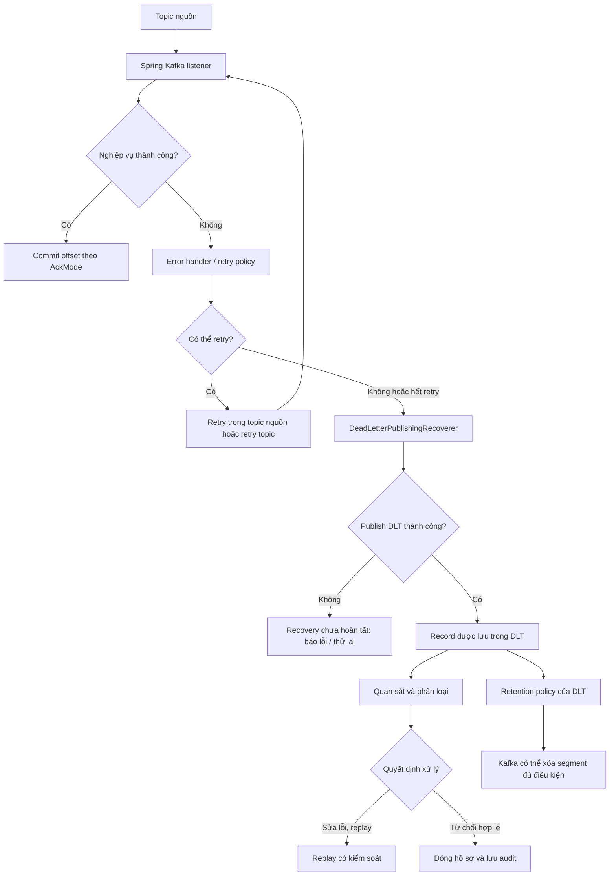

# Chính sách lưu giữ DLT

Trong hệ thống Spring Kafka, **dead-letter topic (DLT)** là nơi tiếp nhận những record mà consumer không thể xử lý theo retry/recovery policy. DLT giữ bằng chứng về message lỗi để đội vận hành xác định nguyên nhân, sửa dữ liệu hoặc ứng dụng, rồi quyết định replay hay kết thúc xử lý theo quy trình nghiệp vụ. Tuy nhiên, DLT vẫn là **Kafka topic**: dữ liệu trong nó chịu ảnh hưởng của `retention.ms`, `retention.bytes`, `cleanup.policy`, dung lượng broker và những quy định bảo vệ dữ liệu.

Nếu DLT hết thời hạn retention trước khi người phụ trách điều tra, record có thể bị xóa và không còn đủ dữ liệu để replay. Ngược lại, để DLT giữ vô hạn mà không có kiểm soát có thể làm đầy ổ đĩa, tăng chi phí, giữ dữ liệu nhạy cảm quá lâu và khiến một sự cố trên DLT ảnh hưởng cả cluster Kafka.

**Chính sách lưu giữ DLT** vì vậy phải trả lời ít nhất bốn câu hỏi: giữ record lỗi trong bao lâu, giới hạn dung lượng thế nào, ai chịu trách nhiệm xử lý trước khi hết hạn và điều gì xảy ra khi một record chưa được giải quyết nhưng sắp bị xóa. Không nên dùng retention của topic nguồn một cách máy móc cho DLT.

## 1. DLT nằm ở đâu trong vòng đời message?

Một luồng xử lý thông thường:



Trong sơ đồ, recovery được xem là thành công khi việc bàn giao record sang DLT được xác nhận theo cơ chế của ứng dụng. Khi đó error handler/container **có thể** cho phép commit offset nguồn theo cấu hình. Nhưng commit offset nguồn chỉ có nghĩa message đã được bàn giao sang nhánh recovery, không có nghĩa nghiệp vụ gốc đã hoàn tất.

Từ khi record xuất hiện trong DLT, nhóm chịu trách nhiệm có một **cửa sổ thời gian hữu hạn** để điều tra và khắc phục trước khi Kafka có thể xóa dữ liệu theo retention. Vì vậy, DLT không tự động thay thế một kho lưu trữ chứng cứ dài hạn hoặc hệ thống quản lý ticket.

## 2. Phân biệt retention, retry, replay và archival

| Khái niệm | Chức năng | Điều không được ngầm định |
|---|---|---|
| Retry | Thử xử lý lại record khi lỗi có thể phục hồi | Không đồng nghĩa record lỗi được lưu giữ vô hạn. |
| DLT | Giữ record thất bại sau khi retry/recovery policy đã quyết định chuyển hướng | Không bảo đảm có người điều tra hoặc replay. |
| Retention | Chính sách Kafka dùng để xác định dữ liệu nào đủ điều kiện bị loại bỏ | Không phải lịch hẹn xóa chính xác đến từng mili-giây. |
| Replay | Phát lại hoặc xử lý lại record đã được chọn | Không tự bảo đảm đúng thứ tự hay không tạo duplicate. |
| Archival | Lưu bằng chứng lâu dài vào kho khác theo quy định nghiệp vụ | Không phải hành vi tự có của DLT. |
| Audit | Lưu metadata về quyết định xử lý, người thao tác và kết quả | Không yêu cầu giữ payload nhạy cảm mãi mãi trong Kafka. |

Một message có thể đã hết retry, được lưu vào DLT và chưa từng được replay. Nếu thời hạn retention kết thúc, Kafka vẫn có thể xóa nó dù ticket điều tra đang mở. Retention của topic không biết trạng thái ticket, mức độ nghiêm trọng của lỗi hay nhu cầu pháp lý của doanh nghiệp.

## 3. Những cấu hình Kafka chi phối tuổi thọ record DLT

### `retention.ms`: thời hạn giữ dữ liệu theo thời gian

`retention.ms` xác định khoảng thời gian giữ log áp dụng với topic có chính sách xóa (`cleanup.policy=delete`). Khi record nằm trong log segment đủ điều kiện xóa theo chính sách, broker có thể loại bỏ cả segment. Đặt `retention.ms=-1` nghĩa là không giới hạn giữ theo **điều kiện thời gian**, nhưng không vô hiệu hóa giới hạn dung lượng hoặc các thao tác quản trị khác.

Ví dụ, cấu hình giữ DLT trong 30 ngày:

```properties
cleanup.policy=delete
retention.ms=2592000000
```

Đây chỉ là ví dụ để minh họa; lựa chọn thực tế phải dựa trên SLA điều tra, nhu cầu replay, khả năng lưu trữ và chính sách dữ liệu. Không mặc định mọi DLT cần giữ 30 ngày.

### `retention.bytes`: giới hạn theo kích thước

`retention.bytes` giới hạn kích thước log **trên mỗi partition**, không phải tổng dung lượng của cả topic. Nếu topic có nhiều partition, tổng dung lượng lưu giữ theo điều kiện này có thể lớn hơn giá trị cấu hình nhân với số partition, chưa tính replication và overhead.

Với topic dùng chính sách `delete`, Kafka có thể xóa dữ liệu đủ điều kiện khi **một trong hai** ràng buộc thời gian hoặc dung lượng kích hoạt. Vì vậy, một DLT được đặt retention 30 ngày vẫn có thể mất các segment cũ hơn sớm hơn 30 ngày nếu ngưỡng `retention.bytes` bị chạm.

Giá trị `-1` cho `retention.bytes` là không đặt giới hạn theo kích thước log của từng partition bằng thuộc tính này. Điều đó không có nghĩa dung lượng cluster vô hạn hay có thể bỏ qua giám sát disk.

### `cleanup.policy`: xóa hay compact?

| Giá trị | Hành vi cốt lõi | Mức phù hợp với DLT |
|---|---|---|
| `delete` | Giữ log rồi xóa segment theo retention thời gian/kích thước | Thường phù hợp khi cần giữ **mọi lần thất bại** để điều tra/replay. |
| `compact` | Giữ bản ghi mới hơn theo key, dọn các phiên bản cũ theo thuật toán compaction | Thường không phù hợp nếu mỗi record lỗi đều là chứng cứ độc lập. |
| `delete,compact` | Áp dụng cả hai cơ chế theo điều kiện của Kafka | Chỉ dùng khi đã hiểu rõ ý nghĩa key, tombstone và yêu cầu lịch sử. |

DLT thường chứa nhiều lần lỗi của cùng một business key. Nếu dùng log compaction theo `orderId`, các record lỗi trước có thể bị dọn khi bản ghi mới dùng cùng key xuất hiện. Điều đó làm mất lịch sử chẩn đoán hoặc dữ liệu cần replay. Vì thế, lựa chọn phổ biến cho DLT dạng sự kiện là `cleanup.policy=delete`.

Không nhầm compaction với một cách "giữ message tốt hơn". Nó tối ưu trạng thái mới nhất theo key, không phải lưu trữ đầy đủ chuỗi lỗi.

### Retention không phải đồng hồ xóa chính xác

Kafka thực hiện retention ở mức **log segment**, không xóa từng record ngay khi đúng tuổi. Một segment chỉ được loại bỏ khi thỏa điều kiện và qua chu kỳ kiểm tra của broker. Các cấu hình như `segment.ms`, kích thước segment, chu kỳ kiểm tra retention và timestamp của record/segment ảnh hưởng đến thời điểm xóa thực tế.

Vì vậy:

- Không cam kết Kafka sẽ xóa chính xác vào phút cuối cùng của một ngày retention.
- Không dùng retention làm cơ chế xóa cá nhân theo từng record một cách có thời hạn tuyệt đối.
- Không đợi đúng ngày cuối cùng mới replay hoặc archive.
- Khi cần chính sách xóa chính xác, phải có quy trình quản trị dữ liệu bổ sung và xác minh kết quả.

Ngoài ra, timestamp dùng cho log retention phụ thuộc cấu hình topic/broker và cách broker xác định timestamp. Record được replay hoặc gửi từ một hệ thống khác có thể mang timestamp khác thời điểm vừa được ghi. Khi thiết kế chính sách, cần kiểm tra `message.timestamp.type`, timestamp hiệu lực và cách hệ thống tạo message DLT, thay vì mặc nhiên coi tuổi record là thời gian kể từ lần publish DLT.

## 4. Chọn thời hạn giữ DLT dựa trên SLA xử lý

Thời hạn retention nên dài hơn tổng thời gian cần thiết để phát hiện, điều tra và khôi phục, cộng một biên cho ngày nghỉ, lỗi hạ tầng và các ca cần phê duyệt.

Một cách lập ngân sách:

```text
Retention tối thiểu theo nghiệp vụ >=
    T_phát_hiện_lỗi
  + T_phân_loại_và_giao_owner
  + T_điều_tra
  + T_sửa_và_triển_khai
  + T_kiểm_thử_replay
  + T_biên_an_toàn
```

Ví dụ một hệ thống có quy trình kiểm tra DLT mỗi ngày, lỗi phức tạp cần vài ngày phân tích và bản sửa phải trải qua lịch phát hành định kỳ. Nếu retention chỉ vài giờ, khả năng mất dữ liệu trước khi có người xử lý là rất cao.

Ngược lại, nếu mọi message DLT chứa dữ liệu cá nhân, retention hàng tháng hoặc vô hạn có thể không phù hợp với chính sách bảo mật và yêu cầu pháp lý. Cần thỏa thuận thời hạn cùng owner nghiệp vụ, bộ phận vận hành và người quản lý dữ liệu.

### Phân loại DLT theo mức độ ưu tiên

Không phải mọi DLT cần cùng thời hạn:

| Nhóm dữ liệu | Tình huống | Cách đặt retention |
|---|---|---|
| Giao dịch quan trọng | Thanh toán, hóa đơn, cập nhật tồn kho | Đặt theo SLA điều tra/reconciliation và phương án lưu vết bền vững được phê duyệt. |
| Sự kiện nghiệp vụ thông thường | Đơn hàng, cập nhật trạng thái | Đủ dài cho vòng release và replay thông thường. |
| Telemetry có thể tái tạo | Một phần metrics hoặc event thống kê | Có thể ngắn hơn nếu thực sự không ảnh hưởng nghiệp vụ và có nguồn tái tạo. |
| Dữ liệu nhạy cảm | Message có thông tin cá nhân hoặc bí mật | Giữ tối thiểu cần thiết, mã hóa/giới hạn truy cập và có chính sách xóa rõ ràng. |
| Poison pill/schema lỗi hàng loạt | Payload không deserialize được hoặc format sai | Giữ đủ mẫu và metadata để chẩn đoán; cân nhắc cách cách ly có giới hạn thay vì giữ vô tận. |

Thời hạn của mỗi nhóm là quyết định nghiệp vụ và quản trị dữ liệu, không phải chỉ là lựa chọn kỹ thuật của Spring Kafka.

## 5. Tính dung lượng và tránh retention sớm do đầy log

Một chính sách retention theo thời gian không hữu dụng nếu DLT thường xuyên chạm giới hạn byte hoặc broker hết disk. Khi sizing, cần ước lượng lưu lượng lỗi bình thường và **lưu lượng lỗi khi có sự cố hàng loạt**, không chỉ lấy trung bình trong ngày ổn định.

Ước lượng dung lượng logic:

```text
Data_per_day =
    failed_records_per_day
  × average_serialized_record_bytes

Logical_DLT_storage ≈
    Data_per_day × retention_days

Physical_storage ≈
    Logical_DLT_storage × replication_factor
  + segment/index/metadata/operational_overhead
```

Ví dụ, nếu DLT có 2.000 record mỗi ngày, kích thước serialize trung bình 12 KiB, thì dữ liệu logic trong một ngày xấp xỉ 23,4 MiB. Với 30 ngày và replication factor 3, dữ liệu replica xấp xỉ 2,06 GiB trước khi tính index, log segment overhead và headroom. Đây chỉ là ví dụ tính tải nền; một lỗi producer phát ra hàng triệu record trong vài giờ có thể vượt xa mức đó.

Khi tính toán, cần xét:

- Key/value serialized size thực tế và kích thước header exception từ Spring Kafka.
- Tỷ lệ lỗi cao nhất trong sự cố (peak), không chỉ tỷ lệ lỗi bình thường.
- Số partition và phân bố key; `retention.bytes` áp dụng trên từng partition.
- Replication factor, disk overhead, log segment và chính sách lưu tiered storage nếu được dùng.
- Topic retry khác DLT: cùng một event có thể xuất hiện ở nhiều retry topic trước khi vào DLT.
- Thời gian phục hồi khi Kafka broker/downstream gặp outage kéo dài.
- Biên dung lượng đủ để không phải hạ retention khẩn cấp trong lúc incident.

Nếu muốn giữ trọn tối thiểu một số ngày, không đặt `retention.bytes` quá thấp khiến segment bị xóa sớm. Có thể đặt giới hạn byte `-1` và quản lý dung lượng qua capacity planning/alerting; hoặc đặt ngưỡng đủ lớn cho kịch bản peak theo chính sách cluster. Mọi lựa chọn đều cần cảnh báo disk và kế hoạch mở rộng.

## 6. Tạo DLT với retention độc lập topic nguồn

Spring Kafka `DeadLetterPublishingRecoverer` chịu trách nhiệm **publish** record lỗi đến DLT; nó không thay bạn thiết kế thời hạn lưu. Cấu hình retention thuộc về Kafka topic và có thể được quản lý bởi Kafka Admin, hạ tầng-as-code hoặc công cụ quản trị cluster.

Ví dụ dùng `KafkaAdmin`/Spring Kafka `NewTopic` để mô tả DLT cho topic `orders.events` có sáu partition:

```java
@Bean
NewTopic ordersDeadLetterTopic() {
    return TopicBuilder.name("orders.events.DLT")
            .partitions(6)
            .replicas(3)
            .config(TopicConfig.CLEANUP_POLICY_CONFIG, "delete")
            .config(TopicConfig.RETENTION_MS_CONFIG, "2592000000")
            .config(TopicConfig.RETENTION_BYTES_CONFIG, "-1")
            .build();
}
```

Các lớp cần thiết gồm `org.apache.kafka.clients.admin.NewTopic`, `org.apache.kafka.common.config.TopicConfig` và `org.springframework.kafka.config.TopicBuilder`. Cấu hình trên minh họa retention 30 ngày, không giới hạn theo byte bằng thuộc tính của topic, và replication factor 3. Cluster phải có đủ broker để đáp ứng replication factor; trong môi trường production nên tạo/quản trị topic theo quy trình được kiểm soát, không mặc nhiên cho service quyền thay đổi mọi topic.

Ví dụ cấu hình `DefaultErrorHandler` chuyển record lỗi sang DLT cùng partition:

```java
@Bean
DefaultErrorHandler ordersErrorHandler(
        KafkaTemplate<Object, Object> kafkaTemplate) {

    DeadLetterPublishingRecoverer recoverer =
            new DeadLetterPublishingRecoverer(
                    kafkaTemplate,
                    (record, exception) -> new TopicPartition(
                            record.topic() + ".DLT",
                            record.partition()));

    return new DefaultErrorHandler(
            recoverer,
            new FixedBackOff(1_000L, 3L));
}
```

Đây là minh họa cho record listener không dùng Kafka container transaction. Nếu resolver giữ nguyên partition, DLT phải có đủ partition tương ứng với topic nguồn; nếu không, cần đổi resolver để chọn partition hợp lệ. KafkaTemplate dùng để publish DLT phải serialize được record và có quyền write topic đích.

Đừng đặt retention bằng cấu hình `spring.kafka.consumer` hay `spring.kafka.producer`; những cấu hình này áp dụng cho Kafka client. Retention là **cấu hình topic/broker**, cần kiểm tra trên broker sau khi topic đã được tạo.

### Thay đổi retention của DLT đã tồn tại

Ví dụ lệnh Kafka CLI trong môi trường có quyền quản trị:

```bash
kafka-configs.sh \
  --bootstrap-server kafka-1.example.internal:9092 \
  --entity-type topics \
  --entity-name orders.events.DLT \
  --alter \
  --add-config retention.ms=2592000000
```

Và lệnh mô tả cấu hình để đối chiếu:

```bash
kafka-configs.sh \
  --bootstrap-server kafka-1.example.internal:9092 \
  --entity-type topics \
  --entity-name orders.events.DLT \
  --describe
```

Đây là lệnh ví dụ, không phải lệnh cần chạy trong tài liệu này. Broker endpoint, quyền truy cập, cơ chế xác thực và công cụ CLI thực tế phụ thuộc môi trường. Việc giảm retention trên một topic có dữ liệu cũ **có thể khiến các segment cũ đủ điều kiện bị xóa nhanh chóng** sau khi broker áp dụng chính sách. Vì vậy, thay đổi retention là thao tác dữ liệu có rủi ro và cần kế hoạch rollback/backup thích hợp.

## 7. Retention của DLT không phải retention của retry topic

Trong non-blocking retry, `@RetryableTopic` có thể tạo nhiều retry topic để lưu record trong các khoảng delay. Mỗi retry topic vẫn có retention riêng. Nếu retention quá ngắn so với delay dự kiến hoặc một retry consumer dừng lâu, record trong retry topic có thể bị xóa trước khi được thử lại.

Ví dụ:

```text
orders.events
  -> orders.events-retry-2000
  -> orders.events-retry-10000
  -> orders.events.DLT
```

Tên topic chỉ mang tính minh họa; Spring Kafka có naming strategy và cấu hình khác nhau. Với retry topic, cần bảo đảm retention đủ cho thời gian chờ + thời gian outage/recovery của retry consumer. Với DLT, cần bảo đảm thời gian điều tra + sửa lỗi + replay.

| Chủng loại topic | Mục tiêu retention | Cần đo |
|---|---|---|
| Topic nguồn | Cho consumer bình thường và replay nghiệp vụ theo thiết kế | Consumer lag, thời gian mất kết nối, yêu cầu tái dựng dữ liệu. |
| Retry topic | Chờ retry đến hạn và chịu outage của retry consumer | Delay tối đa, tuổi record đang chờ, retry backlog. |
| DLT | Giữ record đã vượt qua chính sách retry để điều tra/khắc phục | Tuổi record chưa giải quyết, SLA investigation, replay deadline. |
| Audit/archive ngoài Kafka | Giữ chứng cứ theo chính sách quản trị | Thời gian lưu hợp lệ, quyền truy cập, cơ chế xóa/kiểm chứng. |

Đừng áp dụng cùng một số ngày cho tất cả topic chỉ vì chúng liên quan cùng luồng nghiệp vụ. Từng topic có chức năng và cửa sổ phục hồi khác nhau.

## 8. Kiểm soát độ bền khi record đi vào DLT

Retention chỉ có ý nghĩa nếu record thực sự được ghi và còn khả năng đọc lại. Cấu hình `DeadLetterPublishingRecoverer`, producer và topic DLT cần thống nhất với mức độ bền mong muốn.

Các điểm cần kiểm soát:

1. Topic DLT tồn tại, có số partition phù hợp và replication factor đáp ứng policy.
2. Producer dùng acknowledgement và retry phù hợp, ví dụ `acks=all` với idempotence khi cần.
3. Recoverer nhận diện được lỗi publish DLT, timeout, serializer hoặc ACL và không âm thầm coi đó là recovery thành công.
4. Consumer source chỉ commit offset record đã xử lý/recovered theo policy, không commit sớm khi DLT publish chưa bền vững.
5. Có metric cho `DLT publish success/failure`, không chỉ có `listener exception count`.

Trong Spring Kafka, `DefaultErrorHandler` có thể xem recovery thành công khi recoverer hoàn tất và trả về bình thường; thuộc tính như `ackAfterHandle` và `commitRecovered` tác động đến commit trong những trường hợp tương ứng. Hành vi cụ thể còn tùy `AckMode`, phiên bản framework và transaction model. Không đặt `ackAfterHandle` hay `commitRecovered` mà không xác định rõ ai sẽ commit offset.

Đối với transactional listener, cần xét `DefaultAfterRollbackProcessor` và transaction/recovery transaction thay vì áp nguyên xi mô hình nontransactional. Retention topic DLT là cùng một khái niệm Kafka, nhưng cách record đi đến DLT và offset nguồn được commit có thể khác.

### Thế nào là record DLT còn phục hồi được?

Một record còn trong DLT không đồng nghĩa replay chắc chắn thành công. Cần còn đủ:

- Payload hoặc tham chiếu đến payload theo chính sách bảo mật.
- Schema/version/serializer phù hợp để giải mã.
- Topic/partition/offset nguồn hoặc correlation ID để truy vết.
- Event ID để chống duplicate.
- Exception class, error code và thông tin môi trường tại thời điểm lỗi.
- Dữ liệu tham chiếu và quy tắc nghiệp vụ cần thiết để xử lý lại.

Nếu dữ liệu tham chiếu có thể thay đổi sau nhiều ngày, việc replay message cũ có thể gây một lỗi khác hoặc bị áp dụng theo rule mới. Chính sách retention nên đi cùng chính sách versioning và replay semantics.

## 9. Quy trình xử lý DLT trước khi hết hạn

Một DLT cần có người chịu trách nhiệm cụ thể. Dù topic có retention dài, nếu không có quy trình xử lý, lỗi vẫn bị tích tụ và dữ liệu có thể mất trước khi ai đó phát hiện.

Quy trình gợi ý:

1. **Phát hiện:** monitor số record mới vào DLT và cảnh báo khi xuất hiện hoặc vượt baseline.
2. **Phân loại:** nhóm theo source topic, error code, exception và thời điểm; tách poison-pill, lỗi nghiệp vụ và lỗi hạ tầng.
3. **Giao owner:** ghi ticket hoặc hồ sơ xử lý có hạn chót trước khi record sắp hết retention.
4. **Khắc phục:** sửa producer, consumer, schema, dependency, cấu hình hoặc xử lý bù.
5. **Replay thử:** chọn một số record đại diện, kiểm tra idempotency và kết quả nghiệp vụ.
6. **Replay lô:** giới hạn tốc độ, quan sát duplicate và các lần thất bại mới.
7. **Đóng hồ sơ:** lưu số record được xử lý, bỏ qua hợp lệ hoặc đưa vào kho archive được phép.
8. **Dọn dữ liệu:** để Kafka retention thực hiện theo cấu hình hoặc thực hiện quy trình xóa riêng khi có căn cứ quản trị.

Hồ sơ cần bao gồm topic, partition, offset, event ID, classification, người chịu trách nhiệm, quyết định replay/discard, thời điểm thao tác và kết quả. Chỉ lưu metadata cần thiết, tránh sao chép payload nhạy cảm sang ticket không được bảo vệ.

### Replay không làm mất tính idempotent

Một record DLT có thể đã thực hiện một phần tác động nghiệp vụ trước khi listener ném exception, hoặc record nguồn có thể đã được retry nhiều lần. Vì vậy, replay có thể tạo duplicate.

Consumer nên có `eventId` ổn định và một cơ chế deduplication, ví dụ inbox table với unique constraint được ghi trong cùng database transaction với tác động nghiệp vụ. Nếu replay phát ra một message sửa dữ liệu, cần lưu liên kết đến event gốc và xác định rõ có giữ nguyên hay tạo event ID mới theo semantics của hệ thống.

Không nên replay thẳng toàn bộ DLT chỉ vì đã deploy phiên bản mới. Cần kiểm thử, giới hạn batch, theo dõi kết quả và có cách dừng khẩn cấp nếu dữ liệu cũ không còn hợp lệ.

## 10. Bảo vệ dữ liệu nhạy cảm và tuân thủ chính sách xóa

DLT thường chứa payload lỗi nguyên bản, có thể bao gồm thông tin cá nhân, địa chỉ, mã định danh, dữ liệu tài chính hoặc những nội dung đáng lẽ chỉ được lưu trong hệ thống nghiệp vụ. Header chứa stack trace/exception message cũng có thể vô tình lộ dữ liệu nhạy cảm.

Quy tắc tối thiểu:

- **Minimize:** chỉ giữ dữ liệu cần thiết cho replay/điều tra; cân nhắc publish reference hoặc dạng đã masking.
- **Access control:** áp ACL chỉ cho ứng dụng publish DLT, nhóm vận hành đọc, và nhóm replay được phê duyệt.
- **Encryption:** dùng TLS khi truyền và cơ chế mã hóa lưu trữ theo hạ tầng/nhu cầu bảo mật.
- **Retention limit:** có thời hạn rõ ràng; không đặt `-1` cho retention.ms chỉ để khỏi phải xử lý DLT.
- **Audit:** ghi lại ai đã đọc, xuất, replay hoặc thay đổi cấu hình topic theo khả năng hệ thống.
- **Deletion policy:** có quy trình giải quyết yêu cầu xóa dữ liệu riêng, kể cả backup/archive nếu luật hoặc chính sách yêu cầu.
- **Exception hygiene:** không đưa secret, token hoặc payload cá nhân nguyên văn vào exception message và DLT header.

Kafka retention xóa theo segment và không cung cấp API xóa chính xác một record tùy ý theo business key. Nếu có nghĩa vụ xóa dữ liệu cá nhân trước khi hết retention, cần thiết kế kiến trúc lưu phù hợp, có thể là reference tới kho dữ liệu hỗ trợ xóa theo đối tượng, hoặc quy trình quản trị topic/segment được phê duyệt. Không hứa rằng compaction hoặc retention thông thường đáp ứng mọi yêu cầu xóa cá nhân ngay lập tức.

### DLT và backup/archive

Nếu doanh nghiệp cần giữ bằng chứng dài hơn thời gian Kafka cho phép, có thể xuất metadata/payload được phép sang object storage hoặc một kho audit có lifecycle policy. Kho này phải có quyền truy cập, mã hóa, retention và quy trình xóa rõ ràng. Không coi việc archive thành công chỉ vì đã khởi chạy job export; cần xác nhận object được lưu và có khả năng truy xuất khi cần.

## 11. Giám sát retention hiệu lực và nguy cơ mất DLT

Đội vận hành cần quan sát không chỉ consumer lag, vì DLT có thể **không có consumer group thường trực**. Khi không có consumer đọc DLT, lag của group không phản ánh được số record đang lưu hoặc tuổi dữ liệu.

| Chỉ số / tín hiệu | Ý nghĩa | Hành động khi bất thường |
|---|---|---|
| DLT arrival rate | Tốc độ record lỗi vào DLT | Phân loại lỗi hàng loạt, kiểm tra release/dependency. |
| DLT stored data size | Dung lượng log theo topic/partition | Kiểm tra disk, retention.bytes và capacity plan. |
| Oldest unresolved record age | Tuổi record lâu nhất chưa được giải quyết | Cảnh báo trước retention deadline. |
| Resolved/unresolved count | Số record đã/đang được xử lý trong hồ sơ vận hành | Tránh DLT tăng nhưng không có owner. |
| Replay success/failure rate | Chất lượng khắc phục lỗi | Dừng replay nếu duplicate hoặc lỗi mới tăng. |
| DLT publish failure | Mất khả năng bàn giao record lỗi | Xử lý khẩn trước khi commit nguồn. |
| Topic config drift | Retention hoặc cleanup.policy khác thiết kế | Rà soát thay đổi cấu hình có phê duyệt. |
| Disk utilization / broker log size | Nguy cơ thiếu dung lượng cluster | Scale hoặc kiểm soát lỗi nguồn, không xóa vội. |
| Partition earliest/latest offsets | Cửa sổ record hiện còn trong log | Ước lượng khối lượng dữ liệu đã bị retention loại bỏ. |

Có thể lấy số record logic gần đúng bằng cách so sánh offset đầu/cuối theo partition, nhưng cần thận trọng: offset có thể có khoảng trống do retention, compaction hoặc hành vi Kafka khác. Không đồng nhất hiệu offset với số message đang chờ được xử lý trong mọi tình huống. Số record **unresolved** nên được theo dõi trong một bảng trạng thái/ticket riêng nếu có quy trình replay.

Đặc biệt, nên cảnh báo **trước** khi record chưa giải quyết chạm deadline. Ví dụ, với retention 30 ngày, có thể đặt cảnh báo nhiều mức theo tuổi chưa xử lý để owner còn thời gian sửa lỗi và replay. Ngưỡng cụ thể do SLA quyết định, không nên đợi đến ngày thứ 30 mới gửi cảnh báo.

### Lưu ý timestamp khi đo tuổi

`record.timestamp` không phải lúc nào cũng bằng thời gian record được đưa vào DLT. Nếu record giữ timestamp ban đầu của producer, tuổi tính từ timestamp đó có thể lớn hơn thời gian lưu thực tế trong DLT. Ngược lại, một record được publish với timestamp bất thường cũng có thể làm dashboard hiểu sai.

Khi cần giám sát SLA DLT, nên lưu thêm metadata `dltReceivedAt` hoặc tương đương do pipeline vận hành xác nhận, bên cạnh timestamp nguồn và thời gian broker ghi nhận. Không sửa payload nguồn chỉ để có timestamp nếu điều đó phá vỡ contract; có thể dùng header được kiểm soát hoặc hệ thống tracking bên ngoài.

## 12. Runbook: DLT sắp vượt retention nhưng chưa xử lý

1. Xác định topic, partition, số record liên quan và tuổi của record chưa được giải quyết.
2. Đọc cấu hình hiệu lực `retention.ms`, `retention.bytes`, `cleanup.policy` và đối chiếu disk/log size.
3. Xác định record có chứa dữ liệu nhạy cảm hoặc bị ràng buộc bởi chính sách xóa hay không.
4. Ưu tiên khắc phục các record sắp hết hạn; giao owner và hạn chót cụ thể.
5. Nếu cần kéo dài retention, thực hiện đánh giá dung lượng, bảo mật và xin phê duyệt theo quy trình hạ tầng.
6. Nếu được phép, archive dữ liệu cần thiết ra kho phù hợp và xác nhận khả năng đọc lại; không coi export đã lên lịch là hoàn thành.
7. Replay theo lô nhỏ hoặc đóng hồ sơ từ chối hợp lệ; ghi kết quả.
8. Theo dõi lại tuổi unresolved và xác minh không còn record quan trọng sắp bị xóa ngoài dự kiến.

**Không** thay `retention.ms=-1` như một biện pháp khẩn cấp mặc định. Nó có thể che giấu backlog và đưa cluster đến rủi ro đầy disk.

## 13. Runbook: DLT bị xóa sớm hơn thời hạn dự kiến

1. Kiểm tra có ai thay đổi `retention.ms`, `retention.bytes` hoặc `cleanup.policy` gần đây không.
2. Kiểm tra topic-level override và giá trị mặc định của broker; kiểm tra config drift trong công cụ quản trị.
3. Đối chiếu kích thước từng partition với `retention.bytes`; nhớ đây là giới hạn theo partition.
4. Kiểm tra timestamp và log segment, nhất là khi message DLT mang timestamp cũ hoặc bất thường.
5. Kiểm tra broker logs, tình trạng disk và các hoạt động quản trị như xóa/tạo lại topic hoặc điều chỉnh log.
6. Xác định record có thể khôi phục từ archive/backup hoặc topic nguồn còn retention không.
7. Nếu có thể replay lại từ nguồn, dùng offset và event ID để tránh nhân đôi tác động nghiệp vụ.
8. Điều chỉnh chính sách sau khi xác minh nguyên nhân; ghi incident và bổ sung cảnh báo tuổi unresolved.

Không giả định tăng retention trở lại sẽ khôi phục các segment đã bị xóa. Dữ liệu đã bị loại bỏ cần khôi phục từ bản sao/nguồn lưu khác nếu còn.

## 14. Runbook: DLT phình to vì lỗi hàng loạt

1. Phân loại record theo exception class, error code, source topic và phiên bản producer/consumer.
2. Xác định có một deployment, schema thay đổi, ACL hoặc dependency outage gây ra đột biến không.
3. Ngăn nguồn lỗi sinh thêm dữ liệu sai nếu có thể, hoặc giảm tốc publish/quarantine theo quy trình.
4. Theo dõi broker disk, DLT log size, tốc độ tăng và ngưỡng `retention.bytes`.
5. Không giảm retention hoặc xóa topic DLT khi chưa đánh giá nhu cầu phục hồi dữ liệu.
6. Khắc phục nguyên nhân gốc, replay thử record tiêu biểu, rồi thực hiện replay theo lô có giới hạn.
7. Nếu cần thêm dung lượng, phối hợp vận hành Kafka để mở rộng hoặc chuyển archive được phê duyệt.
8. Sau incident, điều chỉnh capacity plan theo peak failure rate và bổ sung cảnh báo.

Trong sự cố mà DLT tăng quá nhanh, không nên chỉ tăng retention: hệ thống cần vừa giữ được bằng chứng cần thiết vừa khống chế tốc độ lỗi gốc.

## 15. Runbook: Thay đổi chính sách retention cho DLT đang chạy

1. Chụp cấu hình hiệu lực hiện tại và trạng thái partition/log size.
2. Phân tích lý do đổi retention, SLA replay, yêu cầu bảo mật và dung lượng còn trống.
3. Ước lượng tác động của retention mới, đặc biệt nếu giảm thời gian hoặc giảm giới hạn byte.
4. Kiểm tra có record unresolved nào hiện đã già hơn ngưỡng mới hay không.
5. Archive/đóng hồ sơ những record cần bảo toàn theo quy trình đã phê duyệt.
6. Triển khai thay đổi trong cửa sổ vận hành phù hợp và ghi audit trail.
7. Đọc lại cấu hình topic sau thay đổi để xác nhận giá trị hiệu lực.
8. Theo dõi disk, earliest offset, age và số record DLT trong các chu kỳ retention tiếp theo.

Việc thay đổi retention có thể gây xóa dữ liệu khi broker thực hiện cleanup; đây không phải một thao tác rollback dữ liệu an toàn chỉ bằng cách sửa lại số ngày.

## 16. Bảng kiểm soát chính sách lưu giữ DLT

| Điểm kiểm soát | Câu hỏi cần trả lời | Bằng chứng vận hành |
|---|---|---|
| Mục tiêu | DLT này dành cho replay, điều tra hay audit? | Topic owner, data classification và tài liệu SLA. |
| Thời gian | `retention.ms` có đủ cho phát hiện, sửa lỗi và replay không? | SLA recovery, tuổi unresolved và topic configuration. |
| Dung lượng | `retention.bytes` có xóa sớm hơn thời hạn theo thời gian không? | Partition size, error peak và capacity estimate. |
| Cleanup policy | Có giữ được toàn bộ record lỗi cần thiết không? | `cleanup.policy`, key semantics và replay tests. |
| Publish DLT | Recoverer có xác nhận record đã được ghi trước khi offset nguồn tiến không? | Send result, error handler config và DLT publish alert. |
| Replay | Có owner, quy trình phê duyệt và kiểm tra idempotency không? | Ticket, batch replay ID, kết quả và audit log. |
| Data security | DLT có chứa payload nhạy cảm và được bảo vệ đúng không? | ACL, encryption, masking và data retention policy. |
| Expiry | Có cảnh báo trước khi record unresolved bị retention xóa không? | Oldest unresolved age, alert threshold và response log. |
| Recovery | Có archive/backup được kiểm chứng nếu cần giữ lâu hơn Kafka không? | Archive status, restore test và lifecycle policy. |
| Change control | Thay đổi retention có được phê duyệt và kiểm tra tác động không? | Config diff, approval và post-change monitoring. |

Chính sách lưu giữ DLT không chỉ là một giá trị `retention.ms`. Nó là cam kết vận hành giữa khả năng phục hồi message, chi phí Kafka, thời hạn điều tra và yêu cầu bảo vệ dữ liệu. Một DLT hữu ích phải có retention đủ dài so với SLA xử lý, dung lượng đủ chịu lỗi hàng loạt, khả năng replay có kiểm soát và owner chịu trách nhiệm trước khi record hết hạn. Khi Spring Kafka chuyển record sang DLT, hệ thống chỉ hoàn tất **bước bàn giao lỗi**; việc giải quyết nghiệp vụ còn phụ thuộc vào chính sách lưu giữ và recovery đã được thiết kế rõ ràng.
