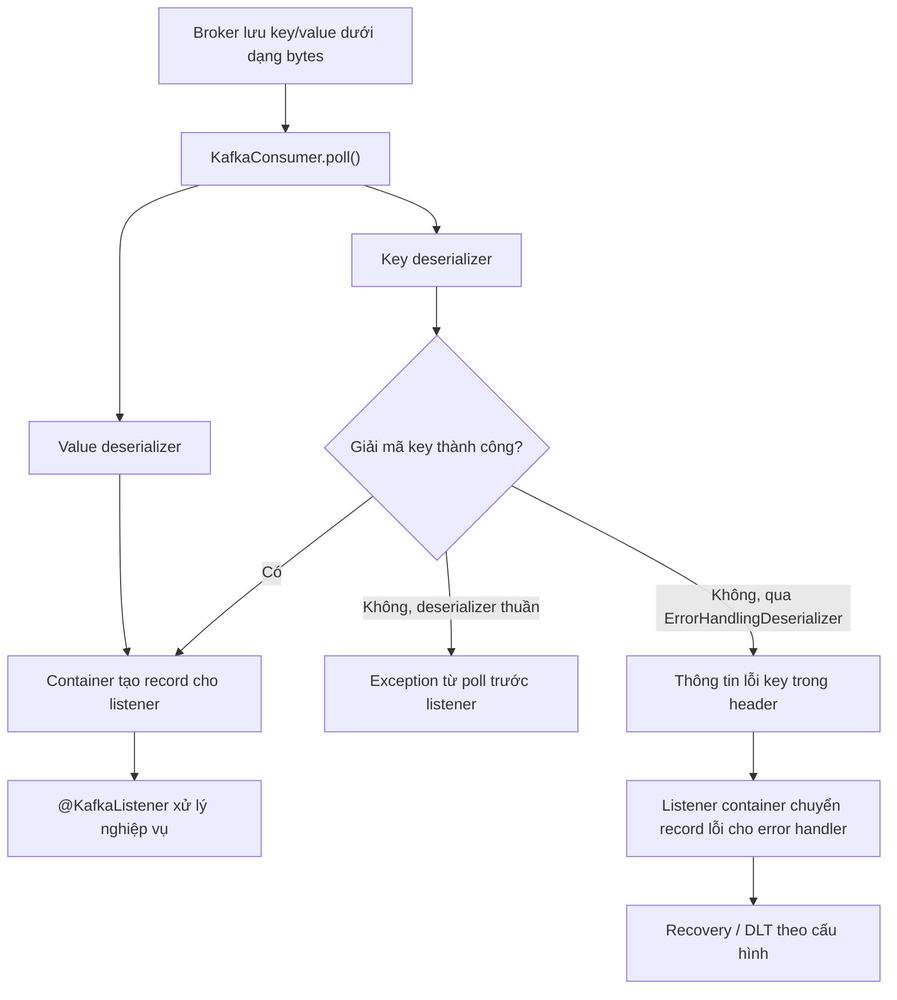

# Lỗi deserialize key trong Spring Kafka

Trong Kafka, một record chứa **key** và **value** dưới dạng byte. Producer serialize chúng trước khi gửi; consumer phải deserialize để khôi phục kiểu dữ liệu mà ứng dụng cần. Nếu **key deserializer** không đọc được chuỗi byte nhận từ Kafka, lỗi có thể xảy ra ngay bên trong `KafkaConsumer.poll()`, **trước khi** phương thức `@KafkaListener` được gọi.

Đây là tình huống vận hành quan trọng trong module *Spring Kafka Reliability Operations*: nếu không xử lý đúng, một “poison record” có key hỏng có thể khiến consumer gặp lỗi lặp lại ở cùng offset, tiến độ commit đứng yên và consumer group lag tiếp tục tăng. Không thể chỉ đặt `try/catch` trong listener, bởi listener chưa hề nhận được record đó.

Spring Kafka cung cấp `ErrorHandlingDeserializer` để đưa lỗi deserialization vào luồng xử lý lỗi của listener container. Khi được cấu hình **cho key**, lớp này giúp `DefaultErrorHandler` xử lý lỗi, phân loại retry, thực hiện recovery và chuyển record sang dead-letter topic (DLT) nếu ứng dụng có `DeadLetterPublishingRecoverer`.

Bài học phân tích riêng **lỗi deserialize key**: cách phát hiện, cấu hình đúng, lưu key bytes lỗi vào DLT, điều chỉnh serializer ở DLT producer, bảo vệ offset và cách kiểm thử vận hành.

## 1. Key được deserialize ở đâu?

Một producer có thể gửi record gồm:

```text
Topic: orders.created
Partition: 2
Offset: 105
Key bytes:   7B 22 6F 72 64 65 72 49 64 22 3A 31 32 33 7D
Value bytes: ...
```

Ví dụ key bytes ở trên có thể là JSON `{"orderId":123}`. Khi consumer cấu hình `JsonDeserializer<OrderKey>`, key sẽ được chuyển thành `OrderKey`.

Luồng xử lý điển hình:



Lưu ý: hình vẽ giản lược thứ tự khởi tạo record để nhấn mạnh vị trí phát sinh lỗi. Thực tế key và value được Kafka consumer deserialize trong vòng xử lý của `poll()`.

### Key không chỉ là trường hiển thị

Key thường có vai trò trong các quyết định nghiệp vụ:

- Định danh aggregate, ví dụ `orderId` hoặc `customerId`.
- Tạo điều kiện để các event cùng key thường được gửi vào cùng partition khi producer dùng partitioner phù hợp.
- Hỗ trợ idempotency, correlation, lưu trạng thái hoặc phát hiện trùng.
- Xác định khóa cho compacted topic và thao tác tombstone.

Một key không deserialize được có thể khiến ứng dụng không xác định được aggregate tương ứng. Vì vậy **không được tự thay key lỗi bằng một giá trị đoán trước** rồi tiếp tục xử lý, trừ khi đó là chính sách nghiệp vụ đã được thiết kế và kiểm thử.

Kafka broker không cần hiểu schema của key; broker chỉ lưu các byte và metadata. Lỗi key deserialization thường xuất hiện ở consumer do client đang đọc bằng sai kiểu/schema hoặc bytes đầu vào không hợp lệ.

## 2. Triệu chứng thường thấy khi key deserializer lỗi

Khi consumer dùng trực tiếp một deserializer có thể ném exception, log có thể cho thấy `SerializationException` hoặc `RecordDeserializationException` trong quá trình `poll()`.

Trong các cấu hình Spring Kafka, bạn có thể gặp thông báo tương tự:

```text
This error handler cannot process SerializationException directly;
please consider configuring an ErrorHandlingDeserializer
in the value and/or key deserializer.
```

Thông điệp phản ánh một vấn đề cốt lõi: exception xảy ra trước khi container có thể chuyển record hợp lệ đến listener, nên error handler thông thường thiếu thông tin để recovery theo từng record.

Những biểu hiện cần liên hệ:

| Dấu hiệu | Khả năng nguyên nhân |
|---|---|
| Không có log từ phương thức listener | Lỗi xảy ra trước listener, tại key deserializer |
| Consumer lặp lỗi cùng topic/partition/offset | Poison record tiếp tục được đọc lại |
| Committed offset không tiến | Chưa xử lý hoặc chưa recovery được record lỗi |
| Lag tăng dù consumer còn kết nối | Consumer bị chặn bởi record không deserialize được |
| Một số partition vẫn chạy, một partition đứng yên | Lỗi chỉ xảy ra ở một partition hoặc consumer con |
| Nâng cấp schema xong mới phát sinh lỗi | Reader schema/deserializer không tương thích dữ liệu cũ |
| Consumer ở môi trường A thành công nhưng B thất bại | Khác version, cấu hình schema registry, classpath hoặc deserializer |

Không phải tất cả lỗi ở key đều ném exception. Chẳng hạn `StringDeserializer` có thể giải mã một số byte UTF-8 không hợp lệ theo cách thay thế ký tự, thay vì luôn báo lỗi. Vì vậy muốn kiểm thử lỗi key JSON/Avro/Protobuf, hãy dùng chính deserializer và schema thực tế hoặc một deserializer kiểm thử được cấu hình để ném lỗi.

## 3. Phân biệt lỗi deserialize key với các lỗi tương tự

| Loại lỗi | Xảy ra ở đâu? | Dữ liệu chịu ảnh hưởng | Đường xử lý |
|---|---|---|---|
| Key deserialization failure | Consumer khi `poll()` | Key bytes | `ErrorHandlingDeserializer` cho key + error handler |
| Value deserialization failure | Consumer khi `poll()` | Value bytes | `ErrorHandlingDeserializer` cho value + error handler |
| Message conversion failure | Spring message converter / listener adapter | Payload chuyển sang tham số listener | Listener container error handling |
| Business validation failure | Listener hoặc service nghiệp vụ | Dữ liệu đã deserialize | Retry hoặc DLT theo chính sách nghiệp vụ |
| Producer key serialization failure | Producer trước khi send thành công | Object key -> bytes | Producer-side error handling; không phải consumer recovery |
| Tombstone hợp lệ | Kafka record có value `null` | Value cố ý rỗng | Xử lý theo contract của topic, không mặc định là lỗi |
| Key hợp lệ bằng `null` | Record không có key | Key rỗng có chủ đích | Listener có thể nhận null key theo contract |

**Key `null` không tự chứng minh lỗi deserialize**. Có producer gửi key null hợp lệ. Khi `ErrorHandlingDeserializer` gặp lỗi, Spring Kafka có cơ chế gắn metadata lỗi vào headers để phân biệt với key null hợp lệ.

Phải dựa vào exception/header và ngữ cảnh thay vì viết logic “key null thì luôn đưa DLT”.

## 4. Nguyên nhân thường gặp

### 4.1. Consumer dùng sai deserializer

Producer serialize key bằng JSON nhưng consumer lại dùng `LongDeserializer`, hoặc producer dùng Avro binary còn consumer dùng `JsonDeserializer`.

Với Kafka, cấu hình serializer/deserializer phải tương thích về wire format. Chỉ giống Java class name là chưa đủ; bytes trên Kafka mới là giao diện thực tế giữa producer và consumer.

### 4.2. Schema của key không tương thích

Key được thay đổi từ một cấu trúc sang cấu trúc khác nhưng consumer cũ không đọc được. Ví dụ trước kia key là một JSON object, sau này producer gửi string thuần hoặc bổ sung một field yêu cầu xử lý kiểu dữ liệu khác.

Schema evolution của **key** cần được quản lý nghiêm túc như value. Với compacted topic, thay đổi biểu diễn key còn có thể ảnh hưởng logic compaction và định danh của record.

### 4.3. Schema Registry hoặc xác thực lỗi

Đối với Avro/Protobuf/JSON Schema sử dụng Schema Registry, deserializer có thể cần tải schema theo ID hoặc thông tin trong payload. Lỗi kết nối, credentials, quyền truy cập hoặc schema ID không tồn tại có thể gây lỗi khi deserialize key.

Cần phân biệt lỗi dữ liệu cố định với lỗi dependency tạm thời: cùng biểu hiện “deserialization failed” nhưng retry policy có thể khác.

### 4.4. Dữ liệu cũ vẫn tồn tại trên topic

Sau khi thay đổi producer, topic có thể còn record theo format cũ vì retention hoặc lịch sử replay. Consumer chỉ hiểu format mới có thể hoạt động ở offset mới nhưng thất bại khi đọc lại dữ liệu cũ.

### 4.5. Custom deserializer lỗi

Custom key deserializer có thể ném exception do parse sai, xử lý charset, dùng object mapper không đúng cấu hình hoặc có bug khi gặp dữ liệu hợp lệ nhưng ít phổ biến.

### 4.6. Payload key bị hỏng hoặc không đầy đủ

Key chứa bytes không hợp lệ so với định dạng đã thỏa thuận, chẳng hạn JSON bị cắt dở, sai encoding hoặc dữ liệu được producer không tương thích gửi nhầm.

## 5. Vì sao try/catch trong @KafkaListener không đủ?

Ví dụ sau không thể bắt được mọi lỗi deserialize key:

```java
@KafkaListener(topics = "orders.created", groupId = "billing-service")
public void listen(ConsumerRecord<OrderKey, String> record) {
    try {
        orderService.process(record.key(), record.value());
    }
    catch (Exception ex) {
        // Chỉ bắt lỗi xảy ra sau khi listener đã được gọi.
        log.error("Failed to process order", ex);
    }
}
```

Nếu `JsonDeserializer<OrderKey>` ném exception ngay trong `poll()`, phương thức `listen()` chưa chạy. Ngoài ra, catch exception rồi chỉ log và trả về có thể khiến container coi record đã thành công và commit offset, gây mất cơ hội xử lý lại.

Hai nguyên tắc quan trọng:

1. Để giải quyết **lỗi deserialization trước listener**, cấu hình `ErrorHandlingDeserializer` ở consumer.
2. Để giải quyết **lỗi nghiệp vụ trong listener**, ném exception cho error handler hoặc hoàn tất recovery rõ ràng; không nuốt lỗi chưa giải quyết.

## 6. ErrorHandlingDeserializer cho key hoạt động ra sao?

`ErrorHandlingDeserializer` là một wrapper quanh deserializer thực tế, còn gọi là delegate.

Khi delegate deserialize thành công, wrapper trả về key đã được chuyển kiểu. Khi delegate thất bại, wrapper có thể trả về `null` hoặc giá trị fallback theo cấu hình và cung cấp thông tin `DeserializationException` trong header để Spring Kafka xử lý.

Điểm quan trọng: listener container có thể nhận biết header lỗi và chuyển record lỗi cho error handler như một lỗi cần recovery. Với cấu hình thông dụng, record lỗi không được chuyển cho listener nghiệp vụ như một record đã deserialize thành công.

```text
Kafka key bytes
      |
      v
ErrorHandlingDeserializer (key)
      |
      +-- delegate thành công --> OrderKey --> listener
      |
      +-- delegate thất bại --> metadata lỗi trong headers
                                      |
                                      v
                            listener container
                                      |
                                      v
                             DefaultErrorHandler
                                      |
                                      v
                          DLT / recovery theo policy
```

Wrapper phải đặt **đúng vị trí**: `key-deserializer` của consumer. Nếu chỉ bọc value deserializer, lỗi xảy ra ở key delegate vẫn có thể làm `poll()` ném exception trước khi container có record để recovery.

## 7. Cấu hình Spring Boot cho key deserialization

Ví dụ topic `orders.created` có key là JSON theo model `com.example.events.OrderKey`, value là string UTF-8.

```yaml
spring:
  kafka:
    bootstrap-servers: localhost:9092
    consumer:
      group-id: billing-service
      enable-auto-commit: false
      auto-offset-reset: earliest

      key-deserializer: org.springframework.kafka.support.serializer.ErrorHandlingDeserializer
      value-deserializer: org.apache.kafka.common.serialization.StringDeserializer

      properties:
        spring.deserializer.key.delegate.class: org.springframework.kafka.support.serializer.JsonDeserializer
        spring.json.key.default.type: com.example.events.OrderKey
        spring.json.trusted.packages: com.example.events
        spring.json.use.type.headers: false

    listener:
      ack-mode: record
```

Ý nghĩa:

- `key-deserializer`: Kafka consumer gọi `ErrorHandlingDeserializer` khi đọc key.
- `spring.deserializer.key.delegate.class`: wrapper dùng `JsonDeserializer` để đọc bytes JSON của key.
- `spring.json.key.default.type`: kiểu key cần tạo khi không dùng type headers.
- `spring.json.trusted.packages`: chỉ cho phép các package ứng dụng tin cậy khi deserializer thực hiện type resolution phù hợp.
- `spring.json.use.type.headers: false`: minh họa trường hợp contract key xác định một kiểu cố định, không dựa vào type headers.
- `enable-auto-commit: false`: để listener container quản lý offset theo quá trình xử lý/recovery.

Kiểu `OrderKey` chỉ là model minh họa. Cần bảo đảm object mapper và constructor/record definition tương thích với dữ liệu JSON gửi thực tế.

Ví dụ JSON key mong đợi:

```json
{"orderId":"ORD-1001","tenantId":"TENANT-A"}
```

Nếu consumer nhận bytes `not-a-json-object` ở vị trí này, delegate `JsonDeserializer` có thể ném lỗi. Wrapper chuyển lỗi vào luồng error handling, cho phép hệ thống xử lý record đó thay vì tiếp tục thất bại vô hạn ở `poll()`.

### 7.1. Khi cả key và value có thể lỗi

Một ứng dụng có thể bọc cả hai:

```yaml
spring:
  kafka:
    consumer:
      key-deserializer: org.springframework.kafka.support.serializer.ErrorHandlingDeserializer
      value-deserializer: org.springframework.kafka.support.serializer.ErrorHandlingDeserializer
      properties:
        spring.deserializer.key.delegate.class: org.springframework.kafka.support.serializer.JsonDeserializer
        spring.deserializer.value.delegate.class: org.springframework.kafka.support.serializer.JsonDeserializer
        spring.json.key.default.type: com.example.events.OrderKey
        spring.json.value.default.type: com.example.events.OrderCreated
        spring.json.trusted.packages: com.example.events
        spring.json.use.type.headers: false
```

Đây là cấu hình minh họa cho hai kiểu JSON cố định. Nếu producer gửi string/Avro/Protobuf thay vì JSON, phải thay delegate tương ứng.

Nếu cả key và value cùng deserialize lỗi, record có thể mang metadata cho hai lỗi. Khi thiết kế DLT và dashboard, cần xác định lỗi nào là nguyên nhân chính và bảo toàn dữ liệu thô phù hợp để có thể điều tra cả hai.

### 7.2. Với Avro hoặc Protobuf

Khi dùng serializer của Schema Registry, delegate phải là deserializer tương ứng của hệ sinh thái và có các properties schema registry/security cần thiết. `ErrorHandlingDeserializer` chỉ bọc việc gọi delegate; nó không tự suy luận hoặc sửa schema.

Không lấy cấu hình JsonDeserializer ở ví dụ trước rồi đổi tên class tùy tiện; hãy đối chiếu API và properties của thư viện serializer đang dùng.

## 8. Java configuration khi không dùng application.yml

Với cấu hình thuần Java, có thể đặt wrapper và delegate thông qua consumer properties:

```java
Map<String, Object> properties = new HashMap<>();

properties.put(
        ConsumerConfig.BOOTSTRAP_SERVERS_CONFIG,
        "localhost:9092"
);
properties.put(
        ConsumerConfig.GROUP_ID_CONFIG,
        "billing-service"
);
properties.put(
        ConsumerConfig.ENABLE_AUTO_COMMIT_CONFIG,
        false
);

properties.put(
        ConsumerConfig.KEY_DESERIALIZER_CLASS_CONFIG,
        ErrorHandlingDeserializer.class
);
properties.put(
        ErrorHandlingDeserializer.KEY_DESERIALIZER_CLASS,
        JsonDeserializer.class
);
properties.put(
        JsonDeserializer.KEY_DEFAULT_TYPE,
        "com.example.events.OrderKey"
);
properties.put(
        JsonDeserializer.TRUSTED_PACKAGES,
        "com.example.events"
);
properties.put(
        JsonDeserializer.USE_TYPE_INFO_HEADERS,
        false
);

properties.put(
        ConsumerConfig.VALUE_DESERIALIZER_CLASS_CONFIG,
        StringDeserializer.class
);

ConsumerFactory<OrderKey, String> consumerFactory =
        new DefaultKafkaConsumerFactory<>(properties);
```

Đoạn code minh họa cách khai báo consumer factory. Trong ứng dụng thực tế, cấu hình này nên đi cùng listener container factory, error handler và các properties bảo mật của cluster.

Tên constant và một số API serializer cần được đối chiếu theo phiên bản dependency. Nếu đang dùng Spring Boot, nên ưu tiên cơ chế properties hoặc `KafkaProperties` được Boot quản lý để tránh khai báo trùng cấu hình ở nhiều nơi.

## 9. DefaultErrorHandler xử lý lỗi key như thế nào?

Khi `ErrorHandlingDeserializer` đã cung cấp thông tin lỗi cho container, `DefaultErrorHandler` có thể nhận lỗi record và áp dụng backoff/recovery.

Với key bytes không tương thích schema hiện hành, retry cùng bytes bằng cùng deserializer thường vẫn thất bại. Vì vậy `DeserializationException` thuộc nhóm lỗi thường được coi là **không retry** trong mặc định của `DefaultErrorHandler` ở các phiên bản hiện đại.

Một chính sách phổ biến là chuyển record lỗi key sang DLT để điều tra:

```java
@Configuration
public class KafkaErrorConfiguration {

    @Bean
    public CommonErrorHandler commonErrorHandler(
            KafkaTemplate<Object, String> dltKafkaTemplate) {

        DeadLetterPublishingRecoverer recoverer =
                new DeadLetterPublishingRecoverer(dltKafkaTemplate);

        DefaultErrorHandler handler =
                new DefaultErrorHandler(
                        recoverer,
                        new FixedBackOff(1_000L, 2L)
                );

        return handler;
    }
}
```

Mặc định non-retryable đối với `DeserializationException` nên được xác nhận theo phiên bản Spring Kafka. Backoff ví dụ chủ yếu dành cho các exception khác có thể retry; không có lý do gì phải thử giải mã một JSON key hỏng nhiều lần nếu dữ liệu không thay đổi.

Bean `CommonErrorHandler` có thể được Spring Boot gắn vào listener container factory mặc định được auto-configure. Với factory tùy chỉnh, phải xác nhận `setCommonErrorHandler()` hoặc `ConcurrentKafkaListenerContainerFactoryConfigurer` được sử dụng phù hợp.

### 9.1. Không retry lỗi schema cố định một cách vô hạn

Nếu bytes key bị hỏng, việc retry trong cùng consumer sẽ không tự sửa payload. Retry vô hạn có thể làm partition bị kẹt và làm lag tăng.

Nếu nguyên nhân là Schema Registry tạm không sẵn sàng, xử lý có thể khác. Khi đó cần phân biệt lỗi truy cập schema từ dependency với lỗi dữ liệu vĩnh viễn, thiết kế retry có giới hạn, backoff phù hợp và recovery rõ ràng. Không nên xem tất cả lỗi được bọc thành deserialization exception là giống nhau về vận hành.

### 9.2. Không skip offset một cách âm thầm

Có thể dùng consumer `seek()` bằng tay để bỏ qua offset gặp lỗi trong một số tình huống khẩn cấp, nhưng cách đó có nguy cơ **bỏ mất record** mà chưa có bản sao để xử lý sau. Đây không phải chiến lược mặc định cho hệ thống reliability.

Ưu tiên cấu hình `ErrorHandlingDeserializer` cùng DLT để giữ lại raw bytes và nguyên nhân. Nếu bắt buộc skip theo quy trình sự cố, cần có phê duyệt, audit, bảo toàn raw record và phương án replay.

## 10. Cần đặc biệt chú ý key khi publish DLT

Đây là điểm dễ bỏ sót.

Với record lỗi deserialization, Java object key có thể không được tạo ra. Tuy nhiên, hệ thống vẫn cần giữ **key bytes ban đầu** để điều tra và có thể replay. Các phiên bản Spring Kafka hỗ trợ `DeadLetterPublishingRecoverer` có khả năng khôi phục key/value raw bytes từ thông tin lỗi để publish vào DLT.

Hệ quả: cùng một DLT producer có thể gặp **hai kiểu key**:

1. Key đã deserialize thành công: ví dụ `OrderKey`.
2. Key deserialize lỗi: bytes gốc kiểu `byte[]`.

Nếu DLT `KafkaTemplate` chỉ dùng `JsonSerializer<OrderKey>`, nó có thể không xử lý đúng trường hợp key là `byte[]`. Nếu chỉ dùng `ByteArraySerializer`, lại có thể không ghi được `OrderKey` từ các lỗi nghiệp vụ bình thường.

Có thể dùng `DelegatingByTypeSerializer` để chọn serializer dựa trên kiểu key:

```java
@Bean
public KafkaTemplate<Object, String> dltKafkaTemplate(
        @Value("${spring.kafka.bootstrap-servers}")
        String bootstrapServers) {

    Map<String, Object> config = new HashMap<>();
    config.put(
            ProducerConfig.BOOTSTRAP_SERVERS_CONFIG,
            bootstrapServers
    );
    config.put(ProducerConfig.ACKS_CONFIG, "all");

    Map<Class<?>, Serializer<?>> keySerializers =
            new LinkedHashMap<>();

    keySerializers.put(
            byte[].class,
            new ByteArraySerializer()
    );
    keySerializers.put(
            OrderKey.class,
            new JsonSerializer<OrderKey>()
    );

    Serializer<Object> keySerializer =
            new DelegatingByTypeSerializer(keySerializers, true);

    ProducerFactory<Object, String> producerFactory =
            new DefaultKafkaProducerFactory<>(
                    config,
                    keySerializer,
                    new StringSerializer()
            );

    return new KafkaTemplate<>(producerFactory);
}
```

Đây là ví dụ **cho topic có value kiểu `String`**. Nếu value cũng có thể là `byte[]` hoặc một domain object, hãy cấu hình value serializer tương ứng, có thể bằng cơ chế delegating tương tự.

`DelegatingByTypeSerializer` không tự giải mã schema sai. Nó giúp producer DLT gửi lại dữ liệu theo đúng loại Java mà recoverer đang nắm giữ. Việc khôi phục raw key bytes cụ thể tùy phiên bản Spring Kafka, vì thế nên xác nhận trong integration test trước khi triển khai.

### 10.1. Nếu không muốn giữ cùng partition

Resolver mặc định của `DeadLetterPublishingRecoverer` thường gửi đến `<source-topic>.DLT` với cùng partition index. DLT phải có partition đó, nếu không publish có thể lỗi.

Có thể tùy chỉnh destination resolver:

```java
DeadLetterPublishingRecoverer recoverer =
        new DeadLetterPublishingRecoverer(
                dltKafkaTemplate,
                (record, exception) ->
                        new TopicPartition(
                                record.topic() + ".DLT",
                                -1
                        )
        );
```

Khi trả partition âm, producer sẽ tự chọn partition đích thay vì buộc phải dùng partition của record gốc. Tuy nhiên, cần bảo toàn `original topic`, `original partition` và `original offset` trong headers để vẫn truy vết được vị trí ban đầu.

Không nhầm partition mà broker đã gán cho record nguồn với kết quả deserialize key. Record gốc đã ở một partition từ trước khi consumer đọc, kể cả khi consumer không thể giải mã key.

## 11. Metadata lỗi key trong DLT

`ErrorHandlingDeserializer` cung cấp metadata về exception trong headers. `DeadLetterPublishingRecoverer` cũng thêm metadata nguồn gốc record và exception để operator có thể điều tra.

Những dữ liệu đáng lưu:

| Dữ liệu | Tác dụng |
|---|---|
| Original topic | Xác định nguồn record |
| Original partition | Tìm partition bị ảnh hưởng |
| Original offset | Đối chiếu với committed offset và log |
| Original timestamp | Kiểm tra thời điểm producer ghi record |
| Original key bytes | Có thể thử deserialize bằng schema đúng khi replay |
| Exception class/cause | Phân loại lỗi schema, classpath, connection hoặc payload |
| Schema/format version | Biết reader nào nên dùng |
| Consumer group/listener ID | Xác định ứng dụng phát hiện lỗi |
| Correlation/event ID nếu có | Liên hệ record với nghiệp vụ |

Spring Kafka có các `KafkaHeaders` dành cho DLT như original topic/partition/offset và exception metadata. Một số header deserialization mang định dạng do framework quản lý; không tùy tiện deserialize byte header bằng Java serialization trong các công cụ không tin cậy.

Khi đọc DLT, nên dùng API và constants của đúng phiên bản thay vì hard-code tên header nội bộ nếu API có thể thay đổi.

### 11.1. Nếu key lỗi thì còn nhận được event ID không?

Điều này phụ thuộc contract của message. Nếu event ID chỉ nằm trong key và key không deserialize được, ứng dụng không thể tin rằng đã có event ID hợp lệ. Có thể khai thác raw bytes hoặc metadata khác trong quá trình điều tra, nhưng không nên tự gán ID đoán trước cho nghiệp vụ.

Nếu value/header còn chứa một correlation ID ổn định và đáng tin cậy, nó có thể giúp liên kết log mà không cần giải mã key lỗi.

### 11.2. Bảo vệ dữ liệu và headers

Raw key bytes có thể chứa định danh khách hàng hoặc dữ liệu nhạy cảm. DLT cần ACL, retention, mã hóa và chính sách logging phù hợp. Không ghi toàn bộ raw bytes hoặc stack trace vào dashboard công khai.

## 12. Khi key lỗi và value hợp lệ, có nên tiếp tục xử lý?

Thông thường **không**, nếu key là thành phần thiết yếu của business contract. Ví dụ handler dựa vào `OrderKey.orderId` để cập nhật đúng đơn hàng. Việc đặt key bằng null và xử lý value vẫn có thể ghi dữ liệu sai hoặc làm hỏng tính idempotent.

Tuy nhiên, một số luồng có thể xử lý độc lập với key. Spring Kafka cung cấp lựa chọn nâng cao như `failedDeserializationFunction` để tạo giá trị fallback từ thông tin lỗi. Nếu ứng dụng sử dụng fallback, phải xác định rõ:

- Fallback có được phép theo schema contract không?
- Nghiệp vụ có nhận biết đây là key thay thế không?
- Giá trị fallback có làm nhiều record khác nhau bị gộp thành một key không?
- Có giữ được raw bytes ban đầu để điều tra không?
- Khi replay, có tạo duplicate hoặc phá thứ tự không?

Không nên bật fallback chỉ để tránh lỗi container. Chỉ triển khai khi chủ sở hữu nghiệp vụ xác nhận hành vi mong muốn và có kiểm thử đầy đủ.

## 13. Offset, commit và tránh poison-pill loop

Kafka committed offset là vị trí **kế tiếp** mà consumer group sẽ đọc. Giả sử record có offset 105 lỗi key; sau recovery thành công theo chính sách, vị trí commit có thể tiến lên 106.

Timeline:

```text
poll() nhận record offset 105
    |
Key delegate thất bại
    |
ErrorHandlingDeserializer gắn metadata lỗi
    |
Listener container gọi error handler
    |
DeadLetterPublishingRecoverer lưu vào DLT
    |
Recovery được xác nhận theo cấu hình
    |
Container commit tiến độ offset tương ứng
    |
Consumer tiếp tục record kế tiếp
```

Cần phân biệt:

- **Commit offset nguồn:** xác nhận consumer group không cần đọc lại record từ vị trí đã xử lý/recovery.
- **Publish DLT:** ghi một bản record lỗi sang topic riêng.
- **Business completion:** nghiệp vụ đã hoàn tất; điều này *không* xảy ra chỉ vì record đã vào DLT.

Các bước publish DLT và commit offset không mặc định là một transaction nguyên tử. Nếu record vào DLT thành công nhưng commit offset thất bại, nó có thể được recovery lại sau restart và tạo duplicate trong DLT.

Vì vậy, quy trình điều tra/replay cần hỗ trợ duplicate, ví dụ deduplicate theo original topic, partition, offset hoặc event ID phù hợp.

### 13.1. Bảo đảm DLT producer báo lỗi gửi

Với yêu cầu độ bền cao, xem xét cấu hình recoverer để thất bại khi broker không xác nhận gửi thành công:

```java
recoverer.setFailIfSendResultIsError(true);
recoverer.setWaitForSendResultTimeout(
        Duration.ofSeconds(10)
);
```

Các phương thức và ngữ nghĩa thời gian chờ phụ thuộc phiên bản Spring Kafka. Khi được cấu hình đúng, publish DLT thất bại có thể làm recovery thất bại thay vì âm thầm coi record đã xử lý.

Ngoài ra cần kiểm tra producer `acks`, retries, serializer, topic/partition và ACL. Không dùng “đã gọi `send()`” làm bằng chứng duy nhất rằng record đã được lưu bền vững.

### 13.2. Khi partition đã bị kẹt lâu

Nếu service trước đây chưa dùng `ErrorHandlingDeserializer`, consumer có thể bị kẹt ở một offset. Sau khi triển khai wrapper + recoverer, consumer có thể đọc lại record đó và chuyển nó sang DLT để tiếp tục.

Nếu đã có ai thay đổi committed offset thủ công, cần đối chiếu audit và raw topic retention để tránh vô tình bỏ qua record mà không thể khôi phục. Không reset toàn bộ consumer group chỉ để giải quyết một record lỗi khi chưa đánh giá ảnh hưởng lên các partition khác.

## 14. Không đánh đồng lỗi key với partition assignment

Lỗi deserialize key **không làm Kafka thay đổi assignment của record đã lưu**.

Partition của một record được quyết định khi producer gửi record hoặc bởi partition cụ thể được chỉ định. Khi consumer đọc record, nó nhận topic/partition/offset từ broker. Deserializer key thất bại không thay đổi metadata đó.

Tuy nhiên, lỗi key có thể ảnh hưởng đến:

- Logic grouping hoặc state store ở tầng nghiệp vụ.
- Khả năng deduplicate theo business key.
- Lệnh ghi lại record đã sửa sang topic khác nếu partitioner mới dựa vào key đã deserialize.
- Quy trình replay theo thứ tự event cùng aggregate.

Ví dụ một tool replay đặt key của record lỗi thành null có thể khiến record được chọn partition khác khi publish lại. Với nghiệp vụ cần order per key, đây là thay đổi có thể gây hậu quả lớn.

Khi replay, nên xác định rõ có cần giữ nguyên raw key bytes, sửa key theo schema mới, hay giữ partition đích đã định. Mỗi lựa chọn có trade-off về idempotency và thứ tự.

## 15. Quan sát lỗi deserialize key trong production

Để phát hiện sớm và chẩn đoán, nên theo dõi những tín hiệu sau:

| Tín hiệu | Cách hiểu |
|---|---|
| Số record lỗi key deserialization | Đo mức phổ biến của dữ liệu lỗi |
| Lỗi key theo topic/partition | Xác định phạm vi bị ảnh hưởng |
| Exception class và nhóm nguyên nhân | Tách lỗi schema, serializer, registry, dữ liệu |
| Consumer lag theo partition | Phát hiện partition đứng yên |
| Record DLT ingress | Tốc độ record lỗi được recovery |
| DLT publish failure | Recovery không lưu được record |
| Thời gian từ lỗi đến recovery | Đánh giá độ trễ xử lý poison record |
| Kafka consumer rebalance | Xem lỗi kéo dài có tác động group không |
| Tuổi record DLT chưa được xử lý | Đánh giá backlog điều tra |
| Replay success/error | Theo dõi quá trình sửa và đưa dữ liệu trở lại |

Dùng metric tags có cardinality thấp: service, topic, consumer group, error category, outcome. Không đặt raw key, original offset, event ID hoặc exception message làm tag vì chúng có thể tạo số lượng time series rất lớn.

Những trường định danh chi tiết nên đưa vào structured log hoặc trace có kiểm soát truy cập.

### 15.1. Ví dụ log có cấu trúc

```json
{
  "event": "kafka_key_deserialization_failure",
  "service": "billing-service",
  "topic": "orders.created",
  "partition": 2,
  "offset": 105,
  "consumerGroup": "billing-service",
  "errorCategory": "invalid_key_json",
  "recoveryOutcome": "dead_lettered",
  "destinationTopic": "orders.created.DLT"
}
```

Đây là ví dụ log do ứng dụng/hạ tầng quan sát tạo ra, không phải định dạng Spring Kafka bắt buộc. Tránh ghi raw key bytes hoặc nội dung message nhạy cảm vào log nếu không cần thiết.

### 15.2. Khi thấy lag tăng mà listener không có lỗi

Hãy kiểm tra log của container và Kafka consumer, vì key deserializer có thể lỗi trước listener. Nếu `ErrorHandlingDeserializer` chưa được cấu hình, listener metrics có thể không phản ánh số lần consumer thực sự thất bại trong `poll()`.

## 16. Integration test cho lỗi deserialize key

Kiểm thử cần thực hiện trên Kafka broker test hoặc môi trường tương đương. Mục tiêu không chỉ là nhận được exception, mà còn chứng minh record lỗi được giữ lại và consumer có thể tiếp tục xử lý record sau đó.

### 16.1. Chuẩn bị

1. Tạo topic `orders.created` với các partition đã biết.
2. Tạo topic `orders.created.DLT` có đủ partition.
3. Consumer sử dụng `ErrorHandlingDeserializer` cho key và `JsonDeserializer<OrderKey>` làm delegate.
4. Cấu hình `DefaultErrorHandler` cùng `DeadLetterPublishingRecoverer`.
5. DLT producer có serializer hỗ trợ key `byte[]` và key `OrderKey` nếu cả hai trường hợp đều có thể xảy ra.
6. Dùng consumer group riêng cho test và topic sạch để kiểm tra offsets.

### 16.2. Gửi một record có key bytes lỗi

Để chủ động tạo key không phải JSON hợp lệ, dùng một producer test với `ByteArraySerializer` cho key và value:

```java
byte[] invalidKey =
        new byte[] { 0x01, 0x02, 0x03 };

byte[] validValue =
        "valid-order".getBytes(StandardCharsets.UTF_8);

ProducerRecord<byte[], byte[]> poisonRecord =
        new ProducerRecord<>(
                "orders.created",
                0,
                invalidKey,
                validValue
        );

rawKafkaProducer.send(poisonRecord).get();
```

`rawKafkaProducer` là một `KafkaProducer<byte[], byte[]>` hoặc `KafkaTemplate<byte[], byte[]>` đã cấu hình đúng `ByteArraySerializer`. Chọn partition 0 chỉ để test dễ dự đoán vị trí.

Để xác nhận consumer vẫn tiến tiếp, gửi thêm một record có key JSON hợp lệ đến cùng partition.

### 16.3. Các điều kiện cần xác nhận

| Tình huống | Kết quả mong đợi |
|---|---|
| Key JSON hợp lệ | Listener nhận `OrderKey` bình thường |
| Key JSON không hợp lệ | Listener nghiệp vụ không xử lý record lỗi như thành công |
| Header key deserialization failure | Error handler nhận đúng lỗi và thông tin record |
| Retry policy | Lỗi dữ liệu cố định đi recovery theo cấu hình |
| DLT routing | Record xuất hiện ở đúng topic/partition đích |
| Raw key bytes | DLT giữ được bytes cần cho điều tra/replay theo phiên bản |
| Offset nguồn | Tiến theo chính sách sau khi recovery hoàn tất |
| Record hợp lệ ở phía sau | Consumer tiếp tục và xử lý được |
| DLT producer serializer sai | Recovery failure có thể quan sát được |
| Restart sau DLT publish trước commit | Có thể duplicate; replay/handler chống trùng |
| Key null hợp lệ | Không bị phân loại sai là deserialize failure |

### 16.4. Test khi thiếu ErrorHandlingDeserializer

Một test riêng có thể cấu hình trực tiếp `JsonDeserializer<OrderKey>` mà không dùng wrapper, gửi poison record và quan sát exception từ `poll()`.

Mục đích là làm rõ vì sao try/catch trong listener không có tác dụng và tại sao cần wrapper cho key. Không nên để kịch bản này chạy vô hạn trong CI; giới hạn thời gian và dừng container có kiểm soát.

### 16.5. Test DLT có value khác kiểu

Nếu hệ thống cũng xử lý lỗi value deserialization, bổ sung test gửi raw value không hợp lệ. Đảm bảo DLT serializer có thể nhận đúng kiểu dữ liệu mà recoverer tạo ra. Hai nhánh key-error và value-error thường cần kiểm thử độc lập vì key và value có serializer khác nhau.

## 17. Quy trình điều tra sự cố key deserialization

Khi production xuất hiện lỗi, có thể đi theo trình tự:

1. Xác định topic, partition, offset, consumer group và thời điểm lỗi.
2. Kiểm tra exception xuất hiện trước hay trong listener.
3. Xem `key-deserializer` thực tế của consumer có đang là `ErrorHandlingDeserializer` không.
4. Xác định key delegate cụ thể: String, JSON, Avro, Protobuf hay custom.
5. Kiểm tra format key producer đang ghi và format mà consumer mong đợi.
6. Nếu dùng Schema Registry, xác nhận schema ID, registry connectivity, ACL và reader/writer compatibility.
7. Kiểm tra liệu record lỗi có đang được gửi vào DLT hay recovery cũng thất bại.
8. Kiểm tra DLT producer serializer có hỗ trợ raw key bytes không.
9. Xác nhận committed offset và record tiếp theo có được xử lý không.
10. Sau khi sửa nguyên nhân, replay có kiểm soát và kiểm tra idempotency.

Nếu thay đổi schema là nguyên nhân, hãy lập kế hoạch tương thích giữa producer và consumer; không nên xử lý bằng cách xóa record lỗi hoặc reset offset hàng loạt.

## 18. Những hiểu nhầm dễ gây mất dữ liệu

**Chỉ bọc value deserializer.** Lỗi key vẫn xảy ra trong `poll()` nếu `key-deserializer` không được bọc phù hợp.

**Tin rằng try/catch trong listener bắt được mọi lỗi Kafka.** Key deserialization thường diễn ra trước lời gọi listener.

**Xem key null luôn là lỗi.** Kafka cho phép null key hợp lệ; cần dựa vào metadata lỗi, không chỉ giá trị null.

**Retry vô hạn một key JSON sai định dạng.** Bytes không thay đổi nên lỗi lặp lại; nên chuyển sang recovery phù hợp.

**Giả định DLT template chỉ cần JsonSerializer.** Key lỗi có thể cần ghi raw `byte[]`. Serializer DLT phải phù hợp với những kiểu key/value thực tế.

**Bỏ record bằng seek mà không lưu lại.** Có thể mất dữ liệu nghiệp vụ và không còn bản raw record để xử lý sau.

**Dùng StringDeserializer để test malformed UTF-8 và kỳ vọng luôn ném lỗi.** Một số giải mã có thể thay thế ký tự lỗi; hãy dùng deserializer/format thật sự kiểm tra tính hợp lệ.

**Cho rằng DLT hoàn tất nghiệp vụ.** DLT là nơi lưu lỗi để xử lý sau; cần alert, ownership, retention và replay.

**Nhầm partition với key đã deserialize.** Topic/partition/offset của record nguồn đã có trước khi consumer decode key; đừng suy ra partition từ một key đang lỗi.

**Replay với key null thay vì raw key hoặc key đã sửa đúng schema.** Record có thể đến partition khác và làm lệch thứ tự/logic idempotency.

**Không kiểm tra failure của DLT producer.** Nếu record chưa được ghi bền vững vào DLT mà offset nguồn đã tiến, có nguy cơ mất khả năng recovery.

## 19. Thiết kế chính sách theo loại lỗi

Không phải mọi lỗi key deserialization đều cần cùng một hướng xử lý.

| Nguyên nhân | Retry? | Hướng xử lý |
|---|---|---|
| Key bytes sai JSON/schema cố định | Thường không có ích | DLT; sửa producer/contract; replay có kiểm soát |
| Producer và consumer dùng khác wire format | Không, cho đến khi thay config | Sửa deserializer hoặc compatibility; giữ raw record |
| Schema Registry tạm unavailable | Có thể, với backoff có giới hạn | Kiểm tra dependency; xử lý lỗi hạ tầng; tránh retry storm |
| Schema ID không tồn tại | Thường cần can thiệp | Kiểm tra schema governance và DLT |
| Classpath/type mapping sai | Cần sửa deployment | Cập nhật cấu hình và kiểm thử tương thích |
| Custom deserializer có bug | Không cho đến khi sửa | Sửa code, deploy, replay |
| Key null hợp lệ | Không phải lỗi | Listener xử lý theo topic contract |

Với lỗi phụ thuộc tạm thời, thiết kế phân loại exception cần xem xét cause cụ thể thay vì chỉ phân loại dựa trên exception wrapper. Với lỗi dữ liệu cố định, DLT thường giúp consumer giữ tiến độ mà vẫn còn bản ghi để điều tra.

## 20. Checklist trước production

Trước khi đưa consumer lên production, xác nhận:

- Contract key được định nghĩa rõ về bytes, schema, encoding và version.
- Key deserializer tương thích với serializer của các producer.
- `ErrorHandlingDeserializer` được đặt ở **key-deserializer**, không chỉ value.
- Delegate được cấu hình đúng và tin cậy.
- Listener không nuốt lỗi nghiệp vụ chưa xử lý.
- `DefaultErrorHandler` có retry/recovery policy rõ ràng.
- DLT topic tồn tại, partition đủ, ACL và retention phù hợp.
- DLT producer hỗ trợ raw key bytes và key object khi cần.
- DLT publish failure có thể quan sát và không bị coi thành công.
- Raw bytes/header nguồn được bảo toàn theo phiên bản Spring Kafka.
- Offset nguồn chỉ tiến theo chính sách sau recovery.
- Dashboard có key deserialization failure, consumer lag, DLT ingress và recovery failure.
- Replay không tạo side effects trùng và không thay đổi key/partition ngoài ý muốn.
- Integration test có ít nhất một key lỗi, một key hợp lệ phía sau và một tình huống DLT publish thất bại.

## 21. Tài liệu tham chiếu theo phiên bản

Khi triển khai hoặc nâng cấp, hãy đối chiếu tài liệu chính thức đúng phiên bản của các thành phần:

- Spring for Apache Kafka Reference — *Handling Exceptions / ErrorHandlingDeserializer*.
- Spring Kafka Javadoc — `ErrorHandlingDeserializer`, `DeserializationException`, `SerializationUtils`, `DefaultErrorHandler`.
- Spring Kafka Javadoc — `DeadLetterPublishingRecoverer` và các lựa chọn serializer cho DLT.
- Spring for Apache Kafka Reference — *Publishing Dead-letter Records*.
- Spring Boot Reference — `spring.kafka.consumer.key-deserializer`, `spring.kafka.consumer.properties`, listener factory auto-configuration.
- Apache Kafka Documentation — consumer `poll()`, deserializers, committed offsets và partitioning.
- Tài liệu serializer/schema registry cụ thể nếu hệ thống dùng Avro, Protobuf hoặc JSON Schema.

Tên header, API nhận thông tin exception, khả năng khôi phục raw key bytes của recoverer và cách xử lý record có cả key/value lỗi có thể khác giữa các phiên bản Spring Kafka. Luôn kiểm chứng bằng integration test trên dependency đang sử dụng.

Điểm cốt lõi của reliability ở đây là: **lỗi deserialize key xảy ra trước listener, nhưng không nên khiến partition đứng yên hoặc làm mất record**. Dùng `ErrorHandlingDeserializer` ở key, một error handler có recovery rõ ràng, DLT producer hỗ trợ raw bytes và khả năng truy vết offset để biến record hỏng thành một công việc lỗi có thể điều tra và xử lý lại an toàn.
