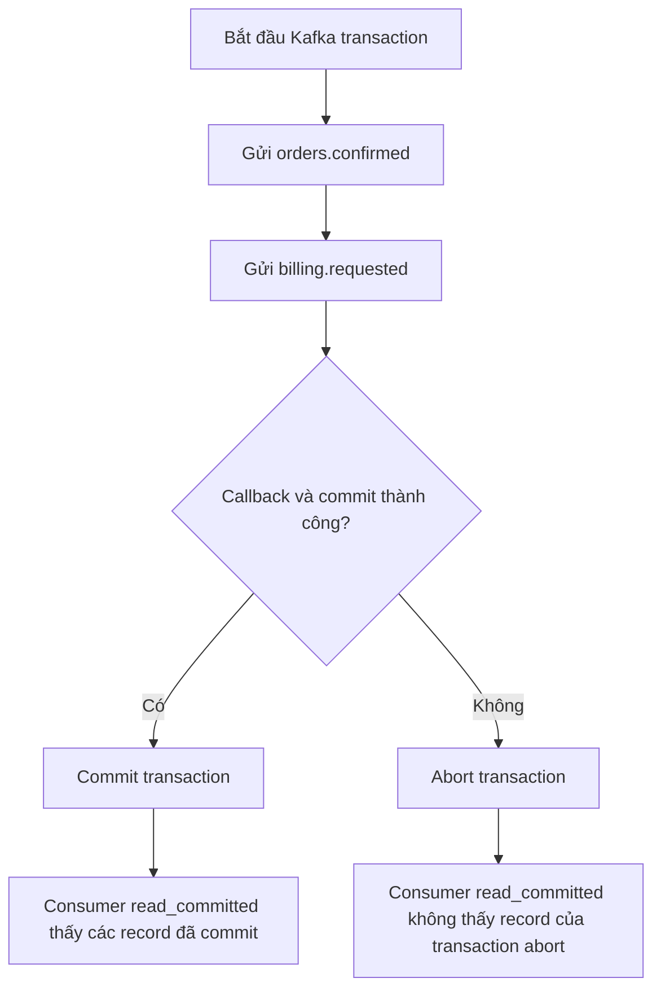

# executeInTransaction trong Spring Kafka

`KafkaTemplate.executeInTransaction(...)` là API của Spring Kafka cho phép thực thi một nhóm thao tác gửi message trong **Kafka transaction cục bộ** (*local Kafka transaction*). Thay vì mỗi lời gọi `send()` là một thao tác độc lập ở góc nhìn transaction, ứng dụng có thể thực hiện nhiều lần publish trong cùng một giao dịch Kafka: hoặc toàn bộ record được commit và hiển thị cho consumer cấu hình `read_committed`, hoặc giao dịch bị abort khi lỗi.

API này hữu ích cho những tác vụ **chỉ liên quan đến ghi Kafka**, chẳng hạn một service cần phát đồng thời event `orders.confirmed` và `billing.requested`, hoặc một scheduled job cần phát một tập record mà không muốn người đọc thấy kết quả của một giao dịch bị abort.

Tuy nhiên, `executeInTransaction` **không phải** giao dịch phân tán cho database, HTTP API hay hệ thống lưu trữ khác; và nó **không tự động** đưa offset của message đã consume vào cùng Kafka transaction. Trong hệ thống có `@KafkaListener`, điều này đặc biệt quan trọng: cần phân biệt transaction do `KafkaTemplate` tự mở với transaction do listener container hoặc Spring transaction manager quản lý.

## 1. Kafka transaction giải quyết vấn đề gì?

Giả sử một nghiệp vụ muốn phát hai record sau:

```text
orders.confirmed       key=ORDER-42
billing.requested      key=ORDER-42
```

Nếu gửi bằng hai lệnh publish độc lập, có thể xảy ra:

1. Record `orders.confirmed` được broker ghi thành công.
2. Producer mất kết nối hoặc gặp lỗi serializer khi gửi `billing.requested`.
3. Downstream chỉ thấy record đầu tiên, mặc dù nghiệp vụ yêu cầu hai record phải cùng được chấp nhận hoặc cùng bị hủy.

Kafka transaction cho phép đưa nhiều lần gửi thuộc một transaction vào cùng ranh giới commit/abort. Một consumer cấu hình `isolation.level=read_committed` không trả về các record của transaction đã abort.



Khả năng này **khác** với `acks=all` hoặc idempotent producer:

| Cơ chế | Mục đích |
|---|---|
| `acks=all` | Chờ broker xác nhận việc ghi theo replication policy |
| Idempotent producer | Giảm trùng lặp do producer retry trong phạm vi semantics hỗ trợ |
| Kafka transaction | Nhóm nhiều lần gửi Kafka thành một đơn vị commit/abort |
| `read_committed` consumer | Không trả về record thuộc các transaction đã abort |
| Idempotency nghiệp vụ | Tránh tác dụng phụ trùng khi event, request hoặc job được chạy lại |

Kafka transaction không đảm bảo hai record được một listener nhận cùng lúc trong một lần `poll()`. Nó đảm bảo các record của transaction đã abort không bị trả về cho consumer `read_committed` và commit marker xác định trạng thái của giao dịch.

## 2. executeInTransaction nằm ở tầng nào?

`executeInTransaction` là phương thức của `KafkaTemplate<K, V>`, sử dụng `ProducerFactory` có khả năng tạo **transactional Kafka producer**.

Mẫu gọi điển hình:

```java
T result = kafkaTemplate.executeInTransaction(operations -> {
    operations.send("topic-a", key, valueA);
    operations.send("topic-b", key, valueB);
    return someResult;
});
```

Đối tượng `operations` trong callback hỗ trợ các thao tác của `KafkaOperations` cho transaction đang được mở. Trong callback, hãy dùng đối tượng này để gửi record, giúp ranh giới thao tác dễ hiểu và nhất quán.

Ở mức khái niệm, Spring Kafka thực hiện quy trình:

```text
KafkaTemplate.executeInTransaction(callback)
  |
  |-- Lấy transactional Producer từ ProducerFactory
  |-- beginTransaction()
  |-- Thực thi callback(operations)
  |     |-- send(record A)
  |     |-- send(record B)
  |
  |-- Callback thành công --> commitTransaction()
  |
  +-- Callback ném exception --> abortTransaction()
  |
  +-- Đóng/trả Producer về factory theo cơ chế quản lý tương ứng
```

Nếu commit hoặc abort cũng gặp lỗi, lệnh gọi có thể kết thúc bằng exception; ứng dụng phải phân biệt trạng thái kết quả không chắc chắn với giao dịch thành công chắc chắn.

`executeInTransaction` **mở một Kafka transaction cục bộ riêng**. Nó không cần bạn đặt `@Transactional` ở phương thức gọi để tạo ranh giới này.

## 3. Điều kiện tiên quyết: transactional ProducerFactory

Để dùng `executeInTransaction`, `ProducerFactory` phải được cấu hình hỗ trợ transaction. Trong Spring Kafka, cách phổ biến là đặt **transaction ID prefix**, để factory tạo producer có `transactional.id` phù hợp.

Ví dụ `application.yml` cho Spring Boot:

```yaml
spring:
  kafka:
    bootstrap-servers: localhost:9092

    producer:
      transaction-id-prefix: orders-publisher-node-a-
      key-serializer: org.apache.kafka.common.serialization.StringSerializer
      value-serializer: org.apache.kafka.common.serialization.StringSerializer
      acks: all

    consumer:
      isolation-level: read_committed
```

Trong ví dụ:

- `transaction-id-prefix` kích hoạt cấu hình transactional producer qua Spring Boot khi auto-configuration phù hợp.
- Prefix `orders-publisher-node-a-` chỉ để minh họa. Trên nhiều instance, **mỗi instance phải có prefix không xung đột**.
- `acks=all` là cấu hình producer hỗ trợ ghi bền vững hơn khi broker/ISR đáp ứng điều kiện.
- `isolation-level: read_committed` áp dụng cho **consumer**. Cấu hình này không tự thay đổi khả năng commit transaction của producer.

Với `KafkaTemplate<String, String>` được Spring Boot tạo từ producer factory phù hợp, ứng dụng có thể gọi `executeInTransaction` trực tiếp.

### 3.1. Cấu hình ProducerFactory bằng Java

Khi không dùng Boot properties hoặc muốn cấu hình độc lập:

```java
@Configuration
public class TransactionalKafkaConfiguration {

    @Bean
    public ProducerFactory<String, String> producerFactory() {
        Map<String, Object> props = new HashMap<>();

        props.put(
                ProducerConfig.BOOTSTRAP_SERVERS_CONFIG,
                "localhost:9092"
        );
        props.put(
                ProducerConfig.KEY_SERIALIZER_CLASS_CONFIG,
                StringSerializer.class
        );
        props.put(
                ProducerConfig.VALUE_SERIALIZER_CLASS_CONFIG,
                StringSerializer.class
        );
        props.put(ProducerConfig.ACKS_CONFIG, "all");

        DefaultKafkaProducerFactory<String, String> factory =
                new DefaultKafkaProducerFactory<>(props);

        factory.setTransactionIdPrefix("orders-publisher-instance-1-");

        return factory;
    }

    @Bean
    public KafkaTemplate<String, String> kafkaTemplate(
            ProducerFactory<String, String> producerFactory) {
        return new KafkaTemplate<>(producerFactory);
    }
}
```

Đoạn code cần các import tương ứng của Spring Kafka, Kafka client, `Map` và `HashMap`. Đây là ví dụ độc lập để làm rõ nguyên lý; trong ứng dụng Spring Boot, nên tránh đồng thời tạo nhiều bean producer factory mà không có phân biệt bằng tên hoặc `@Qualifier`.

Kafka producer dùng transaction cần broker hỗ trợ giao thức transaction. Với cluster thử nghiệm một broker, còn phải kiểm tra các thuộc tính broker về transaction state log và replication phù hợp; nếu môi trường broker không đủ điều kiện, transaction có thể không khởi tạo được.

### 3.2. Vì sao transactional.id phải được quản lý?

Kafka sử dụng `transactional.id` để nhận diện producer transaction và chống trường hợp một phiên producer cũ tiếp tục ghi sau khi instance mới thay thế nó (*producer fencing*).

Nếu hai application instances cùng cố tình hoặc vô tình dùng một transactional ID, một producer có thể bị fenced. Vì thế:

- Prefix của mỗi instance đang chạy nên phân biệt được instance đó.
- Trong cùng một factory, Spring Kafka có thể thêm suffix để phân biệt các producer được dùng đồng thời.
- Cần tính đến restart, failover, scale-out và số lượng transaction đồng thời.
- Không sinh prefix ngẫu nhiên theo **mỗi lần gửi**; đây phải là một chiến lược đặt tên có thể quản trị và quan sát được.

Với container orchestration, có thể đưa pod ID, instance ID hoặc một giá trị deployment-specific vào prefix. Tránh dùng một chuỗi cố định cho mọi replica của một service.

## 4. Ví dụ đơn giản: publish hai event trong một transaction

Một service muốn phát cùng lúc hai event Kafka, mỗi event được biểu diễn bằng chuỗi JSON:

```java
@Service
public class OrderEventPublisher {

    private final KafkaTemplate<String, String> kafkaTemplate;

    public OrderEventPublisher(
            KafkaTemplate<String, String> kafkaTemplate) {
        this.kafkaTemplate = kafkaTemplate;
    }

    public void publishOrderConfirmed(
            String orderId,
            String confirmedJson,
            String billingRequestedJson) {

        kafkaTemplate.executeInTransaction(operations -> {
            operations.send(
                    "orders.confirmed",
                    orderId,
                    confirmedJson
            );

            operations.send(
                    "billing.requested",
                    orderId,
                    billingRequestedJson
            );

            return null;
        });
    }
}
```

Nếu cả hai lần gửi và commit thành công, transaction được commit. Nếu callback ném exception, Spring Kafka abort giao dịch. Nếu producer báo lỗi khi gửi hoặc commit, lời gọi có thể thất bại; không được coi là đã publish thành công khi exception được trả về.

**Lưu ý về lời gọi `send()`:** trong các phiên bản hiện đại của Spring Kafka, nó trả về `CompletableFuture<SendResult<K,V>>`. Việc có được future ngay không có nghĩa broker đã xác nhận. Commit transaction phải xử lý các lần gửi đang chờ, và lỗi có thể xuất hiện sau khi callback đã return, tại thời điểm commit.

Đối với ứng dụng cần phát hiện sớm lỗi gửi trong callback, có thể chờ các futures trước khi kết thúc callback, như phần tiếp theo.

## 5. Đợi kết quả send trong callback

Từ Spring Kafka 3.x, nhiều overload của `KafkaTemplate.send()` trả về `CompletableFuture`. Có thể chờ các lần gửi bằng `CompletableFuture.allOf()` và ném lỗi nếu một send thất bại.

```java
public void publishAtomically(
        String orderId,
        String firstEvent,
        String secondEvent) {

    kafkaTemplate.executeInTransaction(operations -> {

        CompletableFuture<SendResult<String, String>> first =
                operations.send(
                        "orders.confirmed",
                        orderId,
                        firstEvent
                );

        CompletableFuture<SendResult<String, String>> second =
                operations.send(
                        "billing.requested",
                        orderId,
                        secondEvent
                );

        CompletableFuture.allOf(first, second)
                .orTimeout(10, TimeUnit.SECONDS)
                .join();

        return null;
    });
}
```

`join()` ném unchecked `CompletionException` nếu một future thất bại, và `orTimeout()` làm future tổng thất bại khi hết thời gian chờ. Exception thoát khỏi callback khiến giao dịch đi theo nhánh abort.

Ví dụ này có một trade-off: chờ gửi ngay trong callback làm tăng thời gian transaction mở. Cần chọn timeout dựa trên latency của broker, tải hệ thống và transaction timeout; không dùng thời gian chờ không giới hạn cho tác vụ production có yêu cầu ổn định.

Nếu dùng Spring Kafka 2.x, API future của `send()` có thể là `ListenableFuture` thay vì `CompletableFuture`. Điều chỉnh code theo version dependency thực tế thay vì copy nguyên ví dụ 3.x.

### 5.1. Nên bắt exception ở đâu?

Một cách dễ quan sát là bao ngoài lời gọi transaction:

```java
try {
    kafkaTemplate.executeInTransaction(operations -> {
        operations.send("orders.confirmed", orderId, eventJson);
        return null;
    });

    log.info("Kafka transaction committed for order {}", orderId);
}
catch (RuntimeException ex) {
    log.error("Kafka transaction failed for order {}", orderId, ex);
    throw ex;
}
```

Log thành công chỉ chạy sau khi `executeInTransaction` trả về bình thường. Không ghi “committed” ngay sau `send()` trong callback, vì lúc đó commit chưa diễn ra.

Tránh nuốt exception hoặc trả về thành công HTTP khi ứng dụng chưa có bằng chứng transaction đã commit, trừ khi business contract chấp nhận xử lý bất đồng bộ và có cơ chế kiểm tra trạng thái sau đó.

## 6. Kết quả trả về từ executeInTransaction

`executeInTransaction` là một API có kiểu trả về tổng quát, nên callback có thể trả về dữ liệu nghiệp vụ liên quan đến thao tác đã thực hiện:

```java
String publishedOrderId =
        kafkaTemplate.executeInTransaction(operations -> {
            operations.send(
                    "orders.confirmed",
                    "ORDER-42",
                    "{\"orderId\":\"ORDER-42\"}"
            );

            return "ORDER-42";
        });
```

Giá trị `publishedOrderId` là kết quả từ callback, **không phải** transaction ID của Kafka, offset commit hay bảo đảm rằng downstream đã thực thi nghiệp vụ. Lời gọi chỉ trả kết quả thông thường khi không có exception cản trở hoàn thành transaction.

Nếu cần Kafka metadata như partition, offset hoặc timestamp, thu thập từ `SendResult` sau khi send thành công. Không dùng giá trị callback return để thay thế producer send acknowledgement.

## 7. Transaction cục bộ khác Spring-managed transaction như thế nào?

Đây là điểm phân biệt quan trọng nhất khi dùng `executeInTransaction`.

Spring Kafka có nhiều cách quản lý giao dịch:

| Cách dùng | Ranh giới transaction | Đặc trưng |
|---|---|---|
| `KafkaTemplate.executeInTransaction(callback)` | Local Kafka transaction do template tự mở | Không cần `@Transactional`; commit/abort quanh callback |
| `@Transactional` với `KafkaTransactionManager` | Spring-managed Kafka transaction | Spring quản lý transaction và bind resource |
| `@KafkaListener` với transactional listener container | Transaction do listener container khởi tạo | Có thể phối hợp Kafka output và consumer offsets |
| `@Transactional` với `DataSourceTransactionManager` | Database transaction | Không tự bảo đảm Kafka và DB commit nguyên tử |
| Transaction Kafka + database/outbox | Nhiều ranh giới bền vững | Cần thiết kế phối hợp/idempotency; không tự có XA |

Khi đã có một Spring-managed transaction trên thread, `executeInTransaction` **vẫn tạo local Kafka transaction riêng**, không tham gia vào transaction Spring hiện tại. Spring Kafka sử dụng producer thích hợp cho local transaction đó; commit/abort diễn ra độc lập.

### 7.1. Ví dụ: @Transactional database không bảo vệ Kafka send

Giả sử phương thức được quản lý bởi JDBC transaction:

```java
@Transactional
public void createOrder(Order order) {
    orderRepository.save(order);

    kafkaTemplate.executeInTransaction(operations -> {
        operations.send(
                "orders.created",
                order.getId(),
                toJson(order)
        );
        return null;
    });

    // Một exception xảy ra ở đây:
    verifyAnotherConstraint(order);
}
```

Nếu Kafka local transaction đã commit, sau đó `verifyAnotherConstraint()` ném exception làm database transaction rollback, event vẫn có thể tồn tại trong Kafka. Cơ chế `executeInTransaction` không thể quay ngược Kafka transaction đã commit chỉ vì JDBC transaction bên ngoài rollback.

Ngược lại, database có thể commit nhưng publish Kafka thất bại nếu thứ tự thao tác và thiết kế giao dịch cho phép. Muốn nhất quán giữa database và Kafka, thường cần transactional outbox, inbox/idempotency hoặc mô hình phối hợp đã được kiểm chứng.

### 7.2. Ví dụ: @Transactional Kafka và local transaction

Nếu phương thức đang ở trong một `KafkaTransactionManager` transaction, gọi `executeInTransaction` không có nghĩa các lệnh gửi nằm trong transaction do Spring quản lý.

Đó là một transaction lồng theo nghĩa thực thi code, **không phải** một nested transaction có cùng outcome. Hai transaction có thể commit/abort độc lập. Không dùng API này để cố “gộp” một giao dịch đang hoạt động; nó có thể tạo ra kết quả khác kỳ vọng.

Nếu muốn các lệnh gửi tham gia transaction do Spring quản lý, thông thường chỉ cần dùng `kafkaTemplate.send(...)` trong phạm vi transaction đó.

## 8. executeInTransaction có tự commit consumer offset không?

**Không.** Việc gọi `executeInTransaction` để publish record không tự đưa offset của record vừa consume vào transaction.

Giả sử listener xử lý:

```java
@KafkaListener(
    topics = "orders.created",
    groupId = "billing-service"
)
public void onOrderCreated(ConsumerRecord<String, String> record) {
    kafkaTemplate.executeInTransaction(operations -> {
        operations.send(
                "billing.requested",
                record.key(),
                record.value()
        );
        return null;
    });
}
```

Giải thích:

1. Consumer đọc `orders.created`.
2. `executeInTransaction` mở và commit local Kafka producer transaction cho `billing.requested`.
3. Listener trả về bình thường.
4. Listener container xử lý acknowledgement/offset commit của `orders.created` theo cấu hình.

Hai bước 2 và 4 **không mặc định là một transaction duy nhất**. Nếu instance chết sau khi publish `billing.requested` nhưng trước khi commit consumer offset, record nguồn có thể được đọc lại và phát một `billing.requested` trùng.

Khi yêu cầu là consume-process-produce exactly-once trong **phạm vi Kafka**, hãy dùng listener container được cấu hình Kafka transaction đúng cách. Container có thể khởi tạo giao dịch, cho phép `KafkaTemplate.send(...)` tham gia, sau đó đưa consumer offsets vào cùng transaction trước khi commit. Không thay thế mô hình đó bằng một local `executeInTransaction` thuần túy.

### 8.1. Gửi consumer offsets vào transaction là gì?

Kafka hỗ trợ gửi offsets của consumer group vào producer transaction bằng cơ chế `sendOffsetsToTransaction`, với metadata consumer group phù hợp. Đó là phần trọng yếu để liên kết output Kafka và vị trí đã consume.

Chỉ biết offset số 42 rồi gửi event output vào local transaction là chưa đủ. Ứng dụng còn phải bảo đảm offsets được đưa vào cùng giao dịch đúng consumer group và được commit/abort cùng các output record.

Trong Spring Kafka, mô hình container-managed transaction được khuyến nghị cho listener vì framework quản lý việc liên kết consumer, producer và offset theo lifecycle của container. Cấu hình chi tiết phụ thuộc phiên bản Spring Kafka.

## 9. Ví dụ Kafka-only transactional publisher thực tế

Một ứng dụng nhận yêu cầu từ API hoặc scheduled task, rồi publish một cặp event Kafka. Không có consumer offset đầu vào cần quản lý:

```java
@Service
public class OrderEventPublisher {

    private final KafkaTemplate<String, String> template;

    public OrderEventPublisher(KafkaTemplate<String, String> template) {
        this.template = template;
    }

    public void publishPair(
            String orderId,
            String confirmedJson,
            String invoicingJson) {

        template.executeInTransaction(operations -> {
            var first = operations.send(
                    "orders.confirmed",
                    orderId,
                    confirmedJson
            );

            var second = operations.send(
                    "invoicing.requested",
                    orderId,
                    invoicingJson
            );

            CompletableFuture.allOf(first, second)
                    .orTimeout(10, TimeUnit.SECONDS)
                    .join();

            return null;
        });
    }
}
```

Đây là use case phù hợp cho local transaction nếu toàn bộ các tác dụng phụ cần nguyên tử chỉ là các record Kafka được gửi trong callback.

Nếu `invoicing.requested` là thông điệp kích hoạt một hệ thống ngoài Kafka, transaction chỉ bảo đảm publish vào Kafka. Nó không thể đảm bảo downstream gửi invoice đúng một lần; downstream vẫn cần idempotency theo `orderId` hoặc event ID.

## 10. Giao dịch thành công, abort và trạng thái không chắc chắn

Một transaction có thể kết thúc theo ba nhóm kết quả thực tiễn:

### 10.1. Commit thành công

Callback gửi các record, broker chấp nhận, producer commit transaction thành công. Consumer `read_committed` có thể nhìn thấy các record sau khi transaction commit, tùy trạng thái poll và vị trí của consumer.

### 10.2. Abort transaction

Callback ném exception hoặc producer gặp lỗi khiến transaction bị abort. Các record đã ghi vật lý của transaction đó không được trả về cho consumer `read_committed`.

Consumer `read_uncommitted` có thể nhìn thấy record thuộc transaction bị abort. Vì thế, nếu yêu cầu downstream không thấy kết quả hủy, hãy kiểm tra cấu hình `isolation.level` của mọi consumer liên quan.

### 10.3. Kết quả không chắc chắn

Producer có thể gặp timeout, lỗi mạng hoặc mất kết nối trong lúc commit. Client có thể nhận exception mà không nắm chắc broker đã commit hay chưa, tùy loại lỗi và thời điểm. Không nên tự kết luận mọi lỗi đều có nghĩa giao dịch chắc chắn đã abort.

Khi caller cần retry cả nghiệp vụ, hãy tính đến khả năng lặp event. Dùng event ID, key ổn định, cơ chế deduplication hoặc state theo nghiệp vụ. Tránh vòng lặp retry không giới hạn khi kết quả của lần gửi trước chưa được xác định.

## 11. Producer fencing và transactional.id

Kafka dùng producer epoch và `transactional.id` để ngăn producer cũ ghi khi một producer mới sở hữu cùng transactional identity.

Tình huống:

```text
Instance A dùng transactional.id = orders-service-1
A đang mở transaction

Instance B bắt đầu với cùng transactional.id
Broker xác định producer mới thay thế producer cũ
Instance A có thể bị fenced
```

Một số exception hoặc lỗi fatal liên quan đến producer fencing khiến transaction hiện tại không thể tiếp tục an toàn. Khi đó không nên catch rồi thử tiếp tục dùng chính producer đã bị fenced.

Với `DefaultKafkaProducerFactory`, hãy cấu hình transaction ID prefix phù hợp với số instance đang chạy và việc mở nhiều transaction song song. Nếu prefix được dùng chung trên mọi replica, nguy cơ fence ngoài ý muốn có thể rất cao.

Producer factory của Spring Kafka quản lý caching/reuse producer và tạo transactional ID từ prefix theo API/phiên bản. Không tự lắp transactional ID ngẫu nhiên cho mỗi `send()` như một giải pháp thay thế cho việc quản lý producer pool.

## 12. Transaction timeout và giới hạn thời gian callback

Kafka transaction không được phép kéo dài vô hạn. Broker và producer có các giới hạn liên quan:

- `transaction.timeout.ms`: cấu hình timeout của Kafka producer.
- `transaction.max.timeout.ms`: giới hạn broker chấp nhận cho transaction timeout.
- Thời gian chờ từ send futures, metadata và broker ACK.
- Thời gian callback tự chạy nghiệp vụ.
- Transaction coordinator availability và tải cluster.

Ví dụ callback chứa việc gọi HTTP mất ba phút có thể làm transaction Kafka mở rất lâu:

```java
kafkaTemplate.executeInTransaction(operations -> {
    // Không nên giữ Kafka transaction mở trong khi chờ
    // một HTTP call không có timeout.
    String result = remoteService.call();
    operations.send("events", "key", result);
    return null;
});
```

Một cách thiết kế tốt hơn là tách phần chuẩn bị dữ liệu nằm ngoài Kafka transaction nếu việc tách này không phá ranh giới consistency nghiệp vụ:

```java
String eventJson = remoteService.prepareEventWithTimeout();

kafkaTemplate.executeInTransaction(operations -> {
    operations.send("events", "key", eventJson);
    return null;
});
```

Nếu phải đọc database hoặc làm việc với dependency trong transaction, cần hiểu rõ retry, timeout và sự nhất quán khi dependency đó thay đổi trong lúc Kafka transaction đang mở.

### 12.1. Transaction quá dài ảnh hưởng consumer như thế nào?

Với consumer `read_committed`, Kafka dùng **last stable offset** để ngăn trả về record của transaction còn mở hoặc đã abort. Một transaction mở lâu trên partition có thể khiến các record được ghi phía sau chưa được trả về theo cách người vận hành kỳ vọng.

Vì vậy, transaction duration là chỉ số reliability thực tế, không chỉ là vấn đề thời gian HTTP response của producer.

## 13. Sự khác nhau giữa local transaction và batch gửi nhiều record

Nếu chỉ muốn tối ưu throughput, không phải lúc nào cũng cần transaction.

| Trường hợp | Cân nhắc |
|---|---|
| Hai event phải cùng được commit hoặc cùng abort trong Kafka | `executeInTransaction` phù hợp |
| Gửi rất nhiều event độc lập, mỗi record có retry riêng | Có thể dùng non-transactional producer |
| Muốn downstream loại bỏ record đã abort | Kết hợp transactional producer với `read_committed` consumer |
| Muốn gom network request để tăng throughput | Producer batching/compression, không phải transaction |
| Muốn ghi database và Kafka nguyên tử | Transactional outbox hoặc chiến lược consistency khác |
| Consume một Kafka record rồi publish nhiều output cùng consumer offset | Transactional listener container, không chỉ local executeInTransaction |

Transaction có thêm chi phí `begin`, commit/abort, coordinator và quản lý producer. Với workload nhiều transaction rất nhỏ, cần đo latency và throughput trước khi quyết định gom batch hay thay đổi cấu trúc publish.

## 14. Tương tác với Spring Boot auto-configuration

Spring Boot có thể tạo `ProducerFactory`, `KafkaTemplate` và hỗ trợ transaction-related beans khi điều kiện auto-configuration phù hợp. Cấu hình `spring.kafka.producer.transaction-id-prefix` là cách thường dùng để chuẩn bị producer cho transaction.

Ví dụ cấu hình tập trung:

```yaml
spring:
  kafka:
    bootstrap-servers: kafka.internal:9092

    producer:
      transaction-id-prefix: payment-publisher-instance-a-
      key-serializer: org.apache.kafka.common.serialization.StringSerializer
      value-serializer: org.apache.kafka.common.serialization.StringSerializer
      acks: all
      properties:
        transaction.timeout.ms: 30000

    consumer:
      isolation-level: read_committed
```

Giá trị này chỉ là ví dụ; khi chạy nhiều pod phải tạo prefix riêng cho mỗi pod hoặc instance. Tùy phiên bản Boot, cấu hình transaction prefix có thể dẫn tới việc Boot cung cấp `KafkaTransactionManager` khi các điều kiện tương ứng được đáp ứng.

**Nhưng việc có `KafkaTransactionManager` bean không đổi semantics của `executeInTransaction`:** phương thức này vẫn tạo local transaction độc lập với một Spring-managed transaction đang hoạt động.

Nếu ứng dụng tự khai báo `ProducerFactory` hoặc `KafkaTemplate`, Boot có thể không tạo bean mặc định tương ứng. Khi đó hãy xác nhận bean mà service inject thực sự dùng producer factory có transaction ID prefix.

### 14.1. Kiểm tra đúng KafkaTemplate

Khi có nhiều cluster Kafka hoặc nhiều producer factory, đừng nhầm template không transactional với template transactional:

```java
@Service
public class NotificationPublisher {

    private final KafkaTemplate<String, String> transactionalTemplate;

    public NotificationPublisher(
            @Qualifier("transactionalKafkaTemplate")
            KafkaTemplate<String, String> transactionalTemplate) {
        this.transactionalTemplate = transactionalTemplate;
    }
}
```

Tên `transactionalKafkaTemplate` phải là bean do ứng dụng khai báo, không phải tên mà Boot luôn mặc định tạo. `@Qualifier` làm rõ template nào chịu trách nhiệm local transaction.

Nếu gọi `executeInTransaction` với producer factory không hỗ trợ transaction, lời gọi sẽ thất bại. Cần phát hiện trong integration test hoặc startup validation trước khi đưa production.

## 15. KafkaTemplate.execute so với executeInTransaction

`KafkaTemplate` còn có một API tên `execute(...)` để chạy callback trực tiếp với producer.

| API | Ý nghĩa |
|---|---|
| `execute(ProducerCallback)` | Thực thi thao tác với một producer; không tự mở local Kafka transaction |
| `executeInTransaction(OperationsCallback)` | Tự mở/commit/abort local Kafka transaction quanh callback |
| `send(...)` trong Spring-managed transaction | Tham gia transaction do Spring/container quản lý khi được cấu hình đúng |
| `send(...)` ngoài transaction | Publish thường, tùy cấu hình template/factory |

Hai phương thức `execute` và `executeInTransaction` có tên gần giống nhưng **không thể thay thế nhau** chỉ vì đều nhận callback.

Nếu yêu cầu là transaction, hãy chọn API theo ranh giới mong muốn và xác nhận producer thực tế đã được cấu hình transactional.

## 16. Đọc transaction từ phía consumer

Một phép thử producer transaction sẽ thiếu ý nghĩa nếu chỉ kiểm tra broker có record vật lý mà không phân biệt record commit/abort.

Ví dụ một consumer dùng Java Kafka client:

```java
Map<String, Object> consumerProps = new HashMap<>();
consumerProps.put(
        ConsumerConfig.BOOTSTRAP_SERVERS_CONFIG,
        "localhost:9092"
);
consumerProps.put(
        ConsumerConfig.GROUP_ID_CONFIG,
        "audit-committed-events"
);
consumerProps.put(
        ConsumerConfig.KEY_DESERIALIZER_CLASS_CONFIG,
        StringDeserializer.class
);
consumerProps.put(
        ConsumerConfig.VALUE_DESERIALIZER_CLASS_CONFIG,
        StringDeserializer.class
);
consumerProps.put(
        ConsumerConfig.ISOLATION_LEVEL_CONFIG,
        "read_committed"
);
```

Với Spring Boot, cấu hình tương đương là:

```yaml
spring:
  kafka:
    consumer:
      isolation-level: read_committed
```

Nếu consumer dùng `read_uncommitted`, nó có thể nhìn thấy các record thuộc transaction đã abort. Vì vậy thiết kế transactional publisher cần được thống nhất với những consumer cần dựa vào transactional visibility.

Consumer `read_committed` vẫn có thể xử lý trùng ở tầng nghiệp vụ khi có retry, replay hoặc nguồn dữ liệu trùng; `read_committed` không thay thế idempotency.

## 17. Integration test: commit và abort

Có thể dùng `@EmbeddedKafka` hoặc Testcontainers Kafka để kiểm thử ranh giới transaction thật với broker. Test cần cấu hình broker hỗ trợ transaction và tạo topic rõ ràng.

### 17.1. Đường commit thành công

Kịch bản:

1. Tạo topic `orders.confirmed` và `billing.requested`.
2. Tạo producer factory transactional với prefix dành riêng cho test.
3. Gọi `executeInTransaction` và gửi một record đến mỗi topic.
4. Chờ `executeInTransaction` trả về bình thường.
5. Dùng consumer `read_committed` và group ID mới để đọc mỗi topic.
6. Xác nhận cả hai record đã commit đều có thể đọc được.

Nếu hệ thống dùng `CompletableFuture`, có thể chờ các future trong callback để phát hiện send failure sớm và tránh test chỉ dựa trên việc callback được gọi.

### 17.2. Đường abort khi callback ném exception

Một phép thử chủ đích:

```java
assertThrows(IllegalStateException.class, () ->
    kafkaTemplate.executeInTransaction(operations -> {
        operations.send(
                "orders.confirmed",
                "ORDER-42",
                "must-not-be-visible"
        );

        throw new IllegalStateException("simulate failure");
    })
);
```

Sau đó dùng consumer `read_committed` đọc topic và xác nhận record của transaction abort **không được trả về**. Tránh test bằng việc nhìn log vật lý hoặc chỉ kiểm tra một consumer `read_uncommitted`, vì record abort vẫn có thể tồn tại trong log.

Tách group ID và topic cho từng test, không dựa vào committed offset của test trước. Dùng điều kiện chờ có timeout, tránh `Thread.sleep()` cố định dài làm test thiếu ổn định.

### 17.3. Đường gửi lỗi bất đồng bộ

Cố tình tạo send failure bằng tình huống test được kiểm soát như serializer ném exception hoặc topic bị broker từ chối. Kiểm tra `executeInTransaction` không được caller xem là thành công.

Khi mô phỏng timeout/commit error, không mặc định một exception chứng minh broker chắc chắn chưa commit. Trạng thái không chắc chắn cần được ghi nhận và xử lý idempotent theo nghiệp vụ.

### 17.4. Kiểm tra nhiều instance và fencing

Tạo hai publisher thử dùng cùng transactional ID để quan sát hành vi fencing, rồi dùng prefix riêng cho hai instance để xác nhận không xảy ra xung đột không chủ đích.

Test này cần broker thật và quản lý thời điểm transaction rõ ràng; không biến thành phép thử unit mock đơn giản rồi kết luận broker fencing đã đúng.

## 18. Monitoring và vận hành transaction

Để phát hiện sớm lỗi, nên thu thập các nhóm tín hiệu:

| Tín hiệu | Giá trị vận hành |
|---|---|
| Transaction begin/commit/abort count | Tỷ lệ giao dịch thành công và bị hủy |
| Transaction duration p50/p95/p99 | Phát hiện callback hoặc commit kéo dài |
| Producer send error rate | Tách lỗi serializer, authorization, network |
| Commit/abort exceptions | Nhận biết giao dịch không hoàn tất sạch |
| Producer fencing failures | Xác định xung đột transactional ID hoặc failover |
| Producer request latency | Điều tra broker/network slowdowns |
| Transaction coordinator errors | Nhận biết sự cố broker hoặc metadata |
| Downstream read_committed lag | Nhận biết giao dịch mở lâu hoặc consumer chậm |
| Business retry/duplicate count | Theo dõi idempotency và replay |

Spring Kafka/Kafka client có producer metrics; Micrometer Observation có thể giúp theo dõi publish và caller latency theo cấu hình framework. Nhưng không nên khẳng định một timer tiêu chuẩn đo chính xác thời gian từ `beginTransaction` đến `commitTransaction` trong mọi phiên bản.

Nếu cần **transaction duration** theo ranh giới API, ứng dụng có thể tự instrument quanh `executeInTransaction`:

```java
long startedNanos = System.nanoTime();
String outcome = "committed";

try {
    kafkaTemplate.executeInTransaction(operations -> {
        operations.send("orders.confirmed", orderId, json);
        return null;
    });
}
catch (RuntimeException ex) {
    outcome = "failed";
    throw ex;
}
finally {
    long elapsed = System.nanoTime() - startedNanos;
    meterRegistry.timer(
            "app.kafka.local_transaction.duration",
            "outcome", outcome
    ).record(elapsed, TimeUnit.NANOSECONDS);
}
```

`meterRegistry`, `orderId` và `json` là dependency/biến trong service. Metric này đo toàn bộ thời gian lời gọi local transaction ở phía caller, không đo thời gian downstream business xử lý event.

Không sử dụng `orderId`, event ID, transactional ID cụ thể hay exception message làm metric tag: cardinality cao khiến dashboard đắt và khó vận hành. Nên đưa các ID đó vào structured log hoặc trace.

### 18.1. Log an toàn cho transaction

Một log có thể gồm service, instance ID, logical workflow, số message định gửi, outcome, latency và nhóm lỗi. Hạn chế log toàn bộ payload hoặc credentials của Kafka.

Ví dụ:

```json
{
  "event": "kafka_local_transaction",
  "service": "order-service",
  "workflow": "order-confirmed-publish",
  "recordCount": 2,
  "outcome": "committed",
  "durationMs": 72
}
```

Đây là log ứng dụng minh họa, không phải định dạng Spring Kafka tự sinh.

## 19. Các lỗi sử dụng phổ biến

**Quên cấu hình transaction ID prefix.** Producer factory không hỗ trợ transaction sẽ không đáp ứng lời gọi `executeInTransaction`. Cấu hình `spring.kafka.producer.transaction-id-prefix` hoặc `DefaultKafkaProducerFactory.setTransactionIdPrefix`.

**Dùng cùng transactional prefix cho mọi replica.** Dễ gây fencing giữa producer của các instance. Thiết kế prefix theo instance và số transaction đồng thời.

**Nghĩ rằng send() trả future là đã commit.** Callback còn phải hoàn tất và transaction phải commit thành công.

**Nuốt exception trong callback.** Nếu thao tác lỗi nhưng callback trả về bình thường, transaction có thể đi theo đường commit. Hãy truyền lỗi lên và chỉ catch khi đã xử lý có chủ đích.

**Đưa HTTP call không giới hạn timeout vào callback.** Transaction có thể mở lâu, tăng latency, gặp transaction timeout và ảnh hưởng consumer `read_committed`.

**Nhầm execute() với executeInTransaction().** `execute()` không tự mở transaction; cần chọn API đúng.

**Nhầm local transaction với transaction của @Transactional.** `executeInTransaction` mở transaction riêng, không gộp với Spring-managed transaction.

**Dùng executeInTransaction trong @KafkaListener rồi tuyên bố exactly-once.** Offset consumer không tự tham gia transaction của template. Vẫn có cửa sổ duplicate giữa publish và commit offset.

**Chỉ cấu hình transactional producer mà consumer để read_uncommitted.** Consumer có thể nhìn thấy record của transaction đã abort, gây hiểu nhầm về atomic visibility.

**Coi Kafka transaction bao phủ database.** Database rollback không tự kéo theo rollback cho local Kafka transaction đã commit. Dùng outbox/inbox hoặc cơ chế consistency phù hợp.

**Retry toàn bộ transaction vô hạn khi timeout.** Transaction outcome có thể không chắc chắn và gọi lại có thể tạo event trùng. Giới hạn retry, quan sát kết quả và thiết kế idempotency.

**Không kiểm thử broker thực.** Mock `KafkaTemplate` có thể chứng minh callback được gọi nhưng không chứng minh broker transaction đã commit/abort hoặc fencing hoạt động đúng.

## 20. Khi nào nên chọn executeInTransaction?

`executeInTransaction` là lựa chọn tốt khi:

- Một phương thức hoặc job cần publish **nhiều Kafka record** theo ranh giới all-or-nothing.
- Không có Kafka consumer offset đầu vào cần commit chung, hoặc ứng dụng hiểu rõ và chấp nhận việc offset được quản lý riêng.
- Không cần phối hợp nguyên tử với database hoặc API ngoài Kafka.
- Producer factory có transaction ID prefix an toàn cho các instance.
- Consumer cần transactional visibility đã dùng `read_committed`.
- Nhóm vận hành có instrumentation cho commit/abort, timeout và fencing.

Nên cân nhắc mô hình khác khi:

- Đây là một `@KafkaListener` consume-transform-produce cần gắn **offset đầu vào** và **output Kafka** vào một transaction: dùng container-managed Kafka transaction.
- Nghiệp vụ ghi database rồi phát event phải tránh trường hợp một bên commit và bên kia rollback: dùng transactional outbox hoặc kiến trúc tương đương.
- Record độc lập và không cần atomic group: non-transactional producer có thể đơn giản hơn.
- Workflow kéo dài qua nhiều service/HTTP: không giữ Kafka transaction mở xuyên toàn bộ quy trình phân tán.

## 21. Quy trình triển khai production

Một quy trình thực hiện có kiểm soát:

1. Xác định chính xác những Kafka record nào cần atomic commit/abort.
2. Kiểm tra có consumer offset hoặc database transaction nào cần phối hợp hay không.
3. Chọn local `executeInTransaction` chỉ khi ranh giới local phù hợp.
4. Cấu hình transactional producer factory và prefix không xung đột giữa các instance.
5. Cấu hình serializer, topic ACL, broker acknowledgements và producer timeout.
6. Đặt `read_committed` cho consumer phụ thuộc vào trạng thái commit/abort.
7. Giữ callback ngắn, tránh HTTP/database call lâu hoặc không có timeout.
8. Xử lý exception của callback, send và commit; không ghi nhận thành công quá sớm.
9. Thêm event ID/idempotency đối với hoạt động có thể bị retry sau kết quả không chắc chắn.
10. Kiểm thử commit, abort, send failure, timeout, restart và fencing trên broker thật.
11. Theo dõi transaction duration, abort rate, producer failures và consumer lag.
12. Kiểm tra tương thích khi nâng cấp Spring Boot, Spring Kafka hoặc Kafka client.

### 21.1. Câu hỏi dành cho người trực vận hành

Khi có alert về transaction, cần phân biệt: producer có tạo transaction được không? Prefix có xung đột với replica khác không? Lỗi xảy ra lúc gửi hay lúc commit? Broker transaction coordinator có hoạt động không? Callback có chạy quá lâu không? Downstream đã bật `read_committed` chưa? Có event nào đã commit nhưng caller retry lại do không chắc chắn về kết quả không?

Những câu hỏi này giúp định hướng xử lý thay vì chỉ tăng retry hoặc timeout một cách tùy ý.

## 22. Tài liệu tham chiếu theo phiên bản

Khi áp dụng vào dự án, đối chiếu đúng phiên bản dependency:

- Spring for Apache Kafka Reference — *Transactions*, đặc biệt phần local transactions và `KafkaTemplate.executeInTransaction`.
- Spring Kafka Javadoc — `KafkaTemplate`, `KafkaOperations.OperationsCallback`, `DefaultKafkaProducerFactory`, `KafkaTransactionManager`.
- Spring Kafka Reference — transactional listener containers và consume-process-produce exactly-once semantics.
- Spring Boot Reference — `spring.kafka.producer.transaction-id-prefix`, Kafka auto-configuration và consumer isolation level.
- Apache Kafka documentation — *Producer Configs* (`transactional.id`, `transaction.timeout.ms`, idempotence), consumer `isolation.level` và transaction coordinator.
- Micrometer documentation — `Timer`, metrics tags, distribution và tracing.

API future của `KafkaTemplate.send()` và một số setter, configuration classes có thể khác giữa các phiên bản Spring Kafka. Đối với Spring Kafka 3.x, các ví dụ `CompletableFuture` phù hợp với API phổ biến; với các bản 2.x, cần kiểm tra `ListenableFuture` và cấu hình transaction của phiên bản tương ứng.

**Kết luận kỹ thuật:** `executeInTransaction` là ranh giới commit/abort cục bộ rất hữu ích khi publish nhiều record Kafka. Giá trị lớn nhất của nó là bảo đảm các Kafka writes trong callback thuộc cùng giao dịch; giới hạn lớn nhất là nó không tự liên kết database, HTTP side effects hay consumer offsets vào transaction đó. Thiết kế reliability đúng bắt đầu từ việc xác định rõ ranh giới này, kiểm thử với consumer `read_committed` và chuẩn bị cho retry, fencing, timeout cùng khả năng duplicate.
