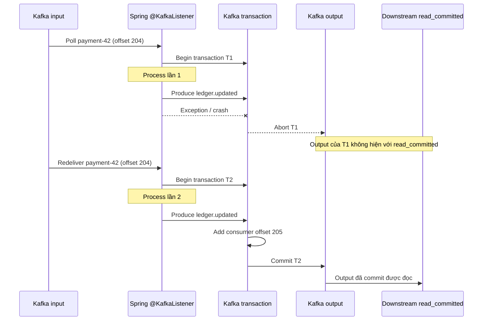
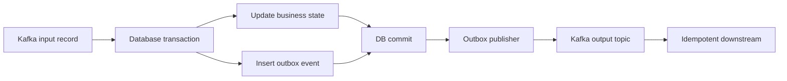

# Read và process vẫn có at-least-once trong Spring Kafka Exactly Once

Khi triển khai **Exactly Once Semantics (EOS)** trong Spring Kafka, một điểm rất dễ gây hiểu nhầm là: **Kafka transaction có thể bảo đảm kết quả Kafka của chuỗi read–process–write được commit đúng một lần, nhưng việc đọc record và thực thi logic xử lý vẫn có thể xảy ra nhiều lần**.

Nói cách khác, “exactly once” không có nghĩa `@KafkaListener` chỉ được gọi đúng một lần cho mỗi record. Khi một transaction bị abort, consumer có thể đọc lại cùng record và chạy lại code. Nếu code có tác dụng phụ bên ngoài Kafka như ghi database, gọi HTTP API, gửi email hoặc trừ tiền, tác dụng phụ đó có thể bị thực hiện lặp lại. Đây là giới hạn quan trọng nhất cần hiểu khi vận hành hệ thống Spring Kafka có giao dịch.

Trong phạm vi **Kafka-to-Kafka consume–process–produce**, giao dịch có thể liên kết *output records* với *consumer offsets* trong một lần commit nguyên tử. Consumer ở downstream dùng `isolation.level=read_committed` sẽ không nhìn thấy output của transaction đã abort. Còn ở phía ứng dụng nguồn, listener có thể đã chạy một hoặc nhiều lần trước khi một transaction cuối cùng commit thành công.

## 1. Ba khái niệm cần phân biệt

Các từ “read”, “process” và “write” đề cập đến ba giai đoạn có ranh giới khác nhau:

| Giai đoạn | Điều thực sự xảy ra | Delivery/processing semantics |
|---|---|---|
| **Read** | Kafka consumer poll và nhận record từ partition | Một record có thể được giao lại nếu offset chưa commit |
| **Process** | Listener chạy Java code, tính toán hoặc gọi dependency | Code có thể chạy nhiều lần khi retry/rebalance/restart |
| **Write** | Producer phát record mới vào Kafka | Có thể gắn vào Kafka transaction |
| **Offset commit** | Consumer group lưu vị trí đọc tiếp theo | Có thể được gắn cùng transaction với Kafka output |
| **External side effect** | Ghi database, gọi HTTP, gửi notification | Không tự nằm trong Kafka transaction |

Trong cách diễn đạt của Kafka EOS, quá trình *read và process* vẫn mang tính **at-least-once**; tính **exactly-once** áp dụng cho kết quả của **read–process–write** khi output và consumer offset được commit cùng một transaction và người đọc dùng isolation phù hợp.

Điều này không mâu thuẫn: hệ thống có thể **thử xử lý nhiều lần** nhưng **chỉ công bố một kết quả Kafka đã commit**.

### 1.1. At-least-once là gì?

At-least-once có nghĩa record có thể được giao và xử lý lại; trong điều kiện hệ thống phục hồi và tiến trình tiếp tục, ứng dụng không cố tình bỏ qua record chưa được xác nhận. Đổi lại, duplicate delivery là điều có thể xảy ra.

Ví dụ consumer xử lý record ở offset 84 nhưng crash trước khi offset 85 được commit. Khi khởi động lại, nó vẫn có thể đọc offset 84.

At-least-once **không bảo đảm** nghiệp vụ sẽ thành công trong mọi điều kiện; ví dụ một poison record có thể tiếp tục lỗi, hoặc dữ liệu có thể hết hạn lưu trữ trước khi xử lý. Thuật ngữ này mô tả semantics của việc giao/ack, không phải cam kết không có sự cố.

### 1.2. Exactly-once effect trong Kafka là gì?

Trong một Kafka transaction hợp lệ, output records và consumer offsets có thể được commit nguyên tử. Nếu transaction abort, output của nó bị ẩn đối với `read_committed` consumer, đồng thời offset của record nguồn chưa được commit trong transaction đó.

Nếu record được đọc lại và lần xử lý sau commit thành công, downstream có thể chỉ thấy output từ lần xử lý thành công này, dù listener đã chạy hai lần.

### 1.3. “Process đúng một lần” là yêu cầu mạnh hơn

Nếu listener gọi một REST API thanh toán ba lần, Kafka transaction không xóa được hai lời gọi dư thừa. Để bảo đảm hiệu ứng nghiệp vụ chỉ xảy ra một lần, cần idempotency key, unique constraint, inbox/outbox hoặc giao thức nghiệp vụ có chống trùng. Kafka transaction một mình không đủ.

## 2. Sơ đồ: listener chạy hai lần, output Kafka chỉ commit một lần

Giả sử topic nguồn `payments.accepted` có record `payment-42` ở partition 1, offset 204. Listener tính toán một event mới và gửi vào `ledger.updated`.



Sơ đồ dùng các bước khái niệm: trong thực tế container bắt đầu transaction trước khi gọi listener, rồi quản lý việc gửi offset/commit hoặc rollback theo lifecycle. Điều cần ghi nhớ là **phép tính nghiệp vụ chạy lại**, còn **Kafka output và offset cùng chỉ commit trong T2**.

Với consumer `read_uncommitted`, record từ transaction abort có thể vẫn được nhìn thấy; không thể tuyên bố downstream chỉ thấy một kết quả nếu bỏ qua yêu cầu `read_committed`.

## 3. Vì sao vẫn có thể đọc lại cùng một offset?

Kafka consumer lưu tiến độ theo committed offset của **consumer group**. Commit offset thường biểu diễn **vị trí của record kế tiếp**, không phải offset cuối cùng đã đọc.

Ví dụ:

```text
Topic: payments.accepted
Partition: 1
Record đang xử lý: offset 204

Lần T1:
  Consumer đọc offset 204
  Listener chạy
  Transaction abort
  Offset 205 chưa commit thành công trong T1

Lần T2:
  Consumer lại đọc offset 204
  Listener chạy lại
  Output + offset 205 cùng commit thành công

Lần sau:
  Consumer group tiếp tục từ committed offset 205
```

Một số nguồn gây redelivery phổ biến:

- Listener ném exception, transaction rollback.
- Service hoặc pod crash trước khi transaction commit.
- Producer commit thất bại, transaction bị abort.
- Consumer group rebalance trước khi tiến độ xử lý được commit.
- Consumer vượt `max.poll.interval.ms` và mất partition assignment.
- Tiến trình bị dừng hoặc deploy lại trong khi đang xử lý.
- Operator cố ý reset offsets hoặc replay dữ liệu.

Những tình huống này không tự chứng minh EOS đã hỏng. **Redelivery là một phần dự kiến của cơ chế phục hồi.** Câu hỏi quan trọng là output Kafka và offset có được quản lý trong cùng transaction hay không, và external side effects có idempotent không.

## 4. Phạm vi bảo đảm của Kafka transaction

Kafka transaction cung cấp một số thuộc tính liên quan chặt chẽ:

1. Producer có `transactional.id` để broker quản lý phiên giao dịch và cơ chế fencing.
2. Các record được gửi trong cùng transaction có cùng kết quả commit hoặc abort ở góc nhìn transactional visibility.
3. Consumer offset của input có thể được đưa vào cùng transaction với các output record qua `sendOffsetsToTransaction`.
4. Consumer `read_committed` tránh trả về record thuộc transaction bị abort.
5. Producer idempotence giúp hạn chế duplicate từ producer retries trong phạm vi giao thức hỗ trợ.

Chỉ cần thiếu bước đưa consumer offset vào transaction thì đường consume–process–produce **không còn có cùng ranh giới nguyên tử**: output có thể commit thành công nhưng input offset chưa commit, dẫn đến publish trùng khi reprocess.

### 4.1. Ranh giới quan trọng

```text
                 Kafka transaction T
         +--------------------------------+
         | Publish ledger.updated         |
         | Publish audit.event            |
         | Commit input offset 205        |
         +--------------------------------+
                         |
                         v
               Commit / Abort chung

BÊN NGOÀI TRANSACTION T:
- INSERT/UPDATE vào PostgreSQL, MySQL...
- HTTP request tới payment provider
- Email/SMS/webhook
- Ghi file hoặc gọi cloud API
- Metrics, logs và một số cache updates
```

Kafka transaction không là XA transaction bao phủ mọi dependency. Một database commit có thể thành công trong khi Kafka transaction abort, và ngược lại.

### 4.2. read_committed không chặn listener chạy lại

`isolation.level=read_committed` ảnh hưởng **record nào một consumer được phép thấy từ transaction của producer upstream**. Nó không đặt một giới hạn “mỗi record chỉ chạy listener một lần”.

Ngay cả listener dùng `read_committed` vẫn có thể xử lý lại **một record đã commit từ upstream** nếu chính offset của consumer group hiện tại chưa được commit.

## 5. Cấu hình Spring Boot cho transactional listener container

Một cấu hình Kafka-to-Kafka EOS thường cần:

- Transaction-capable producer factory với `transaction-id-prefix`.
- `KafkaTransactionManager` hoặc transaction manager Kafka-aware được listener container sử dụng.
- Listener container bắt đầu transaction và thêm consumed offsets khi commit.
- Kafka producer trong listener tham gia transaction do container quản lý.
- `enable.auto.commit=false` cho consumer.
- Downstream consumer dùng `read_committed`.
- Transactional ID prefix không xung đột giữa các instance đang chạy.

Ví dụ `application.yml` cho một service Kafka-to-Kafka:

```yaml
spring:
  kafka:
    bootstrap-servers: localhost:9092
    producer:
      transaction-id-prefix: ledger-service-instance-a-
      key-serializer: org.apache.kafka.common.serialization.StringSerializer
      value-serializer: org.apache.kafka.common.serialization.StringSerializer
      acks: all
    consumer:
      group-id: ledger-service
      enable-auto-commit: false
      isolation-level: read_committed
      key-deserializer: org.apache.kafka.common.serialization.StringDeserializer
      value-deserializer: org.apache.kafka.common.serialization.StringDeserializer
    listener:
      concurrency: 3
```

Trong Spring Boot, khi các điều kiện auto-configuration phù hợp, transaction ID prefix giúp tạo các thành phần Kafka transaction cho factory mặc định. **Không nên suy luận chỉ từ YAML rằng mọi listener hiện đã transactional**: nếu ứng dụng tạo custom listener factory, hãy kiểm tra transaction manager có thực sự được gắn vào container hay không.

Cần chú ý:

- Prefix `ledger-service-instance-a-` là ví dụ cho **một instance**. Nếu chạy nhiều pod/replica, mỗi instance phải có prefix được quản lý sao cho không gây xung đột transactional ID.
- `concurrency: 3` điều khiển số child consumer, không có nghĩa một record được xử lý ba lần.
- `read_committed` ở service này giúp nó tránh các record abort từ upstream. Các downstream đọc `ledger.updated` cũng cần isolation tương ứng.
- Một Kafka transaction không thay thế error handler, retry policy hoặc idempotency của các tác dụng phụ bên ngoài Kafka.
- Khi sử dụng Spring Kafka phiên bản khác nhau, API gắn transaction manager và các option liên quan có thể khác. Hãy đối chiếu phiên bản Spring Boot và Spring Kafka thực tế.

## 6. Ví dụ đúng: Kafka-to-Kafka listener và transaction do container quản lý

Giả sử business processing chỉ là chuyển đổi dữ liệu trong bộ nhớ rồi publish Kafka event:

```java
@Component
public class LedgerListener {

    private final KafkaTemplate<String, String> kafkaTemplate;

    public LedgerListener(KafkaTemplate<String, String> kafkaTemplate) {
        this.kafkaTemplate = kafkaTemplate;
    }

    @KafkaListener(
        topics = "payments.accepted",
        groupId = "ledger-service"
    )
    public void onPayment(
            ConsumerRecord<String, String> record) {

        String paymentId = record.key();
        String output = transform(record.value());

        kafkaTemplate.send(
            "ledger.updated",
            paymentId,
            output
        );
    }

    private String transform(String payload) {
        // Hàm biến đổi thuần túy, không thay đổi state bên ngoài.
        return payload;
    }
}
```

**Điều kiện quan trọng:** listener trên phải chạy trong container có **Kafka transaction manager** và `KafkaTemplate` phải tham gia cùng transaction ấy. Khi listener kết thúc thành công, container phối hợp gửi offset đã xử lý vào transaction rồi commit. Nếu listener ném lỗi, container rollback/abort và redelivery theo cơ chế xử lý lỗi.

Nếu factory không được cấu hình transactional, cùng Java code vẫn có thể publish output thành công rồi fail trước khi commit input offset, dẫn đến output bị gửi lặp.

### 6.1. Vì sao không tự mở executeInTransaction trong listener?

Đoạn sau **không phải** cách thay thế tự động cho consume–process–produce EOS:

```java
@KafkaListener(
    topics = "payments.accepted",
    groupId = "ledger-service"
)
public void onPayment(ConsumerRecord<String, String> record) {

    kafkaTemplate.executeInTransaction(operations -> {
        operations.send(
            "ledger.updated",
            record.key(),
            record.value()
        );
        return null;
    });
}
```

`executeInTransaction` mở **Kafka transaction cục bộ riêng** để publish. Nó không tự đưa offset input vào transaction đó. Nếu record nguồn chưa commit offset khi transaction local hoàn tất, output có thể bị publish lại sau crash hoặc rebalance.

Đối với EOS tại listener, ưu tiên transaction do listener container quản lý và gửi bằng `KafkaTemplate.send()` tham gia transaction đang hoạt động.

## 7. Mô phỏng thất bại: hai lần process nhưng một Kafka output

Xét consumer đã bật transactional listener container và downstream dùng `read_committed`.

```java
@Component
public class PaymentProjectionListener {

    private final KafkaTemplate<String, String> template;
    private final AtomicBoolean failOnce = new AtomicBoolean(true);

    public PaymentProjectionListener(KafkaTemplate<String, String> template) {
        this.template = template;
    }

    @KafkaListener(
        topics = "payments.accepted",
        groupId = "ledger-service"
    )
    public void consume(ConsumerRecord<String, String> record) {

        String eventId = record.key();

        // Mỗi lần delivery đều chạy dòng này.
        System.out.println("Processing event " + eventId);

        template.send(
            "ledger.updated",
            eventId,
            record.value()
        );

        if (failOnce.compareAndSet(true, false)) {
            throw new IllegalStateException(
                "Simulated failure before transaction commit"
            );
        }
    }
}
```

Trong môi trường test chỉ có một process, `AtomicBoolean` dùng để mô phỏng một lần lỗi trước khi listener trả về thành công. Đây là **fault injection để học và kiểm thử**, không phải chiến lược retry hoặc state recovery cho production.

Kết quả mong đợi với transaction hoạt động đúng:

| Quan sát | Kết quả |
|---|---|
| Số lần listener gọi | 2 lần trong kịch bản này |
| Số lần `System.out.println()` chạy | 2 |
| Output ở giao dịch đầu | Bị abort, không hiện với `read_committed` |
| Output ở giao dịch thứ hai | Được commit |
| Output downstream `read_committed` nhìn thấy | 1 record đã commit |
| Committed offset đầu vào | Tiến lên sau transaction thành công |

Không nên dùng số lần gọi listener làm metric “unique events processed”. Số lần gọi listener phản ánh **attempts**, còn số event duy nhất và số transaction commit thành công là những đại lượng khác nhau.

### 7.1. Nếu service chết thay vì ném exception?

Khi process crash trước commit, transaction của producer cũ không được coi là một giao dịch đã commit. Broker transaction coordinator và producer fencing/timeout giúp xử lý trạng thái còn mở. Record input vẫn có thể được consumer mới nhận lại do offset chưa commit.

Việc crash không bảo đảm redelivery xảy ra ngay lập tức; độ trễ phụ thuộc group reassignment, restart, timeout và tình trạng cluster.

## 8. Các cửa sổ lỗi cần hiểu

| Thời điểm lỗi | Read/process có thể lặp? | Kafka output với read_committed | External side effect |
|---|---|---|---|
| Trước khi listener nhận record | Có thể nhận sau khi phục hồi | Chưa có output | Chưa có |
| Sau khi listener bắt đầu nhưng trước send | Có | Chưa có output commit | Có thể đã xảy ra |
| Sau send nhưng trước transaction commit | Có | Output từ transaction abort không hiện | Có thể đã xảy ra |
| Trong commit; caller nhận timeout | Kết quả ở caller có thể chưa chắc chắn | Trạng thái Kafka do broker quyết định | Có thể đã xảy ra |
| Sau commit thành công | Bình thường offset đã commit | Output đã commit có thể đọc | Có thể đã xảy ra một lần hoặc nhiều lần |
| Operator cố ý replay/reset offset | Có | Có thể phát thêm transaction mới hợp lệ | Phải chống trùng |

Ở trường hợp commit có kết quả không chắc chắn tại caller, đừng mặc định “có exception = broker chắc chắn chưa commit”. Hành vi phục hồi phải dựa trên state Kafka, log và khả năng idempotent, thay vì chỉ suy ra từ exception.

Kafka transaction liên kết produced records và offsets trong phạm vi giao thức; nó không bảo đảm các side effect ngoài Kafka chỉ xảy ra một lần.

## 9. Tác dụng phụ database: ví dụ dễ gây sai dữ liệu

Giả sử service nhận `payments.accepted`, ghi một dòng audit vào PostgreSQL rồi publish event `ledger.updated`.

```java
@KafkaListener(
    topics = "payments.accepted",
    groupId = "ledger-service"
)
public void handle(ConsumerRecord<String, String> record) {

    auditRepository.insertAuditRow(record.key());

    kafkaTemplate.send(
        "ledger.updated",
        record.key(),
        record.value()
    );
}
```

Nếu database insert thành công nhưng Kafka transaction abort vì lỗi sau đó:

1. Audit row đã được commit ở database.
2. Output Kafka của transaction cũ bị abort.
3. Consumer đọc lại input record.
4. Listener lại gọi `insertAuditRow()`.
5. Audit có thể xuất hiện hai lần, dù downstream Kafka chỉ nhận một output được commit.

Đó là bằng chứng cho nhận định **read và process vẫn at-least-once**. Một phần code process đã gây side effect thực tế ngoài Kafka trước khi Kafka transaction hoàn tất.

### 9.1. Không dựa vào @Transactional để mặc định có atomicity

Đặt `@Transactional` trên phương thức gọi database và Kafka không tự tạo một giao dịch XA nguyên tử. Thứ tự commit có thể khiến database commit trước Kafka hoặc ngược lại, tùy transaction manager và cấu hình.

Cần xác định cụ thể:

- Transaction manager đang được dùng là database manager hay Kafka manager?
- Kafka output và consumed offsets có cùng Kafka transaction không?
- Database transaction đã commit vào thời điểm nào?
- Nếu giao dịch thứ hai thất bại, bên đã commit trước đó được xử lý như thế nào?
- Recovery có thể chạy lại mà không tạo tác dụng phụ trùng hay không?

Trong nghiệp vụ quan trọng, nên ưu tiên mẫu outbox/inbox và idempotency thay vì chỉ giả định annotation tạo atomicity xuyên hai hệ thống.

## 10. Idempotency là cầu nối cho process at-least-once

Một phép xử lý **idempotent** là phép xử lý có thể lặp mà không làm thay đổi kết quả nghiệp vụ sau lần thành công đầu tiên.

Ví dụ:

```text
Non-idempotent:
  balance = balance + 100
  Nếu chạy 2 lần --> tăng 200

Idempotent theo eventId:
  Nếu eventId đã được áp dụng:
      không áp dụng lại
  Ngược lại:
      áp dụng +100 và ghi dấu eventId
```

Nhưng việc “kiểm tra rồi mới ghi” phải được thực hiện **nguyên tử** trong chính database. Nếu hai consumer chạy đồng thời mà cả hai cùng thấy event chưa xử lý, việc chỉ dùng `SELECT` trước khi `INSERT` có thể gây race condition.

### 10.1. Inbox/processed-event table

Một mẫu phổ biến là ràng buộc duy nhất trên consumer identity và event identity:

```sql
CREATE TABLE processed_event (
    consumer_name TEXT NOT NULL,
    event_id      TEXT NOT NULL,
    processed_at  TIMESTAMPTZ NOT NULL DEFAULT CURRENT_TIMESTAMP,
    PRIMARY KEY (consumer_name, event_id)
);
```

Trong cùng một database transaction với cập nhật nghiệp vụ:

```sql
BEGIN;

INSERT INTO processed_event (consumer_name, event_id)
VALUES ('ledger-service', 'payment-42')
ON CONFLICT DO NOTHING;

-- Chỉ thực hiện UPDATE nghiệp vụ nếu INSERT ở trên
-- thực sự tạo mới processed_event.
-- Ứng dụng cần đọc affected-row count và giữ
-- toàn bộ thao tác trong cùng DB transaction.

COMMIT;
```

Đây là nguyên tắc idempotent consumer. Vấn đề quan trọng: **không được commit marker “đã xử lý” trước khi side effect nghiệp vụ hoàn tất**; marker và cập nhật nghiệp vụ phải cùng DB transaction.

### 10.2. Bẫy: deduplicate database nhưng làm mất Kafka output

Giả sử transaction Kafka đầu tiên abort **sau khi database đã commit thành công**. Khi input được xử lý lại, database thấy eventId đã được xử lý và bỏ qua mọi bước, kể cả phát `ledger.updated`.

Lúc đó database đúng nhưng **Kafka output bị thiếu**, vì output của lần trước nằm trong transaction đã abort.

Do vậy, không thể áp dụng quy tắc “eventId đã xử lý thì return ngay” một cách máy móc nếu listener đồng thời tạo Kafka output bắt buộc.

Cần thiết kế một trong các hướng:

- Lưu trạng thái/output dự kiến một cách bền vững, để lần retry có thể **phát lại đúng output cần thiết** vào Kafka transaction mới.
- Dùng **transactional outbox** để ghi business update và event cần publish trong **một database transaction**, rồi một publisher riêng phát outbox sang Kafka.
- Với bài toán thuần Kafka, giữ transform không có side effect bên ngoài và dùng transaction container quản lý input offset + output.

Đây là một điểm khác biệt giữa “tránh ghi database trùng” và “bảo đảm end-to-end event pipeline chính xác”.

## 11. Transactional outbox khi cần database và Kafka

Outbox là một cách tiếp cận phổ biến để kết hợp update database và ý định publish event trong cùng một database transaction:



Cơ chế mẫu:

1. Consumer nhận event có `eventId`.
2. DB transaction ghi marker/inbox, cập nhật business state, ghi outbox event với unique key phù hợp.
3. DB transaction commit nguyên tử các thay đổi liên quan.
4. Outbox publisher đọc những event còn pending và gửi đến Kafka.
5. Sau khi xác nhận publish, publisher cập nhật trạng thái outbox.

Outbox giải quyết cửa sổ “DB đã commit nhưng không còn biết phải publish event gì”. Tuy vậy outbox publisher cũng có thể gửi Kafka thành công rồi crash trước khi đánh dấu event đã gửi, dẫn đến **duplicate publish**. Vì thế downstream vẫn cần idempotent handling hoặc deduplication.

Outbox không khiến một event xuất hiện đúng một lần trong mọi tầng theo nghĩa tuyệt đối. Nó tạo nền tảng bền vững để **không mất ý định publish** và cho phép retry an toàn.

## 12. Với HTTP, email, thanh toán: Kafka transaction không hoàn tác tác dụng phụ

Trong listener có thể xuất hiện:

```java
@KafkaListener(topics = "invoices.created")
public void onInvoice(InvoiceEvent event) {

    emailGateway.sendInvoiceEmail(event);

    kafkaTemplate.send(
        "invoice.email.sent",
        event.id(),
        event.asJson()
    );
}
```

Nếu email đã gửi nhưng Kafka transaction abort, record có thể được đọc lại và email bị gửi lần nữa.

Các biện pháp phù hợp:

- Với payment API, truyền **idempotency key** mà provider hỗ trợ.
- Với email/notification, lưu một business operation ID ổn định và có trạng thái gửi trong database; không dựa vào thời điểm listener chạy.
- Với webhook/HTTP API, thiết kế receiver xử lý retry an toàn.
- Khi có side effect không thể undo, ghi nhận outcome bền vững trước khi cho retry thực hiện lại.
- Nếu dependency không hỗ trợ idempotency, xác định chính sách reconciliation và điều tra các kết quả không chắc chắn.

Không nên xây dựng tuyên bố “email gửi exactly once” chỉ dựa vào Spring Kafka EOS.

## 13. So sánh EOS với các chiến lược xử lý khác

| Mô hình | Record có thể được listener đọc lại? | Kafka output có thể trùng? | External DB/API side effect |
|---|---|---|---|
| Consumer at-least-once, producer thường | Có | Có thể | Có thể trùng |
| Kafka transactional consume–process–produce | Có | Output của tx abort được ẩn; committed output gắn với committed offsets | Vẫn có thể trùng |
| Kafka transactional producer đơn lẻ | Không tự kiểm soát consumed offset | Ghi trong transaction có commit/abort | Vẫn có thể trùng |
| Inbox/idempotent consumer | Có | Phụ thuộc cách publish | Có thể chống trùng DB nếu thiết kế đúng |
| Transactional outbox + idempotent downstream | Có | Có thể publish trùng nhưng xử lý an toàn hơn | Cần idempotency theo từng nghiệp vụ |

Bảng này mô tả hành vi trong những điều kiện thông thường. Không mô hình nào cho phép bỏ qua lỗi hạ tầng, retention, mất quyền truy cập, partitioning và sự cố vận hành.

### 13.1. At-most-once và lựa chọn bỏ qua record

Nếu commit offset **trước** khi xử lý xong, một crash có thể khiến record không được xử lý nhưng đã bị xem là hoàn tất. Đây là kiểu rủi ro mất message của at-most-once. Nó không phải giải pháp để tránh duplicate trong hệ thống reliability.

### 13.2. EOS không thay thế chuẩn xác dữ liệu đầu vào

Producer có thể tự gửi **hai business events trùng nhau**, nhưng mỗi event là một record Kafka hợp lệ ở offset khác nhau. Kafka transaction không tự kết luận hai record đó là một nghiệp vụ duy nhất.

Dùng `eventId`, aggregate version hoặc business idempotency key để xác định duplicate ở tầng nghiệp vụ. EOS của Kafka xử lý semantics transaction, không suy luận ý nghĩa kinh doanh của payload.

## 14. Lỗi, retry và rollback trong transactional listener

Với listener container quản lý Kafka transaction, khi listener ném exception, transaction thường được rollback/abort. Spring Kafka có cơ chế after-rollback processing, chẳng hạn `DefaultAfterRollbackProcessor`, để điều khiển cách consumer quay lại record chưa xử lý và xử lý retry/recovery.

Trong đường transaction, không nên mặc định mọi cấu hình `DefaultErrorHandler` hoặc DLT mà bạn quen dùng cho non-transactional container cũng hoạt động giống hệt. Chính sách exception, retry và recovery phải phù hợp với **transactional listener container**, Kafka transaction manager và phiên bản Spring Kafka.

### 14.1. Một poison record có thể được gọi nhiều lần

Ví dụ cùng một record chứa dữ liệu sai schema mà listener luôn ném exception:

```text
Poll record at offset 204
  -> listener lỗi
  -> transaction abort
  -> rollback/reposition
  -> poll record at offset 204
  -> listener lại lỗi
  -> ...
```

At-least-once processing trong trường hợp này có thể tạo nhiều attempts nhưng không có transaction nào commit thành công. Vì vậy phải có chiến lược giới hạn retry hoặc recovery/DLT, tránh consumer mắc kẹt vô hạn ở một offset.

### 14.2. DLT là một kết quả recovery, không phải business success

Khi policy quyết định chuyển record lỗi sang DLT, record chưa được xử lý thành công về nghiệp vụ. Cần theo dõi outcome `recovered` hoặc `dead_lettered` riêng với `success`.

Với Kafka transaction, việc gửi DLT và đưa recovered offset vào transaction phải tuân theo cơ chế rollback/recovery dành cho transactional containers. Không mặc định DLT publish thường và offset commit thường là một thao tác nguyên tử.

### 14.3. Retry topic và thứ tự xử lý

Nếu sử dụng non-blocking retry qua `@RetryableTopic`, record lỗi có thể chuyển qua các retry topics và được một consumer khác xử lý sau. Mô hình này có những đặc điểm khác về order, transaction boundaries và điều kiện hỗ trợ theo phiên bản.

Hãy kiểm tra tương thích của non-blocking retry với transactional listener container thay vì mặc định ghép mọi tính năng retry và EOS vào cùng cấu hình.

## 15. Concurrency, partition và rebalance

EOS không có nghĩa mỗi record được cố định vào một listener instance từ đầu đến cuối. Kafka group coordinator có thể thay đổi partition assignment.

Giả sử consumer A đang xử lý partition 2:

```text
Consumer A:
  poll partition 2 / offset 204
  process 204
  transaction chưa commit
  rebalance / mất assignment

Consumer B:
  nhận partition 2
  đọc lại từ committed offset
  process offset 204
```

Cơ chế transaction và fencing giúp bảo vệ việc ghi/commit trong Kafka theo giao thức. Nhưng database/API call mà A đã thực hiện vẫn có thể tồn tại, trong khi B thực hiện lại.

Một số điều kiện cần theo dõi:

- `max.poll.interval.ms` tương quan với thời gian xử lý một poll/batch.
- Concurrency không vượt nhu cầu partition một cách vô ích.
- Producer transactional ID prefix và cơ chế fencing được cấu hình đúng.
- Rebalance rate và thời gian xử lý partition.
- Side effect ngoài Kafka idempotent ngay cả khi có hai attempts gần nhau theo thời gian.

Không dựa vào thứ tự hoặc số lần gọi listener để đưa ra một khóa idempotency. Dùng event ID ổn định hoặc domain key + version.

## 16. Transactional ID, EOS V2 và producer fencing

Kafka transaction dựa vào `transactional.id`, producer epoch và transaction coordinator. Một producer cũ có thể bị **fenced** khi producer mới sở hữu cùng identity và epoch mới.

Trong các phiên bản Spring Kafka hiện đại, EOS V2 là cơ chế giao dịch phù hợp với các Kafka broker/client được hỗ trợ. Cấu hình transaction ID prefix phải tương thích với số producer có thể hoạt động đồng thời và với các instance trong cluster.

Cần phân biệt:

- **Transactional producer identity** giúp broker điều phối và fence producer cũ.
- **Consumer group identity** giúp Kafka điều phối partition assignments và committed offsets.
- **Business event identity** giúp ứng dụng chống side effect trùng.

Ba loại ID phục vụ ba mục đích khác nhau. Transactional ID không phải key để deduplicate một thao tác thanh toán; consumer group ID cũng không chứng minh một event chỉ được xử lý một lần.

Nếu hai pod dùng cùng transactional ID ngoài chủ đích, fencing có thể tăng, transaction abort và redelivery nhiều hơn. Khi đó listener invocation count tăng là triệu chứng cần điều tra, không phải bằng chứng Kafka EOS tự động bị mất hiệu lực.

## 17. Consumer isolation và những record không nhìn thấy

Để quan sát đúng Kafka EOS, downstream nên dùng:

```yaml
spring:
  kafka:
    consumer:
      isolation-level: read_committed
```

Nếu upstream producer abort một transaction, những record đã được ghi vào broker trong transaction đó có thể vẫn hiện diện ở log vật lý cùng transaction markers, nhưng `read_committed` consumer sẽ không trả chúng về như các record nghiệp vụ.

Hệ quả:

- Không nên kỳ vọng offset record nghiệp vụ luôn liên tục trong kết quả đọc bằng `read_committed`.
- Có thể xuất hiện offset “nhảy” khi có aborted transactional records hoặc control records.
- `read_committed` consumer không nên được đánh giá chỉ bằng số lượng offset liền nhau đã thấy.
- Last stable offset có thể khiến dữ liệu phía sau một transaction đang mở chưa khả dụng cho consumer `read_committed` đến khi transaction kết thúc.

`read_committed` chỉ điều khiển visibility của transactional writes. Nó không bảo vệ khỏi hai event cùng business ID được producer phát thành công trong **hai transaction khác nhau**.

## 18. Thiết kế metric đúng: attempts khác unique events

Nếu chỉ ghi một metric tăng mỗi khi listener chạy, một record retry ba lần sẽ được tính là ba lần xử lý, dù kết quả Kafka chỉ được commit một lần.

Nên theo dõi riêng:

| Metric | Điều muốn đo |
|---|---|
| Listener invocation count | Tổng số attempts |
| Listener failure count | Số lần listener ném exception |
| Kafka transaction commit count | Số transaction commit thành công |
| Kafka transaction abort count | Số transaction abort |
| Duplicate delivery count | Số lần cùng event được giao lại theo khóa nhận diện |
| Unique business events completed | Số event nghiệp vụ hoàn tất không trùng |
| External idempotency hit count | Số attempt được bảo vệ khỏi side effect lặp |
| DLT recovery count | Số record được chuyển recovery |
| Consumer group lag | Tiến độ commit theo partition |
| Commit/abort duration | Độ trễ và tính ổn định của transaction |
| Producer fencing errors | Xung đột transactional ID hoặc producer lifecycle |

Không đặt `eventId`, raw key, offset hoặc transactional ID cụ thể vào metric labels vì có thể gây cardinality rất lớn. Chúng phù hợp hơn trong structured log/traces.

### 18.1. Log một attempt

Một log minh họa:

```json
{
  "event": "kafka_listener_attempt",
  "service": "ledger-service",
  "topic": "payments.accepted",
  "partition": 1,
  "offset": 204,
  "eventId": "payment-42",
  "attempt": 2,
  "outcome": "success"
}
```

Đây là log ứng dụng minh họa. Trường `attempt` cần lấy từ cơ chế attempt tracking hoặc header/metadata phù hợp với policy; không tự suy ra từ Kafka offset.

Một log `outcome=success` tại thời điểm listener trả về chưa chứng minh Kafka transaction đã commit. Muốn quan sát outcome transaction, cần instrumentation ở ranh giới transaction manager/producer hoặc metrics Kafka tương ứng.

### 18.2. Lưu ý về latency

Thời gian xử lý một attempt có thể nhỏ nhưng end-to-end event latency lớn do nhiều lần abort/retry và rebalance. Khi đặt SLO, nên phân biệt attempt latency, retry delay, transaction duration và thời gian đến business completion.

## 19. Integration test chứng minh “read/process at-least-once”

Đây là bài test giúp nhóm kỹ thuật hiểu semantics tốt hơn mọi sơ đồ. Dùng **Kafka broker thật** qua Testcontainers hoặc EmbeddedKafka, vì mock `KafkaTemplate` không thể chứng minh commit/abort visibility.

### 19.1. Chuẩn bị

1. Tạo topic input `payments.accepted`, output `ledger.updated`.
2. Tạo transactional producer factory với transaction ID prefix riêng cho test.
3. Cấu hình listener container thực sự sử dụng Kafka transaction manager.
4. Dùng input consumer group riêng và đặt `enable.auto.commit=false`.
5. Tạo output consumer `isolation.level=read_committed`.
6. Tạo một counter ghi nhận số lần listener chạy.
7. Cho listener thất bại lần đầu và thành công lần tiếp theo bằng fault injection.

### 19.2. Kết quả mong đợi

| Điều kiện | Bằng chứng |
|---|---|
| Listener lỗi lần đầu | Listener invocation counter tăng một lần |
| Kafka transaction đầu abort | Output từ transaction lỗi không xuất hiện với read_committed |
| Input offset chưa commit | Record được đọc lại theo chính sách recovery |
| Listener chạy lần thứ hai | Invocation counter lớn hơn 1 |
| Kafka transaction sau commit | Output có thể đọc được |
| Consumer offset và output commit cùng giao dịch | Tiến độ input phản ánh transaction đã thành công |
| Kết quả output đã commit | Có một output hợp lệ cho kịch bản một input này |
| Mô phỏng DB side effect không idempotent | Có thể quan sát duplicate khi listener chạy lại |

Không kiểm tra chỉ bằng việc count mọi record từ consumer `read_uncommitted`: consumer đó có thể nhìn thấy record của transaction đã abort.

### 19.3. Kiểm thử crash window trước commit

Trong môi trường test, tạo failure có kiểm soát sau khi listener đã thực hiện công việc nhưng trước khi transaction commit, sau đó cho consumer khác nhận lại partition.

Kiểm tra:

- Record có thể được xử lý lại.
- Output Kafka bị abort không được trả về cho `read_committed`.
- Offset nguồn chỉ tiến lên khi transaction cuối commit thành công.
- Nếu có database side effect, idempotency bảo vệ state.
- Các metric abort/rebalance/retry phản ánh điều đã xảy ra.

Dùng điều kiện chờ có timeout thay vì `Thread.sleep()` dài và dễ flake. Tránh dùng fault injection làm crash cả broker test trừ khi đó là mục tiêu riêng.

### 19.4. Kiểm thử case dedup làm mất output

Thực hiện kịch bản:

1. Listener ghi database marker và business state.
2. Transaction Kafka của lần xử lý đầu abort.
3. Record được đọc lại.
4. Listener thấy marker và `return` mà không phát output.
5. Kiểm tra output Kafka bị thiếu.

Sau đó áp dụng outbox hoặc replay output bền vững và chạy lại. Đây là cách xác thực rằng idempotency chỉ ở database chưa đủ nếu pipeline còn bắt buộc phát Kafka event.

## 20. Những suy luận sai thường gặp

**“Bật transaction nghĩa là listener chỉ chạy một lần.”** Sai. Listener có thể chạy lại sau abort, crash hoặc rebalance.

**“read_committed làm input không bị giao lại.”** Sai. Nó lọc output của producer transaction đã abort; consumer vẫn dùng committed offset để phục hồi.

**“KafkaTemplate.send() trong listener tự động EOS.”** Chỉ đúng theo ranh giới mong muốn nếu container transaction và offset handling được cấu hình phù hợp; publish đơn lẻ không đủ.

**“executeInTransaction trong listener bao luôn input offset.”** Sai. Local transaction của template không tự thêm offset được consume vào giao dịch.

**“Kafka EOS bảo đảm database được ghi một lần.”** Sai. Database nằm ngoài Kafka transaction.

**“Đã dedup bằng DB thì có thể luôn return.”** Có thể làm mất Kafka output nếu transaction Kafka trước đó abort sau khi DB đã commit. Cần outbox hoặc cách phục hồi output.

**“Transaction abort nghĩa là mọi side effect biến mất.”** Chỉ các Kafka writes tham gia đúng transaction bị abort/ẩn theo semantics Kafka. HTTP/DB/email có thể đã hoàn tất.

**“Có hai listener invocation là EOS lỗi.”** Không hẳn. Cần kiểm tra committed Kafka output, offsets và mô hình retry.

**“Producer cùng key sẽ không bao giờ phát trùng business event.”** Kafka partition key không thay thế event idempotency key. Hai lần send hợp lệ có thể tạo hai record ở hai offsets.

**“Mọi downstream consumer mặc định đều thấy đúng transaction visibility.”** Không. Cần kiểm tra `isolation.level=read_committed` ở những consumer phụ thuộc semantics này.

**“DLT là business success.”** DLT giúp giữ record lỗi cho điều tra/recovery, không chứng minh đã hoàn tất nghiệp vụ.

## 21. Checklist khi đưa EOS vào production

Trước khi kết luận một Spring Kafka service có read–process–write EOS phù hợp, xác nhận:

1. Input và output đều là Kafka trong phạm vi giao dịch muốn bảo đảm.
2. Listener factory thật sự chạy với Kafka transaction manager, không chỉ có bean transaction manager tồn tại.
3. `KafkaTemplate` trong listener tham gia transaction do container quản lý.
4. Consumer offsets được đưa vào **cùng transaction** với Kafka output.
5. Consumer auto-commit được tắt.
6. Downstream quan trọng sử dụng `read_committed`.
7. Transaction ID prefix được phân bổ đúng cho số instance và producer concurrency.
8. Timeout, rebalance và producer fencing được theo dõi.
9. Retry và after-rollback policy có giới hạn, có cơ chế DLT/recovery nếu cần.
10. Mọi database/HTTP side effect có idempotency hoặc outbox/inbox phù hợp.
11. Business event identity được tách khỏi offset và transactional ID.
12. Dashboard phân biệt listener attempts, committed transactions, duplicates và DLT.
13. Integration test đã chứng minh record được listener chạy lại mà output Kafka abort không hiển thị.
14. Đã kiểm thử crash và restart tại những cửa sổ lỗi quan trọng.
15. Runbook nêu rõ cách replay, xử lý duplicate và xác minh business state khi transaction outcome không chắc chắn.

### 21.1. Một câu hỏi thiết kế quan trọng

Hãy hỏi: **“Nếu listener chạy hai lần cho cùng một record, phần nào của hệ thống sẽ bị thay đổi hai lần?”**

Nếu câu trả lời chỉ là các phép tính thuần túy và output Kafka được quản lý trong cùng transaction với input offset, Kafka EOS có thể cung cấp bảo đảm phù hợp.

Nếu câu trả lời bao gồm DB row, thanh toán, email, HTTP request, file hoặc trạng thái external service, cần thêm idempotency, outbox/inbox, reconciliation hoặc cơ chế nghiệp vụ tương đương.

## 22. Tài liệu tham chiếu theo phiên bản

Đối chiếu tài liệu đúng phiên bản Spring Kafka, Spring Boot và Kafka client khi triển khai:

- **Spring for Apache Kafka Reference — Transactions**: transactional listener containers, container transaction manager và Kafka EOS.
- **Spring for Apache Kafka Reference — Exactly Once Semantics**: ranh giới read–process–write và nhận định read/process vẫn có at-least-once semantics.
- **Spring Kafka Javadoc**: `KafkaTemplate`, `KafkaTransactionManager`, `DefaultKafkaProducerFactory`, `ContainerProperties`, `DefaultAfterRollbackProcessor`.
- **Spring Boot Reference — Kafka**: cấu hình `spring.kafka.producer.transaction-id-prefix`, consumer isolation và listener container factory.
- **Apache Kafka Documentation — Transactions**: transactional ID, producer fencing, send offsets to transaction, committed/aborted visibility và isolation levels.
- **Apache Kafka Documentation — Consumer Configs**: `isolation.level`, `enable.auto.commit`, `max.poll.interval.ms`.
- **Tài liệu về Transactional Outbox và Idempotent Consumer**: dùng để thiết kế side effects ngoài Kafka, không phải tính năng mặc định được Kafka transaction cấp phát.

Đặc biệt khi nâng cấp Spring Kafka, hãy xác nhận cách cấu hình transaction manager cho container, EOS mode được hỗ trợ, producer factory caching, retry/after-rollback, transaction ID prefix và quy tắc commit offsets.

Giá trị của exactly-once trong Spring Kafka nằm ở **ranh giới kết quả Kafka được commit**: cho phép record được đọc và xử lý lại để phục hồi, đồng thời tránh để output của lần xử lý bị abort xuất hiện ở consumer `read_committed`. Một hệ thống reliable không cố loại bỏ mọi lần process lặp, mà xây dựng **Kafka transaction đúng ranh giới và nghiệp vụ idempotent** để việc chạy lại không làm sai dữ liệu.
