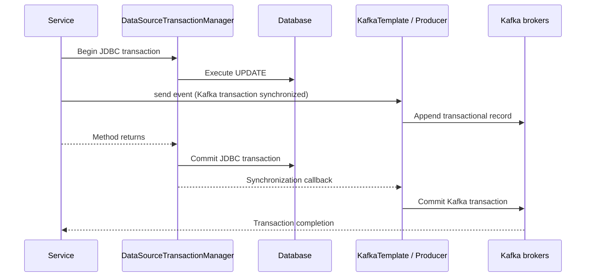
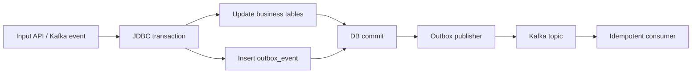

# DataSourceTransactionManager trong Spring Kafka: giao dịch database và Kafka

`DataSourceTransactionManager` là transaction manager của Spring Framework dành cho **một JDBC `DataSource`**. Nó quản lý ranh giới commit/rollback của giao dịch cơ sở dữ liệu, trong khi `KafkaTransactionManager` quản lý giao dịch của Kafka producer. Khi một service Spring Kafka vừa ghi database vừa nhận hoặc phát Kafka events, hiểu rõ vai trò của hai transaction manager này là điều bắt buộc để tránh mất event, phát trùng hoặc cập nhật dữ liệu không nhất quán.

**Điểm mấu chốt:** `DataSourceTransactionManager` chỉ bảo đảm các thao tác JDBC dùng đúng connection tham gia một DB transaction. Việc Spring Kafka có thể **đồng bộ hóa thời điểm commit** với database **không biến hai tài nguyên thành một distributed transaction nguyên tử**. Database có thể commit thành công rồi Kafka commit thất bại; hoặc Kafka commit trước rồi database rollback. Tính đúng đắn của hệ thống còn cần idempotency, transactional outbox hoặc một cơ chế phục hồi được thiết kế rõ ràng.

Bài học này giải thích cụ thể cách `DataSourceTransactionManager` hoạt động, cách gắn nó với `@Transactional`, cách Spring Kafka đồng bộ giao dịch, failure windows, mẫu outbox, và những kiểm thử cần có trong production.

## 1. DataSourceTransactionManager quản lý gì?

Spring cung cấp abstraction `PlatformTransactionManager`. `DataSourceTransactionManager` là implementation quản lý transaction trên JDBC connection lấy từ một `DataSource`. Khi code chạy trong transaction, Spring thường:

1. Lấy JDBC `Connection` từ `DataSource`.
2. Cấu hình transaction trên connection, bao gồm auto-commit và các thuộc tính phù hợp.
3. Liên kết connection với thread hiện tại qua cơ chế transaction synchronization.
4. Cho các thao tác JDBC bên trong cùng transaction dùng connection đó.
5. `commit()` khi luồng thành công hoặc `rollback()` nếu điều kiện rollback được kích hoạt.
6. Khôi phục connection state, giải phóng/hoàn trả connection cho pool.

Các công cụ như `JdbcTemplate` và `DataSourceUtils` hiểu transaction synchronization, nên chúng có thể sử dụng đúng connection đang được quản lý.

```text
@Service method
     |
     | @Transactional("databaseTransactionManager")
     v
DataSourceTransactionManager
     |
     | bind Connection to thread
     v
JDBC DataSource / connection pool
     |
     +-- INSERT business table
     +-- UPDATE aggregate table
     +-- INSERT outbox table
     |
     +-- commit hoặc rollback tất cả JDBC changes
```

Trong giao dịch này, `DataSourceTransactionManager` **không quản lý** các HTTP request, Kafka producer transaction, Redis commands, email hoặc một database khác chỉ vì các thao tác đó chạy trong cùng Java method.

### 1.1. Phân biệt các transaction manager

| Thành phần | Tài nguyên được quản lý | Tính chất |
|---|---|---|
| `DataSourceTransactionManager` | Một JDBC DataSource | Local JDBC transaction |
| `JdbcTransactionManager` | JDBC DataSource | Kế thừa `DataSourceTransactionManager`, hỗ trợ exception translation khi commit/rollback |
| `JpaTransactionManager` | JPA EntityManager và persistence context | Phù hợp với JPA; có thể phối hợp JDBC đúng cấu hình |
| `KafkaTransactionManager` | Transactional Kafka producer | Kafka begin/commit/abort |
| `@Transactional` | Không tự chỉ rõ tài nguyên | Dựa vào transaction manager mà Spring chọn |
| Transactional outbox | Một DB transaction ghi cả nghiệp vụ và ý định publish | Bền vững giữa DB commit và publisher bất đồng bộ |

`JdbcTransactionManager` được giới thiệu từ Spring Framework 5.3. Trong các bản Spring Boot hiện đại dùng JDBC, Boot có thể cung cấp `JdbcTransactionManager` thay vì trực tiếp `DataSourceTransactionManager`; nó vẫn thuộc cùng họ transaction manager JDBC. Không cần thay thế bean Boot tạo chỉ để có đúng tên class `DataSourceTransactionManager` nếu hành vi hiện tại đã đáp ứng yêu cầu.

## 2. @Transactional gắn với DataSourceTransactionManager như thế nào?

Annotation `@Transactional` là điểm khai báo ranh giới giao dịch; **transaction manager được chọn** mới quyết định resource nào commit hoặc rollback.

Giả sử service có một bean tên `databaseTransactionManager`:

```java
@Service
public class AccountService {

    private final JdbcTemplate jdbc;

    public AccountService(JdbcTemplate jdbc) {
        this.jdbc = jdbc;
    }

    @Transactional(transactionManager = "databaseTransactionManager")
    public void credit(String accountId, long amount) {
        jdbc.update(
            "UPDATE account SET balance = balance + ? WHERE id = ?",
            amount,
            accountId
        );

        jdbc.update(
            "INSERT INTO account_audit(account_id, amount) VALUES (?, ?)",
            accountId,
            amount
        );
    }
}
```

Nếu thao tác thứ hai ném một unchecked exception và transaction chưa commit, cả hai JDBC changes có thể rollback cùng nhau. Đây là bảo đảm của **database transaction**, không liên quan đến việc một Kafka event đã được publish hay chưa.

Mặc định cơ chế khai báo transaction của Spring rollback với `RuntimeException` và `Error`. Với checked exception, kiểm tra quy tắc rollback của phiên bản/configuration và đặt `rollbackFor` nếu nghiệp vụ cần:

```java
@Transactional(
    transactionManager = "databaseTransactionManager",
    rollbackFor = Exception.class
)
public void updateAndValidate(...) throws Exception {
    // Các thao tác JDBC phải cùng tham gia transaction.
}
```

Không bắt exception rồi trả về bình thường nếu yêu cầu rollback. Khi đó proxy transaction có thể thấy method hoàn tất thành công và tiến hành commit.

## 3. Spring Boot tạo transaction manager nào?

Trong một ứng dụng Spring Boot có JDBC DataSource, Boot thường tự động cấu hình DataSource và transaction manager JDBC nếu các điều kiện bean/classpath cho phép.

Với cấu hình database mẫu:

```yaml
spring:
  datasource:
    url: jdbc:postgresql://localhost:5432/orders
    username: orders_app
    password: ${DB_PASSWORD}
    hikari:
      maximum-pool-size: 15
```

Các thuộc tính JDBC được Boot dùng tạo `DataSource`; một transaction manager thích hợp có thể được cấu hình tự động. Đây **không phải** cấu hình cho Kafka transactions.

Nếu thêm Kafka producer transaction:

```yaml
spring:
  kafka:
    bootstrap-servers: localhost:9092
    producer:
      transaction-id-prefix: orders-service-pod-a-
      key-serializer: org.apache.kafka.common.serialization.StringSerializer
      value-serializer: org.apache.kafka.common.serialization.StringSerializer
      acks: all
    consumer:
      enable-auto-commit: false
      isolation-level: read_committed
```

Spring Boot có thể cấu hình các thành phần Kafka transaction khi điều kiện tương ứng được đáp ứng. Khi ứng dụng có nhiều bean `PlatformTransactionManager` (ví dụ JDBC manager và Kafka manager), **không nên đoán** `@Transactional` mặc định đang chọn manager nào.

Ưu tiên một trong các cách sau:

- Chỉ định tường minh `@Transactional(transactionManager = "databaseTransactionManager")` cho DB operation.
- Đặt `@Primary` hoặc lựa chọn manager mặc định theo thiết kế ứng dụng khi thực sự phù hợp.
- Dùng `@Qualifier` hoặc truyền manager trực tiếp cho `TransactionTemplate`.
- Kiểm tra tên, kiểu bean và condition evaluation report khi auto-configuration thay đổi do thêm dependency hoặc custom bean.

Không nên gắn một `@Transactional` không có qualifier rồi mặc định rằng cả JDBC và Kafka transaction cùng được quản lý nguyên tử.

### 3.1. Khai báo bean JDBC transaction manager tường minh

Nếu ứng dụng muốn kiểm soát tên bean:

```java
@Configuration
public class DatabaseTransactionConfiguration {

    @Bean("databaseTransactionManager")
    public DataSourceTransactionManager databaseTransactionManager(
            DataSource dataSource) {
        return new DataSourceTransactionManager(dataSource);
    }
}
```

Các import chính:

```java
import javax.sql.DataSource;
import org.springframework.context.annotation.Bean;
import org.springframework.context.annotation.Configuration;
import org.springframework.jdbc.datasource.DataSourceTransactionManager;
```

Một số dự án dùng `JdbcTransactionManager` thay thế:

```java
@Bean("databaseTransactionManager")
public JdbcTransactionManager databaseTransactionManager(
        DataSource dataSource) {
    return new JdbcTransactionManager(dataSource);
}
```

Đây là **hai lựa chọn thay thế**, không cần tạo đồng thời cả hai bean chỉ để quản lý cùng một `DataSource`. Nếu đã có transaction manager được auto-configure, việc tự khai báo một bean mới có thể làm Boot back off hoặc gây mơ hồ trong dependency injection.

## 4. JDBC connection phải tham gia đúng transaction

Một transaction JDBC của Spring chỉ bảo vệ các JDBC operations thực sự dùng connection tương ứng.

`JdbcTemplate` tự quản lý connection acquisition theo mô hình của Spring:

```java
@Transactional("databaseTransactionManager")
public void register(String id) {
    jdbcTemplate.update(
        "INSERT INTO customer(id) VALUES (?)", id
    );
    jdbcTemplate.update(
        "INSERT INTO customer_audit(customer_id) VALUES (?)", id
    );
}
```

Nếu tự lấy connection bằng `dataSource.getConnection()` ngoài cơ chế transaction-aware, rất có thể thao tác đó không dùng connection được bind bởi transaction manager. Khi cần JDBC trực tiếp, sử dụng `DataSourceUtils.getConnection(dataSource)` và cơ chế release tương ứng, hoặc ưu tiên `JdbcTemplate`.

Thêm một điểm cần chú ý: transaction của Spring thường được liên kết với **thread hiện tại**. Gọi `@Async`, tạo `CompletableFuture` chạy thread khác, hoặc tự mở thread trong method không tự truyền JDBC transaction sang thread mới.

```java
@Transactional("databaseTransactionManager")
public void process(String id) {
    jdbcTemplate.update("UPDATE job SET status='RUNNING' WHERE id=?", id);

    CompletableFuture.runAsync(() -> {
        // Đây là thread khác; không tự dùng cùng JDBC transaction.
        invokeAnotherDatabaseOperation(id);
    });
}
```

Nếu cần cập nhật database ở background worker, thiết kế một transaction độc lập trong worker; không giả định nó rollback theo method gọi ban đầu.

## 5. Vì sao database + Kafka khó giữ nhất quán?

Một service thường cần hai tác động:

1. Ghi trạng thái nghiệp vụ vào database.
2. Publish event đến Kafka.

Giả sử khi xác nhận đơn hàng, service cần cập nhật `orders.status = CONFIRMED` rồi phát `orders.confirmed`.

Nếu không có chiến lược transaction rõ ràng, có hai failure windows quan trọng:

```text
DATABASE FIRST:
  DB COMMIT thành công
          |
          X Kafka publish/commit lỗi
          |
  Đơn hàng đã confirmed nhưng event có thể bị thiếu

KAFKA FIRST:
  Kafka COMMIT thành công
          |
          X DB commit lỗi
          |
  Event đã được công bố nhưng đơn hàng chưa confirmed
```

Cả hai thứ tự đều tồn tại cửa sổ xảy ra sai lệch. Việc “đồng bộ hóa” hai local transactions chỉ giúp Spring chủ động thứ tự và truyền exception; nó **không tạo atomic commit** giữa hai hệ thống.

Trong các luồng quan trọng, chính sự tồn tại của hai failure windows này dẫn đến nhu cầu dùng transactional outbox và idempotency.

## 6. Đồng bộ Kafka producer transaction với JDBC transaction

Spring Kafka có thể đồng bộ một Kafka producer transaction với một Spring-managed transaction đang hoạt động, chẳng hạn transaction JDBC.

Khi `KafkaTemplate` được tạo từ transactional `ProducerFactory`, và code gọi `KafkaTemplate.send()` **bên trong** method đang có JDBC transaction được quản lý bởi Spring, Kafka resource có thể được đăng ký để tham gia cơ chế synchronization.

Ví dụ:

```java
@Service
public class OrderConfirmationService {

    private final JdbcTemplate jdbc;
    private final KafkaTemplate<String, String> kafkaTemplate;

    public OrderConfirmationService(
            JdbcTemplate jdbc,
            KafkaTemplate<String, String> kafkaTemplate) {
        this.jdbc = jdbc;
        this.kafkaTemplate = kafkaTemplate;
    }

    @Transactional("databaseTransactionManager")
    public void confirmOrder(String orderId, String eventJson) {

        int changed = jdbc.update(
            "UPDATE orders SET status = ? WHERE id = ?",
            "CONFIRMED",
            orderId
        );

        if (changed != 1) {
            throw new IllegalStateException(
                "Order not found or not updatable: " + orderId
            );
        }

        kafkaTemplate.send(
            "orders.confirmed",
            orderId,
            eventJson
        );
    }
}
```

Để Kafka send tham gia transaction theo cách này, cần:

- Producer factory được cấu hình transactional, thường bằng `transaction-id-prefix`.
- Method thực sự chạy trong Spring-managed **JDBC** transaction.
- `KafkaTemplate` sử dụng đúng transactional producer factory.
- Không mở local `executeInTransaction()` riêng nếu mục đích là đồng bộ với transaction JDBC hiện tại.
- Lời gọi `send()` không bị tách sang thread khác mà làm mất transaction synchronization.

### 6.1. Thứ tự commit khi JDBC là transaction chính

Với kiểu đồng bộ này, trình tự thường là:



**Database là transaction chính**, nên DB commit trước; Kafka transaction được commit sau thông qua transaction synchronization.

Nếu Kafka commit thất bại **sau khi DB đã commit**, JDBC transaction **không thể rollback trở lại**. Spring Kafka ở các phiên bản hiện đại có thể truyền lỗi của secondary commit đến caller, nhưng việc biết có lỗi không tự sửa được trạng thái sai lệch. Cần phương án kiểm tra lại, compensation hoặc outbox.

Không diễn giải sự thành công của một lời gọi `send()` hoặc việc callback được thực thi là bằng chứng toàn bộ chuỗi đã commit. Producer send có thể bất đồng bộ; broker transaction commit mới quyết định transactional visibility.

### 6.2. Điều kiện rollback khi code ném exception

Nếu code ném một unchecked exception trước khi transaction chính commit, Spring có thể rollback JDBC transaction và Kafka synchronization cũng abort transaction Kafka tương ứng.

Điều đó hữu ích cho lỗi xảy ra **trước ranh giới commit**, nhưng vẫn không tạo bảo đảm nếu lỗi phát sinh **trong lúc commit** hoặc sau khi một tài nguyên đã commit xong.

## 7. Ma trận lỗi của đồng bộ hai local transactions

Khi thiết kế transaction order, cần luôn điền bảng lỗi thực tế:

| Giai đoạn lỗi | Trạng thái DB | Trạng thái Kafka | Rủi ro |
|---|---|---|---|
| Trước khi ghi DB | Chưa đổi | Chưa gửi | Có thể retry an toàn |
| Sau SQL update, trước DB commit | Có thể rollback | Có thể abort | Thường phục hồi cùng transaction |
| Kafka send thất bại trước DB commit và lỗi được truyền ra | Rollback theo policy | Abort | Cần xác nhận exception không bị nuốt |
| DB commit thất bại | Không commit hoặc kết quả cần xác định theo lỗi | Secondary Kafka transaction không nên coi là đã commit thành công | Có thể cần kiểm tra thực tế |
| DB commit thành công, Kafka commit thất bại | **Đã commit** | Chưa commit hoặc trạng thái có thể chưa chắc chắn | **Sai lệch DB/Kafka** |
| Cả hai commit thành công, caller timeout sau đó | Đã commit | Đã commit | Caller retry có thể tạo duplicate nghiệp vụ |
| Service crash giữa hai commit | Có thể đã commit | Có thể chưa commit | Cần reconciler/outbox |

Đặc biệt, khi một operation trả exception từ transaction commit, caller không luôn biết chính xác giao dịch đã commit hay chưa chỉ từ exception type; kết quả broker/database có thể cần xác minh bằng state và telemetry.

Một cách ghi nhận trạng thái cần rõ ràng hơn `SUCCESS`/`FAILED` là phân biệt:

- Đã xác nhận transaction thành công.
- Đã xác nhận rollback/abort.
- Kết quả chưa xác định, cần reconcile hoặc xử lý idempotent.

## 8. Có thể commit Kafka trước database không?

Có thể thiết kế một đường thực thi để Kafka transaction commit trước, ví dụ qua một method được Spring quản lý bởi `KafkaTransactionManager`, gọi từ một outer JDBC transaction. Tuy nhiên hai transaction vẫn **không nguyên tử với nhau**.

Ý tưởng:

```text
Outer service: JDBC transaction begin
    |
    |-- Cập nhật database (chưa commit)
    |
    +-- Inner service: Kafka transaction begin
           |-- KafkaTemplate.send(...)
           +-- Kafka transaction commit
    |
    +-- JDBC transaction commit
```

Nếu JDBC commit thất bại sau khi Kafka commit, downstream có thể thấy event về một thay đổi database chưa thành công.

Nếu cần lối này, nested method phải được gọi **qua Spring proxy** và lựa chọn đúng transaction manager:

```java
@Service
public class KafkaEventService {

    private final KafkaTemplate<String, String> template;

    public KafkaEventService(KafkaTemplate<String, String> template) {
        this.template = template;
    }

    @Transactional("kafkaTransactionManager")
    public void publish(String key, String json) {
        template.send("orders.confirmed", key, json);
    }
}
```

```java
@Service
public class DatabaseOrderService {

    private final JdbcTemplate jdbc;
    private final KafkaEventService kafkaEventService;

    public DatabaseOrderService(
            JdbcTemplate jdbc,
            KafkaEventService kafkaEventService) {
        this.jdbc = jdbc;
        this.kafkaEventService = kafkaEventService;
    }

    @Transactional("databaseTransactionManager")
    public void updateThenPublish(String id, String json) {
        jdbc.update(
            "UPDATE orders SET status = 'CONFIRMED' WHERE id = ?",
            id
        );
        kafkaEventService.publish(id, json);
    }
}
```

Ví dụ minh họa **thứ tự hai local transactions**. Nó không phải khuyến nghị dùng làm cơ chế bảo đảm event không mất. Khi Kafka commit trước DB, failure window chuyển sang chiều ngược lại. Nếu yêu cầu nghiệp vụ không chấp nhận cả hai chiều, hãy xem transactional outbox.

**Không nên xây dựng hệ thống mới dựa vào `ChainedKafkaTransactionManager` như một giải pháp atomicity.** API này đã bị deprecated ở các phiên bản Spring Kafka và không cung cấp hai-phase commit nguyên tử cho Kafka + database.

## 9. @KafkaListener ghi database: transaction nào chạy trước?

Trong service nhận event từ Kafka rồi cập nhật database, có thể có hai kiểu thiết kế phổ biến.

### 9.1. Consumer non-transactional + JDBC transaction

Một listener nhận record, gọi service JDBC:

```java
@Component
public class OrderProjectionListener {

    private final OrderProjectionService service;

    public OrderProjectionListener(OrderProjectionService service) {
        this.service = service;
    }

    @KafkaListener(
        topics = "orders.created",
        groupId = "projection-service"
    )
    public void onOrder(OrderCreated event) {
        service.apply(event);
    }
}
```

```java
@Service
public class OrderProjectionService {

    private final JdbcTemplate jdbc;

    public OrderProjectionService(JdbcTemplate jdbc) {
        this.jdbc = jdbc;
    }

    @Transactional("databaseTransactionManager")
    public void apply(OrderCreated event) {
        jdbc.update(
            "INSERT INTO order_projection(order_id, status) " +
            "VALUES (?, ?) " +
            "ON CONFLICT (order_id) " +
            "DO UPDATE SET status = EXCLUDED.status",
            event.orderId(),
            event.status()
        );
    }
}
```

Đây là cấu hình at-least-once quen thuộc:

1. Listener đọc record.
2. Service mở JDBC transaction và ghi DB.
3. JDBC transaction commit.
4. Listener trả về bình thường.
5. Container commit consumer offset theo AckMode.

Nếu service crash **sau DB commit nhưng trước offset commit**, cùng record có thể được đọc lại và DB code chạy lại. Vì vậy database update cần idempotent.

### 9.2. Transactional listener container + JDBC transaction

Nếu listener container dùng Kafka transaction, container thường mở Kafka transaction để gắn output và input offsets. Trong listener, một service `@Transactional("databaseTransactionManager")` có thể mở JDBC transaction riêng.

Trình tự lý tưởng hóa:

```text
Container bắt đầu Kafka transaction
  |
  |-- Listener nhận record
  |     |
  |     +-- DataSourceTransactionManager bắt đầu JDBC transaction
  |     +-- SQL INSERT / UPDATE
  |     +-- JDBC transaction commit khi method trả về
  |
  |-- Container gửi consumer offsets vào Kafka transaction
  +-- Kafka transaction commit
```

Điều này vẫn có **DB-first failure window**: DB đã commit mà Kafka transaction/offset commit thất bại. Sau recovery, record có thể được giao lại và service JDBC bị gọi lần nữa.

Kafka exactly-once cho consume–process–produce trong Kafka không làm thao tác database trở thành exactly-once. Nếu service cần DB update và Kafka output, hãy thiết kế idempotency/outbox phù hợp với trường hợp redelivery.

### 9.3. Transactional listener và error handler

Với Kafka transactional container, exception từ listener có thể khiến transaction Kafka rollback, sau đó cơ chế after-rollback processing điều khiển việc seek/retry/recovery. Spring Kafka có `DefaultAfterRollbackProcessor` và các cấu hình tương ứng.

Không giả định `DefaultErrorHandler` cấu hình cho non-transactional listener cũng giữ nguyên tác dụng khi container chạy transactional. Hãy kiểm tra cơ chế rollback và DLT của phiên bản Spring Kafka.

## 10. Lỗi kinh điển: database đã commit nhưng Kafka offset chưa commit

Giả sử record `payment-77` được dùng để trừ tiền:

```text
Input offset 455 -> Listener
    |
    +-- DB UPDATE balance = balance - 100
    +-- DB COMMIT thành công
    |
    X Process crash trước Kafka offset commit
    |
Restart -> lại đọc offset 455
    |
    +-- DB UPDATE balance = balance - 100 thêm lần nữa
```

Một transaction JDBC vẫn làm tốt nhiệm vụ của nó: mỗi lần chạy, SQL update là nguyên tử. Nhưng **hai lần chạy là hai transaction riêng biệt**, nên tổng tác dụng phụ thành trừ 200.

Giải pháp là có **định danh event ổn định** và cơ chế ghi dấu đã xử lý **trong cùng database transaction** với cập nhật nghiệp vụ. Khi event được giao lại, database chặn lần cập nhật trùng.

### 10.1. Inbox / processed_event table

Ví dụ PostgreSQL:

```sql
CREATE TABLE processed_event (
    consumer_name VARCHAR(128) NOT NULL,
    event_id       VARCHAR(128) NOT NULL,
    processed_at   TIMESTAMPTZ NOT NULL DEFAULT CURRENT_TIMESTAMP,
    PRIMARY KEY (consumer_name, event_id)
);
```

Một service có thể dùng `INSERT ... ON CONFLICT DO NOTHING` để xác định đây là event mới hay duplicate:

```java
@Service
public class PaymentApplyService {

    private final JdbcTemplate jdbc;

    public PaymentApplyService(JdbcTemplate jdbc) {
        this.jdbc = jdbc;
    }

    @Transactional("databaseTransactionManager")
    public void apply(PaymentAccepted event) {

        int inserted = jdbc.update(
            "INSERT INTO processed_event (consumer_name, event_id) " +
            "VALUES (?, ?) ON CONFLICT DO NOTHING",
            "ledger-service",
            event.eventId()
        );

        if (inserted == 0) {
            return; // Event đã được áp dụng trong DB transaction trước.
        }

        jdbc.update(
            "UPDATE account SET balance = balance + ? WHERE id = ?",
            event.amount(),
            event.accountId()
        );
    }
}
```

Với một event ID duy nhất theo contract, unique constraint giúp loại bỏ cập nhật DB trùng. Trong production, cần kiểm tra số row được update theo account ID và ném exception nếu không đúng kỳ vọng. Marker và business update phải ở **cùng database transaction**.

Không làm kiểu:

```text
SELECT event_id có tồn tại không?
    |
    +-- Không tồn tại --> UPDATE business state
    +-- INSERT marker
```

mà không có unique constraint và transaction phù hợp: hai consumer chạy đồng thời có thể cùng nhìn thấy “chưa tồn tại” và đều thực hiện side effect.

### 10.2. Bẫy khi listener vừa cập nhật DB vừa phát Kafka output

Nếu DB marker đã commit nhưng Kafka transaction của lần đầu abort, lần redelivery sau thấy marker đã tồn tại và **return trước khi publish lại event**. Kafka output cuối cùng có thể không xuất hiện.

Điều này cho thấy chống trùng DB và bảo đảm Kafka output không mất là hai bài toán khác nhau. Khi cả DB update và Kafka output là bắt buộc, nên cân nhắc outbox để lưu bền vững “ý định publish”.

## 11. Transactional outbox: giữ database và ý định phát event trong một DB transaction

Outbox chuyển yêu cầu “ghi DB và phát Kafka nguyên tử” thành “ghi DB và ghi một hàng outbox nguyên tử”. Hai thao tác này dùng **cùng `DataSourceTransactionManager`**, nên database có thể commit hoặc rollback chúng như một đơn vị.



### 11.1. Cấu trúc outbox ví dụ

```sql
CREATE TABLE outbox_event (
    event_id       VARCHAR(128) PRIMARY KEY,
    aggregate_id   VARCHAR(128) NOT NULL,
    topic          VARCHAR(255) NOT NULL,
    payload_json   TEXT NOT NULL,
    status         VARCHAR(32) NOT NULL DEFAULT 'PENDING',
    created_at     TIMESTAMPTZ NOT NULL DEFAULT CURRENT_TIMESTAMP,
    published_at   TIMESTAMPTZ
);

CREATE INDEX idx_outbox_event_pending
    ON outbox_event(status, created_at);
```

Schema trên là một phiên bản tối giản cho bài học. Production có thể cần retry count, lease/claim owner, next-attempt time, error category và cơ chế tránh nhiều publisher cùng claim một row.

### 11.2. Ghi business state + outbox cùng JDBC transaction

```java
@Service
public class ConfirmOrderService {

    private final JdbcTemplate jdbc;

    public ConfirmOrderService(JdbcTemplate jdbc) {
        this.jdbc = jdbc;
    }

    @Transactional("databaseTransactionManager")
    public void confirm(
            String orderId,
            String eventId,
            String eventJson) {

        int updated = jdbc.update(
            "UPDATE orders SET status = 'CONFIRMED' " +
            "WHERE id = ? AND status = 'NEW'",
            orderId
        );

        if (updated != 1) {
            throw new IllegalStateException(
                "Order state not eligible: " + orderId
            );
        }

        jdbc.update(
            "INSERT INTO outbox_event " +
            "(event_id, aggregate_id, topic, payload_json) " +
            "VALUES (?, ?, ?, ?)",
            eventId,
            orderId,
            "orders.confirmed",
            eventJson
        );
    }
}
```

Nếu insert outbox thất bại, DB transaction rollback và `orders.status` không đổi. Nếu DB commit thành công, hệ thống đã lưu **cả trạng thái nghiệp vụ lẫn event cần publish**.

Đây là bảo đảm mà `DataSourceTransactionManager` cung cấp trực tiếp vì cả hai thao tác nằm trong cùng database.

### 11.3. Outbox publisher có thể gửi trùng

Publisher đọc outbox `PENDING`, gửi Kafka rồi cập nhật `status=PUBLISHED`. Nếu Kafka publish thành công nhưng process crash **trước khi** cập nhật DB, lần chạy sau có thể publish lại cùng event.

Vì vậy outbox thường mang semantics **at-least-once publish**. Để xử lý an toàn:

- Mỗi outbox row có event ID bất biến.
- Consumer downstream có idempotency theo event ID.
- Publisher có chiến lược claim/lease để tránh nhiều worker gửi trùng không chủ đích.
- Có retries có giới hạn, trạng thái lỗi và dashboard pending-age.
- Khi gửi cùng aggregate, cần quy tắc thứ tự event phù hợp.
- Xác nhận Kafka send result trước khi đánh dấu published.

Có thể dùng change data capture, ví dụ Debezium, để phát outbox; lúc đó vẫn cần hiểu delivery semantics và duplicate.

## 12. Vì sao TransactionTemplate đôi khi hữu ích hơn @Transactional?

`@Transactional` dùng Spring AOP proxy. Với những đoạn xử lý cần kiểm soát transaction programmatically, `TransactionTemplate` có thể làm ranh giới rõ ràng hơn.

```java
@Service
public class LedgerWriter {

    private final TransactionTemplate dbTransaction;
    private final JdbcTemplate jdbc;

    public LedgerWriter(
            @Qualifier("databaseTransactionManager")
            PlatformTransactionManager databaseManager,
            JdbcTemplate jdbc) {
        this.dbTransaction =
                new TransactionTemplate(databaseManager);
        this.jdbc = jdbc;
    }

    public void write(String accountId, long amount) {
        dbTransaction.executeWithoutResult(status -> {
            jdbc.update(
                "UPDATE account SET balance = balance + ? WHERE id = ?",
                amount,
                accountId
            );
        });
    }
}
```

Ưu điểm: ranh giới transaction nằm ngay trong code và không phụ thuộc proxy để intercept method. Điều này đặc biệt hữu ích khi phải làm nhiều việc ngoài transaction và chỉ muốn giữ JDBC connection trong một khối ngắn.

`TransactionTemplate` **không tự gộp** Kafka transaction và DB transaction. Nó chỉ dùng `PlatformTransactionManager` được truyền vào.

## 13. Những điểm cần chú ý về propagation và isolation

`DataSourceTransactionManager` hỗ trợ transaction propagation và isolation qua Spring `@Transactional`, nhưng tác dụng thực tế phụ thuộc database, driver và cấu hình datasource.

### 13.1. Propagation

| Propagation | Ý nghĩa trong JDBC transaction |
|---|---|
| `REQUIRED` | Tham gia transaction hiện có hoặc tạo mới |
| `REQUIRES_NEW` | Tạm ngưng transaction hiện tại, tạo transaction mới |
| `NESTED` | Có thể dùng JDBC savepoint trong cùng physical transaction nếu được hỗ trợ |
| `MANDATORY` | Yêu cầu đã có transaction |
| `SUPPORTS` | Chạy với transaction hiện có nếu có |
| `NOT_SUPPORTED` | Chạy ngoài transaction hiện có |
| `NEVER` | Không cho phép có transaction hiện hành |

`REQUIRES_NEW` có thể cần **một connection khác** trong khi connection của transaction ngoài đang được giữ. Nếu thread pool lớn nhưng Hikari connection pool quá nhỏ, việc nhiều transaction lồng có thể gây chờ connection hoặc deadlock tài nguyên.

`NESTED` với JDBC savepoint không giống Kafka nested transaction. Savepoint chỉ là một tính năng trong database connection; nó không rollback Kafka record đã commit.

### 13.2. Isolation

Ví dụ:

```java
@Transactional(
    transactionManager = "databaseTransactionManager",
    isolation = Isolation.READ_COMMITTED
)
public void updateProjection(...) {
    // JDBC statements
}
```

Isolation level của DB quyết định mức độ nhìn thấy thay đổi giữa các database transactions, **không phải** `isolation.level=read_committed` của Kafka consumer.

Hai tên giống nhau nhưng điều khiển hai tài nguyên khác nhau:

| Tên | Ở đâu? | Mục đích |
|---|---|---|
| `Isolation.READ_COMMITTED` | Spring/JDBC database | Không đọc dữ liệu chưa commit theo semantics DB |
| `isolation.level=read_committed` | Kafka consumer | Không trả về records của Kafka transactions đã abort |

Đừng dùng một giá trị để kết luận hệ thống đã đạt exactly-once hoặc đã loại bỏ hết duplicate.

### 13.3. Timeout và readOnly

`@Transactional(timeout = ...)` đặt giới hạn ở tầng transaction management theo cơ chế của Spring và các resource participants. Nó không thay thế timeout của Kafka producer, HTTP client hoặc broker transaction.

`readOnly=true` là gợi ý/cấu hình hỗ trợ tối ưu hoặc enforcement tùy database/driver; không nên xem nó là biện pháp bảo mật tuyệt đối chặn mọi lệnh ghi.

## 14. Khi @Transactional không có tác dụng như kỳ vọng

Một số lỗi thường gặp:

**Self-invocation:** method trong cùng object gọi method khác có `@Transactional`. Với Spring AOP proxy thông thường, lời gọi nội bộ không đi qua proxy nên transaction annotation có thể không được áp dụng.

```java
@Service
public class BadOrderService {

    public void receive(OrderEvent event) {
        apply(event); // Gọi nội bộ; có thể bỏ qua transactional proxy.
    }

    @Transactional("databaseTransactionManager")
    public void apply(OrderEvent event) {
        // ...
    }
}
```

Chuyển phần transactional sang bean khác hoặc dùng `TransactionTemplate` khi cần ranh giới rõ.

**Sai transaction manager:** annotation chọn Kafka manager thay vì JDBC manager khi có nhiều bean. Hãy chỉ định tường minh manager và kiểm tra transaction logs.

**JDBC connection ngoài Spring:** code gọi `DriverManager.getConnection()` hoặc tự tạo connection thay vì DataSource phù hợp. Thao tác đó có thể không tham gia transaction hiện tại.

**Async code:** công việc chuyển thread không tự kế thừa transaction synchronization.

**Exception bị bắt rồi nuốt:** Spring thấy method return bình thường và có thể commit.

**Checked exception không khớp rollback rule:** ghi rõ `rollbackFor` khi nghiệp vụ yêu cầu.

**Transaction quá dài:** đặt Kafka send, HTTP call hoặc công việc nặng bên trong JDBC transaction làm giữ connection và lock lâu, có thể tăng contention và gây timeout.

## 15. Vận hành consumer JDBC và Kafka offset an toàn

Đối với listener nhận Kafka event rồi ghi database, các quy tắc cần rõ:

- DB transaction commit **trước** khi listener được coi xử lý thành công và offset được commit theo policy.
- Nếu DB rollback, listener phải báo lỗi để Kafka container retry/recover; không ack record chưa thực hiện nghiệp vụ.
- Nếu offset commit thất bại sau DB commit, redelivery là bình thường; DB operation phải idempotent.
- Không bật consumer auto-commit nếu application design dựa vào tiến độ xử lý được container quản lý.
- Nếu record không thể xử lý, cần backoff và DLT/recovery rõ ràng thay vì skip offset âm thầm.
- Với batch listener, cần xác định commit boundary và record nào đã hoàn tất, tránh commit vượt quá tiến độ nghiệp vụ.
- Nếu một event được gửi bởi nhiều producer hoặc replay, Kafka transaction không deduplicate event theo business ID.

### 15.1. Acknowledgement và DB commit

Với `AckMode.RECORD`, container thường có thể commit offset khi listener xử lý record thành công theo cơ chế được cấu hình. Tuy nhiên, thời điểm commit chính xác còn phụ thuộc Kafka transaction, batching và phiên bản Spring Kafka.

Nếu dùng manual acknowledgement, chỉ gọi `acknowledge()` theo workflow đã thiết kế. Một phương thức `@Transactional` có thể chưa commit tại thời điểm một dòng code trong method chạy; vì vậy cần hiểu ranh giới transaction proxy trước khi ack thủ công.

Không sử dụng `acknowledge()` để “chữa” DB transaction rollback nếu nghiệp vụ thực sự chưa thành công.

## 16. Monitoring: DB transaction khác Kafka transaction

Một dashboard sản xuất nên tách hai tài nguyên và đo cả khoảng cách giữa chúng.

| Tín hiệu | Câu hỏi nó trả lời |
|---|---|
| JDBC transaction commit/rollback | Database có hoàn tất thay đổi không? |
| Database connection pool active/wait | Có thiếu connection hoặc transaction giữ connection quá lâu không? |
| DB lock waits/deadlocks | Giao dịch DB có bị tranh chấp không? |
| Kafka producer send error | Publish record có thất bại không? |
| Kafka transaction commit/abort | Kafka output có commit hay bị abort? |
| Consumer offset commit error | Tiến độ consumer có được ghi nhận không? |
| Consumer group lag | Có backlog hoặc record bị kẹt không? |
| Duplicate/idempotency hit count | Có redelivery hoặc replay không? |
| Outbox pending count/oldest age | Ý định publish có bị tồn đọng không? |
| Outbox published/error counts | Publisher có đang bắt kịp không? |
| DB/Kafka reconciliation discrepancy | Có trạng thái DB mà event tương ứng chưa được công bố không? |

Metric `db_commit_success` và `kafka_publish_success` riêng lẻ không tự chứng minh hai tài nguyên nhất quán cho **cùng một event**. Muốn reconciliation, cần một business/event ID có thể truy vết qua DB, outbox, Kafka headers và downstream state.

Ví dụ structured log ứng dụng:

```json
{
  "event": "order_event_publishing",
  "orderId": "ORDER-1042",
  "dbTransaction": "committed",
  "kafkaTransaction": "unknown",
  "reconciliationRequired": true
}
```

Đây là ví dụ dữ liệu để điều tra, không phải log mặc định do framework sinh ra. Không đặt `orderId` hay event ID vào metric labels vì gây cardinality cao; lưu ở structured log/traces có kiểm soát.

### 16.1. Chỉ số outbox thực tế

Với outbox, một SLO nên được định nghĩa theo **tuổi event chờ phát**, ví dụ “99% outbox event được publish trong 30 giây từ lúc DB commit”. Các tín hiệu thường dùng:

- P95/p99 từ `created_at` đến `published_at`.
- Số outbox row có `status=PENDING`.
- Tuổi của pending row lâu nhất.
- Số lỗi publish theo loại exception.
- Tỷ lệ duplicate publisher attempts.
- Kafka consumer lag và DLT metrics downstream.

Không chỉ đo số hàng `PUBLISHED` vì backlog cũ có thể vẫn đang chờ.

## 17. Integration test cho DataSourceTransactionManager và Kafka

Để kiểm chứng hành vi transaction cross-resource, cần **database thật và Kafka broker thật**, ví dụ PostgreSQL + Kafka Testcontainers hoặc bộ test tương đương. Unit test chỉ mock `JdbcTemplate` và `KafkaTemplate` không chứng minh được commit order hay failure windows.

### 17.1. JDBC rollback

1. Tạo order có trạng thái `NEW`.
2. Gọi service `@Transactional("databaseTransactionManager")`.
3. Sau update, chủ động ném unchecked exception.
4. Xác nhận status trong DB vẫn là `NEW`.
5. Nếu có outbox insert trong cùng DB transaction, xác nhận không có outbox row.

Đây là phép kiểm chứng cơ bản rằng JDBC operations cùng một transaction.

### 17.2. JDBC commit rồi Kafka commit thành công

1. Bật transactional producer factory.
2. Gọi service JDBC transaction có `KafkaTemplate.send()` tham gia transaction synchronization.
3. Xác nhận database có trạng thái mới.
4. Dùng consumer Kafka `read_committed` xác nhận event được publish.
5. Kiểm tra event ID và key/headers nếu có.

Kết quả thành công của test không chứng minh hai tài nguyên có atomicity trong tình huống lỗi; đó là mục tiêu của test kế tiếp.

### 17.3. DB commit thành công nhưng Kafka secondary commit lỗi

Đây là fault injection khó nhưng quan trọng:

1. Cho DB update thực hiện và commit thành công.
2. Mô phỏng hoặc tạo lỗi khi Kafka secondary transaction commit.
3. Xác nhận caller thấy lỗi hoặc tình trạng không chắc chắn theo phiên bản.
4. Xác nhận DB không tự rollback được sau khi commit.
5. Kiểm tra hệ thống có cơ chế reconciliation/compensation hoặc outbox.

Không nên viết assertion “Kafka transaction đã rollback chắc chắn” nếu loại lỗi không xác nhận được broker outcome. Hãy kiểm tra state thực tế hoặc đưa vào trạng thái cần reconcile.

### 17.4. Listener DB commit xong nhưng offset chưa commit

1. Gửi record input có event ID ổn định.
2. Cho listener update database thành công.
3. Dừng container/crash trước khi offset Kafka được commit, bằng cơ chế fault injection kiểm soát.
4. Cho consumer cùng group phục hồi.
5. Xác nhận record có thể được giao lại.
6. Xác nhận unique constraint/inbox ngăn DB side effect trùng.
7. Nếu có Kafka output, kiểm tra policy outbox bảo đảm output cuối cùng tồn tại.

### 17.5. Outbox publisher crash sau publish

1. Ghi business state và outbox row cùng DB transaction.
2. Publisher gửi event Kafka thành công.
3. Dừng publisher trước khi đổi row sang `PUBLISHED`.
4. Chạy lại publisher; cùng event có thể được gửi lần nữa.
5. Xác nhận consumer downstream xử lý idempotently theo event ID.
6. Xác nhận outbox không bị kẹt vô hạn và có quan sát retry/last error.

### 17.6. Kiểm tra nhiều transaction managers

Với ứng dụng có cả JDBC và Kafka manager:

- Xác nhận `@Transactional("databaseTransactionManager")` thực sự dùng JDBC connection.
- Xác nhận method dùng `KafkaTransactionManager` không bị chọn nhầm thành JDBC.
- Kiểm tra custom listener factory có đúng transaction manager hoặc common error policy.
- Kiểm tra self-invocation không làm mất JDBC transaction.
- Kiểm tra async task có transaction riêng, không mượn giả định về thread-bound connection.

## 18. Những hiểu nhầm thường gặp

**“DataSourceTransactionManager có thể commit Kafka.”** Không. Nó quản lý JDBC DataSource; Kafka có cơ chế transaction riêng. Đồng bộ transaction chỉ phối hợp thứ tự, không tạo atomic commit phân tán.

**“Gắn @Transactional là đủ cho cả DB và Kafka.”** Không. Spring cần chọn một transaction manager cụ thể; Kafka producer phải transactional và resource synchronization/container phải được cấu hình đúng.

**“Cả DB và Kafka đều có transaction nên không bao giờ mất event.”** Sai. Hai commit độc lập tạo failure window.

**“Chọn DB-first hoặc Kafka-first sẽ loại bỏ mọi inconsistency.”** Thứ tự chỉ đổi chiều của failure window, không xóa nó.

**“KafkaTemplate.send() trả future là event đã commit.”** Future biểu thị tiến độ gửi, không thay thế transaction commit. Giao dịch có thể abort hoặc commit thất bại sau đó.

**“DataSourceTransactionManager rollback sẽ hoàn tác HTTP/email/Kafka record đã commit.”** Không. Những side effects ngoài JDBC transaction vẫn tồn tại.

**“DB ghi thành công nghĩa là Kafka consumer offset đã commit.”** Không. Offset là tài nguyên Kafka và có ranh giới commit riêng.

**“Có duplicate listener là DB transaction bị lỗi.”** Không nhất thiết. Kafka redelivery có thể xảy ra sau DB commit và trước offset commit.

**“Chỉ cần check event_id bằng SELECT để tránh trùng.”** Không đủ khi chạy đồng thời; cần unique constraint và thao tác nguyên tử trong DB transaction.

**“Outbox có nghĩa Kafka publish exactly once tuyệt đối.”** Không. Publisher vẫn có thể publish trùng; downstream cần idempotency.

**“Một @Transactional method gọi method khác trong cùng class luôn tạo nested transaction.”** Không. Với proxy-based AOP, self-invocation có thể bỏ qua interception.

**“Cấu hình REQUIRES_NEW trên DB đồng nghĩa nested Kafka transaction.”** Không. DB savepoints/connections và Kafka producer transactions độc lập.

**“ChainedKafkaTransactionManager giải quyết XA.”** Không. API bị deprecated và không tạo atomic distributed transaction giữa DB và Kafka.

## 19. Lựa chọn mô hình phù hợp theo yêu cầu nghiệp vụ

| Use case | Mẫu thường phù hợp |
|---|---|
| Một service ghi nhiều bảng trong cùng database | `DataSourceTransactionManager` hoặc `JdbcTransactionManager` |
| Consumer Kafka cập nhật DB; có thể redelivery | JDBC transaction + idempotent consumer/inbox |
| HTTP request vừa cập nhật DB vừa phải publish event không được mất | Transactional outbox |
| Consumer Kafka cập nhật DB và phải publish output Kafka | Inbox/transactional outbox hoặc thiết kế phục hồi bền vững |
| Thuần Kafka consume-transform-produce | Kafka transactional listener container + `read_committed` |
| Kafka producer phải gửi nhiều record all-or-nothing | Kafka transaction, có thể dùng `executeInTransaction` |
| Muốn commit DB và Kafka cùng thứ tự xác định nhưng chấp nhận reconcile | Đồng bộ hai local transactions, có đo lường và compensation |
| Workflow qua HTTP/payment provider/email | Idempotency key, state machine, saga/reconciliation theo nghiệp vụ |

Không có một annotation nào thay thế việc xác định: *khi một tài nguyên đã commit mà tài nguyên kia thất bại, ứng dụng phải làm gì?*

## 20. Quy trình triển khai production

Một quy trình làm rõ thiết kế trước khi code:

1. Xác định nghiệp vụ yêu cầu ghi database, publish Kafka hay cả hai.
2. Chọn đúng DB transaction manager cho `DataSource` đang sử dụng.
3. Đặt `@Transactional` trên service method qua Spring proxy hoặc dùng `TransactionTemplate`.
4. Nếu dùng Kafka transaction, cấu hình transactional producer factory và transaction ID prefix theo instance.
5. Kiểm tra mọi `KafkaTemplate.send()` có tham gia đúng ranh giới transaction dự kiến hay không.
6. Viết rõ commit order (DB-first hay Kafka-first) và failure windows.
7. Nếu không được mất event giữa DB commit và Kafka, chọn transactional outbox.
8. Nếu record Kafka có thể redeliver, dùng inbox/unique constraint và xử lý duplicate.
9. Nếu publish output sau DB update, bảo đảm dedup không làm mất Kafka output.
10. Thiết lập timeout cho JDBC queries, connection pool, Kafka producer và downstream dependencies.
11. Xây dựng reconciliation, alert outbox backlog, DLT/retry và metrics transaction outcome.
12. Chạy integration test cho rollback, crash, commit failure và duplicate delivery.
13. Đối chiếu cấu hình transaction managers khi nâng cấp Spring Boot/Spring Kafka.
14. Tài liệu hóa runbook khi một bên commit và bên còn lại thất bại.

Một nhóm vận hành nên trả lời được: **đơn hàng đã commit DB nhưng chưa có Kafka event thì phát hiện bằng cách nào, khôi phục bằng cách nào và tránh phát trùng như thế nào?** Nếu chưa có câu trả lời, không nên coi đồng bộ hai transaction local là đảm bảo nhất quán hoàn chỉnh.

## 21. Tài liệu tham chiếu

Khi triển khai, cần đối chiếu phiên bản Spring Framework, Spring Boot, Spring Kafka và database đang chạy:

- Spring Framework Reference — *Declarative Transaction Management*, transaction propagation, rollback rules và transaction synchronization.
- Spring Framework Javadoc — `DataSourceTransactionManager`, `JdbcTransactionManager`, `DataSourceUtils`, `TransactionTemplate`.
- Spring Boot Reference — `DataSourceAutoConfiguration`, JDBC transaction auto-configuration và Kafka auto-configuration.
- Spring for Apache Kafka Reference — *Transactions* và *Synchronizing Kafka Transactions with Other Transaction Managers*.
- Spring Kafka Javadoc — `KafkaTemplate`, `DefaultKafkaProducerFactory`, `KafkaTransactionManager`, transactional listener containers.
- Apache Kafka Documentation — producer transactions, `transactional.id`, consumer offsets và `isolation.level`.
- Tài liệu của database driver và connection pool về isolation, lock timeout, connection exhaustion và crash recovery.

Một số chi tiết auto-configuration, class được Boot chọn cho JDBC transaction manager và cách Spring Kafka báo lỗi secondary commit thay đổi giữa phiên bản. Cần kiểm tra codebase và dependency thực tế, đặc biệt khi ứng dụng có custom transaction manager beans.

**Nguyên tắc vận hành:** `DataSourceTransactionManager` làm cho **các thao tác JDBC trên một database** commit/rollback cùng nhau; Kafka transaction làm điều tương tự trong phạm vi **Kafka**. Ghép chúng theo thứ tự chỉ là phối hợp hai local transactions, không phải atomicity liên hệ thống. Khi yêu cầu vừa cập nhật database vừa công bố Kafka event đáng tin cậy, hãy thiết kế **outbox + idempotency + reconciliation** thay vì dựa vào một annotation `@Transactional` để giải quyết mọi failure window.
