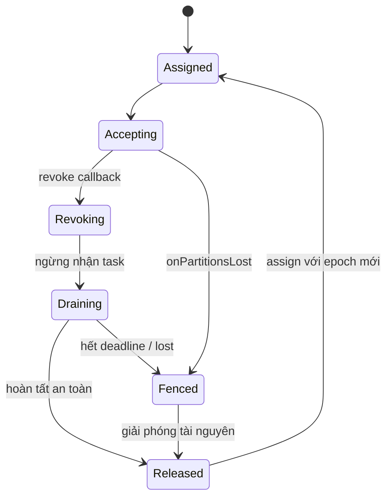

# Xử lý công việc đang chạy khi revoke trong Spring Kafka

Trong consumer group Kafka, **rebalance** là quá trình Kafka điều chỉnh quyền sở hữu partition giữa các consumer. Khi một partition bị **revoke** (thu hồi khỏi consumer hiện tại), consumer đó không còn được xem là chủ sở hữu hợp lệ để tiếp tục điều phối việc đọc và xử lý partition ấy sau thời điểm chuyển giao.

Tình huống khó nhất không phải một listener hoàn toàn rảnh, mà là **consumer vẫn có công việc đang chạy**: HTTP request chưa trả lời, database transaction chưa commit, hàng đợi tác vụ nội bộ còn record, hoặc một `CompletableFuture` đang xử lý record đã được lấy từ Kafka. Nếu chỉ đóng consumer và bỏ mặc những công việc này, ứng dụng có thể commit offset quá sớm, ghi dữ liệu trùng, vi phạm thứ tự theo partition hoặc để một worker cũ tiếp tục ghi sau khi partition đã chuyển sang consumer mới.

Bài học này tập trung vào cách xử lý những công việc *in-flight* khi Kafka revoke partition trong Spring Kafka: nhận biết callback, đóng cổng nhận việc, chờ có giới hạn (*bounded drain*), hủy có kiểm soát, bảo vệ offset, xử lý khi mất quyền sở hữu và thiết kế idempotency/fencing cho tác dụng phụ ngoài Kafka.

**Nguyên tắc quan trọng:** revoke không có nghĩa công việc Java đang chạy lập tức bị hủy, và callback revoke không phải cơ chế bảo đảm có thể dừng an toàn mọi công việc đang xử lý. Thiết kế phải chịu được cả trường hợp **không kịp drain** và **không nhận được callback trước khi consumer mất quyền sở hữu**.

## 1. Revoke xảy ra khi nào?

Kafka phân chia các partition của một consumer group cho các thành viên đang hoạt động. Assignment có thể thay đổi khi:

- Một instance mới tham gia hoặc một instance rời group.
- Một consumer không còn poll kịp, mất heartbeat hoặc bị loại khỏi group.
- Container restart, ứng dụng rolling deploy hoặc được scale.
- Topic thay đổi số partition, subscription thay đổi hoặc metadata được cập nhật.
- Consumer client/broker kích hoạt rebalance theo giao thức và assignor đang dùng.

Ví dụ topic `orders.events` có bốn partition:

```text
Trước rebalance:
  Consumer A --> partitions 0, 1
  Consumer B --> partitions 2, 3

Sau rebalance:
  Consumer A --> partition 0
  Consumer B --> partitions 2, 3
  Consumer C --> partition 1
```

Partition 1 được revoke khỏi Consumer A rồi có thể được assigned cho Consumer C. Tại thời điểm đó, nếu A còn xử lý một record của partition 1 bằng background thread, A và C có thể cùng gây side effect lên cùng business entity.

Không giả định suffix của `client.id`, thứ tự consumer hoặc tên pod gắn cố định với partition. Assignment là trạng thái động.

## 2. Vì sao công việc đang chạy là vấn đề lớn?

Xét record `orders.events-1@500` được Consumer A xử lý:

```text
T0  A poll record partition=1, offset=500
T1  A gửi task xử lý vào executor
T2  Listener trả về (task vẫn đang chạy)
T3  Consumer group rebalance: partition 1 bị revoke khỏi A
T4  Partition 1 được assign cho Consumer C
T5  C đọc lại offset=500 (nếu offset chưa được commit)
T6  Task cũ của A hoàn thành và ghi database
T7  Task mới của C cũng hoàn thành và ghi database
```

Một event có thể được áp dụng hai lần. Nếu A đã ack/commit offset ngay ở T2, tình huống còn nguy hiểm hơn: khi task lỗi sau T3, C có thể bắt đầu từ offset 501 và **không bao giờ xử lý lại offset 500** theo luồng tiêu chuẩn.

Có ba bất biến cần bảo vệ:

1. **Không xác nhận record chưa hoàn tất:** offset được commit phải phản ánh tiến độ đã xử lý hoặc đã recovery thành công.
2. **Không để owner cũ ghi không được kiểm soát:** tác vụ đã chạy trước revoke phải có khả năng bị chặn, dừng hoặc thực thi idempotent/fenced.
3. **Không làm mất khả năng phục hồi:** record chưa hoàn tất phải có thể được redeliver hoặc nằm trong nơi lưu bền vững có quy trình recovery.

“Drain tất cả trước khi revoke” là mong muốn tốt nhưng không phải lúc nào cũng khả thi. Do vậy thiết kế phải đúng cả khi drain bị gián đoạn.

## 3. Revoke, lost và assigned khác nhau như thế nào?

Các callback rebalance phản ánh những trạng thái khác nhau:

| Sự kiện | Ý nghĩa vận hành | Hành động thích hợp |
|---|---|---|
| Assigned | Consumer được giao một số partition | Tạo context/epoch mới, khởi tạo state, cho phép xử lý |
| Revoked | Consumer chuẩn bị nhường một số partition theo rebalance bình thường | Ngừng nhận việc mới, drain ngắn, chốt tiến độ an toàn, bàn giao |
| Lost | Consumer đã mất quyền sở hữu partition, thường do tình huống bất thường | Fencing/cancel ngay; không giả định còn quyền commit hoặc seek |
| Shutdown | Container đóng do lệnh dừng hoặc ứng dụng thoát | Dừng intake, hoàn tất có giới hạn, giải phóng tài nguyên |

Trong Kafka client, `ConsumerRebalanceListener` có các callback như `onPartitionsRevoked`, `onPartitionsAssigned` và `onPartitionsLost`. Spring Kafka có `ConsumerAwareRebalanceListener`, cung cấp callback nhận thêm Kafka `Consumer` để tích hợp với listener container.

**Khác biệt then chốt:** callback `onPartitionsLost` cho biết quyền sở hữu đã mất; không nên xem nó là cơ hội commit offset cuối cùng như một revoke bình thường. Nếu ứng dụng chỉ xử lý `onPartitionsRevoked` mà bỏ qua lost và restart/crash, thiết kế vẫn có lỗ hổng.

### 3.1. Eager và cooperative rebalance

Với **eager rebalance**, một lần rebalance có thể revoke toàn bộ assignment trước khi phân lại.

Với **cooperative rebalance** (ví dụ `CooperativeStickyAssignor`), chỉ những partition cần chuyển chủ mới bị revoke trong từng giai đoạn. Một consumer có thể vẫn tiếp tục sở hữu các partition khác.

Hệ quả: **chỉ drain/cancel đúng những partition được callback báo revoke**. Dừng toàn bộ service mỗi khi một partition bị revoke sẽ gây gián đoạn không cần thiết cho partition vẫn được sở hữu.

Với cooperative rebalance, quá trình chuyển assignment có thể gồm nhiều vòng; không nên giả định một callback duy nhất luôn hoàn thành toàn bộ việc sắp xếp lại partition.

## 4. Callback của Spring Kafka

Đối với listener container, có thể cấu hình rebalance listener qua `ContainerProperties`:

```java
factory.getContainerProperties()
       .setConsumerRebalanceListener(rebalanceListener);
```

`ConsumerAwareRebalanceListener` có các điểm tích hợp hữu ích:

- `onPartitionsRevokedBeforeCommit(...)`: được Spring Kafka gọi trước giai đoạn xử lý commit pending offsets trong đường revoke thông thường.
- `onPartitionsRevokedAfterCommit(...)`: được gọi sau giai đoạn commit tương ứng của container trong đường revoke.
- `onPartitionsAssigned(...)`: được gọi khi container có assignment mới.
- `onPartitionsLost(...)`: xử lý tình huống đã mất quyền sở hữu, với API/cách dispatch tùy phiên bản.

Mục đích của các callback *BeforeCommit* và *AfterCommit* không phải tự động đảm bảo task bất đồng bộ đã hoàn tất. Nếu listener đã trả về trong khi work vẫn chạy, container **không thể tự biết** trạng thái nghiệp vụ thực tế của task đó.

### 4.1. Ví dụ đăng ký callback

Ví dụ dưới đây minh họa cổng trạng thái theo partition. `PartitionWorkCoordinator` là abstraction của ứng dụng, không phải một class Spring Kafka có sẵn.

```java
@Configuration
public class RebalanceConfiguration {

    @Bean
    public ConcurrentKafkaListenerContainerFactory<String, OrderEvent>
            ordersListenerFactory(
                    ConsumerFactory<String, OrderEvent> consumerFactory,
                    PartitionWorkCoordinator coordinator) {

        var factory =
                new ConcurrentKafkaListenerContainerFactory<String, OrderEvent>();

        factory.setConsumerFactory(consumerFactory);
        factory.setConcurrency(3);

        factory.getContainerProperties().setConsumerRebalanceListener(
                new ConsumerAwareRebalanceListener() {

                    @Override
                    public void onPartitionsAssigned(
                            Consumer<?, ?> consumer,
                            Collection<TopicPartition> partitions) {
                        coordinator.onAssigned(partitions);
                    }

                    @Override
                    public void onPartitionsRevokedBeforeCommit(
                            Consumer<?, ?> consumer,
                            Collection<TopicPartition> partitions) {
                        coordinator.stopAccepting(partitions);
                        coordinator.requestDrain(partitions);
                    }

                    @Override
                    public void onPartitionsRevokedAfterCommit(
                            Consumer<?, ?> consumer,
                            Collection<TopicPartition> partitions) {
                        coordinator.detach(partitions);
                    }

                    @Override
                    public void onPartitionsLost(
                            Consumer<?, ?> consumer,
                            Collection<TopicPartition> partitions) {
                        coordinator.markLostAndFence(partitions);
                    }
                }
        );

        return factory;
    }
}
```

Ví dụ trình bày vị trí callback. `PartitionWorkCoordinator` cần được triển khai phù hợp với chính sách completion, ownership và commit của ứng dụng; chỉ gọi các method với tên gợi ý **không tự tạo ra bảo đảm xử lý an toàn**. Kiểm tra chính xác chữ ký và dispatch của callbacks trong Spring Kafka version đang dùng.

**Không đặt logic I/O nặng, `Thread.sleep()` dài hoặc chờ future vô thời hạn ngay trong callback.** Những callback này là một phần của tiến trình rebalance/poll, chặn quá lâu có thể làm việc chuyển giao bị trễ và kéo theo các lỗi liveness.

## 5. Sự thật về thread của Kafka listener

Một Kafka `Consumer` không phải đối tượng thread-safe. Các thao tác như `poll()`, `commitSync()`, `seek()` và thao tác trực tiếp với assignment cần được thực hiện trong ngữ cảnh thread phù hợp.

Trong Spring Kafka **record listener đồng bộ**, container thường gọi listener trên consumer thread. Nếu listener xử lý database/HTTP đồng bộ rồi mới trả về, consumer thread chỉ tiếp tục vòng poll sau khi method kết thúc. Trong mô hình này, không có background task “bay ra ngoài” lifetime của listener nếu code không tự tạo.

Điều đó cũng có giới hạn:

- Nếu listener chạy quá lâu, consumer có nguy cơ vượt `max.poll.interval.ms` và mất assignment.
- Callback revoke thường chạy khi consumer tiến đến bước xử lý rebalance trong vòng poll, không phải một interrupt chắc chắn vào giữa Java method.
- Có thể xảy ra tình huống consumer đã mất quyền sở hữu trong lúc code vẫn đang chạy vì xử lý quá lâu.
- Exception từ listener cần được truyền cho error handler hoặc container-managed transaction thay vì bị nuốt.

### 5.1. Với listener bất đồng bộ

Nếu listener chỉ đưa record vào `ExecutorService` rồi trả về:

```java
@KafkaListener(topics = "orders.events")
public void onRecord(ConsumerRecord<String, OrderEvent> record) {
    executor.submit(() -> orderService.apply(record.value()));
    // Listener trả về khi task chưa hoàn thành.
}
```

Code này **không an toàn làm mẫu mặc định**. Theo AckMode và cấu hình container, offset có thể được xác nhận trong khi task còn pending. Khi task thất bại, `DefaultErrorHandler` cũng không nhận được exception đã xảy ra ở thread khác nếu ứng dụng không đưa failure quay lại luồng xử lý.

Nếu cần async processing, phải thiết kế tường minh:

1. Cơ chế stop-intake theo partition.
2. State từng record hoặc từng partition.
3. Cơ chế xác nhận **sau** khi xử lý thành công.
4. Quy tắc commit chỉ cho dãy offset đã hoàn tất liên tiếp.
5. Quy trình xử lý task đang chạy khi partition lost/revoke.
6. Idempotency/fencing đối với external side effects.
7. Giới hạn queue, timeout và backpressure.

Trong nhiều hệ thống, **giữ listener đồng bộ với concurrency phù hợp** đơn giản và đáng tin cậy hơn việc tự quản lý hàng đợi bất đồng bộ.

## 6. Phân loại công việc in-flight trước khi quyết định hành động

Khi revoke xảy ra, “công việc đang chạy” có thể nằm ở nhiều trạng thái:

| Trạng thái | Có thể chốt/ack ngay? | Cách xử lý ưu tiên |
|---|---|---|
| Chưa dispatch khỏi consumer thread | Không | Ngừng dispatch, để container xử lý redelivery |
| Đang nằm trong queue, chưa bắt đầu | Không | Bỏ khỏi queue hoặc chuyển vào durable queue có checkpoint |
| Đang xử lý CPU, chưa có side effect | Không | Hủy hợp tác hoặc cho chạy xong nếu đủ thời gian |
| Đang gọi HTTP/DB chưa xác định kết quả | Không | Timeout/cancel, idempotency key, reconcile khi outcome không chắc chắn |
| DB transaction đã commit, offset chưa commit | Không thể coi Kafka đã ack | Chấp nhận redelivery, DB phải idempotent |
| Nghiệp vụ thành công, đã được container ack/commit hợp lệ | Có thể xem đã hoàn tất theo policy | Giải phóng state, nhưng vẫn chịu được replay thủ công |
| Đã publish DLT/recovery thành công | Theo commit policy của error handler | Theo dõi offset và khả năng DLT duplicate |

Không đánh đồng “task `Future.isDone()`” với “đã commit database thành công” hoặc “đã xác nhận Kafka offset”. Future có thể hoàn tất do lỗi, cancellation hoặc timeout.

## 7. Các chiến lược xử lý khi partition bị revoke

Có ba hướng chính, có thể kết hợp tùy workload.

### 7.1. Drain có giới hạn

**Drain** nghĩa là ngừng nhận việc mới và chờ những task đang chạy hoàn tất trong một khoảng thời gian xác định.

Phù hợp khi:

- Phần lớn tác vụ kết thúc nhanh.
- Việc kết thúc giữa chừng có chi phí cao.
- Callback còn đủ ngân sách thời gian và không gây block rebalance lâu.
- Ứng dụng có thể biết chắc task nào đã hoàn tất.

Phải giới hạn thời gian chờ. Nếu deadline hết, các task còn pending phải chuyển sang trạng thái chưa được xác nhận và có cách xử lý khi worker cũ vẫn tiếp tục.

### 7.2. Cancel/cooperative cancellation

Ứng dụng báo cho task rằng partition không còn thuộc quyền sở hữu của instance hiện tại.

Ví dụ task kiểm tra một `CancellationToken` giữa các bước:

```text
before DB call       -> check token
after dependency call -> check token
before next write    -> check token
before publish       -> check token
```

Dùng `Future.cancel(true)` hoặc interrupt chỉ là **yêu cầu** hủy. HTTP client, JDBC driver hoặc library có thể không dừng ngay; một tác dụng phụ đã được thực hiện không thể “undo” chỉ vì thread bị interrupt.

Vì vậy cancellation phải đi cùng timeout và idempotency. Với side effect có giá trị cao, cần cơ chế fencing thực sự ở hệ thống ghi.

### 7.3. Persist/hand off

Thay vì giữ việc xử lý lâu trong consumer thread, có thể chuyển ý định xử lý vào một store bền vững trong database:

```text
Kafka event
    |
    v
JDBC transaction:
  - Insert inbox/work item (unique event ID)
  - Commit
    |
    v
Container mới có thể ack input
    |
    v
Worker xử lý work item từ DB queue
```

Trong mô hình này, “đã xử lý Kafka event” mang nghĩa **đã lưu bền vững ý định xử lý**, không phải business side effect đã hoàn tất. Cần bảo đảm quy trình worker, retry và reconciliation đúng với contract nghiệp vụ.

Nếu phải bảo toàn thứ tự theo partition, durable queue phải lưu sequence/offset và không thực thi công việc vượt quá ordering policy.

## 8. Một giao thức revoke an toàn theo partition

Với ứng dụng dùng queue hoặc worker pool ngoài listener, nên thiết kế **state machine** theo từng `TopicPartition`.



Các trạng thái mang ý nghĩa:

- **Assigned/Accepting:** instance đang có quyền nhận record cho partition.
- **Revoking:** ngăn dispatch task mới và đánh dấu task đang chạy.
- **Draining:** thử hoàn tất công việc trong deadline.
- **Fenced:** task cũ không được phép tạo side effect mới theo chính sách ownership.
- **Released:** đã bỏ metadata/lease/tài nguyên cũ, chờ assignment mới.
- **Assigned lại:** tạo context ownership mới, không tái sử dụng token của lần assignment cũ.

Một trình tự triển khai điển hình:

1. Nhận danh sách partition bị revoke.
2. Với **từng partition**, khóa cổng nhận việc/đánh dấu `revoking`.
3. Dừng dispatch record mới vào queue partition tương ứng.
4. Chụp danh sách task in-flight và offset liên quan.
5. Gửi tín hiệu cancellation nếu nhiệm vụ cần dừng.
6. Chờ completion trong **deadline giới hạn** nếu mô hình cho phép.
7. Xác định dãy offset đã hoàn tất liên tiếp; không tính record pending.
8. Để container commit theo quy tắc ack/transaction tương ứng; không commit offset chưa hoàn tất.
9. Mark lost/released và bỏ ownership token cũ.
10. Khi assignment mới đến, tạo generation/epoch mới và cho phép xử lý theo tiến độ committed.

Nếu callback kết thúc khi còn task đang chạy, các task đó **không được tiếp tục ghi vô điều kiện** như thể partition vẫn thuộc về consumer cũ. Chúng phải được fencing/idempotent hoặc được phép hoàn tất theo mô hình bền vững không phụ thuộc quyền sở hữu partition.

## 9. Ví dụ coordinator theo partition

Một coordinator có thể lưu state in-memory để điều phối intake và cancellation, đồng thời phát token ownership cho task. Đây là **mô hình xây dựng**, không tự thay thế cơ chế xác nhận Kafka offset.

```java
public final class PartitionWorkCoordinator {

    private final ConcurrentMap<TopicPartition, PartitionState> states =
            new ConcurrentHashMap<>();

    public void onAssigned(Collection<TopicPartition> partitions) {
        for (TopicPartition partition : partitions) {
            states.compute(partition, (tp, previous) -> {
                long nextEpoch =
                        previous == null ? 1L : previous.epoch() + 1L;
                return new PartitionState(nextEpoch, true, false);
            });
        }
    }

    public void stopAccepting(Collection<TopicPartition> partitions) {
        for (TopicPartition partition : partitions) {
            states.computeIfPresent(partition, (tp, old) ->
                    new PartitionState(old.epoch(), false, old.lost())
            );
        }
    }

    public void markLostAndFence(Collection<TopicPartition> partitions) {
        for (TopicPartition partition : partitions) {
            states.computeIfPresent(partition, (tp, old) ->
                    new PartitionState(old.epoch(), false, true)
            );
        }
    }

    public boolean canStart(
            TopicPartition partition,
            long expectedEpoch) {
        PartitionState state = states.get(partition);
        return state != null
                && state.accepting()
                && !state.lost()
                && state.epoch() == expectedEpoch;
    }

    public void detach(Collection<TopicPartition> partitions) {
        for (TopicPartition partition : partitions) {
            states.computeIfPresent(partition, (tp, old) ->
                    new PartitionState(old.epoch(), false, true)
            );
        }
    }

    public void requestDrain(Collection<TopicPartition> partitions) {
        // Phát tín hiệu tới các worker thuộc partitions.
        // Không đợi vô thời hạn trong rebalance callback.
    }

    private record PartitionState(
            long epoch,
            boolean accepting,
            boolean lost) {}
}
```

Đoạn code minh họa state gate; Java `record` yêu cầu JDK phù hợp. Với các hệ thống dùng Java cũ, có thể thay bằng class thông thường.

**Giới hạn quan trọng:** epoch được tăng trong map của JVM **không phải** distributed fencing token. Sau restart, `states` bị mất. `canStart()` giúp worker hợp tác dừng nhận việc, nhưng vẫn có race giữa lúc kiểm tra và lúc side effect được commit. Muốn chặn ghi từ owner cũ giữa nhiều instance, cần fencing tại dependency/store nhận ghi.

Ngoài ra, trạng thái in-memory có thể bị thay thế khi partition assign lại. Task cũ phải giữ `expectedEpoch` của chính lần assignment tạo ra nó; không được mỗi lần lại đọc epoch mới rồi tự coi mình hợp lệ.

### 9.1. Theo dõi task và deadline

Trong implementation thực tế, cần có bảng theo dõi tối thiểu:

```text
TopicPartition -> assignment epoch
               -> accepting/revoking/lost
               -> queue size
               -> in-flight tasks
               -> offsets started/completed
               -> cancellation token
               -> drain deadline
               -> last contiguous completed offset
```

Hãy giới hạn số task theo partition để tránh một partition quá tải chiếm toàn bộ memory hoặc executor threads.

## 10. Offset commit: chỉ xác nhận dãy liên tiếp đã hoàn tất

Kafka commit offset theo **partition**. Nếu commit vị trí `N`, consumer group thường sẽ tiếp tục từ record có offset `N`; các offset nhỏ hơn `N` được xem là đã đi qua theo tiến độ của group.

Giả sử consumer nhận ba record cùng partition:

```text
offset 100 --> task A hoàn tất
offset 101 --> task B đang chạy
offset 102 --> task C hoàn tất
```

**Không được commit offset 103** chỉ vì task C hoàn tất. Làm như vậy có thể khiến task B ở offset 101 bị bỏ qua sau crash.

Progress an toàn (nếu trước đó đã xử lý xong đến offset 99) mới là:

```text
offset 100 completed  => commit position tối đa 101
offset 101 pending    => không thể vượt position 101
offset 102 completed  => vẫn không thể vượt position 101
```

Sau khi task B hoàn tất, mới có thể đưa commit position lên 103, nếu tất cả offset liên quan đã có kết quả được policy coi là hoàn tất.

| Record | Trạng thái | Có thể nâng vị trí commit tới 103? |
|---|---|---|
| 100 | Success | Chưa |
| 101 | Running | **Không** |
| 102 | Success | **Không** |
| 101 | Success/recovered sau đó | Có thể, tùy toàn bộ tiến độ |

Đây là lý do asynchronous processing + manual acknowledgement khó hơn nhiều so với synchronous listener.

### 10.1. Manual acknowledgement không tự giải quyết out-of-order

Spring Kafka có các AckMode như `MANUAL` và `MANUAL_IMMEDIATE`, cùng hỗ trợ `asyncAcks` trong một số phiên bản. Tuy nhiên, không được suy ra rằng gọi `acknowledge()` từ một background thread **sau revoke** là luôn an toàn.

Các yếu tố phải hiểu:

- Thứ tự acknowledgements theo từng partition.
- Container có đang giữ các offsets chưa ack của một poll không.
- Có cơ chế defer commit nếu acks out-of-order hay không.
- Consumer còn sở hữu partition hay đã lost.
- Callback ack có còn nằm trong container/generation hợp lệ không.
- Điều kiện restart, rebalance và duplicate delivery.

`asyncAcks` không thay thế idempotency. Nó có thể giúp container xử lý acks ngoài thứ tự trong những điều kiện nhất định, nhưng cũng thay đổi quy trình pause/resume và có thể tăng redelivery khi lỗi.

### 10.2. Không dùng consumer.commitSync từ worker thread

Kafka `Consumer` không thread-safe. Background task không nên giữ tham chiếu `Consumer` rồi tự gọi `commitSync()`, `seek()` hoặc `poll()` để “chốt offset trước khi mất partition”.

Để Spring Kafka container xử lý commit theo AckMode hoặc transaction policy là cách ít rủi ro hơn. Nếu phải tự quản lý commit ở consumer thread, cần thiết kế một luồng giao tiếp thread-safe để container biết chính xác dãy offset đã hoàn tất; không tự commit qua mọi thread.

## 11. Cách đơn giản nhất: xử lý đồng bộ và idempotent

Với đa số workload không cần xử lý một record trong nhiều phút, một listener đồng bộ thường dễ vận hành hơn worker pool tự tạo.

```java
@Component
public class OrderEventListener {

    private final OrderProjectionService projectionService;

    public OrderEventListener(OrderProjectionService projectionService) {
        this.projectionService = projectionService;
    }

    @KafkaListener(
        topics = "orders.events",
        groupId = "order-projection-service"
    )
    public void onOrder(ConsumerRecord<String, OrderEvent> record) {
        projectionService.applyIdempotently(
                record.key(),
                record.value()
        );
        // Chỉ trả về sau khi nghiệp vụ đã hoàn tất trong DB.
    }
}
```

Service `applyIdempotently()` nên dùng một database transaction và unique event ID hoặc version bảo vệ khỏi xử lý lặp, thay vì chỉ tính toán dựa trên key. Khi listener ném exception, container/error handler sẽ đi theo retry/recovery; không có task tách khỏi lời gọi listener để âm thầm thất bại về sau.

Đối với `AckMode.RECORD`, container có thể xác nhận tiến độ record sau khi listener thành công theo chính sách của container. Nếu DB commit xong nhưng offset chưa commit mà pod dừng, record có thể được giao lại; vì vậy idempotency vẫn cần thiết.

Ví dụ cấu hình:

```yaml
spring:
  kafka:
    consumer:
      group-id: order-projection-service
      enable-auto-commit: false
      max-poll-records: 50
      properties:
        max.poll.interval.ms: 300000
    listener:
      concurrency: 3
      ack-mode: record
```

Cấu hình ở đây chỉ là ví dụ. `max.poll.records`, concurrency và `max.poll.interval.ms` phải phù hợp với thời gian xử lý **toàn bộ các record từ một vòng poll**, không chỉ thời gian trung bình của một record.

## 12. Khi công việc thật sự phải chạy bất đồng bộ

Một số hệ thống dùng Kafka làm dispatcher cho tác vụ chạy lâu. Khi đó nên chọn một trong hai mô hình thiết kế rõ ràng.

### 12.1. Listener chờ hoàn tất trước khi trả về

Listener có thể gửi tính toán đến executor nhưng **chờ kết quả** rồi mới return:

```java
@KafkaListener(topics = "orders.events")
public void onRecord(ConsumerRecord<String, OrderEvent> record) {
    CompletableFuture<Void> task =
            CompletableFuture.runAsync(
                () -> orderService.applyIdempotently(record.value()),
                workerPool
            );

    task.orTimeout(30, TimeUnit.SECONDS).join();
}
```

Cách này vẫn giữ completion boundary trong listener: nếu task thất bại, `join()` ném exception để container/error handler xử lý. Nhưng consumer thread đang chờ và tổng thời gian poll interval phải được kiểm soát.

`orTimeout()` đánh dấu future timed out; nó **không bảo đảm** tác vụ thực tế đã bị dừng. External side effect phải idempotent và có timeout ở HTTP/JDBC layer.

### 12.2. Listener chỉ đưa task vào store bền vững

Một mô hình an toàn hơn cho tác vụ rất dài:

```java
@KafkaListener(topics = "orders.events")
public void onRecord(ConsumerRecord<String, OrderEvent> record) {
    durableWorkService.enqueueIdempotently(
        record.topic(),
        record.partition(),
        record.offset(),
        record.key(),
        record.value()
    );
}
```

`enqueueIdempotently()` phải **commit bền vững** một work item trong database trước khi listener trả về. Container có thể ack record sau đó; worker khác hoàn tất công việc dựa trên durable queue.

Với mô hình này, task không còn phụ thuộc trực tiếp vào quyền sở hữu Kafka partition sau khi enqueue. Nhưng phải thiết kế claim lease, retry, ordering và idempotency cho hệ thống worker riêng.

Tương phản, enqueue vào một `BlockingQueue` in-memory rồi return không có độ bền sau crash và có nguy cơ mất việc.

## 13. “Drain trong callback” có giới hạn thực tế

Một ý tưởng phổ biến là chờ toàn bộ task xong trong `onPartitionsRevoked`. Điều này chỉ an toàn khi thời gian chờ được giới hạn và việc đợi không ngăn chính tiến trình cần để task hoàn tất.

Các rủi ro:

- Rebalance bị chậm và ảnh hưởng consumer khác trong group.
- Callback chạy trong consumer thread; chờ một tác vụ cần consumer thread xử lý ack/commit có thể gây deadlock.
- Nhiều HTTP/database calls kéo dài hơn timeout cho phép.
- Producer/DB side effect đã hoàn tất nhưng Kafka offset chưa commit.
- Consumer đã mất ownership trước khi callback có cơ hội chạy.
- Cooperative rebalance cần chuyển **một số partition**, không nhất thiết toàn bộ.

Ví dụ pseudo-policy:

```text
on revoke(partitions):
    for each partition:
        block new tasks
        request cooperative cancellation
        deadline = now + short_grace_period

    wait only for work that can finish without consumer-thread progress

    if deadline reached:
        mark remaining tasks abandoned/fenced
        do not acknowledge unfinished offsets

    let container follow its configured offset/rebalance path
```

Đây là nguyên tắc, không phải API có sẵn đảm bảo mọi bất đồng bộ hoàn tất. Không tăng thời gian chờ revoke lên nhiều phút chỉ để né việc thiết kế idempotency.

## 14. Cơ chế fencing cho worker cũ

Một vấn đề khó: Consumer A bị revoke, Consumer B nhận partition, nhưng task của A vẫn đang chờ HTTP response. Ngay cả khi A đánh dấu `cancelled=true`, task có thể đã vượt qua điểm kiểm tra token và chuẩn bị ghi database.

Một `AtomicBoolean` trong JVM chỉ là **cooperative cancellation**, không phải distributed fencing.

### 14.1. Epoch/lease theo partition

Có thể lưu một lease/epoch tại database hoặc coordination store. Mỗi lần owner hợp lệ mới nhận lease, token được tăng đơn điệu.

```text
partition orders.events-1:
   epoch 11 --> Consumer A
   revoke / lose assignment
   epoch 12 --> Consumer B

Consumer A với epoch 11:
   DB write phải bị từ chối khi lease hiện tại là 12

Consumer B với epoch 12:
   DB write được phép nếu các điều kiện nghiệp vụ đúng
```

Fencing cần được **enforce tại nơi side effect được ghi**, ví dụ bằng transaction có row lock và điều kiện epoch, hoặc bằng service downstream chấp nhận idempotency/fencing token. Chỉ so sánh epoch ở application thread trước khi gửi lệnh ghi không loại bỏ race condition.

### 14.2. Ví dụ ý tưởng SQL

Giả sử bảng sở hữu partition:

```sql
CREATE TABLE partition_lease (
    topic           VARCHAR(255) NOT NULL,
    partition_id    INTEGER NOT NULL,
    owner_id        VARCHAR(255) NOT NULL,
    epoch           BIGINT NOT NULL,
    PRIMARY KEY(topic, partition_id)
);
```

Khi owner mới nhận partition, code điều phối tăng epoch một cách nguyên tử trong database và nhận epoch mới. Với mỗi business write, transaction phải xác minh ownership token theo chính sách khóa/đồng bộ bảo đảm owner cũ không commit sau khi owner mới giành quyền.

Pseudocode:

```text
BEGIN DB TRANSACTION
  lock/validate partition_lease row
  if current_epoch != task.epoch:
       ROLLBACK; reject stale worker
  perform business update idempotently
COMMIT
```

Đây là **mẫu thiết kế cần triển khai và kiểm thử**, không phải nguyên tắc Kafka tự cung cấp cho mọi external database.

### 14.3. Epoch ứng dụng khác Kafka group generation

Kafka có thông tin thế hệ group và metadata consumer, nhưng không nên dùng bừa một số `generationId` hoặc Java counter như distributed fencing token mà chưa xét restart, chuyển ownership, cùng group trên nhiều instance và race giữa hai tài nguyên.

Hệ thống ghi side effect cần kiểm soát chính nó: business event ID, unique constraint và/hoặc lease epoch được bảo toàn qua process restart.

## 15. Exactly-once của Kafka không xóa công việc cũ

Khi listener container dùng Kafka transaction, produced Kafka records và consumed offsets có thể commit nguyên tử trong phạm vi giao dịch Kafka. Nếu transaction abort, downstream `read_committed` không nhìn thấy những Kafka outputs đã abort.

Tuy nhiên:

- Listener có thể đã xử lý record trước khi abort.
- Database/API/email nằm ngoài Kafka transaction có thể đã hoàn tất.
- Task bất đồng bộ tạo ra ngoài vòng đời transaction có thể vẫn chạy sau revoke.
- Nếu code mở `KafkaTemplate.executeInTransaction()` local riêng trong listener, nó không tự đưa consumer offset của listener vào giao dịch cục bộ ấy.

Vì vậy không thể dùng “Kafka EOS đang bật” như một lý do để bỏ fencing và idempotency cho external side effects.

### 15.1. Transactional listener và rollback

Trong container transactional, khi listener ném exception, Kafka transaction có thể bị abort và after-rollback processing xử lý seek/retry theo cấu hình. Với Spring Kafka, phần `DefaultAfterRollbackProcessor` liên quan đến recovery trong đường transactional container.

Đừng xem `DefaultErrorHandler` dành cho non-transactional listener và after-rollback của transactional container như hai cấu hình có thể thay thế máy móc; cách offset/recovery cần đối chiếu đúng phiên bản.

### 15.2. Revoke trong lúc có transaction

Nếu ownership thay đổi trước khi một giao dịch hoàn tất, cần tôn trọng kết quả commit/abort của Kafka transaction và consumer group metadata. Không cố ép một task cũ gửi output hoặc commit offset chỉ vì nó đã bắt đầu khi còn được assigned.

Với Kafka-to-Kafka pipeline, để container và transaction manager kiểm soát lifecycle của producer/offset; với external side effects, áp dụng fencing/idempotency ở dependency đích.

## 16. Rebalance callback không thay thế shutdown handling

Một shutdown bình thường có thể cho ứng dụng thời gian dừng intake và hoàn tất các tác vụ, nhưng crash, kill -9, mất node hoặc mất mạng không bảo đảm có callback Java nào chạy.

Vì thế:

- Thiết kế khôi phục dựa trên **committed offset** hoặc durable work store.
- Không dựa vào một biến in-memory `inFlight` duy nhất để ghi nhớ việc còn pending.
- Có timeout cho calls bên ngoài.
- Có phương án xử lý các tác vụ đã commit external side effect nhưng chưa ack Kafka.
- Dùng idempotent consumer/inbox nếu duplicate delivery có thể xảy ra.

### 16.1. Container stop và graceful shutdown

Spring Kafka listener container có cấu hình liên quan đến shutdown timeout và cách chờ consumer thread. Với Spring Boot/ứng dụng container orchestration, cần phối hợp:

1. Chặn nhận request/job mới khi chuẩn bị shutdown.
2. Ra tín hiệu dừng listener container có kiểm soát.
3. Cho in-flight synchronous processing hoàn tất trong thời gian cho phép.
4. Đảm bảo pod termination grace period đủ cho hoạt động dừng bình thường.
5. Nếu bị kill trước deadline, rely on redelivery và idempotency.

Không đặt thời gian shutdown cực dài mà không xét yêu cầu rollout và tình trạng consumer group. Đối với async workers, dừng container và dừng executor là hai vấn đề riêng, cần phối hợp ownership và cancellation.

## 17. Pause, resume và backpressure

Nếu một partition có quá nhiều công việc in-flight, **pause việc nhận thêm record** trước khi queue quá tải có thể hữu ích.

Spring Kafka container có API pause/resume hoặc pausePartition/resumePartition trong các phiên bản hỗ trợ. Cách này cho phép container điều phối việc pause consumer an toàn trong vòng poll của nó, thay vì background worker tự gọi `Consumer.pause()`.

Nhưng pause không có nghĩa relinquish ownership:

- Partition vẫn có thể thuộc assignment của consumer.
- Consumer vẫn cần poll theo yêu cầu liveness.
- Pause không commit offset.
- Pause không hủy những task đã được dispatch.
- Rebalance vẫn có thể xảy ra khi membership thay đổi.

Khi revoke/lost, không “resume để xử lý nốt” trên partition không còn thuộc quyền sở hữu của consumer. Chờ assignment mới và thiết lập state tương ứng.

Với `asyncAcks`, container có thể tự pause khi thiếu acknowledgements của một poll. Đừng gỡ pause một cách tùy tiện để tăng throughput mà phá quản lý offset.

## 18. Revoke và thứ tự xử lý theo partition

Kafka bảo đảm thứ tự record trong cùng partition ở tầng log. Ứng dụng có thể tự phá thứ tự nếu chạy nhiều tasks song song cho cùng partition.

Ví dụ:

```text
orders.events-2
  offset 100: OrderCreated
  offset 101: OrderPaid
  offset 102: OrderCancelled
```

Nếu task `OrderCancelled` xử lý xong trước `OrderPaid`, database có thể nhận trạng thái cuối sai. Khi revoke xảy ra giữa chuỗi này, rủi ro càng lớn vì consumer mới có thể đọc lại từ committed offset.

Các chiến lược phù hợp:

- Xử lý đồng bộ theo partition nếu ordering là yêu cầu chính.
- Dùng executor **một hàng đợi tuần tự trên mỗi partition**.
- Ghi aggregate version và reject stale updates.
- Theo dõi contiguous committed offset thay vì offset của task hoàn thành mới nhất.
- Trước khi bàn giao partition, xác nhận trạng thái cần thiết đã được ghi bền vững.

Concurrency ở mức nhiều partition thường đơn giản hơn concurrency nhiều record trong **một partition**.

## 19. Quan sát và cảnh báo

Để biết revoke có gây mất/đúp công việc hay không, cần ghép metrics về rebalance, in-flight và tiến độ xử lý.

| Chỉ số | Mục đích |
|---|---|
| Rebalance count/rate | Tần suất thay đổi ownership |
| Revoked partition count | Số partition phải bàn giao |
| Lost partition count | Trường hợp mất ownership bất thường |
| In-flight tasks per partition | Công việc còn chạy khi revoke |
| Drain duration p95/p99 | Thời gian chờ công việc hoàn tất |
| Drain timeout count | Số lần không thể hoàn tất trước deadline |
| Cancellation requests vs completed | Hủy hợp tác có hiệu quả không |
| Stale worker write rejected | Fencing có chặn owner cũ không |
| Duplicate/idempotency hit count | Redelivery hoặc replay ảnh hưởng nghiệp vụ thế nào |
| Consumer lag per partition | Progress có đứng yên không |
| Offset commit failures | Có lỗi chốt tiến độ không |
| DLT/recovery outcomes | Record không hoàn tất đi đâu |
| Worker queue depth/oldest age | Có backlog ngoài Kafka không |
| `max.poll.interval.ms` breach | Consumer có xử lý quá lâu không |

Không nên đặt record key, offset, event ID hoặc task ID vào metrics labels do cardinality cao. Dùng các ID này trong structured logs hoặc traces có kiểm soát.

### 19.1. Log cho từng lần chuyển ownership

Ví dụ structured log:

```json
{
  "event": "kafka_partitions_revoked",
  "service": "order-projection-service",
  "consumerInstance": "pod-a",
  "topic": "orders.events",
  "partitions": [1, 3],
  "inFlight": 7,
  "drainOutcome": "timeout",
  "drainElapsedMs": 1500
}
```

Đây là log do ứng dụng tạo ra, không phải cấu trúc mặc định của Spring Kafka. Nếu record đang chạy còn giữ business ID, lưu nó trong trace/event log riêng khi cần điều tra.

### 19.2. Tracing theo attempt

Với một event, trace có thể có nhiều attempts từ nhiều consumer instances:

```text
eventId=ORDER-42, partition=1, offset=500

Attempt 1: Consumer A
  - DB update started
  - partition revoked/lost
  - operation cancelled or fenced

Attempt 2: Consumer C
  - partition assigned
  - DB update idempotently
  - listener completed
  - offset committed
```

Đừng coi có hai attempts là lỗi mặc định. Reliability phụ thuộc việc state nghiệp vụ và offsets không sai.

## 20. Integration testing cho rebalance có in-flight work

Unit test callback không đủ để chứng minh consumer group chuyển assignment, offsets commit và lost ownership hoạt động đúng. Nên dùng Kafka thật trong integration test, ví dụ Testcontainers hoặc EmbeddedKafka, cùng database/HTTP stub có thể điều khiển thời gian.

### 20.1. Hai consumer, một task đang chờ

1. Tạo topic nhiều partition, consumer group có instance A.
2. Cho A đọc record partition 1 và bắt đầu một task được chặn bằng latch.
3. Thêm instance B vào group hoặc thay đổi membership để kích hoạt rebalance.
4. Quan sát partition nào bị revoked, partition nào vẫn assigned.
5. Xác nhận A ngừng nhận thêm việc cho partition bị revoke.
6. Cho drain hoàn tất trong deadline hoặc cố tình làm hết deadline.
7. Xác nhận record pending không bị commit quá sớm.
8. Cho B nhận partition và xử lý/recover record theo committed offset.
9. Xác nhận không mất business update; duplicate được idempotency chặn.

### 20.2. Cooperative rebalance chỉ revoke một phần

Cấu hình assignor cooperative được hỗ trợ và tạo kịch bản chuyển một partition giữa các consumer. Xác nhận coordinator chỉ stop/drain các partition được revoke; các partition vẫn sở hữu tiếp tục nhận việc theo policy.

Không viết test giả định mọi lần rebalance đều revoke toàn bộ partition.

### 20.3. Lost ownership khi không có thời gian drain

Mô phỏng consumer bị treo hoặc xử lý vượt `max.poll.interval.ms` trong môi trường test có kiểm soát. Khi assignment được chuyển sang consumer khác, xác nhận:

- Worker cũ không ghi side effect không kiểm soát.
- Commit offset từ owner cũ không được giả định hợp lệ.
- Consumer mới xử lý dựa trên committed offset.
- Business state đúng nhờ idempotency/fencing.

Test này có thể phụ thuộc timing của broker và runtime; dùng điều kiện chờ có timeout và logs để phân biệt “không nhận callback trước khi mất quyền” với “callback đã nhận nhưng task không dừng”.

### 20.4. Offset out-of-order

Gửi ba record liên tiếp trên cùng partition. Giữ task offset 101 chưa hoàn tất, cho task 100 và 102 hoàn tất. Kích hoạt revoke.

Kỳ vọng: hệ thống không commit position 103 trong khi offset 101 chưa hoàn tất. Sau redelivery và recovery, không mất record 101.

### 20.5. Rebalance khi DB commit xong nhưng chưa ack

Chèn fault sau khi DB transaction commit nhưng trước Kafka offset commit. Cho consumer mới nhận record.

Kỳ vọng: event được giao lại và idempotent update không tạo side effect thứ hai. Nếu listener còn publish Kafka output, kiểm tra transaction/outbox để không mất output do dedup sai cách.

### 20.6. Crash và shutdown

Chạy hai kịch bản riêng: graceful shutdown và process termination đột ngột. Kỳ vọng cơ chế phục hồi vẫn đúng khi không có callback Java hoàn chỉnh. Không nên xây test chỉ thành công nhờ nhận đúng thứ tự revoke callbacks.

## 21. Playbook khi production đang rebalance liên tục

Nếu nhiều partition liên tục bị revoke/lost và task in-flight tăng, có thể điều tra theo trình tự:

1. Kiểm tra consumer group membership, rebalance rate và số pod đang rollout/scale.
2. Kiểm tra `max.poll.interval.ms`, `max.poll.records`, listener processing latency và dependency timeouts.
3. Xem callback nhận đúng danh sách revoked hay có lost.
4. Quan sát queue depth, số task pending và drain deadline per partition.
5. Xác nhận worker cũ sau revoke đã bị fencing hoặc không thể gây side effect sai.
6. Xem contiguous completed offsets và committed positions; tìm dấu hiệu ack sớm.
7. Đối chiếu duplicate/idempotency hit và DB business state.
8. Kiểm tra consumer lag, recovery/DLT và các record có tuổi lớn.
9. Nếu có cooperative rebalance, bảo đảm chỉ drain những partition cần bàn giao.
10. Nếu async work quá dài, cân nhắc durable queue hoặc thay đổi kiến trúc thay vì tăng mọi timeout.

Thay đổi `session.timeout.ms` hoặc `max.poll.interval.ms` có thể giảm một số rebalance do xử lý lâu, nhưng không sửa lỗi kiến trúc “listener ack trước khi task hoàn tất”. Tăng timeout chỉ che giấu cửa sổ lỗi nếu ownership và offset chưa được quản lý đúng.

## 22. Những sai lầm thường gặp

**Chỉ implement onPartitionsRevoked mà không xét lost/crash.** Không phải lúc nào consumer cũng có cơ hội revoke sạch. Phải thiết kế cho trường hợp owner cũ mất quyền đột ngột.

**Chờ mọi task vô thời hạn trong rebalance callback.** Có thể chặn consumer thread, kéo dài rebalance và gây thêm sự cố liveness. Chỉ drain có giới hạn và có recovery khi deadline hết.

**Gọi Future.cancel(true) rồi tin task đã dừng.** Cancellation có thể không dừng database hoặc HTTP operation đang thực hiện. Dùng timeout, idempotency và fencing.

**Listener dispatch async rồi return ngay.** Container có thể ack/commit record trước khi task hoàn tất và không nhận được exception của background worker.

**Commit offset mới nhất đã hoàn thành.** Với task chạy song song, offset 102 hoàn tất không chứng minh offset 101 đã xong. Chỉ chốt dãy offset liên tiếp.

**Background worker tự gọi Kafka Consumer.commitSync().** Kafka Consumer không thread-safe. Để consumer thread/container quản lý commits.

**Xem revoke giống pause.** Pause chỉ chặn fetch có chủ đích khi còn sở hữu partition; revoke là chuyển quyền sở hữu.

**Dừng toàn bộ partitions khi cooperative rebalance chỉ revoke một partition.** Gây gián đoạn không cần thiết và tăng latency cho workload không bị ảnh hưởng.

**Dùng Java epoch làm distributed fencing.** Counter in-memory không chặn instance khác hoặc stale worker sau restart. Cần enforce ownership token tại external store.

**Tin Kafka transaction rollback cả HTTP/database.** Kafka EOS không hoàn tác side effects ngoài Kafka.

**Chỉ kiểm thử callback được gọi.** Chưa đủ; phải kiểm thử offsets, redelivery, duplicate side effects và restart.

**Ack record ngay sau enqueue vào in-memory queue.** Nếu process crash, queue biến mất và record đã commit có thể bị mất công việc. Nếu muốn ack sau enqueue, phải enqueue bền vững.

## 23. Lựa chọn chiến lược theo workload

| Workload | Cách tiếp cận thường phù hợp |
|---|---|
| Xử lý record nhanh, DB update ngắn | Listener đồng bộ + idempotency |
| CPU work vừa phải và cần kiểm soát concurrency | Concurrency theo partition; hoặc worker pool có completion boundary |
| Task nhiều phút/giờ | Durable inbox/work queue rồi ack sau khi lưu bền vững |
| Cần giữ thứ tự tuyệt đối theo partition | Một luồng tuần tự per partition và commit liên tiếp |
| Có external side effect không thể rollback | Idempotency key, fencing/reconciliation |
| Kafka-to-Kafka consume/process/produce | Transactional listener container + `read_committed` |
| Rebalance cooperative và nhiều partitions | Drain/cancel đúng tập revoked, giữ phần assignment còn lại |
| Pod thường xuyên rolling deploy | Graceful shutdown có giới hạn + crash-safe recovery |

Không có một callback hoặc flag Spring Kafka nào tự đảm bảo mọi task in-flight được chuyển giao nguyên tử giữa hai consumer instances. An toàn đến từ **ranh giới ack rõ ràng, idempotency và cơ chế lưu trạng thái bền vững**.

## 24. Checklist triển khai thực tế

Trước khi đưa một async listener vào production, cần làm rõ:

1. Record có được ack/commit trước khi nghiệp vụ hoàn tất không?
2. Khi revoke xảy ra, ứng dụng có biết task nào thuộc topic/partition nào không?
3. Có cơ chế stop-intake **chỉ trên partition bị revoke** không?
4. Có deadline drain và đường xử lý khi hết deadline không?
5. Task bị cancel có thể vẫn ghi side effect không?
6. Có distributed fencing hoặc idempotency ở dependency đích không?
7. Hệ thống có theo dõi contiguous completed offset thay vì offset hoàn tất lớn nhất không?
8. Callback lost có được xử lý khác revoke bình thường không?
9. Khi process chết không callback, record có thể được redeliver/durable work recovery không?
10. Hệ thống có bảo vệ ordering per partition không?
11. Có cơ chế pause/backpressure khi queue quá tải không?
12. Kafka Consumer API có được giới hạn đúng thread không?
13. Khi dùng Kafka transactions, consumed offsets và outputs có cùng transaction không?
14. Có metrics cho drain timeout, lost ownership, stale worker writes và duplicate processing không?
15. Test đã mô phỏng crash, rebalance và worker cũ hoàn tất trễ chưa?

### 24.1. Câu hỏi quyết định trong code review

Hãy giả sử **partition đã được Consumer B nhận, nhưng một task cũ của Consumer A bất ngờ hoàn thành**. Hệ thống có thể trả lời chính xác task cũ có được phép commit database, gửi HTTP request hoặc xác nhận Kafka offset hay không?

Nếu chưa trả lời được bằng một quy tắc được **enforce**, thiết kế còn có rủi ro khi revoke. Một nhánh `if (!revoked)` đơn giản trong memory không nhất thiết đủ để loại bỏ race.

## 25. Tài liệu tham khảo theo phiên bản

Khi triển khai, đối chiếu phiên bản Spring Kafka và Kafka client đang chạy:

- **Spring for Apache Kafka Reference — Rebalancing Listeners**: cách cấu hình `ConsumerAwareRebalanceListener` và callback trước/sau commit.
- **Spring Kafka Javadoc**: `ConsumerAwareRebalanceListener`, `ContainerProperties`, `ConcurrentMessageListenerContainer`, `KafkaMessageListenerContainer`.
- **Apache Kafka Consumer API**: `ConsumerRebalanceListener`, `onPartitionsRevoked`, `onPartitionsAssigned`, `onPartitionsLost`.
- **Spring Kafka Reference — Committing Offsets**: `AckMode`, manual acknowledgments và `asyncAcks`.
- **Spring Kafka Reference — Listener Container Lifecycle**: pause, resume, stop và shutdown behavior.
- **Spring Kafka Reference — Transactions and Exactly Once Semantics**: consume–process–produce, rollback và after-rollback processing.
- **Apache Kafka Consumer Configuration**: `max.poll.interval.ms`, group membership, assignors và `session.timeout.ms`.

Tên callback, thời điểm dispatch, chế độ cooperative rebalance, khả năng `asyncAcks`, container pause methods và cách Spring Kafka xử lý offset sau revoke có thể thay đổi theo phiên bản. Hãy kiểm tra Javadoc đúng dependency trước khi dùng callback để điều khiển commit hoặc cancellation.

**Kết luận kỹ thuật:** khi partition bị revoke, điều quan trọng không phải làm sao giữ công việc cũ chạy bằng mọi giá, mà là **không để task chưa hoàn tất được ack sớm, không để owner cũ ghi sai sau khi bàn giao và không làm mất khả năng xử lý lại**. Listener đồng bộ và idempotent là mặc định đơn giản; với async workloads cần thiết kế riêng per-partition ownership, bounded drain, contiguous offset progress và cơ chế fencing hoặc durable handoff có thể chịu được crash.
