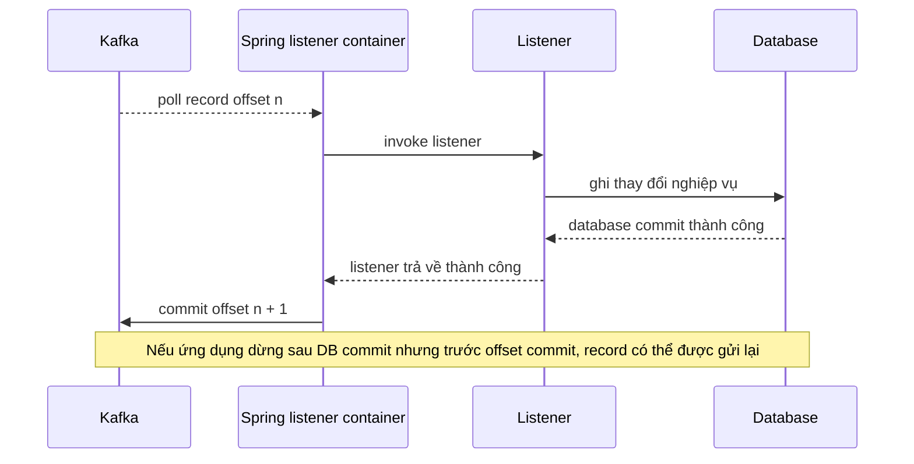
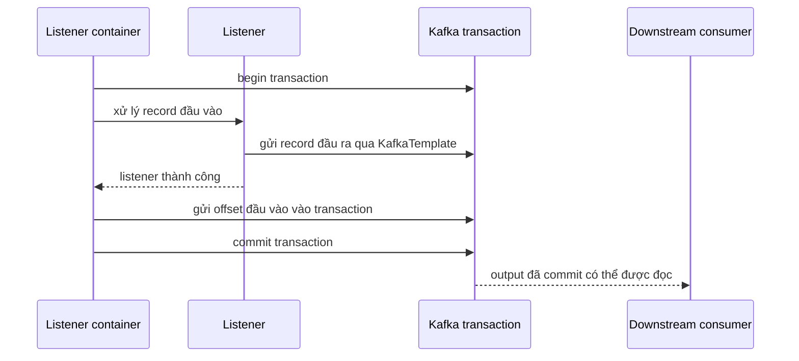

# Delivery guarantee của consumer

Trong Spring Kafka, delivery guarantee mô tả điều gì xảy ra với một record khi consumer nhận record đó, xử lý nghiệp vụ và lưu tiến độ đọc. Một consumer có thể xử lý một record không lần nào, một lần hoặc nhiều lần. Vì vậy, câu hỏi quan trọng không chỉ là Kafka có gửi record đến consumer hay không, mà còn là **offset được commit vào thời điểm nào so với lúc xử lý nghiệp vụ hoàn tất**.

Delivery guarantee là thuộc tính của toàn bộ luồng xử lý. Cấu hình consumer quyết định cách tiến độ đọc được lưu; listener và error handler quyết định cách xử lý lỗi; transaction hoặc cơ chế idempotency quyết định liệu tác động nghiệp vụ có bị lặp hay bị mất hay không.

## 1. Ba kiểu delivery guarantee

### At-most-once

Consumer commit offset trước khi thực hiện tác động nghiệp vụ. Nếu ứng dụng dừng sau khi offset đã được commit nhưng trước khi tác động nghiệp vụ hoàn tất, Kafka xem record đó là đã được tiêu thụ và không gửi lại cho consumer group. Record có thể bị mất khỏi luồng xử lý nghiệp vụ.

```text
Đọc record -> Commit offset -> Xử lý nghiệp vụ
                              ^
                              Nếu ứng dụng dừng tại đây, record không được xử lý lại
```

Kiểu này tránh việc một record được xử lý lặp do consumer restart, nhưng chấp nhận khả năng mất dữ liệu. Chỉ nên cân nhắc khi bỏ sót một số sự kiện ít quan trọng hơn việc xử lý trùng, chẳng hạn một số luồng telemetry có thể được tổng hợp lại từ nguồn khác.

### At-least-once

Consumer hoàn tất xử lý nghiệp vụ rồi mới commit offset. Nếu ứng dụng dừng sau khi nghiệp vụ đã hoàn tất nhưng trước khi Kafka ghi nhận offset mới, record sẽ được đọc lại sau khi consumer khởi động hoặc partition được giao cho consumer khác.

```text
Đọc record -> Xử lý nghiệp vụ -> Commit offset
                    ^                 ^
                    |                 |
                    +-- Nếu dừng sau khi xử lý nhưng trước commit,
                        record có thể được gửi lại
```

At-least-once tránh việc đánh dấu một record là hoàn tất trước khi listener xử lý xong. Đổi lại, listener có thể nhận cùng một record nhiều lần. Đây là lựa chọn phổ biến cho consumer cần tránh mất sự kiện, với điều kiện tác động nghiệp vụ có thể được thực hiện idempotent.

### Exactly-once

Exactly-once có nghĩa là một kết quả đã commit chỉ xuất hiện một lần trong phạm vi mà cơ chế exactly-once bảo vệ. Với Spring Kafka, Kafka transactions có thể phối hợp việc ghi record đầu ra và commit offset của record đầu vào trong cùng một transaction Kafka.

Nếu transaction thành công, record đầu ra và offset đầu vào cùng được commit. Nếu transaction thất bại, cả hai cùng bị abort: consumer có thể đọc lại record đầu vào, nhưng consumer downstream dùng `read_committed` sẽ không nhìn thấy record đầu ra thuộc transaction đã abort.

Exactly-once trong Kafka **không đồng nghĩa listener chỉ được gọi đúng một lần**. Listener vẫn có thể chạy lại sau rollback hoặc restart. Cơ chế này bảo đảm kết quả Kafka đã commit nhất quán trong phạm vi transaction; nó không tự động bao phủ database, HTTP API, email hay hệ thống bên ngoài Kafka.

## 2. Offset quyết định thời điểm consumer tiếp tục đọc

Kafka lưu tiến độ theo từng consumer group và từng partition. Offset được commit là vị trí tiếp theo mà consumer group sẽ đọc, không phải số offset cuối cùng đã xử lý. Ví dụ, sau khi xử lý record có offset `41`, consumer thường commit `42`.

```text
Partition 2:  ... 40 | 41 | 42 | 43 | 44 ...
                    ^    ^
                 record 41  offset commit = 42
                              record tiếp theo sẽ đọc
```

Khi consumer khởi động lại với cùng `group.id`, Kafka dùng committed offset để tiếp tục. Nếu chưa có offset hợp lệ, `auto.offset.reset` quyết định vị trí bắt đầu, chẳng hạn `earliest` hoặc `latest`. Thuộc tính này chỉ quyết định vị trí khởi đầu khi thiếu offset; nó không tự tạo ra at-most-once, at-least-once hay exactly-once.

Một số tình huống minh họa mối quan hệ giữa offset và nghiệp vụ:

| Thời điểm ứng dụng dừng | Offset đã commit? | Kết quả khi consumer chạy lại |
|---|---:|---|
| Trước khi listener xử lý record | Không | Record được đọc lại |
| Trong lúc listener đang xử lý | Không | Record thường được đọc lại; tác động một phần cần được xử lý an toàn |
| Sau khi database commit, trước khi offset commit | Không | Record được đọc lại; database có thể nhận tác động trùng |
| Sau khi offset commit | Có | Consumer tiếp tục từ offset kế tiếp |

Kafka chỉ quản lý offset của consumer group. Kafka không biết một câu lệnh SQL đã commit hay một HTTP request đã tạo tác động thành công hay chưa. Khoảng thời gian giữa commit nghiệp vụ và commit offset là nguồn phổ biến gây xử lý trùng trong hệ thống at-least-once.

## 3. Spring Kafka quản lý offset như thế nào?

Với `@KafkaListener`, listener container gọi Kafka consumer để poll record, chuyển record cho listener và quản lý việc commit offset. Trong Spring Kafka từ phiên bản 2.3, nếu ứng dụng không cấu hình `enable.auto.commit`, framework đặt thuộc tính này thành `false` để container quản lý commit. Nên khai báo rõ trong cấu hình để ý định của ứng dụng dễ đọc và tránh phụ thuộc vào cấu hình được kế thừa.

```yaml
spring:
  kafka:
    consumer:
      group-id: inventory-service
      enable-auto-commit: false
    listener:
      ack-mode: record
```

`AckMode` quyết định container commit offset theo cách nào:

| AckMode | Thời điểm commit | Cách sử dụng thường gặp |
|---|---|---|
| `RECORD` | Sau khi từng record được listener xử lý thành công | Muốn commit theo từng record với record listener |
| `BATCH` | Sau khi xử lý xong các record của một lần `poll()` | Tăng hiệu quả commit khi xử lý theo batch; đây là chế độ mặc định của container |
| `TIME` | Sau khi batch được xử lý và điều kiện thời gian được đáp ứng | Giảm tần suất commit theo khoảng thời gian |
| `COUNT` | Sau khi batch được xử lý và ngưỡng số record được đáp ứng | Điều chỉnh tần suất commit theo lưu lượng |
| `COUNT_TIME` | Khi điều kiện số lượng hoặc thời gian được đáp ứng sau xử lý batch | Kết hợp hai ngưỡng commit |
| `MANUAL` | Listener gọi `acknowledge()`; container quản lý commit theo semantics tương tự batch | Listener cần chủ động xác nhận sau xử lý |
| `MANUAL_IMMEDIATE` | Commit ngay khi `acknowledge()` được gọi trên consumer thread; nếu gọi từ thread khác, yêu cầu được chuyển cho container xử lý | Cần commit ngay tại thời điểm xác nhận và kiểm soát rõ thread gọi |

`RECORD` dành cho record listener; batch listener cần chọn chế độ phù hợp với việc xử lý cả batch. Với `BATCH`, việc một record trong poll bị lỗi có thể ảnh hưởng đến tiến độ commit của batch; kết quả cụ thể còn phụ thuộc error handler và cách handler xử lý record lỗi.

### Ví dụ dùng RECORD

```java
@KafkaListener(topics = "inventory-events", groupId = "inventory-service")
public void handle(InventoryEvent event) {
    inventoryService.apply(event);
}
```

Với container dùng `AckMode.RECORD`, khi `inventoryService.apply()` hoàn tất và listener trả về bình thường, container có thể commit offset của record đó. Nếu listener ném exception, container chuyển lỗi cho error handler. Error handler quyết định retry, recover hoặc dừng xử lý; không nên giả định mọi exception đều tự động tạo ra cùng một hành vi.

Một listener chỉ nên trả về thành công khi công việc cần được bảo vệ bởi delivery guarantee đã hoàn tất. Nếu listener khởi chạy một tác vụ bất đồng bộ rồi trả về ngay, container có thể commit offset trong khi tác vụ thực tế vẫn chưa hoàn tất. Khi đó, cấu hình `RECORD` cũng không bảo vệ được công việc bất đồng bộ chưa được chờ.

## 4. Xây dựng consumer at-least-once

Với at-least-once, listener chỉ xác nhận thành công sau khi tác động nghiệp vụ đã được lưu bền vững. Nếu xử lý lỗi, exception cần được chuyển đến container để error handler thực hiện retry hoặc recovery.

```java
@KafkaListener(topics = "orders", groupId = "order-projection")
public void handle(OrderEvent event) {
    // Phương thức chỉ trả về sau khi thay đổi nghiệp vụ đã commit.
    orderProjectionService.apply(event);
}
```

Ví dụ trên phù hợp với `AckMode.RECORD` hoặc một chế độ commit khác có cùng nguyên tắc: offset chỉ tiến lên sau khi listener xử lý thành công. Nếu `apply()` ghi database, phương thức cần trả về sau khi transaction database đã commit. Nếu phương thức chỉ đưa lệnh ghi vào một hàng đợi nội bộ rồi trả về, offset có thể được commit trước khi dữ liệu thực sự an toàn.

Luồng thời gian điển hình:



### Xác nhận thủ công

Khi cần listener quyết định chính xác thời điểm xác nhận, có thể dùng `MANUAL` và nhận `Acknowledgment` trong phương thức listener:

```java
@KafkaListener(topics = "payments", groupId = "payment-service")
public void handle(PaymentEvent event, Acknowledgment acknowledgment) {
    paymentService.processAndCommit(event);
    acknowledgment.acknowledge();
}
```

Container cần được cấu hình `ContainerProperties.AckMode.MANUAL` cho listener này. `acknowledge()` chỉ được gọi sau khi `processAndCommit()` hoàn tất thành công. Với `MANUAL`, container tiếp nhận xác nhận và commit theo semantics của chế độ manual; nếu cần commit ngay trên consumer thread, hãy tìm hiểu `MANUAL_IMMEDIATE` và bảo đảm lời gọi diễn ra trên đúng thread. Không gọi acknowledge trước khi nghiệp vụ hoàn tất nếu mục tiêu là at-least-once.

## 5. Retry và Dead Letter Topic

At-least-once cần một chính sách lỗi rõ ràng. Khi listener ném exception, Spring Kafka error handler có thể thử lại record, chuyển record sang Dead Letter Topic (DLT), hoặc áp dụng hành động recovery khác. Nếu ứng dụng bắt exception rồi bỏ qua và trả về bình thường, container có thể xem record là đã xử lý thành công và commit offset. Chỉ bắt exception khi ứng dụng thực sự đã xử lý hoặc đã ghi nhận lỗi theo một quy trình có chủ đích.

Ví dụ cấu hình `DefaultErrorHandler` với ba lần retry và DLT:

```java
@Bean
DefaultErrorHandler kafkaErrorHandler(KafkaTemplate<Object, Object> template) {
    DeadLetterPublishingRecoverer recoverer =
            new DeadLetterPublishingRecoverer(template);

    return new DefaultErrorHandler(
            recoverer,
            new FixedBackOff(1_000L, 3L)
    );
}

@Bean
ConcurrentKafkaListenerContainerFactory<String, OrderEvent>
kafkaListenerContainerFactory(
        ConsumerFactory<String, OrderEvent> consumerFactory,
        DefaultErrorHandler kafkaErrorHandler) {

    var factory = new ConcurrentKafkaListenerContainerFactory<String, OrderEvent>();
    factory.setConsumerFactory(consumerFactory);
    factory.setCommonErrorHandler(kafkaErrorHandler);
    factory.getContainerProperties().setAckMode(ContainerProperties.AckMode.RECORD);
    return factory;
}
```

Ví dụ sử dụng API `DefaultErrorHandler` của các phiên bản Spring Kafka hiện đại (2.8 trở lên). Cần bảo đảm producer dùng để publish DLT có serializer phù hợp với cả record gốc và exception metadata. Theo resolver mặc định, record thường được chuyển tới topic có hậu tố `.DLT` và giữ partition tương ứng; topic DLT phải tồn tại và có đủ partition để nhận record. Có thể tùy chỉnh destination bằng `DeadLetterPublishingRecoverer` khi quy tắc định tuyến của hệ thống khác.

Khi recovery publish record sang DLT thành công và error handler xem record là đã recover, container có thể tiến offset qua record đó. Nếu publish DLT thất bại, lỗi recovery cần được xử lý như một lỗi thực sự để record không bị âm thầm bỏ qua. Vì vậy, DLT cũng cần được giám sát, lưu giữ đủ lâu và có quy trình điều tra hoặc phát lại. Chuyển record sang DLT là một quyết định nghiệp vụ về recovery; nó không có nghĩa tác động nghiệp vụ ban đầu đã thành công.

Retry có thể kéo dài thời gian giữ partition và ảnh hưởng đến thứ tự xử lý. Với lỗi tạm thời như timeout hoặc dịch vụ phụ trợ không sẵn sàng, retry có backoff thường phù hợp. Với lỗi dữ liệu không thể khắc phục bằng retry, DLT giúp cô lập record để các record khác tiếp tục. Cần phân biệt lỗi transient với lỗi permanent thay vì retry vô hạn mọi exception.

## 6. At-most-once và rủi ro mất record

At-most-once yêu cầu offset được commit trước khi thực hiện tác động nghiệp vụ. Với Spring Kafka, có thể chủ động xác nhận sớm bằng `MANUAL_IMMEDIATE` trên consumer thread, nhưng hành vi này phải được thiết kế có chủ đích:

```java
@KafkaListener(topics = "metrics", groupId = "metrics-aggregator")
public void handle(MetricEvent event, Acknowledgment acknowledgment) {
    acknowledgment.acknowledge(); // xác nhận trước khi xử lý nghiệp vụ
    metricsService.aggregate(event);
}
```

Container phải dùng `AckMode.MANUAL_IMMEDIATE` nếu muốn lời gọi trên consumer thread commit ngay. Nếu ứng dụng dừng sau `acknowledge()` nhưng trước `aggregate()`, record sẽ không được đọc lại theo offset đã commit. Nếu `aggregate()` thất bại, retry dựa trên offset cũng không còn bảo vệ record này.

Không nên bật `enable.auto.commit=true` rồi mặc định xem consumer là at-most-once. Auto commit có thể diễn ra độc lập với thời điểm listener hoàn tất; tùy thời điểm poll, xử lý và commit, ứng dụng có thể gặp cả mất record lẫn xử lý lặp. Container-managed acknowledgment giúp gắn commit với vòng đời xử lý của listener rõ ràng hơn.

## 7. Exactly-once với Kafka transactions

Một luồng consume-transform-produce có thể dùng Kafka transaction để commit nguyên tử record đầu ra và offset của record đầu vào. Spring Kafka hỗ trợ transaction-aware listener container. Khi listener được chạy trong Kafka transaction:

1. Container bắt đầu Kafka transaction trước khi gọi listener.
2. Listener đọc record đầu vào và có thể gửi record đầu ra bằng `KafkaTemplate` tham gia cùng transaction.
3. Khi listener hoàn tất, container gửi offset đầu vào vào transaction.
4. Kafka commit transaction để làm cho output và offset cùng có hiệu lực; nếu xử lý thất bại, transaction bị abort.



Nếu listener ném exception trước khi transaction commit, output của transaction bị abort và offset đầu vào không được commit trong transaction đó. Record đầu vào có thể được đọc lại. Consumer downstream cần đặt `isolation.level=read_committed` để chỉ đọc record thuộc transaction đã commit; consumer dùng `read_uncommitted` có thể nhìn thấy record từ transaction chưa hoàn tất hoặc đã abort.

Một cấu hình Spring Boot minh họa phần transaction producer và consumer:

```yaml
spring:
  kafka:
    producer:
      # Giá trị phải duy nhất giữa các instance chạy đồng thời.
      transaction-id-prefix: ${INSTANCE_ID:order-transformer-1}-
    consumer:
      properties:
        isolation.level: read_committed
```

Khi dùng cấu hình này, producer factory phải hỗ trợ transaction và listener container phải được cấu hình chạy trong transaction tương ứng. `KafkaTemplate` gửi output phải tham gia transaction của container; một producer không transactional hoặc một lời gọi gửi ra ngoài transaction sẽ phá vỡ bảo đảm nguyên tử. `transaction-id-prefix` cần duy nhất giữa các instance đồng thời để tránh xung đột transactional ID. Cách khai báo transaction manager và container có thể khác theo phiên bản Spring Boot/Spring Kafka và cách ứng dụng tự cấu hình factory.

Kafka producer idempotence và Kafka transactions có vai trò liên quan nhưng khác nhau. Idempotent producer ngăn việc retry gửi của cùng producer tạo ra bản ghi trùng do lỗi mạng hoặc xác nhận không rõ ràng. Transaction mở rộng bảo đảm đó để kết hợp nhiều output record và offset đầu vào trong một lần commit nguyên tử. Cả hai không loại bỏ các sự kiện nghiệp vụ trùng được tạo độc lập ở upstream.

## 8. Exactly-once không tự bao phủ database và dịch vụ bên ngoài

Giả sử listener cập nhật database rồi commit offset Kafka. Hai hệ thống này có transaction riêng:

```text
Kafka gửi record
      |
      v
Database commit thay đổi
      |
      | Ứng dụng dừng ở đây
      v
Kafka commit offset
```

Nếu ứng dụng dừng giữa hai bước, database đã thay đổi nhưng offset chưa tiến lên. Khi consumer chạy lại, record được gửi lại và database có thể nhận cùng một thay đổi lần nữa. Kafka transaction không thể tự động rollback transaction database đã commit.

### Idempotent consumer và Inbox pattern

Một cách phổ biến là gán mỗi event một `eventId` ổn định và lưu dấu đã xử lý trong cùng database transaction với thay đổi nghiệp vụ. Cột `event_id` cần có unique constraint; thao tác ghi dấu phải nguyên tử để hai lần xử lý đồng thời không cùng vượt qua bước kiểm tra.

```java
@Transactional
public void apply(OrderEvent event) {
    // insertIfAbsent phải dựa trên unique constraint và thao tác nguyên tử.
    boolean firstDelivery = processedEventRepository.insertIfAbsent(event.id());
    if (!firstDelivery) {
        return; // event đã được áp dụng trong transaction trước
    }

    orderRepository.apply(event);
}
```

Nếu database transaction rollback, cả dấu `eventId` và thay đổi nghiệp vụ cùng rollback; lần giao lại có thể thử lại. Nếu transaction commit, lần giao lại thấy `eventId` đã tồn tại và không lặp tác động. Không nên triển khai bằng hai câu lệnh `SELECT` rồi `INSERT` không có unique constraint, vì hai consumer có thể cùng kiểm tra trước khi một consumer ghi dữ liệu.

### Outbox pattern

Khi một transaction database vừa cập nhật dữ liệu nghiệp vụ vừa cần phát event Kafka, ghi trực tiếp database rồi gửi Kafka tạo ra bài toán dual-write: một hệ thống có thể commit trong khi hệ thống còn lại thất bại. Outbox pattern giải quyết bằng cách ghi thay đổi nghiệp vụ và một dòng outbox trong cùng database transaction. Một publisher riêng đọc outbox và gửi lên Kafka; publisher có thể gửi lại nếu chưa xác nhận được, vì vậy consumer vẫn nên idempotent.

Inbox thường được dùng ở phía consumer để ghi nhận event đã áp dụng. Outbox thường được dùng ở phía producer để bảo đảm thay đổi database và ý định phát event được lưu cùng nhau. Kết hợp hai mẫu giúp xây dựng luồng tin cậy giữa database và Kafka mà không giả định có một transaction phân tán tự động bao phủ cả hai.

Với HTTP API, thanh toán hoặc gửi email, cần dùng idempotency key do dịch vụ đích hỗ trợ, một bảng trạng thái bền vững hoặc quy trình workflow/saga có khả năng retry và bù trừ. Chỉ commit offset sau khi ứng dụng đã ghi nhận kết quả đủ bền vững để tiếp tục an toàn.

## 9. Poll, rebalance và thứ tự xử lý

Consumer group phân chia partition giữa các consumer member. Kafka bảo đảm thứ tự trong một partition; các partition khác nhau có thể được xử lý song song. `concurrency` của listener container tạo nhiều consumer, nhưng số consumer thực sự có thể nhận partition hữu ích bị giới hạn bởi số partition được gán cho group.

Nếu xử lý một record quá lâu và consumer không gọi `poll()` trong khoảng `max.poll.interval.ms`, Kafka có thể xem consumer không còn hoạt động và thực hiện rebalance. Partition được giao cho consumer khác; record chưa commit có thể được đọc lại. Consumer cũ cũng cần xử lý đúng trường hợp mất quyền sở hữu partition để tránh tiếp tục tạo tác động nghiệp vụ sau khi partition đã được giao nơi khác.

Một số cấu hình và thiết kế cần xem xét:

- `max.poll.records` giới hạn số record tối đa trong một lần poll. Giảm giá trị có thể giảm lượng công việc đang chờ commit, nhưng làm tăng số lần poll.
- `max.poll.interval.ms` cần đủ lớn cho thời gian xử lý dài nhất dự kiến của một poll batch, kể cả retry và các bước phụ trợ.
- `concurrency` nên phù hợp với số partition và khả năng chịu tải của database/dịch vụ phụ trợ.
- Xử lý song song bên trong listener cần bảo đảm offset chỉ được xác nhận sau khi công việc tương ứng hoàn tất. Không để tác vụ nền tiếp tục sau khi listener đã trả về thành công.
- Retry topic hoặc chuyển record sang luồng khác có thể làm thay đổi thứ tự quan sát giữa các event. Nếu thứ tự theo aggregate/key là yêu cầu nghiệp vụ, cần thiết kế retry và partitioning theo yêu cầu đó.

At-least-once kết hợp với partition ordering thường đủ cho nhiều projection hoặc consumer cập nhật trạng thái. Tuy nhiên, một lần retry dài có thể làm chậm các record phía sau cùng partition; tăng concurrency không làm một partition được xử lý đồng thời an toàn theo mặc định.

## 10. Phân biệt các cấu hình thường bị nhầm

| Cấu hình hoặc cơ chế | Vai trò | Không tự bảo đảm |
|---|---|---|
| `enable.auto.commit` | Kafka consumer tự commit offset theo lịch | Listener đã hoàn tất nghiệp vụ trước khi commit |
| `AckMode.RECORD` / `BATCH` | Container xác định thời điểm commit theo kết quả listener | Tác động database/HTTP là nguyên tử với offset |
| `Acknowledgment.acknowledge()` | Listener xác nhận record/batch theo chế độ manual | Tác động nghiệp vụ không thể bị lặp nếu xác nhận quá sớm |
| `auto.offset.reset` | Chọn vị trí đọc khi group chưa có offset hợp lệ | Delivery guarantee sau khi listener bắt đầu xử lý |
| Producer idempotence | Ngăn duplicate do retry gửi của cùng producer | Consumer không bao giờ xử lý lại một event |
| Kafka transaction | Commit nguyên tử Kafka output và offset trong transaction | Transaction database hoặc dịch vụ ngoài Kafka |
| `isolation.level=read_committed` | Chỉ trả về record thuộc transaction đã commit | Exactly-once cho side effect ngoài Kafka |

Đặc biệt, không nên suy luận rằng `AckMode.RECORD` đồng nghĩa exactly-once. Nó chỉ làm rõ thời điểm container commit offset sau khi listener trả về thành công. Nếu listener ghi database rồi ứng dụng dừng trước offset commit, record vẫn có thể được giao lại. Muốn bảo vệ database, cần idempotency hoặc một cơ chế transaction phù hợp với database.

## 11. Quan sát delivery guarantee trong vận hành

Delivery guarantee cần được quan sát qua cả trạng thái Kafka lẫn trạng thái nghiệp vụ. Các tín hiệu hữu ích gồm:

- Consumer group lag và tốc độ lag tăng/giảm theo partition.
- Số lần rebalance, thời gian xử lý listener và các lần vượt `max.poll.interval.ms`.
- Tần suất commit, độ trễ commit và lỗi commit offset.
- Số lần retry, số record được recover, tốc độ tăng của DLT và lỗi publish DLT.
- Tỷ lệ event bị phát hiện trùng bởi unique constraint hoặc inbox table.
- Thời gian từ lúc nhận record đến lúc tác động nghiệp vụ được commit.

Log cho lỗi xử lý nên có topic, partition, offset, key hoặc event ID, consumer group và nguyên nhân lỗi. Không ghi payload nhạy cảm vào log chỉ để truy vết. DLT cần có cảnh báo khi tăng bất thường và quy trình replay có kiểm soát; replay phải giữ nguyên event ID để cơ chế idempotency tiếp tục nhận diện event đã được áp dụng.

## 12. Chọn guarantee theo loại công việc

| Loại consumer | Hướng thiết kế phù hợp | Lý do |
|---|---|---|
| Metrics hoặc telemetry có thể tái tạo | Có thể cân nhắc at-most-once nếu chấp nhận mất một phần dữ liệu | Giảm chi phí xử lý trùng khi dữ liệu không phải nguồn sự thật duy nhất |
| Consumer cập nhật database hoặc trạng thái đơn hàng | At-least-once cùng inbox/idempotency | Tránh bỏ sót event và kiểm soát tác động lặp |
| Consumer biến đổi topic A thành topic B | Kafka transactions và consumer downstream `read_committed` khi cần exactly-once trong Kafka | Output và offset input được commit nguyên tử |
| Consumer gọi payment/HTTP/email provider | At-least-once cùng idempotency key hoặc workflow bền vững | Kafka không thể commit nguyên tử với dịch vụ bên ngoài |

Ví dụ, một consumer cập nhật số lượng tồn kho nên dùng at-least-once để event không bị bỏ qua. Mỗi event cần có ID ổn định; thao tác ghi nhận ID và cập nhật tồn kho phải nằm trong cùng database transaction. Nếu listener thất bại trước commit, Kafka có thể gửi lại. Nếu database đã commit nhưng offset chưa commit, lần gửi lại được nhận diện là duplicate và không trừ tồn kho lần thứ hai.

Ngược lại, một consumer chỉ đọc topic đầu vào, chuẩn hóa dữ liệu rồi ghi topic đầu ra có thể dùng Kafka transaction. Khi listener hoàn tất, Kafka commit output và offset input cùng nhau. Consumer đọc topic đầu ra cần `read_committed` để không xử lý kết quả của transaction đã abort.

Thiết kế tốt bắt đầu từ việc xác định tác động nào cần được bảo vệ, hệ thống nào là nguồn sự thật và điều gì phải xảy ra khi ứng dụng dừng ở từng bước. Sau đó mới chọn `AckMode`, retry, DLT, transaction và idempotency để bảo đảm hành vi thực tế khớp với yêu cầu nghiệp vụ.
