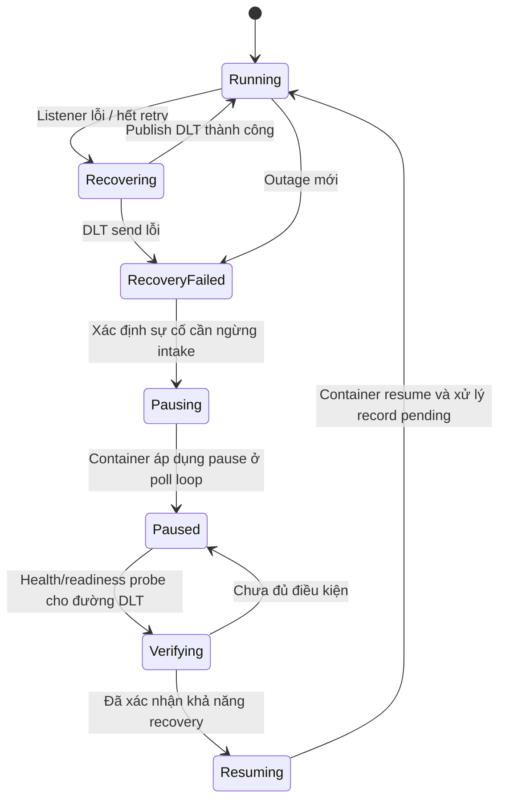

# Tạm dừng khi DLT không khả dụng trong Spring Kafka

Khi một Kafka listener không xử lý được record, hệ thống thường thử lại theo `DefaultErrorHandler` rồi dùng `DeadLetterPublishingRecoverer` để gửi record thất bại sang **dead-letter topic (DLT)**. Cách này chỉ thật sự an toàn nếu bước recovery có thể ghi được bản ghi lỗi. Nếu DLT không tồn tại, Kafka broker không sẵn sàng, producer bị từ chối quyền ghi hoặc serializer của DLT gặp lỗi, record gốc **chưa được recovery thành công**.

Trong chương *Pause và backpressure* của module *Spring Kafka Reliability Operations*, yêu cầu vận hành là **tạm dừng intake khi đường recovery bị gián đoạn**, nhưng vẫn giữ consumer có khả năng duy trì group membership, không xác nhận offset sai và có đường khôi phục rõ ràng.

Điểm cốt lõi:

> **Pause là biện pháp hạn chế tiếp nhận thêm việc, không phải một cơ chế lưu trữ dữ liệu lỗi.** Chỉ nên pause sau khi đã bảo đảm lỗi publish DLT không bị coi là recovery thành công. Khi DLT phục hồi, resume để hệ thống retry/recover record còn pending; không được tự skip offset.

Bài này giải thích các điều kiện cần, hành vi của Spring Kafka khi DLT publish thất bại, các API pause/resume, cách kết hợp retry với cơ chế phát hiện lỗi DLT, giới hạn liên quan đến rebalance và những kịch bản kiểm thử production.

## 1. DLT là một phần của đường xử lý đáng tin cậy

Giả sử consumer `orders-worker` đọc topic `orders.created`. Record tại partition 2, offset 150 không hợp lệ và không thể xử lý ở listener.

Luồng bình thường:

```text
orders.created-2@150
     |
     v
@KafkaListener
     |
     +-- Exception
             |
             v
      DefaultErrorHandler
             |
             +-- Retry theo BackOff nếu phù hợp
             |
             +-- Hết retry / lỗi không retry
                    |
                    v
       DeadLetterPublishingRecoverer
                    |
                    v
          orders.created.DLT
                    |
                    +-- Publish thành công
                    |
                    v
       Recovery được coi đã hoàn tất
                    |
                    v
       Container xử lý tiến độ offset
```

Một record vào DLT **chưa phải business success**. Đó chỉ là kết quả recovery, giúp consumer không bị kẹt vĩnh viễn và giữ dữ liệu để điều tra hoặc replay sau khi sửa nguyên nhân.

Nếu recoverer không gửi được DLT, yêu cầu thiết kế phải trả lời:

1. Liệu listener container có còn sở hữu record chưa xử lý?
2. Offset nguồn đã bị commit chưa?
3. Có đang retry publish DLT một cách quá nhanh khiến broker hoặc dependency quá tải?
4. Hệ thống có tiếp tục lấy thêm record trong khi không có nơi lưu lỗi không?
5. Ai, hoặc điều kiện nào, cho phép resume?

Khi không trả lời được những câu hỏi này, việc thêm một lệnh `pause()` đơn lẻ không đủ để bảo vệ dữ liệu.

## 2. DLT không khả dụng có nhiều nguyên nhân

Không phải mọi lỗi trong `DeadLetterPublishingRecoverer` đều chứng minh DLT đang bị outage ở phạm vi toàn hệ thống.

| Nhóm nguyên nhân | Ví dụ | Hướng xử lý thường phù hợp |
|---|---|---|
| Broker/network tạm gián đoạn | Connection/timeout, leader unavailable | Giới hạn retry, có thể pause và kiểm tra phục hồi |
| Authorization | Producer không có quyền ghi DLT | Pause/alert; sửa ACL rồi mới resume |
| DLT topic/partition không hợp lệ | Topic chưa tạo, resolver trỏ partition không tồn tại | Sửa topic hoặc resolver; tránh retry vô hạn |
| Serializer/key/value không tương thích | Raw `byte[]` nhưng DLT producer chỉ nhận domain object | Sửa cấu hình serializer; không mong broker tự phục hồi |
| Record quá lớn | Vượt `max.message.bytes` hoặc producer limits | Xử lý riêng payload/chính sách quarantine |
| Kafka producer bị fenced | Xung đột `transactional.id` | Sửa producer lifecycle và transaction configuration |
| Retry topic/DLT routing sai | Topic đích tạo sai tên hoặc partition count | Kiểm tra định tuyến và provisioning |
| Broker quota/throttling | Produce latency tăng mạnh, có timeout | Điều chỉnh tải, backoff, cảnh báo |

Một lỗi serializer chỉ ảnh hưởng một schema có thể không cần pause mọi consumer của cluster. Ngược lại, DLT broker không ghi được bất kỳ record nào có thể khiến nhiều listener cần giảm intake.

**Phân loại nguyên nhân trước khi chọn phạm vi pause.** Nếu chỉ pause dựa trên mọi `Exception` ở listener, lỗi nghiệp vụ thông thường sẽ làm ngừng dịch vụ không cần thiết.

## 3. Sơ đồ trạng thái: từ healthy đến pause rồi resume

Có thể mô hình hóa một listener container theo trạng thái vận hành:



Đây là **state machine của ứng dụng**, không phải tất cả trạng thái do Spring Kafka tự quản lý.

- `RecoveryFailed`: recoverer đã báo lỗi thật sự.
- `Pausing`: ứng dụng gửi yêu cầu pause; consumer có thể còn hoàn tất record trong poll hiện tại.
- `Paused`: container đã áp dụng pause trên consumer.
- `Verifying`: kiểm tra môi trường DLT trước khi mở lại.
- `Resuming`: tiếp tục poll/delivery; record lỗi vẫn cần đi qua retry/recovery chính xác.

Không tự chuyển trạng thái sang `Running` chỉ vì một thời gian cố định đã trôi qua. Nếu ACL, topic hoặc serializer chưa được sửa, một lần resume sẽ chỉ gây lại lỗi cũ.

## 4. Bảo vệ offset là điều kiện trước khi pause

Kafka consumer group lưu committed offset để biết vị trí đọc tiếp theo. Nếu record ở offset 150 chưa được xử lý thành công và DLT cũng chưa nhận được nó, **không được xác nhận tiến độ vượt qua record đó** chỉ nhằm làm lag giảm.

Ví dụ:

```text
Partition 2:

offset 148: xử lý thành công
offset 149: xử lý thành công
offset 150: listener lỗi, publish DLT lỗi
offset 151: chưa xử lý
offset 152: chưa xử lý

Vị trí commit an toàn trong giả định này: tối đa 150.
Không commit 151 hoặc 153 chỉ vì muốn bỏ qua record 150.
```

Sau khi DLT publish của offset 150 được xác nhận thành công theo policy, container/error handler mới có thể coi record đó đã recovery và xử lý commit position 151 theo AckMode tương ứng.

Cần phân biệt ba loại kết quả:

| Kết quả | Có nghĩa gì? | Có thể xem record nghiệp vụ đã hoàn tất? |
|---|---|---|
| Listener success | Nghiệp vụ xử lý xong | Có, theo contract và commit policy |
| Recovery success | Record lỗi đã được lưu/định tuyến theo recovery policy | Không; mới là recovery |
| Recovery failed | Chưa lưu được record lỗi | Không; phải giữ khả năng xử lý lại |

Nếu ứng dụng dùng manual acknowledgement, không gọi `acknowledge()` khi DLT publish còn thất bại. Trong transactional listener, phải dùng đường rollback/recovery tương thích transaction, không coi commit offset và publish DLT là hai hành động có thể tùy tiện độc lập.

## 5. Vì sao phải phát hiện được DLT publish failure?

`KafkaTemplate.send()` là thao tác gửi có thể trả về future trước khi broker xác nhận kết quả. Nếu recoverer chỉ khởi tạo gửi mà không kiểm tra kết quả phù hợp, lỗi producer đến muộn có thể không được diễn giải như recovery failure ở nơi cần quyết định offset.

Với những phiên bản Spring Kafka hỗ trợ, `DeadLetterPublishingRecoverer` có các cấu hình:

- `setFailIfSendResultIsError(true)`: yêu cầu recoverer báo lỗi khi kết quả gửi DLT là lỗi.
- `setWaitForSendResultTimeout(Duration)`: giới hạn thời gian chờ send result.
- Các lựa chọn khác về xác minh partition đích, headers và producer transaction tùy phiên bản.

Ví dụ:

```java
DeadLetterPublishingRecoverer recoverer =
        new DeadLetterPublishingRecoverer(dltKafkaTemplate);

recoverer.setFailIfSendResultIsError(true);
recoverer.setWaitForSendResultTimeout(
        Duration.ofSeconds(10)
);
```

Mục tiêu là **không đánh dấu recovery thành công trước khi có kết quả DLT send cần thiết**. Chọn timeout theo cấu hình Kafka producer như `delivery.timeout.ms`, `request.timeout.ms`, `max.block.ms`, môi trường broker và SLO của listener.

Chờ kết quả quá lâu ngay trong consumer thread có thể ảnh hưởng liveness. Chờ quá ngắn có thể làm hệ thống báo outage giả khi broker chỉ chậm. Cần chọn giới hạn có chủ đích và quan sát latency thực tế.

### 5.1. Publisher có thể báo lỗi ngay hoặc báo lỗi bất đồng bộ

Ví dụ producer không có serializer tương thích có thể thất bại khi chuẩn bị record, còn lỗi timeout hoặc broker authorization có thể xuất hiện khi future hoàn tất.

Do đó, chỉ kiểm tra exception trực tiếp từ lời gọi `send()` là không đủ để mô tả mọi đường thất bại. Phải hiểu chính sách xác nhận publish của recoverer trong dependency đang chạy.

### 5.2. Gửi DLT thành công rồi commit offset thất bại

Ngay cả khi DLT publish được xác nhận, consumer có thể crash hoặc commit offset nguồn thất bại trước khi tiến độ được lưu. Khi restart, record nguồn có thể được xử lý và dead-letter lại, gây **duplicate DLT**.

Vì thế, DLT consumer và replay tool phải idempotent, chẳng hạn nhận diện record bằng original topic/partition/offset hoặc business event ID ổn định.

## 6. Cấu hình DefaultErrorHandler và recoverer

Một ví dụ Spring Boot cho listener record, với DLT producer đã có khả năng serialize các kiểu key/value cần thiết:

```java
@Configuration
public class KafkaFailureConfiguration {

    @Bean
    public CommonErrorHandler commonErrorHandler(
            KafkaTemplate<Object, Object> dltKafkaTemplate) {

        DeadLetterPublishingRecoverer recoverer =
                new DeadLetterPublishingRecoverer(dltKafkaTemplate);

        recoverer.setFailIfSendResultIsError(true);
        recoverer.setWaitForSendResultTimeout(
                Duration.ofSeconds(10)
        );

        DefaultErrorHandler handler =
                new DefaultErrorHandler(
                        recoverer,
                        new FixedBackOff(1_000L, 2L)
                );

        handler.addNotRetryableExceptions(
                InvalidOrderException.class
        );

        return handler;
    }
}
```

Ý nghĩa:

1. Listener lỗi, `DefaultErrorHandler` xác định retry/recovery.
2. Với lỗi retryable, `FixedBackOff(1000,2)` cho phép tối đa hai lần retry sau lần đầu.
3. Với `InvalidOrderException`, handler có thể chuyển sang recoverer ngay theo classification.
4. Recoverer gửi record sang DLT (mặc định tên topic thêm `.DLT` và dùng partition tương ứng).
5. Nếu DLT publish không thể được xác nhận theo cấu hình, recoverer báo lỗi thay vì âm thầm coi record đã được xử lý.
6. Ứng dụng có thể phát hiện recovery failure và quyết định giới hạn intake hoặc pause.

**Cấu hình trên tự nó chưa có logic pause.** Đây là bước bảo vệ để handler biết recovery có thật sự thành công hay chưa. Phần tiếp theo mới quyết định khi nào và pause ở đâu.

### 6.1. Recovery failure khác listener failure

Một record có thể luôn bị lỗi nghiệp vụ, nhưng DLT vẫn hoạt động khỏe mạnh. Trong trường hợp đó, workflow đúng là đưa record sang DLT và tiếp tục xử lý những record khác.

Chỉ khi **recoverer không hoàn tất được công việc** mới phát sinh vấn đề đường recovery. Không nên gộp hai loại failure thành một counter rồi pause theo mọi lần `@KafkaListener` ném exception.

### 6.2. Retry sau recovery failure

`DefaultErrorHandler` có logic retry và quản lý trạng thái backoff; trong các phiên bản hiện đại có thể cấu hình `resetStateOnRecoveryFailure`.

Khi recoverer thất bại, error handler có thể reset trạng thái retry/backoff để lần delivery sau tiếp tục theo policy. Điều này giữ khả năng xử lý lại record nhưng cũng có thể khiến record lỗi bị xử lý lặp, và mỗi vòng lại thử DLT đang outage.

**Pause hoặc circuit breaker có thể giảm retry storm**, nhưng không thay thế việc để handler giữ record chưa recovery. Nếu bật pause, cần có đường resume và policy retry sau khi hạ tầng phục hồi.

## 7. Ba loại pause và ý nghĩa thực tế

### 7.1. Consumer.pause trực tiếp

Kafka client có `KafkaConsumer.pause(Collection<TopicPartition>)`. Nó yêu cầu consumer tạm không fetch thêm record từ các partition đã nêu; assignment không tự bị relinquish chỉ vì pause.

Tuy nhiên, Kafka `Consumer` không thread-safe. Không nên giữ một tham chiếu `Consumer` trong background health-check thread rồi tự gọi `pause()`, `resume()` hoặc `commitSync()`.

Trong ứng dụng Spring Kafka sử dụng listener containers, thường **ưu tiên API của container** để container điều phối pause/resume trên consumer thread.

### 7.2. Pause toàn listener container

Với một `MessageListenerContainer`:

```java
container.pause();
// ... sau khi đường DLT đã phục hồi
container.resume();
```

`pause()` là **yêu cầu** tạm dừng. Spring Kafka áp dụng việc pause vào thời điểm phù hợp trong poll loop; nó không nhất thiết dừng ngay một listener invocation đang chạy.

Container tiếp tục có thể gọi `poll()` trong lúc các assigned partitions bị pause để hỗ trợ consumer group liveness, thay vì dừng polling vô hạn. Cơ chế cụ thể phụ thuộc phiên bản/configuration.

### 7.3. Pause một partition

Trong các phiên bản Spring Kafka hỗ trợ:

```java
container.pausePartition(
        new TopicPartition("orders.created", 2)
);

// Khi đủ điều kiện tiếp tục:
container.resumePartition(
        new TopicPartition("orders.created", 2)
);
```

Pause theo partition hữu ích nếu lỗi chỉ ảnh hưởng một đường DLT hoặc một partition. Nhưng nếu DLT producer, ACL hoặc broker lỗi toàn cục, pause một partition có thể không đủ: những partition khác cũng có thể đến record lỗi và cố publish vào DLT.

### 7.4. Pause không phải stop

| Hành động | Assignment | Polling/liveness | Mục tiêu |
|---|---|---|---|
| `pause()` ở container | Thông thường vẫn giữ ownership khi group ổn định | Container vẫn duy trì poll phù hợp | Tạm ngừng delivery/fetch |
| `pausePartition()` | Giữ ownership partition khi group ổn định | Các partition khác vẫn có thể tiến | Chặn một partition cụ thể |
| `stop()` ở container | Consumer đóng/rời group | Container dừng | Dừng service/listener |
| Rebalance revoke/lost | Ownership thay đổi/mất | Phụ thuộc group lifecycle | Bàn giao partition |

Không dùng stop thay pause nếu yêu cầu là giữ listener trong group và có thể resume nhanh. Nhưng pause cũng **không ngăn** rebalance nếu instance bị loại khỏi group hoặc membership thay đổi.

## 8. Yêu cầu pause không dừng được record đang xử lý

Giả sử `max.poll.records=100`, container vừa lấy một batch record và đang dispatch đến listener. Khi monitor phát hiện DLT outage rồi gọi `pause()`, những record thuộc poll hiện tại có thể vẫn đang được container xử lý theo chế độ listener và cấu hình.

Ví dụ timeline:

```text
T0  poll() nhận 100 records
T1  Listener xử lý record đầu
T2  Lỗi nghiệp vụ -> recoverer publish DLT thất bại
T3  Đề nghị pause container
T4  Container hoàn tất những bước cần thiết của poll hiện tại
T5  Pause được áp dụng ở vòng poll thích hợp
T6  Consumer vẫn poll để duy trì liveness, không nhận batch mới
```

Spring Kafka có option `pauseImmediate` trong các phiên bản hỗ trợ để thay đổi thời điểm áp dụng pause (sau record hiện tại thay vì đợi toàn bộ record của poll), nhưng cần kiểm tra Javadoc và tác động lên các record đang giữ trong bộ nhớ trước khi sử dụng.

Bởi vậy, **không thể hứa rằng ngay sau khi gọi `pause()` sẽ không còn bất kỳ record nào được gọi listener**. Khi yêu cầu đóng intake thực sự nghiêm ngặt, thiết kế thêm bounded in-flight processing và khả năng idempotency.

## 9. Một cổng điều khiển pause/resume qua KafkaListenerEndpointRegistry

Với listener có ID ổn định:

```java
@KafkaListener(
    id = "orders-listener",
    topics = "orders.created",
    groupId = "orders-service"
)
public void consume(OrderCreated event) {
    orderService.apply(event);
}
```

Ứng dụng có thể tìm listener container theo ID qua `KafkaListenerEndpointRegistry` và gửi yêu cầu pause/resume.

```java
@Component
public class DltIntakeGate {

    private final KafkaListenerEndpointRegistry registry;
    private final AtomicBoolean pausedForDlt = new AtomicBoolean();

    public DltIntakeGate(KafkaListenerEndpointRegistry registry) {
        this.registry = registry;
    }

    public void requestPause() {
        if (!pausedForDlt.compareAndSet(false, true)) {
            return;
        }

        MessageListenerContainer container =
                registry.getListenerContainer("orders-listener");

        if (container == null) {
            pausedForDlt.set(false);
            throw new IllegalStateException(
                    "orders-listener container not found"
            );
        }

        container.pause();
    }

    public void resumeAfterVerifiedRecovery() {
        MessageListenerContainer container =
                registry.getListenerContainer("orders-listener");

        if (container == null) {
            throw new IllegalStateException(
                    "orders-listener container not found"
            );
        }

        // Gọi method này sau khi đã xác minh DLT thực sự ghi được.
        container.resume();
        pausedForDlt.set(false);
    }

    public boolean isPauseRequestedByGate() {
        return pausedForDlt.get();
    }
}
```

Cần các import tương ứng:

```java
import java.util.concurrent.atomic.AtomicBoolean;
import org.springframework.kafka.config.KafkaListenerEndpointRegistry;
import org.springframework.kafka.listener.MessageListenerContainer;
import org.springframework.stereotype.Component;
```

Đây là một **cổng điều khiển** đơn giản, không tự xác minh DLT. Phần `resumeAfterVerifiedRecovery()` chỉ nên được gọi sau khi health logic hoặc operator đã xác nhận điều kiện phục hồi.

Một `AtomicBoolean` là trạng thái trong JVM; nó không thay thế việc đọc trạng thái pause thực tế của container. Nếu instance restart, gate được khởi tạo lại. Với hệ thống nhiều pod, quyết định pause toàn service phải được đồng bộ qua metrics/alert hoặc một cơ chế điều phối phù hợp.

### 9.1. Kiểm tra pause đã được áp dụng chưa

Spring Kafka có API hoặc events liên quan trạng thái pause như `isPauseRequested()`, `isConsumerPaused()`, `ConsumerPausedEvent` và `ConsumerResumedEvent` trong các phiên bản hỗ trợ.

Nhờ đó có thể phân biệt:

- Đã **yêu cầu** pause.
- Consumer thread đã **thực sự áp dụng** pause.
- Lệnh resume đã được phát.
- Consumer đã trở lại trạng thái nhận record.

Sự phân biệt này quan trọng khi xây alert hoặc đánh giá “pause có chặn đúng intake không?”.

## 10. Phát hiện recovery failure bằng RetryListener

`DefaultErrorHandler` hỗ trợ `RetryListener` cho những sự kiện như failed delivery, successful recovery và recovery failure. Callback `recoveryFailed` giúp ứng dụng biết recoverer đã ném lỗi.

Ví dụ kết hợp error handler với `DltIntakeGate`:

```java
@Bean
public CommonErrorHandler commonErrorHandler(
        KafkaTemplate<Object, Object> dltKafkaTemplate,
        DltIntakeGate gate) {

    DeadLetterPublishingRecoverer recoverer =
            new DeadLetterPublishingRecoverer(dltKafkaTemplate);

    recoverer.setFailIfSendResultIsError(true);
    recoverer.setWaitForSendResultTimeout(
            Duration.ofSeconds(10)
    );

    DefaultErrorHandler handler =
            new DefaultErrorHandler(
                    recoverer,
                    new FixedBackOff(1_000L, 2L)
            );

    handler.setRetryListeners(new RetryListener() {
        @Override
        public void recoveryFailed(
                ConsumerRecord<?, ?> record,
                Exception original,
                Exception failure) {

            if (isDltInfrastructureFailure(failure)) {
                gate.requestPause();
            }
        }
    });

    return handler;
}
```

Hàm `isDltInfrastructureFailure` là **hàm phân loại do ứng dụng xây dựng**; Spring Kafka không tự biết lỗi nào đáng pause mọi partition. Có thể bắt đầu từ nhóm exception của Kafka producer như timeout, authorization hoặc topic metadata, rồi điều chỉnh theo policy.

Ví dụ helper kiểm tra cause chain:

```java
private static boolean isDltInfrastructureFailure(
        Throwable error) {

    Throwable current = error;

    while (current != null) {
        if (current instanceof org.apache.kafka.common.errors.TimeoutException
                || current instanceof
                       org.apache.kafka.common.errors.TopicAuthorizationException
                || current instanceof
                       org.apache.kafka.common.errors.UnknownTopicOrPartitionException) {
            return true;
        }

        current = current.getCause();
    }

    return false;
}
```

Helper này mang tính minh họa. Một lỗi `TimeoutException` cũng có thể xuất phát từ nhiều nguyên nhân, còn một outage DLT có thể biểu hiện qua exception khác. Trong production, nên kết hợp destination topic, producer metrics, lỗi gần nhất và điều kiện sức khỏe của chính DLT.

**Đặc biệt:** callback `recoveryFailed` được gọi trong đường xử lý lỗi của listener container. Chỉ thực hiện thao tác nhẹ và phát yêu cầu pause; không chạy health probe lâu, gọi REST blocking hoặc chờ toàn bộ cluster ngay trong callback.

### 10.1. Vì sao không pause ở mọi failedDelivery?

`failedDelivery` thường được gọi cho lỗi listener, nhiều lỗi có thể recovery tốt bằng retry hoặc DLT. Nếu pause ở lần failed delivery đầu tiên, một `InvalidOrderException` bình thường cũng có thể khiến toàn service ngừng xử lý.

Hãy tách:

- **Listener processing failed:** dữ liệu hoặc dependency nghiệp vụ bị lỗi.
- **Retry exhausted:** số lần xử lý lại đã hết.
- **Recovery failed:** DLT/quarantine không lưu được record.
- **Infrastructure outage confirmed:** đủ tín hiệu để giảm intake hoặc pause.

Chỉ nhóm cuối là điều kiện điển hình để pause dài hạn.

## 11. Phạm vi pause: toàn container hay từng partition?

Hãy chọn dựa trên phạm vi sự cố, không chọn tùy tiện.

| Tình huống | Pause gợi ý | Lý do |
|---|---|---|
| DLT producer của một listener không ghi được bất kỳ topic nào | Container của listener đó | Không tiếp nhận thêm record có thể cần recovery |
| Chỉ một topic DLT có ACL/topic metadata lỗi | Listener/route sử dụng DLT đó | Tránh ảnh hưởng listener không liên quan |
| Chỉ một partition đích thiếu hoặc resolver sai | Partition nguồn tương ứng nếu được hỗ trợ | Giới hạn vùng ảnh hưởng, sửa routing |
| Lỗi serializer với một event type | Phân loại và quarantine chuyên biệt hoặc pause route liên quan | Không tự coi mọi DLT đều outage |
| Kafka cluster toàn cục unavailable | Nhiều listener/producer, theo điều phối vận hành | Backpressure ở nhiều đường dữ liệu |
| Lỗi nghiệp vụ thông thường, DLT hoạt động | Không pause | Handler đã có retry/recovery |

Với một `ConcurrentMessageListenerContainer` có concurrency lớn hơn 1, pause toàn container có thể chặn các child consumers thuộc listener này. Nếu cần pause theo topic/partition, kiểm tra method hỗ trợ và assignment thực tế.

Không trực tiếp gọi `Consumer.pause()` trên mọi child từ một thread tùy ý. Sử dụng container APIs để tránh vi phạm yêu cầu thread-safety của Kafka client.

## 12. Pause và backoff không phải một cơ chế

**Backoff** quyết định khoảng chờ giữa các lần retry. **Pause** quyết định việc lấy/giao thêm record mới ở các partition hoặc container. Chúng có thể phối hợp nhưng không thay thế nhau.

Ví dụ:

```text
Record offset 150 bị lỗi
      |
      v
DefaultErrorHandler retry/backoff
      |
      v
DeadLetterPublishingRecoverer gửi DLT
      |
      +-- Success --> xử lý tiếp
      |
      +-- Failure --> ghi nhận recovery failure
                           |
                           v
                    Yêu cầu pause intake
                           |
                           v
                  Chờ hạ tầng phục hồi
                           |
                           v
                         Resume
                           |
                           v
                  Retry/recovery lại record
```

Nếu chỉ đặt `FixedBackOff(5000, Long.MAX_VALUE)` cho listener mà không phân loại lỗi, ứng dụng có thể thử xử lý lại payload sai schema vô hạn, dù vấn đề thực tế là DLT không ghi được. Ngược lại, chỉ gọi `pause()` mà không có chính sách tiếp tục recovery sẽ làm record nằm yên mãi sau khi hạ tầng đã phục hồi.

### 12.1. ContainerPausingBackOffHandler

Spring Kafka có `ContainerPausingBackOffHandler` ở các phiên bản hỗ trợ để xử lý **backoff dài** bằng việc phối hợp pause container, thay vì để consumer thread sleep toàn bộ khoảng chờ.

Cơ chế này hữu ích khi retry delay dài hơn khoảng thời gian được phép giữa các lần poll. Tuy nhiên nó **không phải** hệ thống tự phát hiện DLT outage. Muốn pause do DLT failure, vẫn cần logic phát hiện recoverer failure và quyết định resume.

Cần đối chiếu constructor/API cụ thể theo version và kiểu listener trước khi cấu hình.

### 12.2. Retry storm nếu resume quá sớm

Nếu listener được resume khi DLT vẫn lỗi:

1. Record lỗi được giao lại.
2. Listener có thể thất bại như cũ.
3. Recoverer lại publish vào DLT và thất bại.
4. Cổng điều khiển lại yêu cầu pause.

Lặp liên tục có thể gây nhiều log, metrics, Kafka producer attempts và churn. Cần cooldown, probe có giới hạn, hysteresis và một ngưỡng phục hồi ổn định trước khi resume.

## 13. Consumer vẫn phải poll khi paused

Kafka consumer cần duy trì hoạt động polling/membership theo protocol của group. Nếu một listener thread bị chặn trong thời gian rất dài, nó có thể vượt `max.poll.interval.ms`, mất assignment và gây rebalance.

Container pause thông thường giúp tránh fetch thêm record **trong khi vẫn cho consumer thread tiếp tục poll** ở những thời điểm thích hợp. Nhưng nếu code chặn ngay bên trong listener, recoverer hoặc callback với timeout vô hạn, pause request không thể cứu việc poll không diễn ra.

Vì vậy cần:

- Giới hạn thời gian chờ `KafkaTemplate` send result.
- Giới hạn thời gian xử lý listener và dependency calls.
- Tránh `Thread.sleep()` kéo dài trong `RetryListener` callback.
- Không đợi probe DLT vô thời hạn ở consumer thread.
- Quan sát rebalance, heartbeat, poll và `max.poll.interval.ms`.
- Dùng container-supported backoff pause khi delay dài.

### 13.1. Pause không khóa assignment mãi mãi

Khi group membership thay đổi, partition vẫn có thể bị revoke dù container đang pause. Record chưa được commit sẽ được đọc lại theo committed offsets bởi owner mới khi group phục hồi.

Nếu ứng dụng giữ công việc async, yêu cầu pause không tự hủy công việc đó. Cần idempotency, xử lý in-flight và bảo vệ ownership/offset riêng.

## 14. Resume đúng cách khi DLT phục hồi

Resume không nên được kích hoạt chỉ bởi một flag “Kafka broker reachable”. Có thể kết nối được broker nhưng vẫn không có quyền ghi topic DLT, topic đích thiếu partition hoặc serializer vẫn lỗi.

Một chính sách phục hồi có thể gồm:

1. **Xác định lỗi gốc** của DLT: metadata, ACL, network, serializer, partition, producer transaction.
2. **Khắc phục** topic/configuration/ACL hoặc dependency tương ứng.
3. **Kiểm tra khả năng publish** đến destination thực tế với serializer và credentials phù hợp, hoặc thực hiện test có kiểm soát đại diện cho đường ghi DLT.
4. **Đảm bảo điều kiện ổn định** trong một khoảng thời gian hoặc một số lần probe liên tiếp.
5. **Resume có giới hạn**, tránh mở lại tất cả instance cùng lúc nếu cluster mới phục hồi.
6. Theo dõi offset lỗi có được retry/recovered hay không.
7. Theo dõi DLT ingress, recovery failure rate, consumer lag và downstream health.
8. Nếu lỗi tái phát, pause lại và alert thay vì liên tục mở/đóng intake.

Kiểm tra `AdminClient.describeTopics()` hoặc broker metadata có thể phát hiện topic thiếu nhưng **không chứng minh publish thành công**. Một producer vẫn có thể bị ACL denied, serializer lỗi hoặc broker từ chối record. Nếu dùng canary record, phải chọn topic/quy trình canary có chủ đích để không làm ô nhiễm DLT nghiệp vụ hoặc kích hoạt replay nhầm.

### 14.1. Thủ công hay tự động resume?

| Chiến lược | Ưu điểm | Rủi ro |
|---|---|---|
| Operator xác minh rồi resume | Có kiểm soát, dễ audit | Tốn công trực |
| Health-check tự resume | Phục hồi nhanh cho outage tạm thời | Dễ flap nếu probe không phản ánh đúng publish |
| Resume theo cooldown cố định | Đơn giản | Không biết outage đã hết chưa |
| Circuit breaker + canary publish | Có tín hiệu mạnh hơn | Phải quản lý canary, chi phí và bảo mật |

Với outage DLT có thể gây mất dữ liệu nếu cấu hình sai, ưu tiên tín hiệu xác nhận recovery đủ mạnh và có audit trail rõ ràng.

## 15. Đừng vô tình mở một đường bỏ qua DLT

Một số cách “chữa cháy” có thể làm giảm lag nhất thời nhưng phá tính đúng đắn.

**Không dùng recoverer chỉ log rồi trả về bình thường** nếu contract yêu cầu giữ record thất bại trong DLT. Recoverer trả về bình thường có thể khiến handler/container coi recovery đã xong và tiến offset.

**Không đặt `ackAfterHandle=true` rồi giả định mọi trường hợp đều an toàn.** Giá trị này liên quan record đã được error handler xử lý xong mà không ném lại; nó không thay thế việc xác định DLT publish có thành công hay không.

**Không gọi `Acknowledgment.acknowledge()` cho record chưa được xử lý hoặc chưa recovery.** Ack sớm có thể làm mất khả năng redelivery.

**Không dùng `seek()` thủ công để skip offset** chỉ vì DLT outage gây backlog. Nếu cần bỏ qua record theo quyết định nghiệp vụ, phải có bản lưu bền vững, audit và cơ chế replay.

**Không catch exception trong listener rồi return** nếu vẫn cần error handler retry/recovery. Container sẽ khó phân biệt failure thật và success.

## 16. Trường hợp ACK mode và transaction

Với record listener non-transactional, `DefaultErrorHandler`, `DeadLetterPublishingRecoverer` và container thường phối hợp offset khi recoverer thành công. Cấu hình `ackAfterHandle` và `commitRecovered` có semantics riêng, nhất là với `AckMode.MANUAL_IMMEDIATE`.

Ví dụ một cấu hình nền:

```yaml
spring:
  kafka:
    consumer:
      group-id: orders-service
      enable-auto-commit: false
      auto-offset-reset: earliest
      key-deserializer: org.apache.kafka.common.serialization.StringDeserializer
      value-deserializer: org.springframework.kafka.support.serializer.JsonDeserializer
      properties:
        spring.json.trusted.packages: com.example.events

    listener:
      ack-mode: record
      concurrency: 3
```

Đây là ví dụ cho một listener nhận JSON và container quản lý acknowledgement. Số `max.poll.records`, concurrency, retry policy và serializer cần điều chỉnh theo workload.

### 16.1. Khi listener container có Kafka transaction

Transactional listener container có cơ chế rollback và after-rollback processing khác đường non-transactional. `DefaultAfterRollbackProcessor` có thể phối hợp recoverer để xử lý record sau rollback, còn việc đưa offsets vào Kafka transaction phải tuân theo semantics consume–process–produce.

Không áp dụng máy móc ví dụ `DefaultErrorHandler` cho transactional listener rồi kết luận DLT publish + offset nguồn đã atomic. Hãy thiết kế transaction boundaries, recovery và pause/resume phù hợp với phiên bản và kiểm chứng bằng broker thực tế.

### 16.2. Việc DLT publish lỗi trong transaction

Nếu recoverer là thành phần của transactional recovery, producer fencing, transaction abort, commit error hoặc DLT send failure có thể khiến recovery không thể hoàn tất. Không được tự xem transaction đã commit chỉ vì future của send hoàn thành thành công.

Với các đường recovery yêu cầu atomicity Kafka, cần xác nhận cách `DeadLetterPublishingRecoverer` và after-rollback processor tham gia transaction, cùng chính sách xử lý offset. Pause là biện pháp giảm tải, không tự sửa một transaction bị lỗi.

## 17. Scope pause trong hệ thống nhiều instance

Một consumer group có thể chạy trên nhiều pod:

```text
orders.created partitions: 0..5

pod-A: assigned 0, 1
pod-B: assigned 2, 3
pod-C: assigned 4, 5
```

Nếu DLT broker không ghi được ở mọi partition, chỉ pause pod-A sau khi gặp lỗi có thể khiến pod-B và pod-C vẫn xử lý tiếp, rồi các record lỗi khác tiếp tục thất bại.

Có ba mức phối hợp:

1. **Local pause:** instance nào thấy recovery failure thì pause container của nó. Đơn giản nhưng phản ứng có độ trễ.
2. **Service-level signal:** một health/gate condition khiến tất cả instances của một consumer group pause theo cùng policy. Cần giữ polling và điều phối resume.
3. **Route-level signal:** chỉ pause listeners/partitions phụ thuộc DLT đích lỗi, giữ các luồng không bị ảnh hưởng hoạt động.

Một gate trạng thái dùng `AtomicBoolean` trong mỗi pod không bảo đảm toàn bộ group đã pause. Muốn điều phối toàn nhóm, cần cấu hình, operational control plane hoặc health signal chung, đồng thời tránh tranh chấp khi nhiều instances tự resume.

### 17.1. Pause làm lag tăng — điều đó có thể đúng

Khi container pause, consumer lag của group có thể tăng vì các producer nguồn vẫn tiếp tục gửi. Đây không nhất thiết là lỗi mới; nó thể hiện **backpressure có chủ đích** để bảo vệ dữ liệu.

Dashboard phải phân biệt “lag tăng vì paused do DLT outage” với “lag tăng vì consumer chết hoặc xử lý chậm”. Nếu có SLO xử lý event, hãy ước lượng backlog và thời gian catch-up sau khi resume.

### 17.2. Retention và backlog

Pause không giữ mãi record tại broker nếu topic có retention policy. Nếu consumer bị pause lâu hơn retention, record chưa xử lý có thể bị xóa khỏi log trước khi consumer đọc lại.

Vì vậy khi outage kéo dài, cần quan sát:

- Log retention của topic nguồn.
- Tuổi record chưa xử lý lâu nhất.
- Consumer group lag và tốc độ producer nguồn.
- Dung lượng broker và chính sách lưu trữ.
- Thời gian dự kiến catch-up khi resume.
- Khả năng chuyển input sang đường bền vững khác nếu yêu cầu giữ dữ liệu dài hạn.

Pause là biện pháp ngắn/trung hạn; không phải kho lưu trữ vô hạn.

## 18. Điểm khác nhau giữa fail closed và fail open

Một quyết định kiến trúc quan trọng: nếu DLT không sẵn sàng thì service phải **ngừng intake** (*fail closed*) hay có thể tiếp tục xử lý những record tốt (*fail open*)?

| Policy | Ưu điểm | Rủi ro |
|---|---|---|
| Fail closed / pause | Không tiếp tục làm tăng nguy cơ gặp record không có chỗ recovery | Consumer lag tăng, ảnh hưởng throughput và SLO |
| Fail open khi vẫn giữ record lỗi | Các luồng/partition khác có thể tiếp tục | Phải rất cẩn thận về commit order và backpressure |
| Fallback sang kho quarantine khác | Vẫn có nơi giữ dữ liệu lỗi | Cần bảo đảm fallback thực sự bền vững và có replay |
| Skip record lỗi để giữ throughput | Lag có thể giảm nhanh | Có nguy cơ mất dữ liệu; không phải mặc định phù hợp |

Trong bài toán reliability, fail closed thường hợp lý khi không thể chứng minh record lỗi được lưu bền vững và các record phía sau phụ thuộc thứ tự. Nếu service cần duy trì throughput cho những route không bị ảnh hưởng, sử dụng pause theo partition/listener hoặc quarantine thay vì mở đường skip offset.

### 18.1. Fallback DLT khác với recoverer im lặng

Một kho fallback, ví dụ một topic quarantine độc lập hoặc database table, chỉ có ích khi ứng dụng xác nhận **đã ghi bền vững** rồi mới coi recovery thành công.

Ghi log local rồi ack record không tương đương quarantine, bởi log có thể không đủ retention, quyền truy cập hoặc khả năng replay. Nếu fallback là database, lại xuất hiện ranh giới transaction giữa Kafka offset và database commit; cần idempotency và crash recovery phù hợp.

## 19. Quan sát sự cố DLT và trạng thái pause

Một dashboard cho service nên đặt **recovery và pause cạnh nhau**, không chỉ xem consumer lag.

| Metric/tín hiệu | Mục đích |
|---|---|
| `listener_failure_rate` | Lỗi nghiệp vụ trước recovery |
| `recovery_failure_count` | Số lần DLT/quarantine không hoàn tất |
| `dlt_publish_failure_rate` | Mức lỗi producer DLT |
| `dlt_publish_latency_p95` | Publish có chậm dần trước outage không |
| `pause_requested` | Gate đã yêu cầu pause |
| `consumer_paused` | Pause đã được áp dụng thực tế |
| `pause_duration_seconds` | Listener bị pause bao lâu |
| `resume_attempt_count` | Số lần thử mở lại |
| `resume_failure_count` | Số lần resume rồi đường DLT lại lỗi |
| `consumer_group_lag` | Backlog và nhu cầu catch-up |
| `oldest_unprocessed_event_age` | Nguy cơ vượt retention/SLO |
| `recovered_count` | Record lỗi đã chuyển DLT thành công |
| `committed_offset_progress` | Consumer có tiếp tục sau hồi phục không |
| `rebalance_count` | Pause có bị nhiễu bởi membership changes không |

Metric names trong bảng là gợi ý thiết kế, không phải khẳng định Spring Kafka xuất sẵn tất cả metric đó. Có thể kết hợp Micrometer, Spring Kafka container events, Kafka client metrics và application counters.

Không đặt record key, offset, event ID hoặc raw exception message vào metric tags vì cardinality cao. Những trường này phù hợp hơn trong structured log/traces có kiểm soát.

### 19.1. Log structured cho sự kiện pause

```json
{
  "event": "kafka_listener_pause_requested",
  "service": "orders-service",
  "listenerId": "orders-listener",
  "reason": "dlt_publish_failure",
  "destinationTopic": "orders.created.DLT",
  "failureCategory": "producer_timeout",
  "sourceTopic": "orders.created",
  "sourcePartition": 2,
  "sourceOffset": 150
}
```

Đây là format minh họa do ứng dụng tạo, không phải log mặc định bắt buộc của Spring Kafka. Với lỗi DLT, nên ghi cả exception class và trace ID vào nơi phù hợp để operator tìm nguyên nhân nhanh.

### 19.2. Cảnh báo cần cả tốc độ và thời lượng

Một lỗi producer đơn lẻ không nhất thiết là outage. Ngược lại, listener đã pause và không còn traffic mới có thể khiến failure rate về 0 dù hệ thống vẫn ngừng hoạt động.

Cần alert dựa trên kết hợp:

- Số lần DLT publish failure trong một cửa sổ.
- Trạng thái container đang pause.
- Thời lượng pause vượt ngưỡng.
- Consumer lag/oldest pending age tăng.
- Điều kiện DLT vẫn chưa phục hồi.
- Retry resume thất bại lặp lại.

Đặc biệt, **đừng tự coi failure rate bằng 0 khi paused là service đã khỏe lại**.

## 20. Kiểm thử tích hợp: DLT unavailable rồi phục hồi

Để chứng minh hành vi pause không làm mất record, cần broker Kafka thật trong integration test, ví dụ Testcontainers hoặc EmbeddedKafka. Unit test mock recoverer không chứng minh producer send result, offset commit và pause ở container đã hoạt động đúng.

### 20.1. Chuẩn bị

1. Tạo topic `orders.created` có partition đã biết.
2. Tạo `orders.created.DLT` hoặc có cơ chế chủ động làm DLT không ghi được.
3. Cấu hình listener với `DefaultErrorHandler` và `DeadLetterPublishingRecoverer`.
4. Bật chính sách báo lỗi khi DLT send result thất bại.
5. Dùng consumer group test riêng, tắt auto commit.
6. Cài gate theo listener ID, đo trạng thái pause/resume.
7. Gửi một record lỗi cố định, theo sau là một hoặc nhiều record hợp lệ.

### 20.2. Gây outage có kiểm soát

Một số cách:

- Tắt quyền write DLT đối với principal test.
- Dùng DLT topic chưa được tạo và tắt auto-create của broker test.
- Cấu hình resolver trỏ đến một partition không tồn tại.
- Dùng serializer test cố tình ném exception cho value nhất định.

Không nên mô phỏng tất cả loại lỗi bằng cách tắt toàn broker nếu mục tiêu là kiểm tra **DLT producer unavailable nhưng consumer nguồn vẫn có thể duy trì group**.

### 20.3. Những điều cần xác nhận khi lỗi

| Tình huống | Kết quả mong đợi |
|---|---|
| Listener thất bại | Error handler được gọi |
| Retry đã hết hoặc lỗi không retry | Recoverer được gọi |
| Publish DLT thất bại | Recovery failure được quan sát |
| Gate nhận outage đúng loại | Có yêu cầu pause |
| Container áp dụng pause | Trạng thái paused được quan sát |
| Record lỗi chưa recovery | Không bị commit vượt qua do policy |
| Record hợp lệ ở phía sau | Không bị xử lý/commit trái chính sách |
| Consumer còn sống | Có polling/liveness trong trạng thái pause |
| Lag tăng khi paused | Được báo là intentional backpressure |

Nếu dùng pause thông thường, có thể có record từ poll trước đang in-flight. Không assert thiếu cơ sở rằng sau đúng thời điểm gọi `pause()` không còn bất kỳ callback listener nào; test phải dựa vào semantics pause thực tế.

### 20.4. Khôi phục và resume

1. Cấp lại quyền ghi DLT hoặc sửa topic/partition/serializer.
2. Xác minh producer có thể gửi theo đường recovery thực tế.
3. Ra lệnh resume bằng gate.
4. Chờ record lỗi được xử lý lại/recover theo chính sách.
5. Xác nhận record xuất hiện trong DLT với headers original topic/partition/offset.
6. Kiểm tra consumer offset tiến qua record lỗi sau recovery thành công.
7. Xác nhận record hợp lệ phía sau tiếp tục được xử lý.
8. Đo thời gian catch-up và kiểm tra DLT publish failure không tăng trở lại.

Do producer/consumer có thể retry và crash, không mặc định DLT chỉ có một physical record trong mọi kịch bản. Kiểm tra khả năng duplicate/replay idempotent.

### 20.5. Crash hoặc rebalance khi paused

Thêm consumer instance mới hoặc dừng instance đang pause. Partition có thể được giao cho owner khác, vì pause không “giữ khóa” ownership vĩnh viễn.

Xác nhận record chưa recovery có thể được đọc lại từ committed offset và không mất dữ liệu. Nếu gate là local trong một pod, test cũng cần cho thấy owner mới không vô tình bỏ qua chính sách outage chung.

## 21. Những lỗi triển khai thường gặp

**Chỉ gọi `pause()` mà không kiểm tra DLT send result.** Recoverer có thể bị coi thành công trong khi lỗi gửi bất đồng bộ chưa được xử lý theo kỳ vọng. Bảo đảm đường recovery báo failure đúng cách trước.

**Pause ở mọi exception từ listener.** Làm dừng dịch vụ vì lỗi nghiệp vụ thông thường. Chỉ pause khi đường recovery hoặc dependency quan trọng cần backpressure.

**Gọi `KafkaConsumer.pause()` từ thread bất kỳ.** Kafka Consumer không thread-safe. Dùng API listener container của Spring Kafka.

**Nghĩ pause có hiệu lực tức thì với mọi in-flight record.** Các record thuộc poll trước có thể vẫn đang xử lý; cần hiểu pause semantics và `pauseImmediate` nếu version hỗ trợ.

**Chờ DLT publish không giới hạn trong consumer thread.** Có thể vượt `max.poll.interval.ms`, gây rebalance, lặp recovery và tăng downtime.

**Gọi `acknowledge()` khi DLT outage.** Record chưa xử lý/recover có thể bị bỏ qua sau restart.

**Resume chỉ vì broker ping thành công.** Broker reachable không bảo đảm DLT write ACL, partition, serializer hay transactional producer đã đúng.

**Không có đường resume.** Container có thể tiếp tục pause mãi dù DLT đã phục hồi, khiến lag tăng không giới hạn.

**Tự resume liên tục theo timer ngắn.** Tạo flap và retry storm. Cần cooldown, tín hiệu phục hồi có ý nghĩa và giới hạn số lần thử.

**Pause quá rộng.** Một lỗi serializer ở một topic không nhất thiết yêu cầu tắt tất cả consumers. Dùng phạm vi listener/partition phù hợp.

**Chỉ giám sát DLT error rate.** Khi paused, error rate có thể giảm về 0 vì không có thêm attempts. Theo dõi pause duration, backlog và oldest event age.

**Không tính retention của topic nguồn.** Pause dài có thể khiến các record chưa đọc hết hạn trước khi resume.

**Cho rằng Kafka transaction đã bảo đảm mọi thao tác recovery.** Transaction boundaries phải được cấu hình và kiểm tra tường minh; pause không tạo atomicity.

## 22. Runbook khi production gặp DLT outage

Một runbook thực tế nên phân biệt **ổn định trước**, **sửa gốc sau**, rồi **phục hồi có kiểm soát**.

### Giai đoạn A — Ổn định

1. Xác nhận recovery failure và destination topic bị ảnh hưởng.
2. Kiểm tra DLT producer send errors, ACL, serializer, topic/partition, broker latency.
3. Bảo đảm record lỗi chưa bị ack/commit vượt qua.
4. Pause listener hoặc các partition phù hợp để tránh làm tình hình xấu hơn.
5. Ghi nhận thời điểm pause, nguyên nhân và owner phụ trách.
6. Cảnh báo các bên chịu ảnh hưởng về SLO/lag.

### Giai đoạn B — Khắc phục

1. Khôi phục broker hoặc networking nếu có outage.
2. Sửa quyền ghi topic, partition count hoặc destination resolver.
3. Nếu serializer sai, phát hành cấu hình tương thích và kiểm thử raw bytes khi cần.
4. Xác minh đường publish bằng phương pháp đủ đại diện cho DLT thực tế.
5. Đảm bảo producer không còn báo lỗi sau một cửa sổ ổn định.
6. Đánh giá retention, pending lag và khả năng catch-up.

### Giai đoạn C — Resume và theo dõi

1. Resume một nhóm nhỏ listener/instance nếu outage phạm vi lớn.
2. Xác nhận record lỗi được recovered, offset tiến và record phía sau tiếp tục chạy.
3. Mở rộng resume theo nhịp kiểm soát để không tạo tải đột ngột.
4. Theo dõi recovery failure, DLT ingress, consumer lag, transaction/poll health.
5. Kiểm tra duplicate DLT và idempotent replay.
6. Đóng incident khi backlog trở lại mức chấp nhận được và runbook được cập nhật.

Nếu sau resume vẫn lỗi, **không skip record chỉ để giảm lag**. Quay lại phân loại nguyên nhân, bảo toàn offsets và chọn recovery/quarantine phù hợp.

## 23. Mẫu ra quyết định cho một hệ thống

Trước khi áp dụng auto-pause do DLT outage, hãy trả lời những câu hỏi sau:

1. Producer DLT có báo lỗi send bất đồng bộ cho recoverer không?
2. Offset của record chưa recovery có thể bị commit trong trường hợp nào?
3. Loại lỗi nào nên trigger pause: infrastructure toàn cục hay lỗi payload cụ thể?
4. Phạm vi pause nên là một partition, listener hay toàn consumer group?
5. Ai đảm bảo container tiếp tục poll trong khi paused?
6. Timeout publish và `max.poll.interval.ms` có tương thích không?
7. Có record nào đã in-flight trước khi pause không?
8. Một pod mới tham gia group trong outage sẽ được áp dụng gate như thế nào?
9. Điều kiện nào chứng minh DLT đã phục hồi đủ để resume?
10. Nếu auto resume thất bại, có backoff/cooldown/hysteresis không?
11. Có alert cho pause duration, lag và retention risk không?
12. DLT replay có idempotent khi record được publish trùng không?
13. Có integration test cho failed publish, resume, restart và rebalance không?
14. Khi pause kéo dài, có phương án bảo toàn dữ liệu trước khi hết retention không?

Những câu trả lời này nên được ghi vào service runbook và kiểm thử khi thay đổi retry policy, broker topology hoặc Spring Kafka version.

## 24. Tài liệu tham chiếu theo phiên bản

Khi triển khai, đối chiếu đúng phiên bản của các thành phần sau:

- **Spring for Apache Kafka Reference — Pausing and Resuming Listener Containers:** container `pause()`, `resume()`, pause theo partition và những lưu ý về poll loop.
- **Spring Kafka Reference — Handling Exceptions:** `DefaultErrorHandler`, `RetryListener`, retry/recovery failure và backoff.
- **Spring Kafka Reference — Publishing Dead-letter Records:** `DeadLetterPublishingRecoverer`, DLT destination, send-result error handling và serializer.
- **Spring Kafka Javadoc:** `DeadLetterPublishingRecoverer`, `DefaultErrorHandler`, `RetryListener`, `MessageListenerContainer`, `KafkaListenerEndpointRegistry`.
- **Spring Kafka Reference — Container Events / Monitoring:** `ConsumerPausedEvent`, `ConsumerResumedEvent` và trạng thái pause.
- **Spring Kafka Reference — Transactions and After-Rollback Processing:** recovery trong transactional listener container.
- **Apache Kafka Documentation — Consumer Groups / Producer Configurations:** consumer `pause`, `poll`, `max.poll.interval.ms`, producer timeouts, ACL và transaction coordinator.
- **Spring Boot Reference — Kafka:** `spring.kafka.consumer.*`, `spring.kafka.listener.*`, producer factory và các bean error handler.

Các API như `pauseImmediate`, `pausePartition`, `setFailIfSendResultIsError`, `setWaitForSendResultTimeout` và `ContainerPausingBackOffHandler` có thể có khác biệt về thời điểm hỗ trợ, signature hoặc default giữa các phiên bản. Cần kiểm tra Javadoc của dependency thực tế và chạy integration test với broker trước khi dùng trong production.

**Điểm cốt lõi:** khi DLT không khả dụng, một consumer reliable phải **nhận biết recovery chưa thành công**, **không commit offset vượt record còn lỗi**, **giảm intake bằng pause/backpressure trong phạm vi phù hợp**, và **chỉ resume sau khi đường recovery được xác nhận đã hoạt động lại**. Pause đúng cách không làm lỗi biến mất; nó giữ cho hệ thống có cơ hội xử lý record an toàn khi hạ tầng phục hồi.
