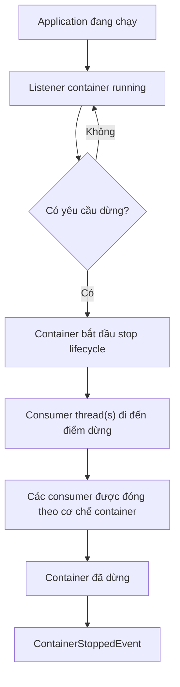

# ContainerStoppedEvent trong Spring Kafka

`ContainerStoppedEvent` là một **Spring Application Event** do Spring Kafka phát ra khi một Kafka listener container đã đi đến trạng thái dừng. Trong module *Spring Kafka Reliability Operations*, sự kiện này đặc biệt hữu ích để quan sát vòng đời consumer, ghi log và metrics, xác nhận một yêu cầu stop đã hoàn tất, hoặc kích hoạt các bước dọn dẹp tài nguyên thuộc phạm vi ứng dụng.

Điều quan trọng là không đánh đồng “container đã dừng” với “mọi tác vụ nghiệp vụ đã hoàn tất”, “mọi offset đã commit” hoặc “ứng dụng chắc chắn đã shutdown an toàn”. `ContainerStoppedEvent` mô tả **trạng thái vòng đời của listener container**; những bảo đảm về dữ liệu phải đến từ cách thiết kế acknowledgement, transaction, retry/recovery, idempotency và shutdown.

Bài học này giải thích khi nào sự kiện xuất hiện, cách đăng ký listener bằng `@EventListener`, cách phân biệt nó với các sự kiện của từng consumer, cách sử dụng trong môi trường concurrency/rebalance, và các tình huống không nên phụ thuộc hoàn toàn vào event.

## 1. Kafka listener container là gì?

Khi khai báo một phương thức `@KafkaListener`, Spring Kafka sử dụng listener container để quản lý consumer lifecycle thay cho ứng dụng.

Ví dụ:

```java
@Component
public class OrderListener {

    @KafkaListener(
        id = "orders-listener",
        topics = "orders.events",
        groupId = "order-service"
    )
    public void onOrder(String payload) {
        // Xử lý một record đã được chuyển đến listener.
    }
}
```

Với listener này, container chịu trách nhiệm những việc như:

- Tạo và quản lý Kafka `Consumer`.
- Poll các partition đang được assign.
- Gọi listener và chuyển exception tới error-handling layer.
- Phối hợp acknowledgement và commit offset.
- Thực thi pause/resume, start/stop và rebalance callbacks.
- Phối hợp Kafka transaction khi được cấu hình.
- Phát application events phản ánh các thay đổi vòng đời.

Những implementation thường gặp là `KafkaMessageListenerContainer` và `ConcurrentMessageListenerContainer`. Khi `concurrency > 1`, một concurrent container có thể quản lý nhiều child consumer containers.

`ContainerStoppedEvent` xuất hiện ở **lớp lifecycle của container**, không phải ở vị trí của business callback cho từng record.

## 2. Ý nghĩa của ContainerStoppedEvent

Sự kiện trả lời câu hỏi:

> “Listener container mà Spring Kafka quản lý đã hoàn tất quá trình dừng chưa?”

Nó không phải một thông báo “record vừa xử lý xong” hoặc “consumer vừa hết partition”. Nó là tín hiệu cấp lifecycle.

Một chuỗi khái niệm:



Đây là sơ đồ tổng quan, không cam kết thứ tự chính xác của mọi callback giữa parent và child containers trong tất cả phiên bản. Với một concurrent container, cần hiểu container cha quản lý nhiều consumer con và event có thể mang ngữ cảnh nguồn phát khác nhau theo phiên bản, cách cấu hình và đường stop.

### 2.1. Tại sao tên sự kiện đáng chú ý?

Trong Spring Kafka có cả `ConsumerStoppedEvent` và `ContainerStoppedEvent`. Hai tên gần giống nhưng chúng không nói cùng một chuyện:

- **`ConsumerStoppedEvent`**: liên quan vòng đời của một consumer/container chạy consumer thread. Thường chứa thông tin hữu ích để hiểu nguyên nhân consumer dừng.
- **`ContainerStoppedEvent`**: liên quan listener container đã dừng ở cấp container.

Với `ConcurrentMessageListenerContainer`, số consumer con và container cha không nhất thiết là một. Vì thế đừng mặc định số `ConsumerStoppedEvent` bằng số `ContainerStoppedEvent` cho một lần dừng của cả listener.

## 3. Những tình huống có thể dẫn đến container stop

Một listener container có thể dừng vì nhiều lý do:

| Tình huống | Ví dụ | Điều nên quan sát |
|---|---|---|
| Stop có chủ đích | Operator gọi stop trên listener container | Stop completion và thời lượng shutdown |
| Application shutdown | Spring context đóng khi pod/service dừng | Các container đã dừng, pending work được xử lý ra sao |
| Dynamic lifecycle | Ứng dụng tắt một listener để bảo trì | Đúng listener ID và không ảnh hưởng listener khác |
| Fatal consumer failure | Có lỗi khiến consumer/container không tiếp tục chạy | Nguyên nhân thật, log và `ConsumerStoppedEvent` |
| Auth/authorization issue | Consumer không còn truy cập được Kafka | Lỗi bảo mật, chính sách retry/restart |
| Error-handler policy | Thành phần lỗi khiến listener bị dừng theo thiết kế | DLT/recovery, offset và cảnh báo |
| Reconfiguration | Service stop/start listener theo môi trường | Trạng thái trước/sau, khả năng restart |

**Không phải mọi rebalance đều là container stop.** Một partition bị revoke khỏi consumer, rồi được assign lại, thường là diễn biến bình thường của consumer group trong khi container vẫn chạy. `onPartitionsRevoked` không đồng nghĩa có `ContainerStoppedEvent`.

Tương tự, gọi `pause()` chỉ tạm dừng việc nhận record theo cơ chế pause/resume; nó không có nghĩa container đã stop.

## 4. Phân biệt các application events liên quan

Spring Kafka phát nhiều loại sự kiện vòng đời và hoạt động. Mỗi loại trả lời một nhóm câu hỏi khác nhau:

| Event | Tín hiệu chính | Dùng để làm gì? |
|---|---|---|
| `ConsumerStartingEvent` | Consumer bắt đầu khởi động | Theo dõi startup |
| `ConsumerStartedEvent` | Consumer đã bắt đầu | Thời điểm khởi chạy consumer |
| `ConsumerStoppingEvent` | Consumer chuẩn bị dừng | Quan sát quá trình shutdown |
| `ConsumerStoppedEvent` | Consumer đã dừng | Điều tra nguyên nhân/lifecycle của consumer |
| `ContainerStoppedEvent` | Listener container đã dừng | Theo dõi completion của stop ở cấp container |
| `ConsumerFailedToStartEvent` | Consumer không thể start theo giới hạn phù hợp | Phát hiện lỗi startup |
| `ListenerContainerIdleEvent` | Listener container idle theo ngưỡng | Quan sát thiếu dữ liệu, polling hoặc workload |
| `NonResponsiveConsumerEvent` | Consumer không phản hồi theo tiêu chí monitor | Điều tra poll không tiến triển |
| `ConsumerPausedEvent` | Consumer đã được pause | Quan sát backpressure |
| `ConsumerResumedEvent` | Consumer đã resume | Quan sát khôi phục intake |

Tên sự kiện, lớp và metadata bổ sung có thể thay đổi theo phiên bản. Khi viết monitoring, nên dùng những event tồn tại trong dependency thực tế thay vì hard-code mọi event của một danh sách tham khảo.

### 4.1. ConsumerStoppedEvent có thể mang nguyên nhân

Ở những phiên bản Spring Kafka hỗ trợ, `ConsumerStoppedEvent` có thông tin lý do dừng, ví dụ bình thường hay do một lỗi đặc biệt. Nếu mục tiêu là phân loại **vì sao** consumer dừng, nên quan sát event đó và log exception tương ứng.

`ContainerStoppedEvent` tự nó không đủ để phân biệt mọi trường hợp stop bình thường và stop ngoài ý muốn. Phải phối hợp với:

- Lệnh stop/start do ứng dụng phát ra.
- Lỗi từ consumer hoặc listener container.
- `ConsumerStoppedEvent` và reason nếu version hỗ trợ.
- Application lifecycle events và trạng thái Spring context.
- Metrics về consumer group, assigned partitions và lag.

Không suy ra `ContainerStoppedEvent` luôn là sự cố.

### 4.2. ContainerStoppedEvent khác ApplicationReadyEvent

`ApplicationReadyEvent` nói rằng Spring Boot đã hoàn tất giai đoạn startup tương ứng. `ContainerStoppedEvent` nói rằng một listener container Kafka đã dừng.

Spring context còn hoạt động sau khi một listener container dừng là tình huống hoàn toàn hợp lệ: ứng dụng có thể tạm tắt một listener nhưng vẫn chạy các listener khác hoặc cung cấp HTTP API.

## 5. Nhận ContainerStoppedEvent bằng @EventListener

Cách đơn giản nhất là tạo một Spring bean có method `@EventListener`.

```java
import org.slf4j.Logger;
import org.slf4j.LoggerFactory;
import org.springframework.context.event.EventListener;
import org.springframework.kafka.event.ContainerStoppedEvent;
import org.springframework.stereotype.Component;

@Component
public class KafkaContainerLifecycleObserver {

    private static final Logger log =
            LoggerFactory.getLogger(
                    KafkaContainerLifecycleObserver.class
            );

    @EventListener
    public void onContainerStopped(ContainerStoppedEvent event) {
        log.info(
            "Kafka listener container stopped: source={}, timestamp={}",
            event.getSource(),
            event.getTimestamp()
        );
    }
}
```

`event.getSource()` và `event.getTimestamp()` là những thuộc tính cơ bản của Spring `ApplicationEvent`. Đoạn code không phụ thuộc vào một ID được suy diễn từ thread name hoặc consumer group.

Trong một ứng dụng có nhiều listener, method trên có thể nhận event của nhiều container. Cần xác định rõ nguồn nào thuộc listener cần quan sát nếu logic vận hành áp dụng cho một listener cụ thể.

**Lưu ý:** event này không thay thế `@PreDestroy`, `SmartLifecycle` hay callback stop khi mục tiêu là đảm bảo một resource cần đóng theo lifecycle riêng của ứng dụng. Chỉ dựa vào event có thể bỏ sót crash hoặc một số đường shutdown bất thường.

### 5.1. Vì sao không đăng ký consumer callback ở đây?

`ContainerStoppedEvent` là Spring application event được phát qua cơ chế Spring event publishing. Bạn không cần, và không nên, tự gọi `KafkaConsumer.poll()` hoặc đăng ký một Kafka `ConsumerRebalanceListener` chỉ để nhận biết container đã stop.

Rebalance listener phụ trách partition ownership; application event listener phụ trách phản ứng với event do framework phát ra.

## 6. Xác định đúng listener container phát event

Một ứng dụng có thể khai báo nhiều listener:

```java
@KafkaListener(
    id = "orders-listener",
    topics = "orders.events"
)
public void consumeOrders(String payload) {
    // ...
}

@KafkaListener(
    id = "payments-listener",
    topics = "payments.events"
)
public void consumePayments(String payload) {
    // ...
}
```

Nếu một listener được tắt để bảo trì, không nên đánh dấu tất cả listener của service là stopped chỉ vì nhận được một event.

Có thể quan sát nguồn rồi trích xuất listener ID khi phù hợp:

```java
@EventListener
public void onContainerStopped(ContainerStoppedEvent event) {

    Object source = event.getSource();

    if (source instanceof MessageListenerContainer container) {
        String listenerId = container.getListenerId();

        log.info(
            "Stopped listener container id={}",
            listenerId
        );
    }
    else {
        log.info(
            "Stopped Kafka container source={}",
            source
        );
    }
}
```

`MessageListenerContainer` thuộc `org.springframework.kafka.listener`. Kiểm tra source type và cách container cha/con được biểu diễn trong phiên bản đang dùng. Nếu muốn so khớp một listener ID logic, hãy dùng `KafkaListenerEndpointRegistry` để tìm đúng container được đăng ký và quan sát mối quan hệ với child containers.

### 6.1. Đừng dùng thread name làm identity duy nhất

Thread name và consumer client ID có thể thay đổi theo concurrency, prefix, version hoặc restart. Chúng hữu ích cho troubleshooting nhưng không nên là khóa duy nhất để xác định container.

Dùng listener ID được khai báo ổn định trong `@KafkaListener` và registry khi phù hợp. Nếu cần phân biệt từng instance/pod, thêm service instance ID vào log hoặc tracing context.

## 7. KafkaListenerEndpointRegistry và stop theo listener ID

Các container được tạo từ `@KafkaListener` thường được quản lý bởi `KafkaListenerEndpointRegistry`. Có thể tìm và dừng một listener theo ID:

```java
@Component
public class ListenerMaintenanceService {

    private final KafkaListenerEndpointRegistry registry;

    public ListenerMaintenanceService(
            KafkaListenerEndpointRegistry registry) {
        this.registry = registry;
    }

    public void stopOrdersListener() {
        MessageListenerContainer container =
                registry.getListenerContainer("orders-listener");

        if (container == null) {
            throw new IllegalStateException(
                    "orders-listener is not registered"
            );
        }

        container.stop();
    }
}
```

Khi stop được thực hiện và container đi đến trạng thái stopped, Spring Kafka có thể phát `ContainerStoppedEvent`. Tuy nhiên `stop()` và event emission có thể có tính bất đồng bộ theo implementation và lifecycle.

Vì thế, không nên gọi `container.stop()` rồi ngay lập tức khẳng định mọi child consumer đã dừng trong cùng dòng code tiếp theo. Khi cần xác nhận hoàn tất, hãy dùng cơ chế stop callback/lifecycle completion được hỗ trợ hoặc quan sát event phù hợp.

### 7.1. Stop completion callback

Spring Kafka listener container triển khai lifecycle contract của Spring. Trong những phiên bản hỗ trợ callback completion, có thể sử dụng dạng:

```java
MessageListenerContainer container =
        registry.getListenerContainer("orders-listener");

if (container != null) {
    container.stop(() ->
        log.info("orders-listener stop completed")
    );
}
```

Callback này phù hợp với use case **chính code vừa ra lệnh stop muốn biết khi nào xong**. Ngược lại, `ContainerStoppedEvent` phù hợp với quan sát chung, không cần tất cả nơi ra lệnh stop đều inject cùng callback.

Không dùng cả hai để thực hiện một hành động không idempotent mà không có deduplication, vì một lần stop có thể tạo cả callback lẫn event.

## 8. ContainerStoppedEvent trong concurrent listener container

Khi `concurrency=3`, một concurrent container có thể quản lý ba child consumer containers:

```text
orders-listener (ConcurrentMessageListenerContainer)
    |
    +-- child consumer/container A
    +-- child consumer/container B
    +-- child consumer/container C
```

Mỗi child có lifecycle riêng; parent container điều phối start/stop của tập child. Cần phân biệt:

- **Một child consumer đã dừng** chưa chắc toàn bộ listener logic đã dừng.
- **Parent container đã dừng** mới là tín hiệu phù hợp để đánh giá cả listener group tại instance đó.
- **Một partition bị revoke** không có nghĩa consumer con đã dừng.
- **Thay đổi assignment** có thể xảy ra trong khi container và các child vẫn đang running.

Không viết logic “đã thấy một ConsumerStoppedEvent thì đánh dấu orders-listener stopped” trong môi trường concurrency.

### 8.1. Số event không phải số lượng record

Nếu một container dùng concurrency 3, một lần stop có thể tạo nhiều lifecycle events ở cấp consumer và container. Đó không phải ba business failures hay ba lần xử lý một record.

Metrics nên dùng tên thể hiện chính xác đối tượng, chẳng hạn `kafka_container_stop_total` và `kafka_consumer_stop_total`. Đừng cộng các event types này thành một counter duy nhất rồi suy ra tần suất downtime của service.

### 8.2. Ghi nhận parent và child theo phiên bản

Thông tin `source`, container identity và thứ tự phát các events giữa parent/children cần được kiểm tra trong phiên bản Spring Kafka thực tế, nhất là khi ứng dụng cần dùng event để đánh dấu “tất cả consumers đã ngừng”.

Một số hệ thống chọn theo dõi trực tiếp registry container `isRunning()` cùng event thay vì phụ thuộc hoàn toàn vào số lượng child events.

## 9. Event publishing: đồng bộ và bất đồng bộ

Spring application events được phân phối bởi `ApplicationEventMulticaster`. Với cấu hình mặc định thông dụng của Spring, việc gọi các event listeners thường **đồng bộ** trong thread phát event, trừ khi ứng dụng đã cấu hình async multicaster hoặc listener bất đồng bộ phù hợp.

Điều này ảnh hưởng trực tiếp đến độ an toàn:

- Handler event thực hiện I/O nặng có thể kéo dài quá trình stop hoặc thread vận hành liên quan.
- Handler ném exception không được xử lý có thể ảnh hưởng luồng phát event theo cơ chế multicaster.
- Nếu dùng async multicaster, thời gian hoàn thành handler có thể muộn hơn thời gian container stop.
- Không nên dựa vào thứ tự event handlers khi đã bật async delivery.
- Các API Kafka `Consumer` không thread-safe; event handler chạy async không được tự gọi `seek()`, `commitSync()` hay `poll()` trên consumer cũ.

### 9.1. Pattern handler nhẹ

Một handler an toàn thường chỉ log, tăng metric hoặc cập nhật một trạng thái quan sát nhẹ:

```java
@Component
public class KafkaStopMetrics {

    private final MeterRegistry meterRegistry;

    public KafkaStopMetrics(MeterRegistry meterRegistry) {
        this.meterRegistry = meterRegistry;
    }

    @EventListener
    public void whenStopped(ContainerStoppedEvent event) {
        meterRegistry.counter(
                "app.kafka.container.stopped",
                "source_type",
                event.getSource().getClass().getSimpleName()
        ).increment();
    }
}
```

Tên `app.kafka.container.stopped` là metric tùy chỉnh của ứng dụng. Nó **không** phải bảo đảm Spring Kafka tự xuất metric này.

`source_type` ở ví dụ có cardinality thấp hơn source identity động. Nếu muốn gắn `listener_id`, cần chuẩn hóa từ danh sách listener ID ổn định và tránh đưa client ID ngẫu nhiên hoặc event ID vào metrics labels.

### 9.2. Nếu cần chạy cleanup lâu

Đừng làm:

```java
@EventListener
public void onStopped(ContainerStoppedEvent event) {
    remoteStorage.rebuildAllIndexes(); // Công việc lớn, có thể chặn stop path.
}
```

Thay vào đó, chọn một cơ chế tách biệt có trạng thái bền vững và retry, hoặc một `SmartLifecycle` bean quản lý chính resource của ứng dụng nếu cleanup là yêu cầu shutdown thực sự.

Nếu việc cleanup là bắt buộc trước khi pod được xem là an toàn để tắt, fire-and-forget async event handler cũng không đủ. Cần một shutdown protocol có giới hạn thời gian và điểm xác nhận hoàn tất rõ ràng.

## 10. ContainerStoppedEvent không phải thông báo “mọi công việc đã xong”

Với listener đồng bộ:

```java
@KafkaListener(topics = "orders.events")
public void consume(OrderEvent event) {
    orderService.apply(event);
}
```

Container thường quản lý việc gọi listener trên consumer thread. Nếu `apply()` hoàn tất đồng bộ rồi method mới trả về, container có thể phối hợp offset/transaction theo trạng thái lời gọi.

Nhưng nếu listener dispatch sang background executor:

```java
@KafkaListener(topics = "orders.events")
public void consume(OrderEvent event) {
    workerPool.submit(() -> orderService.apply(event));
    // Listener kết thúc khi task còn chạy.
}
```

Container không tự biết task Java bên ngoài đã hoàn tất. Khi `ContainerStoppedEvent` xuất hiện, các task này **vẫn có thể đang chạy** hoặc thậm chí bị mất nếu queue chỉ nằm trong memory và process shutdown.

Muốn theo dõi completion nghiệp vụ, cần một trong các thiết kế:

- Listener chờ task hoàn tất và truyền exception đúng cách.
- Dùng acknowledgement được container hỗ trợ, chỉ xác nhận sau khi task thành công.
- Chuyển work item vào durable queue/inbox trước khi xác nhận Kafka offset.
- Thiết kế graceful shutdown cho executor cùng idempotency và crash recovery.
- Theo dõi in-flight tasks và giới hạn thời gian drain.

Sự kiện container stopped không tự bảo đảm các việc đó đã hoàn thành.

## 11. Liên hệ với commit offset và delivery semantics

Kafka consumer group ghi committed offset để xác định nơi tiếp tục sau restart hoặc rebalance.

Một chuỗi đơn giản:

```text
Input partition 0:
  offset 100 --> listener đang xử lý
  offset 101 --> chưa xử lý

Stop được yêu cầu
    |
    +-- Nếu offset 100 đã xử lý/commit đúng policy:
    |      khi restart có thể tiếp tục từ 101
    |
    +-- Nếu offset 100 chưa commit:
           khi restart có thể đọc lại offset 100
```

`ContainerStoppedEvent` **không mang ý nghĩa “committed offset đã là 101”**. Việc commit phụ thuộc `AckMode`, cấu hình auto-commit, error handler, transaction và thời điểm dừng.

### 11.1. At-least-once vẫn có thể tạo duplicate

Nếu service ghi database thành công rồi crash hoặc dừng trước khi Kafka offset được commit, record có thể bị giao lại. Đây là một tình huống bình thường của at-least-once processing.

Nên dùng event ID, unique constraint, inbox hoặc business idempotency. Không dùng event stopped để tự suy diễn record đã xử lý “đúng một lần”.

### 11.2. Kafka transaction không bảo vệ mọi side effect

Nếu listener dùng Kafka transaction cho consume–process–produce, output Kafka và consumed offsets có thể được commit cùng transaction khi cấu hình đúng. Nhưng database, HTTP, email hay filesystem không tự thuộc transaction ấy.

Trong quá trình stop, nếu Kafka transaction abort sau khi DB side effect đã commit, record có thể được xử lý lại. `ContainerStoppedEvent` không thay đổi cơ chế này.

### 11.3. Không commit offset từ event handler

Đây là anti-pattern cần tránh:

```java
@EventListener
public void onStopped(ContainerStoppedEvent event) {
    // Không tự tìm KafkaConsumer rồi commitSync/seek ở đây.
}
```

Kafka Consumer không thread-safe, và khi stopped, consumer có thể đã đóng hoặc không còn assignment. Offset commit phải đi qua listener container/acknowledgement/transaction policy lúc consumer còn hợp lệ.

## 12. Quan sát graceful shutdown của Spring Boot

Một ứng dụng Spring Boot thường trải qua:

```text
SIGTERM / ContextClosedEvent
          |
          v
Spring lifecycle yêu cầu dừng các bean liên quan
          |
          v
Kafka listener container stop
          |
          +-- consumer loop kết thúc
          +-- consumer resources được giải phóng
          |
          v
ContainerStoppedEvent
          |
          v
Ứng dụng hoàn tất các pha shutdown còn lại
```

Thứ tự chính xác giữa nhiều `SmartLifecycle` beans, listeners và resource cleanup phụ thuộc phase, configuration và cách gọi stop. Không suy diễn rằng mọi bean đã đóng chỉ vì một Kafka container phát event.

### 12.1. Kết hợp với readiness và liveness

**Readiness** thể hiện instance có nên nhận traffic/workload hay không; **liveness** thể hiện tiến trình có còn hoạt động hay không.

Khi listener bị dừng có chủ đích để bảo trì, bạn có thể ghi metric/trạng thái “listener unavailable” nhưng không nhất thiết đánh dấu toàn bộ ứng dụng dead. Một service có nhiều listener có thể vẫn khỏe mạnh ở các chức năng khác.

Với một listener **bắt buộc** cho nghiệp vụ, container dừng bất thường có thể là điều kiện làm readiness thất bại. Tuy nhiên không nên dựa vào mỗi event để xác định tình trạng lâu dài: một event đã xảy ra từ phút trước không nói rằng listener có được start lại sau đó hay không.

Một health indicator nên kiểm tra trạng thái hiện tại, ví dụ từ `KafkaListenerEndpointRegistry`, và dùng events để bổ sung lịch sử/nguyên nhân.

## 13. ContainerStoppedEvent và các trạng thái stop/paused/idle

Ba nhóm trạng thái thường bị nhầm:

| Trạng thái | Container còn running? | Poll/assignment | Cần dùng tín hiệu nào? |
|---|---|---|---|
| Idle | Thường còn running | Consumer có thể poll nhưng không nhận record trong khoảng ngưỡng | `ListenerContainerIdleEvent` |
| Paused | Thường còn running | Paused partitions vẫn có thể được poll để duy trì liveness | Pause/resume state/events |
| Stopping | Đang tiến tới stopped | Consumer đang đóng/thoát poll loop | `ConsumerStoppingEvent` và lifecycle state |
| Stopped | Không còn running | Consumer đã được đóng theo lifecycle | `ContainerStoppedEvent` |
| Rebalancing | Thường vẫn running | Partition assignment thay đổi | Rebalance callbacks |
| Failed/lost | Tùy đường lỗi | Có thể không còn consumer hợp lệ | Error log, consumer stopped reason, registry state |

Nếu mục tiêu là *backpressure tạm thời*, nên dùng `pause()`/`resume()`, không dùng `stop()` nếu không muốn consumer rời group và phải start lại.

Nếu mục tiêu là shutdown để deploy, stop và event là phù hợp hơn. Với các đường lỗi cần tự khởi động lại, kết hợp policy restart rõ ràng thay vì dùng event stop như một cơ chế retry vô hạn.

## 14. Không dùng event để tự động restart vô điều kiện

Một phản ứng dễ nghĩ tới là:

```java
@EventListener
public void onStopped(ContainerStoppedEvent event) {
    // Không nên luôn lập tức start() lại container tại đây.
}
```

Điều này có thể tạo vòng lặp `stop → start → fail → stop` khi lỗi gốc vẫn tồn tại (authorization, schema, thiếu topic, transaction fencing...). Nó cũng có thể chống lại một stop **có chủ đích** do operator hoặc shutdown process.

Nếu muốn tự phục hồi:

1. Xác định nguyên nhân: bình thường, do lỗi, do shutdown, do operator.
2. Phân biệt listener được phép tự start lại và listener cố ý dừng.
3. Áp dụng cooldown/backoff, giới hạn lần thử và cảnh báo.
4. Kiểm tra điều kiện cần: broker, ACL, topic, serializer, dependencies.
5. Không start lại khi Spring context đang đóng.
6. Xác nhận container hiện chưa running và có lifecycle hợp lệ để restart.
7. Theo dõi số lần restart, thời gian unavailable và lag sau khi quay lại.

Một trường hợp lỗi có thể yêu cầu operator sửa configuration trước khi restart. Tự start ngay có thể gây retry storm.

## 15. Kết hợp ContainerStoppedEvent với ConsumerStoppedEvent

Hai event bổ sung cho nhau trong việc chẩn đoán.

Ví dụ observer ở mức khái niệm:

```java
@Component
public class KafkaLifecycleLogger {

    private static final Logger log =
            LoggerFactory.getLogger(KafkaLifecycleLogger.class);

    @EventListener
    public void onConsumerStopped(ConsumerStoppedEvent event) {
        log.warn(
            "Kafka consumer stopped: source={}, event={}",
            event.getSource(),
            event
        );
    }

    @EventListener
    public void onContainerStopped(ContainerStoppedEvent event) {
        log.info(
            "Kafka container stopped: source={}",
            event.getSource()
        );
    }
}
```

Với phiên bản Spring Kafka có reason API trên `ConsumerStoppedEvent`, có thể thêm reason vào log, ví dụ `event.getReason()` nếu method tồn tại trong dependency thực tế.

Sự kiện consumer stopped có thể hỗ trợ trả lời **tại sao** dừng; container stopped giúp đánh dấu **đã kết thúc** lifecycle cấp container. Khi callback có concurrency, cần phân biệt source của parent và child.

Đừng mặc định thứ tự hai event luôn hoàn toàn giống nhau với mọi assignor, stop path và Spring Kafka version; cần quan sát và kiểm thử trên dependency đang chạy khi hệ thống có automation dựa vào thứ tự.

## 16. Dùng event làm tín hiệu metrics

Một dashboard lifecycle cơ bản có thể hiển thị:

| Metric/tín hiệu | Mục tiêu |
|---|---|
| Listener container running state | Listener hiện có đang running hay không |
| Container stop count | Số lần listener container dừng trong cửa sổ thời gian |
| Consumer stop count/reason | Phân tích lý do consumer dừng |
| Unexpected stop count | Phân biệt stop sự cố với bảo trì |
| Listener restart count | Phát hiện restart loop |
| Stop completion latency | Dừng container mất bao lâu |
| Consumer group lag | Dữ liệu có tồn khi container stopped không |
| Assigned partition count | Kiểm tra assignment sau start/rebalance |
| Rebalance rate | Có bất ổn consumer group hay không |
| In-flight task count | Có background work còn chạy sau listener stop không |
| Retry/DLT recovery failure | Dừng có liên quan lỗi downstream/recovery không |

Không nên dùng `ContainerStoppedEvent` để trực tiếp tính một gauge “currently running” mà không lắng nghe start events hoặc kiểm tra trạng thái hiện tại. Nếu process restart, state in-memory của observer cũng sẽ mất.

### 16.1. Counter và gauge khác nhau

- **Counter**: số lần stop event đã xảy ra.
- **Gauge**: trạng thái running/stopped hiện tại của listener.
- **Timer**: thời lượng từ lúc request stop đến khi stop completion.
- **Log/trace**: dữ liệu chi tiết của một stop incident.

Một counter tăng một lần khi stop không cho biết container đang stopped hay đã restart.

### 16.2. Tránh cardinality cao

Nên tag metric bằng `service`, `listener_id` thuộc tập giá trị cố định, `stop_reason` được phân loại và `environment`. Tránh gắn event ID, record key, raw exception message, offset hoặc client ID ngẫu nhiên làm labels.

Việc đếm event có thể bị khác biệt khi concurrency thay đổi; nên dùng hai metric riêng cho consumer events và container events.

## 17. Gắn sự kiện với một quy trình maintenance

Một use case thực tế: operator muốn tạm dừng hẳn `orders-listener` để thay đổi cấu hình, sau đó start lại.

Một quy trình rõ ràng:

1. Đánh dấu **maintenance requested** cho listener.
2. Ngừng nhận yêu cầu nghiệp vụ mới cần listener này, nếu có.
3. Gọi stop trên container qua registry.
4. Đợi stop completion callback hoặc event phù hợp, với timeout.
5. Xác nhận trạng thái hiện tại `isRunning() == false`.
6. Kiểm tra background workers hoặc durable work queue của ứng dụng.
7. Thực hiện thay đổi cần thiết.
8. Start lại container theo điều kiện vận hành.
9. Xác nhận container running, consumer assignment và lag đang phục hồi.
10. Kết thúc trạng thái maintenance.

Cần có timeout; một sự kiện không xuất hiện không nên làm hệ thống chờ vô hạn.

### 17.1. Đừng gộp container lifecycle với transaction outcome

Khi listener dừng, một record đang xử lý có thể chưa được commit. Tại thời điểm start lại, nó có thể được giao lại. Maintenance process nên chấp nhận điều đó hoặc bảo đảm một protocol drain cụ thể.

Việc nhận `ContainerStoppedEvent` sau stop không chứng minh offset commit đã thành công ở broker theo yêu cầu nghiệp vụ. Nếu cần xác nhận tiến độ, hãy đo committed offsets và kiểm thử redelivery/idempotency riêng.

## 18. Test ApplicationEvent bằng Spring Boot

Một integration test hợp lý nên khởi tạo container thật từ Spring context và quan sát event, thay vì chỉ tự gọi method observer bằng một `new ContainerStoppedEvent(...)` giả định.

Ví dụ probe bean:

```java
@Component
public class ContainerStopProbe {

    private final BlockingQueue<ContainerStoppedEvent> events =
            new LinkedBlockingQueue<>();

    @EventListener
    public void onEvent(ContainerStoppedEvent event) {
        events.offer(event);
    }

    public ContainerStoppedEvent awaitStop(
            long timeout,
            TimeUnit unit) throws InterruptedException {
        return events.poll(timeout, unit);
    }
}
```

Một test có thể:

```java
@SpringBootTest
class KafkaContainerStopIT {

    @Autowired
    KafkaListenerEndpointRegistry registry;

    @Autowired
    ContainerStopProbe probe;

    @Test
    void emitsContainerStoppedEvent() throws Exception {

        MessageListenerContainer container =
                registry.getListenerContainer("orders-listener");

        assertNotNull(container);

        if (!container.isRunning()) {
            container.start();
        }

        container.stop();

        ContainerStoppedEvent event =
                probe.awaitStop(10, TimeUnit.SECONDS);

        assertNotNull(event);
        assertFalse(container.isRunning());
    }
}
```

Đây là ví dụ test khung, giả định đã có listener bean với ID `orders-listener`, Spring Kafka và broker test phù hợp, cùng các imports JUnit/Spring. Trong test thực tế, nên **lọc event theo container cần kiểm tra**, vì một Spring context có nhiều listener có thể phát stop events khác nhau.

Test cũng cần dọn queue hoặc tách context cho từng kịch bản để không nhận nhầm event cũ. Dùng timeout để tránh treo CI.

### 18.1. Các trường hợp nên kiểm thử

| Kịch bản | Điều cần xác nhận |
|---|---|
| Stop một listener cụ thể | Event của đúng container được nhận |
| Stop lặp lại khi đã stopped | Không suy diễn số event nếu lifecycle không đổi |
| Concurrent listener nhiều consumers | Phân biệt container event và consumer events |
| Application context shutdown | Event có được phát khi shutdown bình thường |
| Stop do fatal consumer failure | Logs/reason phản ánh nguyên nhân nếu container dừng |
| Rebalance không stop | Không coi revoke là ContainerStoppedEvent |
| Pause/resume | Không coi pause là stop |
| Event handler ném lỗi | Không làm shutdown path mất kiểm soát |
| Event multicaster async | Không giả định order/completion đồng bộ |
| Crash/Kill process | Không giả định chắc chắn nhận event |

### 18.2. Kiểm thử không nên chỉ mock event

Một unit test gọi trực tiếp:

```java
observer.onContainerStopped(event);
```

có thể chứng minh observer ghi log/counter, nhưng **không kiểm tra** Spring Kafka thực sự phát event vào đúng thời điểm lifecycle. Cần integration test để kiểm tra event publishing, container stop và concurrency.

Nếu requirement liên quan “mọi consumer đã đóng”, bổ sung kiểm tra trạng thái container và sự kiện consumer cấp thấp theo phiên bản thay vì chỉ đếm một event.

## 19. Khi event không xuất hiện

Nếu stop được yêu cầu nhưng hệ thống không nhận thấy `ContainerStoppedEvent`, cần điều tra theo tầng:

1. Container có thực sự dừng không, hay chỉ pause/idle?
2. `@KafkaListener` có đăng ký đúng ID trong registry?
3. Bean observer có nằm trong Spring component scan không?
4. `@EventListener` có được Spring quản lý và đăng ký không?
5. Observer có được phát event trong cùng `ApplicationContext` không?
6. ApplicationEventMulticaster có được thay bằng cấu hình async/filtering tùy chỉnh không?
7. Container có đang kẹt listener callback hoặc thread shutdown không?
8. Context có bị kill đột ngột trước khi phát event không?
9. Code có dùng custom container hoặc đường stop khác với listener mặc định không?
10. Log/metrics có chỉ ra container đã stopped nhưng event handler thất bại không?

Quan sát `KafkaListenerEndpointRegistry`, `isRunning()`, container logs, `ConsumerStoppedEvent`, Spring context state và thread dumps để chẩn đoán.

Không tăng timeout vô hạn chỉ vì đợi event chưa thấy. Nếu yêu cầu là “xác nhận stop đã hoàn tất” ở một đường gọi cụ thể, callback stop và trạng thái lifecycle thường là tín hiệu chủ động dễ kiểm soát hơn.

## 20. Crash không phát event như graceful shutdown

Điểm giới hạn quan trọng của mọi in-process lifecycle event là **nó không bền vững**.

Với những sự cố như:

- `kill -9` hoặc tiến trình bị termination cưỡng bức.
- JVM crash hoặc host/pod chết bất ngờ.
- Out-of-memory nghiêm trọng khiến shutdown logic không chạy.
- Mất điện, node bị tắt đột ngột.
- Process không còn cơ hội xử lý Spring lifecycle.

Ứng dụng có thể **không phát hoặc không xử lý** `ContainerStoppedEvent`.

Do đó event không được dùng làm nguồn sự thật duy nhất cho:

- Xác nhận đã commit toàn bộ Kafka offsets.
- Xác nhận không còn job quan trọng đang pending.
- Thực hiện business compensation bắt buộc.
- Giải phóng distributed lease mà không có TTL/fencing.
- Ghi nhận audit bắt buộc của mọi lần crash.
- Đảm bảo restart/recovery khi node biến mất.

Muốn phục hồi sau crash, phải dựa vào committed offsets, broker state, durable inbox/outbox, transaction và idempotent handling.

## 21. Anti-patterns khi sử dụng ContainerStoppedEvent

**Tự động restart mỗi khi nhận event.** Có thể chống lại lệnh stop có chủ đích hoặc tạo restart loop khi lỗi nguyên nhân chưa được sửa.

**Đếm consumer stopped như container stopped.** Concurrent container có thể có nhiều child consumers; không quy đổi số events một cách máy móc.

**Cho rằng revoke partition sẽ phát event.** Rebalance có thể xảy ra khi listener vẫn chạy. Hãy dùng rebalance callbacks.

**Cho rằng pause làm container stopped.** Pause là backpressure tạm thời và thường vẫn duy trì polling/assignment.

**Ghi database hoặc gọi HTTP lâu trong event listener.** Handler có thể làm chậm lifecycle path, hoặc thất bại vì dependencies đang shutdown.

**Commit offset trong event handler.** Consumer có thể đã đóng/mất ownership và Kafka Consumer không thread-safe.

**Dùng event để suy ra business processing đã thành công.** Task bất đồng bộ có thể vẫn chạy hoặc thất bại sau khi listener trả về.

**Dùng event làm tín hiệu duy nhất cho readiness.** Event là quá khứ; readiness cần kiểm tra trạng thái hiện tại và requirement của service.

**Không lọc source của event.** Một service có nhiều listeners; stop của listener này không nên được ghi thành stop của tất cả.

**Đặt listener ID không ổn định làm metric label.** Dynamic IDs/client IDs có thể tạo nhiều time series; dùng identity logic được chuẩn hóa.

**Tin rằng mọi crash đều có ContainerStoppedEvent.** JVM/process chết đột ngột có thể không chạy event publishing.

**Dựa vào thứ tự callback khi event multicaster async.** Không có cơ sở bảo đảm toàn bộ handlers hoàn tất theo đúng thứ tự như sync path.

## 22. Quy trình ứng dụng trong production

Khi muốn dùng `ContainerStoppedEvent` làm một phần của chiến lược vận hành Kafka, có thể triển khai theo thứ tự:

1. Đặt listener ID ổn định cho các `@KafkaListener` quan trọng.
2. Xác định rõ stop có chủ đích và stop bất thường là hai trường hợp khác nhau.
3. Viết observer bằng `@EventListener(ContainerStoppedEvent.class)`.
4. Quan sát source/container identity; tránh trộn parent/child events.
5. Bổ sung `ConsumerStoppedEvent` nếu cần reason theo consumer.
6. Ghi log nhẹ và metric count/latency, không làm I/O lớn trong handler.
7. Dùng registry/callback để kiểm tra trạng thái hiện tại khi chạy maintenance workflow.
8. Thiết kế shutdown cho task in-flight, DB/API calls và offset policy độc lập với event.
9. Thiết lập idempotency cho record có thể redeliver sau restart.
10. Kiểm thử stop bình thường, concurrent stop, pause/rebalance và crash.
11. Định nghĩa alert cho unexpected stop và restart loop, không alert cho mọi stop hợp lệ.
12. Kiểm tra lại event lifecycle và callback order khi nâng cấp Spring Kafka.

Nếu service dùng nhiều replicas, mỗi replica quan sát lifecycle của container **trong chính Spring context của nó**. Một `ContainerStoppedEvent` ở pod A không có nghĩa tất cả pods trong consumer group đều stopped.

## 23. Tài liệu tham khảo theo phiên bản

Đối chiếu các tài liệu/API chính thức tương ứng với dependency đang chạy:

- **Spring for Apache Kafka Reference — Application Events**: các event của listener containers và vòng đời consumer.
- **Spring Kafka Javadoc — `ContainerStoppedEvent`**: class, constructor và metadata thực tế.
- **Spring Kafka Javadoc — `ConsumerStoppedEvent`**: thông tin reason và trạng thái consumer.
- **Spring Kafka Javadoc — `MessageListenerContainer` và `ConcurrentMessageListenerContainer`**: start/stop, callback, `isRunning()`, concurrency.
- **Spring Kafka Reference — Listener Container Lifecycle**: startup, shutdown và pause/resume.
- **Spring Kafka Javadoc — `KafkaListenerEndpointRegistry`**: tìm container theo listener ID.
- **Spring Framework Reference — Application Events**: `@EventListener`, `ApplicationEventMulticaster` và asynchronous event listeners.
- **Spring Framework Reference — SmartLifecycle**: phase, shutdown và callback completion.
- **Apache Kafka Documentation — Consumer Groups**: group membership, rebalance và committed offsets.

Một số phiên bản có khác biệt về thời điểm phát sự kiện, cách biểu diễn container cha/con, reason của consumer stop hoặc API stop callback. Khi dùng event cho automation điều khiển production, hãy kiểm tra Javadoc đúng phiên bản và xác nhận bằng integration test.

**Nguyên tắc cuối cùng:** `ContainerStoppedEvent` là tín hiệu đáng dùng để **quan sát container đã dừng**, nhưng không thay thế cơ chế **xử lý record an toàn, commit offset, transaction, idempotency và crash recovery**. Hệ thống đáng tin cậy dùng event để hiểu lifecycle, đồng thời dựa vào trạng thái bền vững và các ranh giới xử lý rõ ràng để bảo vệ dữ liệu.
