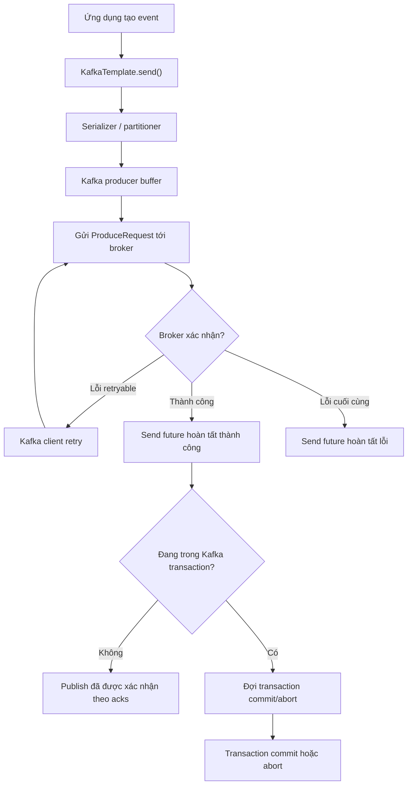
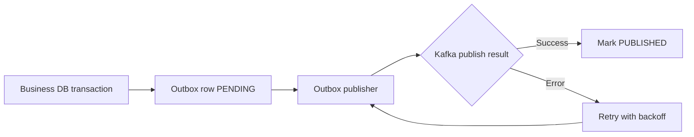

# Producer error rate trong Spring Kafka: đo lường, phân tích và cảnh báo

Trong hệ thống dùng Spring Kafka, **producer error rate** là tín hiệu cho biết quá trình gửi record đến Kafka đang thất bại với tần suất nào. Chỉ số này giúp phát hiện broker hoặc đường mạng bất ổn, topic bị thiếu, quyền ghi không hợp lệ, serializer lỗi, transaction bị abort, hay một producer bị quá tải.

Tuy nhiên, không có một phép tính duy nhất luôn đúng cho mọi cách sử dụng từ “producer error rate”. Đếm lỗi của Kafka client, lỗi cuối cùng từ `KafkaTemplate.send()`, lỗi commit Kafka transaction và lỗi publish dead-letter topic (DLT) là **bốn ranh giới khác nhau**. Nếu cộng lẫn chúng hoặc chia sai mẫu số, dashboard có thể báo động giả hoặc che giấu mất khả năng gửi dữ liệu.

Trong module *Spring Kafka Reliability Operations*, mục tiêu là thiết kế một hệ đo đủ để trả lời: **Bao nhiêu logical send đã thành công hoặc thất bại? Kafka client đã retry bao nhiêu? Transaction có commit không? Dữ liệu đã được lưu ở đâu khi producer lỗi? Khi nào cần giảm intake hoặc cảnh báo?**

## 1. Producer error rate cần đo ở đúng ranh giới

Hãy xem một message trải qua các giai đoạn:



Sơ đồ này đã giản lược những thao tác nội bộ như metadata lookup, batching, callback, transaction coordinator và các loại lỗi không thể retry. Nhưng nó cho thấy lỗi có thể xảy ra ở nhiều điểm.

Ví dụ một `send()` có thể trải qua hai retry nội bộ rồi thành công. Ở mức ứng dụng, logical send đó **thành công**; ở mức Kafka client, **retry rate tăng**. Ngược lại, một `send()` có thể thành công ở producer callback nhưng nằm trong **transaction sau đó abort**, nên consumer `read_committed` không nhìn thấy record.

### 1.1. Ba cấp đo lường

| Cấp | Đơn vị quan sát | Câu hỏi |
|---|---|---|
| Kafka producer client | Record send, retry, request, error ở Kafka client | Producer và broker đang hoạt động ra sao? |
| Spring KafkaTemplate | Mỗi logical `send()` và kết quả future | Ứng dụng yêu cầu gửi bao nhiêu record, bao nhiêu lần báo lỗi cuối cùng? |
| Nghiệp vụ/transaction | Event, transaction, outbox item, offset | Kết quả có commit và đã đáp ứng contract nghiệp vụ chưa? |

Nên đặt tên metric khác nhau cho từng cấp. Không ghép một `record-error-rate` của Kafka client với counter `send_failure` của ứng dụng rồi coi chúng là cùng một loại lỗi.

## 2. Định nghĩa error rate bằng một mẫu số rõ ràng

Giả sử trong cửa sổ năm phút, một service hoàn tất 10.000 lời gọi `KafkaTemplate.send()`:

- 9.900 lời gọi có future hoàn tất thành công.
- 100 lời gọi có future hoàn tất lỗi.
- Một số trong 9.900 lời gọi thành công từng được Kafka client retry trước đó.

Khi đó:

```text
logical send error ratio
  = 100 / (9.900 + 100)
  = 1%

logical send failure rate
  = 100 / 300 giây
  ≈ 0,333 lỗi/giây
```

**Ratio** là tỷ lệ phần trăm số lần gửi thất bại. **Rate** có thể được hiểu là tốc độ lỗi theo giây. Khi nói “producer error rate 2%”, bạn thực chất đang nói về *error ratio*. Hãy thể hiện đơn vị ngay ở dashboard.

Với logical send, định nghĩa:

```text
send_error_ratio(W)
  = completed_send_failures(W)
    / completed_send_outcomes(W)

completed_send_outcomes(W)
  = completed_send_successes(W)
    + completed_send_failures(W)
```

Trong đó `W` là cửa sổ thời gian, ví dụ 5 phút. Những send còn pending **chưa thể có outcome**, không nên tự tính là success.

### 2.1. Tại sao không lấy lỗi chia cho traffic đầu vào?

Producer có thể phát nhiều message cho một input event, hoặc một business operation không phát message nào. Chia `producer_errors` cho số HTTP requests hay số Kafka records tiêu thụ có thể cho ratio sai lệch.

Nếu muốn đo **event publication success rate** ở cấp nghiệp vụ, dùng business event ID và trạng thái publication; đó là một metric riêng, không phải phép đo thô của mỗi producer send.

### 2.2. Kafka client retry không phải failed logical send

Ví dụ:

```text
Logical send ORDER-42
  -> attempt tới broker 1: retriable error
  -> attempt tới broker 2: retriable error
  -> attempt tới broker 3: broker ack thành công

KafkaTemplate result: success
Kafka client retry activity: có
Business event: chưa chắc đã được downstream xử lý
```

Nếu mỗi internal retry bị tính là một lần business event thất bại, tỷ lệ lỗi ứng dụng bị phóng đại. Nên tạo biểu đồ **retry rate** riêng để nhận diện rủi ro đang tăng trước khi lỗi cuối cùng xuất hiện.

## 3. Những metric gốc của Apache Kafka producer

Kafka client phát nhiều metrics qua hệ thống metrics/JMX. Các tên quen thuộc ở producer scope gồm:

| Kafka producer metric | Cách diễn giải |
|---|---|
| `record-error-rate` | Tốc độ record sends gặp lỗi theo semantics Kafka client metric |
| `record-error-total` | Tổng record sends được Kafka client tính là error |
| `record-retry-rate` | Tốc độ record được retry ở client |
| `record-retry-total` | Tổng số lần record retry được Kafka client ghi nhận |
| `record-send-rate` | Tốc độ record được gửi theo metric producer |
| `record-send-total` | Tổng record gửi theo metric producer |
| `request-rate` | Số requests tới broker trên giây |
| `request-latency-avg` / `request-latency-max` | Độ trễ request |
| `record-queue-time-avg` / `record-queue-time-max` | Thời gian record chờ trong producer buffer |
| `bufferpool-wait-time-total` | Tổng thời gian chờ buffer pool |
| `outgoing-byte-rate` | Tốc độ dữ liệu outgoing |
| `produce-throttle-time-avg` / `produce-throttle-time-max` | Tín hiệu broker throttling khi được hỗ trợ |

Các metric cụ thể, đơn vị và cách Kafka client cập nhật chúng cần được đối chiếu với client version. Đặc biệt, một metric tên `*-rate` của Kafka client là giá trị tốc độ đã được tính bởi Kafka client, còn `*-total` là dạng tổng tích lũy; cách truy vấn hai loại này trong Prometheus khác nhau.

### 3.1. record-error-rate đo điều gì?

`record-error-rate` phản ánh số record send mà Kafka producer ghi nhận lỗi theo đơn vị thời gian. Nó rất hữu ích để nhìn thấy đường gửi đang thất bại, nhưng không tự thay thế mọi phép đo ở tầng ứng dụng.

Ví dụ một serializer có thể ném exception trước khi record được thêm thành công vào pipeline gửi của producer, hoặc một local Kafka transaction có thể thất bại ở bước commit. Những lỗi này cần được theo dõi ở ranh giới tương ứng thay vì giả định mọi lỗi đều được bao phủ bởi một metric Kafka client.

### 3.2. record-retry-rate giúp cảnh báo sớm

Producer có thể thành công nhờ tự retry tạm thời. Khi `record-retry-rate` tăng nhưng `record-error-rate` vẫn thấp, có thể đang có dấu hiệu broker load, transient network issues hoặc throttling.

Đây là giai đoạn thích hợp để kiểm tra:

- Request latency và broker response errors.
- Broker ISR/leader availability và cluster health.
- Network packet loss, DNS, TLS/authentication.
- Producer queue time, buffer pressure.
- `delivery.timeout.ms` và mức độ tiến gần delivery deadline.

Nếu error rate tăng sau một giai đoạn retry rate tăng, khả năng producer đã hết ngân sách retry/delivery trước khi gửi thành công.

### 3.3. Đừng trộn producer metrics từ các scope

Kafka client có metrics ở mức producer, topic, node và request. Một số tên tương tự xuất hiện ở nhiều scope.

Nếu gom metrics từ nhiều producer instances hoặc topics, cần xác nhận labels và đơn vị của từng series. Không được cộng một per-client rate với một per-topic rate của chính client ấy rồi tính chúng như hai nguồn lỗi độc lập.

## 4. Thu thập Kafka producer metrics trong Spring Kafka

Một Spring Boot service có thể xuất metrics qua Micrometer và hệ thống quan sát, tùy dependency và cấu hình instrumentation.

Các đường quan sát thường gặp:

1. **Kafka client metrics**: đo tầng producer Kafka client, bao gồm record send/error/retry và request latency.
2. **KafkaTemplate metrics/Observation**: đo thao tác gửi ở tầng Spring Kafka.
3. **Application counters**: do code ghi với outcome có ý nghĩa cụ thể.
4. **Broker-side metrics**: phản ánh tình trạng broker tiếp nhận requests, throughput, ISR và throttling.

Spring Kafka hỗ trợ liên kết Kafka client metrics với Micrometer trong các phiên bản hiện đại. Nếu muốn sử dụng tên metric cụ thể trong Prometheus, phải kiểm tra endpoint `/actuator/prometheus` thực tế: tên sau khi chuyển từ JMX/Micrometer sang Prometheus có thể khác nhau theo registry, binder và naming conventions.

### 4.1. Dependencies thường dùng

Trong ứng dụng Spring Boot có Micrometer/Actuator, thường cần các thành phần như:

```text
spring-kafka
spring-boot-starter-actuator
micrometer-registry-prometheus  (nếu dùng Prometheus)
```

Chỉ thêm dependencies không bảo đảm rằng mọi loại producer metric hay KafkaTemplate observation đã được bật. Cần xem cơ chế auto-configuration, `KafkaTemplate`, producer factory và Kafka client binder đang được dùng.

### 4.2. Endpoint và quyền truy cập

Ví dụ cấu hình exposure cho môi trường giám sát:

```yaml
management:
  endpoints:
    web:
      exposure:
        include: health,info,prometheus
```

Đây chỉ là cấu hình phơi bày endpoint; nó **không tự tạo** các producer metrics. Endpoint monitoring cần được giới hạn truy cập trong mạng nội bộ hoặc qua authentication/authorization thích hợp.

Tránh bật mọi Actuator endpoint công khai trong production chỉ để xem producer error rate.

### 4.3. JMX và Micrometer có thể khác tên

Ở JMX, Kafka producer metrics thường nằm dưới các object names thuộc `kafka.producer` và có `client-id` tương ứng. Ví dụ một metric có dạng quen thuộc:

```text
kafka.producer:type=producer-metrics,client-id=<producer-client-id>
    record-error-rate
    record-retry-rate
    record-send-rate
```

Tên trên minh họa cấu trúc JMX phổ biến, không phải một Prometheus label-set cố định. Nếu chạy nhiều producers hoặc nhiều cluster, client ID là một chiều quan trọng để chẩn đoán nhưng nên tránh client ID ngẫu nhiên làm tăng cardinality quá mức.

## 5. Đo kết quả logical send ở KafkaTemplate

Ở Spring Kafka 3.x, nhiều overload của `KafkaTemplate.send()` trả về `CompletableFuture<SendResult<K,V>>`.

Ví dụ:

```java
CompletableFuture<SendResult<String, OrderEvent>> future =
        kafkaTemplate.send(
                "orders.confirmed",
                event.orderId(),
                event
        );
```

`send()` có thể xảy ra lỗi ngay trong bước chuẩn bị gửi, và future có thể hoàn tất lỗi về sau. Nếu chỉ tăng counter khi bắt exception trực tiếp ở dòng gọi, bạn có thể bỏ sót lỗi bất đồng bộ. Ngược lại, chỉ gắn callback cho future nhưng không xét đường ném lỗi đồng bộ cũng có thể thiếu một số lỗi.

Cần đo **kết quả cuối cùng của lời gọi gửi theo contract đang dùng**, nhưng tránh đếm cùng một failure hai lần.

### 5.1. Ví dụ instrument bằng Micrometer

Ví dụ sau tạo một timer cho logical send outcome, cùng counter cho thành công hoặc lỗi. `OrderEvent`, `MeterRegistry` và `KafkaTemplate` là dependencies của service:

```java
@Service
public class InstrumentedOrderPublisher {

    private final KafkaTemplate<String, OrderEvent> kafkaTemplate;
    private final MeterRegistry registry;

    public InstrumentedOrderPublisher(
            KafkaTemplate<String, OrderEvent> kafkaTemplate,
            MeterRegistry registry) {
        this.kafkaTemplate = kafkaTemplate;
        this.registry = registry;
    }

    public CompletableFuture<SendResult<String, OrderEvent>> publish(
            OrderEvent event) {

        final String topic = "orders.confirmed";
        final long startedNanos = System.nanoTime();

        final CompletableFuture<SendResult<String, OrderEvent>> future;

        try {
            future = kafkaTemplate.send(
                    topic,
                    event.orderId(),
                    event
            );
        }
        catch (RuntimeException ex) {
            recordOutcome(
                    topic,
                    "error",
                    startedNanos
            );
            throw ex;
        }

        // Đếm đúng một lần khi future này hoàn tất.
        future.whenComplete((result, failure) -> {
            String outcome = failure == null
                    ? "success"
                    : "error";

            recordOutcome(
                    topic,
                    outcome,
                    startedNanos
            );
        });

        return future;
    }

    private void recordOutcome(
            String topic,
            String outcome,
            long startedNanos) {

        registry.counter(
                "app.kafka.producer.send",
                "topic", topic,
                "outcome", outcome
        ).increment();

        registry.timer(
                "app.kafka.producer.send.duration",
                "topic", topic,
                "outcome", outcome
        ).record(
                System.nanoTime() - startedNanos,
                TimeUnit.NANOSECONDS
        );
    }
}
```

Những metric trên do ứng dụng tự định nghĩa:

- `app.kafka.producer.send`: counter của logical `KafkaTemplate.send()` outcomes.
- `app.kafka.producer.send.duration`: thời gian từ lúc bắt đầu gửi đến khi future hoàn tất hoặc xảy ra lỗi đồng bộ.
- `outcome=success`: future hoàn tất thành công.
- `outcome=error`: future hoàn tất lỗi hoặc lời gọi ném exception.

`System.nanoTime()` phù hợp với duration trong một JVM vì đây là đồng hồ đơn điệu.

Đoạn code không chờ future trong listener hay HTTP request; nó chỉ instrument outcome. Khi cần fail business operation nếu publish thất bại, caller phải quản lý future và transaction/error propagation theo contract riêng.

**Giới hạn rất quan trọng:** `outcome=success` ở đây là **send future success**, không có nghĩa Kafka transaction chứa record đã commit, không có nghĩa consumer downstream đã xử lý event, và không có nghĩa database transaction cùng nghiệp vụ đã commit.

### 5.2. Một vấn đề tinh tế về thời điểm ghi metric

Trong code trên, `whenComplete` là callback side effect để ghi metric. Khi dùng, callback có thể chạy trên thread hoàn tất future. Nội dung callback phải nhẹ và không được phụ thuộc vào thread-local JDBC transaction hoặc Kafka consumer thread.

Không gọi một HTTP API chậm hoặc database query trong send completion callback. Đừng ném exception từ callback chỉ để “báo lại” lỗi cho listener: một exception trong callback không tự quay về phương thức `@KafkaListener` đã return.

### 5.3. Lựa chọn ProducerListener thay vì gắn callback ở từng send

Spring Kafka cũng có `ProducerListener<K,V>` cho các callback thành công/thất bại khi gửi. Đây là một điểm instrument tập trung, hữu ích khi nhiều nơi sử dụng cùng `KafkaTemplate`.

Ví dụ rút gọn:

```java
public class CountingProducerListener
        implements ProducerListener<String, String> {

    private final MeterRegistry registry;

    public CountingProducerListener(MeterRegistry registry) {
        this.registry = registry;
    }

    @Override
    public void onSuccess(
            ProducerRecord<String, String> record,
            RecordMetadata metadata) {

        registry.counter(
            "app.kafka.producer.callback",
            "topic", record.topic(),
            "outcome", "success"
        ).increment();
    }

    @Override
    public void onError(
            ProducerRecord<String, String> record,
            RecordMetadata metadata,
            Exception exception) {

        registry.counter(
            "app.kafka.producer.callback",
            "topic", record.topic(),
            "outcome", "error"
        ).increment();
    }
}
```

Tùy phiên bản, `RecordMetadata` trong đường lỗi có thể không có giá trị hữu ích; không được dereference nó một cách vô điều kiện.

Đăng ký `ProducerListener` trên đúng `KafkaTemplate` được ứng dụng sử dụng. Khi có nhiều templates, cần kiểm tra số nguồn metric và khả năng cùng một send bị instrument hai lần.

**Không cộng cả callback metric và future metric như hai số send độc lập** nếu cả hai cùng quan sát một `KafkaTemplate.send()`.

## 6. Tính producer error ratio trong Prometheus

Giả sử Counter `app.kafka.producer.send` từ ví dụ trên được xuất bằng Micrometer Prometheus registry thành:

```text
app_kafka_producer_send_total{topic="orders.confirmed",outcome="success"}
app_kafka_producer_send_total{topic="orders.confirmed",outcome="error"}
```

PromQL cho tỷ lệ lỗi trong năm phút:

```promql
sum by (topic) (
  rate(app_kafka_producer_send_total{
    outcome="error"
  }[5m])
)
/
clamp_min(
  sum by (topic) (
    rate(app_kafka_producer_send_total{
      outcome=~"success|error"
    }[5m])
  ),
  0.000001
)
```

Kết quả là một **ratio từ 0 đến 1**, không phải phần trăm. Nhân 100 để hiển thị phần trăm nếu dashboard yêu cầu.

Mẫu số được bảo vệ bởi `clamp_min` để tránh phép chia cho 0, nhưng khi không có traffic, ratio bị ép thành 0 có thể gây hiểu nhầm rằng producer đang khỏe. Nên có trạng thái *no data/low traffic* riêng hoặc ghép điều kiện volume khi alert.

### 6.1. Tốc độ lỗi tuyệt đối

```promql
sum by (topic) (
  rate(app_kafka_producer_send_total{
    outcome="error"
  }[5m])
)
```

Đơn vị: logical send failures/giây.

Một ratio 50% trên 2 sends có mức độ khác với ratio 5% trên 100.000 sends. Khi điều tra incident, luôn xem cả **ratio** và **failure count/rate**.

### 6.2. Số lỗi trong khoảng thời gian

```promql
sum by (topic) (
  increase(app_kafka_producer_send_total{
    outcome="error"
  }[15m])
)
```

Metric này trả số lỗi ước lượng trong 15 phút theo counters. Giá trị có thể là số lẻ do Prometheus extrapolation trong `increase()`, không phải vì có “nửa message lỗi”.

### 6.3. Gắn thêm service và cluster

Khi có nhiều services/clusters, metric cần chứa các label hữu hạn và có ngữ nghĩa, ví dụ `service`, `cluster`, `topic`, `outcome`. Sau đó truy vấn `sum by (service, cluster, topic)`.

Không cộng lỗi của hai Kafka clusters rồi dùng mẫu số của chỉ một cluster. Những ratio aggregated phải có cùng ranh giới và cùng mẫu số logic.

## 7. Query trực tiếp Kafka client metrics: những điểm cần kiểm tra

Nếu hệ thống xuất Kafka client `record-error-total` và `record-send-total`, có thể dùng `rate()` để xem tốc độ lỗi và gửi theo từng `client-id` hay topic.

Ví dụ tên series *giả định* sau khi exporter chuẩn hóa:

```promql
rate(kafka_producer_record_error_total[5m])
```

Nhưng **không có cam kết** tất cả deployments dùng đúng tên `kafka_producer_record_error_total`. Một JMX exporter và Micrometer KafkaClientMetrics có thể tạo tên và labels khác nhau. Trước khi viết dashboard cố định, mở `/actuator/prometheus` hoặc truy vấn metrics endpoint thực tế.

Ngoài ra, một ratio từ hai Kafka client metrics cần xác nhận semantics mẫu số của `record-send-total`: ở một số cách giải thích nó là số record được gửi theo client, không nhất thiết đồng nhất với “mọi logical send được ứng dụng gọi”. Không dùng phép chia `record-error-total/record-send-total` như business send error ratio nếu chưa xác nhận định nghĩa của Kafka client version.

Một dashboard vững chắc thường giữ cả hai:

- **Kafka client errors/retries:** phát hiện vấn đề ở protocol/producer.
- **Application logical send outcome:** đo kết quả mà caller nhận được.

Hai nhóm tín hiệu bổ sung cho nhau, không cần ép chúng bằng nhau.

## 8. Async send làm lỗi xuất hiện sau khi caller đã trả về

Ví dụ dễ mất kiểm soát:

```java
@KafkaListener(topics = "orders.created")
public void onOrder(OrderCreated order) {

    kafkaTemplate.send(
        "orders.confirmed",
        order.orderId(),
        toJson(order)
    );

    // Listener trả về ngay, không chờ send thành công.
}
```

Nếu container coi listener đã xử lý thành công và commit offset nguồn, nhưng producer send fail về sau, **record input có thể đã được ack trong khi output chưa phát được**. Counter producer error vẫn tăng, nhưng đã quá muộn để error handler của listener tự rollback chỉ từ callback bất đồng bộ.

Điều này chứng minh: producer error rate không chỉ là dashboard, mà liên quan trực tiếp đến correctness của pipeline.

### 8.1. Chờ kết quả để truyền lỗi vào listener

Nếu use case yêu cầu output phải được xác nhận trước khi input được xem là hoàn tất, một cách cơ bản là chờ future:

```java
@KafkaListener(
    topics = "orders.created",
    groupId = "orders-service"
)
public void onOrder(OrderCreated order) {

    kafkaTemplate.send(
            "orders.confirmed",
            order.orderId(),
            toJson(order)
        )
        .orTimeout(10, TimeUnit.SECONDS)
        .join();
}
```

Nếu future hoàn tất lỗi, `join()` ném unchecked exception để listener container/error handler xử lý theo cấu hình. Dùng timeout có giới hạn để tránh treo consumer thread vô hạn.

Tuy nhiên:

- Chờ `send()` là một phần của latency listener.
- Timeout từ phía caller không chứng minh broker chắc chắn chưa nhận record.
- Consumer input offset và output Kafka **chưa tự động nguyên tử** nếu không cấu hình transactional listener container.
- Nếu listener retry sau outcome không chắc chắn, có thể phát event trùng; dùng idempotency và transaction phù hợp.

Trong Spring Kafka 2.x, API `send()` có thể trả `ListenableFuture` thay vì `CompletableFuture`. Ví dụ trên hướng đến Spring Kafka 3.x.

### 8.2. Sử dụng transactional listener container

Với Kafka-to-Kafka consume–process–produce cần EOS trong phạm vi Kafka, listener container có thể quản lý Kafka transaction, gửi output và đưa input offsets vào cùng transaction.

Không dùng `KafkaTemplate.executeInTransaction()` cục bộ rồi mặc định output và input offset đã nằm trong một transaction. Một transaction local của template không tự bao gồm offset consumer đang xử lý.

Đối với Kafka transactions, send callback success vẫn khác **transaction commit success**. Cần metric riêng ở ranh giới commit/abort.

## 9. Producer error rate khi có Kafka transactions

Giả sử một local transaction gửi hai record:

```java
kafkaTemplate.executeInTransaction(operations -> {
    operations.send(
        "orders.confirmed",
        orderId,
        confirmedJson
    );
    operations.send(
        "billing.requested",
        orderId,
        billingJson
    );
    return null;
});
```

Có thể cả hai `send()` futures thành công nhưng transaction commit sau đó thất bại hoặc transaction bị abort vì code ném exception. Downstream `read_committed` sẽ không xem những record abort là đã công bố.

Nên có thêm metric:

| Metric | Outcome | Ý nghĩa |
|---|---|---|
| `producer.send` | success/error | Kết quả từng send future |
| `producer.transaction` | committed/failed | Kết quả của lời gọi hoàn tất transaction ở caller |
| `producer.transaction.duration` | Theo outcome | Latency local Kafka transaction |
| `business.event.published` | completed/pending/unknown | Trạng thái nghiệp vụ dựa vào transaction/outbox |

### 9.1. Instrument transaction ở đúng ranh giới

```java
public void publishInLocalTransaction(
        String orderId,
        String payload) {

    long startedNanos = System.nanoTime();
    String outcome = "committed";

    try {
        kafkaTemplate.executeInTransaction(operations -> {
            operations.send(
                "orders.confirmed",
                orderId,
                payload
            );
            return null;
        });
    }
    catch (RuntimeException ex) {
        outcome = "failed";
        throw ex;
    }
    finally {
        registry.counter(
            "app.kafka.producer.transaction",
            "outcome", outcome
        ).increment();

        registry.timer(
            "app.kafka.producer.transaction.duration",
            "outcome", outcome
        ).record(
            System.nanoTime() - startedNanos,
            TimeUnit.NANOSECONDS
        );
    }
}
```

Ở đây `failed` nghĩa **caller nhận exception khi thực hiện local transaction**; không mặc định tương đương “broker chắc chắn abort”. Một số lỗi commit có trạng thái chưa chắc chắn tại caller, nên phải dựa vào broker state, reconciliation hoặc idempotency khi quyết định retry business operation.

Đừng cộng transaction failure count vào send failure count: một transaction có thể chứa nhiều record. Chúng có mẫu số khác nhau.

### 9.2. ProducerFencedException và transactional.id

Với transactional producer, `ProducerFencedException` hoặc những lỗi fatal liên quan producer epoch/transactional identity là tín hiệu nghiêm trọng. Hai instances dùng transactional ID xung đột có thể khiến một producer bị fenced.

Khi producer đã bị fenced, không cố tiếp tục sử dụng nó như thể chỉ gặp timeout tạm thời. Cần xử lý lifecycle producer factory, quản lý `transaction-id-prefix` theo instance và xác nhận Kafka transaction không bị báo thành công sai.

Metric fencing nên được theo dõi và cảnh báo riêng, kể cả khi tổng send error ratio vẫn nhỏ.

## 10. Error rate của DLT producer cần tách khỏi business producer

Một Spring Kafka service có thể vừa:

- Publish output nghiệp vụ bằng `KafkaTemplate`.
- Publish record lỗi qua `DeadLetterPublishingRecoverer` đến DLT.
- Publish retry topics nếu dùng non-blocking retries.
- Gửi metrics hoặc audit events qua producer khác.

Nếu chỉ có một biểu đồ “producer error rate toàn service”, một DLT producer lỗi có thể bị che bởi hàng triệu business publishes thành công.

Nên tách ít nhất theo **producer role**:

| Producer role | Ví dụ | Mức độ ảnh hưởng khi lỗi |
|---|---|---|
| Business event | `orders.confirmed` | Thiếu hoặc chậm output nghiệp vụ |
| DLT/recovery | `orders.created.DLT` | Không còn nơi lưu record lỗi |
| Retry republisher | `orders.retry-1000` | Không chuyển được record vào chuỗi retry |
| Outbox publisher | `orders.confirmed` từ outbox | Outbox backlog tăng |
| Audit producer | `audit.events` | Tùy yêu cầu lưu dấu của hệ thống |

Ngay cả một số nhỏ lỗi DLT producer cũng có thể khiến consumer không recovery được record poison, lặp xử lý hoặc làm partition kẹt.

### 10.1. Đừng để DLT lỗi bị coi recovery thành công

Khi dùng `DeadLetterPublishingRecoverer`, cần quyết định mức độ chờ xác nhận send result. Với Spring Kafka phiên bản hỗ trợ:

```java
DeadLetterPublishingRecoverer recoverer =
        new DeadLetterPublishingRecoverer(dltKafkaTemplate);

recoverer.setFailIfSendResultIsError(true);
recoverer.setWaitForSendResultTimeout(
        Duration.ofSeconds(10)
);
```

Mục tiêu là để recoverer báo lỗi khi DLT publish thất bại theo policy. Không coi việc gọi `KafkaTemplate.send()` là chắc chắn đã ghi bền vững record vào DLT.

Khi recovery thất bại, phải giữ cơ hội redelivery/rehabilitation của record nguồn theo error handler/transaction policy. **Không ack/commit vượt qua record chưa xử lý hoặc chưa được recovery**.

### 10.2. Pause/backpressure khi DLT producer không khỏe

Nếu DLT không khả dụng, có thể cân nhắc pause listener/container có liên quan để ngăn retry storm. Nhưng pause chỉ giảm intake; nó không sửa lỗi publish hoặc tự đảm bảo offset.

Cần một cơ chế health/recovery để resume sau khi ACL, topic, serializer hoặc Kafka broker đã hoạt động đúng. Nếu không có đường resume, consumer lag sẽ tiếp tục tăng, và topic source có thể vượt retention.

## 11. Các loại lỗi producer thường gặp

Để điều tra error rate, cần gom lỗi thành các nhóm nguyên nhân có thể hành động.

| Nhóm lỗi | Tình huống điển hình | Cách phản ứng |
|---|---|---|
| Serialization | Schema không tương thích, converter lỗi | Sửa payload/serializer; thường không ích khi retry cùng dữ liệu |
| Topic/partition metadata | Topic không tồn tại, partition sai | Sửa provisioning/resolver/metadata |
| Authorization | Principal thiếu quyền ghi topic | Sửa ACL; tránh retry storm |
| Authentication/TLS | Token/certificate/credentials sai hoặc hết hạn | Khắc phục bảo mật/connection |
| Network/timeout | Broker unreachable, packet loss, request timeout | Kiểm tra network/broker; retry có giới hạn |
| Broker availability | Leader unavailable, ISR không đủ | Kiểm tra broker, replication và health |
| Quota/throttling | Produce throttle time tăng | Điều chỉnh quota/throughput |
| Buffer saturation | Producer buffer hết, `max.block.ms` bị vượt | Backpressure, batch tuning, giảm tốc độ gửi |
| Record too large | Record vượt giới hạn producer/topic/broker | Sửa contract payload, chunking theo thiết kế |
| Transaction/fencing | Producer bị fenced, commit fail | Sửa transactional ID/lifecycle; đánh giá outcome không chắc chắn |
| Application shutdown | Template/factory đóng khi vẫn còn publish | Phối hợp lifecycle, stop intake và drain |

Một số Kafka exceptions có thể là retriable theo Kafka client; những lỗi khác không thể tự sửa bằng retry. Chính sách ứng dụng nên dựa trên loại lỗi, bối cảnh publish và mức độ quan trọng của event.

### 11.1. SerializationException

Nếu producer không serialize được key/value, Kafka broker có thể chưa nhận record nào. Tăng retry đối với cùng object lỗi schema thường không giải quyết nguyên nhân.

Nên ghi metric `error_category=serialization`, kiểm tra schema evolution, serializer configuration và khả năng DLT/quarantine nếu dữ liệu phải được lưu lại.

Đừng ghi toàn bộ payload nhạy cảm vào log chỉ để điều tra lỗi serializer.

### 11.2. TimeoutException

Timeout có thể xảy ra vì broker quá tải, metadata không về kịp, network lỗi, buffer pool chờ lâu hoặc delivery deadline bị vượt.

Phải xem:

- `request.timeout.ms`.
- `delivery.timeout.ms`.
- `max.block.ms`.
- Producer request latency và retry rate.
- Broker availability, ISR và throttling.
- Tốc độ gửi và producer buffer usage.

Một timeout ở caller không luôn chứng minh broker chắc chắn **không lưu record**. Khi retry business request, cần business idempotency key hoặc event ID ổn định.

### 11.3. TopicAuthorizationException

Nếu producer không có ACL write vào topic, việc tiếp tục gửi ở tốc độ cao chỉ làm tăng error rate và log volume. Đây thường là lỗi configuration/permission cần operator can thiệp.

Nếu topic bị thiếu, cần xác nhận auto-create policy, partition count và topic ownership. Không nên dựa vào broker auto-create trong production khi cần DLT partitioning và retention chính xác.

### 11.4. RecordTooLargeException

Record vượt kích thước cho phép có thể thất bại dù broker hoàn toàn khỏe. Phải xem `max.request.size`, topic `max.message.bytes`, broker limits và schema/payload design.

Không tăng tất cả giới hạn lên rất lớn như một giải pháp mặc định, vì memory, throughput và consumer fetch behavior cũng bị ảnh hưởng.

## 12. Kafka producer config ảnh hưởng error rate như thế nào?

Ví dụ cấu hình producer trong Spring Boot:

```yaml
spring:
  kafka:
    bootstrap-servers: kafka.internal:9092
    producer:
      acks: all
      key-serializer: org.apache.kafka.common.serialization.StringSerializer
      value-serializer: org.springframework.kafka.support.serializer.JsonSerializer
      properties:
        enable.idempotence: true
        delivery.timeout.ms: 120000
        request.timeout.ms: 30000
        linger.ms: 10
        max.in.flight.requests.per.connection: 5
```

Các giá trị là ví dụ, không phải cấu hình bắt buộc cho mọi workload.

### 12.1. acks

- `acks=0`: producer không chờ broker acknowledgement; một future thành công không chứng minh broker đã lưu record. Error metrics không phản ánh đầy đủ mất dữ liệu phía broker.
- `acks=1`: leader xác nhận theo điều kiện của leader; không có cùng replication acknowledgement như `acks=all`.
- `acks=all`: leader chờ replication condition theo cấu hình ISR; thường được dùng khi yêu cầu durability cao.

**Không chọn `acks=0` chỉ để error rate trên dashboard trông thấp hơn.** Điều đó làm yếu khả năng quan sát và độ bền của publish.

### 12.2. enable.idempotence và retries

Idempotent producer giúp ngăn các duplicate do retry ở mức producer protocol trong phạm vi hỗ trợ. Kafka client hiện đại có thể bật idempotence mặc định khi các cấu hình không xung đột, nhưng nên kiểm tra version và effective settings.

Để bật idempotence, cần tuân thủ các ràng buộc tương thích như `acks=all`, số in-flight requests phù hợp và retries không vô hiệu hóa cơ chế.

Idempotence ở Kafka producer **không loại bỏ duplicate business events** do ứng dụng gọi `send()` hai lần với cùng payload nhưng là hai logical sends riêng. Vẫn cần event ID hoặc idempotency ở tầng nghiệp vụ.

### 12.3. delivery.timeout.ms

Đây là giới hạn quan trọng cho thời gian producer cố gửi record thành công, bao gồm những chờ/retry liên quan theo Kafka client semantics.

Tăng timeout có thể giảm số lỗi cuối cùng trong outage ngắn, nhưng đổi lại **latency và số in-flight records tăng**. Nếu business SLO ngắn hơn timeout, một số event có thể trễ không chấp nhận được dù future cuối cùng success.

Không giải quyết producer error rate chỉ bằng cách tăng timeout: cần biết nguyên nhân gốc và đánh giá SLO.

### 12.4. max.block.ms và producer buffer

`send()` có thể bị chặn khi lấy metadata hoặc chờ buffer memory. Nếu không hoàn tất trong `max.block.ms`, producer có thể báo lỗi trước khi record đi đến broker.

Cần theo dõi buffer pool wait, queue time, memory, request latency và tốc độ enqueue records. Khi downstream broker chậm nhưng application tiếp tục gửi vô hạn, producer buffer trở thành một điểm backpressure.

### 12.5. linger.ms, batch.size và throughput

Batching giúp giảm overhead network, nhưng tăng thời gian record nằm trong buffer trong một số điều kiện. Một workload burst có thể tận dụng batch tốt hơn, trong khi latency-sensitive workload cần cân nhắc mục tiêu delay.

Tuning chỉ số producer error rate phải nhìn cả throughput, p95/p99 send latency, queue time và memory usage. Một cấu hình làm giảm lỗi nhưng tăng event latency quá SLO không phải cải tiến toàn diện.

## 13. Backpressure khi producer không gửi được

Khi error rate tăng vì broker chậm, việc producer nhận thêm records ở tốc độ không giới hạn có thể làm:

- Buffer memory đầy và `send()` bắt đầu block.
- Số futures in-flight tăng.
- Thread pool hoặc HTTP handlers bị giữ lâu.
- GC và heap pressure tăng.
- Retry storms làm broker khó phục hồi hơn.
- Kafka consumer pipeline commit offset trong khi output send chưa được xác nhận nếu design sai.

Các biện pháp thường gặp:

1. Giới hạn số concurrent publishes/in-flight events ở tầng ứng dụng.
2. Giới hạn queue và có backpressure rõ ràng.
3. Khi là Kafka listener, pause/resume container có kiểm soát nếu downstream không thể nhận thêm.
4. Không ack input khi output bắt buộc chưa được publish hoặc lưu bền vững.
5. Nếu producer lấy sự kiện từ database, lưu trong outbox để retry an toàn mà không giữ HTTP request.
6. Dùng retry/backoff có giới hạn và tránh làm quá tải broker đang hồi phục.
7. Có alarm cho buffer pressure và oldest pending age.

### 13.1. Đừng gọi KafkaConsumer.pause() từ callback producer

Producer callback có thể chạy trên Kafka producer I/O thread. Kafka `Consumer` không thread-safe và Spring Kafka container quản lý poll loop riêng.

Nếu muốn giảm intake, sử dụng API `MessageListenerContainer.pause()`/`resume()` hoặc cơ chế control-plane của ứng dụng. Không lấy `Consumer` trong `@KafkaListener` rồi lưu lại để callback async tùy tiện gọi `pause()` hay `commitSync()`.

### 13.2. Một số lỗi không nên tự động pause toàn bộ service

Lỗi serialization của một event cụ thể không nhất thiết cần ngừng mọi producer. Topic khác có thể hoàn toàn khỏe.

Hãy phân loại outage scope: một topic, một route, một producer factory, một Kafka cluster hay toàn service. Pause sai phạm vi làm giảm throughput không cần thiết.

## 14. Producer error rate trong transactional outbox

Trong mẫu **transactional outbox**, business transaction ghi database state và một outbox event cùng một DB transaction. Một publisher riêng đọc outbox và gửi Kafka.



Producer error rate của outbox publisher quan trọng, nhưng không đủ để đánh giá toàn workflow.

Ví dụ:

- Trong 5 phút có 100 sends lỗi và 1000 sends thành công.
- Outbox publisher retry các record lỗi.
- Một phần record đã được publish nhưng process crash trước khi đánh dấu `PUBLISHED`, nên lần sau có thể publish trùng.
- Một số outbox rows bị pending lâu dù producer error rate gần đây đã bằng 0 vì publisher không còn chạy.

Dashboard cần thêm:

| Metric | Vai trò |
|---|---|
| Outbox pending count | Số event chưa xác nhận hoàn tất |
| Oldest pending age | Event tồn đọng lâu nhất |
| Outbox publish attempt error ratio | Lỗi theo attempts |
| Unique outbox events completed | Tiến độ business publication |
| Publish latency p95/p99 | Độ trễ từ enqueue DB đến broker ack |
| Duplicate publish/reconciliation | Tác dụng của retry sau outcome không chắc chắn |

Outbox cho khả năng retry bền vững, nhưng không tự mang lại exactly-once publication tuyệt đối. Downstream cần idempotency theo event ID.

## 15. Error rate không bằng event loss rate

Một lỗi producer có thể dẫn đến các kết quả khác nhau:

| Tình huống | Producer send outcome | Dữ liệu nghiệp vụ |
|---|---|---|
| Retry nội bộ thành công | Success | Kafka record được xác nhận theo producer policy |
| Send lỗi nhưng event vẫn trong durable outbox | Error | Event còn tồn để retry |
| Send lỗi, caller giữ request và retry idempotently | Error ban đầu | Có đường phục hồi |
| Send lỗi nhưng application nuốt exception rồi ack input | Error | **Có nguy cơ mất output** |
| Transaction send thành công nhưng abort | Send success, transaction failed/aborted | Output không visible với read_committed |
| Send timeout, broker outcome chưa chắc chắn | Error tại caller | Có thể thiếu hoặc trùng khi retry |
| Producer báo success với acks=0 | Success theo client | Không bảo đảm broker lưu bền vững |
| Kafka đã publish, consumer downstream xử lý lỗi | Producer success | Nghiệp vụ downstream chưa hoàn tất |

Do vậy:

- **Producer error rate** đo sức khỏe đường gửi.
- **Event loss risk** phụ thuộc acknowledgement, retry, outbox, transactions, offset handling.
- **Business completion rate** phụ thuộc downstream processing và domain outcome.

Chỉ khi đặt các chỉ số này cạnh nhau mới đánh giá được reliability end-to-end.

## 16. Thiết kế nhãn metric tránh cardinality cao

Nên dùng những tags có số lượng giá trị hữu hạn và ổn định.

| Tag | Ví dụ | Lưu ý |
|---|---|---|
| `service` | `orders-service` | Service phát event |
| `cluster` | `kafka-primary` | Phân biệt các clusters |
| `topic` | `orders.confirmed` | Topic hữu hạn được quản lý |
| `producer_role` | `business`, `dlt`, `outbox` | Tách chức năng |
| `outcome` | `success`, `error` | Kết quả send |
| `error_category` | `serialization`, `timeout`, `auth` | Gom nhóm lỗi |
| `transaction_outcome` | `committed`, `failed` | Chỉ dùng với transaction metric |
| `environment` | `prod`, `staging` | Chẩn đoán deployment |

Không đặt `orderId`, `eventId`, message key, raw exception message, Kafka offset, transaction ID động hoặc client ID sinh ngẫu nhiên làm metric tags.

Các giá trị đó có thể hữu ích trong structured logs/traces, nhưng tăng quá nhiều series khiến Prometheus/metrics backend tốn chi phí và giảm hiệu quả truy vấn.

### 16.1. Gom exception thành nhóm

Ví dụ:

```text
TimeoutException             -> timeout
TopicAuthorizationException  -> authorization
SerializationException       -> serialization
RecordTooLargeException      -> size
ProducerFencedException      -> fencing
Other                        -> other
```

Nhóm `other` không có nghĩa bỏ thông tin. Ghi exception class/cause ở log và trace để điều tra, nhưng dùng category hữu hạn trên metrics.

### 16.2. Không lọc lỗi chỉ bằng exception.getMessage()

Exception message có thể chứa topic/partition cụ thể, tên broker, payload hoặc trạng thái runtime. Việc dùng toàn bộ message làm label tạo cardinality cao và có thể rò rỉ thông tin nhạy cảm.

Nếu phải phân loại theo message trong tình huống thư viện trả lỗi không có typed exception, cần chuẩn hóa và kiểm thử rule; không lấy nguyên chuỗi làm tag.

## 17. Theo dõi send latency song song với error rate

Một producer thường **chậm trước khi lỗi**. Nếu dashboard chỉ có error ratio, bạn có thể mất tín hiệu cảnh báo sớm.

Hãy đo:

- `send_duration` p50/p95/p99 của future completion.
- Kafka producer request latency.
- Record queue time.
- Buffer wait.
- Delivery timeout gần tới ngưỡng.
- Retry rate và broker throttle time.
- Số send futures đang pending.
- Tuổi event chưa publish thành công.

Ví dụ:

```text
10:00  P95 send latency: 40 ms   error ratio: 0.1%
10:05  P95 send latency: 300 ms  error ratio: 0.2%
10:10  P95 send latency: 2 s     error ratio: 0.5%
10:15  P95 send latency: 20 s    error ratio: 8%
```

Khi latency tăng trước, nguyên nhân có thể là broker throughput, network hoặc buffer saturation. Thời điểm error ratio tăng mạnh có thể đến khi producer bắt đầu hết ngân sách retry.

### 17.1. Pending futures gây thiên lệch

Giả sử một producer đã bắt đầu 10.000 sends nhưng 9.000 futures đang pending lâu. Trong cửa sổ ngắn, chỉ có 1.000 futures hoàn tất thành công và error ratio của **completed sends** vẫn bằng 0%.

Điều đó không có nghĩa producer đang khỏe. Cần thêm **in-flight count, oldest pending duration và send latency** để tránh dashboard “0 lỗi” che giấu pipeline đang kẹt.

Một `LongTaskTimer`, gauge pending sends hoặc ứng dụng tự lưu số lượng futures chưa hoàn thành có thể giúp đánh giá tình trạng này, miễn là dọn state khi timeout/cancel/complete và giới hạn memory.

## 18. Alerting theo ratio, volume và độ bền

Một cảnh báo producer error ratio nên có ít nhất hai điều kiện:

1. Ratio vượt ngưỡng trong một cửa sổ.
2. Có đủ sample volume để kết luận.

Ví dụ rule mang tính minh họa:

```promql
(
  sum by (service, topic) (
    rate(app_kafka_producer_send_total{
      outcome="error"
    }[5m])
  )
  /
  clamp_min(
    sum by (service, topic) (
      rate(app_kafka_producer_send_total{
        outcome=~"success|error"
      }[5m])
    ),
    0.000001
  )
) > 0.02
and on (service, topic)
(
  sum by (service, topic) (
    increase(app_kafka_producer_send_total{
      outcome=~"success|error"
    }[5m])
  ) > 100
)
```

Rule minh họa cảnh báo khi **error ratio > 2%** và có **hơn 100 completed sends trong 5 phút**. Ngưỡng cần đặt theo baseline, SLO, sự quan trọng của topic và mức traffic thực tế.

Nếu service có traffic thấp nhưng mỗi event đều quan trọng (ví dụ DLT hoặc thanh toán), một lỗi duy nhất có thể đã cần alert. Vì vậy không áp dụng volume gating trên cho tất cả producer roles.

### 18.1. Cảnh báo phân tầng

| Tình huống | Cảnh báo gợi ý |
|---|---|
| Business producer có error ratio tăng | Warning khi tăng kéo dài; critical khi ảnh hưởng SLO |
| DLT producer thất bại | Alert sớm hơn vì đường recovery bị ảnh hưởng |
| Producer fencing | Critical hoặc điều tra nhanh theo deployment |
| Authorization failure | Cần sửa cấu hình/ACL; thường không tự phục hồi |
| Retry rate tăng, final error thấp | Early warning kèm request latency |
| Send completion ngừng dù traffic đầu vào còn | Stalled producer/pending-age alert |
| Outbox backlog già đi | Publication SLA alert dù error ratio bằng 0 |
| Transaction abort tăng | Transaction-specific alert, không gộp send errors |

Một service không phát traffic trong thời gian dự kiến cũng có thể là vấn đề. Error ratio không được tính khi không có sends; cần kiểm tra expected throughput, outbox queue và publication SLO.

### 18.2. Burn rate theo SLO

Nếu nghiệp vụ đặt mục tiêu 99.9% publishes thành công trong cửa sổ SLO, error budget là 0.1% completed sends theo định nghĩa đó.

Có thể dùng multi-window burn-rate alerts để phát hiện một outage ngắn nghiêm trọng hoặc tỷ lệ lỗi tăng âm ỉ. Nhưng một publication SLO tốt hơn thường kết hợp **thời gian event đạt trạng thái published** và **event age pending**, vì chỉ ratio của completed sends có thể bỏ qua những record bị kẹt.

## 19. Dashboard đề xuất

Một dashboard producer reliability có thể chia thành bốn hàng:

### Hàng 1: Business health

- Event publication success ratio theo topic/service.
- End-to-end publication latency từ tạo event đến xác nhận Kafka.
- Số business events còn pending/recovery.
- Error budget/SLO violations.

### Hàng 2: KafkaTemplate outcomes

- Logical send error ratio.
- Logical send success/failure rate.
- Send completion latency p50/p95/p99.
- Số sends in-flight và oldest pending age.

### Hàng 3: Kafka client internals

- `record-error-rate`.
- `record-retry-rate`.
- `record-send-rate`.
- Request latency, queue time, buffer wait, throttle time.

### Hàng 4: Failure and recovery

- Phân bố error categories.
- Transaction commit/abort/fencing.
- DLT publish error/recovery failure.
- Outbox backlog và retry attempts.
- Broker health, networking, quotas và ISR.

Một biểu đồ error ratio được đặt cạnh retry rate và p95 latency sẽ cho câu trả lời tốt hơn nhiều so với chỉ hiển thị một con số “producer errors”.

## 20. Chẩn đoán từ các mẫu metric

### 20.1. Retry rate cao nhưng error ratio thấp

Khả năng: transient broker/network errors vẫn được client retry thành công.

Cần xem request latency, throttle time, Kafka broker logs và tốc độ xuất hiện retry. Nếu retry rate tăng liên tục, đó có thể là chỉ báo ban đầu của outage.

Không vội kết luận service mất event khi final sends vẫn được xác nhận thành công.

### 20.2. Error ratio cao ngay sau deploy

Khả năng: serializer/schema thay đổi, topic name sai, ACL sai hoặc transactional ID prefix xung đột.

Dùng thời điểm release, class exception và producer role để khoanh vùng. Nếu lỗi non-retryable, tự tăng retries thường chỉ làm tăng tải.

### 20.3. Send latency cao nhưng errors gần bằng 0

Khả năng: futures còn pending, broker chậm, producer buffer đầy hoặc timeout quá dài nên failure chưa được ghi nhận.

Theo dõi queue time, in-flight count, oldest pending age, request latency. Đừng đánh giá hệ thống khỏe chỉ vì trong phút này chưa có future hoàn tất lỗi.

### 20.4. Kafka client errors thấp nhưng transaction failures cao

Có thể sends được broker chấp nhận nhưng commitTransaction thất bại, transaction bị abort hoặc producer bị fenced.

Dashboard send-only không đủ. Cần transaction outcome và visibility của downstream `read_committed`.

### 20.5. Error ratio của DLT cao nhưng producer nghiệp vụ khỏe

Đây là lỗi đường recovery: consumer có thể không thể dead-letter poison records. Cần kiểm tra DLT topic, ACL, resolver, serializers, producer send-result checking và offset policy.

Tùy mức độ ảnh hưởng, pause/backpressure của listener có thể an toàn hơn việc tiếp tục xử lý rồi bỏ qua record lỗi.

### 20.6. Error ratio tăng cùng broker throttle

Nếu `produce-throttle-time` tăng cùng request latency và error rate, hãy kiểm tra Kafka quotas, client traffic profile và giới hạn cluster. Không chỉ tăng producer timeout nếu throughput đầu vào vượt năng lực broker bền vững.

## 21. Structured logging và tracing cho lỗi gửi

Một log khi Kafka send thất bại nên có đủ thông tin để tìm sự cố nhưng không làm lộ payload.

Ví dụ:

```json
{
  "event": "kafka_producer_send_failed",
  "service": "orders-service",
  "producerRole": "business",
  "topic": "orders.confirmed",
  "eventId": "example-event-42",
  "errorCategory": "timeout",
  "exceptionClass": "TimeoutException",
  "traceId": "example-trace-id",
  "publishAttempt": 1
}
```

Các trường như `eventId`, `traceId`, `publishAttempt` do ứng dụng thiết kế hoặc instrumentation cung cấp, không phải tất cả có sẵn từ KafkaTemplate.

Nếu có tracing, cần phân biệt:

- Span ứng dụng chuẩn bị event.
- Span publish record (nếu instrumentation hỗ trợ).
- Transaction commit span hoặc metric riêng.
- Downstream consumer processing span.

Một send span thành công không chứng minh downstream business action hoàn tất. Với transactional Kafka, span publish có thể thành công trước khi transaction commit.

### 21.1. Không log toàn bộ key/value theo mặc định

Kafka payload có thể chứa thông tin khách hàng, thanh toán, thông tin xác thực hoặc dữ liệu lớn. Khi lỗi serializer, ghi toàn bộ object vào log có thể làm lộ dữ liệu hoặc gây thêm sự cố hiệu năng.

Ưu tiên schema version, event type, message size, hash/ID phù hợp và exception category. Khi cần lưu raw bytes để điều tra, dùng đường quarantine/DLT có ACL và retention tương ứng.

## 22. Integration tests: producer error rate có phản ánh lỗi thật?

Chỉ unit test gọi `registry.counter().increment()` chưa chứng minh producer send error được phát hiện từ Kafka thực. Nên có integration tests với Kafka broker thật (Testcontainers hoặc EmbeddedKafka), producer và observability pipeline tương ứng.

### 22.1. Success baseline

1. Tạo topic test và producer factory đúng serializer.
2. Gửi một số record hợp lệ.
3. Chờ futures hoàn tất.
4. Xác nhận success counter tăng theo số logical sends.
5. Xác nhận error counter không tăng khi không có lỗi.
6. Kiểm tra send duration timer có mẫu và labels đúng.
7. Kiểm tra producer Kafka client metrics được xuất qua registry/JMX theo cấu hình.

### 22.2. Serialization failure

Dùng serializer test cố tình ném exception khi gặp một payload cụ thể:

```java
public final class FailingSerializer
        implements Serializer<String> {

    @Override
    public byte[] serialize(String topic, String value) {
        if ("INVALID".equals(value)) {
            throw new SerializationException(
                    "forced serialization failure"
            );
        }
        return value == null
                ? null
                : value.getBytes(StandardCharsets.UTF_8);
    }
}
```

Gửi `INVALID` và xác nhận code instrument ghi một logical failure. Lỗi có thể được ném ngay trong lời gọi hoặc đi qua cơ chế future tùy đường gửi/version; test cần xác nhận cả hai khả năng mà không double count.

### 22.3. Topic authorization failure

Trong cluster test có ACL, cấu hình producer principal không có quyền ghi một topic. Gửi record và chờ kết quả.

Kiểm tra:

- Producer báo lỗi phù hợp.
- Application send error counter tăng.
- Error category được phân loại thành authorization.
- Không xảy ra retry vô hạn cho một lỗi configuration cố định.

Đừng dùng production ACL để thử nghiệm sự cố.

### 22.4. Broker unavailable hoặc network timeout

Tạm ngừng broker test hoặc chặn kết nối trong môi trường cô lập. Kiểm tra final send failure và retry behavior theo `delivery.timeout.ms`/timeout đã cấu hình.

Lưu ý: một lần network disconnect không chắc tạo ngay final error, vì Kafka client có thể retry. Test phải chờ completion outcome thay vì assert counter tăng tức thì.

### 22.5. Producer buffering và backpressure

Dùng cấu hình test có buffer nhỏ, broker nhận dữ liệu chậm và số sends lớn. Quan sát:

- In-flight sends tăng.
- Buffer wait và queue time tăng.
- Một số sends có thể block hoặc timeout.
- Ứng dụng có cơ chế giới hạn intake.
- Memory không tăng không giới hạn.

Không dùng stress test này trong CI chung với quy mô lớn; tách load/integration environment và có deadline.

### 22.6. Transaction commit failure

Tạo transactional producer rồi mô phỏng failure hoặc fencing trong một integration test được kiểm soát.

Xác nhận:

- Send success metric không bị dùng làm transaction committed metric.
- Transaction outcome được ghi nhận riêng.
- Consumer `read_committed` không thấy record từ transaction abort.
- Khi callback/caller gặp lỗi có outcome chưa chắc chắn, application retry path vẫn idempotent.

### 22.7. DLT producer failure

Cấu hình một `DeadLetterPublishingRecoverer` có send-result checking, rồi làm DLT không ghi được.

Xác nhận:

1. Listener record lỗi đi vào recovery.
2. DLT producer báo lỗi.
3. Recovery failure được ghi nhận.
4. Record nguồn không bị ack vượt qua trước recovery hợp lệ.
5. Nếu pause container, có đường resume sau khi DLT phục hồi.
6. DLT có thể có duplicate khi publish thành công nhưng source offset commit lỗi.

Đây là phép thử quan trọng vì một producer error rate nhỏ ở DLT có thể ảnh hưởng trực tiếp đến guarantee không mất poison record.

## 23. Những hiểu lầm và lỗi metric thường gặp

**Đếm Kafka retry là failed business publication.** Một logical send có thể retry rồi thành công. Theo dõi retry rate riêng.

**Gọi `send()` xong tăng success counter.** `send()` thường bất đồng bộ; chỉ được xem success ở thời điểm kết quả gửi phù hợp đã hoàn tất.

**Cho rằng future success nghĩa transaction đã commit.** Trong transactional producer, send và commit là hai ranh giới khác nhau.

**Nuốt lỗi trong `whenComplete` nhưng listener đã ack input.** Callback async không tự ném lỗi về listener đã return. Pipeline cần transaction hoặc completion boundary đúng.

**Chỉ nhìn ratio, không xem volume.** Một lỗi trong một send cho ratio 100% nhưng mức ảnh hưởng khác một triệu sends thất bại.

**Chỉ nhìn failure rate, không xem latency và pending.** Khi producer treo, số futures hoàn tất ít đi và failure counter có thể không tăng dù SLO đã vi phạm.

**Dùng sai mẫu số của Kafka client record metrics.** `record-error-rate` và `record-send-rate` không nhất thiết có semantics đúng bằng số logical `KafkaTemplate.send()` calls.

**Gộp DLT producer với business producer.** Lỗi DLT ảnh hưởng recovery cần được ưu tiên khác biệt.

**Tăng retries hoặc timeout cho mọi lỗi.** Lỗi serializer/ACL không tự hồi phục vì chờ lâu hơn.

**Dùng acks=0 để giảm lỗi hiển thị.** Error rate thấp hơn có thể đi kèm rủi ro mất dữ liệu cao hơn.

**Cho rằng idempotent producer loại bỏ mọi event trùng.** Hai business sends khác nhau vẫn có thể tạo hai record hợp lệ.

**Cho rằng transaction rollback cả database/HTTP.** Kafka transaction chỉ bảo vệ Kafka operations trong phạm vi của nó.

**Đặt event ID hoặc exception message vào metrics tags.** Cardinality tăng cao và dễ gây rò rỉ dữ liệu.

**Dựa vào một tên Prometheus metric không xác minh.** Spring Kafka binder, Kafka version và exporter có thể đổi tên và labels; luôn xem endpoint thực tế.

**Không phân biệt stop/pause với producer outage.** Khi listener đã dừng hoặc pause, error count có thể về 0 do không còn requests, không phải vì hệ thống đã hồi phục.

## 24. Runbook khi producer error rate tăng

Một quy trình vận hành có thể đi theo ba giai đoạn.

### Giai đoạn A — Xác nhận mức ảnh hưởng

1. Xác định service, Kafka cluster, producer role và topics bị lỗi.
2. Kiểm tra logical send error ratio, failure rate và số completed sends.
3. Kiểm tra p95/p99 send latency và số futures pending.
4. Xác định có transaction errors hoặc DLT recovery failures không.
5. Đối chiếu consumer lag, outbox pending và business publication SLO.
6. Ghi lại thời điểm bắt đầu sự cố và các thay đổi cấu hình/deploy gần đó.

### Giai đoạn B — Tìm nguyên nhân

1. Phân nhóm exception: serialization, authorization, timeout, broker, fencing, record too large.
2. Kiểm tra Kafka client record retry/error metrics và request latency.
3. Kiểm tra broker leaders, ISR, partitions, quotas/throttling và network.
4. Kiểm tra topic existence, ACL, certificates và schema changes.
5. Kiểm tra producer buffer và `max.block.ms`.
6. Với transactions, kiểm tra transactional ID prefix/producer epoch/commit failures.
7. Với DLT, kiểm tra recoverer send-result checking và error handler commit policy.

### Giai đoạn C — Ổn định và khôi phục

1. Sửa lỗi gốc hoặc khôi phục broker/ACL/topic/serializer.
2. Áp dụng bounded retry và backpressure phù hợp để tránh retry storm.
3. Nếu có durable outbox, để publisher catch up có giới hạn.
4. Nếu listener pause vì producer outage, chỉ resume khi đường publish thực sự khỏe.
5. Xác nhận send success, transaction outcome và business publication đều phục hồi.
6. Kiểm tra duplicate events và downstream idempotency.
7. Theo dõi backlog/oldest pending age đến khi trở lại SLO.
8. Ghi nhận nguyên nhân và cập nhật alert/runbook sau incident.

**Không dùng mỗi producer error rate trở về 0 làm điều kiện đóng incident.** Nếu traffic đã ngừng hoặc queue không còn được drain, tỷ lệ lỗi có thể bằng 0 trong khi dữ liệu vẫn pending.

## 25. Câu hỏi thiết kế trước khi đưa production

Hãy xác định rõ:

1. “Producer error rate” trong service này là Kafka client errors hay logical send failures?
2. Metric dùng mẫu số là completed sends, attempted sends hay unique business events?
3. Có đo retry rate riêng hay không?
4. Có nhìn thấy synchronous serializer errors và async send failures không?
5. Send future success có nằm trong Kafka transaction chưa commit không?
6. Có metric transaction commit/abort/fencing riêng không?
7. Producer DLT/retry/outbox có được tách khỏi business producer không?
8. Nếu send thất bại sau khi listener ack input, event được khôi phục bằng cách nào?
9. Có số lượng pending sends và oldest pending age không?
10. Có alert cho producer hoàn toàn không gửi record trong lúc workload vẫn tồn tại không?
11. Khi timeout có outcome không chắc chắn, cơ chế retry có idempotent không?
12. Metrics labels có ổn định và tránh cardinality cao không?
13. Dashboard Prometheus đã được đối chiếu với tên series thực tế chưa?
14. Có integration tests cho serializer, ACL, network, transaction và DLT failures không?
15. Có runbook về pause/backpressure, outbox recovery và replay không?

Nếu chưa trả lời được các câu hỏi trên, một biểu đồ “producer error rate 0%” chưa phải bằng chứng đường publish của hệ thống đáng tin cậy.

## 26. Tài liệu tham chiếu theo phiên bản

Khi cấu hình và kiểm chứng, sử dụng tài liệu đúng version của Kafka clients, Spring Kafka và Spring Boot đang chạy:

- **Apache Kafka Documentation — Producer Configs:** `acks`, idempotence, retries, `delivery.timeout.ms`, `request.timeout.ms`, `max.block.ms`, batching.
- **Apache Kafka Documentation — Producer Metrics:** `record-error-rate`, `record-retry-rate`, `record-send-rate`, latency, queue time và throttling.
- **Apache Kafka Javadoc — `KafkaProducer` và callback:** kết quả gửi, exceptions, thread safety và transaction lifecycle.
- **Spring for Apache Kafka Reference — KafkaTemplate:** send futures, `ProducerListener` và error handling.
- **Spring Kafka Reference — Monitoring:** Kafka client metrics, Micrometer timers và Observation.
- **Spring Kafka Reference — Transactions:** `KafkaTransactionManager`, local transactions, transactional listener containers và `read_committed`.
- **Spring Kafka Reference — Publishing Dead-letter Records:** `DeadLetterPublishingRecoverer` và cách nhận lỗi send result.
- **Spring Boot Reference — Actuator / Kafka:** Kafka producer configuration, metrics exposure và Prometheus registry.
- **Micrometer Documentation — Counters and Timers:** cách dùng counters, histograms, tags và giới hạn cardinality.
- **Prometheus Documentation — PromQL:** `rate()`, `increase()`, `sum by`, `clamp_min()` và alerting.

Các chi tiết như kiểu future trả về từ `KafkaTemplate.send()`, metric name sau khi xuất Prometheus, producer defaults và Kafka transaction API có thể thay đổi theo version. Đối chiếu code/Javadoc/dependency thực tế thay vì coi những tên và giá trị trong ví dụ là bất biến.

**Kết luận:** `Producer error rate` là tín hiệu cốt lõi về khả năng gửi Kafka, nhưng phải được đo **đúng ranh giới và mẫu số**. Hãy tách Kafka client retry/errors khỏi logical KafkaTemplate send outcomes, tách send success khỏi transaction commit, tách business producer khỏi DLT/outbox publisher và kết hợp error rate với send latency, pending age, backlog cùng idempotency. Khi đó metric không chỉ giúp phát hiện outage mà còn giúp bảo vệ dữ liệu và phục hồi an toàn.
