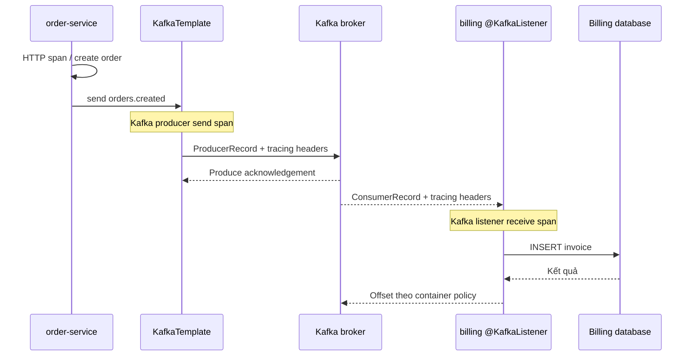
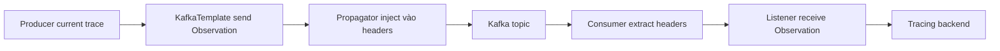

# Span cho send và receive trong Spring Kafka

Kafka thường nối nhiều service bằng các message bất đồng bộ. Một yêu cầu bắt đầu ở HTTP API có thể được producer gửi thành Kafka record, nằm trong broker một khoảng thời gian rồi mới được consumer xử lý; sau đó consumer lại phát record mới cho service khác. Khi chỉ xem log của từng service, người vận hành khó xác định **thao tác nào chậm, lỗi xuất hiện ở đầu gửi hay đầu nhận, và một record đã trải qua bao nhiêu lần thử**.

Trong chương **Observation và tracing** của module *Spring Kafka Reliability Operations*, **span cho send và receive** là cách nhìn vào hai điểm kết nối quan trọng:

- **Send span** mô tả một thao tác producer gửi Kafka record, thường là operation của `KafkaTemplate.send()`.
- **Receive/process span** mô tả một lượt listener nhận và xử lý Kafka record hoặc batch, thường là operation của `@KafkaListener`.

Spring Kafka từ các phiên bản hỗ trợ Micrometer Observation có thể tạo observations cho `KafkaTemplate` và listener container. Khi một `ObservationRegistry` được kết nối với Micrometer Tracing bridge và exporter, các observations đó có thể sinh spans trong hệ thống distributed tracing. Trace context được truyền qua **Kafka record headers** để liên hệ các hoạt động xảy ra ở hai JVM khác nhau.

Điều quan trọng: **span mô tả việc thực thi, không chứng minh nghiệp vụ đã hoàn tất**. Một send span thành công không tự xác nhận Kafka transaction đã commit. Một receive span kết thúc bình thường không bảo đảm consumer offset đã được commit. Retry, rebalance, DLT và các tác dụng phụ ngoài Kafka đều cần được xem riêng.

## 1. Những khái niệm nền tảng

| Khái niệm | Ý nghĩa |
|---|---|
| Trace | Chuỗi các hoạt động có liên hệ về mặt nhân quả |
| Span | Một đơn vị công việc có tên, thời điểm bắt đầu/kết thúc và metadata |
| Trace ID | Định danh trace dùng để liên hệ các spans |
| Span ID | Định danh một span |
| Parent / span link | Quan hệ với span khác, theo instrumentation và semantics |
| Span kind | Vai trò như producer, consumer, client hoặc internal |
| Span attributes | Thông tin mô tả operation, topic, outcome, exception... |
| Observation | Abstraction của Micrometer để quan sát một operation |
| ObservationRegistry | Nơi quản lý handlers cho observations |
| Tracing bridge | Thành phần kết nối Micrometer Observation với tracer |
| Propagator | Đưa trace context vào và đọc từ Kafka headers |
| Exporter | Gửi span data tới collector/backend |

Một observation có thể phục vụ cả metrics và tracing:

```text
KafkaTemplate / listener invocation
             |
             v
      Micrometer Observation
             |
             +-- Metrics handler --> timer / distribution
             |
             +-- Tracing handler --> producer / consumer span
                                             |
                                             v
                                     Tracing exporter
                                             |
                                             v
                                   Collector / trace backend
```

Nếu chỉ bật Observation nhưng không có tracing bridge/exporter thích hợp, ứng dụng có thể có metrics mà **không nhìn thấy span tại Jaeger, Tempo, Zipkin hoặc backend khác**. Nếu chỉ có tracing bridge nhưng KafkaTemplate/container chưa bật Observation, có thể thấy HTTP spans mà thiếu send/receive spans của Kafka.

### 1.1. Một event không tương đương một span

Một record có thể bị listener xử lý lại nhiều lần. Mỗi attempt có thể được ghi nhận bằng một listener observation/span riêng. Một event có thể được republish sang retry topic, DLT rồi replay, dẫn đến thêm nhiều send và receive operations.

```text
Business event ID: order-event-42
    |
    +-- Producer send orders.created
    |
    +-- Receive attempt 1: lỗi database
    +-- Receive attempt 2: lỗi database
    +-- Receive attempt 3: thành công

=> Có thể có nhiều spans cho cùng một event.
```

Không dùng số spans làm số business events duy nhất, nhất là khi tracing đang sampling.

## 2. Sơ đồ hành trình send → broker → receive

Ví dụ `order-service` phát `orders.created`, sau đó `billing-service` consume và lưu hóa đơn.



Trong trace backend, có thể nhìn thấy một chuỗi tương tự:

```text
Trace: create-order
  HTTP POST /orders
    Kafka send orders.created

  Kafka receive orders.created
    DB INSERT invoice
    Kafka send invoices.created
```

Một số instrumentation biểu diễn quan hệ producer–consumer bằng parent/child; một số mô hình messaging sử dụng span links. **Không xây business logic dựa vào cấu trúc cây trace cố định**. Điều cần kiểm chứng là trace context có được truyền qua Kafka và các thao tác có thể liên hệ với nhau khi điều tra.

### 2.1. Broker có tự tạo span không?

Kafka broker lưu record và chuyển headers, nhưng không mặc định phát ra application span theo trace của `KafkaTemplate`. Send span và receive span được tạo bởi instrumentation của hai đầu ứng dụng.

Muốn quan sát broker internals, cần Kafka broker metrics/tracing instrumentation riêng. Không xem khoảng trống giữa hai spans là một “broker span” tự động.

## 3. Send span đo ranh giới nào?

Với `KafkaTemplate`, send observation được dùng để quan sát một hoạt động gửi record. Nó hữu ích để tìm hiểu:

1. Producer bắt đầu gửi lúc nào?
2. Send outcome trả lỗi hay thành công?
3. Topic đích và producer operation là gì?
4. Send mất bao lâu?
5. Lỗi gửi có trùng thời điểm broker latency hoặc client retry tăng không?

Tuy nhiên send span **không bao gồm mọi phần trong vòng đời event**. Nếu event nằm 5 phút trong một database outbox trước khi publisher gọi `send()`, send span không mặc định đo 5 phút đó.

Đặc biệt, khi gửi trong transaction:

```text
KafkaTemplate.send()
       |
       +-- Producer send hoàn tất thành công
       |
       +-- Kafka transaction vẫn đang mở
               |
               +-- commit --> visible với read_committed
               |
               +-- abort  --> không visible với read_committed
```

Một send span thành công **không đồng nghĩa Kafka transaction commit thành công**. Nếu workflow cần EOS, phải theo dõi transaction outcome, consumed offsets và producer send outcome thành những tín hiệu riêng biệt.

### 3.1. Lỗi gửi đồng bộ và bất đồng bộ

`KafkaTemplate.send()` có thể thất bại ngay ở bước chuẩn bị, như serialization hoặc lấy metadata, hoặc báo lỗi sau đó qua future/callback.

Một `TimeoutException` ở producer có thể xuất hiện sau nhiều attempts/retries. Một serializer exception có thể xảy ra trước khi broker nhận được record. Cùng là send failure nhưng biện pháp xử lý khác nhau.

Không mặc định rằng tracing sẽ thay thế producer error metrics. Nên xem send spans cùng với `record-error-rate`, `record-retry-rate`, send latency, timeout và broker health.

## 4. Receive span đo ranh giới nào?

Với listener container, receive/process observation thường bao quanh **một lượt gọi listener** trong phạm vi instrumentation tương ứng.

Nó giúp phân tích:

- Listener nào đã nhận record?
- Thời gian listener thực thi nghiệp vụ.
- Exception nào đã được ném trong listener?
- Có database/HTTP spans con hay không?
- Record có được retry hoặc chuyển DLT không?

Nhưng receive span không tự đo thời gian event nằm trong Kafka topic trước khi listener được gọi.

```text
Event được tạo lúc T0
  |
  +-- Producer send lúc T1
  |
  +-- Broker giữ record / backlog từ T1 đến T2
  |
  +-- Listener receive/process từ T2 đến T3
  |
  +-- Offset commit / transaction outcome sau đó
```

Nếu listener chỉ chạy 30 ms nhưng record chờ backlog hai giờ, receive span có thể phản ánh 30 ms, **không phải** end-to-end latency hai giờ.

**Listener span success cũng không mặc định nghĩa offset đã được commit.** Container còn xử lý acknowledgement, error handler hoặc transaction sau khi listener trả về theo cấu hình.

### 4.1. Receive không có nghĩa KafkaConsumer.poll()

Spring Kafka listener observation và việc đo lường vòng `KafkaConsumer.poll()` không phải một metric/span giống nhau. Nếu consumer bị treo và không poll, cần kết hợp client metrics, `NonResponsiveConsumerEvent`, `noPollThreshold`, consumer lag và thread dump.

Không chỉ dựa vào receive spans: khi consumer ngừng poll hoàn toàn, không có listener invocation mới để tạo spans.

### 4.2. Batch listeners

Với batch listener, đơn vị observation và propagation context có thể khác tùy phiên bản Spring Kafka và cách xử lý batch. Không mặc định một batch chứa 200 records sẽ tạo đúng 200 receive spans.

Nếu batch chứa records từ nhiều tracing contexts, cần kiểm tra framework thực sự chọn/extract context nào và semantic conventions phù hợp trước khi giả định tất cả records có một parent duy nhất.

## 5. Những thành phần cần thiết cho tracing

Một ứng dụng dùng Spring Kafka và Spring Boot có thể cần:

| Thành phần | Nhiệm vụ |
|---|---|
| `spring-kafka` | KafkaTemplate, listener containers, Observation integration |
| `micrometer-observation` | Observation API/registry |
| `micrometer-tracing` | Tracing abstraction |
| Tracing bridge | OpenTelemetry hoặc Brave |
| Exporter/reporter | Chuyển spans đến backend |
| Observation/tracing auto-configuration | Nối registry, tracer, exporter |
| Kafka record headers | Chuyển propagation metadata xuyên process |
| Collector/trace backend | Lưu và truy vấn trace data |

Tùy Spring Boot version, một setup OpenTelemetry có thể sử dụng `spring-boot-starter-actuator`, `micrometer-tracing-bridge-otel` và các dependencies exporter tương ứng. Cần kiểm tra cấu hình exporter theo Boot release thay vì giả định mọi bản đều dùng cùng property keys.

Một application **có thể gửi message bình thường mà không có tracing**. Tracing là lớp quan sát bổ sung; không nên để một exporter outage làm hỏng Kafka business processing.

## 6. Bật Observation cho KafkaTemplate

Một cấu hình Java minh họa Spring Kafka 3.x:

```java
@Configuration
public class ObservedProducerConfiguration {

    @Bean
    public KafkaTemplate<String, String> observedKafkaTemplate(
            ProducerFactory<String, String> producerFactory,
            ObservationRegistry observationRegistry) {

        KafkaTemplate<String, String> template =
                new KafkaTemplate<>(producerFactory);

        template.setObservationRegistry(observationRegistry);
        template.setObservationEnabled(true);

        return template;
    }
}
```

Ý nghĩa:

- `ProducerFactory` quản lý Kafka producer theo config broker, serializer và transaction.
- `ObservationRegistry` chứa handlers/tracing integration phù hợp.
- `setObservationEnabled(true)` bật việc tạo observations khi template gửi message.

Nếu Spring Boot đã tạo KafkaTemplate mặc định, một bean template tùy chỉnh có thể làm thay đổi auto-configuration. Cần chắc chắn **template được application thực sự sử dụng** đã bật Observation, không phải một bean khác cùng kiểu nhưng chưa bao giờ được inject.

### 6.1. Service gửi message

```java
@Service
public class OrderPublisher {

    private final KafkaTemplate<String, String> kafkaTemplate;

    public OrderPublisher(
            @Qualifier("observedKafkaTemplate")
            KafkaTemplate<String, String> kafkaTemplate) {
        this.kafkaTemplate = kafkaTemplate;
    }

    public CompletableFuture<SendResult<String, String>> publish(
            String orderId,
            String eventJson) {

        return kafkaTemplate.send(
            "orders.created",
            orderId,
            eventJson
        );
    }
}
```

Spring Kafka 3.x thường dùng `CompletableFuture<SendResult<K,V>>`; các bản cũ hơn có thể dùng `ListenableFuture`. Kiểm tra version trước khi copy ví dụ.

Không tự tạo thêm một span tên `kafka.send` bao quanh mọi lời gọi `KafkaTemplate.send()` nếu template đã có Observation phù hợp, trừ khi có lý do rõ ràng. Hai instrumentation layers cùng tạo send span có thể dẫn đến duplicate spans và timeline khó đọc.

## 7. Bật Observation cho listener container

Với `@KafkaListener`, cần bật Observation trên đúng listener container factory.

```java
@Configuration
public class ObservedConsumerConfiguration {

    @Bean
    public ConcurrentKafkaListenerContainerFactory<String, String>
            kafkaListenerContainerFactory(
                    ConcurrentKafkaListenerContainerFactoryConfigurer configurer,
                    ConsumerFactory<String, String> consumerFactory) {

        var factory =
                new ConcurrentKafkaListenerContainerFactory<String, String>();

        // Áp dụng những cấu hình Boot đang quản lý.
        configurer.configure(factory, consumerFactory);

        factory.getContainerProperties()
                .setObservationEnabled(true);

        return factory;
    }
}
```

Listener:

```java
@Component
public class BillingListener {

    private final BillingService service;

    public BillingListener(BillingService service) {
        this.service = service;
    }

    @KafkaListener(
        id = "billing-listener",
        topics = "orders.created",
        groupId = "billing-service"
    )
    public void onOrder(ConsumerRecord<String, String> record) {
        service.createInvoice(record.key(), record.value());
    }
}
```

Khi registry, instrumentation và propagator đã được cấu hình phù hợp, Spring Kafka có thể tạo listener observation và trích xuất tracing context từ headers.

Nếu ứng dụng có nhiều container factories, chỉ bật Observation trên `kafkaListenerContainerFactory` không tự bật nó trên mọi factory. Phải kiểm tra `containerFactory` được mỗi listener chỉ định.

### 7.1. Có cần @Observed trên @KafkaListener?

Không bắt buộc cho send/receive spans mặc định khi Spring Kafka container Observation đang hoạt động. `@Observed` hoặc các annotations tạo span khác có thể dùng cho **business method** nếu được bật AOP/instrumentation tương ứng, nhưng có thể sinh spans bổ sung hoặc duplicate nếu đặt không có chủ đích.

Bật listener observation ở container, sau đó tạo custom business spans khi cần đo một phần nghiệp vụ riêng.

## 8. Trace context được chuyển qua Kafka headers

Một trace ở producer không tự truyền sang consumer chỉ vì hai services cùng sử dụng Kafka. Context cần được **inject** vào Kafka record headers rồi **extract** ở phía nhận.



Với propagation theo **W3C Trace Context**, thường gặp headers `traceparent` và đôi khi `tracestate`. Một hệ sinh thái dùng B3 có thể dùng header names khác. Tên headers thực tế phụ thuộc tracing bridge và cấu hình propagator.

**Không giả định mọi deployment dùng cùng format.** Nếu producer inject W3C nhưng consumer chỉ extract B3, send và receive spans có thể không liên kết được dù Kafka message vẫn được xử lý bình thường.

### 8.1. Dữ liệu header không phải payload

Kafka headers lưu key và byte values; tracing framework chịu trách nhiệm encoding/decoding propagation context. Broker không cần diễn giải dữ liệu đó.

Không tự serialize toàn bộ tracing context vào JSON value của business event nếu Kafka headers đã đáp ứng yêu cầu. Cũng không tự phân tích header bytes bằng business deserializer để dựng trace context.

### 8.2. Producer của ngôn ngữ khác

Upstream viết bằng Go, Python, JavaScript, Kafka Connect hoặc một Kafka client khác vẫn có thể truyền context hợp lệ nếu:

1. Đã có trace context trong process upstream.
2. Producer inject context theo format được thống nhất.
3. Hệ thống trung gian không làm mất các headers cần thiết.
4. Spring Kafka consumer extract bằng propagator tương thích.

Nếu message không có trace context, consumer vẫn phải xử lý message đúng nghiệp vụ. Receive span có thể trở thành root span; **thiếu parent không phải lỗi deserialization**.

## 9. Parent/child và span links trong hệ thống bất đồng bộ

Khi quan sát HTTP request đồng bộ, parent/child spans thường dễ hiểu. Messaging lại có đặc tính bất đồng bộ, fan-out/fan-in, batching và replay.

Ví dụ một producer phát message cho ba consumer groups:

```text
producer send orders.created
           |
           +-- inventory-service receive
           +-- billing-service receive
           +-- analytics-service receive
```

Những consumer groups có thể xử lý ở các thời điểm rất khác nhau. Một trace backend có thể biểu diễn causal relationship theo parent context hoặc span links tùy conventions.

Không ép tất cả receive spans phải nằm trong một cấu trúc parent/child cứng, đặc biệt khi có batch processing hoặc một consumer hợp nhất nhiều messages. Điều quan trọng là **có thể xác định quan hệ nguyên nhân phù hợp**.

### 9.1. Span kind

Messaging spans thường có ngữ nghĩa `PRODUCER` và `CONSUMER`, nhưng tên operation và cách ánh xạ có thể thay đổi theo OpenTelemetry semantic conventions/instrumentation version.

Khi xây dashboards hoặc search traces, nên đối chiếu backend đã nhận những span names, kinds và attributes nào thay vì giả định các key bất biến.

## 10. Trace ID không phải event ID

Trong Kafka reliability có ít nhất ba loại định danh:

| Định danh | Công dụng chính |
|---|---|
| Trace ID | Liên kết operations khi quan sát |
| Topic/partition/offset | Xác định record vật lý trong Kafka log |
| Business event ID | Deduplication, idempotency, replay và reconciliation |

Ví dụ một event đi qua retry/DLT:

```text
eventId = order-event-42

Gốc:        orders.created-0@150
Retry:      orders.created-retry-1000-0@80
DLT:        orders.created.DLT-0@11
Replay:     orders.created-1@220
```

Topic/partition/offset thay đổi khi republish. Trace ID cũng có thể thay đổi theo attempts và replay. **Business event ID nên ổn định nếu domain contract yêu cầu chống trùng**.

Không dùng Trace ID như khóa để trừ tiền, khóa inbox hoặc deduplicate event: trace sampling, propagation, batch/replay và tracing configuration không phải nguồn định danh nghiệp vụ đáng tin cậy.

## 11. Bổ sung business span trong listener

Send/receive spans giúp nhìn tổng quan. Khi muốn biết phần nào của business logic chậm, có thể tạo custom Observation:

```java
@Service
public class InvoiceService {

    private final ObservationRegistry observationRegistry;
    private final InvoiceRepository repository;

    public InvoiceService(
            ObservationRegistry observationRegistry,
            InvoiceRepository repository) {
        this.observationRegistry = observationRegistry;
        this.repository = repository;
    }

    public void persistInvoice(Invoice invoice) {
        Observation.createNotStarted(
                "billing.invoice.persist",
                observationRegistry
        ).observe(() -> {
            repository.save(invoice);
        });
    }
}
```

Khi chạy trong listener tracing context trên cùng thread, custom Observation có thể tạo span liên quan đến receive operation.

Tên operation nên ổn định:

```text
billing.invoice.persist
orders.validate
inventory.reserve
payment.check_eligibility
```

Không ghép `orderId`, `customerId` hoặc event ID vào span name. Nếu cần correlation, sử dụng attributes có kiểm soát privacy và sampling.

### 11.1. Không che exception chỉ để span xanh

Nếu code bên trong custom Observation ném lỗi, cứ để exception truyền về layer chịu trách nhiệm xử lý hoặc xử lý theo policy được thiết kế. Không bắt rồi return thành công chỉ để span có status “success”: container có thể hiểu record đã được xử lý và commit offset quá sớm.

## 12. Listener retries: nhiều receive spans cho cùng record

Một Kafka listener có thể được gọi lại do `DefaultErrorHandler`, backoff, redelivery sau crash hoặc rebalance.

```text
orders.created-0@150
   |
   +-- Attempt 1 --> receive span --> Database timeout
   +-- Attempt 2 --> receive span --> Database timeout
   +-- Attempt 3 --> receive span --> Success
```

Số receive spans lớn hơn số records gốc không tự chứng minh duplicate business events. Nó có thể phản ánh **attempts** trong at-least-once processing.

Để điều tra retry, ghép tracing với:

- Original topic, partition, offset.
- Business event ID.
- Retry attempt counter/header nếu được framework hỗ trợ.
- Listener exception class/category.
- Backoff duration.
- Outcome cuối: success, recovered-to-DLT hay recovery-failed.

Không đưa offset hoặc event ID vào low-cardinality metrics tags; nếu cần lưu chúng trong tracing/logging, vẫn phải kiểm soát privacy và chi phí.

### 12.1. Blocking retry

Khi retry ngay trong đường listener/error handler, các lần gọi lại listener có thể xuất hiện như nhiều observations/spans, tùy Spring Kafka version và chính sách instrumentation.

Nếu retry delay dài nhưng receive span mỗi attempt ngắn, **end-to-end retry latency** vẫn có thể lớn. Đo riêng từ original event time đến final outcome.

### 12.2. Non-blocking retry topics

Với `@RetryableTopic`, một record có thể được publish sang retry topic để xử lý sau:

```text
orders.created
   -> listener lỗi
   -> send orders.created-retry-1000
   -> listener retry lỗi
   -> send orders.created-retry-5000
   -> listener retry
   -> success hoặc DLT
```

Mỗi send/receive mới có thể tạo observation riêng nếu infrastructure template và retry listener containers tương ứng được bật. Không giả định custom KafkaTemplate dùng cho business publish kiểm soát toàn bộ retry-topic infrastructure.

Khi đọc traces, nhận diện rõ retry-topic send và listener attempt; đó là các operations khác nhau, không nhất thiết là duplicate instrumentation.

## 13. Dead-letter topic cũng có send span

`DeadLetterPublishingRecoverer` sử dụng Kafka operations để publish record lỗi vào DLT. Nếu template thực hiện publish được bật Observation và có tracing bridge, DLT send operation cũng có thể được ghi nhận.

Tuy nhiên, cần phân biệt:

```text
Listener business failure
     |
DefaultErrorHandler / AfterRollbackProcessor
     |
DeadLetterPublishingRecoverer
     |
DLT producer send span
     |
Kafka DLT send result
     |
Consumer offset handling theo policy
```

Một DLT send span success không chứng minh **business success**, cũng không chắc offset nguồn đã commit. Nếu DLT producer send được xác nhận nhưng offset commit thất bại, record có thể được đọc lại và DLT có duplicate.

Nếu DLT producer thất bại, error handler/recoverer phải báo recovery failure theo yêu cầu durability; tracing chỉ giúp phân tích nguyên nhân.

### 13.1. Trace khi replay từ DLT

Replay sau nhiều giờ hoặc nhiều ngày nên được xem là một **operation mới** có tracking riêng. Có thể tạo trace mới và liên kết bằng event ID, original Kafka metadata hoặc span links tùy tracing system.

Không bắt buộc tái sử dụng cùng Trace ID của request gốc cho tất cả replay, vì điều đó có thể gây trace sống rất lâu và phức tạp.

## 14. Kafka transactions: send span chưa đủ

Trong Kafka transactional listener container, produced Kafka outputs và consumed offsets có thể được đưa vào cùng Kafka transaction khi cấu hình đúng.

```text
Kafka transaction T1 bắt đầu
    |
    +-- Listener receive/process operation
    +-- KafkaTemplate.send output A    --> send span
    +-- KafkaTemplate.send output B    --> send span
    +-- Send consumed offsets to transaction
    |
    +-- Commit hoặc abort T1
```

Nếu T1 abort, consumer dùng `isolation.level=read_committed` không thấy outputs của transaction đã abort. Nhưng tracing vẫn có thể ghi nhận các **send attempts** đã diễn ra.

Cần theo dõi riêng:

| Tín hiệu | Ranh giới |
|---|---|
| Send span | Một producer send operation |
| Receive span | Một listener invocation |
| Transaction commit/abort metrics | Outcome của Kafka transaction |
| Consumer offset commit progress | Vị trí đã xử lý/được commit |
| Business completion | Trạng thái nghiệp vụ cuối cùng |

**Không đếm send spans success như transaction commits.** Một Kafka transaction có thể chứa nhiều sends và vẫn abort ở cuối.

### 14.1. executeInTransaction không tự đưa consumer offset vào transaction

Gọi `KafkaTemplate.executeInTransaction(...)` trong `@KafkaListener` mở local producer transaction riêng. Nó không tự gắn input offset vào local transaction đó. Khi yêu cầu Kafka-to-Kafka EOS, cần transactional listener container được cấu hình đúng.

Một trace có hai spans nối đẹp nhau không chứng minh pipeline đạt exactly-once. Đây là bài toán của Kafka transaction semantics, không phải tracing.

## 15. Async processing: context có thể bị mất

Tracing context thường gắn với thread/scope đang thực thi. Nếu listener chuyển công việc sang executor thread, context không nhất thiết đi theo.

Ví dụ:

```java
@KafkaListener(topics = "orders.created")
public void consume(OrderCreated event) {
    CompletableFuture.runAsync(() -> {
        kafkaTemplate.send(
            "orders.confirmed",
            event.orderId(),
            toJson(event)
        );
    });
}
```

Đoạn này có **hai rủi ro độc lập**:

1. **Tracing:** send span trên background thread có thể trở thành root span vì context của receive không được truyền.
2. **Reliability:** listener có thể return và offset được ack/commit trước khi send hoàn tất; send failure sau đó không tự quay về error handler.

Để giữ tracing context, có thể sử dụng **Micrometer Context Propagation**, context-aware executor/task decorator hoặc cách capture/restore context được framework/version hỗ trợ.

Một mô hình khái niệm:

```text
Listener thread:
  capture observation/tracing context
  submit decorated task

Worker thread:
  restore context trong scope
  thực hiện business work
  KafkaTemplate.send()
  close scope / restore previous context
```

Lưu ý: code capture/restore cụ thể phụ thuộc Micrometer/Spring version. Không lưu trace context vào một ThreadLocal rồi quên xóa; thread pool tái sử dụng threads có thể khiến task kế tiếp mang nhầm trace context.

**Quan trọng hơn:** propagation không khắc phục ack sớm. Với async work, cần acknowledgement sau completion hoặc durable inbox/work queue và idempotency.

## 16. Span attributes và cardinality

Micrometer Observation phân biệt **low-cardinality key values** và **high-cardinality key values**. Vì Observation có thể tạo cả metrics và traces, việc phân loại đúng là cần thiết.

| Metadata | Dùng làm metric tag? | Trong trace/log? |
|---|---|---|
| Service name | Có | Có |
| Topic thuộc tập hữu hạn | Có | Có |
| Listener ID logic | Có | Có |
| Operation/outcome | Có | Có |
| Exception class chuẩn hóa | Có thể | Có |
| Business event ID | **Không** | Có thể, nếu cho phép |
| Kafka offset | **Không** | Có thể |
| Record key | **Không** | Hạn chế do PII |
| Raw payload | **Không** | Thường không |
| Raw exception message | **Không** | Hạn chế |
| Trace ID | **Không** | Là metadata tracing |

Các giá trị như offset và event ID thay đổi liên tục, có thể tạo lượng lớn time series nếu đưa vào low-cardinality metric labels.

### 16.1. Observation conventions

Spring Kafka có những observation context/convention classes cho KafkaTemplate và listener operations. Các span names, attributes mặc định và extension APIs có thể khác giữa các phiên bản.

Nếu cần custom convention:

- Giữ tên operation ổn định.
- Không phá cơ chế propagation.
- Chỉ thêm low-cardinality keys thực sự hữu hạn.
- Không gắn raw payload hoặc credentials.
- Kiểm tra metadata thực tế trong tracing backend.

Không xây alert trên một attribute name chưa được xác nhận từ dependency/version đang dùng.

## 17. Baggage và bảo mật

**Baggage** là thông tin có thể được propagation qua các process cùng tracing context. Không đưa mật khẩu, token, session, thông tin thanh toán hoặc dữ liệu cá nhân vào baggage.

Kafka record headers có thể được những downstream consumers khác đọc. Trace metadata không phải authentication/authorization token; không được dùng `traceparent` hoặc Trace ID để quyết định một event có được phép xử lý không.

Nếu topic nhận dữ liệu từ bên ngoài, coi propagation headers là dữ liệu không đáng tin cậy; để tracing framework validate/extract theo chuẩn và áp dụng giới hạn kích thước/giá trị phù hợp.

Trace backend cũng cần access controls, retention và quy tắc mask dữ liệu như một hệ thống quan sát nhạy cảm.

## 18. Sampling làm trace có thể thiếu

Tracing thường sampling một phần các requests/messages để kiểm soát chi phí.

Ví dụ:

```text
Traffic: 100.000 Kafka sends/phút
Sampling: 10%

Backend có thể chỉ giữ một phần traces/spans.
Số spans hiển thị không bằng số record gửi thực tế.
```

Với head sampling, quyết định giữ trace có thể xảy ra trước khi biết operation sau đó có lỗi. Một failure hiếm có thể không được lưu trong tracing backend.

Vì thế:

- Không tính producer error rate chỉ từ sampled send spans.
- Không dùng số receive spans để tính consumer throughput tuyệt đối.
- Một event không tìm thấy trace không chứng minh record bị mất.
- Cần metrics producer/consumer và structured logs đủ coverage.
- Có thể xem xét tail sampling ở collector nếu backend/chi phí cho phép, nhưng không mặc định nó giữ được mọi lỗi.

### 18.1. Tracing exporter outage

Nếu collector/backend không khả dụng, ứng dụng vẫn phải bảo đảm Kafka sends/receives theo business contract. Exporter nên có timeout/batch/drop policy hợp lý.

Theo dõi telemetry exporter errors/dropped spans riêng. Không để lỗi telemetry khiến consumer commit sai offset hoặc producer đổi error-handling policy.

## 19. Latency của send và receive khác end-to-end latency

Một hệ Kafka có nhiều khoảng thời gian:

| Duration | Được đo từ đâu đến đâu? |
|---|---|
| Producer send latency | Bắt đầu send → producer result |
| Kafka broker/topic dwell | Record được lưu → consumer nhận/đọc |
| Listener processing latency | Listener bắt đầu → kết thúc attempt |
| Offset commit latency | Commit request → broker response |
| Retry latency | Lỗi attempt đầu → attempt tiếp theo/final outcome |
| Transaction duration | Begin → commit/abort |
| End-to-end business latency | Event tạo → nghiệp vụ cuối hoàn tất |

Send và receive spans **không tự cộng thành end-to-end business latency**, vì có thể có queueing, broker dwell, retry delay và downstream workflows ngoài các spans đó.

Nếu muốn tính end-to-end latency, cần business timestamp hoặc record timestamp phù hợp, clock synchronization và định nghĩa final completion rõ ràng.

Với hai JVM khác nhau, không coi chênh lệch wall-clock timestamps là tuyệt đối chính xác nếu chưa kiểm soát clock skew.

### 19.1. Consumer lag và span duration

Một service có receive spans ngắn nhưng lag vẫn tăng có thể vì input rate lớn hơn processing capacity, thiếu partitions/concurrency hoặc đang pause. Ngược lại, receive span dài nhưng lag thấp có thể là ít traffic nhưng dependency chậm.

Trace có giá trị chẩn đoán; consumer lag và processing metrics vẫn cần được theo dõi độc lập.

## 20. Tạo custom span cho bước nghiệp vụ, không trùng send/receive

Một số đoạn đáng instrument:

```text
orders.validate
inventory.reserve
billing.invoice.persist
outbox.claim_batch
outbox.publish
payment.authorize
```

Một operation như `outbox.publish` có thể bao quanh logic đọc outbox, chọn records và mark published. KafkaTemplate send spans bên trong cho biết từng Kafka send.

Điều này cho phép trace giải thích:

```text
outbox.publish
  |
  +-- DB SELECT pending
  |
  +-- Kafka send orders.confirmed
  |
  +-- DB UPDATE outbox status
```

Nhưng vẫn cần bảo đảm tính đúng của outbox: Kafka send success rồi crash trước khi database mark published có thể khiến event publish trùng. Trace không tự tạo distributed transaction giữa Kafka và database.

## 21. Monitoring bổ sung cho send/receive spans

Một dashboard reliability nên đặt spans cạnh những metrics sau:

| Tín hiệu | Câu hỏi |
|---|---|
| Producer send error ratio | Có lỗi publish không? |
| Producer retry rate | Broker/network có dấu hiệu bất ổn không? |
| Producer send p95/p99 | Thao tác gửi có chậm không? |
| Consumer listener failure rate | Business processing có lỗi không? |
| Listener processing duration | Listener đang tốn thời gian ở đâu? |
| Consumer group lag | Record tồn đọng bao nhiêu? |
| Non-responsive consumer events | Consumer có lâu không poll không? |
| Retry attempt/latency | Có mất thời gian vì xử lý lại không? |
| DLT ingress/recovery failures | Poison records được giữ lại an toàn không? |
| Transaction abort/fencing | Kafka EOS đang gặp lỗi gì? |
| Offset commit failures | Consumer group progress có lưu được không? |
| Trace export errors | Có observability gap không? |
| Business event completion latency | SLO cuối cùng có đạt không? |

Một trace chứa send và receive spans giúp đi từ dashboard aggregate đến nguyên nhân của một attempt. Nó **không thay thế** các metrics kiểm tra trạng thái của cả pipeline.

## 22. Log correlation theo traceId/spanId

Các logs có thể được bổ sung `traceId` và `spanId` qua MDC integration khi tracing bridge/logging đã cấu hình phù hợp.

Ví dụ structured log:

```json
{
  "service": "billing-service",
  "listenerId": "billing-listener",
  "topic": "orders.created",
  "partition": 0,
  "offset": 150,
  "eventId": "order-event-42",
  "traceId": "example-trace-id",
  "spanId": "example-span-id",
  "outcome": "retry"
}
```

Đây là định dạng minh họa do ứng dụng/logging framework tạo, không phải tất cả trường tự có trong Spring Kafka.

Nếu log của background worker không có traceId, kiểm tra context propagation trước khi suy ra trace backend có lỗi. Nếu log có traceId nhưng backend không tìm thấy span, xem sampling, exporter failure và thời gian truy vấn.

Không dùng traceId làm low-cardinality metric tag và không log raw payload/credentials.

## 23. Integration test cho span send và receive

Để chứng minh tracing thật sự đi qua broker, nên dùng **Kafka broker thật** trong integration test, ví dụ Testcontainers hoặc EmbeddedKafka, cùng test tracer/span exporter hoặc tracing collector cho phép truy vấn kết quả.

### 23.1. Chuẩn bị

1. Tạo topic `orders.created`.
2. Cấu hình KafkaTemplate observation-enabled.
3. Cấu hình listener container observation-enabled.
4. Đảm bảo ObservationRegistry có tracing handlers.
5. Chọn propagation format thống nhất.
6. Có exporter/tracer test hoặc backend tạm thời để thu spans.
7. Gửi một record hợp lệ có event ID ổn định.
8. Đợi listener xác nhận business operation đã hoàn tất bằng latch/test state.

### 23.2. Success path

Kỳ vọng:

- Producer có send observation/span.
- Record có trace context headers khi propagator được bật.
- Consumer xử lý record.
- Có receive/listener observation/span.
- Hai operations có quan hệ causal theo tracing convention.
- Kafka topic/operation attributes có ý nghĩa.
- Không lộ raw record payload/secret trong spans.

Không hard-code một tên span duy nhất nếu framework version có thể thay đổi. Kiểm tra mối quan hệ producer/consumer và ranh giới span thay vì phụ thuộc mọi attribute mặc định.

### 23.3. Lỗi listener và retry

Cho listener ném exception lần đầu rồi thành công lần sau.

Kiểm tra:

- Listener exception được quan sát.
- Retry attempts tạo tín hiệu phù hợp với cơ chế handler/version.
- Kafka offset không bị commit quá sớm trong kịch bản lỗi.
- Final business outcome và recovery metric có thể được đối chiếu.
- Không dùng số receive spans làm số unique events.

### 23.4. DLT path

Cho listener liên tục lỗi và recover qua DLT.

Kiểm tra:

- Có tín hiệu listener failure.
- DLT recoverer gửi record qua template được instrument khi mong muốn.
- Record DLT giữ source metadata cần điều tra.
- DLT publish failure được quan sát bằng error-handler metrics/logs.
- DLT producer send span success không bị hiểu nhầm là business success.

### 23.5. Transaction abort

Gửi record trong Kafka transaction rồi chủ động abort. Dùng consumer `read_committed` để xác nhận record của transaction abort không được đọc.

Có thể thấy send span của attempt đã xảy ra nhưng **không có receive operation ở downstream read_committed cho record abort**. Điều này chứng minh send span không thay thế Kafka commit outcome.

### 23.6. Missing propagation headers

Dùng producer không có tracing gửi record hợp lệ.

Consumer vẫn phải xử lý bình thường, và có thể tạo receive/root span. Không được reject message chỉ vì nó không có `traceparent` hoặc B3 headers.

### 23.7. Async executor

Gửi record rồi xử lý phần nghiệp vụ qua executor. So sánh spans trước và sau khi cấu hình context-aware task execution.

Đồng thời kiểm tra **ack/commit đúng sau processing** hoặc durable enqueue, vì trace correlation đẹp không bảo đảm asynchronous workflow an toàn.

### 23.8. Exporter failure

Làm tracing collector không sẵn sàng trong môi trường test.

Kafka producer/consumer phải tiếp tục hoạt động theo business contract; sự cố export telemetry cần có tín hiệu riêng. Không đặt test success dựa vào giả định mọi span bắt buộc phải được ghi bền vững trong backend.

## 24. Runbook khi trace bị đứt giữa send và receive

Nếu producer span tồn tại nhưng không thấy consumer span, điều tra theo thứ tự:

1. Producer send future có hoàn tất thành công không?
2. Nếu transactional, Kafka transaction đã commit chưa?
3. Topic/partition của record có đúng không?
4. Consumer group có subscribe, assignment và progress không?
5. Consumer lag có tăng hoặc listener đang pause/stopped không?
6. Consumer listener factory có bật Observation không?
7. Tracing bridge/exporter của consumer có hoạt động không?
8. Producer và consumer có dùng cùng propagation format không?
9. Record headers có bị xóa trong pipeline trung gian không?
10. Có sampling khiến span không được export không?
11. Event có đang ở retry topic/DLT hoặc bị replay dưới trace khác không?
12. Có async task làm mất context khi chuyển thread không?
13. Tracing backend có ingestion delay hoặc exporter drop không?
14. Business event cuối cùng đã hoàn tất hay recovery theo state/offset thực tế chưa?

**Không kết luận record bị mất chỉ vì thiếu một span.** Kafka offsets, DLT records, outbox state và business event ID mới là bằng chứng phục hồi cần đối chiếu.

Ngược lại, nếu có consumer span nhưng không có producer span, record có thể đến từ Kafka Connect, CLI, một producer chưa bật instrumentation hoặc một trace bị sample. Receive span vẫn có giá trị.

## 25. Những lỗi triển khai thường gặp

**Chỉ thêm Micrometer Tracing dependency mà không bật KafkaTemplate Observation.** HTTP spans có thể có nhưng Kafka send spans không xuất hiện.

**Bật Observation cho producer nhưng không cho listener container.** Không đủ để có receive/process spans.

**Bật trên sai KafkaTemplate hoặc sai container factory.** Một bean không được dùng sẽ không tạo spans cho pipeline thật.

**Dùng hai tracing bridges/exporters chồng nhau.** Có thể phát sinh spans trùng, conflict hoặc khó xác định nguồn dữ liệu.

**Tạo custom send span trùng instrumentation mặc định.** Timeline bị lặp operation.

**Cho rằng send span success là transaction committed.** Send và commit có ranh giới khác nhau.

**Cho rằng receive span success là consumer offset đã commit.** Commit/acknowledgement có thể xảy ra sau listener.

**Đếm số spans sau sampling như throughput tuyệt đối.** Sampling làm số liệu không đầy đủ.

**Dùng Trace ID làm event ID hoặc idempotency key.** Không bảo đảm ổn định qua retry/replay.

**Không propagate context qua async executor.** Worker spans có thể thành root hoặc dính nhầm trace của task trước nếu scope cleanup sai.

**Coi broker sẽ tự nối traces giữa mọi services.** Cần record headers và propagator tương thích.

**Lưu raw payload, token hoặc PII trong baggage/span attributes.** Rủi ro bảo mật và privacy.

**Đặt Kafka offset hoặc event ID vào metrics labels.** Cardinality tăng quá lớn.

**Thiếu trace được hiểu là thiếu message.** Exporter/sampling có thể làm trace biến mất dù Kafka đã xử lý xong.

**Không đo retry/DLT/transaction outcomes ngoài tracing.** Trace của attempt không kể hết trạng thái cuối cùng.

## 26. Checklist production

Trước khi đưa send/receive tracing vào production, xác nhận:

1. Spring Kafka version hỗ trợ Observation cho KafkaTemplate/listener như mong muốn.
2. KafkaTemplate được ứng dụng sử dụng đã bật `observationEnabled`.
3. Listener container factory thực tế đã bật `observationEnabled`.
4. ObservationRegistry đã nối tracing handlers/bridge.
5. Exporter, collector, backend và sampling được cấu hình đúng version.
6. Producer/consumer cùng hiểu propagation format.
7. Headers không bị strip hoặc transform làm mất context.
8. Span names/attributes không chứa dữ liệu nhạy cảm.
9. Business span bổ sung không duplicate với send/receive instrumentation.
10. Async processing có context propagation và scope cleanup.
11. Retry/DLT/replay semantics được hiểu đúng, không đếm attempts thành unique events.
12. Kafka transaction commit/abort được đo riêng với send span.
13. Offset commit progress được đo riêng với listener completion.
14. Producer error rate, consumer lag, DLT metrics và SLO không phụ thuộc sampled spans.
15. Test đã kiểm chứng propagation xuyên Kafka broker.
16. Test đã kiểm chứng listener failure, DLT, transaction abort và no trace headers.
17. Tracing exporter outage không làm thay đổi Kafka business correctness.
18. Runbook có quy trình điều tra trace bị đứt và kiểm chứng business state thực tế.

### 26.1. Ba câu hỏi code review

**Send span kết thúc khi nào?** Khi send operation trả kết quả theo instrumentation, không mặc định khi Kafka transaction commit hoặc downstream xử lý xong.

**Receive span bao trùm điều gì?** Thường là một lượt listener xử lý, không tự bao gồm toàn bộ broker dwell time, offset commit và retries.

**Trace context đi qua đâu?** Kafka record headers theo propagator; không phải shared thread-local giữa các JVM.

## 27. Tài liệu tham chiếu theo phiên bản

Khi triển khai, cần đối chiếu đúng dependency đang chạy:

- **Spring for Apache Kafka Reference — Micrometer Observation / Monitoring**: KafkaTemplate observations và listener container observations.
- **Spring Kafka Javadoc — `KafkaTemplate`**: `setObservationEnabled`, `setObservationRegistry` và send APIs.
- **Spring Kafka Javadoc — `ContainerProperties`**: `setObservationEnabled` cùng lifecycle/acknowledgement settings.
- **Spring Kafka Reference — Transactions and Exactly Once Semantics**: producer sends, consumed offsets và commit/abort boundary.
- **Spring Kafka Reference — Error Handling / Non-blocking Retry / Dead-letter Publishing**: retry attempts, recovery và DLT.
- **Spring Boot Reference — Observability and Tracing**: tracing bridge, sampling, exporters, resource attributes và metrics configuration.
- **Micrometer Observation Reference**: ObservationRegistry, custom observations, handlers và cardinality.
- **Micrometer Tracing / OpenTelemetry Documentation**: spans, W3C Trace Context, B3, baggage, async context propagation.
- **OpenTelemetry Messaging Semantic Conventions**: producer/consumer span kinds, attributes, parent/span links.
- **Apache Kafka Documentation — Record Headers và Transactions**: message metadata, propagation bytes và transactional visibility.
- **Micrometer/Prometheus Documentation**: metrics cho send latency, retries, DLT và consumer health.

Các tên spans, attribute keys, batch listener behavior và exporter properties có thể thay đổi giữa các phiên bản Spring Kafka/Micrometer/Spring Boot. Hãy xác nhận bằng integration test và traces thực tế trước khi thiết lập alerts hoặc conventions cố định.

**Kết luận:** send và receive spans giúp quan sát hai đầu của một pipeline Kafka bất đồng bộ. Bật Micrometer Observation trên `KafkaTemplate` và listener container, kết nối tracing bridge/exporter và truyền context qua Kafka record headers là nền tảng. Nhưng tracing chỉ có giá trị reliability khi được diễn giải cùng **send outcomes, Kafka transaction commits, consumer offsets, retry/DLT, consumer lag và idempotency**. Một trace xanh không thay thế bằng chứng nghiệp vụ đã hoàn tất và dữ liệu đã được lưu an toàn.
