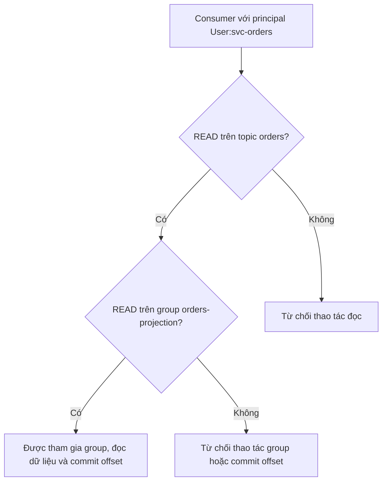

# Phân quyền theo topic và group

Kafka phân quyền ở cấp tài nguyên. Một ứng dụng được phép đọc một topic chưa chắc đã được phép tham gia consumer group; tương tự, quyền trên group không tự cấp quyền đọc dữ liệu của topic. Khi cấu hình ACL, cần cấp riêng các quyền mà từng luồng xử lý thực sự sử dụng.

## 1. Xác thực và phân quyền trong Kafka

Kafka xử lý hai câu hỏi khác nhau:

- **Xác thực (authentication):** client là ai? Broker xác định danh tính thông qua cơ chế bảo mật đã cấu hình, chẳng hạn SASL/SCRAM, SASL/OAUTHBEARER hoặc TLS client certificate.
- **Phân quyền (authorization):** danh tính đó được phép thực hiện thao tác nào trên tài nguyên nào? Authorizer của broker kiểm tra ACL trước khi chấp nhận thao tác.

Một ACL (Access Control List) mô tả principal, quyền thao tác, tài nguyên và có thể cả phạm vi host. Ví dụ, `User:svc-orders` được phép `READ` topic `orders` và `READ` group `orders-projection`.

Các ví dụ trong bài dùng Kafka CLI với `--bootstrap-server`. Tài khoản trong `--command-config` phải có quyền quản trị ACL. Principal trong ACL phải khớp với principal mà broker nhìn thấy sau khi xác thực và ánh xạ danh tính; tên tài khoản mà ứng dụng tự đặt trong cấu hình không nhất thiết là principal thực tế.

## 2. Hai loại tài nguyên cần phân biệt

| Tài nguyên | Đại diện cho | Ví dụ tên | Quyền thường dùng |
|---|---|---|---|
| `TOPIC` | Luồng bản ghi mà producer ghi và consumer đọc | `orders`, `payments` | `READ`, `WRITE`, `DESCRIBE`, `CREATE`, `DELETE`, `ALTER` |
| `GROUP` | Nhóm consumer phối hợp phân chia partition và quản lý offset | `orders-projection` | `READ`, `DESCRIBE`, `DELETE` |

Tên topic và tên group là hai namespace độc lập. Nếu một consumer đọc topic `orders` bằng group `orders-projection`, broker kiểm tra ACL trên cả hai tài nguyên:



Với consumer thông thường, bộ quyền tối thiểu thường là:

- `READ` trên từng topic cần tiêu thụ.
- `READ` trên đúng consumer group mà ứng dụng sử dụng.

Quyền `READ` trên topic cho phép consumer đọc bản ghi. Quyền `READ` trên group cho phép client thực hiện các thao tác cần thiết để tham gia consumer group và làm việc với offset của group. Kafka xem `DESCRIBE` là quyền được bao hàm bởi một số quyền thao tác như `READ` và `WRITE`, vì vậy thường không cần cấp thêm `DESCRIBE` chỉ để thực hiện luồng đọc/ghi cơ bản.

Nếu chỉ cấp `READ` trên topic, consumer có thể vượt qua một số bước truy cập topic nhưng vẫn bị từ chối khi join group hoặc commit offset. Nếu chỉ cấp `READ` trên group, consumer vẫn không được phép fetch dữ liệu từ topic.

## 3. Cấp quyền cho consumer

Giả sử dịch vụ `orders-projection` dùng principal `User:svc-orders`, đọc topic `orders` và chạy với group ID `orders-projection-v1`.

Trước tiên, tạo ACL đọc trên topic:

```bash
bin/kafka-acls.sh \
  --bootstrap-server kafka-1.example.net:9093 \
  --command-config config/admin.properties \
  --add \
  --allow-principal 'User:svc-orders' \
  --operation Read \
  --topic orders \
  --resource-pattern-type literal
```

Tiếp theo, cấp quyền đọc trên group:

```bash
bin/kafka-acls.sh \
  --bootstrap-server kafka-1.example.net:9093 \
  --command-config config/admin.properties \
  --add \
  --allow-principal 'User:svc-orders' \
  --operation Read \
  --group orders-projection-v1 \
  --resource-pattern-type literal
```

Hai lệnh tạo hai ACL riêng. Khi ứng dụng cần đọc thêm topic `order-events`, hãy cấp thêm quyền trên topic đó; quyền trên group không cần thay đổi nếu group ID vẫn giữ nguyên.

### Group ID trong Spring Kafka

ACL của group phải khớp với group ID hiệu lực tại runtime. Group ID có thể đến từ cấu hình mặc định:

```yaml
spring:
  kafka:
    consumer:
      group-id: orders-projection-v1
```

Hoặc được đặt trực tiếp trên listener:

```java
@KafkaListener(
    topics = "orders",
    groupId = "orders-projection-v1"
)
public void handle(OrderEvent event) {
    // Xử lý sự kiện đơn hàng
}
```

Nếu listener chỉ định `groupId`, hãy kiểm tra giá trị đó cùng các cấu hình container và consumer liên quan. Không suy ra group ID từ tên class, tên topic hoặc tên ứng dụng. Một thay đổi group ID khi triển khai có thể khiến ACL cũ không còn khớp, dù topic vẫn giữ nguyên.

## 4. Cấp quyền cho producer

Producer ghi bản ghi vào topic nên cần `WRITE` trên topic đích. Ví dụ, dịch vụ `orders-api` ghi vào topic `orders`:

```bash
bin/kafka-acls.sh \
  --bootstrap-server kafka-1.example.net:9093 \
  --command-config config/admin.properties \
  --add \
  --allow-principal 'User:svc-orders-api' \
  --operation Write \
  --topic orders \
  --resource-pattern-type literal
```

`WRITE` cho phép ghi bản ghi và bao hàm quyền mô tả cần thiết cho thao tác đó. Producer thông thường không cần quyền `READ` trên topic. Nếu ứng dụng vừa consume vừa produce, hãy cấp quyền riêng theo từng vai trò và tài nguyên.

Với producer dùng transaction, cần xem xét thêm ACL cho tài nguyên `TRANSACTIONAL_ID` tương ứng; thao tác transaction thường cần quyền `WRITE` trên transactional ID. Producer idempotent hoặc transactional còn có thể cần quyền ở cấp `CLUSTER` tùy phiên bản Kafka và cấu hình broker. Hãy xác định chính xác tính năng producer đang bật và đối chiếu ma trận quyền của phiên bản đang vận hành trước khi cấp quyền bổ sung. Không cấp `ALL` trên cluster chỉ để xử lý một lỗi transaction khi chưa xác định nguyên nhân.

## 5. Literal, prefixed và phạm vi ACL

Kafka hỗ trợ các kiểu resource pattern để xác định ACL áp dụng cho tài nguyên nào:

| Kiểu pattern | Ý nghĩa | Ví dụ |
|---|---|---|
| `literal` | Khớp đúng tên tài nguyên | Topic `orders` chỉ khớp `orders` |
| `prefixed` | Khớp tên bắt đầu bằng chuỗi đã khai báo | Prefix `orders.` khớp `orders.created` và `orders.cancelled` |
| `match` | Dùng khi liệt kê để tìm các ACL có thể khớp tài nguyên | Hữu ích khi điều tra quyền hiệu lực |

Ví dụ, nếu một dịch vụ được phép đọc tất cả topic có prefix `orders.`:

```bash
bin/kafka-acls.sh \
  --bootstrap-server kafka-1.example.net:9093 \
  --command-config config/admin.properties \
  --add \
  --allow-principal 'User:svc-orders' \
  --operation Read \
  --topic 'orders.' \
  --resource-pattern-type prefixed
```

ACL prefix trên topic không tự áp dụng cho group. Nếu các group của dịch vụ cũng tuân theo quy ước `orders-`, phải tạo ACL prefixed riêng cho tài nguyên group:

```bash
bin/kafka-acls.sh \
  --bootstrap-server kafka-1.example.net:9093 \
  --command-config config/admin.properties \
  --add \
  --allow-principal 'User:svc-orders' \
  --operation Read \
  --group 'orders-' \
  --resource-pattern-type prefixed
```

Chỉ dùng prefix khi các tài nguyên trong prefix có cùng ranh giới tin cậy và cùng chủ sở hữu. Một prefix quá rộng có thể cấp quyền đọc cho những topic hoặc group được tạo sau này mà nhóm vận hành không dự định chia sẻ. Tên tài nguyên literal `*` có ý nghĩa wildcard trong ACL; tránh dùng wildcard nếu ứng dụng chỉ cần truy cập một tập tài nguyên hữu hạn.

## 6. Kiểm tra ACL đã cấu hình

Liệt kê ACL của một topic:

```bash
bin/kafka-acls.sh \
  --bootstrap-server kafka-1.example.net:9093 \
  --command-config config/admin.properties \
  --list \
  --topic orders \
  --resource-pattern-type match
```

Liệt kê ACL của một group:

```bash
bin/kafka-acls.sh \
  --bootstrap-server kafka-1.example.net:9093 \
  --command-config config/admin.properties \
  --list \
  --group orders-projection-v1 \
  --resource-pattern-type match
```

Kiểu `match` giúp tìm cả ACL literal, prefixed và wildcard có thể áp dụng cho tài nguyên đang kiểm tra. Khi đọc kết quả, đối chiếu đủ principal, operation, permission type, host và resource pattern. Chỉ nhìn thấy một dòng `ALLOW` chưa đủ kết luận ứng dụng chắc chắn được truy cập, vì một ACL `DENY` phù hợp cũng có thể ảnh hưởng đến kết quả.

Để xác minh thực tế, chạy consumer bằng đúng thông tin xác thực của dịch vụ, đúng topic và đúng group ID. Kiểm tra các bước lấy metadata, join group, fetch record và commit offset. Lệnh liệt kê ACL bằng tài khoản quản trị chỉ cho biết cấu hình; thử nghiệm bằng principal của ứng dụng mới xác nhận được danh tính và quyền trong luồng vận hành thực tế.

## 7. ALLOW, DENY và quyền mặc định

Kafka ACL hỗ trợ `ALLOW` và `DENY`. Khi đánh giá một thao tác, nếu có ACL `DENY` phù hợp thì thao tác bị từ chối; nếu không có `DENY` phù hợp nhưng có `ALLOW` phù hợp thì thao tác được chấp nhận. Khi không có ACL nào cho phép thao tác, authorizer thông thường từ chối truy cập. Superuser được cấu hình ở broker có quyền vượt qua kiểm tra ACL.

Ví dụ, một principal có `ALLOW READ` cho topic `orders` nhưng đồng thời khớp với `DENY READ` trên chính topic đó vẫn không đọc được. Vì vậy, khi điều tra lỗi, hãy tìm cả ACL cho phép lẫn ACL từ chối, bao gồm các pattern prefixed hoặc wildcard có thể khớp.

Không bật chế độ cho phép mọi người truy cập tài nguyên chưa có ACL như một cách chữa cháy cho lỗi authorization. Cấu hình mặc định từ chối giúp tài nguyên mới không vô tình trở thành công khai khi chưa được cấp quyền. Cũng cần kiểm tra danh sách superuser và cấu hình authorizer trong broker, vì chúng ảnh hưởng đến kết quả phân quyền.

## 8. Thu hồi quyền khi thay đổi vòng đời dịch vụ

Khi một dịch vụ ngừng dùng topic hoặc group, thu hồi đúng ACL đã cấp. Ví dụ, xóa quyền đọc topic `orders` của `User:svc-orders`:

```bash
bin/kafka-acls.sh \
  --bootstrap-server kafka-1.example.net:9093 \
  --command-config config/admin.properties \
  --remove \
  --allow-principal 'User:svc-orders' \
  --operation Read \
  --topic orders \
  --resource-pattern-type literal
```

Thu hồi quyền đọc trên group bằng lệnh riêng:

```bash
bin/kafka-acls.sh \
  --bootstrap-server kafka-1.example.net:9093 \
  --command-config config/admin.properties \
  --remove \
  --allow-principal 'User:svc-orders' \
  --operation Read \
  --group orders-projection-v1 \
  --resource-pattern-type literal
```

Đối chiếu kết quả lệnh remove và liệt kê ACL lại để xác nhận. Với ACL prefixed hoặc wildcard, cần xác định phạm vi ảnh hưởng trước khi xóa; một ACL prefix có thể đang phục vụ nhiều topic hoặc group đang hoạt động.

## 9. Quy trình thiết kế quyền theo nguyên tắc tối thiểu

Trước khi cấp ACL cho một ứng dụng, lập bảng tài nguyên và thao tác mà ứng dụng cần:

| Vai trò ứng dụng | Tài nguyên | Quyền khởi đầu |
|---|---|---|
| Consumer | Mỗi topic cần đọc | `READ` |
| Consumer | Group ID hiệu lực | `READ` |
| Producer | Mỗi topic cần ghi | `WRITE` |
| Producer transactional | Transactional ID được sử dụng | Kiểm tra và cấp `WRITE` theo cấu hình transaction |
| Công cụ vận hành group | Group cần kiểm tra hoặc quản trị | Cấp `DESCRIBE`, `READ` hoặc quyền quản trị cụ thể theo thao tác thực tế |

Áp dụng quy trình sau trong mỗi lần triển khai:

1. Xác định principal thực tế từ cơ chế SASL hoặc TLS và quy tắc ánh xạ principal trên broker.
2. Liệt kê chính xác topic, group ID và transactional ID mà phiên bản ứng dụng sẽ sử dụng.
3. Chọn operation nhỏ nhất đáp ứng từng thao tác; tránh `ALL`, quyền cluster rộng và wildcard không cần thiết.
4. Tạo ACL bằng tài khoản quản trị, sau đó kiểm tra lại theo từng tài nguyên.
5. Khởi chạy ứng dụng bằng đúng principal và xác minh cả thao tác đọc/ghi lẫn thao tác group hoặc transaction liên quan.
6. Khi đổi group ID, đổi principal hoặc ngừng dịch vụ, cập nhật và thu hồi ACL tương ứng; lưu thay đổi trong quy trình quản lý cấu hình để có thể kiểm toán.

Nên dùng principal riêng cho từng dịch vụ và từng môi trường. Nếu nhiều ứng dụng dùng chung một principal, broker không thể phân biệt chúng khi áp dụng ACL; việc thu hồi quyền cho một ứng dụng có thể ảnh hưởng đến các ứng dụng còn lại. Tách principal giúp giới hạn sự cố và làm rõ chủ sở hữu của mỗi quyền.

## 10. Chẩn đoán lỗi authorization trong ứng dụng Spring Kafka

Khi consumer hoặc producer gặp lỗi authorization, hãy đọc exception và xác định tài nguyên được nêu trong lỗi. Một số tình huống thường gặp:

| Triệu chứng | Nguyên nhân cần kiểm tra |
|---|---|
| Consumer bị từ chối khi đọc record | Thiếu `READ` trên topic, topic name khác dự kiến hoặc principal không khớp |
| Consumer bị từ chối khi join group hoặc commit offset | Thiếu `READ` trên group hoặc group ID runtime khác ACL |
| Producer bị từ chối khi gửi record | Thiếu `WRITE` trên topic hoặc đang kết nối bằng principal khác |
| Ứng dụng kết nối được nhưng thao tác Kafka bị từ chối | Xác thực đã thành công nhưng authorizer không tìm thấy ACL phù hợp, hoặc có ACL `DENY` |
| Lỗi xuất hiện sau khi triển khai phiên bản mới | Topic, group ID, principal, transactional ID hoặc cơ chế xác thực đã thay đổi |

Kiểm tra theo thứ tự: principal broker nhận được; địa chỉ cluster và listener mà ứng dụng đang kết nối; topic name; group ID hiệu lực; ACL trên topic; ACL trên group; sau đó là các ACL transaction hoặc cluster nếu ứng dụng dùng tính năng tương ứng. Đảm bảo lệnh `kafka-acls.sh` đang trỏ đến đúng cluster và dùng `--command-config` của tài khoản quản trị.

Trong Spring Kafka, cấu hình `spring.kafka.properties.security.protocol`, SASL hoặc TLS giúp client xác thực và kết nối. Các thuộc tính đó không tự tạo ACL trên broker. Việc cấp quyền vẫn do cấu hình authorizer và ACL của Kafka quản lý. Không đưa mật khẩu, JAAS secret hoặc private key vào lệnh minh họa hay log khi chia sẻ kết quả điều tra.

## Kết luận vận hành

Phân quyền consumer cần xét đồng thời topic và group: topic quyết định quyền đọc dữ liệu, còn group quyết định quyền tham gia nhóm và quản lý offset. Producer cần quyền ghi trên topic; ứng dụng dùng transaction cần đánh giá thêm transactional ID và các quyền liên quan theo phiên bản Kafka. Dùng principal riêng, tên tài nguyên chính xác, pattern có phạm vi hẹp và kiểm tra bằng chính danh tính của ứng dụng sẽ giúp ACL dễ vận hành, dễ kiểm toán và giảm quyền truy cập ngoài nhu cầu.
