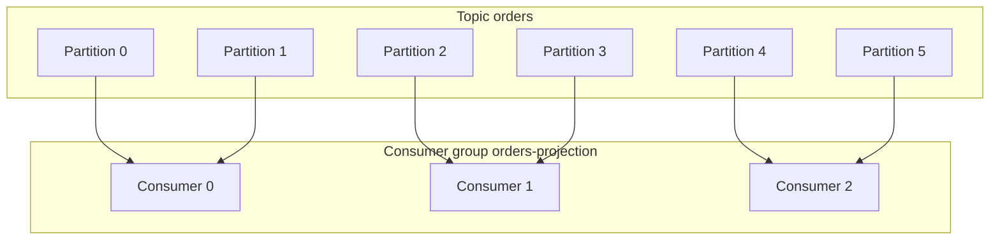

# Concurrency theo partition

Trong Kafka, partition là đơn vị phân chia dữ liệu và cũng là đơn vị cơ bản để phân công công việc cho các consumer trong cùng một consumer group. Muốn tăng số luồng xử lý song song, cần xem số partition của topic cùng số consumer thực tế mà ứng dụng Spring Kafka tạo ra. Tăng `concurrency` chỉ tạo thêm consumer; nó không tự tạo thêm partition hoặc làm một partition được nhiều consumer trong cùng group xử lý đồng thời.

## 1. Partition quyết định giới hạn song song

Kafka chia một topic thành nhiều partition. Mỗi partition là một log có thứ tự riêng, trong đó record được ghi nối tiếp và có offset tăng dần. Khi consumer thuộc cùng một group đăng ký đọc topic, Kafka phân công các partition cho những consumer trong group.

Quy tắc quan trọng là **tại một thời điểm, một partition chỉ được gán cho tối đa một consumer trong cùng group**. Một consumer có thể nhận nhiều partition, nhưng hai consumer cùng group không đồng thời sở hữu cùng một partition.

Ví dụ topic `orders` có 6 partition và consumer group `orders-projection` có 3 consumer:



Trong ví dụ này, ba consumer có thể xử lý ba partition cùng lúc; mỗi consumer chịu trách nhiệm hai partition. Nếu group có 6 consumer, mỗi consumer có thể nhận một partition. Nếu group có 9 consumer, tối đa 6 consumer có partition để xử lý, còn 3 consumer không được gán partition.

Với một topic và một group, gọi:

- `P` là số partition của topic.
- `R` là số replica (instance/pod) của ứng dụng.
- `C` là concurrency của listener trên mỗi instance.
- `N = R × C` là tổng số consumer mà các instance tạo ra trong trạng thái ổn định.

Số consumer có thể thực sự nhận partition bị giới hạn bởi:

\[
N_{active} \leq \min(P, R \times C)
\]

Đây là giới hạn trên cho một topic trong cùng group. Số consumer được gán thực tế còn phụ thuộc vào assignment strategy, số topic mà listener subscribe và tình trạng hoạt động của các instance.

## 2. `concurrency` trong Spring Kafka hoạt động như thế nào?

Spring Kafka cung cấp `ConcurrentMessageListenerContainer` để chạy nhiều consumer cho cùng một listener. Khi đặt `concurrency = 4`, container cha tạo và quản lý bốn container con. Mỗi container con sử dụng một Kafka consumer riêng, tham gia cùng group ID và có luồng xử lý riêng.

Ví dụ cấu hình qua `ConcurrentKafkaListenerContainerFactory`:

```java
@Bean
public ConcurrentKafkaListenerContainerFactory<String, OrderEvent>
        ordersKafkaListenerContainerFactory(
                ConsumerFactory<String, OrderEvent> consumerFactory) {

    ConcurrentKafkaListenerContainerFactory<String, OrderEvent> factory =
            new ConcurrentKafkaListenerContainerFactory<>();
    factory.setConsumerFactory(consumerFactory);
    factory.setConcurrency(4);
    return factory;
}
```

Listener sử dụng factory đó:

```java
@KafkaListener(
    topics = "orders",
    groupId = "orders-projection",
    containerFactory = "ordersKafkaListenerContainerFactory"
)
public void handle(OrderEvent event) {
    orderProjectionService.apply(event);
}
```

Trong cấu hình Spring Boot, có thể đặt concurrency mặc định cho listener container bằng thuộc tính `spring.kafka.listener.concurrency`. Nếu cần cấu hình riêng từng listener, hãy dùng factory riêng hoặc thuộc tính `concurrency` của `@KafkaListener` ở phiên bản Spring Kafka hỗ trợ thuộc tính đó. Hãy kiểm tra phiên bản thư viện đang chạy trước khi chọn cách cấu hình.

Concurrency là số consumer cho mỗi listener container trên mỗi instance. Nếu cùng một factory được dùng cho ba phương thức `@KafkaListener` độc lập, mỗi listener tạo container riêng và mỗi container có thể áp dụng concurrency của factory. Vì vậy, không nên mặc định tổng số consumer của ứng dụng chỉ bằng một giá trị concurrency khi có nhiều listener.

## 3. Tính concurrency theo số partition và số instance

Giả sử topic `orders` có 12 partition. Ứng dụng chạy 3 pod, mỗi pod đặt concurrency bằng 4:

\[
N = 3 \times 4 = 12
\]

Group có tổng cộng 12 consumer và topic có 12 partition. Nếu assignment phân bố phù hợp, mỗi consumer nhận một partition. Có thể xử lý song song trên cả 12 partition.

Nếu giảm concurrency xuống 2:

\[
N = 3 \times 2 = 6
\]

Chỉ có 6 consumer trong group. Tối đa 6 partition được xử lý đồng thời; mỗi consumer có thể nhận hai partition. Các partition còn lại vẫn thuộc group nhưng chờ đến lượt consumer xử lý record trên luồng consumer tương ứng.

Nếu tăng concurrency lên 8:

\[
N = 3 \times 8 = 24
\]

Topic vẫn chỉ có 12 partition. Tối đa 12 consumer được gán partition; số consumer còn lại rảnh. Việc tăng concurrency từ 4 lên 8 không làm tăng số partition được xử lý đồng thời trong ví dụ này, nhưng vẫn làm tăng số consumer, kết nối broker, bộ nhớ và chi phí quản lý.

| Số pod (`R`) | Concurrency mỗi pod (`C`) | Tổng consumer (`R × C`) | Partition topic | Consumer có thể hoạt động tối đa |
|---:|---:|---:|---:|---:|
| 3 | 2 | 6 | 12 | 6 |
| 3 | 4 | 12 | 12 | 12 |
| 3 | 8 | 24 | 12 | 12 |
| 2 | 4 | 8 | 12 | 8 |

Các phép tính trên giả định các pod dùng cùng group ID, cùng subscribe một topic và đang ở trạng thái ổn định. Nếu mỗi pod dùng group ID khác nhau, mỗi group sẽ đọc độc lập toàn bộ luồng dữ liệu; khi đó không thể dùng phép tính này để mô tả một group duy nhất.

## 4. Assignment strategy ảnh hưởng đến phân bố partition

Kafka dùng partition assignment strategy để quyết định consumer nào nhận partition nào. Các chiến lược phổ biến gồm `RangeAssignor`, `RoundRobinAssignor` và `StickyAssignor`; các phiên bản Kafka mới còn hỗ trợ cooperative sticky assignment. Cấu hình client và phiên bản Kafka quyết định những chiến lược có thể dùng.

Với một topic, các chiến lược thông thường cố gắng phân phối partition giữa consumer. Khi số partition không chia hết cho số consumer, một số consumer có thể nhận nhiều partition hơn consumer khác.

Khi một listener subscribe nhiều topic, cần quan sát assignment thực tế. Ví dụ có hai topic, mỗi topic có 3 partition và group có 6 consumer. Với `RangeAssignor`, việc chia theo từng topic có thể khiến ba consumer đầu nhận partition của cả hai topic trong khi ba consumer còn lại rảnh. `RoundRobinAssignor` có thể phân bố partition xen kẽ giữa các consumer và tận dụng nhiều consumer hơn trong tình huống này.

Do đó, tổng số partition của nhiều topic không tự đảm bảo số consumer hoạt động tối đa. Hãy kiểm tra assignment strategy và kết quả phân công của group trước khi kết luận concurrency đã được tận dụng.

## 5. Ordering và xử lý record trong một partition

Kafka duy trì thứ tự record trong từng partition. Khi một consumer sở hữu partition, các record của partition đó được đọc theo thứ tự offset. Trong cách dùng listener đồng bộ thông thường của Spring Kafka, các lần gọi listener trên một consumer được thực hiện tuần tự trên luồng consumer của nó.

Điều này dẫn đến ba hệ quả:

1. Tăng concurrency giúp nhiều partition được xử lý song song.
2. Tăng concurrency không làm một partition được nhiều consumer trong cùng group xử lý đồng thời.
3. Không có thứ tự toàn cục giữa các partition. Record ở partition 0 có thể được xử lý trước hoặc sau record ở partition 1.

Nếu một consumer được gán nhiều partition, listener của consumer đó vẫn dùng cùng luồng consumer để xử lý. Một record xử lý chậm từ partition này có thể làm chậm việc xử lý record từ partition khác đang được gán cho cùng consumer. Tăng số consumer có thể giảm số partition mỗi consumer phụ trách, miễn là còn partition để phân công.

Nếu nghiệp vụ yêu cầu thứ tự theo đơn hàng hoặc khách hàng, producer thường chọn message key ổn định, chẳng hạn `orderId` hoặc `customerId`, để các record cùng key được định tuyến vào cùng partition. Nhờ đó, thứ tự của một key được duy trì trong partition tương ứng. Không nên giả định các key khác nhau có thứ tự tương quan.

Muốn xử lý song song nhiều record của cùng một partition, ứng dụng phải chủ động thiết kế cơ chế xử lý bất đồng bộ hoặc phân phối công việc ở tầng ứng dụng. Khi đó cần kiểm soát thứ tự hoàn tất, retry, lỗi và commit offset. Nếu commit offset vượt qua record chưa xử lý xong, ứng dụng có thể mất khả năng phát lại đúng các record đó sau sự cố. Đây là thiết kế khác với việc chỉ tăng `concurrency` của listener container.

## 6. Chọn số partition và concurrency

Nên bắt đầu từ mức song song mà nghiệp vụ cần, sau đó chọn số partition và số consumer phù hợp. Với một topic quan trọng, số partition đặt ra giới hạn trên cho số consumer có thể cùng xử lý topic đó trong một group. Số partition cũng cần đủ để hỗ trợ kế hoạch scale-out trong tương lai.

Một cách lập kế hoạch thực tế:

1. Đo thông lượng cần đạt, thời gian xử lý trung bình của mỗi record và mức lag chấp nhận được.
2. Xác định số partition hiện tại và phân bố record theo key; kiểm tra có partition nóng hay không.
3. Chọn số pod dự kiến và concurrency mỗi pod sao cho tổng consumer có ý nghĩa so với số partition.
4. Thử tải với dữ liệu có phân bố key gần với thực tế, không chỉ dữ liệu chia đều nhân tạo.
5. Quan sát throughput, lag, CPU, heap, network, thời gian xử lý và thời gian rebalance trước khi tăng tiếp concurrency.

Ví dụ, nếu một topic có 16 partition và dịch vụ chạy 4 pod, concurrency 4 trên mỗi pod tạo 16 consumer trong group. Đây là điểm khởi đầu hợp lý để thử nghiệm mức song song tối đa theo partition. Nếu CPU hoặc database downstream đã bão hòa ở concurrency 2, tăng lên 4 có thể làm hệ thống chậm hơn do tranh chấp tài nguyên. Nếu còn dư năng lực nhưng lag vẫn cao ở một partition, vấn đề có thể là key skew hoặc một record xử lý đặc biệt chậm thay vì thiếu consumer.

Số partition không nên tăng tùy tiện. Nhiều partition làm tăng metadata, file segment, chi phí leader/replica, yêu cầu bộ nhớ và công việc khi rebalance. Tăng số partition của topic cũng có thể làm thay đổi kết quả hash key đối với record mới, vì vậy các record cùng key được ghi trước và sau khi tăng partition có thể đi vào các partition khác nhau. Nếu nghiệp vụ dựa vào thứ tự theo key xuyên suốt thời gian, cần đánh giá tác động này trước khi mở rộng topic.

## 7. Cấu hình concurrency và kiểm tra bằng Spring Kafka

Ví dụ cấu hình concurrency bằng Spring Boot:

```yaml
spring:
  kafka:
    consumer:
      group-id: orders-projection
    listener:
      concurrency: 4
```

Nếu ứng dụng có nhiều listener, cân nhắc tạo các container factory riêng để mỗi nhóm listener có mức concurrency phù hợp với số partition và tải downstream của nó. Ví dụ listener ghi projection vào database có thể cần mức concurrency khác listener chỉ kiểm tra hoặc chuyển tiếp sự kiện.

Không nhầm `concurrency` với `max.poll.records`. `concurrency` quyết định số consumer/container con; `max.poll.records` giới hạn số record trả về trong một lần `poll()` của mỗi consumer. Tăng `max.poll.records` có thể tăng kích thước lô xử lý mỗi lần poll nhưng không tạo thêm consumer hoặc partition được xử lý song song.

Với batch listener, một consumer có thể nhận một lô record từ các partition được gán cho nó. Số consumer vẫn bị giới hạn bởi số partition và group assignment. Kích thước batch, thời gian xử lý batch và cấu hình commit cần được cân nhắc cùng concurrency để tránh vượt `max.poll.interval.ms` khi xử lý lâu.

## 8. Quan sát consumer group và partition assignment

Trước khi điều chỉnh concurrency, kiểm tra số partition của topic:

```bash
bin/kafka-topics.sh \
  --bootstrap-server kafka-1.example.net:9092 \
  --describe \
  --topic orders
```

Kiểm tra trạng thái consumer group và lag:

```bash
bin/kafka-consumer-groups.sh \
  --bootstrap-server kafka-1.example.net:9092 \
  --describe \
  --group orders-projection
```

Trên các phiên bản CLI hỗ trợ, có thể xem thành viên và assignment chi tiết:

```bash
bin/kafka-consumer-groups.sh \
  --bootstrap-server kafka-1.example.net:9092 \
  --describe \
  --group orders-projection \
  --members \
  --verbose
```

Nếu cluster yêu cầu xác thực, bổ sung `--command-config` trỏ đến file cấu hình client phù hợp. Không đưa secret trực tiếp vào dòng lệnh hoặc log.

Khi đọc kết quả, chú ý:

- Số partition và replica của topic.
- Số member đang hoạt động trong group.
- Partition nào được gán cho từng member và có member nào không có assignment.
- `CURRENT-OFFSET`, `LOG-END-OFFSET` và `LAG` của từng partition.
- Lag có tăng đều trên mọi partition hay tập trung ở một vài partition.

Trong ứng dụng, theo dõi thêm tốc độ record được consume, thời gian xử lý listener, số lần rebalance, lỗi xử lý, CPU, heap và độ trễ của database hoặc dịch vụ downstream. Consumer count tăng nhưng throughput không tăng có thể là dấu hiệu downstream đã bão hòa, partition bị lệch tải hoặc chi phí quản lý consumer đã vượt lợi ích song song.

## 9. Rebalance khi thay đổi concurrency hoặc số instance

Khi thêm hoặc bớt consumer trong một group, Kafka phải phân công lại partition. Việc này gọi là rebalance. Thay đổi concurrency, scale số pod, restart ứng dụng hoặc thay đổi subscription đều có thể kích hoạt rebalance.

Trong quá trình rebalance, partition có thể được thu hồi khỏi consumer cũ rồi gán cho consumer mới. Tùy assignment strategy và giao thức rebalance, một phần hoặc toàn bộ việc đọc có thể tạm dừng. Nếu triển khai thường xuyên làm group rebalance liên tục, throughput có thể giảm và lag tăng dù số consumer cấu hình cao.

Để giảm tác động:

- Dùng readiness và rolling deployment hợp lý để tránh khởi động hoặc dừng quá nhiều consumer cùng lúc.
- Chọn assignment strategy phù hợp; cooperative sticky assignment có thể giảm phạm vi thu hồi partition khi môi trường hỗ trợ và được cấu hình nhất quán.
- Giữ thời gian xử lý mỗi poll trong giới hạn phù hợp với `max.poll.interval.ms`.
- Theo dõi rebalance và lag trong lúc scale thay vì chỉ nhìn số pod đã sẵn sàng.
- Kiểm tra `session.timeout.ms`, `heartbeat.interval.ms` và các thiết lập liên quan khi có hiện tượng member rời group ngoài dự kiến.

Không nên tăng concurrency liên tục để xử lý lag nếu nguyên nhân thực tế là rebalance lặp lại hoặc downstream không đủ năng lực. Trước tiên hãy tìm nguyên nhân khiến consumer mất membership hoặc không theo kịp vòng poll.

## 10. Những tình huống thường gặp

| Hiện tượng | Giải thích có thể xảy ra | Hướng xử lý |
|---|---|---|
| Tăng concurrency nhưng throughput không đổi | Consumer mới không được gán partition hoặc downstream đã bão hòa | Kiểm tra partition assignment, CPU, database và thời gian listener |
| Có nhiều consumer ở trạng thái rảnh | Tổng consumer lớn hơn số partition có thể phân công hoặc assignment strategy phân bố lệch | So sánh số member với partition; kiểm tra strategy và subscription |
| Một partition có lag cao, các partition khác gần như không lag | Key bị lệch, một key nóng hoặc record của partition đó xử lý lâu | Kiểm tra key distribution và thời gian xử lý theo partition |
| Lag tăng sau khi scale pod | Rebalance kéo dài, startup chậm hoặc downstream quá tải | Quan sát rebalance, thời gian khởi động và tài nguyên downstream |
| Thứ tự xử lý thay đổi khi tăng concurrency | Các record thuộc những partition khác nhau được xử lý song song | Xác định yêu cầu thứ tự theo key và bảo đảm key được định tuyến nhất quán |
| Ứng dụng tạo quá nhiều kết nối consumer | Concurrency nhân với số pod hoặc số listener lớn hơn dự kiến | Tính tổng consumer của mọi listener trên mọi instance |

Một lỗi cấu hình phổ biến là đặt concurrency bằng số CPU mà không kiểm tra số partition. CPU core có thể là một yếu tố khi chọn mức song song, nhưng Kafka chỉ có thể phân công tối đa một consumer cho mỗi partition trong cùng group. Ngoài ra, listener thường chờ database, HTTP service hoặc hệ thống khác; số luồng tối ưu phụ thuộc cả năng lực của các hệ thống đó.

## 11. Quy trình điều chỉnh concurrency trong vận hành

Khi cần tăng khả năng tiêu thụ của một listener, thực hiện theo trình tự sau:

1. Xác nhận listener đang dùng đúng group ID và topic subscription dự kiến.
2. Lấy số partition hiện tại của từng topic và xem assignment thực tế của consumer group.
3. Tính tổng consumer dự kiến từ số instance nhân concurrency của từng listener container.
4. Kiểm tra partition có phân bố tải đều theo key hay không; tìm partition nóng trước khi thêm consumer.
5. Thay đổi concurrency theo từng bước, triển khai có kiểm soát và chờ group ổn định sau rebalance.
6. So sánh throughput và lag trước/sau, đồng thời quan sát CPU, heap, thời gian listener và tải downstream.
7. Giữ cấu hình mới khi thông lượng cải thiện mà độ trễ, lỗi và tài nguyên vẫn trong ngưỡng vận hành; nếu không, quay lại mức phù hợp và xử lý nút thắt thực tế.

Concurrency nên được quản lý như một phần của capacity planning. Số partition đặt giới hạn song song của Kafka, số instance và concurrency quyết định số consumer được tạo, còn assignment strategy và năng lực xử lý của ứng dụng quyết định mức song song thực tế có ích. Khi ba yếu tố này được cân đối, Spring Kafka có thể tận dụng partition hiệu quả mà không tạo ra consumer dư thừa hoặc làm hệ thống downstream quá tải.
