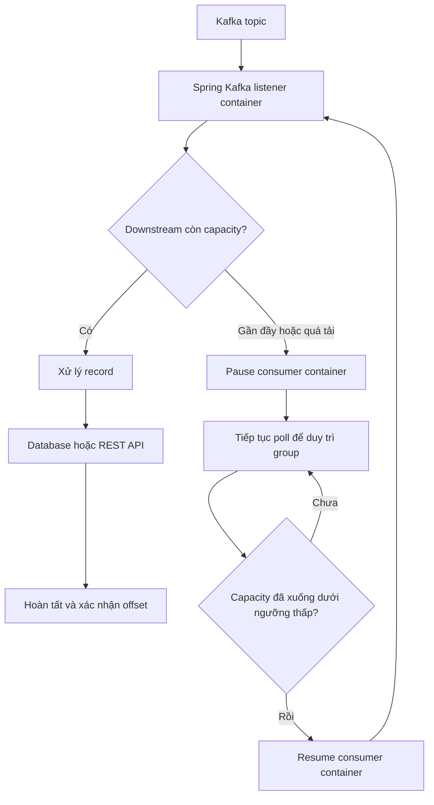

# Backpressure khi downstream chậm

Trong một hệ thống Spring Kafka, consumer thường đọc record từ Kafka rồi gọi database, REST API, dịch vụ thanh toán, hệ thống tìm kiếm hoặc một dịch vụ nội bộ khác. Nếu consumer đọc nhanh hơn tốc độ downstream có thể xử lý, công việc sẽ tích tụ. Ứng dụng có thể tăng bộ nhớ, tạo hàng đợi nội bộ ngày càng dài, giữ connection quá lâu, timeout hàng loạt hoặc làm consumer group rebalance.

**Backpressure** là cơ chế điều chỉnh tốc độ nhận công việc theo khả năng xử lý thực tế của downstream. Khi downstream gần hết năng lực, consumer giảm hoặc tạm dừng nhận record; khi tài nguyên phục hồi, consumer tiếp tục tiêu thụ. Kafka vốn lưu trữ record bền vững, vì vậy consumer có thể để backlog nằm trong topic trong một khoảng thời gian phù hợp thay vì kéo toàn bộ backlog vào bộ nhớ của ứng dụng.

## 1. Vì sao downstream chậm làm consumer mất ổn định?

Giả sử topic nhận 2.000 record mỗi giây, còn database chỉ ghi ổn định được 1.200 record mỗi giây. Nếu consumer tiếp tục poll và đưa dữ liệu vào một executor có hàng đợi không giới hạn, phần chênh lệch 800 record mỗi giây sẽ tích tụ trong tiến trình. Sau một thời gian, heap tăng, garbage collection kéo dài và request tới database có thể còn chậm hơn.

Một số biểu hiện thường gặp:

- Consumer lag tăng liên tục dù số consumer đã tăng.
- Hàng đợi executor, số tác vụ đang chạy hoặc số request in-flight tăng không giới hạn.
- Connection pool của database hoặc HTTP client cạn, thời gian chờ connection tăng.
- Listener xử lý lâu, timeout tăng và consumer không quay lại `poll()` đủ nhanh.
- Retry liên tục gửi lại cùng loại request, làm downstream đang quá tải càng chịu thêm tải.
- Heap và GC tăng, cuối cùng consumer có thể bị OOM hoặc bị xem là không còn tiến triển.

Điểm quan trọng là phân biệt **backlog trong Kafka** với **backlog trong bộ nhớ ứng dụng**. Lag trong Kafka thường là tín hiệu có thể quan sát và có giới hạn vận hành thông qua retention. Hàng đợi nội bộ không giới hạn có thể làm tiến trình mất ổn định trước khi hệ thống kịp phản ứng.

## 2. Nhìn backpressure như một bài toán năng lực

Gọi:

- \(\lambda\): tốc độ record đến, tính bằng record/giây.
- \(\mu\): năng lực xử lý tổng của consumer và downstream, tính bằng record/giây.
- \(L\): số record đang chờ xử lý, có thể ước lượng từ consumer lag.

Hệ thống chỉ có thể duy trì ổn định lâu dài khi tốc độ đến thấp hơn năng lực xử lý:

\[
\lambda < \mu
\]

Nếu \(\lambda > \mu\), backlog tăng xấp xỉ \(\lambda - \mu\) record mỗi giây. Ví dụ, nguồn gửi 2.000 record/giây nhưng downstream chỉ xử lý được 1.200 record/giây thì backlog tăng khoảng 800 record/giây khi các tốc độ này duy trì ổn định.

Khi đầu vào đã giảm xuống thấp hơn năng lực xử lý, thời gian cần để giải phóng backlog có thể ước lượng bằng:

\[
T_{drain} \approx \frac{L}{\mu - \lambda}
\]

Đây là mô hình gần đúng. Tốc độ thực tế còn phụ thuộc kích thước record, phân bố tải giữa partition, thời gian downstream, retry, số consumer và các giới hạn tài nguyên. Nếu đầu vào vẫn bằng hoặc lớn hơn năng lực xử lý, backlog không thể tự giảm.

Với \(C\) luồng xử lý song song và thời gian xử lý trung bình một record là \(S\) giây, năng lực lý thuyết ban đầu có thể ước lượng là:

\[
\mu \approx \frac{C}{S}
\]

Không nên dùng riêng giá trị trung bình để đặt giới hạn production. Hãy đo p95/p99, kiểm tra thời gian chờ connection, giới hạn rate của downstream và khả năng xử lý khi một partition nóng hơn các partition khác.

## 3. Các lớp kiểm soát backpressure

Backpressure có thể được triển khai ở nhiều lớp. Một hệ thống ổn định thường kết hợp các lớp thay vì chỉ dựa vào một tham số Kafka.

| Lớp | Cơ chế | Mục tiêu |
|---|---|---|
| Kafka consumer | Giảm số record mỗi poll, pause/resume container | Điều chỉnh tốc độ lấy record |
| Listener | Xử lý đồng bộ hoặc giới hạn số tác vụ in-flight | Không nhận thêm việc vượt khả năng xử lý |
| Executor | Thread pool và queue có giới hạn | Giữ bộ nhớ và số tác vụ chờ trong ngưỡng |
| Downstream client | Connection pool, timeout, rate limit, bulkhead | Bảo vệ database hoặc API khỏi tải vượt mức |
| Retry | Exponential backoff, jitter, phân loại lỗi, DLQ | Tránh retry storm và cô lập record lỗi |
| Hệ thống upstream | Rate limit hoặc điều tiết phát record | Giảm tốc độ đầu vào khi có thể |

Luồng điều tiết điển hình:



Sơ đồ mô tả ý tưởng điều tiết. Trong triển khai thực tế, điều kiện pause/resume cần dựa trên tín hiệu có thể đo được như queue depth, số request in-flight, connection pool utilization hoặc tín hiệu overload của downstream.

## 4. Điều tiết ngay tại Kafka consumer

### Giới hạn số record mỗi lần poll

`max.poll.records` giới hạn số record tối đa Kafka client trả về trong một lần `poll()`. Khi downstream chậm, giảm giá trị này có thể giảm số record mà listener phải giữ và xử lý trong một lượt.

Ví dụ:

```yaml
spring:
  kafka:
    consumer:
      enable-auto-commit: false
      max-poll-records: 100
      properties:
        max.poll.interval.ms: 300000
    listener:
      ack-mode: record
      concurrency: 3
```

Đây chỉ là giá trị khởi đầu minh họa. Hãy chọn `max-poll-records` theo thời gian xử lý thực tế, kích thước payload và ngân sách thời gian giữa hai lần poll. Nếu mỗi record có thể gọi downstream trong vài giây, ngay cả 100 record cũng có thể tạo ra một lượt xử lý quá dài.

Giảm `max.poll.records` giúp giới hạn số record trong một lượt, nhưng không tự giới hạn mọi bộ nhớ mà Kafka consumer sử dụng. Fetch buffer còn chịu ảnh hưởng bởi `fetch.max.bytes` và `max.partition.fetch.bytes`. Ngoài ra, nếu listener chuyển record vào một queue nội bộ rồi trả về ngay, giảm số record mỗi poll chỉ làm chậm tốc độ nạp queue; queue vẫn có thể tăng mãi nếu không có giới hạn và cơ chế pause.

### Pause và resume listener container

Spring Kafka cung cấp API pause/resume trên listener container. Đây là cách hữu ích khi ứng dụng có một bộ giám sát capacity chạy bên ngoài listener và cần tạm dừng nhận record.

Ví dụ khai báo listener có ID và lấy container qua `KafkaListenerEndpointRegistry`:

```java
@Component
public class OrderListener {

    @KafkaListener(
        id = "ordersListener",
        topics = "orders",
        groupId = "order-workers"
    )
    public void consume(OrderEvent event) {
        orderService.process(event);
    }

    private final OrderService orderService;

    public OrderListener(OrderService orderService) {
        this.orderService = orderService;
    }
}
```

Một thành phần điều khiển có thể yêu cầu container pause hoặc resume:

```java
@Component
public class KafkaIntakeController {

    private final KafkaListenerEndpointRegistry registry;

    public KafkaIntakeController(KafkaListenerEndpointRegistry registry) {
        this.registry = registry;
    }

    public void pauseOrders() {
        MessageListenerContainer container =
            registry.getListenerContainer("ordersListener");

        if (container != null) {
            container.pause();
        }
    }

    public void resumeOrders() {
        MessageListenerContainer container =
            registry.getListenerContainer("ordersListener");

        if (container != null) {
            container.resume();
        }
    }
}
```

Các import cần thiết thuộc package `org.springframework.kafka.config` và `org.springframework.kafka.listener`. `OrderService` là service nghiệp vụ của ứng dụng.

Khi container được pause, Spring Kafka thực hiện thao tác pause trên consumer ở thread sở hữu consumer. Container vẫn tiếp tục gọi `poll()` để duy trì hoạt động của consumer group, nhưng các partition đã pause không cung cấp record mới cho listener. Vì vậy, pause container có thể giảm lượng công việc mới mà không cố tình để consumer biến mất khỏi group chỉ vì ngừng poll.

`pause()` là yêu cầu điều khiển container; nó không hủy listener đang xử lý và không ngắt request downstream đang chạy. Nếu listener hiện tại đang bị block bởi một HTTP call không có timeout, cần giải quyết timeout hoặc cancellation ở tầng client. API pause/resume cũng không thay thế việc quản lý offset và xác nhận xử lý.

### Điều khiển theo ngưỡng cao và ngưỡng thấp

Không nên pause và resume liên tục quanh một ngưỡng duy nhất. Hãy dùng hai ngưỡng để tạo hysteresis:

- Khi queue depth hoặc số tác vụ in-flight vượt ngưỡng cao, yêu cầu pause.
- Chỉ resume khi queue depth giảm xuống dưới ngưỡng thấp.
- Giữa hai ngưỡng, giữ trạng thái hiện tại.

Ví dụ, nếu queue nội bộ có sức chứa 500 tác vụ, hệ thống có thể bắt đầu pause ở 400 và chỉ resume khi queue giảm dưới 150. Những con số này phải được xác định từ thời gian xử lý và ngân sách bộ nhớ của ứng dụng.

Giám sát nên có trạng thái pause hiện tại để tránh phát đi lệnh lặp lại. Nếu có nhiều listener container, mỗi container cần được điều khiển theo đúng downstream và tài nguyên mà nó sử dụng. Với container concurrency, pause ở cấp container thường ảnh hưởng các consumer con thuộc container đó; nếu chỉ muốn điều tiết một partition, cần dùng API pause partition phù hợp với phiên bản Spring Kafka và quản lý rõ assignment.

## 5. Giới hạn công việc trong ứng dụng

### Ưu tiên xử lý đồng bộ khi cần backpressure tự nhiên

Với record listener xử lý đồng bộ, container không thể hoàn tất vòng xử lý hiện tại cho đến khi listener trả về. Khi downstream chậm, tốc độ quay lại poll giảm theo tốc độ xử lý. Đây là một dạng backpressure tự nhiên và dễ hiểu.

Ví dụ:

```java
@KafkaListener(topics = "orders", groupId = "order-workers")
public void consume(OrderEvent event) {
    orderService.saveToDatabase(event);
}
```

Để cách này hoạt động ổn định, lời gọi downstream phải có timeout hợp lý, connection pool phải được giới hạn và thời gian xử lý phải nằm trong ngân sách `max.poll.interval.ms`. Nếu một record có thể chờ vô hạn, consumer có thể không tiến triển và cuối cùng bị rời group.

### Dùng executor có giới hạn khi cần xử lý song song

Một lỗi phổ biến là nhận record rồi đẩy vào `Executors.newFixedThreadPool()` với queue mặc định không giới hạn. Thread count có thể cố định nhưng queue vẫn tiếp tục tăng, khiến hệ thống chỉ trì hoãn thời điểm hết bộ nhớ.

Nếu cần tách công việc khỏi listener thread, hãy dùng executor có giới hạn cả số thread lẫn queue. Ví dụ:

```java
@Bean
public ThreadPoolTaskExecutor orderExecutor() {
    ThreadPoolTaskExecutor executor = new ThreadPoolTaskExecutor();
    executor.setCorePoolSize(8);
    executor.setMaxPoolSize(8);
    executor.setQueueCapacity(200);
    executor.setThreadNamePrefix("order-worker-");
    executor.setRejectedExecutionHandler(
        new ThreadPoolExecutor.AbortPolicy()
    );
    executor.initialize();
    return executor;
}
```

Khi queue đầy, `AbortPolicy` làm thao tác submit bị từ chối. Ứng dụng phải xử lý tình huống này như một tín hiệu capacity đã hết: có thể yêu cầu pause container và để record chưa được xác nhận sẽ được xử lý lại theo chiến lược offset phù hợp. Không được bắt và bỏ qua `RejectedExecutionException` rồi vẫn commit offset, vì record sẽ bị mất khỏi luồng xử lý của ứng dụng.

Ví dụ trên chỉ minh họa giới hạn tài nguyên của executor. Nó chưa phải một consumer bất đồng bộ hoàn chỉnh. Muốn chuyển xử lý sang thread khác, phải thiết kế rõ thời điểm acknowledgment, thứ tự theo partition, hành vi khi ứng dụng dừng và cách phục hồi các tác vụ đang chạy.

### Không commit offset trước khi công việc hoàn tất

Giả sử listener submit record vào executor rồi trả về ngay. Nếu container commit offset sau khi listener trả về, Kafka có thể xem record đã xử lý xong trong khi tác vụ nền vẫn chưa ghi database. Nếu tiến trình dừng ở thời điểm đó, record đã commit sẽ không được giao lại, dẫn tới mất tác vụ.

Với xử lý bất đồng bộ, cần bảo đảm:

1. Offset chỉ được xác nhận sau khi thao tác downstream đạt trạng thái thành công theo định nghĩa nghiệp vụ.
2. Khi submit bị từ chối hoặc tác vụ thất bại, record chưa được xác nhận và phải đi qua retry hoặc xử lý lỗi đã định nghĩa.
3. Nếu xử lý song song làm các offset hoàn thành lệch thứ tự, phải cấu hình cơ chế acknowledgment bất đồng bộ phù hợp với phiên bản Spring Kafka, chẳng hạn `asyncAcks` khi dùng tính năng hỗ trợ tương ứng.
4. Phải tính tới trường hợp một record xử lý xong nhưng record trước nó trong cùng partition chưa xong. Việc xác nhận offset cao hơn có thể làm mất khả năng giao lại record thấp hơn nếu quản lý sai.
5. Các thao tác downstream nên idempotent vì một record có thể được giao lại sau crash, timeout hoặc rebalance.

Nếu không có yêu cầu rõ ràng về xử lý bất đồng bộ, listener đồng bộ thường dễ vận hành và dễ bảo đảm semantics hơn. Tăng song song chỉ có ích khi downstream còn capacity và thứ tự nghiệp vụ cho phép.

## 6. Bảo vệ downstream bằng giới hạn tài nguyên

Backpressure tại Kafka cần đi cùng giới hạn ở client gọi downstream.

**Connection pool:** đặt giới hạn connection theo năng lực database hoặc API. Nếu số consumer thread lớn hơn số connection khả dụng, các thread có thể chỉ chờ connection và kéo dài thời gian xử lý.

**Timeout:** đặt connect timeout, response timeout và deadline cho toàn bộ thao tác. Timeout ngăn một request chiếm worker vô thời hạn. Timeout quá ngắn lại có thể tạo retry không cần thiết, vì vậy cần dựa trên latency thực tế và SLO.

**Bulkhead:** giới hạn số request đồng thời tới từng dependency. Một API chậm không nên chiếm hết worker và connection dành cho các dependency khác.

**Rate limit:** giới hạn request mỗi giây theo quota của downstream. Nếu downstream cho phép 500 request/giây, không nên cấu hình consumer concurrency khiến hệ thống thường xuyên vượt quota rồi dựa vào HTTP 429 để điều tiết.

**Circuit breaker:** khi lỗi hoặc timeout vượt ngưỡng, tạm ngăn gọi downstream trong một khoảng thời gian và cho phép thử lại có kiểm soát. Circuit breaker giúp ngăn request thất bại liên tục tiêu tốn worker, nhưng cần kết hợp với pause hoặc retry để record vẫn được xử lý đúng.

Hãy phân biệt lỗi do quá tải tạm thời với lỗi nghiệp vụ không thể khắc phục. HTTP 429 hoặc 503 thường có thể là tín hiệu cần giảm tốc và retry có backoff; dữ liệu không hợp lệ có thể cần đưa vào dead-letter topic để không chặn partition vô thời hạn.

## 7. Retry và backoff khi downstream không sẵn sàng

Retry không phải là cách thay thế backpressure. Nếu downstream đang quá tải và mọi consumer retry ngay lập tức, số request có thể tăng mạnh hơn tốc độ ban đầu. Đây là retry storm.

Một chiến lược retry ổn định thường gồm:

- Phân loại lỗi transient như timeout, connection reset, HTTP 429 hoặc 503.
- Dùng exponential backoff và jitter để các consumer không retry đồng loạt.
- Giới hạn số lần retry hoặc tổng thời gian retry.
- Tôn trọng `Retry-After` nếu downstream cung cấp và chính sách ứng dụng cho phép.
- Sau khi hết retry, chuyển record lỗi không thể phục hồi sang dead-letter topic kèm thông tin lỗi cần thiết.
- Đảm bảo record được retry không làm mất thứ tự nghiệp vụ nếu thứ tự trong partition là yêu cầu bắt buộc.

Spring Kafka có các error handler và cơ chế backoff để điều phối retry. Với thời gian backoff dài, có thể xem xét `ContainerPausingBackOffHandler` trong các phiên bản Spring Kafka hỗ trợ. Cơ chế này sử dụng việc pause container trong thời gian chờ để tránh giữ consumer thread ngủ lâu và vượt giới hạn poll. Cần đối chiếu API với phiên bản Spring Kafka đang chạy.

Nếu downstream ngừng hoạt động trong thời gian dài, pause consumer hoặc dùng retry topic có lịch xử lý phù hợp thường dễ kiểm soát hơn việc giữ hàng loạt thread chờ trong một tiến trình. Khi dùng retry topic, cần chấp nhận rằng thứ tự xử lý toàn cục có thể thay đổi và thiết kế theo yêu cầu nghiệp vụ.

## 8. Phân biệt pause, giảm concurrency và tăng consumer

Ba cách này giải quyết các tình huống khác nhau:

| Biện pháp | Khi phù hợp | Rủi ro nếu dùng sai |
|---|---|---|
| Pause/resume | Downstream tạm thời hết capacity hoặc queue gần đầy | Pause quá lâu làm lag tăng; resume quá sớm khiến quá tải lặp lại |
| Giảm `max.poll.records` | Mỗi poll chứa quá nhiều record hoặc thời gian xử lý một poll quá dài | Poll overhead tăng; không xử lý được queue nội bộ không giới hạn |
| Giảm concurrency | Downstream có giới hạn connection hoặc quota thấp | Throughput giảm và lag tăng nếu giảm quá mức |
| Tăng concurrency | Có partition chưa được khai thác và downstream còn dư capacity | Tăng số request đồng thời, có thể làm downstream quá tải hơn |
| Tăng số consumer trong group | Topic có đủ partition và downstream có thể nhận thêm tải | Consumer vượt số partition sẽ không tạo thêm parallelism hữu ích |

Không nên phản ứng với lag tăng bằng cách luôn tăng consumer. Nếu downstream đang là nút thắt, tăng concurrency có thể làm database chậm hơn, khiến mọi consumer giữ record lâu hơn và lag tăng nhanh hơn.

## 9. Offset, rebalance và khả năng giao lại record

Backpressure làm consumer xử lý chậm hơn, vì vậy cần hiểu tác động tới offset và consumer group.

### `max.poll.interval.ms`

Kafka yêu cầu consumer trong group tiếp tục gọi `poll()` trong giới hạn `max.poll.interval.ms`. Với listener xử lý đồng bộ, thời gian xử lý toàn bộ record của một poll cộng overhead phải thấp hơn giới hạn này với khoảng dự phòng đủ lớn.

Nếu một poll nhận 100 record, mỗi record mất trung bình 100 ms và xử lý tuần tự, riêng phần nghiệp vụ đã cần khoảng 10 giây. Nếu một số request mất 20 giây do downstream timeout, thời gian thực tế có thể cao hơn nhiều. Khi thiết kế cần đo percentile và trường hợp xấu, không chỉ nhân thời gian trung bình.

Tăng `max.poll.interval.ms` có thể cần thiết với xử lý dài có chủ đích, nhưng không làm downstream nhanh hơn và cũng không giới hạn bộ nhớ. Hãy ưu tiên giảm kích thước poll, đặt timeout cho dependency hoặc thay đổi mô hình xử lý khi cần.

### Commit và giao nhận ít nhất một lần

Với `enable.auto.commit=false`, Spring Kafka container quản lý commit theo acknowledgment mode. Ví dụ, `AckMode.RECORD` commit sau khi listener xử lý record thành công; `AckMode.BATCH` commit các offset của poll sau khi batch được xử lý. Manual acknowledgment cho phép ứng dụng quyết định thời điểm xác nhận.

Khi downstream đã ghi dữ liệu thành công nhưng ứng dụng chết trước lúc commit, Kafka có thể giao lại record. Đây là hành vi at-least-once bình thường. Database nên có khóa idempotency, unique constraint hoặc cơ chế upsert phù hợp để lần giao lại không tạo tác động nghiệp vụ trùng lặp.

Khi downstream thất bại, không commit record như thể đã thành công. Hãy để error handler thực hiện retry, recovery hoặc chuyển DLQ theo chính sách. Đừng dùng pause/resume như một cách thay thế việc xác nhận offset.

## 10. Cấu hình minh họa cho consumer có downstream chậm

Một cấu hình ban đầu có thể giới hạn poll size, concurrency và thời gian chờ:

```yaml
spring:
  kafka:
    consumer:
      enable-auto-commit: false
      max-poll-records: 100
      properties:
        max.poll.interval.ms: 300000
    listener:
      concurrency: 3
      ack-mode: record
```

Kết hợp cấu hình này với các giới hạn ở service:

```text
Kafka listener concurrency:       3
Downstream max in-flight calls:    3 (hoặc giới hạn phù hợp đã đo)
Database connection pool:         giới hạn theo capacity database
HTTP response timeout:            theo SLO và latency downstream
Executor queue:                   bounded, nếu có offload
Pause high watermark:             queue/capacity gần đầy
Resume low watermark:             queue đã giảm đủ sâu
```

Các con số ở trên chỉ là ví dụ về cách liên kết giới hạn. Không nhất thiết phải đặt concurrency và số request in-flight bằng nhau; cần tính cả các luồng công việc khác dùng chung database hoặc API. Đặc biệt, không sao chép nguyên cấu hình sang production khi chưa đo tải.

## 11. Quan sát và cảnh báo backpressure

Để biết backpressure có hoạt động, cần quan sát cả Kafka lẫn downstream.

**Phía Kafka và Spring Kafka:**

- Consumer lag theo từng partition và tuổi của record cũ nhất chưa xử lý.
- Records consumed rate và tốc độ commit offset.
- Listener execution time p50, p95 và p99.
- Số lần rebalance, poll timeout hoặc log liên quan đến `max.poll.interval.ms`.
- Thời gian container ở trạng thái pause và số lần pause/resume.
- Số record retry, số record chuyển DLQ và commit latency.

**Phía ứng dụng:**

- Queue depth, số tác vụ in-flight và số lần executor từ chối submit.
- Số thread bận, thời gian chờ thread và thời gian chờ connection.
- Heap usage, allocation rate và GC pause.
- Số request downstream mỗi giây, latency p95/p99, timeout và error rate.
- Connection pool active/idle/pending và tỷ lệ sử dụng quota.

Một cảnh báo chỉ dựa vào lag có thể gây hiểu nhầm. Lag tăng trong lúc downstream bị pause có chủ đích là hành vi dự kiến. Cần kết hợp lag với trạng thái pause, tốc độ downstream, tuổi record và thời gian còn lại trước khi chạm giới hạn retention.

Các metric cụ thể phụ thuộc phiên bản Kafka client, Spring Kafka và hệ thống quan sát. Hãy xác nhận tên metric được export trong môi trường thực tế trước khi tạo dashboard hoặc alert.

## 12. Quy trình xử lý khi downstream chậm

Khi nhận cảnh báo, có thể thực hiện theo trình tự sau:

1. Xác định downstream nào chậm và kiểm tra latency, error rate, quota, connection pool cùng tình trạng dịch vụ.
2. So sánh tốc độ record đến với tốc độ xử lý thành công để biết backlog đang tăng hay giảm.
3. Kiểm tra queue nội bộ, số tác vụ in-flight và heap. Nếu queue gần đầy, kích hoạt pause hoặc giảm intake theo ngưỡng đã định.
4. Kiểm tra timeout và retry. Giảm retry storm, dùng backoff có jitter và phân loại lỗi cần DLQ.
5. Giữ số consumer/concurrency trong giới hạn downstream có thể chịu được. Chỉ tăng khi xác nhận còn capacity.
6. Khi downstream phục hồi, resume theo ngưỡng thấp và theo dõi tốc độ drain của lag.
7. Xác nhận record được commit sau khi xử lý đúng, các tác vụ lỗi có đường phục hồi và tuổi record chưa vượt retention.

Không nên resume toàn bộ consumer cùng lúc sau một outage dài nếu downstream có quota thấp. Có thể phục hồi theo từng nhóm consumer hoặc tăng dần concurrency để tránh tạo một đợt traffic burst mới.

## 13. Kiểm thử backpressure

Hãy kiểm thử với downstream chậm có kiểm soát trước khi triển khai cơ chế điều tiết:

- Tăng response latency của API từ mức bình thường lên vài lần để xem listener và lag phản ứng ra sao.
- Giả lập HTTP 429, 503, timeout và connection reset.
- Làm database connection pool cạn tạm thời.
- Tăng tốc độ record đầu vào vượt capacity downstream trong một khoảng thời gian.
- Kiểm tra queue executor không vượt giới hạn và heap không tăng không kiểm soát.
- Xác nhận container pause vẫn duy trì consumer group và resume không làm phát sinh burst vượt quota.
- Dừng ứng dụng khi tác vụ downstream đang chạy để kiểm tra offset, retry và xử lý trùng.
- Thực hiện rebalance trong lúc backlog lớn và xác nhận record chưa commit được giao lại an toàn.
- Phục hồi downstream rồi đo thời gian giải phóng backlog, không chỉ thời điểm error rate trở về bình thường.

Tiêu chí đạt nên gắn với SLO cụ thể: memory ổn định, queue có giới hạn, không mất record, tỷ lệ lỗi nằm trong ngưỡng, consumer không rebalance ngoài dự kiến và backlog được giải phóng trong thời gian chấp nhận được.

## 14. Những sai lầm thường gặp

**Tăng `max.poll.interval.ms` để chữa mọi vấn đề.** Cách này chỉ tăng thời gian cho consumer xử lý trước khi bị xem là không tiến triển. Nó không giới hạn queue, không giải phóng connection và không cải thiện throughput downstream.

**Dùng queue không giới hạn để hấp thụ burst.** Queue chỉ chuyển backlog từ Kafka vào heap. Khi downstream không phục hồi đủ nhanh, tiến trình có thể OOM.

**Submit tác vụ nền rồi commit ngay.** Nếu tiến trình dừng trước khi tác vụ hoàn tất, record đã commit có thể bị mất khỏi luồng xử lý.

**Tăng concurrency khi downstream đang quá tải.** Nhiều consumer hơn có thể tạo thêm request đồng thời và làm dependency chậm hơn.

**Retry ngay lập tức và vô hạn.** Retry storm làm downstream khó phục hồi và có thể chiếm toàn bộ worker.

**Pause quá muộn.** Khi queue đã đầy, việc pause chỉ ngăn thêm dữ liệu mới; ứng dụng vẫn cần xử lý hoặc phục hồi lượng công việc đã nhận. Hãy đặt high watermark đủ thấp để có thời gian phản ứng.

**Resume ngay khi có một tín hiệu thành công.** Một request thành công đơn lẻ chưa chứng minh downstream đã phục hồi. Dùng low watermark và khoảng ổn định phù hợp để tránh dao động pause/resume.

## 15. Nguyên tắc thiết kế

Một triển khai backpressure đáng tin cậy cần giữ các nguyên tắc sau:

- Giới hạn mọi hàng đợi trong bộ nhớ và mọi số lượng tác vụ in-flight.
- Điều chỉnh tốc độ poll theo capacity, dùng `max.poll.records` như một trong các nút điều khiển.
- Dùng pause/resume của listener container khi cần ngừng nhận record tạm thời, đồng thời tiếp tục duy trì poll của consumer group.
- Đặt timeout, connection pool, rate limit và bulkhead theo năng lực downstream.
- Chỉ xác nhận offset sau khi xử lý đạt trạng thái thành công đã định nghĩa.
- Thiết kế idempotency vì retry, crash và rebalance có thể làm record được giao lại.
- Dùng retry có giới hạn, backoff và DLQ cho lỗi không thể phục hồi.
- Chỉ tăng concurrency khi partition và downstream đều còn capacity.
- Theo dõi đồng thời lag, tuổi record, queue depth, listener latency và tình trạng downstream.

Backpressure giúp Spring Kafka hấp thụ chênh lệch tải bằng cách để phần công việc dư nằm trong Kafka và điều tiết lượng việc đi vào ứng dụng. Khi giới hạn hàng đợi, quản lý offset đúng và phục hồi downstream có kiểm soát, hệ thống có thể chịu được những giai đoạn downstream chậm mà vẫn bảo toàn record và giữ tiến trình consumer ổn định.
