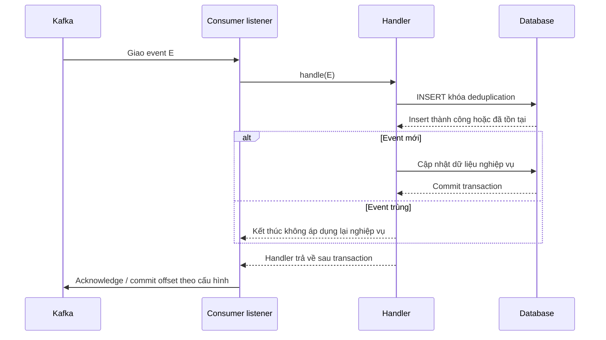

# Unique constraint trong database

Trong hệ thống dùng Spring Kafka, một message có thể được giao cho consumer nhiều lần. Consumer có thể xử lý xong nghiệp vụ và ghi dữ liệu vào database, nhưng tiến trình lại dừng trước khi Kafka ghi nhận offset đã xử lý. Khi consumer khởi động lại hoặc partition được chuyển sang consumer khác, Kafka giao lại message đó. Retry, rebalance và việc xử lý lỗi cũng có thể tạo ra những lần giao lặp tương tự.

Nếu mỗi lần nhận message đều thực hiện nghiệp vụ như tạo đơn hàng, ghi nhận thanh toán hoặc cộng số dư, dữ liệu có thể bị thay đổi nhiều lần. Một cách bảo vệ hiệu quả là lưu dấu vết message đã xử lý trong database và đặt `UNIQUE` constraint trên khóa định danh của message. Database sẽ trở thành nơi phân xử cuối cùng: dù nhiều consumer cùng thử ghi một message, chỉ một transaction có thể sở hữu khóa duy nhất đó.

## 1. Unique constraint bảo vệ điều gì?

`UNIQUE` constraint là ràng buộc dữ liệu yêu cầu một cột hoặc một tổ hợp cột không được xuất hiện trùng nhau trong các hàng của bảng. Database thường thực thi ràng buộc này bằng unique index. Việc kiểm tra và ghi index diễn ra bên trong thao tác ghi dữ liệu, nên database có thể xử lý cả trường hợp nhiều transaction đồng thời chèn cùng một khóa.

Ví dụ, bảng `consumed_event` lưu những event mà một consumer logic đã nhận xử lý:

```sql
CREATE TABLE consumed_event (
    consumer_name VARCHAR(120) NOT NULL,
    event_id UUID NOT NULL,
    processed_at TIMESTAMPTZ NOT NULL DEFAULT CURRENT_TIMESTAMP,
    CONSTRAINT uq_consumed_event_consumer_event
        UNIQUE (consumer_name, event_id)
);
```

Ràng buộc trên có nghĩa là một `event_id` chỉ được ghi nhận một lần cho cùng một `consumer_name`. Cùng một event vẫn có thể được một consumer logic khác xử lý, vì hai consumer đó có mục đích và trạng thái nghiệp vụ riêng.

Các cột khóa nên có `NOT NULL`. Cách xử lý giá trị `NULL` trong unique constraint có khác biệt giữa các hệ quản trị cơ sở dữ liệu; ở nhiều hệ, nhiều hàng có thể cùng chứa `NULL` mà vẫn không vi phạm `UNIQUE`. Nếu khóa định danh bị để trống, ràng buộc có thể không bảo vệ được trường hợp mà ta mong muốn.

Unique constraint khác `PRIMARY KEY` ở mục đích mô hình hóa. Một bảng chỉ có một primary key, còn có thể có nhiều unique constraint để biểu diễn nhiều quy tắc duy nhất độc lập. Bảng nghiệp vụ thường có primary key riêng và thêm unique constraint cho khóa chống xử lý lặp.

## 2. Vì sao consumer Kafka cần cơ chế này?

Kafka thường được cấu hình theo hướng at-least-once: message không bị mất trong luồng xử lý thông thường, nhưng một message có thể được giao lại nếu consumer chưa xác nhận tiến độ một cách an toàn. Một tình huống điển hình:

1. Consumer nhận event `order-created` có `event_id = e-123`.
2. Consumer ghi đơn hàng vào database và transaction đã commit.
3. Tiến trình bị dừng trước khi offset tương ứng được commit.
4. Sau khi khởi động lại, Kafka giao lại event `e-123`.
5. Nếu consumer không có cơ chế deduplication, nó có thể tạo thêm một bản ghi hoặc thực hiện lại tác động nghiệp vụ.

Điều này không nhất thiết là lỗi của Kafka. Kafka chỉ biết tiến độ đọc của consumer; database lại quản lý trạng thái nghiệp vụ. Hai hệ thống có transaction và thời điểm commit riêng. Nếu chỉ dựa vào việc “message thường chỉ đến một lần”, ứng dụng sẽ dễ gặp lỗi khi có crash hoặc retry.

Unique constraint giúp biến thao tác nhận diện message thành một thao tác ghi có tính nguyên tử. Consumer không cần dựa vào một lần đọc kiểm tra trước đó để quyết định message có mới hay không. Nó thử ghi khóa; database xác định transaction nào được quyền tạo khóa đó.

### Phân biệt ba loại idempotency

- **Producer idempotency:** hạn chế bản ghi trùng do producer retry gửi dữ liệu trong phạm vi cơ chế Kafka hỗ trợ. Cơ chế này không tự ngăn consumer thực hiện nghiệp vụ hai lần.
- **Consumer idempotency:** cùng một event được giao nhiều lần nhưng consumer chỉ áp dụng tác động nghiệp vụ một lần. Unique constraint trên bảng inbox hoặc bảng đã xử lý thường được dùng cho mục đích này.
- **Business idempotency:** một hành động nghiệp vụ không bị thực hiện lặp, kể cả khi hai event khác nhau cùng biểu diễn một yêu cầu nghiệp vụ. Ví dụ, hai event có ID khác nhau nhưng cùng mang một mã yêu cầu thanh toán. Khi đó cần thêm khóa duy nhất theo quy tắc nghiệp vụ.

Ba lớp này giải quyết các vấn đề khác nhau. Bật producer idempotence không thay thế cho việc bảo vệ database ở consumer. Tương tự, deduplicate theo `event_id` không thay thế cho unique constraint trên mã giao dịch nếu nghiệp vụ yêu cầu một giao dịch chỉ được tạo một lần.

## 3. Chọn khóa duy nhất đúng với ý nghĩa nghiệp vụ

Chất lượng của cơ chế deduplication phụ thuộc vào khóa được chọn. Khóa phải nhận diện cùng một sự kiện qua mọi lần retry và phải phân biệt được hai sự kiện hợp lệ khác nhau.

### Dùng event ID ổn định

Thông thường, producer tạo một `event_id` duy nhất khi tạo event. ID đó phải được giữ nguyên khi gửi lại event do timeout hoặc retry. Consumer dùng ID này để nhận diện event đã xử lý.

Không tạo `event_id` mới mỗi lần producer retry. Nếu mỗi lần gửi lại đều có ID mới, database sẽ nhìn các lần giao đó như các event khác nhau và unique constraint không thể phát hiện trùng lặp.

Nếu nguồn dữ liệu không cung cấp event ID, có thể tạo khóa từ định danh ổn định của nguồn, chẳng hạn `source_system + source_record_id + event_version`. Việc ghép khóa phải phản ánh chính xác quy tắc nhận diện của nguồn; không nên tùy tiện dùng thời điểm consumer nhận message hoặc số lần retry.

### Dùng khóa ghép theo consumer

Một event có thể được nhiều consumer độc lập xử lý cho những mục đích khác nhau. Ví dụ, `order-created` vừa cập nhật projection đơn hàng vừa kích hoạt một quy trình phân tích. Nếu chỉ đặt `UNIQUE(event_id)` trên một bảng dùng chung, consumer thứ nhất có thể vô tình ngăn consumer thứ hai xử lý event.

Khóa ghép `(consumer_name, event_id)` thể hiện rõ phạm vi deduplication. `consumer_name` nên là tên ổn định của logic xử lý, chẳng hạn `order-projection-v1`; không dùng hostname, pod ID, thread ID hoặc tên instance tạm thời. Nếu mỗi lần triển khai lại đổi tên consumer một cách vô ý, các event cũ có thể được xử lý lại.

Khi cần chủ động dựng lại một projection từ đầu, có thể dùng một tên consumer hoặc namespace xử lý mới để tạo một phạm vi deduplication riêng. Đây là quyết định vận hành cần được lên kế hoạch vì nó cho phép xử lý lại dữ liệu lịch sử.

### Dùng khóa nghiệp vụ khi cần

Giả sử hệ thống nhận hai event khác nhau, `event_id` khác nhau, nhưng cả hai đều yêu cầu tạo thanh toán cho cùng một mã yêu cầu từ đối tác. Unique constraint theo event ID cho phép cả hai event được ghi nhận. Nếu nghiệp vụ chỉ cho phép một thanh toán cho mỗi yêu cầu, bảng thanh toán cần thêm ràng buộc như:

```sql
ALTER TABLE payment
    ADD CONSTRAINT uq_payment_tenant_external_reference
    UNIQUE (tenant_id, external_payment_reference);
```

Khóa ghép thường cần có `tenant_id` để hai khách hàng khác nhau có thể sử dụng cùng một mã tham chiếu trong phạm vi riêng của họ. Với các thao tác khác nhau trên cùng một đối tượng, khóa có thể cần thêm loại thao tác hoặc phiên bản nghiệp vụ, ví dụ `(account_id, operation_type, request_id)`.

Không nên đưa timestamp nhận message, Kafka offset, partition, tên pod hoặc số lần retry vào khóa deduplication. Những giá trị này có thể thay đổi giữa các lần giao cùng một event. Kafka offset cũng chỉ duy nhất trong phạm vi topic-partition, không phải định danh nghiệp vụ ổn định của event khi dữ liệu được sao chép, chuyển topic hoặc phát lại qua một luồng khác.

## 4. Ghi nhận event và cập nhật nghiệp vụ trong cùng transaction

Mẫu xử lý phổ biến gồm hai bước trong cùng một database transaction:

1. Thử insert khóa `(consumer_name, event_id)` vào bảng `consumed_event`.
2. Chỉ khi insert thành công, thực hiện thay đổi nghiệp vụ.

Với PostgreSQL, có thể dùng `ON CONFLICT DO NOTHING` để xử lý xung đột duy nhất mà không làm transaction thất bại:

```sql
INSERT INTO consumed_event (consumer_name, event_id)
VALUES ('order-projection-v1', '2b7f1a3e-2c5d-4e3a-9b11-6f5f5f7c1234')
ON CONFLICT (consumer_name, event_id) DO NOTHING;
```

PostgreSQL trả về số hàng được insert. Nếu kết quả là `1`, event vừa được ghi nhận và consumer có thể xử lý nghiệp vụ. Nếu kết quả là `0`, khóa đã tồn tại và event đã được consumer logic này ghi nhận trước đó; consumer có thể kết thúc lần giao hiện tại mà không áp dụng lại tác động nghiệp vụ.

Không nên thực hiện `SELECT` để kiểm tra trước rồi mới `INSERT`:

```text
Consumer A: SELECT -> chưa có event
Consumer B: SELECT -> chưa có event
Consumer A: INSERT -> thành công
Consumer B: INSERT -> có thể tạo bản ghi trùng nếu không có constraint
```

Đây là race condition kiểu check-then-act. Hai transaction đều có thể nhìn thấy trạng thái “chưa tồn tại”. Unique constraint kết hợp với thao tác insert nguyên tử giải quyết cuộc đua ở nơi duy nhất có thể phân xử đáng tin cậy: database.

### Ví dụ với Spring JDBC và Spring transaction

Ví dụ sau sử dụng PostgreSQL, `JdbcTemplate` và một service có `@Transactional`:

```java
@Service
@RequiredArgsConstructor
public class OrderCreatedHandler {

    private static final String CONSUMER_NAME = "order-projection-v1";

    private final JdbcTemplate jdbcTemplate;
    private final OrderProjectionRepository orderProjectionRepository;

    @Transactional
    public void handle(OrderCreated event) {
        int inserted = jdbcTemplate.update("""
            INSERT INTO consumed_event (consumer_name, event_id)
            VALUES (?, ?)
            ON CONFLICT (consumer_name, event_id) DO NOTHING
            """,
            CONSUMER_NAME,
            event.eventId()
        );

        if (inserted == 0) {
            // Event đã được xử lý trước đó bởi consumer logic này.
            return;
        }

        // Các thay đổi database phải tham gia cùng transaction.
        orderProjectionRepository.apply(event);
    }
}
```

Listener gọi handler:

```java
@Component
@RequiredArgsConstructor
public class OrderCreatedListener {

    private final OrderCreatedHandler handler;

    @KafkaListener(
        topics = "orders.created",
        groupId = "order-projection-v1"
    )
    public void onMessage(OrderCreated event) {
        handler.handle(event);
    }
}
```

Khi `handle` trả về bình thường, Spring kết thúc transaction của service. Nếu các thao tác ghi database thành công, transaction commit trước khi lời gọi handler trả về cho listener. Với cấu hình acknowledgment phù hợp, container chỉ ghi nhận offset sau khi listener xử lý thành công. Nếu dùng `AckMode.MANUAL`, hãy gọi `ack.acknowledge()` sau khi `handler.handle(event)` trả về; không xác nhận offset khi database transaction vẫn chưa commit.

Để hai thao tác thực sự nguyên tử, `JdbcTemplate` và repository phải tham gia cùng một transaction manager và cùng transaction của database. Nếu repository ghi qua một datasource hoặc transaction manager khác, việc insert dấu vết và cập nhật nghiệp vụ có thể commit hoặc rollback độc lập, làm mất bảo đảm.

Nên đặt handler trong một Spring bean riêng để lời gọi đi qua transaction proxy. Nếu một method trong cùng class tự gọi method `@Transactional` khác, cơ chế proxy mặc định của Spring có thể không áp dụng transaction như mong đợi do self-invocation.

### Điều gì xảy ra khi có lỗi?

Giả sử insert `consumed_event` thành công nhưng cập nhật projection thất bại. Nếu cả hai thao tác nằm trong cùng transaction, transaction rollback sẽ xóa cả dấu vết vừa insert. Khi Kafka giao lại event, lần thử sau có thể insert khóa và xử lý nghiệp vụ lại.

Ngược lại, nếu dấu vết được commit trong transaction riêng trước khi cập nhật nghiệp vụ, lỗi ở bước sau có thể để lại trạng thái “đã xử lý” dù nghiệp vụ chưa được cập nhật. Lần retry tiếp theo sẽ bị bỏ qua và dữ liệu bị thiếu. Vì vậy, không tách hai bước này thành hai transaction độc lập nếu mục tiêu là bảo đảm cả hai cùng thành công hoặc cùng thất bại.

Spring mặc định rollback transaction với `RuntimeException` và `Error`; checked exception không tự động kích hoạt rollback trong cấu hình mặc định. Nếu handler có thể ném checked exception biểu thị lỗi cần retry, hãy cấu hình `@Transactional(rollbackFor = Exception.class)` hoặc chuyển lỗi thành loại exception có chính sách rollback phù hợp. Không nuốt exception rồi trả về bình thường khi nghiệp vụ chưa hoàn tất, vì transaction có thể commit dấu vết deduplication.

## 5. Phối hợp với Kafka acknowledgment và retry

Database transaction và Kafka offset commit là hai hành động khác nhau. Mẫu xử lý cần sắp xếp thứ tự để không xác nhận message trước khi thay đổi database đã bền vững:



Nếu database commit thành công nhưng offset commit thất bại, Kafka có thể giao lại event. Lần giao lại sẽ gặp unique constraint, insert không tạo hàng mới và consumer bỏ qua tác động nghiệp vụ. Đây là trường hợp mà cơ chế deduplication được thiết kế để xử lý.

Nếu offset được commit trước khi database commit và sau đó database rollback hoặc tiến trình dừng, Kafka có thể không giao lại event vì nó đã xem offset là hoàn tất. Khi đó nghiệp vụ có nguy cơ bị mất. Vì vậy, acknowledgment phải tuân theo kết quả commit database.

Trong Spring Kafka, thứ tự thực tế còn phụ thuộc vào `AckMode`, listener/container transaction và transaction manager được cấu hình. Hãy xác định rõ ai commit offset, ai commit database và thứ tự giữa hai thao tác. Kafka transaction hoặc chế độ exactly-once của Kafka có thể bảo vệ luồng Kafka-to-Kafka trong phạm vi cấu hình hỗ trợ, nhưng không tự biến một transaction database độc lập thành transaction phân tán với Kafka.

Khi handler ném exception, để lỗi đi tới error handler/container theo chính sách retry đã cấu hình. Nếu retry thành công, database commit và offset được xác nhận. Nếu hết số lần retry, dead-letter topic có thể được dùng để lưu event cần điều tra. Việc đưa event vào dead-letter topic cũng cần chính sách rõ ràng: event đã thất bại có được xem là đã hoàn tất ở topic gốc hay cần một quy trình replay có kiểm soát?

## 6. Xử lý duplicate theo từng hệ quản trị cơ sở dữ liệu

`ON CONFLICT ... DO NOTHING` là cú pháp PostgreSQL. Không nên giả định mọi database có cùng cú pháp hoặc cùng quy tắc về số hàng bị ảnh hưởng.

- **PostgreSQL:** `INSERT ... ON CONFLICT (key_columns) DO NOTHING` là cách trực tiếp để thử insert và bỏ qua xung đột trên khóa được chỉ định. Có thể dùng `ON CONFLICT ON CONSTRAINT constraint_name DO NOTHING` để nêu rõ constraint.
- **MySQL:** có thể dùng `INSERT ... ON DUPLICATE KEY UPDATE` hoặc một chiến lược insert phù hợp với phiên bản và schema. Cần xem xét cẩn thận hành vi update và số hàng được báo cáo; không suy luận duplicate chỉ từ số hàng nếu driver/database có quy tắc khác.
- **SQL Server và các hệ khác:** chọn cách insert/upsert phù hợp với engine, mức cô lập và phiên bản. Cần kiểm chứng hành vi đồng thời bằng integration test trên đúng loại database triển khai.

Một phương án khác là thực hiện `INSERT` bình thường và nhận diện unique violation. Tuy nhiên, cách bắt exception cần hiểu trạng thái transaction của database. Chẳng hạn, trong PostgreSQL, một lỗi SQL thông thường làm transaction hiện tại ở trạng thái cần rollback; bắt exception trong Java rồi tiếp tục chạy câu lệnh khác trong cùng transaction không làm transaction tự phục hồi. Cần rollback transaction hoặc dùng savepoint/cơ chế upsert phù hợp.

Với JPA, gọi `repository.save()` rồi bắt `DataIntegrityViolationException` không phải lúc nào cũng là cách an toàn để xem duplicate như một kết quả bình thường. Lỗi có thể chỉ xuất hiện khi flush hoặc commit, và transaction có thể đã bị đánh dấu rollback-only. Hơn nữa, exception có thể đến từ unique constraint khác, foreign key, `NOT NULL` hoặc check constraint. Không nên coi mọi `DataIntegrityViolationException` đều là message trùng.

Nếu cần tiếp tục transaction sau khi gặp xung đột, ưu tiên câu lệnh upsert/insert-ignore có hành vi được database hỗ trợ rõ ràng. Nếu buộc phải bắt unique violation, hãy phân biệt đúng constraint và thiết kế rollback/savepoint hoặc transaction boundary phù hợp với engine.

## 7. Phân biệt duplicate với event có cùng ID nhưng nội dung khác

Unique constraint chỉ chứng minh khóa đã tồn tại. Nó không tự chứng minh payload mới giống payload đã được xử lý. Nếu producer vô tình tái sử dụng `event_id` cho hai payload khác nhau, `ON CONFLICT DO NOTHING` sẽ bỏ qua event thứ hai như một duplicate bình thường.

Với hệ thống yêu cầu kiểm soát chặt, có thể lưu thêm `event_type`, `schema_version` hoặc `payload_hash` trong bảng inbox. Khi insert gặp conflict, đọc bản ghi hiện có và so sánh các trường định danh cần thiết. Nếu cùng ID nhưng khác loại event hoặc khác hash payload, ghi nhận đó là lỗi dữ liệu hoặc vi phạm hợp đồng producer; không âm thầm coi nó là retry.

Ví dụ cấu trúc mở rộng:

```sql
CREATE TABLE consumed_event (
    consumer_name VARCHAR(120) NOT NULL,
    event_id UUID NOT NULL,
    event_type VARCHAR(160) NOT NULL,
    payload_hash VARCHAR(128) NOT NULL,
    processed_at TIMESTAMPTZ NOT NULL DEFAULT CURRENT_TIMESTAMP,
    CONSTRAINT uq_consumed_event_consumer_event
        UNIQUE (consumer_name, event_id)
);
```

Hash phải được tính từ biểu diễn payload ổn định và có quy tắc canonicalization rõ ràng. Nếu thứ tự field, cách biểu diễn số, timestamp hoặc encoding thay đổi, cùng một nội dung logic có thể cho hash khác. Chỉ bổ sung hash khi có nhu cầu phát hiện lỗi tái sử dụng ID; không nên thêm độ phức tạp này nếu event ID đã được quản lý đáng tin cậy.

## 8. Khi nghiệp vụ phát sinh side effect bên ngoài database

Transaction database chỉ rollback được các thay đổi tham gia transaction đó. Nó không thể tự hoàn tác một email đã gửi, một HTTP request đã được hệ thống khác chấp nhận hoặc một lệnh gọi tới payment provider.

Ví dụ, consumer insert dấu vết deduplication, gửi email thành công rồi cập nhật database thất bại. Transaction rollback có thể xóa dấu vết, khiến Kafka retry và email được gửi lần nữa. Đưa HTTP call vào giữa transaction cũng kéo dài thời gian giữ khóa và không tạo ra tính nguyên tử xuyên hệ thống.

Một cách tổ chức an toàn hơn là ghi thay đổi nghiệp vụ và một bản ghi outbox trong cùng database transaction. Một publisher riêng đọc outbox và gửi thông điệp hoặc yêu cầu ra bên ngoài. Publisher vẫn có thể gửi lặp nếu crash sau khi gửi nhưng trước khi đánh dấu outbox hoàn tất, nên phía nhận cần idempotency key hoặc cơ chế deduplication tương ứng.

Với API bên ngoài có hỗ trợ idempotency key, truyền một khóa ổn định gắn với hành động nghiệp vụ, ví dụ `payment_request_id`. Không tạo khóa mới mỗi lần retry. Với email hoặc dịch vụ không hỗ trợ idempotency, cần chấp nhận và xử lý khả năng gửi lặp theo thiết kế nghiệp vụ, hoặc bổ sung một lớp điều phối có thể kiểm soát được.

## 9. Vòng đời dữ liệu deduplication

Bảng `consumed_event` tăng theo số lượng event đã xử lý. Trước khi đặt chính sách xóa dữ liệu, cần xác định thời gian tối đa mà một event cũ có thể quay lại từ Kafka, retry topic, dead-letter topic, bản backup hoặc quy trình replay.

Nếu xóa dấu vết sớm hơn thời gian replay, event cũ có thể được xử lý lại như một event mới. Vì vậy, thời gian lưu nên bao phủ retention của nguồn và mọi cửa sổ retry/replay được hỗ trợ. Với nghiệp vụ tài chính hoặc nghiệp vụ có tác động không thể lặp, có thể cần lưu khóa lâu dài hoặc lưu một sổ cái nghiệp vụ có unique constraint riêng, kể cả khi bảng inbox được dọn dẹp.

Khi bảng lớn, cần theo dõi kích thước index, tốc độ insert, thời gian truy vấn và chi phí dọn dữ liệu. Partition bảng theo thời gian có thể giúp quản lý retention, nhưng phải kiểm tra giới hạn unique constraint của database. Chẳng hạn, PostgreSQL yêu cầu unique constraint trên bảng partitioned phải bao gồm các cột partition key trong những trường hợp áp dụng; thêm cột thời gian vào khóa có thể làm thay đổi ý nghĩa duy nhất toàn cục. Không partition chỉ vì bảng lớn mà chưa xác nhận cách giữ được invariant deduplication.

Khi triển khai unique constraint lên bảng đã có dữ liệu, cần kiểm tra và xử lý các hàng trùng trước. Migration tạo constraint có thể thất bại nếu dữ liệu hiện tại vi phạm ràng buộc. Với bảng lớn, cách tạo unique index online/concurrently và cách triển khai migration phụ thuộc vào database; cần chọn quy trình phù hợp để hạn chế khóa bảng và thời gian gián đoạn.

## 10. Quan sát và vận hành

Unique constraint giúp hệ thống đúng khi có cạnh tranh, nhưng vận hành vẫn cần biết duplicate xuất hiện với tần suất nào và có dấu hiệu bất thường hay không.

Nên theo dõi các chỉ số như:

- Số event mới được ghi nhận và xử lý thành công.
- Số lần insert bị bỏ qua do khóa đã tồn tại, theo consumer logic.
- Số event có cùng ID nhưng payload hoặc event type không khớp.
- Số lần retry, số event vào dead-letter topic và tuổi của event khi được xử lý.
- Tỷ lệ lỗi database, thời gian transaction và độ trễ xử lý consumer.

Duplicate có thể là kết quả bình thường của at-least-once delivery. Một tỷ lệ tăng đột biến có thể cho thấy consumer thường xuyên crash sau khi commit database, offset commit gặp vấn đề, retry policy quá rộng hoặc producer phát lại event nhiều lần. Chỉ số duplicate nên được diễn giải cùng retry và lỗi xử lý, không nên mặc định mọi duplicate đều là sự cố.

Log nên chứa `event_id`, `consumer_name`, topic, partition và offset để truy vết. Topic/partition/offset hữu ích cho điều tra vị trí message, nhưng không thay thế event ID trong khóa idempotency. Tránh ghi toàn bộ payload nhạy cảm vào log chỉ để debug duplicate.

## 11. Các lỗi thiết kế thường gặp

| Cách làm | Rủi ro | Cách xử lý |
|---|---|---|
| `SELECT` kiểm tra rồi mới `INSERT` | Hai consumer có thể cùng thấy khóa chưa tồn tại | Dùng insert/upsert nguyên tử và unique constraint |
| Chỉ deduplicate bằng Kafka offset | Offset chỉ có ý nghĩa trong topic-partition và có thể đổi khi phát lại qua luồng khác | Dùng event ID ổn định; giữ offset cho mục đích truy vết |
| Tạo event ID mới mỗi lần retry | Mỗi lần giao trông như event mới | Tạo ID một lần ở nguồn và giữ nguyên qua retry |
| Commit dấu vết trong transaction riêng | Lỗi nghiệp vụ có thể để lại dấu vết khiến retry bị bỏ qua | Ghi dấu vết và thay đổi nghiệp vụ trong cùng transaction |
| Acknowledge trước khi database commit | Message có thể bị mất khỏi luồng xử lý dù database rollback | Acknowledge sau khi transaction thành công |
| Bắt mọi lỗi integrity như duplicate | Có thể che giấu lỗi dữ liệu, foreign key hoặc constraint khác | Phân biệt đúng constraint hoặc dùng upsert có chủ đích |
| Dùng tên pod làm consumer key | Mỗi lần scale/deploy tạo phạm vi dedupe mới | Dùng tên logic ổn định của handler |
| Xóa dấu vết quá sớm | Replay event cũ có thể thực hiện lại nghiệp vụ | Đặt retention theo cửa sổ retry và replay |
| Gọi API/email rồi mới commit database | Side effect bên ngoài không rollback cùng database | Dùng outbox và idempotency key ở phía nhận |

## 12. Kiểm chứng hành vi cần có

Khi xây dựng hoặc thay đổi cơ chế idempotency, các tình huống sau giúp xác nhận rằng unique constraint bảo vệ đúng invariant:

1. **Giao cùng event hai lần tuần tự:** hàng deduplication chỉ có một bản ghi và tác động nghiệp vụ chỉ xảy ra một lần.
2. **Hai consumer xử lý cùng event đồng thời:** unique constraint chỉ cho một transaction insert khóa; transaction còn lại nhận kết quả duplicate và không áp dụng nghiệp vụ lần nữa.
3. **Lỗi sau khi insert dấu vết nhưng trước khi hoàn tất nghiệp vụ:** transaction rollback cả dấu vết; lần retry có thể xử lý thành công.
4. **Database commit thành công nhưng offset chưa được commit:** khi event được giao lại, consumer nhận diện duplicate và không lặp tác động nghiệp vụ.
5. **Cùng event ID nhưng payload khác:** hệ thống phát hiện hoặc ghi nhận vi phạm hợp đồng thay vì âm thầm coi hai payload là giống nhau.
6. **Hai tenant có cùng mã tham chiếu:** khóa ghép có tenant ID cho phép hai bản ghi hợp lệ tồn tại độc lập.

Nên chạy integration test với cùng loại database và phiên bản gần môi trường triển khai. H2 hoặc mock repository có thể không tái hiện chính xác cú pháp upsert, quy tắc unique index, khóa đồng thời và hành vi transaction của PostgreSQL/MySQL/SQL Server đang dùng. Riêng trường hợp hai consumer chạy đồng thời cần tạo cạnh tranh thực tế, không chỉ gọi cùng method tuần tự trong một test.

## 13. Quy tắc thiết kế thực hành

Khi dùng unique constraint làm hàng rào idempotency cho Spring Kafka consumer, hãy xác định rõ event ID ổn định, phạm vi consumer và khóa nghiệp vụ cần bảo vệ. Tạo unique constraint trên các cột khóa với `NOT NULL`, rồi dùng thao tác insert/upsert nguyên tử để database phân xử duplicate. Ghi dấu vết và cập nhật nghiệp vụ trong cùng transaction; chỉ xác nhận Kafka offset sau khi transaction đó hoàn tất. Với side effect bên ngoài database, dùng outbox và idempotency key ở hệ thống nhận.

Unique constraint không khiến Kafka chỉ giao message một lần. Nó làm cho tác động được bảo vệ trong database có thể chịu được việc giao lặp và xử lý đồng thời. Đó là nền tảng thực tế để xây dựng consumer idempotent trong một hệ thống phân tán có retry và failure.
