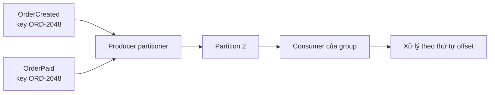

# Business key và message key

Trong một hệ thống hướng sự kiện, một đơn hàng có thể phát sinh nhiều sự kiện như `OrderCreated`, `OrderPaid` và `OrderShipped`. Hệ thống cần biết các sự kiện đó thuộc về đơn hàng nào, cần giữ thứ tự xử lý ra sao và làm thế nào để một sự kiện được giao lại mà không tạo ra tác động nghiệp vụ hai lần. Những yêu cầu này liên quan đến ba khái niệm thường bị nhầm lẫn: **business key**, **Kafka message key** và **idempotency key**.

Business key nhận diện đối tượng hoặc khái niệm trong miền nghiệp vụ. Message key là khóa của một Kafka record, được producer gửi cho Kafka để định tuyến và tổ chức dữ liệu. Idempotency key nhận diện một lần phát sinh logic để consumer hoặc dịch vụ có thể phát hiện lần xử lý lặp. Một giá trị có thể đảm nhiệm nhiều vai trò, nhưng ba khái niệm không đồng nghĩa và cần được chọn theo mục đích sử dụng.

## 1. Phân biệt ba loại khóa

Giả sử hệ thống xử lý đơn hàng. Đơn hàng `ORD-2048` phát sinh hai sự kiện: tạo đơn và xác nhận thanh toán.

| Khái niệm | Câu hỏi được trả lời | Ví dụ | Phạm vi ý nghĩa |
|---|---|---|---|
| Business key | Sự kiện thuộc về đối tượng nghiệp vụ nào? | `orderId = ORD-2048` | Định danh ổn định của đơn hàng trong miền nghiệp vụ |
| Message key | Kafka dùng khóa nào để định tuyến record và nhóm dữ liệu? | Record key `ORD-2048` | Khóa của một record trong topic |
| Event ID / idempotency key | Đây là lần phát sinh logic nào, đã xử lý chưa? | `eventId = evt-7f91` | Định danh duy nhất của một sự kiện hoặc yêu cầu logic |

Ví dụ hai record:

```json
{
  "key": "ORD-2048",
  "value": {
    "eventId": "evt-7f91",
    "eventType": "OrderCreated",
    "orderId": "ORD-2048",
    "occurredAt": "2026-11-16T00:10:00Z"
  }
}
```

```json
{
  "key": "ORD-2048",
  "value": {
    "eventId": "evt-a203",
    "eventType": "OrderPaid",
    "orderId": "ORD-2048",
    "occurredAt": "2026-11-16T00:12:00Z"
  }
}
```

Hai record có cùng business key và message key vì cùng mô tả một đơn hàng. Chúng có `eventId` khác nhau vì là hai sự kiện logic riêng biệt. Nếu consumer nhận lại record `evt-a203`, event ID giúp nhận ra đó là lần giao lại của cùng sự kiện.

## 2. Business key trong miền nghiệp vụ

Business key là định danh mà các thành phần của hệ thống dùng để nói về cùng một đối tượng nghiệp vụ. Ví dụ:

- `orderId` nhận diện đơn hàng.
- `accountId` nhận diện tài khoản.
- `customerId` nhận diện khách hàng.
- `shipmentId` nhận diện một đợt giao hàng.
- Cặp `tenantId` và `orderId` nhận diện đơn hàng trong một hệ thống đa tenant khi `orderId` chỉ duy nhất trong từng tenant.

Business key nên có các đặc điểm sau:

1. **Ổn định:** không đổi khi tên hiển thị, địa chỉ hoặc trạng thái của đối tượng thay đổi.
2. **Có phạm vi duy nhất rõ ràng:** biết khóa duy nhất toàn hệ thống hay chỉ duy nhất trong tenant, cửa hàng hoặc loại đối tượng.
3. **Có thể tái sử dụng nhất quán:** producer, consumer và hệ thống lưu trữ hiểu cùng một cách biểu diễn.
4. **Không phụ thuộc vào thuộc tính dễ thay đổi:** email, số điện thoại, tên hoặc địa chỉ thường không phù hợp làm định danh lâu dài.

Không phải mọi giá trị nhìn giống mã định danh đều là business key tốt. Ví dụ, email có thể thay đổi hoặc được tái sử dụng; tên khách hàng có thể trùng; số thứ tự đơn hàng có thể chỉ duy nhất trong một cửa hàng. Nếu hệ thống có nhiều tenant, chỉ dùng `orderId` có thể gây xung đột khi hai tenant cùng phát sinh mã `1001`.

Khi khóa chỉ duy nhất trong phạm vi tenant, có thể định nghĩa business key tổng hợp gồm `tenantId` và `orderId`. Cách biểu diễn cần không nhập nhằng. Nếu nối chuỗi bằng dấu phân cách, phải bảo đảm dấu đó không thể xuất hiện trong thành phần hoặc phải có quy tắc escape. Với hệ thống dùng schema, có thể biểu diễn khóa tổng hợp bằng cấu trúc có schema ổn định rồi serialize theo quy ước thống nhất.

## 3. Message key ảnh hưởng đến partition như thế nào?

Kafka record có key và value. Key có thể là chuỗi, số, byte hoặc kiểu dữ liệu khác tùy serializer. Khi producer gửi record có key, partitioner dùng byte đã serialize của key để quyết định partition đích. Với partitioner mặc định phổ biến của Java producer, cùng key bytes thường được định tuyến đến cùng partition khi số partition và cấu hình partitioner không đổi.



Nếu `OrderCreated` và `OrderPaid` có cùng key, chúng thường đi vào cùng partition. Kafka giữ thứ tự record trong partition đó theo thứ tự offset. Điều này giúp consumer xử lý các thay đổi của cùng một đơn hàng theo thứ tự được ghi vào partition.

Message key vì vậy thường được chọn từ business key của aggregate cần giữ thứ tự. Ví dụ:

- Topic `orders`: dùng `orderId` nếu cần thứ tự sự kiện theo từng đơn hàng.
- Topic `accounts`: dùng `accountId` nếu cần tuần tự hóa thay đổi số dư của từng tài khoản.
- Topic `shipments`: dùng `shipmentId` nếu trạng thái của từng đợt giao hàng phải được xử lý theo thứ tự.

Kafka chỉ đảm bảo thứ tự trong một partition. Hai record ở hai partition khác nhau không có thứ tự toàn cục. Cùng message key cũng không làm cho nhiều consumer trong cùng group xử lý đồng thời cùng một partition; tại một thời điểm, partition được gán cho tối đa một consumer trong group.

## 4. Chọn message key theo aggregate và yêu cầu thứ tự

Một quy tắc hữu ích là chọn key theo đơn vị nghiệp vụ mà hệ thống cần cập nhật tuần tự. Nếu `OrderCreated`, `OrderPaid` và `OrderCancelled` đều làm thay đổi trạng thái của một đơn hàng, `orderId` thường là message key phù hợp.

Tuy nhiên, key quá rộng có thể tạo điểm nóng. Nếu mọi sự kiện của tất cả khách hàng đều dùng cùng một key `customer-events`, tất cả record sẽ tập trung vào một partition. Nếu key quá chi tiết, chẳng hạn `eventId` duy nhất cho từng record, các sự kiện của cùng một đơn hàng có thể nằm ở nhiều partition và không còn được sắp thứ tự cùng nhau.

| Lựa chọn key | Kết quả có thể có | Khi phù hợp |
|---|---|---|
| `orderId` | Các sự kiện của một đơn hàng cùng partition | Cần thứ tự theo đơn hàng |
| `accountId` | Các thay đổi của một tài khoản cùng partition | Cần tuần tự hóa thay đổi theo tài khoản |
| `customerId` | Mọi sự kiện của khách hàng tập trung theo khách hàng | Cần thứ tự ở cấp khách hàng và tải phân bố đủ đều |
| `eventId` | Mỗi sự kiện thường có key khác nhau | Không cần thứ tự theo aggregate; cần phân tán record, nhưng phải cân nhắc mất thứ tự nghiệp vụ |
| Một hằng số dùng chung | Hầu hết record vào cùng partition | Chỉ phù hợp với luồng nhỏ cần một thứ tự duy nhất; giới hạn throughput rất thấp |

Hãy chọn cấp độ khóa theo invariant nghiệp vụ. Nếu hai đơn hàng độc lập có thể xử lý song song, dùng `orderId` thường cho phép phân tán tốt hơn việc dùng `customerId` cho mọi đơn hàng của một khách hàng. Nếu nghiệp vụ yêu cầu cập nhật tất cả đơn hàng của một khách hàng theo cùng thứ tự, `customerId` có thể là lựa chọn có chủ đích, nhưng cần chấp nhận mức tập trung tải tương ứng.

## 5. Message key không phải cơ chế chống trùng

Kafka không tự bảo đảm mỗi key chỉ xuất hiện một lần. Producer có thể gửi hàng trăm record cùng key; đó là hành vi bình thường. Key chủ yếu giúp định tuyến, giữ thứ tự trong partition và hỗ trợ các tính năng như log compaction.

Do đó, không dùng `orderId` làm bằng chứng rằng sự kiện đã được xử lý. Một đơn hàng có thể có nhiều sự kiện hợp lệ, và cùng một sự kiện có thể được giao lại nhiều lần. Consumer cần một định danh riêng cho lần phát sinh logic, thường là `eventId` được tạo ở producer hoặc `idempotencyKey` được cấp cho yêu cầu đầu vào.

Ví dụ:

| Lần ghi | Business key | Message key | Event ID | Ý nghĩa |
|---|---|---|---|---|
| 1 | `ORD-2048` | `ORD-2048` | `evt-7f91` | Sự kiện tạo đơn |
| 2 | `ORD-2048` | `ORD-2048` | `evt-a203` | Sự kiện thanh toán thành công |
| 3 | `ORD-2048` | `ORD-2048` | `evt-a203` | Giao lại cùng sự kiện thanh toán |

Lần 2 và lần 3 có cùng event ID nên consumer có thể nhận diện lần giao lại. Nếu chỉ so sánh message key `ORD-2048`, consumer sẽ nhầm sự kiện thanh toán với sự kiện tạo đơn vì cả hai đều thuộc cùng đơn hàng.

## 6. Gửi record có key bằng Spring Kafka

Spring Kafka cho phép truyền key trực tiếp khi gửi bằng `KafkaTemplate`:

```java
public record OrderEvent(
        String eventId,
        String eventType,
        String orderId,
        Instant occurredAt) {
}

public void publish(OrderEvent event) {
    kafkaTemplate.send(
        "orders",
        event.orderId(),
        event
    );
}
```

Trong ví dụ này, `event.orderId()` là Kafka message key. `event.eventId()` nằm trong payload và là định danh của sự kiện để phục vụ idempotency. Producer phải cấu hình key serializer tương thích với kiểu key, ví dụ `StringSerializer` nếu dùng `String`.

Cũng có thể tạo `ProducerRecord` tường minh:

```java
ProducerRecord<String, OrderEvent> record =
        new ProducerRecord<>(
            "orders",
            event.orderId(),
            event
        );

kafkaTemplate.send(record);
```

Nếu muốn truyền event ID qua header, có thể thêm header như `event-id`, nhưng nên thống nhất một nguồn dữ liệu chuẩn và bảo đảm header được giữ qua các bước chuyển tiếp. Đặt event ID trong payload thường giúp dữ liệu sự kiện tự mô tả khi được lưu trữ hoặc chuyển sang hệ thống khác. Có thể dùng header bổ sung cho metadata phục vụ vận chuyển.

Consumer có thể đọc cả key lẫn payload:

```java
@KafkaListener(topics = "orders", groupId = "orders-projection")
public void handle(ConsumerRecord<String, OrderEvent> record) {
    String messageKey = record.key();
    OrderEvent event = record.value();

    if (!messageKey.equals(event.orderId())) {
        throw new IllegalStateException("Message key không khớp orderId");
    }

    orderProjectionService.apply(event);
}
```

Kiểm tra key với business identifier trong payload giúp phát hiện lỗi producer hoặc dữ liệu không nhất quán. Trong hệ thống thực tế, cần quy định rõ hành vi khi key null, payload null hoặc hai giá trị không khớp; không nên âm thầm xử lý sai aggregate.

## 7. Idempotency ở consumer dùng event ID

Consumer Kafka có thể nhận lại một record khi ứng dụng restart, rebalance, xử lý lỗi hoặc offset chưa được commit. Đây là hành vi bình thường của mô hình giao nhận có thể lặp. Nếu thao tác nghiệp vụ không idempotent, xử lý lại có thể trừ tiền hai lần, tăng số lượng hai lần hoặc tạo bản ghi trùng.

Một cách phổ biến là lưu event ID đã xử lý trong cùng cơ sở dữ liệu và transaction với thay đổi nghiệp vụ. Bảng inbox có thể có unique constraint trên `event_id`:

```sql
CREATE TABLE processed_events (
    event_id VARCHAR(100) PRIMARY KEY,
    processed_at TIMESTAMP NOT NULL
);
```

Luồng xử lý ở mức khái niệm:

```text
Nhận record
    |
    v
Bắt đầu database transaction
    |
    v
Ghi eventId vào processed_events
    |
    +-- Nếu vi phạm unique constraint --> Sự kiện đã xử lý, kết thúc an toàn
    |
    v
Áp dụng thay đổi nghiệp vụ
    |
    v
Commit database transaction
    |
    v
Commit Kafka offset theo cấu hình listener
```

Ví dụ service:

```java
@Transactional
public void applyOnce(OrderEvent event) {
    processedEventRepository.insert(event.eventId());
    orderRepository.markPaid(event.orderId());
}
```

`insert` phải được bảo vệ bởi unique constraint thực sự trong database. Nếu event ID đã tồn tại, repository có thể nhận diện xung đột và trả về kết quả đã xử lý. Không nên thực hiện thao tác nghiệp vụ trước rồi mới ghi dấu event ID, vì hai thao tác có thể không cùng được commit.

Database transaction phải bao gồm cả dấu đã xử lý và cập nhật nghiệp vụ. Nếu database commit thành công nhưng Kafka offset chưa commit, record có thể được giao lại; lần sau unique constraint phát hiện event đã xử lý và consumer có thể hoàn tất mà không lặp tác động nghiệp vụ. Nếu database transaction rollback, cả dấu event ID và thay đổi nghiệp vụ đều rollback để record có thể được thử lại.

Chi tiết commit offset phụ thuộc acknowledgement mode và cấu hình listener container. Thiết kế phải bảo đảm offset chỉ tiến qua record sau khi thao tác database đã hoàn tất theo chính sách mong muốn. Với batch hoặc xử lý bất đồng bộ, cần đặc biệt cẩn thận để không commit offset của record chưa hoàn tất.

## 8. Event ID, command idempotency key và business key

Ba định danh này có thể xuất hiện trong cùng một luồng:

- **Business key:** `orderId` cho biết đối tượng đơn hàng.
- **Command idempotency key:** token do client gửi khi tạo yêu cầu thanh toán hoặc tạo đơn, giúp API nhận diện cùng một yêu cầu được gửi lại do timeout.
- **Event ID:** ID do hệ thống phát sinh cho sự kiện đã được tạo, giúp các consumer nhận diện lần giao lại của sự kiện đó.

Ví dụ, client gửi yêu cầu tạo đơn với `Idempotency-Key: req-93ab`. Dịch vụ tạo đơn `ORD-2048` và phát sinh event `evt-7f91`. Nếu client gửi lại cùng yêu cầu `req-93ab`, API trả về kết quả đã tạo thay vì tạo đơn mới. Nếu Kafka giao lại event `evt-7f91`, consumer dùng event ID để tránh áp dụng thay đổi nghiệp vụ lần thứ hai.

Không nên mặc định một event ID được tạo mới mỗi lần retry ở tầng ứng dụng. Nếu cùng một sự kiện logic được publish lại sau timeout, ID phải được giữ ổn định để consumer nhận ra đó là cùng sự kiện. Nếu producer tạo event mới với ID mới cho cùng một yêu cầu logic, cơ chế deduplication theo event ID sẽ không phát hiện được sự trùng lặp đó.

## 9. Producer idempotence và Kafka transactions

Kafka producer hỗ trợ idempotence để xử lý một loại trùng lặp phát sinh khi producer retry gửi record do lỗi mạng hoặc phản hồi không đến kịp. Producer dùng producer ID và sequence number để broker nhận diện lần gửi lặp trong phạm vi phiên producer và partition tương ứng.

Ví dụ cấu hình Spring Boot:

```yaml
spring:
  kafka:
    producer:
      properties:
        enable.idempotence: true
```

Với Kafka client hiện đại, idempotence thường được bật mặc định khi các cấu hình liên quan tương thích. Hãy xác nhận phiên bản client và cấu hình thực tế thay vì dựa vào mặc định của phiên bản khác.

Producer idempotence không thay thế event ID hoặc consumer deduplication. Nó không tự loại bỏ hai lần gọi `send()` riêng biệt do ứng dụng phát sinh, không nhận diện hai sự kiện nghiệp vụ có payload giống nhau và không làm một thao tác ghi database trở nên idempotent.

Kafka transactions có thể kết hợp việc đọc record, ghi record sang topic khác và commit offset trong một giao dịch Kafka. Cách này hữu ích cho luồng Kafka-to-Kafka cần đảm bảo các bản ghi đầu ra và offset đầu vào được commit nhất quán. Consumer đọc dữ liệu transactional thường cần `isolation.level=read_committed` để không nhìn thấy record thuộc transaction đã abort.

Kafka transaction không tự bao phủ transaction của một database bên ngoài. Nếu consumer cập nhật PostgreSQL rồi publish record Kafka, chỉ bật Kafka transaction không khiến commit PostgreSQL và commit Kafka trở thành một giao dịch phân tán nguyên tử. Với luồng database và Kafka, hãy xem xét transactional outbox ở producer hoặc inbox/idempotent consumer ở phía nhận.

## 10. Business key và log compaction

Topic có cleanup policy `compact` giữ lại giá trị mới nhất theo key trong quá trình log compaction. Vì vậy, message key trong compacted topic thường đại diện cho thực thể mà hệ thống muốn giữ trạng thái mới nhất.

Ví dụ topic `account-state` có key là `accountId`:

| Key | Value | Ý nghĩa |
|---|---|---|
| `ACC-10` | `{"balance": 100}` | Trạng thái tài khoản ở một thời điểm |
| `ACC-20` | `{"balance": 250}` | Trạng thái tài khoản khác |
| `ACC-10` | `{"balance": 125}` | Trạng thái mới hơn của `ACC-10` |

Sau compaction, Kafka có thể loại bỏ bản ghi cũ của `ACC-10` và giữ bản ghi mới nhất. Vì vậy, key phải ổn định và đại diện đúng cho thực thể cần compact. Nếu dùng `eventId` làm key trong topic lưu trạng thái theo tài khoản, mỗi event có key riêng và compaction không thể gom lịch sử của cùng tài khoản thành một trạng thái mới nhất.

Tombstone là record có key nhưng value bằng `null`, dùng để đánh dấu xóa key trong compacted topic. Ví dụ record có key `ACC-10` và value null biểu thị trạng thái của tài khoản đó đã bị xóa. Tombstone phải dùng đúng key mà các bản ghi trạng thái trước đó sử dụng.

Compaction không phải cơ chế deduplication tổng quát và không bảo đảm chỉ còn một record ngay lập tức. Quá trình compact chạy nền; consumer vẫn có thể đọc nhiều phiên bản của cùng key trước khi compaction hoàn tất. Nếu cần lịch sử đầy đủ mọi sự kiện, hãy thiết kế retention và topic phù hợp thay vì dựa vào compacted topic như event log bất biến.

## 11. Thay đổi partition count và cách serialize key

Với partitioner mặc định, partition được tính từ key bytes và số partition hiện có. Khi tăng số partition của topic, kết quả ánh xạ key sang partition có thể thay đổi. Record cũ của một `orderId` có thể nằm ở partition cũ, trong khi record mới của cùng `orderId` được ghi vào partition khác.

Điều này ảnh hưởng đến giả định thứ tự theo business key. Kafka vẫn giữ thứ tự trong từng partition, nhưng không tạo thứ tự xuyên hai partition. Nếu ứng dụng phụ thuộc chặt vào thứ tự của một aggregate, cần lập kế hoạch thay đổi partition count, có thể dùng chiến lược chuyển đổi topic hoặc quy trình migration có kiểm soát.

Serialization của key cũng là một phần của định tuyến. Cùng business key nhưng hai producer serialize thành byte khác nhau có thể tạo ra key bytes khác nhau và dẫn đến partition khác nhau. Ví dụ một producer dùng `StringSerializer` cho `ORD-2048`, producer khác dùng JSON serialization cho cùng giá trị. Hai dạng byte không giống nhau.

Khi thiết kế key cho nhiều producer:

- Thống nhất kiểu dữ liệu, serializer và encoding.
- Chuẩn hóa chữ hoa/chữ thường, khoảng trắng và định dạng trước khi serialize.
- Không thay đổi tùy tiện cấu trúc key hoặc schema key đang được sử dụng.
- Với composite key, dùng encoding không nhập nhằng và có phiên bản nếu cần tiến hóa schema.
- Kiểm thử việc ánh xạ partition giữa các producer dùng chung topic.

## 12. Phân phối tải và bảo vệ dữ liệu nhạy cảm

Key ảnh hưởng trực tiếp đến phân phối tải. Nếu một business key phát sinh lượng record rất lớn, partition chứa key đó có thể trở thành hot partition. Thêm consumer không giúp chia một partition cho nhiều consumer trong cùng group. Cần đo phân bố key, throughput từng partition và độ trễ xử lý để xác định có cần thay đổi mô hình phân vùng hay không.

Không nên đưa dữ liệu cá nhân hoặc bí mật vào message key nếu không cần thiết. Key có thể xuất hiện trong log, công cụ quản trị, metric hoặc hệ thống quan sát. Dùng ID nội bộ ổn định thường an toàn và dễ vận hành hơn email, số điện thoại, số tài khoản hoặc thông tin định danh trực tiếp.

Nếu cần phân vùng theo một định danh nhạy cảm, cân nhắc dùng ID giả danh ổn định được tạo bằng cơ chế phù hợp. Việc băm đơn giản một giá trị có miền nhỏ không luôn bảo vệ được dữ liệu vì có thể dò ngược bằng từ điển. Dù chọn cách nào, mọi producer phải tạo ra cùng một biểu diễn key cho cùng đối tượng.

## 13. Quan sát và kiểm tra key trong vận hành

Khi điều tra lỗi thứ tự, phân phối tải hoặc deduplication, cần xem cả key, event ID, partition và offset của record. Có thể dùng Kafka console consumer để hiển thị key:

```bash
bin/kafka-console-consumer.sh \
  --bootstrap-server kafka-1.example.net:9092 \
  --topic orders \
  --from-beginning \
  --property print.key=true \
  --property key.separator=" | "
```

Với topic lớn hoặc dữ liệu nhạy cảm, giới hạn phạm vi đọc và tránh ghi toàn bộ payload vào log dùng chung. Trong ứng dụng, có thể ghi nhận metadata phục vụ chẩn đoán như topic, partition, offset, message key đã được che phù hợp và event ID.

Một số dấu hiệu cần theo dõi:

| Dấu hiệu | Nguyên nhân có thể | Hướng điều tra |
|---|---|---|
| Một partition có throughput hoặc lag cao bất thường | Một số key quá nóng hoặc key phân bố lệch | Thống kê số record và tải theo partition, kiểm tra key distribution |
| Sự kiện của cùng aggregate xuất hiện ở nhiều partition | Producer dùng key khác nhau, serializer khác nhau hoặc partition count đã đổi | So sánh key bytes, serializer, partitioner và lịch sử thay đổi topic |
| Consumer áp dụng nghiệp vụ hai lần | Không có event ID ổn định hoặc deduplication không nguyên tử | Kiểm tra event ID, unique constraint và transaction database |
| Nhiều sự kiện khác nhau bị bỏ qua như trùng | Dùng business key làm khóa deduplication | Dùng event ID cho từng sự kiện logic |
| Compacted topic giữ dữ liệu không như mong đợi | Key không đại diện cho thực thể cần compact hoặc tombstone sai key | Kiểm tra key của mọi phiên bản và cleanup policy |

## 14. Quy trình chọn và sử dụng khóa

Khi thiết kế một topic hoặc event contract, thực hiện theo trình tự sau:

1. Xác định aggregate hoặc đối tượng nghiệp vụ mà sự kiện mô tả.
2. Chọn business key ổn định và xác định rõ phạm vi duy nhất, bao gồm tenant nếu cần.
3. Xác định invariant về thứ tự: cần thứ tự theo đơn hàng, tài khoản, khách hàng hay không cần thứ tự theo aggregate.
4. Chọn message key theo đơn vị cần giữ thứ tự và kiểm tra khả năng phân bố tải.
5. Định nghĩa event ID duy nhất, ổn định qua retry cho mỗi sự kiện logic.
6. Thống nhất serializer, encoding và schema của key giữa mọi producer.
7. Thiết kế consumer idempotent bằng event ID và lưu dấu xử lý cùng transaction với tác động nghiệp vụ.
8. Kiểm tra ảnh hưởng của partition count, compaction, hot key và dữ liệu nhạy cảm.
9. Quan sát partition, offset, lag, key distribution và số lần xử lý trùng trong môi trường chạy thật.

Business key giúp các dịch vụ hiểu sự kiện thuộc về đối tượng nào. Message key giúp Kafka định tuyến record, giữ thứ tự trong partition và nhóm trạng thái khi compaction. Event ID hoặc idempotency key giúp nhận diện một lần phát sinh logic để xử lý retry an toàn. Thiết kế tách bạch ba vai trò này giúp hệ thống vừa giữ được thứ tự cần thiết, vừa phân phối tải hợp lý và tránh lặp tác động nghiệp vụ khi Kafka giao lại record.
