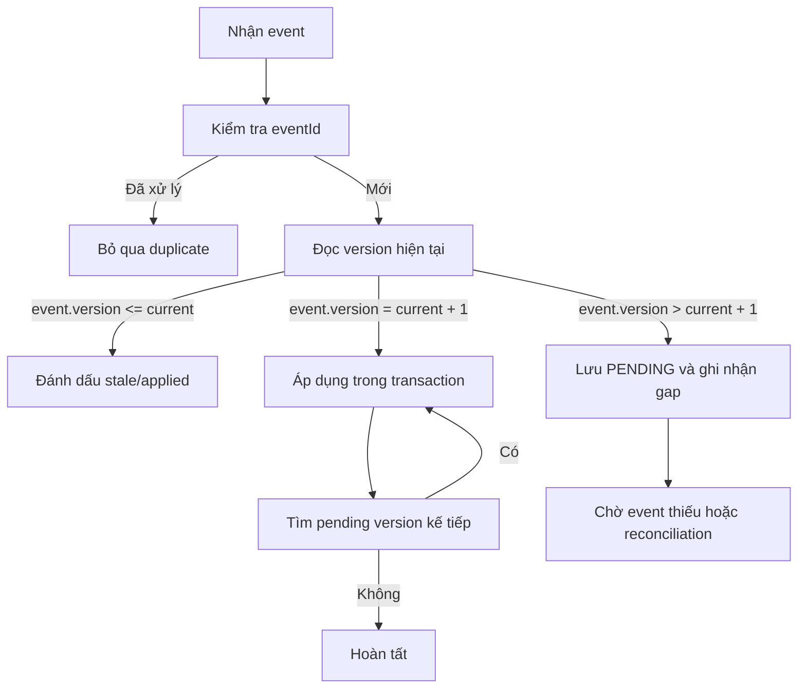

# Out-of-order event trong Spring Kafka

Trong hệ thống hướng sự kiện, **out-of-order event** là tình huống một consumer nhận hoặc hoàn tất xử lý các sự kiện của cùng một nghiệp vụ theo thứ tự khác với thứ tự nghiệp vụ đã phát sinh. Ví dụ, một đơn hàng phát ra `OrderCreated(version=1)` rồi `PaymentCaptured(version=2)`, nhưng consumer lại áp dụng phiên bản 2 trước phiên bản 1.

Vấn đề không chỉ nằm ở thứ tự bản ghi trong Kafka. Một consumer có thể đọc bản ghi đúng thứ tự nhưng xử lý bất đồng bộ khiến kết quả hoàn tất bị đảo. Retry topic, dead-letter topic (DLT), nhiều partition, nhiều producer hoặc thao tác cập nhật cơ sở dữ liệu cũng có thể tạo ra trạng thái tương tự.

Trong phạm vi **Spring Kafka Reliability Operations**, cần phân biệt ba câu hỏi:

1. Kafka đã lưu bản ghi theo thứ tự nào?
2. Consumer đã nhận và hoàn tất xử lý theo thứ tự nào?
3. Thứ tự đó có bảo toàn đúng quy tắc nghiệp vụ của aggregate hay không?

Kafka hỗ trợ thứ tự trong một partition. Ứng dụng phải thiết kế key, version, xử lý idempotent và cơ chế phục hồi để bảo đảm tính đúng ở cấp nghiệp vụ.

## 1. Nhận diện out-of-order event

Giả sử một aggregate đơn hàng phát ra chuỗi sự kiện:

| Aggregate version | Event | Ý nghĩa |
|---:|---|---|
| 1 | `OrderCreated` | Đơn hàng được tạo |
| 2 | `PaymentAuthorized` | Thanh toán được xác nhận |
| 3 | `OrderConfirmed` | Đơn hàng được xác nhận |
| 4 | `OrderShipped` | Đơn hàng được giao cho đơn vị vận chuyển |

Thứ tự nghiệp vụ hợp lệ là 1 → 2 → 3 → 4. Nếu consumer áp dụng version 3 khi trạng thái hiện tại vẫn ở version 1, nó có thể xác nhận đơn hàng trước khi biết kết quả thanh toán. Nếu consumer áp dụng version 2 hai lần, nó có thể ghi nhận thanh toán trùng. Hai tình huống này liên quan nhưng khác nhau:

- **Out-of-order:** sự kiện mới hơn được áp dụng trước sự kiện cũ hơn.
- **Duplicate:** cùng một sự kiện được giao hoặc xử lý nhiều lần.
- **Late/stale event:** sự kiện cũ đến sau khi trạng thái đã tiến lên phiên bản mới hơn.

Một hệ thống tin cậy cần xử lý cả ba. Idempotency giải quyết việc lặp; version hoặc sequence giải quyết việc sai thứ tự; chính sách nghiệp vụ quyết định có thể bỏ qua sự kiện cũ hay phải chờ sự kiện còn thiếu.

### Thứ tự Kafka và thứ tự nghiệp vụ

Kafka gán offset tăng dần **trong từng partition**. Consumer đọc các record của một partition theo offset. Không có một thứ tự offset toàn cục giữa các partition.

Ví dụ:

```text
Topic: orders.events

Partition 0: offset 10 -> Order A, version 1
             offset 11 -> Order A, version 2
             offset 12 -> Order B, version 1

Partition 1: offset  7 -> Order C, version 1
             offset  8 -> Order A, version 3
```

Ở đây, `Order A` có thể bị chia qua hai partition. Kafka không thể bảo đảm version 1, 2, 3 của Order A được quan sát theo cùng một thứ tự. Khi cần thứ tự cho một aggregate, các sự kiện của aggregate đó phải đi vào cùng partition và producer phải phát chúng theo thứ tự mong muốn.

Ngay cả khi các record nằm cùng partition, ứng dụng vẫn có thể phá thứ tự sau khi đọc. Ví dụ listener nhận version 1 trước version 2, nhưng gửi hai tác vụ sang thread pool; tác vụ version 2 hoàn tất trước version 1. Kafka giữ thứ tự lưu trữ, còn ứng dụng đã làm mất thứ tự hoàn tất.

## 2. Những nguyên nhân thường gặp

### 2.1. Cùng một aggregate được gửi vào nhiều partition

Nếu producer không dùng aggregate ID làm message key, Kafka có thể phân phối các sự kiện của cùng một đơn hàng sang nhiều partition. Các consumer xử lý những partition đó độc lập.

Đối với topic chứa sự kiện theo aggregate, hãy chọn key ổn định như `orderId`, `accountId` hoặc `shipmentId`. Với partitioner mặc định, cùng một key thường được ánh xạ vào cùng partition trong cùng cấu hình partition của topic.

Tuy nhiên, key chỉ tạo thứ tự trong phạm vi partition. Nó không tự sắp xếp sự kiện nếu nhiều producer gửi sai thứ tự, và việc tăng số partition có thể làm thay đổi partition được chọn cho một key ở các lần gửi sau. Khi thay đổi số partition của topic có yêu cầu thứ tự nghiêm ngặt, cần có kế hoạch chuyển đổi và kiểm tra các key đang hoạt động.

### 2.2. Producer phát sự kiện song song

Nhiều thread hoặc nhiều instance có thể cùng phát sự kiện cho một aggregate. Nếu hai luồng độc lập tạo version 10 và 11, record version 11 có thể được gửi trước version 10. Broker chỉ ghi nhận thứ tự record đến partition; broker không biết thứ tự nghiệp vụ dự định.

Giải pháp là xác định thứ tự tại nguồn:

- Chỉ một nơi có quyền cấp version cho một aggregate.
- Cấp sequence/version trong cùng giao dịch cập nhật aggregate.
- Serialize việc publish theo aggregate key nếu một aggregate có thể được phát từ nhiều luồng.
- Dùng transactional outbox để ghi thay đổi nghiệp vụ và bản ghi cần publish trong cùng giao dịch cơ sở dữ liệu; relay phải giữ thứ tự theo aggregate.

Không dùng timestamp của máy làm thứ tự duy nhất. Đồng hồ giữa các máy có thể lệch, và hai sự kiện có thể có cùng timestamp. Timestamp hữu ích cho quan sát thời gian, còn sequence/version do nguồn có thẩm quyền cấp mới là căn cứ đáng tin cậy để xác định thứ tự của một aggregate.

### 2.3. Retry và xử lý lỗi

Retry có thể làm một sự kiện cũ hoàn tất sau các sự kiện mới.

Với **blocking retry**, consumer tạm dừng tiến trình xử lý partition hiện tại để thử lại record lỗi. Cách này giữ các record sau trong partition chờ phía trước, nên phù hợp hơn khi thứ tự là bắt buộc. Đổi lại, một record lỗi lâu có thể làm tăng lag của cả partition.

Với **non-blocking retry**, chẳng hạn `@RetryableTopic` của Spring Kafka, record lỗi được chuyển sang retry topic và record tiếp theo trong topic chính có thể tiếp tục được xử lý. Khi record lỗi quay lại sau một khoảng delay, các record mới hơn có thể đã được áp dụng. Đây là hành vi có chủ đích của mô hình retry topic và có thể làm đảo thứ tự.

DLT cũng cần chính sách rõ ràng. Chuyển một record lỗi sang DLT rồi tiếp tục xử lý record sau có nghĩa là luồng chính đã bỏ qua một mắt xích. Nếu sự kiện sau phụ thuộc vào sự kiện bị bỏ qua, consumer phải phát hiện khoảng trống version và chờ, khôi phục hoặc yêu cầu đối soát. DLT lưu giữ thông tin lỗi; bản thân DLT không khôi phục thứ tự nghiệp vụ.

### 2.4. Consumer xử lý bất đồng bộ

Một listener có thể đọc record tuần tự nhưng đẩy công việc sang executor, reactive pipeline hoặc callback không chờ hoàn tất. Nếu nhiều công việc cùng chạy, thời điểm hoàn tất không còn theo offset.

Ví dụ không an toàn về thứ tự:

```java
@KafkaListener(topics = "orders.events")
public void listen(OrderEvent event) {
    executor.submit(() -> orderService.apply(event));
}
```

Listener trả về ngay sau khi gửi tác vụ. Container có thể tiếp tục nhận record tiếp theo và commit offset trong khi tác vụ trước chưa hoàn tất. Khi đó, một lỗi tiến trình có thể làm mất công việc đã được xác nhận offset; đồng thời các tác vụ có thể hoàn tất sai thứ tự.

Nếu thứ tự quan trọng, hãy xử lý đồng bộ trong listener hoặc dùng cơ chế tuần tự hóa theo key và chỉ xác nhận record sau khi công việc tương ứng đã hoàn tất an toàn. Một executor dùng chung không tự bảo đảm FIFO cho từng aggregate.

### 2.5. Rebalance và nhiều consumer

Trong một consumer group, tại một thời điểm một partition chỉ được gán cho một consumer member. Tăng `concurrency` của `@KafkaListener` thường tạo nhiều consumer để xử lý các partition khác nhau song song; nó không làm Kafka phân chia cùng một partition cho nhiều consumer trong cùng group tại cùng thời điểm.

Tuy vậy, rebalance, xử lý bất đồng bộ còn dang dở và commit offset không phù hợp vẫn có thể gây lặp hoặc làm thứ tự hoàn tất ở tầng ứng dụng bị thay đổi. Consumer phải có khả năng xử lý lại record và bảo vệ cập nhật trạng thái bằng idempotency/version.

## 3. Bảo đảm thứ tự ở phía producer

### 3.1. Dùng aggregate ID làm key

Ví dụ event có cấu trúc:

```java
public record OrderEvent(
        String eventId,
        String orderId,
        long version,
        String eventType,
        Instant occurredAt
) {
}
```

Gửi `orderId` làm key:

```java
@Service
public class OrderEventPublisher {

    private final KafkaTemplate<String, OrderEvent> kafkaTemplate;

    public OrderEventPublisher(
            KafkaTemplate<String, OrderEvent> kafkaTemplate) {
        this.kafkaTemplate = kafkaTemplate;
    }

    public CompletableFuture<SendResult<String, OrderEvent>> publish(
            OrderEvent event) {
        return kafkaTemplate.send(
                "orders.events",
                event.orderId(),
                event
        );
    }
}
```

Các event của cùng một order được gửi cùng key. Với partitioner mặc định, chúng được đưa vào cùng partition khi cấu hình partition không thay đổi theo cách làm remap key.

Không chọn một key chung như `"orders"` cho mọi đơn hàng nếu muốn tận dụng xử lý song song. Key chung sẽ dồn toàn bộ sự kiện vào một partition và tạo nút thắt cổ chai. Key cần phản ánh đơn vị mà hệ thống phải giữ thứ tự.

### 3.2. Bật producer idempotence

Cấu hình ví dụ cho Spring Boot với Spring Kafka 3.x:

```yaml
spring:
  kafka:
    producer:
      acks: all
      properties:
        enable.idempotence: true
        max.in.flight.requests.per.connection: 5
```

Producer idempotence giúp Kafka loại bỏ bản ghi trùng do producer retry trong phạm vi cơ chế idempotence của producer. `acks=all` yêu cầu xác nhận từ các replica đang tham gia ISR theo cấu hình broker. Các thiết lập này tăng độ tin cậy khi gửi, nhưng **không** cấp version nghiệp vụ, không tuần tự hóa nhiều producer độc lập và không bảo đảm consumer áp dụng sự kiện đúng thứ tự.

Kafka hiện đại mặc định bật idempotence trong nhiều cấu hình nếu không có thiết lập xung đột. Khai báo tường minh giúp ý định vận hành dễ đọc và dễ kiểm tra. Cần kiểm tra phiên bản Kafka client và cấu hình thực tế khi thay đổi các thuộc tính liên quan.

### 3.3. Cấp version tại nguồn có thẩm quyền

Mỗi aggregate nên có một version tăng đơn điệu. Version phải được cấp cùng với thay đổi trạng thái của aggregate, thường trong cùng giao dịch cơ sở dữ liệu.

Ví dụ:

| Thao tác | Version trước | Version sau | Event phát ra |
|---|---:|---:|---|
| Tạo đơn | 0 | 1 | `OrderCreated(1)` |
| Xác nhận thanh toán | 1 | 2 | `PaymentAuthorized(2)` |
| Xác nhận đơn | 2 | 3 | `OrderConfirmed(3)` |

Nếu hai transaction đồng thời cập nhật cùng aggregate, cần optimistic locking hoặc khóa phù hợp để không cấp trùng version. Một trường `@Version` của JPA có thể hỗ trợ phát hiện xung đột ghi, nhưng ứng dụng vẫn phải thiết kế cách tạo và publish event nhất quán.

### 3.4. Dùng transactional outbox khi cập nhật DB và publish Kafka

Một lỗi thường gặp là cập nhật database thành công nhưng gửi Kafka thất bại, hoặc gửi Kafka thành công rồi transaction database rollback. Hai hệ thống không tự tạo thành một giao dịch nguyên tử chỉ vì code gọi cả repository và `KafkaTemplate`.

Transactional outbox giải quyết khoảng trống này bằng cách ghi trạng thái nghiệp vụ và một bản ghi outbox trong cùng transaction database. Một relay đọc outbox rồi publish sang Kafka. Relay cần giữ thứ tự theo aggregate, ví dụ lấy các bản ghi theo `aggregate_id` và `aggregate_version`, chỉ publish version kế tiếp sau khi version trước đã được xác nhận.

Outbox không tự bảo đảm thứ tự nếu nhiều relay cùng lấy các bản ghi của một aggregate mà không có khóa hoặc cơ chế claim phù hợp. Cần thiết kế phân vùng công việc, khóa theo aggregate hoặc cơ chế tuần tự hóa tương ứng.

## 4. Bảo vệ thứ tự ở phía consumer

Thiết kế consumer nên dựa trên version và event ID thay vì giả định mọi record sẽ luôn đến đúng thứ tự.

### 4.1. Phân biệt event ID và aggregate version

Một event thường cần tối thiểu:

| Trường | Mục đích |
|---|---|
| `eventId` | Nhận diện duy nhất một lần phát sinh event; dùng để chống xử lý trùng |
| `aggregateId` | Xác định thực thể cần giữ thứ tự |
| `version` | Xác định vị trí của event trong chuỗi thay đổi aggregate |
| `eventType` | Xác định loại thay đổi |
| `occurredAt` | Thời điểm nghiệp vụ phát sinh, hữu ích cho audit và quan sát |

`eventId` và `version` không thay thế nhau. Một event bị gửi lại có cùng `eventId`; hai event hợp lệ liên tiếp có hai `eventId` khác nhau và version khác nhau.

### 4.2. Quy tắc xử lý theo version

Giả sử trạng thái hiện tại của aggregate có version 7. Khi nhận event:

- Nếu event version `<= 7`, event đã cũ hoặc đã được áp dụng. Có thể bỏ qua sau khi xác nhận đó là duplicate/stale theo chính sách.
- Nếu event version `= 8`, đây là event kế tiếp; có thể áp dụng.
- Nếu event version `> 8`, đang thiếu ít nhất một event trước đó. Không áp dụng ngay nếu event hiện tại là delta phụ thuộc vào trạng thái trước.

Ví dụ, trạng thái đơn hàng ở version 7 nhận version 9. Consumer chưa biết version 8 có thể là `PaymentAuthorized`, `PaymentCancelled` hoặc một thay đổi khác. Áp dụng version 9 trước có thể tạo trạng thái sai. Consumer cần lưu lại event và chờ version 8, hoặc yêu cầu phục hồi từ nguồn có thẩm quyền.

Không phải mọi event đều cần chặn khi version bị đảo. Nếu event là snapshot đầy đủ, độc lập và version mới hơn thay thế hoàn toàn snapshot cũ, có thể áp dụng snapshot version cao nhất rồi bỏ qua snapshot cũ. Quy tắc đó chỉ hợp lệ khi hợp đồng event xác nhận snapshot là trạng thái đầy đủ; không áp dụng tùy tiện cho event delta như cộng tiền, trừ kho hoặc chuyển trạng thái.

### 4.3. Kết hợp inbox/idempotency với cập nhật trạng thái

Một bảng inbox có thể lưu event ID đã nhận hoặc đã áp dụng. Đặt unique constraint trên `event_id` để hai lần giao cùng event không tạo hai lần xử lý. Cập nhật inbox và trạng thái aggregate trong cùng transaction database.

Luồng xử lý khái niệm:

```java
@Transactional
public ApplyResult apply(OrderEvent event) {
    if (inboxRepository.existsByEventId(event.eventId())) {
        return ApplyResult.DUPLICATE;
    }

    OrderState state = orderRepository.findByIdForUpdate(event.orderId())
            .orElseGet(() -> OrderState.empty(event.orderId()));

    if (event.version() <= state.version()) {
        inboxRepository.save(InboxEntry.applied(event.eventId()));
        return ApplyResult.STALE;
    }

    if (event.version() > state.version() + 1) {
        throw new MissingPreviousEventException(
                event.orderId(),
                state.version() + 1,
                event.version()
        );
    }

    state.apply(event);
    orderRepository.save(state);
    inboxRepository.save(InboxEntry.applied(event.eventId()));

    return ApplyResult.APPLIED;
}
```

Đây là minh họa cho quy tắc nghiệp vụ; các repository, kiểu trạng thái và xử lý lỗi cần được triển khai theo ứng dụng thực tế. `findByIdForUpdate` đại diện cho thao tác khóa hàng hoặc cơ chế đồng bộ tương đương để hai consumer thread không đồng thời áp dụng cùng aggregate. Unique constraint vẫn cần thiết vì kiểm tra `exists` đơn lẻ có thể gặp race condition.

Nếu transaction database commit thành công nhưng consumer chết trước khi Kafka offset được commit, Kafka có thể giao lại event. Inbox sẽ nhận ra `eventId` đã xử lý và ngăn tác động lặp. Đây là lý do idempotency vẫn cần thiết ngay cả khi producer bật idempotence hoặc consumer dùng Kafka transaction.

Không đánh dấu event là đã áp dụng trước khi trạng thái nghiệp vụ được lưu thành công. Nếu cần lưu event đến trước vào vùng chờ, hãy phân biệt rõ trạng thái `RECEIVED/PENDING` với `APPLIED`; event đang chờ không được coi là đã hoàn tất nghiệp vụ.

### 4.4. Chọn cách xử lý khi thiếu version

Có ba hướng thường dùng:

**Chờ và retry có giới hạn.** Consumer ném exception khi thiếu version để record được retry. Cách này đơn giản và có thể phù hợp với luồng có độ trễ nhỏ, nhưng retry blocking có thể giữ partition và làm tăng lag. Cần giới hạn số lần, thời gian chờ và có cảnh báo khi khoảng trống không được lấp đầy.

**Lưu vào bảng pending và xử lý khi đủ chuỗi.** Consumer lưu event vào database với unique key phù hợp, commit việc lưu rồi xác nhận record Kafka. Một worker hoặc transaction tiếp theo tìm version kế tiếp và áp dụng tuần tự. Khi version 8 đến, hệ thống áp dụng version 8 rồi tiếp tục drain các event pending version 9, 10 nếu chúng đã có mặt. Cách này không giữ partition chờ một event bị trễ, nhưng cần cơ chế phục hồi pending, chống xử lý đồng thời và theo dõi event bị kẹt.

**Đối soát hoặc lấy lại trạng thái từ nguồn.** Nếu event bị mất, bị đưa vào DLT hoặc không thể phục hồi trong thời hạn, consumer có thể yêu cầu replay từ event store, đọc snapshot mới nhất hoặc chạy quy trình reconciliation. Chỉ bỏ qua gap khi nghiệp vụ cho phép và có quyết định rõ ràng về trạng thái bị thiếu.

Ví dụ luồng pending:



Khi dùng pending table, thao tác ghi event và kiểm tra version phải có tính nguyên tử phù hợp. Cần tránh trường hợp hai worker cùng lấy một pending event. Có thể dùng row lock, trạng thái claim có lease, hoặc phân vùng worker theo aggregate. Nếu pending event được lưu trong database, hệ thống cần job quét và khôi phục event pending sau restart.

## 5. Chọn retry và cấu hình listener trong Spring Kafka

### 5.1. Consumer xử lý tuần tự trong listener

Ví dụ listener đồng bộ:

```java
@Component
public class OrderEventListener {

    private final OrderEventService orderEventService;

    public OrderEventListener(OrderEventService orderEventService) {
        this.orderEventService = orderEventService;
    }

    @KafkaListener(
            topics = "orders.events",
            groupId = "orders-projection",
            concurrency = "3"
    )
    public void listen(OrderEvent event) {
        orderEventService.apply(event);
    }
}
```

Mỗi consumer xử lý record của partition được gán theo thứ tự poll. `concurrency = "3"` cho phép tối đa ba consumer chạy song song trong listener container (phụ thuộc số partition và phân công). Nó hữu ích khi topic có nhiều partition độc lập. Nếu một aggregate luôn dùng cùng key và partition, các event của aggregate đó vẫn thuộc cùng luồng partition.

Listener đồng bộ chỉ giữ thứ tự khi phần xử lý hoàn tất trước khi listener chuyển sang record tiếp theo. Nếu `apply` chỉ tạo tác vụ nền rồi trả về, thứ tự hoàn tất vẫn có thể bị đảo.

### 5.2. Tắt auto commit và chọn thời điểm xác nhận phù hợp

Cấu hình minh họa:

```yaml
spring:
  kafka:
    consumer:
      enable-auto-commit: false
    listener:
      ack-mode: record
```

Với record listener, `AckMode.RECORD` giúp commit offset sau khi listener xử lý record thành công theo cơ chế container. Cần kiểm tra transaction manager, error handler và cấu hình thực tế của ứng dụng vì cách commit có thể thay đổi theo mô hình listener.

Commit offset chỉ ghi nhận tiến độ đọc của consumer group. Nó không tự làm cho thay đổi ở database và Kafka trở thành một giao dịch nguyên tử. Nếu listener cập nhật database, hãy dùng inbox/idempotency để xử lý trường hợp database commit rồi Kafka chưa commit offset.

Nếu listener dùng Kafka transaction để đọc và ghi Kafka, Spring Kafka có thể kết hợp việc gửi output và offset vào một Kafka transaction. Cơ chế này hỗ trợ exactly-once processing trong phạm vi Kafka read-process-write. Nó không tự bao phủ side effect ở database hoặc HTTP service bên ngoài.

### 5.3. Blocking retry với DefaultErrorHandler

Khi cần giữ các record sau trong partition chờ record hiện tại, có thể dùng blocking retry. Ví dụ cấu hình Spring Kafka:

```java
@Bean
DefaultErrorHandler kafkaErrorHandler(
        KafkaTemplate<Object, Object> template) {

    DeadLetterPublishingRecoverer recoverer =
            new DeadLetterPublishingRecoverer(template);

    return new DefaultErrorHandler(
            recoverer,
            new FixedBackOff(1_000L, 2L)
    );
}
```

Ví dụ này thử lại theo khoảng nghỉ một giây với số lần retry hữu hạn, sau đó chuyển record không phục hồi được sang DLT qua recoverer. Số lần retry, loại exception được retry, DLT destination và xử lý sau DLT phải được cấu hình theo nghiệp vụ. Khi record được chuyển sang DLT và partition tiếp tục chạy, consumer vẫn phải phát hiện gap version nếu record sau phụ thuộc vào record lỗi.

Blocking retry phù hợp khi thứ tự quan trọng và lỗi có khả năng tạm thời. Không nên retry vô hạn một lỗi dữ liệu vĩnh viễn vì nó có thể chặn toàn bộ partition.

### 5.4. Non-blocking retry với @RetryableTopic

Ví dụ:

```java
@RetryableTopic(
        attempts = "4",
        backoff = @Backoff(delay = 1_000, multiplier = 2.0),
        dltTopicSuffix = ".dlt"
)
@KafkaListener(
        topics = "orders.events",
        groupId = "orders-projection"
)
public void listen(OrderEvent event) {
    orderEventService.apply(event);
}

@DltHandler
public void handleDlt(OrderEvent event) {
    dltService.recordFailure(event);
}
```

`@RetryableTopic` tạo các retry topic để record lỗi được thử lại sau khoảng delay. Cơ chế này hữu ích khi muốn tránh giữ partition chính trong lúc chờ retry. Đổi lại, record sau có thể được xử lý trước record đang retry. Với aggregate cần thứ tự nghiêm ngặt, hãy kết hợp version/pending và reconciliation, hoặc chọn blocking retry nếu phù hợp.

Tên topic retry, số lần thử, backoff, exception được retry và DLT handler cần được thiết kế nhất quán với cấu hình topic và phiên bản Spring Kafka đang dùng. Ví dụ trên minh họa cách dùng phổ biến; không thay thế việc kiểm tra API tương ứng với phiên bản dự án.

### 5.5. Chú ý khi dùng batch listener

Batch listener nhận nhiều record trong một lần gọi. Nếu batch chứa record của nhiều partition, hoặc code xử lý song song các phần tử trong batch, thứ tự hoàn tất có thể không còn giống thứ tự offset. Khi cần thứ tự theo aggregate, hãy nhóm và tuần tự hóa theo key/version; đồng thời xử lý commit và lỗi ở cấp record theo semantics mà listener container hỗ trợ.

## 6. Chọn chiến lược theo loại event

Không có một chính sách xử lý out-of-order phù hợp cho mọi event. Cần xác định event mang thông tin delta hay snapshot, và liệu có thể bỏ qua version trung gian hay không.

| Loại event | Ví dụ | Khi nhận version mới hơn nhưng thiếu version trước |
|---|---|---|
| Delta phụ thuộc trạng thái | `BalanceDebited`, `InventoryReserved` | Chờ, lưu pending hoặc phục hồi event thiếu; không tự ý áp dụng |
| Chuyển trạng thái | `OrderPaid`, `OrderCancelled` | Kiểm tra state machine và version; chỉ cho phép chuyển trạng thái hợp lệ |
| Snapshot đầy đủ | `CustomerProfileSnapshot` | Có thể áp dụng snapshot mới nhất nếu hợp đồng xác nhận snapshot thay thế hoàn toàn snapshot cũ |
| Thông báo độc lập | `EmailRequested` | Có thể xử lý độc lập nếu không có phụ thuộc nghiệp vụ; vẫn cần idempotency |

Ví dụ với số dư tài khoản:

- Version 10: cộng 100.
- Version 11: trừ 30.

Nếu version 11 được áp dụng trước, số dư trung gian sai; nếu consumer bỏ qua version 10 vì thấy nó cũ, số dư cuối cùng cũng sai. Đây là delta nên phải bảo toàn chuỗi hoặc tái dựng trạng thái từ nguồn có thẩm quyền.

Ngược lại, nếu mỗi event là snapshot đầy đủ số dư tại version 10 và 11, snapshot version 11 có thể thay thế version 10. Nhưng điều này chỉ đúng khi snapshot chứa toàn bộ trạng thái cần thiết và không có side effect riêng phải chạy cho từng event.

## 7. Kiểm thử tình huống đảo thứ tự

Kiểm thử không nên chỉ xác nhận listener nhận được message. Cần xác nhận trạng thái cuối cùng và các side effect vẫn đúng khi có duplicate, gap, retry và crash.

Một bộ kịch bản hữu ích:

1. Gửi version 1 rồi version 2; xác nhận cả hai được áp dụng đúng thứ tự.
2. Gửi version 2 trước version 1; xác nhận version 2 được giữ pending hoặc retry theo chính sách.
3. Gửi cùng `eventId` hai lần; xác nhận side effect chỉ xảy ra một lần.
4. Gửi version 2 hai lần với `eventId` khác nhau; xác nhận version check vẫn ngăn áp dụng lại thay đổi đã cũ.
5. Làm listener lỗi tạm thời ở version 1; xác nhận hành vi retry không khiến version 2 phá vỡ invariant.
6. Làm listener commit database rồi mô phỏng lỗi trước khi offset được commit; xác nhận lần giao lại được inbox nhận diện.
7. Dừng consumer khi còn pending event rồi khởi động lại; xác nhận tiến trình phục hồi tiếp tục xử lý.
8. Kiểm thử nhiều partition và nhiều consumer; xác nhận mọi event của cùng aggregate có cùng key/partition theo thiết kế.
9. Kiểm thử DLT; xác nhận quy trình xử lý gap khi một event không thể phục hồi.

Có thể dùng Embedded Kafka hoặc Kafka Testcontainers để kiểm thử tích hợp với broker thật. Với phần kiểm tra version và idempotency, nên có unit test cho service/domain logic và integration test cho transaction database, unique constraint, listener container và retry configuration.

## 8. Quan sát và vận hành

Out-of-order event có thể không làm consumer crash. Nó thường biểu hiện dưới dạng trạng thái nghiệp vụ bất thường hoặc event pending tồn tại lâu. Vì vậy, chỉ theo dõi consumer lag là chưa đủ.

Nên ghi log có cấu trúc với các trường `eventId`, `aggregateId`, `version`, `partition`, `offset`, `consumerGroup`, `retryAttempt` và kết quả xử lý. Tránh log toàn bộ payload nếu payload chứa dữ liệu nhạy cảm.

Các metric hữu ích:

- Số event bị phát hiện stale hoặc duplicate.
- Số lần phát hiện gap version.
- Số event pending và tuổi của event pending lâu nhất.
- Số lần retry, số record chuyển DLT và tuổi của record trong DLT.
- Consumer lag theo partition và thời gian xử lý record.
- Số lần reconciliation thành công/thất bại.

Đặt cảnh báo theo mức độ nghiệp vụ. Một gap tồn tại vài giây có thể là độ trễ bình thường; một gap kéo dài vượt SLA hoặc pending tăng liên tục có thể báo hiệu producer mất event, retry topic bị tắc hoặc relay outbox không giữ thứ tự.

Khi điều tra một aggregate, hãy ghép log theo `aggregateId` rồi sắp xếp theo `version`. Đối chiếu version với offset/partition để phân biệt lỗi nguồn phát, lỗi phân vùng, lỗi retry và lỗi xử lý song song. Không sắp xếp chỉ theo timestamp nếu đồng hồ giữa các service không được đồng bộ chặt chẽ.

## 9. Checklist thiết kế

Trước khi đưa luồng event vào production, hãy trả lời được các câu hỏi sau:

- Đơn vị nghiệp vụ nào cần giữ thứ tự: aggregate, account, order hay một nhóm khác?
- Message key có phản ánh đúng đơn vị đó không?
- Version được cấp bởi nguồn nào, và có tăng đơn điệu trong transaction không?
- Event là delta hay snapshot? Có được phép bỏ qua version trung gian không?
- Consumer xử lý đồng bộ hay có công việc bất đồng bộ phía sau listener?
- Duplicate được nhận diện bằng `eventId` và unique constraint nào?
- Gap version được retry, lưu pending hay reconciliation?
- Non-blocking retry có thể làm record sau vượt record trước không?
- Khi đưa record vào DLT, ai quyết định khôi phục hoặc bỏ qua khoảng trống?
- Database commit và Kafka offset commit được bảo vệ thế nào khi tiến trình chết giữa hai thao tác?
- Có metric và cảnh báo cho pending/gap/DLT không?
- Việc tăng partition hoặc thay đổi partitioner ảnh hưởng đến key đang hoạt động ra sao?

## 10. Nguyên tắc áp dụng

Để giữ tính đúng và idempotency trong Spring Kafka, hãy phối hợp nhiều lớp bảo vệ:

1. **Ở producer:** dùng aggregate ID làm key, cấp version tại nguồn có thẩm quyền, serialize publish theo aggregate khi cần và cân nhắc transactional outbox.
2. **Ở Kafka:** bật producer idempotence và cấu hình durability phù hợp; nhớ rằng thứ tự chỉ được bảo đảm trong một partition.
3. **Ở consumer:** tránh xử lý bất đồng bộ không kiểm soát, dùng `eventId` để chống duplicate và kiểm tra aggregate version trước khi áp dụng.
4. **Ở retry/DLT:** chọn blocking hoặc non-blocking dựa trên yêu cầu thứ tự; thiết kế rõ cách phục hồi event bị thiếu.
5. **Ở database:** ghi inbox, trạng thái aggregate và pending event theo transaction; dùng khóa hoặc optimistic concurrency để tránh cập nhật đồng thời sai.
6. **Ở vận hành:** theo dõi gap, pending, retry và DLT để phát hiện lỗi trước khi chúng trở thành sai lệch nghiệp vụ.

Kafka cung cấp thứ tự record trong partition. Tính đúng của chuỗi nghiệp vụ là trách nhiệm của thiết kế producer, consumer và cơ chế phục hồi. Khi event có aggregate key ổn định, version rõ ràng, idempotency bền vững và chính sách xử lý gap minh bạch, hệ thống có thể chịu được duplicate, retry, rebalance và event đến muộn mà vẫn duy trì trạng thái nhất quán.


