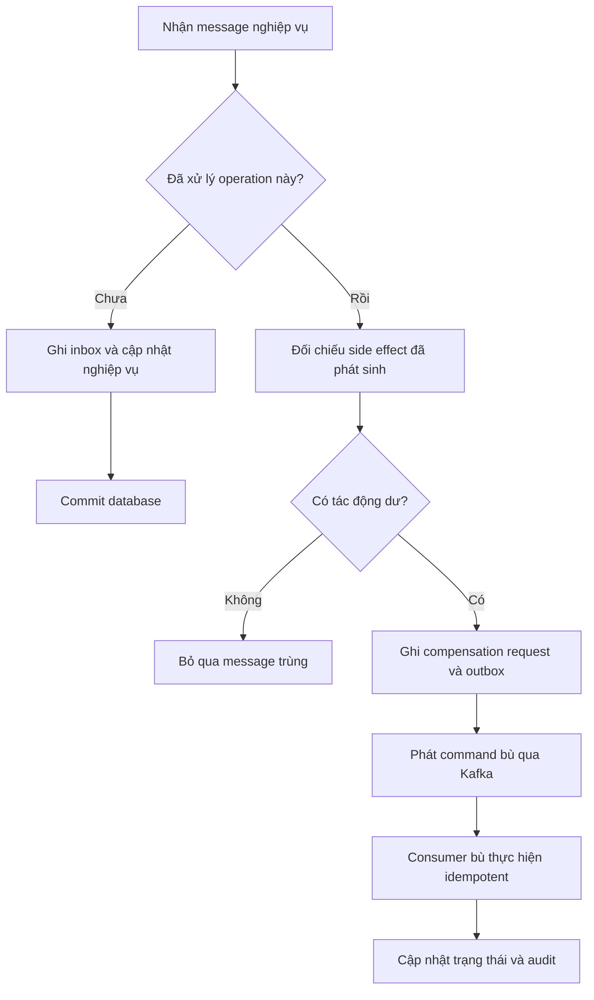

# Tác vụ bù khi xử lý lặp

Trong một hệ thống dùng Spring Kafka, một message có thể được giao đến consumer nhiều lần. Việc nhận lại message không nhất thiết có nghĩa producer đã gửi một nghiệp vụ mới: consumer có thể đã thực hiện một phần công việc rồi gặp lỗi, chưa kịp commit offset, hoặc bị rebalance. Nếu mỗi lần nhận đều tạo ra một tác động nghiệp vụ mới, hệ thống có thể trừ tiền hai lần, tạo nhiều đơn hàng, giữ nhiều chỗ hoặc gửi thông báo trùng.

Idempotency là lớp bảo vệ đầu tiên: cùng một yêu cầu logic được xử lý nhiều lần vẫn tạo ra một kết quả nghiệp vụ duy nhất. Tuy nhiên, có những trường hợp tác động đã xảy ra nhiều lần trước khi hệ thống phát hiện lỗi, hoặc tác động được thực hiện ở một dịch vụ bên ngoài. Khi đó, hệ thống cần một **tác vụ bù** để đưa trạng thái nghiệp vụ về trạng thái chấp nhận được. Tác vụ bù phải được theo dõi, có thể retry an toàn và không tạo thêm tác động trùng.

## 1. Vì sao consumer có thể xử lý một message nhiều lần?

Kafka lưu message trong partition và consumer group quản lý tiến độ đọc bằng offset. Offset cho biết vị trí consumer đã xử lý đến đâu; nó không tự chứng minh rằng mọi tác động bên ngoài message đã hoàn tất.

Với cách xử lý phổ biến theo hướng at-least-once, consumer chỉ xác nhận tiến độ sau khi xử lý thành công. Điều này ưu tiên tránh mất message, nhưng tạo ra một khoảng thời gian có thể phát sinh xử lý lặp:

1. Consumer nhận message ở offset `42`.
2. Consumer ghi dữ liệu hoặc gọi một dịch vụ bên ngoài.
3. Tiến trình dừng trước khi offset `42` được commit.
4. Consumer khởi động lại hoặc partition được giao cho consumer khác.
5. Message ở offset `42` được giao lại và phần xử lý bắt đầu lần nữa.

Một số tình huống khác cũng có thể khiến message được giao lại:

- Listener ném exception sau khi đã thực hiện một phần tác động nghiệp vụ.
- Consumer mất kết nối hoặc dừng trong lúc đang xử lý.
- Consumer group rebalance và quyền sở hữu partition thay đổi.
- Cấu hình retry hoặc việc phát lại message khiến cùng một sự kiện đi qua consumer lần nữa.
- Một ứng dụng upstream phát lại cùng nghiệp vụ dưới một message mới.

Điểm cuối cần được phân biệt rõ: hai message có payload giống nhau chưa chắc là cùng một nghiệp vụ. Ví dụ, hai lần khách hàng chủ động đặt cùng một sản phẩm với cùng số tiền có thể là hai đơn hàng hợp lệ. Ngược lại, một yêu cầu thanh toán được gửi lại do timeout có thể vẫn chỉ là một lần thanh toán logic.

### Phân biệt các cơ chế bảo đảm

| Cơ chế | Phạm vi bảo vệ | Giới hạn cần nhớ |
|---|---|---|
| Producer idempotence | Hạn chế bản ghi trùng do producer retry trong phạm vi Kafka producer protocol | Không ngăn consumer thực hiện một side effect nhiều lần |
| Consumer idempotency | Bảo đảm một nghiệp vụ logic chỉ tạo một tác động trong phạm vi được kiểm soát | Cần một khóa nhận diện ổn định và nơi lưu trạng thái đã xử lý |
| Kafka transaction / exactly-once processing trong Kafka | Có thể phối hợp đọc và ghi Kafka theo một giao dịch Kafka | Không tự bao trùm transaction của database, payment gateway, email hoặc HTTP service |
| Tác vụ bù | Sửa lại hậu quả nghiệp vụ đã xảy ra | Là một nghiệp vụ mới, cần tính idempotency, retry và theo dõi riêng |

Không nên xem `enable.idempotence` của producer hoặc Kafka transaction là bằng chứng rằng mọi hệ thống downstream chỉ nhận một tác động. Phạm vi bảo đảm phải được xác định theo từng tài nguyên tham gia xử lý.

## 2. Ưu tiên ngăn tác động trùng bằng idempotency

Một thao tác idempotent có cùng kết quả quan sát được dù được thực hiện một hay nhiều lần. Ví dụ, đặt trạng thái đơn hàng thành `PAID` là thao tác có thể thiết kế theo hướng idempotent; cộng thêm 100.000 đồng vào số dư mỗi lần nhận message thì không.

### Chọn khóa idempotency

Khóa phải đại diện cho **một ý định nghiệp vụ**, ổn định qua retry và được tạo ở nơi có thể phân biệt một yêu cầu mới với một lần gửi lại. Các lựa chọn thường gặp:

- `eventId`: phù hợp khi mọi lần phát lại đều giữ nguyên ID sự kiện.
- `businessOperationId` hoặc `commandId`: phù hợp khi cùng một nghiệp vụ có thể được đóng gói lại thành message mới với `eventId` khác.
- Khóa kết hợp như `(consumerName, tenantId, operationId)`: phù hợp khi cùng một ID có phạm vi duy nhất theo consumer hoặc tenant.

Không nên chỉ dùng hash của payload làm khóa. Hai yêu cầu hợp lệ có thể có payload giống hệt nhau, còn cùng một yêu cầu có thể có payload thay đổi ở các metadata không làm thay đổi ý nghĩa nghiệp vụ.

Khóa cần được truyền xuyên suốt qua các bước xử lý. Khi gọi dịch vụ thanh toán, ví dụ, hãy dùng cùng một idempotency key cho mọi lần retry của cùng một yêu cầu thanh toán. Không tạo UUID mới cho mỗi lần gọi lại, vì như vậy dịch vụ nhận sẽ coi mỗi lần retry là một yêu cầu mới.

### Dùng inbox table để ghi nhận message đã xử lý

Với tác động nằm trong cùng database, một mẫu phổ biến là lưu dấu vết message đã nhận trong một bảng inbox (hoặc `processed_event`). Khóa duy nhất ngăn hai transaction cùng ghi nhận một sự kiện hai lần.

Ví dụ schema PostgreSQL:

```sql
CREATE TABLE consumed_event (
    consumer_name  VARCHAR(100) NOT NULL,
    event_id       VARCHAR(200) NOT NULL,
    processed_at   TIMESTAMPTZ NOT NULL DEFAULT CURRENT_TIMESTAMP,
    PRIMARY KEY (consumer_name, event_id)
);
```

Repository có thể đánh dấu sự kiện mới bằng một câu lệnh insert không gây lỗi khi khóa đã tồn tại:

```java
public interface ConsumedEventRepository extends Repository<ConsumedEvent, Long> {

    @Modifying
    @Query(value = """
        INSERT INTO consumed_event (consumer_name, event_id)
        VALUES (:consumerName, :eventId)
        ON CONFLICT (consumer_name, event_id) DO NOTHING
        """, nativeQuery = true)
    int insertIfAbsent(
        @Param("consumerName") String consumerName,
        @Param("eventId") String eventId
    );
}
```

Listener thực hiện thao tác đánh dấu và cập nhật nghiệp vụ trong cùng transaction database:

```java
@Component
public class OrderPlacedListener {

    private final ConsumedEventRepository consumedEvents;
    private final AccountService accountService;

    public OrderPlacedListener(
            ConsumedEventRepository consumedEvents,
            AccountService accountService) {
        this.consumedEvents = consumedEvents;
        this.accountService = accountService;
    }

    @KafkaListener(topics = "order-placed", groupId = "billing")
    @Transactional
    public void onMessage(OrderPlaced event) {
        int inserted = consumedEvents.insertIfAbsent("billing", event.eventId());

        if (inserted == 0) {
            // Sự kiện này đã được consumer billing xử lý.
            return;
        }

        // Phải tham gia cùng transaction database với inbox insert.
        accountService.debit(event.accountId(), event.amount());
    }
}
```

Mẫu này có hai kết quả quan trọng:

- Nếu cập nhật nghiệp vụ thất bại, transaction rollback cả dòng inbox. Lần giao lại có thể thử xử lý từ đầu.
- Nếu database commit thành công nhưng ứng dụng dừng trước khi Kafka offset được commit, lần giao lại sẽ gặp khóa đã tồn tại và bỏ qua tác động nghiệp vụ.

Điều kiện cốt lõi là inbox insert và cập nhật nghiệp vụ phải thực sự nằm trong **cùng transaction database**. Nếu `AccountService` gọi một dịch vụ từ xa hoặc dùng transaction manager khác, ranh giới transaction này không còn bảo đảm tính nguyên tử cho tác động đó.

Ví dụ SQL trên dùng cú pháp PostgreSQL `ON CONFLICT`. Với database khác, hãy dùng cơ chế insert-if-absent hoặc xử lý vi phạm unique constraint phù hợp với hệ quản trị đang dùng. Không nên bắt mọi exception rồi coi là message trùng; chỉ trường hợp vi phạm đúng khóa idempotency mới được xem là đã xử lý.

### Phối hợp commit database và Kafka offset

Với listener xử lý database transaction, cần bảo đảm offset chỉ được xác nhận sau khi listener hoàn tất thành công và transaction database đã commit. Khi đó, cửa sổ crash sau database commit nhưng trước offset commit có thể tạo redelivery, nhưng inbox sẽ chặn side effect lặp.

Nếu dùng manual acknowledgment, chỉ acknowledge sau khi transaction database đã commit. Nếu dùng Kafka transaction hoặc phối hợp transaction manager giữa Kafka và database, cần hiểu rõ thứ tự commit và khả năng rollback của từng tài nguyên; việc cấu hình hai transaction manager không tự tạo ra một distributed transaction nguyên tử.

Inbox table cần giữ khóa lâu hơn khoảng thời gian hệ thống cho phép replay message. Nếu xóa dấu vết quá sớm, một message cũ được phát lại có thể tạo side effect lần nữa. Với nghiệp vụ tài chính hoặc dữ liệu kiểm toán, chính sách lưu giữ thường phải theo yêu cầu nghiệp vụ và pháp lý thay vì chỉ dựa trên thời gian retry thông thường.

## 3. Khi nào cần thực hiện tác vụ bù?

Tác vụ bù cần thiết khi một tác động không mong muốn đã thực sự xảy ra và việc bỏ qua message trùng không thể sửa hậu quả. Ví dụ:

| Tình huống | Hậu quả | Hướng xử lý |
|---|---|---|
| Message được giao lại, inbox chưa ghi nhận vì transaction trước rollback | Chưa có side effect đã commit | Xử lý lại bình thường |
| Message được giao lại sau khi database đã commit | Side effect database đã có một lần | Inbox chặn lần xử lý tiếp theo; thường không cần bù |
| Consumer gọi payment gateway hai lần với hai request key khác nhau | Khách hàng bị trừ tiền hai lần | Xác định charge dư và tạo refund cho đúng charge đó |
| Consumer gửi email hai lần | Người nhận nhận email trùng | Ghi nhận sự cố; nếu nghiệp vụ cho phép, gửi thông báo đính chính, nhưng không thể thu hồi email đã gửi |
| Consumer giữ chỗ nhiều lần | Tồn kho hoặc quota bị giữ quá mức | Giải phóng phần reservation dư |
| Một workflow nhiều dịch vụ đã hoàn thành một số bước rồi thất bại | Trạng thái các dịch vụ không đồng nhất | Chạy các bước bù theo workflow/Saga hoặc thực hiện forward recovery |

Không phải mọi lần nhận message trùng đều cần tạo tác vụ bù. Nếu idempotency đã ngăn tác động thứ hai, tạo thêm refund hoặc release sẽ gây ra một lỗi mới. Trước khi bù, cần xác định tác động nào đã xảy ra, ở hệ thống nào và có bao nhiêu lần thực hiện thành công.

## 4. Thiết kế tác vụ bù an toàn

### Xác minh đó là cùng một nghiệp vụ

Trước tiên, đối chiếu `eventId`, `businessOperationId`, aggregate ID và bản ghi side effect. Một message có cùng `eventId` thường là lần giao lại của cùng sự kiện. Hai message có `eventId` khác nhau nhưng cùng `businessOperationId` có thể là hai bản phát hành của cùng một ý định. Ngược lại, hai operation ID khác nhau thường phải được xem là hai nghiệp vụ riêng cho đến khi có bằng chứng khác.

Không suy luận duplicate chỉ từ số tiền, nội dung payload hoặc thời điểm gần nhau. Cần dùng khóa nghiệp vụ và dữ liệu thực tế ở hệ thống đã tạo side effect.

### Bù đúng phần chênh lệch

Tác vụ bù phải đảo ngược **tác động dư**. Nếu một khoản thanh toán hợp lệ 500.000 đồng bị ghi nợ hai lần, khoản bù thường là hoàn lại lần ghi nợ dư 500.000 đồng, không phải hoàn cả hai lần. Nếu ba reservation được tạo cho một yêu cầu chỉ cần một reservation, cần giải phóng hai reservation dư.

Nên liên kết tác vụ bù với bản ghi side effect cụ thể, chẳng hạn `chargeId` hoặc `reservationId`. Điều này giúp tránh hoàn nhầm một giao dịch hợp lệ khác có cùng số tiền.

### Lưu yêu cầu bù bền vững

Không nên chỉ gọi refund hoặc release trực tiếp trong nhánh xử lý duplicate rồi hy vọng lần gọi đó thành công. Hãy lưu yêu cầu bù trong database, có trạng thái và khóa duy nhất. Một mô hình dữ liệu đơn giản có thể gồm:

| Trường | Ý nghĩa |
|---|---|
| `compensationId` | ID duy nhất của tác vụ bù |
| `compensationKey` | Khóa idempotency ổn định của tác vụ bù |
| `originalOperationId` | Nghiệp vụ gốc cần điều chỉnh |
| `affectedEffectId` | Side effect cụ thể cần bù, ví dụ charge dư |
| `type` | Loại bù như `REFUND`, `RELEASE_RESERVATION` hoặc `CREDIT_BACK` |
| `status` | Trạng thái xử lý hiện tại |
| `attemptCount` | Số lần thử |
| `createdAt`, `updatedAt` | Thời điểm tạo và cập nhật |
| `lastError` | Lỗi gần nhất để điều tra và xử lý |

Có thể dùng các trạng thái như `PENDING`, `IN_PROGRESS`, `SUCCEEDED`, `RETRYABLE_FAILED` và `MANUAL_REVIEW`. Mọi chuyển trạng thái cần được thực hiện có kiểm soát để nhiều worker không đồng thời thực hiện cùng một tác vụ bù.

### Làm cho chính tác vụ bù cũng idempotent

Tác vụ bù cũng có thể được giao nhiều lần. Vì vậy, nó cần một khóa riêng, ổn định qua mọi retry. Ví dụ, nếu hoàn tiền cho một charge dư, khóa có thể là `refund:<chargeId>`. Mỗi charge dư có một khóa refund riêng; mọi lần retry refund cho cùng charge phải dùng lại khóa đó.

Một ví dụ ghi yêu cầu refund vào bảng compensation và outbox trong cùng transaction:

```java
@Service
public class DuplicateChargeCompensator {

    private final CompensationRepository compensations;
    private final OutboxRepository outbox;

    public DuplicateChargeCompensator(
            CompensationRepository compensations,
            OutboxRepository outbox) {
        this.compensations = compensations;
        this.outbox = outbox;
    }

    @Transactional
    public void requestRefund(Charge duplicateCharge) {
        String key = "refund:" + duplicateCharge.id();

        boolean created = compensations.insertIfAbsent(
            key,
            duplicateCharge.operationId(),
            duplicateCharge.id(),
            "REFUND"
        );

        if (!created) {
            return; // Yêu cầu bù cho charge này đã được tạo.
        }

        outbox.save(OutboxMessage.refundRequested(
            key,
            duplicateCharge.id(),
            duplicateCharge.amount()
        ));
    }
}
```

`insertIfAbsent` ở đây phải dựa trên unique constraint của `compensationKey`, không dựa vào thao tác đọc rồi mới insert vì hai consumer có thể chạy đồng thời. Outbox được ghi cùng transaction với compensation request để không có tình huống đã tạo trạng thái `PENDING` nhưng mất command cần gửi đi, hoặc đã gửi command nhưng không lưu được trạng thái tương ứng.

Một outbox publisher có thể phát cùng command nhiều lần nếu nó dừng sau khi publish nhưng trước khi đánh dấu outbox là đã gửi. Vì vậy, consumer của command bù và dịch vụ đích vẫn phải xử lý idempotent. Nếu payment provider hỗ trợ idempotency key, hãy truyền `compensationKey` đó sang provider. Nếu provider không hỗ trợ, cần lưu mã giao dịch bên ngoài, kiểm tra trạng thái giao dịch trước khi retry một yêu cầu có kết quả chưa rõ ràng và đưa trường hợp không thể xác minh vào hàng chờ xử lý thủ công.

### Không giả định mọi tác động đều đảo ngược hoàn toàn

Một số tác động có thể bù tương đối trực tiếp:

- Ghi nợ có thể được bù bằng ghi có hoặc refund.
- Giữ chỗ có thể được bù bằng release reservation.
- Tăng quota có thể được bù bằng giảm quota.

Một số tác động không thể thu hồi nguyên trạng:

- Email hoặc push notification đã gửi không thể được lấy lại.
- Hàng hóa đã giao cần quy trình trả hàng.
- Một báo cáo đã được tải xuống có thể cần phát hành bản đính chính.
- Một hành động pháp lý hoặc thủ công có thể cần người có thẩm quyền xử lý.

Trong các trường hợp này, compensation là một nghiệp vụ mới nhằm đưa hệ thống về trạng thái nhất quán hoặc giảm thiểu hậu quả. Không nên mô tả nó như thao tác rollback cơ sở dữ liệu.

## 5. Tổ chức luồng bù với Spring Kafka

Một luồng bù có thể được tổ chức thành các bước sau:



Trong hệ thống thực tế, nhánh `Đã xử lý operation này?` cần kết hợp inbox với trạng thái side effect. Nếu inbox cho biết message đã xử lý nhưng một dịch vụ ngoài cũng đã bị gọi nhiều lần, chỉ bỏ qua message hiện tại sẽ không khắc phục được tác động dư. Việc đối chiếu phải xác định chính xác side effect nào cần bù.

Có thể dùng một topic riêng như `payment-compensation` hoặc `reservation-compensation` để tách command bù khỏi luồng nghiệp vụ chính. Tên topic và số partition cần theo mô hình dữ liệu, thứ tự nghiệp vụ và tải của hệ thống. Nếu cần giữ thứ tự theo một aggregate, hãy chọn message key phù hợp, thường là aggregate ID hoặc operation ID.

Consumer xử lý command bù nên có các đặc điểm sau:

1. Kiểm tra `compensationKey` và trạng thái hiện tại trước khi thực hiện.
2. Chỉ chuyển sang `IN_PROGRESS` theo cách loại trừ xử lý đồng thời, chẳng hạn conditional update hoặc cơ chế khóa phù hợp.
3. Gọi dịch vụ đích với cùng idempotency key trong mọi lần retry.
4. Ghi `SUCCEEDED` khi xác nhận tác động bù đã hoàn tất.
5. Với lỗi tạm thời, retry có giới hạn và backoff; với kết quả không xác định hoặc lỗi cần can thiệp, chuyển sang trạng thái chờ đối soát.

Không giữ transaction database mở trong thời gian dài chỉ để chờ một HTTP call. Thay vào đó, lưu trạng thái và command trước, gọi dịch vụ ngoài theo một bước có thể retry, rồi cập nhật kết quả trong transaction riêng. Cần thiết kế riêng cho trường hợp dịch vụ ngoài đã hoàn tất nhưng consumer mất kết nối trước khi nhận response.

## 6. Retry, Dead Letter Topic và đối soát

Retry giải quyết lỗi tạm thời, ví dụ timeout ngắn hoặc dịch vụ downstream đang quá tải. Retry không tự sửa side effect đã thực hiện trước khi exception xuất hiện. Nếu listener đã ghi nợ rồi mới lỗi, retry không có inbox hoặc idempotency key có thể ghi nợ lần nữa.

Dead Letter Topic (DLT) giữ lại message không thể xử lý sau chính sách retry đã cấu hình. DLT là nơi cách ly và điều tra lỗi; nó không tự động hoàn tác các bước đã thành công. Khi phát lại message từ DLT, hệ thống vẫn phải áp dụng idempotency và kiểm tra trạng thái nghiệp vụ hiện tại.

Với tác vụ bù, cần phân loại lỗi:

- **Lỗi tạm thời:** timeout, rate limit hoặc lỗi mạng có thể retry với backoff và giới hạn số lần.
- **Lỗi dữ liệu/nghiệp vụ:** charge đã được hoàn, reservation không còn tồn tại hoặc số tiền không khớp; cần đối chiếu trạng thái trước khi quyết định bước tiếp theo.
- **Kết quả không xác định:** request đã gửi nhưng client timeout trước khi biết provider có thực hiện hay không. Cần tra cứu bằng idempotency key hoặc mã giao dịch trước khi gửi lại.
- **Lỗi cần can thiệp:** provider từ chối vĩnh viễn, thiếu dữ liệu đối chiếu hoặc trạng thái không thể tự giải quyết; chuyển sang `MANUAL_REVIEW` và phát cảnh báo.

Một tiến trình reconciliation định kỳ có thể tìm các compensation request bị kẹt quá lâu, đối chiếu trạng thái nội bộ với provider, phát lại command an toàn hoặc tạo danh sách cần xử lý thủ công. Reconciliation cần dùng cùng khóa idempotency với luồng chính để không tạo một tác động bù thứ hai.

## 7. Theo dõi và kiểm toán

Một tác vụ bù cần trả lời được: nghiệp vụ gốc nào gây ra sự cố, side effect nào đã xảy ra, vì sao cần bù, ai hoặc thành phần nào khởi tạo, đã thử bao nhiêu lần và kết quả cuối cùng là gì.

Nên ghi các trường định danh sau trong log có cấu trúc và trace:

- `eventId` và `businessOperationId` của message gốc.
- `aggregateId`, tenant hoặc phạm vi nghiệp vụ liên quan.
- Kafka topic, partition và offset để truy vết lần giao message.
- `compensationId`, `compensationKey` và ID giao dịch ở dịch vụ ngoài.
- Trạng thái trước/sau, số lần thử và mã lỗi đã chuẩn hóa.

Các metric hữu ích gồm số message duplicate bị chặn, số compensation request mới, số tác vụ bù thành công/thất bại, tuổi của tác vụ `PENDING` lâu nhất, số tác vụ `MANUAL_REVIEW` và số message trong DLT. Không đưa thông tin thanh toán hoặc dữ liệu cá nhân nhạy cảm vào log nếu không cần thiết.

## 8. Các tình huống cần kiểm thử

| Kịch bản | Kết quả mong đợi |
|---|---|
| Một event hợp lệ được giao một lần | Nghiệp vụ được thực hiện một lần và inbox được ghi nhận |
| Cùng `eventId` được giao lại | Không tạo thêm side effect |
| Cùng `businessOperationId` đến với `eventId` khác | Consumer nhận diện cùng ý định nghiệp vụ nếu hợp đồng sự kiện quy định như vậy |
| Database commit xong nhưng ứng dụng dừng trước khi offset commit | Redelivery được inbox chặn; không mất nghiệp vụ và không lặp side effect |
| Hai consumer đồng thời nhận cùng operation | Unique constraint chỉ cho một consumer ghi nhận operation mới |
| Outbox publisher phát command bù hai lần | Consumer bù hoặc dịch vụ đích chỉ thực hiện một tác động bù |
| Provider đã refund nhưng response bị timeout | Retry dùng cùng khóa hoặc tra cứu trạng thái; không refund lần hai |
| Hai nghiệp vụ hợp lệ có payload giống nhau nhưng operation ID khác | Cả hai vẫn được xử lý |
| Tác vụ bù thất bại liên tục | Trạng thái và lỗi được lưu; cảnh báo hoặc chuyển xử lý thủ công theo chính sách |

Các kiểm thử lỗi nên mô phỏng việc dừng tiến trình tại những ranh giới quan trọng: sau side effect, sau database commit, sau publish command và trước khi lưu trạng thái hoàn tất. Đây là những thời điểm dễ bộc lộ lỗi xử lý lặp nhất.

## 9. Checklist thiết kế

- [ ] Có định danh ổn định cho một nghiệp vụ logic, phân biệt được retry với yêu cầu mới.
- [ ] Inbox/dedup record và cập nhật nghiệp vụ nội bộ được commit trong cùng database transaction.
- [ ] Offset chỉ được xác nhận sau khi xử lý bền vững thành công.
- [ ] Side effect ở dịch vụ ngoài dùng idempotency key ổn định hoặc có quy trình đối soát kết quả không xác định.
- [ ] Tác vụ bù gắn với side effect cụ thể và chỉ điều chỉnh phần dư.
- [ ] Compensation request có khóa duy nhất, trạng thái bền vững và audit trail.
- [ ] Outbox/inbox được dùng khi cần chuyển command giữa database và Kafka một cách có thể phục hồi.
- [ ] Consumer bù có retry giới hạn, backoff, DLT hoặc hàng chờ xử lý thủ công.
- [ ] Chính sách lưu inbox record đủ lâu cho cửa sổ replay thực tế.
- [ ] Có metric và cảnh báo cho tác vụ bù bị kẹt hoặc thất bại.
- [ ] Đã kiểm thử crash, redelivery, xử lý đồng thời và timeout có kết quả không xác định.

## Kết luận

Trong Spring Kafka, xử lý lặp là tình huống cần được dự liệu khi consumer có thể nhận lại message sau retry, crash hoặc rebalance. Idempotency giúp cùng một nghiệp vụ không tạo thêm side effect. Khi tác động dư đã xảy ra, tác vụ bù phải xác định đúng phần cần điều chỉnh, được lưu bền vững, có khóa idempotency riêng và được theo dõi đến khi hoàn tất hoặc chuyển xử lý thủ công. Kết hợp inbox, transaction database, outbox, idempotency key ở dịch vụ ngoài và reconciliation giúp hệ thống phục hồi có kiểm soát mà không tạo thêm lỗi do chính quá trình bù.
