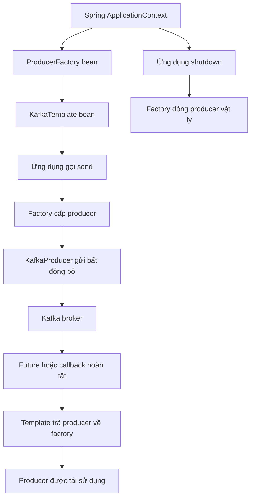
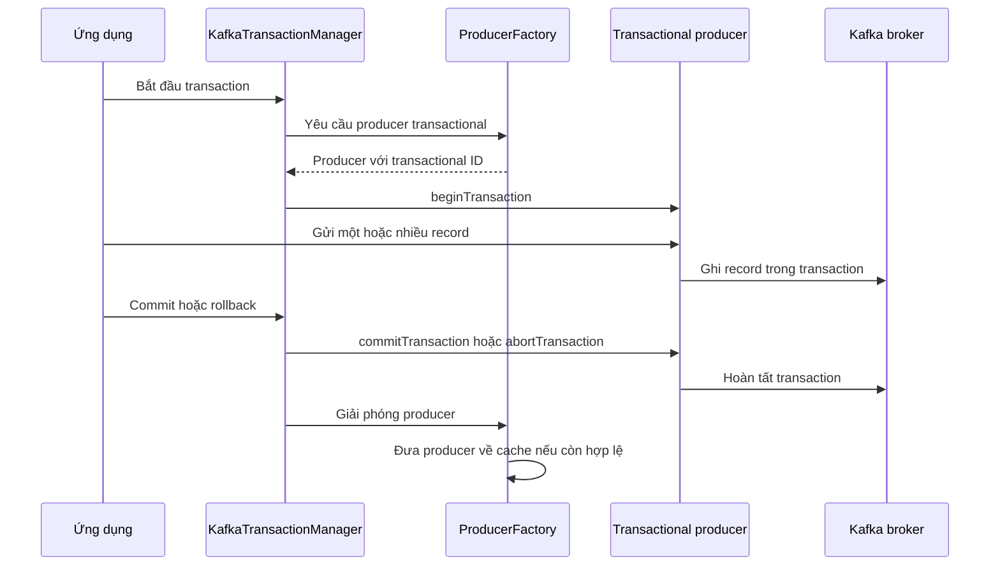

# ProducerFactory và vòng đời producer

Trong Spring Kafka, `ProducerFactory` là thành phần tạo và quản lý các Kafka producer mà ứng dụng dùng để gửi message. `KafkaTemplate` nhận một `ProducerFactory` và dùng nó cho các thao tác gửi. Cách tổ chức này giúp ứng dụng tái sử dụng producer, quản lý serializer và cấu hình tập trung, đồng thời kiểm soát việc mở, trả lại, làm mới và đóng tài nguyên kết nối Kafka.

Hiểu đúng vòng đời producer rất quan trọng với vận hành bền vững. Một Kafka producer tạo kết nối mạng, metadata cache, bộ đệm gửi và các luồng I/O nền; tạo producer mới cho từng message gây tốn tài nguyên và làm giảm thông lượng. Ngược lại, giữ producer hoặc đóng producer sai thời điểm có thể làm rò rỉ tài nguyên, làm mất các lần gửi đang chờ hoặc khiến producer transactional bị fencing.

Trong ứng dụng Spring Kafka thông thường, nên để Spring quản lý một `ProducerFactory` và một `KafkaTemplate` dùng chung. `DefaultKafkaProducerFactory` là triển khai phổ biến, có cơ chế tái sử dụng producer và tích hợp với transaction. Các phần dưới đây mô tả cách factory tạo producer, cách template sử dụng chúng và những điểm cần kiểm soát trong suốt vòng đời ứng dụng.

## 1. Vai trò của ProducerFactory trong kiến trúc gửi message

`ProducerFactory<K, V>` là abstraction tạo `Producer<K, V>`. Nó tách phần tạo và quản lý Kafka client khỏi code nghiệp vụ. `DefaultKafkaProducerFactory` là triển khai dựa trên cấu hình Kafka client; ứng dụng cũng có thể dùng một triển khai khác cho mục đích kiểm thử hoặc tích hợp riêng.

Các thành phần có vai trò khác nhau:

| Thành phần | Trách nhiệm |
|---|---|
| `ProducerFactory` | Tạo producer theo cấu hình, quản lý producer dùng chung hoặc producer trong cache, và giải phóng chúng theo vòng đời factory. |
| `DefaultKafkaProducerFactory` | Triển khai factory mặc định của Spring Kafka, hỗ trợ producer dùng chung, producer theo thread và producer transactional. |
| `KafkaProducer` | Kafka client thực hiện serialize, lấy metadata, gom batch, gửi request và nhận acknowledgement từ broker. |
| `KafkaTemplate` | API cấp ứng dụng để gửi message, xử lý callback/future và lấy/trả producer thông qua factory. |
| `ProducerListener` | Nhận thông báo gửi thành công hoặc thất bại từ `KafkaTemplate` để ghi nhận kết quả và quan sát. |

Factory không phải là một producer. Một factory có thể cấp producer dùng chung hoặc cấp các producer riêng tùy chế độ. `KafkaTemplate` cũng không nên được tạo mới cho mỗi lần gửi; hãy đăng ký nó thành bean dùng chung để cấu hình và tài nguyên được quản lý nhất quán.

Luồng gửi thông thường có thể hình dung như sau:



Điểm cần nhớ là một lần gọi `send()` không đồng nghĩa với việc tạo một Kafka producer mới. Trong chế độ mặc định, nhiều lần gửi và nhiều thread có thể sử dụng cùng một producer vật lý thông qua cơ chế quản lý của factory.

## 2. Vòng đời từ lúc khởi động đến khi shutdown

### Khởi tạo bean và tạo producer theo nhu cầu

Khi Spring khởi động, container tạo bean `ProducerFactory` và `KafkaTemplate` theo cấu hình. Với `DefaultKafkaProducerFactory`, producer vật lý thường được tạo lười: factory tạo producer khi có thành phần lần đầu yêu cầu `createProducer()`, chẳng hạn khi `KafkaTemplate` gửi message. Vì vậy, việc ứng dụng khởi động thành công chưa chắc đã chứng minh broker có thể nhận message; kết nối hoặc lỗi cấu hình có thể chỉ lộ ra ở lần gửi đầu tiên.

Khi tạo producer, Kafka client đọc cấu hình bootstrap servers, serializer, acknowledgement, retry, bảo mật và các thuộc tính khác. Producer khởi tạo metadata và kết nối đến cluster khi cần. Nếu cấu hình sai, broker không truy cập được hoặc serializer không khởi tạo được, lỗi có thể xuất hiện ngay lúc tạo producer hoặc trong quá trình gửi.

### Cấp producer và gửi bất đồng bộ

Khi ứng dụng gọi `KafkaTemplate.send()`, template yêu cầu factory cấp producer, tạo `ProducerRecord` rồi gọi API gửi của Kafka client. Kafka producer thường gửi bất đồng bộ: message được đưa vào bộ đệm, gom batch và gửi qua luồng I/O nền. Kết quả gửi được trả về qua future/callback khi có metadata hoặc exception.

Với Spring Kafka 3.x, `KafkaTemplate.send()` trả về `CompletableFuture<SendResult<K, V>>`. Các phiên bản Spring Kafka cũ hơn dùng `ListenableFuture`. Cần xử lý future/callback để quan sát lỗi xảy ra sau khi lời gọi `send()` đã trả quyền điều khiển; không nên chỉ bắt exception ngay tại dòng gọi `send()` rồi kết luận rằng mọi lỗi gửi đều đã được xử lý.

Sau khi thao tác hoàn tất, `KafkaTemplate` giải phóng producer về factory. Với producer dùng chung hoặc producer được cache, việc giải phóng này thường trả quyền sử dụng producer về factory thay vì đóng socket và luồng I/O vật lý sau mỗi message.

### Shutdown ứng dụng

Khi Spring ApplicationContext đóng, bean factory được hủy theo lifecycle của Spring. `DefaultKafkaProducerFactory` đóng các producer mà nó quản lý và giải phóng tài nguyên Kafka client. Nhờ đăng ký factory thành bean, ứng dụng thường không cần tự gọi `destroy()` trong code nghiệp vụ.

Trước khi shutdown, hệ thống nên ngừng nhận công việc mới, cho các lần gửi đang chờ có thời gian hoàn tất trong giới hạn shutdown đã đặt, rồi mới đóng factory. Nếu process bị dừng đột ngột, mất mạng hoặc bị kill trước khi future hoàn tất, ứng dụng có thể không biết broker đã ghi nhận message hay chưa. Khi retry ở tầng nghiệp vụ, cần giữ `eventId` ổn định và thiết kế consumer idempotent để xử lý trường hợp gửi lại.

## 3. Cách DefaultKafkaProducerFactory quản lý producer

### Producer dùng chung cho gửi thông thường

Mặc định, `DefaultKafkaProducerFactory` sử dụng một producer dùng chung cho các thao tác không transactional. Kafka `Producer` thread-safe, do đó nhiều thread có thể gọi gửi đồng thời trên cùng producer. Cách này tránh chi phí tạo nhiều Kafka client, giảm số kết nối và tận dụng hiệu quả batching.

Không nên tự tạo `new KafkaProducer<>(...)` cho từng request hoặc từng message. Producer có bộ đệm, luồng I/O nền và metadata riêng; việc tạo liên tục làm tăng kết nối, bộ nhớ, số thread và độ trễ khởi tạo. Với ứng dụng Spring, hãy dùng `KafkaTemplate` được inject từ container để dùng lại factory và producer.

Khi `KafkaTemplate` hoàn tất thao tác và gọi close trên producer wrapper do factory cấp, factory quản lý việc giải phóng. Với producer dùng chung, close ở mức wrapper không có nghĩa là producer vật lý bị đóng ngay; factory giữ producer để dùng cho các lần gửi sau. Đây là lý do code nghiệp vụ không được tự ý đóng producer nội bộ hoặc giữ producer qua nhiều vòng đời request.

### Producer riêng theo thread

`DefaultKafkaProducerFactory` có tùy chọn `producerPerThread`. Khi bật, factory cấp producer gắn với thread gọi thay vì dùng một producer chung. Chế độ này chỉ nên dùng khi có lý do kỹ thuật cụ thể; Kafka producer vốn thread-safe, vì vậy producer theo thread thường làm tăng số client, kết nối, bộ đệm và tài nguyên mà không tự động tăng thông lượng.

Producer gắn với thread có vòng đời riêng. Khi dùng chế độ này, ứng dụng cần gọi `closeThreadBoundProducer()` trên thread sở hữu producer khi thread đó kết thúc hoặc khi không còn cần producer. Việc đóng factory không thay thế cho quy trình giải phóng producer gắn với từng thread. Điều này đặc biệt quan trọng với thread pool: thread có thể sống lâu sau khi request hoàn tất, nên producer gắn với thread cũng có thể tiếp tục giữ tài nguyên.

Không nên bật `producerPerThread` chỉ vì ứng dụng có nhiều thread. Hãy đo latency, throughput, số producer vật lý, số kết nối và tài nguyên trước khi chọn chế độ này. Với phần lớn workload gửi thông thường, producer dùng chung là lựa chọn đơn giản và hiệu quả.

### Producer transactional và cache

Khi cấu hình `transactionIdPrefix`, `DefaultKafkaProducerFactory` có thể tạo producer transactional. Producer transactional được quản lý theo transactional ID và có thể được trả lại cache sau khi transaction kết thúc, thay vì tạo mới cho mỗi transaction. Factory quản lý suffix để tạo các transactional ID khác nhau trong phạm vi factory.

Mỗi transactional producer cần transactional ID duy nhất trong cluster tại một thời điểm. Nếu nhiều instance ứng dụng cùng dùng một prefix và cấp các suffix giống nhau, chúng có thể tạo transactional ID trùng và fencing lẫn nhau. Vì vậy prefix phải phân biệt giữa các instance đang chạy, ví dụ gắn với application name và instance/pod ID.

Cache transactional giúp giảm chi phí khởi tạo producer, nhưng cần đặt giới hạn phù hợp với số transaction đồng thời và cách ứng dụng dùng producer. Producer được giữ quá lâu có thể gặp vấn đề nếu broker đã hết hạn transactional ID theo cấu hình cluster. Ở các phiên bản Spring Kafka hỗ trợ `maxAge` cho factory, có thể đặt tuổi tối đa thấp hơn `transactional.id.expiration.ms` của broker để factory làm mới producer trước khi broker hết hạn ID. Cần kiểm tra thuộc tính và hành vi cụ thể theo phiên bản Spring Kafka đang sử dụng.

## 4. Cấu hình ProducerFactory và KafkaTemplate

### Cấu hình qua Spring Boot

Nếu không khai báo `ProducerFactory` tùy chỉnh, Spring Boot có thể tự cấu hình factory và `KafkaTemplate` từ các thuộc tính `spring.kafka.*`. Đây là cách gọn cho ứng dụng không cần tùy biến vòng đời producer:

```yaml
spring:
  kafka:
    bootstrap-servers: ${KAFKA_BOOTSTRAP_SERVERS}
    producer:
      key-serializer: org.apache.kafka.common.serialization.StringSerializer
      value-serializer: org.springframework.kafka.support.serializer.JsonSerializer
      acks: all
      properties:
        "enable.idempotence": true
        "delivery.timeout.ms": 120000
        "request.timeout.ms": 30000
```

Spring Boot dùng các thuộc tính này để cấu hình producer factory tự động. Ứng dụng inject `KafkaTemplate` vào service:

```java
@Service
public class OrderEventPublisher {

    private final KafkaTemplate<String, OrderEvent> kafkaTemplate;

    public OrderEventPublisher(
            KafkaTemplate<String, OrderEvent> kafkaTemplate) {
        this.kafkaTemplate = kafkaTemplate;
    }

    public CompletableFuture<SendResult<String, OrderEvent>> publish(
            OrderEvent event) {
        return kafkaTemplate.send("orders.events", event.orderId(), event);
    }
}
```

Ví dụ dùng API future của Spring Kafka 3.x. Với phiên bản cũ hơn, kiểu trả về và cách đăng ký callback cần điều chỉnh theo API tương ứng. `OrderEvent` là kiểu dữ liệu nghiệp vụ của ứng dụng; serializer phải tương thích với kiểu payload thực tế.

### Khai báo factory tùy chỉnh

Khi cần kiểm soát trực tiếp `DefaultKafkaProducerFactory`, có thể khai báo bean như sau:

```java
@Configuration
public class KafkaProducerConfiguration {

    @Bean
    ProducerFactory<String, OrderEvent> producerFactory(
            @Value("${spring.kafka.bootstrap-servers}") String bootstrapServers) {

        Map<String, Object> properties = new HashMap<>();
        properties.put(
                ProducerConfig.BOOTSTRAP_SERVERS_CONFIG, bootstrapServers);
        properties.put(
                ProducerConfig.KEY_SERIALIZER_CLASS_CONFIG, StringSerializer.class);
        properties.put(
                ProducerConfig.VALUE_SERIALIZER_CLASS_CONFIG, JsonSerializer.class);
        properties.put(ProducerConfig.ACKS_CONFIG, "all");
        properties.put(ProducerConfig.ENABLE_IDEMPOTENCE_CONFIG, true);

        return new DefaultKafkaProducerFactory<>(properties);
    }

    @Bean
    KafkaTemplate<String, OrderEvent> kafkaTemplate(
            ProducerFactory<String, OrderEvent> producerFactory) {
        return new KafkaTemplate<>(producerFactory);
    }
}
```

Đây là ví dụ tối giản để thể hiện quan hệ giữa factory và template. Cấu hình production còn phải đưa vào TLS/SASL, truststore/keystore, serializer/deserializer phù hợp, timeout, retry, client ID và các thuộc tính vận hành của môi trường. Khi tự khai báo factory, cần bảo đảm toàn bộ thuộc tính cần thiết được đưa vào map; không giả định factory tùy chỉnh tự động nhận mọi thuộc tính mà Spring Boot đã dùng cho factory mặc định.

Khi ứng dụng khai báo bean `ProducerFactory` riêng, auto-configuration tương ứng của Spring Boot có thể lùi lại theo điều kiện bean. Tránh vô tình tạo hai factory với cấu hình khác nhau rồi inject nhầm factory vào `KafkaTemplate`, transaction manager hoặc listener container.

## 5. KafkaTemplate quản lý việc mượn và trả producer

`KafkaTemplate` là lớp ứng dụng nên dùng trong hầu hết tình huống gửi message. Nó thực hiện một số công việc quan trọng:

- Lấy producer từ `ProducerFactory` khi cần gửi.
- Tạo `ProducerRecord` từ topic, key, value, partition và header được cung cấp.
- Gọi Kafka producer và chuyển kết quả thành future/callback.
- Giải phóng producer về factory khi thao tác kết thúc.
- Hỗ trợ transaction, callback và các cơ chế quan sát của Spring Kafka.

Vì template quản lý việc cấp và trả producer, code nghiệp vụ không nên gọi `close()` trên producer mà template đang sử dụng. Không giữ reference đến producer để dùng sau khi callback hoàn tất. Nếu cần thao tác Kafka client mức thấp, cân nhắc `KafkaTemplate.execute(...)`; callback của template cung cấp producer trong phạm vi thao tác và template quản lý việc giải phóng.

Ví dụ truy cập một API cấp producer mà không tự quản lý vòng đời:

```java
Integer partitionCount = kafkaTemplate.execute(producer ->
        producer.partitionsFor("orders.events").size());
```

Thao tác này dùng producer do template cấp và được template giải phóng sau callback. Không nên gọi `producer.close()` bên trong callback vì có thể làm gián đoạn producer được factory quản lý hoặc làm sai lệch cơ chế cache.

### Xử lý kết quả gửi

Gửi bất đồng bộ giúp thread nghiệp vụ không phải chờ broker hoàn tất từng message. Tuy nhiên, ứng dụng cần quan sát cả kết quả thành công và thất bại. Có thể gắn callback/future để ghi log, cập nhật metric hoặc chuyển lỗi đến cơ chế xử lý phù hợp.

```java
CompletableFuture<SendResult<String, OrderEvent>> future =
        kafkaTemplate.send("orders.events", event.orderId(), event);

future.whenComplete((result, exception) -> {
    if (exception != null) {
        // Ghi nhận lỗi gửi cùng eventId và correlationId.
        publishMetrics.recordFailure(event.eventId(), exception);
        return;
    }

    RecordMetadata metadata = result.getRecordMetadata();
    publishMetrics.recordSuccess(
            event.eventId(), metadata.topic(), metadata.partition(), metadata.offset());
});
```

Đoạn code minh họa cho Spring Kafka 3.x. Trong hệ thống thực tế, callback nên ngắn và không thực hiện công việc blocking lâu vì callback chạy trên luồng hoàn tất gửi. Nếu cần gọi dịch vụ chậm hoặc chạy logic phức tạp, hãy chuyển công việc sang executor có giới hạn và có chính sách backpressure. Không được bỏ qua exception trong future nếu ứng dụng cần bảo đảm rằng lỗi publish được phát hiện.

Producer acknowledgement cho biết kết quả ghi theo cấu hình `acks`; nó không chứng minh consumer đã xử lý nghiệp vụ. Metadata trả về có thể dùng để truy vết topic, partition và offset, nhưng nên kết hợp với `eventId` để đối chiếu xuyên suốt hệ thống.

## 6. Vòng đời producer khi dùng Kafka transaction

Producer transactional có vòng đời chặt chẽ hơn producer gửi thông thường. Factory phải được cấu hình transaction ID prefix để tạo producer có khả năng mở transaction. Trong Spring Kafka, `KafkaTransactionManager` hoặc listener container có thể quản lý transaction và phối hợp với `KafkaTemplate`.

Ví dụ cấu hình prefix qua Spring Boot:

```yaml
spring:
  kafka:
    producer:
      transaction-id-prefix: ${INSTANCE_ID:local}-orders-
```

`INSTANCE_ID` phải khác nhau giữa các instance đang hoạt động. Giá trị mặc định `local` chỉ phù hợp khi chắc chắn không có nhiều instance dùng chung transactional ID trong cùng cluster. Với deployment nhiều replica, hãy cung cấp instance ID duy nhất qua nền tảng triển khai.

Có thể khai báo transaction manager khi factory đã được cấu hình transactional:

```java
@Bean
KafkaTransactionManager<String, OrderEvent> kafkaTransactionManager(
        ProducerFactory<String, OrderEvent> producerFactory) {
    return new KafkaTransactionManager<>(producerFactory);
}
```

Vòng đời khái quát của một transaction:



Sau commit hoặc abort, producer có thể được trả về cache để tái sử dụng. Không nên dùng cùng transactional ID đồng thời từ nhiều producer đang hoạt động. Nếu broker nhận producer mới khởi tạo với transactional ID đã được producer khác dùng, producer cũ có thể bị fencing. Fencing là cơ chế bảo vệ tính đúng đắn của transaction; cần xử lý như dấu hiệu xung đột định danh hoặc vòng đời producer, không nên retry mù quáng.

Kafka transaction có thể bảo đảm tính nguyên tử trong phạm vi các thao tác Kafka được đưa vào transaction, chẳng hạn ghi nhiều record và commit offset trong cùng transaction. Nó không tự tạo transaction phân tán bao trùm database hoặc HTTP API. Nếu cần phối hợp database và Kafka, cân nhắc transactional outbox hoặc một thiết kế idempotent phù hợp.

## 7. Thay đổi cấu hình và làm mới producer

Producer vật lý đọc cấu hình khi được tạo. Nếu ứng dụng thay đổi map cấu hình của factory, producer đang tồn tại không tự động nhận các giá trị mới. Điều này thường gặp khi xoay vòng chứng thư, thay đổi credential, thay bootstrap server hoặc cập nhật serializer.

`DefaultKafkaProducerFactory` cung cấp các thao tác cập nhật cấu hình và reset producer. `updateConfigs(...)` có thể cập nhật cấu hình dùng cho producer được tạo sau đó; `removeConfig(...)` loại bỏ thuộc tính khỏi cấu hình factory. `reset()` đóng các producer mà factory quản lý và xóa cache để lần yêu cầu tiếp theo tạo producer mới theo cấu hình hiện tại.

Trước khi reset, cần phối hợp với luồng gửi đang hoạt động. Reset trong lúc có nhiều send đang chờ có thể làm các thao tác bị gián đoạn hoặc phát sinh lỗi đóng producer. Với hệ thống production, nên có quy trình xoay vòng theo bước: cập nhật secret/config, ngừng hoặc hạn chế công việc mới nếu cần, chờ các lần gửi quan trọng hoàn tất, reset factory, kiểm tra producer mới và theo dõi kết quả gửi.

Nếu dùng `producerPerThread`, cần xử lý thêm các producer gắn với thread theo API lifecycle của phiên bản đang dùng; không giả định reset cache producer dùng chung đã giải phóng mọi producer thread-bound. Gọi `closeThreadBoundProducer()` từ đúng thread sở hữu producer khi cần kết thúc vòng đời của nó.

Không nên dùng reset như biện pháp chữa mọi lỗi Kafka. Nếu broker đang lỗi, credential sai hoặc DNS không phân giải được, tạo producer mới liên tục chỉ làm tăng áp lực lên hệ thống. Trước tiên cần xác định lỗi thuộc cấu hình, mạng, broker, serializer hay vòng đời producer.

## 8. Shutdown an toàn và giải phóng tài nguyên

Một producer Kafka giữ các tài nguyên như socket, buffer, metadata và I/O thread. Nếu producer không được đóng đúng cách, ứng dụng có thể rò rỉ thread, kết nối và bộ nhớ; nếu đóng quá sớm, message còn trong buffer có thể không được gửi hoàn tất.

Các nguyên tắc vận hành:

- Để Spring quản lý `ProducerFactory` như bean singleton để lifecycle callback của factory được gọi khi ApplicationContext đóng.
- Dùng một `KafkaTemplate` dùng chung thay vì tạo template/factory mới trong mỗi request.
- Không gọi `destroy()` hoặc đóng producer vật lý từ code nghiệp vụ khi ứng dụng vẫn còn hoạt động.
- Theo dõi các future đang chờ và cho phép chúng hoàn tất trong giới hạn shutdown đã định.
- Với producer lấy trực tiếp từ `ProducerFactory`, luôn trả producer về factory bằng `close()` trong `finally` sau khi thao tác kết thúc.
- Với `producerPerThread`, giải phóng producer thread-bound trên thread tương ứng.
- Khi dùng transaction, kết thúc commit/abort trước khi producer được trả lại cache hoặc factory bị đóng.

Nếu code thật sự cần lấy producer trực tiếp, cấu trúc tối thiểu phải bảo đảm trả producer trong mọi nhánh:

```java
Producer<String, OrderEvent> producer = producerFactory.createProducer();
try {
    producer.send(new ProducerRecord<>(
            "orders.events", event.orderId(), event));
} finally {
    producer.close();
}
```

Trong ví dụ này, `close()` gọi trên producer do `DefaultKafkaProducerFactory` cấp sẽ thực hiện quy tắc giải phóng của factory; tùy loại producer, nó có thể trả producer về cache thay vì đóng vật lý. Cách này chỉ minh họa quyền sở hữu tài nguyên. Với code nghiệp vụ thông thường, `KafkaTemplate` vẫn là lựa chọn phù hợp hơn vì quản lý producer và kết quả bất đồng bộ nhất quán.

Shutdown timeout cần phù hợp với `delivery.timeout.ms`, thời gian chờ của ứng dụng và quy trình dừng service. Không thể bảo đảm mọi message được gửi thành công chỉ bằng cách tăng timeout; cần kiểm tra trạng thái future, broker acknowledgement và hành vi retry sau restart.

## 9. Theo dõi sức khỏe và vòng đời producer

Vận hành ProducerFactory cần quan sát cả số producer được tạo và kết quả gửi. Những tín hiệu hữu ích gồm:

| Phạm vi | Tín hiệu | Ý nghĩa |
|---|---|---|
| Tạo producer | Số lần tạo producer, lỗi khởi tạo, thời gian khởi tạo | Phát hiện factory tạo producer liên tục hoặc cấu hình/broker không sẵn sàng. |
| Cache và vòng đời | Số producer đang dùng, producer được trả lại, producer bị đóng, cache transactional | Phát hiện rò rỉ producer, cache không phù hợp hoặc producer không được giải phóng. |
| Gửi message | Send rate, request latency, retry, error, timeout và record size | Phát hiện producer chậm, broker quá tải hoặc lỗi serialize. |
| Broker acknowledgement | Tỷ lệ lỗi theo loại exception, metadata trả về và thời gian xác nhận | Phân biệt lỗi gửi với việc consumer chưa xử lý message. |
| Tài nguyên client | Số socket, I/O thread, buffer memory, network throughput | Phát hiện tạo quá nhiều producer hoặc thiếu tài nguyên. |
| Transaction | Transaction commit/abort, fencing, timeout và tuổi producer | Phát hiện xung đột transactional ID hoặc producer transactional hết hạn. |

`ProducerFactory` hỗ trợ listener để quan sát sự kiện producer được tạo hoặc bị loại bỏ; các phiên bản và cấu hình cụ thể có thể cung cấp thêm post-processor để bọc producer. `KafkaTemplate` có `ProducerListener` để nhận kết quả gửi. Kafka client cũng cung cấp metrics qua cơ chế metrics/JMX được nền tảng giám sát tích hợp.

Log nên ghi `eventId`, topic, key nghiệp vụ nếu phù hợp, thời gian gửi, kết quả, partition, offset và exception class. Tránh ghi toàn bộ payload nếu chứa dữ liệu nhạy cảm. Với producer dùng chung, không nên đưa dữ liệu định danh cá nhân hoặc thông tin bí mật vào tên producer hay transactional ID.

Một số dấu hiệu cần điều tra:

- Producer được tạo liên tục: kiểm tra code có tạo factory/template theo request, có reset định kỳ không cần thiết hoặc có producer không được trả lại không.
- Số producer tăng cùng số thread: kiểm tra `producerPerThread` và việc gọi `closeThreadBoundProducer()`.
- Send timeout tăng: kiểm tra broker request latency, network, metadata, buffer pressure và `delivery.timeout.ms`.
- Transactional producer bị fencing: kiểm tra prefix, instance ID, rollout trùng lặp và số producer cùng transactional ID.
- Ứng dụng shutdown chậm: kiểm tra các lần gửi chưa hoàn tất, transaction chưa kết thúc và thời gian close producer.

## 10. Runbook theo tình huống

### Ứng dụng khởi động được nhưng lần gửi đầu tiên thất bại

1. Xem exception đầy đủ từ `KafkaTemplate.send()` và future/callback.
2. Kiểm tra bootstrap servers, DNS, network, TLS/SASL và ACL.
3. Kiểm tra serializer, kiểu payload, schema và cấu hình producer.
4. Xác nhận broker có sẵn sàng và topic tồn tại theo chính sách của hệ thống.
5. Phân biệt lỗi tạo producer với lỗi xảy ra sau khi producer đã gửi request.

### Số lượng producer hoặc thread tăng bất thường

1. Kiểm tra ứng dụng có tạo `ProducerFactory` hoặc `KafkaTemplate` bên trong request/service method hay không.
2. Kiểm tra `producerPerThread` có được bật không và số thread pool có tăng không.
3. Nếu lấy producer trực tiếp từ factory, xác nhận mọi nhánh đều gọi `close()`.
4. Nếu dùng producer theo thread, gọi `closeThreadBoundProducer()` từ thread sở hữu khi kết thúc vòng đời.
5. Theo dõi số socket, I/O thread và số producer sau khi sửa.

### Gửi message timeout hoặc callback báo lỗi

1. Ghi nhận `eventId`, topic, key, thời điểm và exception.
2. Kiểm tra producer metrics, request latency, retry và buffer memory.
3. Kiểm tra broker health, ISR, quota, ACL và network.
4. Xác định message có thể đã được broker ghi nhận trước khi timeout hay không; không gửi lại bằng một event ID mới.
5. Dùng idempotency ở consumer để xử lý an toàn trường hợp producer gửi lại cùng sự kiện.

### Transactional producer bị fencing

1. Đọc exception fencing và xác định transactional ID liên quan.
2. So sánh `transactionIdPrefix` giữa các instance và kiểm tra instance ID có duy nhất không.
3. Kiểm tra có hai process cùng chạy với một transactional ID do rollout hoặc cấu hình deployment không.
4. Khôi phục định danh duy nhất, dừng producer cũ theo quy trình và để factory tạo producer mới.
5. Theo dõi transaction commit/abort và lỗi fencing sau khi khởi động lại.

### Thay đổi chứng thư hoặc credential Kafka

1. Xác nhận secret mới đã được cấp và cấu hình ứng dụng có thể đọc được.
2. Xác định producer vật lý hiện tại có cần được tạo lại để nhận cấu hình mới không.
3. Chọn thời điểm cập nhật/reset factory sao cho các lần gửi đang chờ được xử lý an toàn.
4. Reset producer theo API phù hợp của phiên bản Spring Kafka; xử lý riêng producer thread-bound nếu có.
5. Gửi thử message, xác nhận broker acknowledgement và theo dõi lỗi xác thực.

### Ứng dụng shutdown nhưng còn message đang gửi

1. Ngừng nhận công việc mới hoặc dừng luồng phát sinh sự kiện theo quy trình ứng dụng.
2. Chờ các future quan trọng hoàn tất trong thời gian shutdown cho phép.
3. Kết thúc transaction đang mở bằng commit hoặc abort theo logic nghiệp vụ.
4. Để Spring đóng factory và producer được quản lý.
5. Khi process khởi động lại, đối chiếu event ID và trạng thái nghiệp vụ để xử lý an toàn những message có kết quả gửi chưa xác định.

## 11. Bảng kiểm soát vòng đời ProducerFactory

| Giai đoạn | Điểm cần xác nhận | Bằng chứng vận hành |
|---|---|---|
| Khởi tạo | Factory là bean được quản lý; cấu hình bootstrap, serializer, bảo mật và acknowledgement đầy đủ | Bean configuration, effective producer properties và log khởi tạo |
| Tạo producer | Producer được tạo theo nhu cầu; không tạo mới cho từng message | Số producer, số lần tạo và thời gian khởi tạo |
| Gửi | Template dùng factory; future/callback được xử lý | Send result, latency, retry, exception và metadata |
| Tái sử dụng | Producer được trả lại factory sau thao tác; chế độ per-thread có cleanup | Producer/cache metrics, thread count và socket count |
| Transaction | Prefix duy nhất theo instance; transaction kết thúc trước khi producer được trả cache | Transaction ID, commit/abort, fencing và timeout |
| Reconfigure | Producer cũ được làm mới có kiểm soát sau khi đổi cấu hình | Thời điểm cập nhật config, reset và kết quả gửi thử |
| Shutdown | Các lần gửi/transaction được xử lý; factory giải phóng tài nguyên | Shutdown log, pending future, producer close và thread count |

ProducerFactory là điểm kiểm soát trung tâm của vòng đời producer trong Spring Kafka. Khi factory được quản lý như bean dùng chung, `KafkaTemplate` chịu trách nhiệm mượn và trả producer, transaction có định danh riêng và shutdown được thực hiện có trật tự, ứng dụng tránh được việc tạo client dư thừa, rò rỉ kết nối và lỗi vòng đời khó truy vết. Những chỉ số về producer, kết quả gửi và transaction giúp đội vận hành xác định đúng giai đoạn đang gặp vấn đề và khôi phục luồng publish một cách có kiểm soát.
