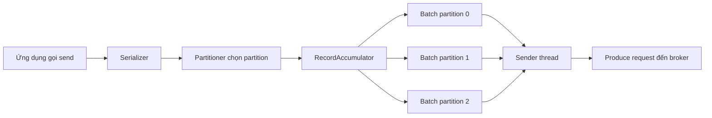
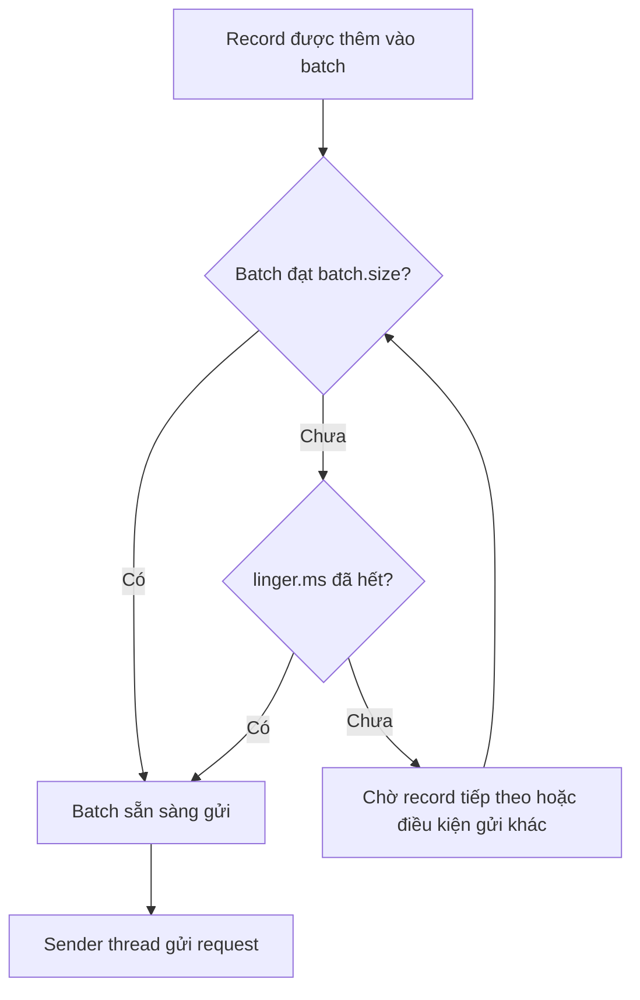

# `linger.ms` và `batch.size`

Trong Kafka producer, `linger.ms` và `batch.size` phối hợp để gom nhiều record thành một batch trước khi gửi request đến broker. `batch.size` quy định dung lượng mục tiêu của một batch theo byte; `linger.ms` quy định producer có thể chờ thêm bao lâu để batch chưa đầy có cơ hội nhận thêm record. Hai thuộc tính này ảnh hưởng trực tiếp đến độ trễ, thông lượng, số request và hiệu quả nén.

Trong Spring Kafka, các thuộc tính này được cấu hình cho Kafka producer mà `KafkaTemplate` sử dụng. Chúng giúp điều chỉnh hiệu quả gửi dữ liệu trong hệ thống producer bền vững, nhưng bản thân chúng không quyết định record có được lưu bền vững sau lỗi broker hay không. Độ bền dữ liệu còn phụ thuộc vào `acks`, replication, `min.insync.replicas`, retry, idempotence và cách ứng dụng xử lý kết quả gửi.

## 1. Producer gom record thành batch như thế nào?

Khi ứng dụng gọi `KafkaTemplate.send()` hoặc `KafkaProducer.send()`, producer serialize key/value, xác định partition đích rồi thêm record vào bộ đệm. Kafka client duy trì batch riêng cho từng partition. Một sender thread lấy các batch đã sẵn sàng và gửi chúng trong các produce request đến broker.



Việc gom batch diễn ra theo partition. Hai record cùng topic nhưng thuộc hai partition khác nhau không nằm trong cùng một batch. Vì vậy, tổng số record gửi trong một khoảng thời gian không đủ để dự đoán batch có đầy hay không; tốc độ record trên từng partition mới là yếu tố trực tiếp.

Ví dụ, một producer gửi 10.000 record mỗi giây đến một topic có 20 partition. Nếu phân phối đều, mỗi partition chỉ nhận trung bình khoảng 500 record mỗi giây. Với lưu lượng thấp trên từng partition, batch có thể hết thời gian chờ trước khi đầy, dù tổng lưu lượng của topic khá cao.

## 2. `batch.size`: dung lượng mục tiêu của một batch

`batch.size` là kích thước tính bằng byte mà producer dùng làm dung lượng mục tiêu cho mỗi batch theo partition. Giá trị mặc định truyền thống của Kafka client là 16 KiB (16.384 byte), nhưng ứng dụng nên kiểm tra tài liệu của đúng phiên bản client đang chạy thay vì dựa vào một giá trị mặc định cố định.

Ví dụ, khi cấu hình `batch.size=65536`, producer dành batch với dung lượng mục tiêu khoảng 64 KiB cho mỗi partition. Khi batch đạt dung lượng đó, nó sẵn sàng được gửi mà không cần đợi hết `linger.ms`.

`batch.size` được tính theo byte, không phải số lượng record. Số record trong một batch thay đổi theo kích thước key, value, header và phần overhead của record. Nếu mỗi record trung bình 1 KiB, batch 64 KiB có thể chứa xấp xỉ vài chục record; số lượng thực tế phụ thuộc kích thước mã hóa và metadata.

Một record đơn lẻ lớn hơn `batch.size` vẫn có thể được gửi trong batch lớn hơn mức mục tiêu đó, miễn là các giới hạn kích thước request/record liên quan cho phép. `batch.size` không thay thế `max.request.size` ở producer hay `message.max.bytes`/`max.message.bytes` ở broker và topic. Các giới hạn này cần tương thích để record lớn có thể đi hết đường truyền.

### Tăng `batch.size` có tác dụng gì?

- Batch có thể chứa nhiều dữ liệu hơn trước khi được gửi.
- Với lưu lượng đủ lớn trên mỗi partition, producer có thể tạo ít request hơn cho cùng một lượng dữ liệu.
- Compression thường hiệu quả hơn khi có nhiều record cùng nằm trong một batch, vì codec có nhiều dữ liệu để nén cùng nhau.
- Bộ nhớ dành cho batch có thể tăng, nhất là khi producer gửi đến nhiều partition đồng thời.

Tăng `batch.size` không có nghĩa producer luôn đợi đến khi batch đầy. Nếu batch không đầy và `linger.ms` hết hạn, batch vẫn được gửi với dung lượng sử dụng thấp hơn. Khi lưu lượng thấp, tăng `batch.size` đơn thuần thường không cải thiện đáng kể batching.

## 3. `linger.ms`: thời gian chờ để gom thêm record

`linger.ms` là khoảng thời gian producer có thể chờ để một batch chưa đầy nhận thêm record trước khi gửi. Đơn vị là mili giây. Khi batch đã đầy, producer có thể gửi ngay mà không cần đợi hết khoảng thời gian này.

Ví dụ với `linger.ms=5`:

```text
Thời điểm t0: record đầu tiên đến partition 3, batch bắt đầu tích lũy
Thời điểm t1: record tiếp theo đến, được thêm vào cùng batch
Thời điểm t2: thêm record khác vào batch
Thời điểm t0 + 5 ms: batch chưa đầy cũng có thể được gửi
```

Thời gian này là một ngưỡng chờ để batching, không phải lịch gửi chính xác. Thời điểm thực tế còn phụ thuộc sender thread, tải của producer, trạng thái buffer, broker và các điều kiện gửi khác. Nếu batch đầy trước khi hết thời gian chờ, producer có thể gửi sớm hơn.

`linger.ms` giúp đặc biệt rõ ở tải thấp hoặc tải vừa. Không có linger, batch chưa đầy thường sẵn sàng gửi ngay và có ít cơ hội tích lũy thêm record. Một khoảng chờ nhỏ có thể tăng kích thước batch trung bình, giảm số request và cải thiện hiệu quả nén. Đổi lại, record có thể phải đợi thêm trước khi được gửi, làm tăng producer-side latency.

Giá trị mặc định phụ thuộc phiên bản Kafka client. Các client đời cũ thường dùng `0`; Kafka 4.0 đổi mặc định thành `5 ms`. Khi nâng cấp client, hãy kiểm tra lại cấu hình hiệu lực vì thay đổi mặc định có thể làm độ trễ và batching khác trước dù ứng dụng không đổi cấu hình.

## 4. Hai thuộc tính phối hợp với nhau

`batch.size` và `linger.ms` giải quyết hai điều kiện khác nhau:

| Thuộc tính | Câu hỏi nó trả lời | Khi đạt điều kiện |
|---|---|---|
| `batch.size` | Batch có thể tích lũy đến dung lượng mục tiêu bao nhiêu? | Batch đủ lớn và sẵn sàng gửi |
| `linger.ms` | Batch chưa đầy có thể chờ thêm bao lâu? | Hết thời gian chờ, batch có thể được gửi |

Có thể hình dung producer gửi batch khi batch đã đầy hoặc khi thời gian chờ đã hết. Đây là cách mô tả thực tế để hiểu tương tác của hai thuộc tính; các điều kiện buffer pressure, request readiness và trạng thái sender cũng có thể khiến batch được gửi sớm.



Hai tình huống minh họa:

**Lưu lượng cao trên một partition:** record đến nhanh và batch đạt `batch.size` trước khi `linger.ms` hết. Batch được gửi khi đầy; tăng `linger.ms` có thể ít tác động đến thời gian chờ của các batch đã đầy.

**Lưu lượng thấp trên một partition:** batch chưa đầy sau vài mili giây. Khi `linger.ms` hết, producer gửi batch hiện có. Tăng `linger.ms` có thể gom được thêm record nếu chúng đến trong khoảng chờ, nhưng cũng làm record đầu tiên trong batch đợi lâu hơn.

### Ví dụ ước lượng số record tích lũy

Giả sử một partition nhận 2.000 record mỗi giây, kích thước record trung bình khoảng 1 KiB và `linger.ms=5`. Trong 5 ms, lượng record kỳ vọng đến xấp xỉ:

\[
2.000 \times \frac{5}{1.000} = 10 \text{ record}
\]

Tức khoảng 10 KiB dữ liệu trước khi tính overhead. Với `batch.size=64 KiB`, batch có thể chưa đầy khi hết linger và được gửi ở kích thước nhỏ hơn 64 KiB. Nếu tốc độ tăng lên 20.000 record mỗi giây trên partition đó, cùng khoảng chờ có thể nhận xấp xỉ 100 record, tương đương khoảng 100 KiB theo giả định 1 KiB/record; batch có thể đạt dung lượng mục tiêu trước khi hết linger.

Đây chỉ là ước lượng trung bình. Lưu lượng thường đến theo đợt, record có kích thước khác nhau và phân phối partition không hoàn toàn đều. Hãy dùng metric của producer để xác nhận kích thước batch thực tế.

## 5. Cấu hình trong Spring Boot và Spring Kafka

Spring Boot ánh xạ `spring.kafka.producer.batch-size` sang thuộc tính producer `batch.size`. `linger.ms` có thể được truyền qua map `spring.kafka.producer.properties`.

Ví dụ cấu hình trong `application.yml`:

```yaml
spring:
  kafka:
    producer:
      # Dung lượng mục tiêu của batch cho mỗi partition: 64 KiB.
      batch-size: 65536
      # Kafka producer properties bổ sung.
      properties:
        "[linger.ms]": 5
```

Hoặc trong `application.properties`:

```properties
spring.kafka.producer.batch-size=65536
spring.kafka.producer.properties[linger.ms]=5
```

Giá trị `65536` là byte; giá trị `5` của `linger.ms` là mili giây. Cách đặt dấu ngoặc vuông trong YAML/properties giúp giữ nguyên key có dấu chấm khi Spring Boot bind map property.

Nếu tạo `ProducerFactory` thủ công, có thể đặt trực tiếp các hằng số của Kafka client:

```java
Map<String, Object> props = new HashMap<>();
props.put(ProducerConfig.BOOTSTRAP_SERVERS_CONFIG, "localhost:9092");
props.put(ProducerConfig.BATCH_SIZE_CONFIG, 64 * 1024);
props.put(ProducerConfig.LINGER_MS_CONFIG, 5);

ProducerFactory<String, OrderEvent> producerFactory =
        new DefaultKafkaProducerFactory<>(props);
KafkaTemplate<String, OrderEvent> kafkaTemplate =
        new KafkaTemplate<>(producerFactory);
```

Ví dụ Java chỉ minh họa vị trí đặt hai thuộc tính; ứng dụng thực tế cần bổ sung serializer, bootstrap servers, security và các cấu hình producer phù hợp với môi trường. Tránh cấu hình cùng một thuộc tính ở nhiều nơi mà không kiểm tra precedence, vì cấu hình thủ công có thể làm giá trị từ Spring Boot không còn là giá trị cuối cùng.

## 6. Tác động đến latency và throughput

Mục tiêu tuning thường là cân bằng giữa thời gian chờ của một record và hiệu quả gửi cả batch.

| Thay đổi | Xu hướng thường gặp | Đánh đổi cần theo dõi |
|---|---|---|
| Tăng `linger.ms` | Batch trung bình lớn hơn, ít request hơn khi record tiếp tục đến | Producer-side latency tăng, nhất là tải thấp |
| Giảm `linger.ms` | Record được gửi sớm hơn khi batch chưa đầy | Batch nhỏ hơn, nhiều request hơn, compression có thể kém hiệu quả |
| Tăng `batch.size` | Có thể chứa nhiều byte hơn trong một batch | Buffer/memory có thể tăng; không giúp nhiều nếu linger luôn hết khi batch còn nhỏ |
| Giảm `batch.size` | Batch đạt ngưỡng gửi sớm hơn | Nhiều batch và request hơn khi tải cao |

Tăng batching có thể cải thiện throughput vì producer gửi ít request hơn cho cùng lượng dữ liệu và giảm overhead trên mỗi record. Tuy nhiên, khi broker hoặc mạng đã là nút thắt, tăng batch không bảo đảm throughput sẽ tăng. Nếu ứng dụng chỉ gửi một record mỗi vài giây, `linger.ms` lớn có thể chủ yếu làm tăng độ trễ mà không tạo ra batch đáng kể.

Độ trễ cần được nhìn theo từng chặng: thời gian record nằm trong producer buffer, thời gian gửi request, thời gian broker xử lý và thời gian chờ acknowledgment. `linger.ms` chủ yếu tác động đến thời gian tích lũy ở producer; nó không giới hạn tổng thời gian gửi hoặc thời gian broker phản hồi.

## 7. Bộ nhớ và backpressure

Producer dùng `buffer.memory` để quản lý tổng dung lượng buffer dành cho các record đang chờ gửi. `batch.size` là dung lượng mục tiêu cho mỗi batch theo partition, còn `buffer.memory` là ngân sách buffer tổng thể của producer. Không được hiểu `buffer.memory` là một batch lớn duy nhất.

Khi producer gửi đến nhiều partition, có thể tồn tại nhiều batch đồng thời. Tăng `batch.size` làm tăng dung lượng mục tiêu cho từng batch; số partition hoạt động, tốc độ gửi và tốc độ broker xác nhận quyết định số batch thực sự giữ trong bộ nhớ. Vì thế, tăng batch size trong một ứng dụng có nhiều partition và nhiều producer instance có thể làm mức sử dụng bộ nhớ tăng đáng kể.

Nếu broker chậm hoặc mất kết nối, record có thể tích lũy trong buffer. Khi buffer không còn đủ chỗ, `send()` có thể phải chờ tối đa theo `max.block.ms` rồi ném lỗi nếu không lấy được buffer. Cần theo dõi buffer còn trống, số thread chờ buffer và thời gian chặn của lời gọi gửi. Tăng `buffer.memory` có thể hấp thụ đợt tải ngắn, nhưng không giải quyết được tình trạng producer liên tục tạo dữ liệu nhanh hơn khả năng broker tiếp nhận.

`linger.ms` cũng không phải công cụ backpressure. Đặt linger cao hơn không làm broker xử lý nhanh hơn; nó chỉ thay đổi cách producer gom dữ liệu trước khi gửi. Khi có backlog, hãy kiểm tra throughput broker, network, request latency, retry và buffer trước khi tăng linger hoặc batch size.

## 8. Compression và kích thước batch

Kafka áp dụng compression cho batch. Khi batch chứa nhiều record, codec thường có nhiều dữ liệu liền nhau để khai thác mẫu lặp, nên compression ratio có thể tốt hơn. Các loại compression thường gặp gồm `gzip`, `snappy`, `lz4` và `zstd`, tùy phiên bản client và broker.

Ví dụ, một producer gửi event JSON có nhiều tên field lặp lại. Nếu record được gom thành batch đủ lớn, phần lặp có thể được nén hiệu quả hơn so với gửi nhiều batch rất nhỏ. Lợi ích thực tế phụ thuộc dữ liệu; payload đã nén hoặc mã hóa trước đó có thể khó nén thêm.

Có thể cấu hình compression trong Spring Boot cùng với batching:

```yaml
spring:
  kafka:
    producer:
      batch-size: 65536
      compression-type: zstd
      properties:
        "[linger.ms]": 5
```

Compression làm giảm byte truyền trên mạng và có thể giảm tải I/O, nhưng tiêu tốn CPU để nén ở producer và giải nén ở broker/consumer theo đường xử lý tương ứng. Đừng chỉ nhìn compression ratio; hãy đo CPU, network throughput, request latency và kích thước batch trong tải thật.

## 9. Quan hệ với `acks`, retries và idempotence

`linger.ms` và `batch.size` là các thuộc tính batching. Chúng không xác định broker cần xác nhận bao nhiêu replica, producer retry ra sao hoặc retry có tạo duplicate hay không.

Một cấu hình producer bền vững thường xem xét riêng các thuộc tính sau:

```yaml
spring:
  kafka:
    producer:
      acks: all
      batch-size: 65536
      properties:
        "[linger.ms]": 5
        "[enable.idempotence]": true
```

`acks=all` yêu cầu broker chờ acknowledgment theo tập replica in-sync hiện hành. Để chống mất dữ liệu khi replica giảm, cần cấu hình replication factor và `min.insync.replicas` phù hợp. Idempotent producer giúp chống duplicate phát sinh do retry của cùng producer session theo cơ chế sequence number của Kafka. Các thuộc tính này bảo vệ khía cạnh durability và retry semantics; batch size và linger chủ yếu tối ưu cách gửi.

Khi idempotence được bật, Kafka client áp dụng các ràng buộc tương thích cho `acks`, retries và số request đang bay (`max.in.flight.requests.per.connection`). Hãy để client quản lý các giá trị tương thích hoặc kiểm tra tài liệu đúng phiên bản trước khi override. Không nên tắt idempotence chỉ để thay đổi throughput mà chưa đo và hiểu hệ quả.

Nếu dùng producer transaction, batching vẫn diễn ra bên trong producer, còn transaction xác định ranh giới commit/abort của các record. `linger.ms` không thay đổi ý nghĩa nguyên tử của transaction. Khi transaction commit, các output record thuộc transaction trở nên visible theo isolation level của consumer; khi abort, chúng không được consumer `read_committed` trả về.

## 10. Partitioning ảnh hưởng đến batching

Batch được gom theo partition, vì vậy chiến lược phân phối key tác động trực tiếp đến kích thước batch.

- Nếu record phân bố đều trên nhiều partition, mỗi partition nhận ít record hơn trong cùng một khoảng thời gian. Batch có thể nhỏ khi linger hết.
- Nếu tất cả record có cùng key và key luôn ánh xạ đến một partition, batch ở partition đó có thể đầy nhanh, nhưng partition có thể trở thành điểm nóng.
- Nếu key phân bố không đều, một số partition tạo batch lớn trong khi partition khác thường gửi batch nhỏ.
- Tăng số partition có thể tăng khả năng song song của consumer, nhưng cũng phân tán lưu lượng producer trên nhiều batch riêng biệt.

Không nên thay đổi key hoặc số partition chỉ để làm batch đầy hơn nếu điều đó phá vỡ thứ tự theo aggregate hoặc thay đổi semantics phân phối dữ liệu. Batching phải được tối ưu trong giới hạn của mô hình partitioning và yêu cầu ordering của nghiệp vụ.

## 11. Những thao tác có thể vô tình làm mất lợi ích batching

### Gọi `flush()` sau mỗi record

`KafkaTemplate.flush()` yêu cầu gửi các record đang được buffer và chờ việc gửi hoàn tất theo semantics của producer. Nếu ứng dụng flush sau từng record, producer ít có cơ hội tích lũy batch; lợi ích của `linger.ms` và `batch.size` giảm rõ rệt.

```java
// Tránh làm như vậy trong đường gửi thông thường:
kafkaTemplate.send("orders", event);
kafkaTemplate.flush();
```

Chỉ flush ở ranh giới thực sự cần thiết, chẳng hạn trước khi đóng producer trong một quy trình shutdown được kiểm soát. Trong ứng dụng Spring, để container/lifecycle quản lý việc đóng producer thường phù hợp hơn việc tự flush sau từng lần gửi.

### Chờ đồng bộ sau từng send

Gọi `get()` trên future trả về từ `send()` ngay sau mỗi record khiến luồng ứng dụng chờ acknowledgment rồi mới gửi record tiếp theo. Điều này có thể làm giảm lượng record đồng thời trong producer buffer và hạn chế khả năng batching. Nếu nghiệp vụ cho phép, gửi bất đồng bộ và xử lý callback/future khi hoàn tất sẽ giúp producer duy trì lưu lượng tốt hơn.

### Tạo quá nhiều producer instance

Mỗi producer có accumulator và buffer riêng. Chia lưu lượng thành nhiều producer instance có thể làm mỗi accumulator nhận ít record hơn, tạo batch nhỏ hơn và tăng tổng bộ nhớ. Tái sử dụng `KafkaTemplate`/`ProducerFactory` theo mô hình Spring phù hợp thay vì tạo producer mới cho từng record.

## 12. Theo dõi metric để chọn giá trị

Không nên chọn `linger.ms` và `batch.size` chỉ dựa vào một con số throughput tổng. Hãy đo cùng lúc độ trễ, batch thực tế, request, compression, buffer và retry. Tên metric có thể khác theo phiên bản Kafka client hoặc hệ thống thu thập; các metric producer thường hữu ích gồm:

| Metric | Điều cần quan sát |
|---|---|
| `batch-size-avg` | Kích thước batch trung bình; cho biết producer có đang tận dụng dung lượng batch không |
| `batch-size-max` | Batch lớn nhất đã quan sát; giúp so sánh với `batch.size` |
| `record-queue-time-avg` | Thời gian record nằm trong producer queue/buffer trước khi gửi |
| `request-latency-avg` | Thời gian request producer nhận phản hồi; giúp phân biệt chờ batching với chờ broker/network |
| `record-send-rate` | Tốc độ gửi record |
| `record-retry-rate` | Tần suất retry; tăng bất thường có thể cho thấy broker/network không ổn định |
| `buffer-available-bytes` | Dung lượng buffer còn trống |
| `waiting-threads` | Số thread đang chờ buffer |
| `compression-rate-avg` | Hiệu quả nén trung bình theo metric client |

Để đánh giá, so sánh cùng một workload và cùng điều kiện broker. Ghi lại throughput, p50/p95/p99 end-to-end latency, request rate, batch size trung bình, CPU, network và retry. Một batch lớn hơn chưa chắc tốt nếu p99 latency vượt SLO hoặc CPU nén tăng quá mức.

## 13. Quy trình tuning thực tế

### Bước 1: xác định mục tiêu

Ghi rõ yêu cầu chính của producer: latency thấp cho event tương tác, throughput cao cho luồng ingest, hay cân bằng giữa hai mục tiêu. Đặt giới hạn p95/p99 latency và thông lượng tối thiểu trước khi thử cấu hình.

### Bước 2: đo cấu hình hiện tại

Thu thập metric theo producer và partition nếu có thể. Xác định batch trung bình đang nhỏ hay lớn, producer có thường xuyên chờ buffer không, request latency có cao không và compression có hiệu quả không. Nếu batch đã thường xuyên đạt kích thước mục tiêu, tăng `batch.size` có thể không đem lại lợi ích.

### Bước 3: thay đổi từng biến

Giữ `batch.size` cố định và thử một số giá trị `linger.ms` tăng dần. Sau đó giữ `linger.ms` ở vùng phù hợp và thử thay đổi `batch.size`. Thay đổi từng biến giúp xác định nguyên nhân của chênh lệch. Không dùng cùng một cấu hình thử nghiệm cho workload có phân phối key hoặc số partition rất khác nhau.

### Bước 4: chạy tải đại diện

Tải thử cần phản ánh kích thước payload, số partition, phân phối key, số producer instance, burst traffic và tỷ lệ gửi lỗi trong production. Chạy đủ lâu để quan sát cả trạng thái ổn định và giai đoạn tăng tải; một phép thử ngắn có thể chỉ đo được cache hoặc buffer ban đầu.

### Bước 5: kiểm tra giới hạn tài nguyên và durability

Đảm bảo buffer không thường xuyên cạn, producer không có nhiều thread chờ, broker không bị quá tải và CPU còn đủ dư địa. Đồng thời kiểm tra cấu hình `acks`, idempotence, replication và hành vi khi broker mất kết nối. Không đánh đổi yêu cầu durability để đạt một con số batching đẹp.

### Bước 6: rollout có quan sát

Áp dụng trước trên một nhóm producer hoặc một môi trường canary. Theo dõi latency, throughput, retry, buffer và lỗi gửi sau khi triển khai. Nếu SLO xấu đi, quay về cấu hình đã đo ổn định và điều tra nguyên nhân.

## 14. Các điểm bắt đầu để thử nghiệm

Các giá trị dưới đây chỉ là điểm khởi đầu cho benchmark, không phải cấu hình tối ưu chung:

| Đặc điểm workload | `linger.ms` để thử | `batch.size` để thử | Điều cần ưu tiên |
|---|---:|---:|---|
| Event tương tác, ưu tiên phản hồi nhanh | 0–2 ms | 16–32 KiB | Giữ producer queue latency thấp |
| Lưu lượng ổn định, cân bằng | 2–5 ms | 32–64 KiB | So sánh throughput và p95/p99 |
| Ingest thông lượng cao, chấp nhận chờ ngắn | 5–20 ms | 64–128 KiB | Tăng batch trung bình và hiệu quả nén |

Giá trị cần điều chỉnh theo kích thước record, tốc độ trên mỗi partition, số partition, broker, network và giới hạn latency của ứng dụng. Nếu producer gửi ít record và mỗi partition ít hoạt động, tăng `linger.ms` có thể chỉ làm record chờ lâu hơn. Nếu producer đã tạo batch lớn gần giới hạn, tăng `batch.size` cũng có thể không đem lại lợi ích.

## 15. Chẩn đoán một số tình huống thường gặp

| Triệu chứng | Nguyên nhân có thể | Hướng kiểm tra |
|---|---|---|
| Batch trung bình nhỏ dù `batch.size` lớn | Lưu lượng trên mỗi partition thấp hoặc linger quá ngắn | Xem `batch-size-avg`, phân phối partition và `record-queue-time-avg`; thử tăng linger trong giới hạn latency |
| Latency tăng sau khi tăng linger | Record chờ lâu hơn trước khi sender gửi batch | So sánh queue time và end-to-end latency; giảm linger nếu SLO bị ảnh hưởng |
| Batch vẫn nhỏ khi tổng throughput topic cao | Lưu lượng bị phân tán trên nhiều partition hoặc nhiều producer instance | Kiểm tra throughput từng partition và số accumulator |
| Producer thường xuyên chờ buffer | Broker/network chậm, retry tăng hoặc producer gửi nhanh hơn khả năng drain buffer | Kiểm tra `buffer-available-bytes`, `waiting-threads`, request latency, retry và broker health |
| Compression ratio kém | Batch nhỏ, payload khó nén hoặc dữ liệu đã nén | Kiểm tra batch size thực tế và đặc tính payload trước khi đổi codec |
| Throughput không tăng khi batch lớn hơn | Nút thắt nằm ở broker, network, serialization, CPU hoặc downstream | Đo từng chặng và kiểm tra tài nguyên trước khi tăng thêm batch size |

Khi điều tra sự cố gửi, phân biệt lỗi batching với lỗi delivery. `linger.ms` và `batch.size` có thể ảnh hưởng thời điểm record được gửi, nhưng lỗi `NotEnoughReplicas`, timeout, authorization hoặc serialization cần được xử lý theo nguyên nhân tương ứng. Không tăng linger để chữa lỗi replica hoặc tăng batch size để chữa lỗi xác thực.

## 16. Ví dụ lựa chọn cấu hình cho hai producer

### Producer gửi event trạng thái đơn hàng

Giả sử dịch vụ phát event khi trạng thái đơn hàng thay đổi. Lượng event không quá lớn, và ứng dụng cần giữ latency thấp để các dịch vụ phía sau cập nhật nhanh. Có thể bắt đầu thử `linger.ms` rất nhỏ và `batch.size` vừa phải. Nếu metric cho thấy batch thường chỉ có một record, không nên tăng linger quá cao chỉ để làm batch đầy; chi phí chờ có thể lớn hơn lợi ích request.

### Producer ingest telemetry

Giả sử dịch vụ thu thập telemetry liên tục với tốc độ cao trên mỗi partition. Có thể thử linger vài mili giây và batch lớn hơn để giảm số request và cải thiện compression. Cần theo dõi CPU nén, network, broker throughput và p99 latency. Nếu key phân phối không đều, một số partition có thể tạo batch đầy nhanh trong khi các partition khác vẫn gửi batch nhỏ.

Hai trường hợp này dùng cùng Kafka producer API nhưng có mục tiêu khác nhau. Không có một cặp `linger.ms`/`batch.size` tối ưu cho mọi topic; lựa chọn phải dựa trên workload thực tế và SLO của ứng dụng.

## 17. Nguyên tắc vận hành

- Coi `batch.size` là dung lượng mục tiêu theo byte cho batch của từng partition.
- Coi `linger.ms` là khoảng chờ tối đa có chủ đích để batch chưa đầy nhận thêm record; batch đầy có thể được gửi sớm.
- Đánh giá lưu lượng trên từng partition thay vì chỉ nhìn tổng throughput của topic.
- Đo queue time, batch size, request latency, compression, buffer và retry cùng lúc.
- Tránh flush hoặc chờ đồng bộ sau mỗi record nếu muốn producer gom batch hiệu quả.
- Tái sử dụng producer thay vì tạo producer cho từng lần gửi.
- Giữ yêu cầu `acks`, idempotence, replication và transaction phù hợp; batching không thay thế các cơ chế này.
- Thử nghiệm với workload đại diện, triển khai có quan sát và kiểm tra lại sau khi nâng phiên bản Kafka client vì default có thể thay đổi.

Việc chọn hai thuộc tính này là bài toán điều chỉnh thời điểm gửi và lượng dữ liệu trong mỗi request. Khi batch đủ lớn để giảm overhead mà producer queue latency vẫn nằm trong SLO, cấu hình đã đạt được sự cân bằng phù hợp cho workload đang chạy.
