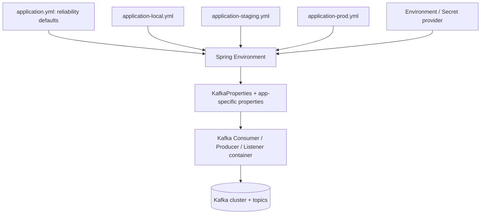
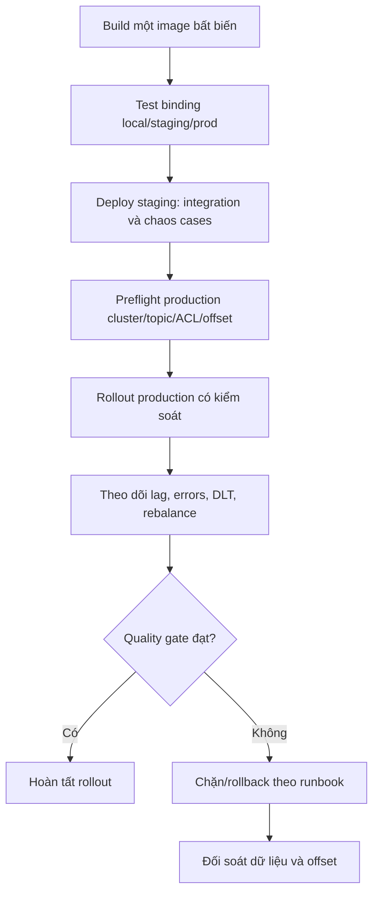

# Profile theo môi trường trong Spring Kafka

Một ứng dụng Spring Kafka có thể dùng **cùng một bản build** để chạy trên laptop, môi trường tích hợp, staging và production. Tuy nhiên, Kafka cluster, topic, consumer group, chứng thực, số luồng, chính sách retry và mức độ quan sát ở các môi trường này không giống nhau. Nếu ứng dụng chỉ có một file cấu hình hoặc phải sửa mã nguồn mỗi lần deploy, việc đưa nhầm consumer vào cluster production hay dùng trùng consumer group trở thành một rủi ro vận hành thực tế.

**Spring Profiles** giúp tách cấu hình theo môi trường trong khi giữ nguyên artifact được triển khai. Đây không chỉ là cách đổi `bootstrap-servers`; với hệ thống Kafka cần độ tin cậy cao, profile còn phải bảo đảm **cô lập dữ liệu**, **cấp quyền tối thiểu**, **chính sách xử lý lỗi rõ ràng** và **không làm thay đổi ý nghĩa offset khi rollout**.

Bài thuộc **Spring Kafka Reliability Operations → Deployment và cấu hình**, trình bày cách tổ chức profile `local`, `staging`, `prod`, cách Spring Boot nạp và ghi đè property, cách cấu hình các thiết lập liên quan reliability, bảo vệ secrets, kiểm thử profile và quy trình deploy/rollback. Ví dụ định hướng **Spring Boot 3.x / Spring Kafka 3.x / Kafka client tương thích**; hãy đối chiếu phiên bản cụ thể khi triển khai thật.

## 1. Profile giải quyết vấn đề gì?

Giả sử service `order-events-worker` đọc topic đơn hàng, ghi vào database và chuyển record lỗi không phục hồi được sang DLT (dead-letter topic).

| Thành phần | Local | Staging | Production |
|---|---|---|---|
| Kafka cluster | Broker Docker trên máy | Cluster thử nghiệm | Cluster production |
| Topic đầu vào | `orders.local.v1` | `orders.staging.v1` | `orders.v1` |
| Consumer group | `orders-worker-local-*` | `orders-worker-staging` | `orders-worker-prod` |
| Bảo mật | Có thể PLAINTEXT trong môi trường cô lập | SASL/TLS theo cluster | SASL/TLS hoặc identity production |
| Concurrency mỗi instance | 1 | 2 | Theo partitions và throughput |
| Offset khi chưa có commit | Có thể `earliest` để thử dữ liệu | Quy tắc bootstrap rõ ràng | Thường đặt chính sách tránh replay ngoài ý muốn |
| Retry/DLT | Cấu hình đơn giản, dễ mô phỏng lỗi | Tương tự production để kiểm thử | Giới hạn retry và DLT được giám sát |
| Logs/metrics | Chi tiết để debug | Đủ để diễn tập | Có cảnh báo, bảo vệ dữ liệu nhạy cảm |

**Mục tiêu không phải mọi giá trị đều khác nhau.** Những nguyên tắc bảo vệ tính đúng đắn như `enable-auto-commit=false`, idempotent processing, timeout và phân loại lỗi nên nhất quán. Môi trường khác nhau chủ yếu ở **địa chỉ tài nguyên, danh tính, hạn mức và yêu cầu vận hành**.

### Ba khái niệm cần phân biệt

- **Profile:** tên tập cấu hình Spring đang hoạt động, ví dụ `prod`.
- **Deployment environment:** nơi chạy thật — namespace Kubernetes, cluster, tài khoản cloud, VPC. Một chuỗi profile **không tự xác thực** rằng ứng dụng đang ở đúng môi trường.
- **Kafka resource identity:** cluster, topic, group, principal/ACL. Đây mới là các giá trị quyết định consumer sẽ đọc dữ liệu ở đâu và có thể làm gì.

Vì vậy `SPRING_PROFILES_ACTIVE=prod` chỉ là lựa chọn cấu hình, **không phải hàng rào bảo mật**. Nếu cấu hình hoặc credential sai, ứng dụng vẫn có thể kết nối tới cluster khác. Cần thêm ràng buộc ở broker ACL, network và pipeline triển khai.

## 2. Spring Boot nạp profile như thế nào?

Spring Boot hỗ trợ các file `application.yml`, `application-{profile}.yml` và các nguồn cấu hình khác. Một cách bố trí thông dụng:

```text
src/main/resources/
├── application.yml
├── application-local.yml
├── application-staging.yml
└── application-prod.yml
```

Khi không kích hoạt profile, `application.yml` cung cấp giá trị chung; khi kích hoạt `prod`, các giá trị từ `application-prod.yml` có thể ghi đè các giá trị chung ở cùng property. Environment variables, command-line args và các config source khác cũng có thể ghi đè theo **thứ tự ưu tiên của Spring Boot**.

Ví dụ:

```bash
# Bash/Linux/macOS: chạy local.
SPRING_PROFILES_ACTIVE=local java -jar order-events-worker.jar

# Chạy staging.
java -jar order-events-worker.jar --spring.profiles.active=staging

# Production: profile do deployment platform đặt.
java -jar order-events-worker.jar --spring.profiles.active=prod
```

Trên Windows PowerShell:

```powershell
$env:SPRING_PROFILES_ACTIVE = "local"
java -jar order-events-worker.jar
```

Spring nhận cấu hình profile thông qua `spring.profiles.active`. Không nên hard-code `spring.profiles.active: prod` trong `application.yml` rồi dùng chính artifact đó trên laptop: một thao tác chạy nhầm có thể chọn profile nguy hiểm. Thường nên để **deployment manifest/launcher** chọn môi trường.

### 2.1. Profile-specific files và profile-activated documents

Có hai cách hợp lệ:

1. Tách file `application-prod.yml`.
2. Dùng nhiều YAML documents trong một file, mỗi phần có `spring.config.activate.on-profile`.

Ví dụ cách thứ hai:

```yaml
# application.yml
app:
  kafka:
    retry:
      retries: 2
---
spring:
  config:
    activate:
      on-profile: local
  kafka:
    listener:
      concurrency: 1
---
spring:
  config:
    activate:
      on-profile: prod
  kafka:
    listener:
      concurrency: 3
```

Không cần trộn cả hai kỹ thuật cho cùng một property nếu không có lý do. Trong bài này ta dùng **file riêng** để dễ review diff và truy dấu giá trị theo môi trường.

**Lưu ý:** Không đặt `spring.profiles.active` bên trong một tài liệu YAML chỉ được kích hoạt bằng `spring.config.activate.on-profile` hoặc profile-specific document; Spring Boot không hỗ trợ kiểu khai báo này. Kích hoạt profile từ nguồn cấu hình **không phụ thuộc profile**, môi trường hoặc launcher.

### 2.2. Thứ tự ghi đè và nguồn của một giá trị

Ví dụ file prod:

```yaml
spring:
  kafka:
    bootstrap-servers: "${KAFKA_BOOTSTRAP_SERVERS}"
```

Ứng dụng cần có `KAFKA_BOOTSTRAP_SERVERS` khi khởi động. Nếu một operator dùng command-line arg:

```bash
java -jar app.jar --spring.profiles.active=prod \
  --spring.kafka.bootstrap-servers=broker-override:9093
```

Giá trị command-line có thể được ưu tiên hơn giá trị từ file, dù tên file là `application-prod.yml`. Spring Boot còn hỗ trợ các nguồn cấu hình có độ ưu tiên khác, ví dụ config data bên ngoài, system properties và environment variables. Khi debug một property sai, phải xác định **giá trị hiệu lực và nguồn gốc** thay vì chỉ đọc một file YAML.

Không dump toàn bộ `Environment`/`KafkaProperties` ra log: chúng có thể chứa SASL JAAS, token hoặc cấu hình nhạy cảm.

## 3. Cấu trúc cấu hình khuyến nghị

Ta tách hai nhóm:

- **Cấu hình chung:** semantics consumer/producer, offset/ack, retry policy cơ bản, tên ứng dụng và health settings.
- **Cấu hình profile:** broker, group, topic, ACL/security, concurrency, timeout theo tài nguyên, tên môi trường.

Sơ đồ:



Đừng xem hình trên như thứ tự ưu tiên tuyệt đối: Spring Boot có **quy tắc property source precedence** cụ thể. Ở đây mục đích là phân biệt nguồn và nơi sử dụng.

### 3.1. Common: `application.yml`

Ví dụ common config:

```yaml
spring:
  application:
    name: order-events-worker

  kafka:
    consumer:
      enable-auto-commit: false
      # Override rõ ở local/staging/prod để định nghĩa
      # hành vi group chưa có offset.
      auto-offset-reset: none
      key-deserializer: org.apache.kafka.common.serialization.StringDeserializer
      value-deserializer: org.apache.kafka.common.serialization.StringDeserializer
      properties:
        "[isolation.level]": "read_committed"

    producer:
      acks: all
      key-serializer: org.apache.kafka.common.serialization.StringSerializer
      value-serializer: org.apache.kafka.common.serialization.StringSerializer
      properties:
        "[enable.idempotence]": "true"

    listener:
      ack-mode: record
      missing-topics-fatal: true

app:
  kafka:
    retry:
      backoff-ms: 1000
      retries: 2

management:
  endpoints:
    web:
      exposure:
        include: health, info, prometheus
```

Các quyết định ở đây:

1. **`enable-auto-commit=false`:** để Spring Kafka listener container quản lý offset theo ack mode. Không để Kafka client tự commit theo chu kỳ bất kể xử lý nghiệp vụ đã xong hay chưa.
2. **`ack-mode=record`:** với record listener, container quản lý commit offset sau khi listener xử lý record thành công theo semantics của Spring Kafka. Điều này thường dẫn tới **at-least-once** khi có crash giữa commit DB và offset.
3. **`auto-offset-reset=none`:** nếu một group không có offset hợp lệ, consumer sẽ báo lỗi thay vì tự nhảy tới đầu/cuối; cần quy trình bootstrap offset. Đây là lựa chọn bảo thủ cho môi trường nhạy cảm, không phải mặc định bắt buộc cho mọi hệ thống.
4. **`isolation.level=read_committed`:** consumer tránh nhìn thấy record từ transaction Kafka bị abort; nó không làm giao dịch DB bên ngoài trở thành atomic với commit offset.
5. **`acks=all` và `enable.idempotence=true`:** giúp producer giảm rủi ro ghi trùng do retry ở tầng producer và yêu cầu acknowledgment theo cấu hình cluster. Không biến mọi ứng dụng end-to-end thành exactly-once.
6. **`missing-topics-fatal=true`:** listener không âm thầm chờ một topic được cấu hình sai hoặc chưa tồn tại trong ví dụ này. Cần đảm bảo provisioning topic trước deploy.
7. **Retry policy do ứng dụng đặt ở `app.kafka.retry`:** đây **không phải property Spring Kafka tự dùng**; cần một bean error handler đọc và áp dụng, minh họa ở phần sau.

`management.endpoints.web.exposure.include` chỉ mở một số Actuator endpoints nếu các dependency/endpoint tương ứng được bật. Production cần bảo vệ đường truy cập monitoring và không expose `env` hay `configprops` cho người dùng không có quyền.

### 3.2. Cấu hình `local`

File `application-local.yml`:

```yaml
spring:
  kafka:
    bootstrap-servers: "${KAFKA_BOOTSTRAP_SERVERS:localhost:9092}"
    consumer:
      group-id: "orders-worker-local-${USER:developer}"
      auto-offset-reset: earliest
    listener:
      concurrency: 1

app:
  kafka:
    topics:
      orders: orders.local.v1
      orders-dlt: orders.local.v1.DLT
```

Giải thích:

- `localhost:9092` hợp lý khi Kafka local được dựng bằng Docker và advertise listener phù hợp với client đang chạy trên host. Nếu ứng dụng chạy **trong container**, `localhost` là container của nó, không phải broker; cần dùng service DNS/network đúng.
- Local có thể dùng `earliest` để xem dữ liệu cũ khi group chưa có offset. Điều này **không có nghĩa mỗi lần khởi chạy đều đọc từ đầu**: khi group đã có committed offset, Kafka dùng offset đó; reset policy chủ yếu áp dụng khi không có offset hợp lệ.
- Gắn tên user vào local group chỉ để giảm tình trạng hai developer vô tình chia sẻ group khi kết nối chung một cluster thử nghiệm. Trong CI hoặc môi trường nhiều máy, nên dùng group ID có phạm vi theo test run nếu muốn cô lập thật sự, đồng thời dọn group/topic hết hạn.
- Không đưa Kafka production credentials vào profile local. Nếu local cần xác thực, dùng principal thử nghiệm chỉ có quyền lên topic local.

### 3.3. Cấu hình `staging`

File `application-staging.yml`:

```yaml
spring:
  kafka:
    bootstrap-servers: "${KAFKA_BOOTSTRAP_SERVERS}"
    client-id: "orders-worker-staging-${HOSTNAME:unknown}"

    consumer:
      group-id: orders-worker-staging
      auto-offset-reset: none

    listener:
      concurrency: 2

    properties:
      "[security.protocol]": SASL_SSL
      "[sasl.mechanism]": SCRAM-SHA-512
      "[sasl.jaas.config]": "${KAFKA_SASL_JAAS_CONFIG}"

app:
  kafka:
    topics:
      orders: orders.staging.v1
      orders-dlt: orders.staging.v1.DLT
```

Ở staging, các placeholder không có mặc định bắt ứng dụng cần được cấp giá trị phù hợp khi deploy. **Đây là cấu hình minh họa SASL_SSL/SCRAM**, không phải mọi cluster đều dùng cùng cơ chế. Một cluster có thể dùng SSL client certs, SASL/OAUTHBEARER hoặc cơ chế identity riêng. Điều bắt buộc là sử dụng cấu hình do chủ cluster cấp và kiểm chứng TLS/certificate, không tắt xác minh hostname để cho kết nối “chạy được”.

Việc chỉ ghi `"${KAFKA_SASL_JAAS_CONFIG}"` trong YAML **không làm secret trở nên tự động an toàn**. Biến môi trường hoặc secret mount vẫn phải được bảo vệ; không commit giá trị JAAS thật vào repository hoặc in ra log.

### 3.4. Cấu hình `prod`

File `application-prod.yml`:

```yaml
spring:
  kafka:
    bootstrap-servers: "${KAFKA_BOOTSTRAP_SERVERS}"
    client-id: "orders-worker-prod-${HOSTNAME:unknown}"

    consumer:
      group-id: orders-worker-prod
      auto-offset-reset: none

    listener:
      concurrency: 3

    properties:
      "[security.protocol]": SASL_SSL
      "[sasl.mechanism]": SCRAM-SHA-512
      "[sasl.jaas.config]": "${KAFKA_SASL_JAAS_CONFIG}"

app:
  kafka:
    topics:
      orders: orders.v1
      orders-dlt: orders.v1.DLT
```

Khác biệt chính giữa staging và prod trong ví dụ là **cluster/secret được inject từ deployment**, consumer group, topic và concurrency. Đừng trỏ staging tới cluster prod chỉ bằng cách thay group ID: việc dùng topic production với một group mới có thể **tiêu thụ lại toàn bộ lịch sử** hoặc gây tác dụng nghiệp vụ ngoài ý muốn.

**Quan trọng:** Không có mặc định nào khiến `prod` đương nhiên an toàn. Nếu `KAFKA_BOOTSTRAP_SERVERS` vô tình trỏ sang staging hoặc ACL cấp sai, service có thể chạy lệch môi trường. Hệ thống deploy phải kiểm tra cluster identity, principal và topic allowlist trước khi cho listener hoạt động.

## 4. Profile active và nhóm profile

Trong một ứng dụng lớn, các thuộc tính có thể được nhóm thành các concern như `observability`, `secure-kafka` và `prod`. Spring Boot hỗ trợ `spring.profiles.group` để một profile kích hoạt các profile thành viên.

Ví dụ ở **tài liệu không phụ thuộc profile**:

```yaml
spring:
  profiles:
    group:
      prod:
        - production-observability
        - strict-security
```

Khi bật `prod`, hai profile thành viên cũng được kích hoạt. Tuy nhiên, nhóm profile không phải lựa chọn bắt buộc. Với ba môi trường đơn giản, file `application-{profile}.yml` thường dễ hiểu hơn.

**Rủi ro:** Nếu nhiều profile active cùng định nghĩa `spring.kafka.consumer.group-id` hoặc `bootstrap-servers`, thứ tự override có thể dẫn đến giá trị không mong đợi. Tránh kích hoạt `local,prod` cùng lúc và không dùng nhiều profile môi trường đối lập như các “tính năng” có thể cộng dồn. Nên có startup guard bảo đảm **đúng một environment profile**.

### 4.1. Profile không phải feature flag

Profile phù hợp với **bộ cấu hình triển khai**. Những khả năng bật/tắt ở runtime như bật consumer cho một tenant, tắt publish, chuyển một flow sang chế độ dry-run có thể cần feature flags/operational controls riêng. Không dùng việc bật/tắt profile để thay đổi hành vi nghiệp vụ liên tục giữa lúc ứng dụng đang chạy: đổi profile thường đòi hỏi restart process, và thay đổi Kafka group/offset có hệ quả lớn.

## 5. Binding cấu hình cho mã ứng dụng

Nhóm `spring.kafka.*` được Spring Boot bind vào `KafkaProperties` và các factory/container mặc định khi ứng dụng sử dụng auto-configuration. Nhóm `app.kafka.*` là property **do ứng dụng định nghĩa**, cần bind hoặc đọc rõ ràng.

### 5.1. Tạo typed configuration properties

Ví dụ Java 17:

```java
package com.example.orders.config;

import org.springframework.boot.context.properties.ConfigurationProperties;
import org.springframework.validation.annotation.Validated;
import jakarta.validation.Valid;
import jakarta.validation.constraints.Min;
import jakarta.validation.constraints.NotBlank;

@Validated
@ConfigurationProperties(prefix = "app.kafka")
public record AppKafkaProperties(
        @Valid Topics topics,
        @Valid Retry retry) {

    public record Topics(
            @NotBlank String orders,
            @NotBlank String ordersDlt) {
    }

    public record Retry(
            @Min(0) long backoffMs,
            @Min(0) long retries) {
    }
}
```

Với Spring Boot 3, record một constructor có thể được bind qua constructor binding. `orders-dlt` trong YAML được relaxed binding thành `ordersDlt`. Các annotation Jakarta Validation cần dependency `spring-boot-starter-validation` (hoặc validator tương thích) để cơ chế validate hoạt động đầy đủ.

Đăng ký:

```java
package com.example.orders.config;

import org.springframework.boot.context.properties.EnableConfigurationProperties;
import org.springframework.context.annotation.Configuration;

@Configuration
@EnableConfigurationProperties(AppKafkaProperties.class)
public class KafkaAppConfiguration {
}
```

Trong service có thể inject `AppKafkaProperties` để lấy tên topic, retry budget mà không hard-code ở nhiều nơi. Những giá trị cần bảo mật **không được** ghi ra log khi ứng dụng startup. Các property validation kiểu `@NotBlank` kiểm tra thiếu cấu hình nhưng không thể xác minh topic có thuộc đúng cluster hay không; việc đó cần kiểm tra vận hành riêng.

### 5.2. Ví dụ listener không hard-code topic

```java
package com.example.orders.consumer;

import org.springframework.kafka.annotation.KafkaListener;
import org.springframework.stereotype.Component;

@Component
public class OrdersListener {

    private final OrderEventHandler handler;

    public OrdersListener(OrderEventHandler handler) {
        this.handler = handler;
    }

    @KafkaListener(
            id = "orders-listener",
            idIsGroup = false,
            topics = "${app.kafka.topics.orders}")
    public void onMessage(String payload) {
        handler.handle(payload);
    }
}
```

`OrderEventHandler` là service nghiệp vụ do ứng dụng định nghĩa. Trong `@KafkaListener`, `idIsGroup=false` tránh việc listener ID trở thành consumer group ID; group được lấy từ `spring.kafka.consumer.group-id` trong cấu hình container. Nếu có khai báo `groupId` riêng trên annotation, giá trị đó có thể ghi đè group của consumer factory, làm tách group ngoài ý muốn.

Với `ack-mode=record` và `enable-auto-commit=false`, container quản lý commit offset sau khi handler trả về thành công. Nếu handler ném exception, đường xử lý lỗi phụ thuộc error handler/container; **không mặc định offset được commit bất kể lỗi**.

### 5.3. Chú ý placeholder với annotation

Trong `@KafkaListener`, chuỗi `"${app.kafka.topics.orders}"` tham chiếu một property được Spring resolve khi tạo listener. Đây là cú pháp placeholder của Spring, khác với biểu thức SpEL `#{...}`. Dùng placeholder giúp mỗi profile chọn topic khác nhau mà không cần sửa annotation Java.

Với Java/Kotlin, placeholder là cấu hình ở thời điểm application context khởi tạo, không phải cơ chế tự đổi topic ở runtime khi một file ConfigMap được sửa. Khi thay tên topic/group trong production, triển khai/restart container theo kế hoạch.

## 6. Cấu hình error handler và dead-letter topic theo môi trường

Ứng dụng reliability thường cần xử lý cả lỗi tạm thời và lỗi không còn khả năng phục hồi. Một lựa chọn Spring Kafka cho record listener là `DefaultErrorHandler` kết hợp `DeadLetterPublishingRecoverer`.

Giả sử mỗi profile có topic:

```text
local:   orders.local.v1      → orders.local.v1.DLT
staging: orders.staging.v1    → orders.staging.v1.DLT
prod:    orders.v1            → orders.v1.DLT
```

Ví dụ:

```java
package com.example.orders.config;

import org.apache.kafka.common.TopicPartition;
import org.springframework.context.annotation.Bean;
import org.springframework.context.annotation.Configuration;
import org.springframework.kafka.core.KafkaTemplate;
import org.springframework.kafka.listener.DefaultErrorHandler;
import org.springframework.kafka.listener.DeadLetterPublishingRecoverer;
import org.springframework.util.backoff.FixedBackOff;

@Configuration
public class KafkaFailureConfiguration {

    @Bean
    DefaultErrorHandler errorHandler(
            KafkaTemplate<Object, Object> template,
            AppKafkaProperties settings) {

        String dlt = settings.topics().ordersDlt();

        DeadLetterPublishingRecoverer recoverer =
                new DeadLetterPublishingRecoverer(
                        template,
                        (record, exception) ->
                                new TopicPartition(dlt, record.partition()));

        FixedBackOff backOff = new FixedBackOff(
                settings.retry().backoffMs(),
                settings.retry().retries());

        return new DefaultErrorHandler(recoverer, backOff);
    }
}
```

Ví dụ dùng Spring Kafka 3.x, **StringSerializer** cho key/value như common configuration. Trong hệ thống thực, nếu consumer dùng JSON deserializer hoặc `ErrorHandlingDeserializer`, cấu hình DLT producer serializer cần tương thích kiểu dữ liệu được recoverer gửi; không mặc định mọi payload lỗi đều là `String`.

Các điểm phải hiểu:

- `FixedBackOff(1000L, 2L)` nghĩa là hai lần retry sau lần xử lý ban đầu trong trường hợp áp dụng; đây **không phải ba JobExecution**.
- Khi hết retry và record được recover thành công, recoverer gửi bản ghi sang DLT theo topic được cấu hình.
- Việc commit offset sau recovery phụ thuộc ack mode, container và error handler; phải xác minh DLT publish được broker xác nhận và listener/container thực hiện đúng contract, không chỉ nhìn log “sent to DLT”.
- Ví dụ chọn **cùng partition number** cho DLT. DLT phải có **ít nhất** số partition tương ứng với topic đầu vào, hoặc phải định tuyến sang partition thích hợp. Nếu không, publish DLT có thể thất bại.
- Producer principal cần quyền WRITE tới DLT, consumer group cần quyền READ topic gốc và quyền sử dụng group.
- Mỗi profile phải dùng **DLT riêng** hoặc có ranh giới rõ ràng, tránh record staging bị đưa nhầm vào DLT production.

### 6.1. Lỗi permanent và lỗi transient

Không nên retry mọi exception vô hạn. Một lỗi JSON sai schema hoặc business validation không được phép có thể được đánh dấu **không retryable**:

```java
DefaultErrorHandler handler =
        new DefaultErrorHandler(recoverer, backOff);
handler.addNotRetryableExceptions(
        InvalidOrderEventException.class);
return handler;
```

`InvalidOrderEventException` là exception ứng dụng cần khai báo. Cần phân loại theo contract nghiệp vụ: lỗi dữ liệu permanent không thể tự hết sau vài giây; deadlock/database timeout lại có thể cần backoff. DLT không nên được dùng làm “thùng rác” rồi để record quan trọng nằm đó vĩnh viễn; phải có dashboard, ownership, retention, và quy trình replay có kiểm soát.

### 6.2. Không làm retry policy khác nhau tùy tiện giữa staging và prod

Mục tiêu staging là phát hiện hành vi production trước khi rollout. Nếu staging chỉ retry 0 lần còn prod retry 30 lần, test staging không phản ánh nguy cơ retry storm hoặc delay backlog của prod. Nên giữ **nguyên tắc xử lý lỗi giống nhau** rồi điều chỉnh hạn mức theo SLA hoặc quota có lý do, đồng thời lưu các giá trị đó trong tài liệu cấu hình.

Với Spring Kafka, cần phân biệt **container error handler retry**, **non-blocking retry topics** (chẳng hạn `@RetryableTopic`), **Kafka client producer retries** và retry trong service/HTTP client. Bật tất cả mà không tổng hợp ngân sách có thể nhân số lần gọi downstream; profile phải phản ánh một thiết kế retry đã được kiểm soát.

## 7. Consumer group: profile không được làm lệch semantics offset

Trong Kafka, committed offset được quản lý theo **consumer group + topic + partition**. Thay consumer group ID là thay danh tính tiêu thụ.

Ví dụ:

```text
orders-worker-prod đã commit offset 6000 ở orders.v1 partition 0.

Deploy mới vô tình dùng group-id=orders-worker-prod-v2.

Kafka xem đây là group mới:
  Nếu auto-offset-reset=earliest → có thể đọc lại lịch sử.
  Nếu auto-offset-reset=latest   → có thể bỏ qua backlog cũ.
  Nếu auto-offset-reset=none     → có thể lỗi vì chưa có offset.
```

Do đó:

1. **Giữ group ID ổn định qua các lần deploy cùng workload.**
2. Dùng group khác khi **chủ đích** tạo consumer độc lập (ví dụ audit consumer), không chỉ để đặt phiên bản release.
3. Không dùng chung group cho staging và prod; nếu cùng broker nhưng khác topic vẫn cần ACL/identity tách biệt.
4. Khi đổi group hoặc thay partition count, lên kế hoạch về offset bootstrap, throughput và dữ liệu có thể replay.
5. Nếu dùng nhiều instance cùng group, Kafka phân chia partitions cho các consumer; không phải mỗi instance tự đọc toàn bộ topic.

### 7.1. Concurrency và partition count

Trong Spring Kafka, `spring.kafka.listener.concurrency` quyết định số consumer thread/container con trên **mỗi instance** cho concurrent listener. Số consumer thực tế xấp xỉ:

```text
total consumers ≈ application replicas × listener concurrency
```

Giả sử topic có 6 partitions:

| Deployment | Replicas | Concurrency/instance | Tổng consumer | Kết quả điển hình |
|---|---:|---:|---:|---|
| Local | 1 | 1 | 1 | Một consumer đọc tối đa 6 partitions |
| Staging | 1 | 2 | 2 | Có thể chia 6 partitions cho 2 consumers |
| Prod A | 2 | 3 | 6 | Có thể khai thác đủ 6 partitions |
| Prod B | 4 | 3 | 12 | Nhiều consumer **không có assignment** |

Ví dụ lý tưởng hóa; thực tế còn phụ thuộc listener count, group subscription và partition assignment strategy. Tăng concurrency vượt số partitions **không làm throughput tăng tương ứng**. Ngược lại, tăng số thread có thể gây thêm DB connections, HTTP request và lock contention ở downstream.

Khi đặt profile prod, phải tính **cả replicas lẫn concurrency**, không chỉ giá trị trong YAML. Kiểm tra consumer lag, processing duration, CPU, DB pool và rebalance sau khi scale.

### 7.2. Rebalance khi rolling deployment

Khi một pod dừng và pod mới tham gia cùng group, Kafka có thể phân lại partitions. Khi handler xử lý chậm, rebalance hoặc `max.poll.interval.ms` bị vượt có thể khiến record được giao lại; nếu DB đã commit nhưng offset chưa commit, record có thể bị xử lý lại.

Vì vậy rollout profile prod cần:

- Graceful shutdown để các listener ngừng nhận công việc và hoàn tất phần xử lý trong giới hạn.
- Timeout và workload đủ nhỏ để không thường xuyên vượt `max.poll.interval.ms`.
- Idempotency ở business database hoặc API.
- Theo dõi rebalance count/consumer lag, không chỉ số pod `Ready`.
- Cấu hình liveness/readiness và autoscaling không gây vòng rebalance liên tục.

Không dùng cách tăng `session.timeout.ms` hoặc `max.poll.interval.ms` lên vô hạn để che handler bị kẹt; cần điều tra nguyên nhân thực tế và ảnh hưởng tới failover.

## 8. Profiles và producer reliability

Producer configuration cũng phải được kiểm soát khi triển khai. Một cấu hình cơ sở cho producer ghi record quan trọng:

```yaml
spring:
  kafka:
    producer:
      acks: all
      properties:
        "[enable.idempotence]": "true"
        "[delivery.timeout.ms]": "120000"
        "[request.timeout.ms]": "30000"
```

Đây là giá trị ví dụ, cần đánh giá theo broker/cluster/network và SLA. `enable.idempotence=true` yêu cầu các thuộc tính liên quan như acknowledgment/retries/max in-flight đáp ứng ràng buộc Kafka client; để driver/client kiểm tra hoặc thất bại khi cấu hình mâu thuẫn, không tự cho rằng bật một flag là đủ.

**Idempotent producer** giảm duplication khi Kafka client retry việc gửi record trong phạm vi producer semantics; nó **không** bảo đảm consumer downstream không xử lý trùng, cũng không giúp một HTTP POST bên ngoài Kafka được rollback.

### 8.1. Kafka transaction có cần cấu hình theo profile?

Nếu ứng dụng sử dụng **Kafka transactions**, Spring Kafka có cấu hình `spring.kafka.producer.transaction-id-prefix`. Cần lưu ý:

- Transactional ID phải được phân phối để các producer đang hoạt động **không dùng trùng** ngoài ý muốn.
- Transaction ID prefix cần được thiết kế phù hợp **mỗi application instance** và chiến lược rolling deploy.
- Transaction timeout, fencing và khả năng khôi phục producer phải được kiểm thử.
- Consumer tham gia Kafka transaction có thể cần `isolation.level=read_committed`.
- Kafka exactly-once semantics trong chuỗi Kafka→process→Kafka **không tự động bao phủ** một database hoặc HTTP API bên ngoài Kafka.

Ví dụ môi trường chỉ dùng Kafka transaction:

```yaml
spring:
  kafka:
    producer:
      transaction-id-prefix: "orders-tx-${POD_UID}"
```

Ở đây `POD_UID` là ví dụ định danh instance được deployment cấp, và phải thực sự ổn định/duy nhất theo chiến lược vận hành. **Không copy cấu hình này sang mọi môi trường nếu ứng dụng không dùng Kafka transactions.** Mỗi lần đổi prefix có tác động tới transactional producer identity và fencing, cần được thiết kế, không chỉ chỉnh sửa tùy tiện.

### 8.2. Delivery semantics thực tế

Với consumer ghi database:

```text
Kafka record offset 100
  → listener xử lý
  → database COMMIT thành công
  → process crash trước khi Kafka offset COMMIT
  → record offset 100 được đọc lại sau restart
```

`enable-auto-commit=false` và `ack-mode=record` **không loại bỏ** cửa sổ này. Đối với data processing quan trọng, writer nên dùng business key duy nhất, upsert có kiểm tra version hoặc deduplication transactionally ở database. Nếu có external API, dùng idempotency key/outbox và đối soát tương ứng.

Đây là lý do profile production nên tăng tính quan sát và bảo vệ downstream chứ không chỉ tăng `acks` hoặc concurrency.

## 9. Không lưu secrets trong Git/profile YAML

Một lỗi điển hình:

```yaml
# KHÔNG LÀM: credential thật sẽ nằm trong repository và artifact.
spring:
  kafka:
    properties:
      "[sasl.jaas.config]": "org.apache.kafka.common.security.scram.ScramLoginModule required username='real-user' password='real-password';"
```

Hệ quả có thể là secret bị lưu trong lịch sử Git, CI logs, build artifact và bản sao config. Thay vào đó:

1. Lưu cấu hình **không nhạy cảm** như protocol, mechanism, topic và group trong file profile.
2. Lấy credential từ **secret manager / Kubernetes Secret / workload identity** do platform cấp.
3. Chỉ cấp quyền cần thiết cho principal của từng môi trường.
4. Có rotation, auditing và quy trình thu hồi khi secret bị lộ.
5. Không log raw property map, connection config, Authorization header hoặc JAAS string.

### 9.1. Kubernetes: ConfigMap và Secret

Một cách minh họa để inject môi trường (rút gọn):

```yaml
apiVersion: apps/v1
kind: Deployment
metadata:
  name: order-events-worker
spec:
  replicas: 2
  selector:
    matchLabels:
      app: order-events-worker
  template:
    metadata:
      labels:
        app: order-events-worker
    spec:
      containers:
        - name: worker
          image: registry.example.invalid/order-events-worker:1.4.2
          env:
            - name: SPRING_PROFILES_ACTIVE
              value: "prod"
            - name: KAFKA_BOOTSTRAP_SERVERS
              valueFrom:
                configMapKeyRef:
                  name: order-worker-config
                  key: kafka-bootstrap-servers
            - name: KAFKA_SASL_JAAS_CONFIG
              valueFrom:
                secretKeyRef:
                  name: order-worker-credentials
                  key: sasl-jaas-config
```

Các object `order-worker-config` và `order-worker-credentials` phải được tạo qua quy trình của platform. **Kubernetes Secret mặc định không phải một secret manager đầy đủ**: việc mã hóa at rest, RBAC, quyền xem pod/env, audit và cách đồng bộ rotation đều cần cấu hình. Secret inject qua environment variable thường không tự cập nhật trong process đã chạy; rotation có thể cần rollout lại pod hoặc provider refresh thích hợp.

Trong môi trường nghiêm ngặt, workload identity/certificate hoặc secret volume/sidecar có thể phù hợp hơn; lựa chọn phải theo contract Kafka security. Không biến mọi developer có quyền xem Deployment thành người có quyền đọc Secret.

### 9.2. Khác profile không có nghĩa khác quyền

Nếu staging và prod dùng **cùng Kafka principal** có quyền read/write tất cả topic, đặt tên profile riêng không ngăn staging ghi vào `orders.v1`. Cần:

- Principal/ACL khác nhau hoặc ít nhất policy được phân tách rõ.
- Network segmentation/VPC/firewall và broker listener phù hợp.
- Topic namespace và naming convention có quy tắc.
- Giới hạn quyền READ, WRITE, DESCRIBE, GROUP theo đúng workload.
- Kiểm tra quyền khi deploy và kiểm tra policy định kỳ.

Quyền của producer gửi DLT phải được tính riêng: một consumer có thể đọc topic chính thành công nhưng lỗi khi publish sang DLT vì thiếu WRITE ACL. Khi đó record lỗi có thể bị kẹt hoặc được thử lại liên tục, làm backlog tăng.

## 10. Chọn môi trường bằng container/Kubernetes một cách an toàn

Một quy trình triển khai tốt dùng **cùng một artifact bất biến**:

```text
Build artifact:
  order-events-worker:1.4.2
       │
       ├─ local   + application-local.yml   + local resources
       ├─ staging + application-staging.yml + staging resources
       └─ prod    + application-prod.yml    + prod resources
```

Không biên dịch phiên bản mã nguồn khác chỉ để thay đổi broker URL. Chênh lệch code giữa staging và prod làm giảm giá trị kiểm thử staging.

Tuy nhiên, **configuration drift** vẫn có thể tồn tại dù cùng artifact:

- Topic staging chỉ có 1 partition, prod có 12 partitions.
- Staging dùng PLAINTEXT, prod dùng SASL_SSL nên chưa kiểm chứng certs/ACL.
- Staging retry rất ít, prod retry nhiều khiến sự cố kéo dài.
- Staging không có DLT/monitoring, prod có DLT nhưng thiếu quyền ghi.
- Prod concurrency không tương thích số replicas hoặc DB connection pool.

Nên có **config inventory** và parity review cho những thuộc tính ảnh hưởng reliability, không chỉ đảm bảo YAML parse thành công.

### 10.1. “Fail fast” nếu profile không hợp lệ

Một startup guard có thể chặn việc bật nhầm nhiều profile môi trường hoặc chạy với profile mặc định:

```java
package com.example.orders.config;

import java.util.Arrays;
import java.util.Set;
import org.springframework.boot.ApplicationArguments;
import org.springframework.boot.ApplicationRunner;
import org.springframework.core.env.Environment;
import org.springframework.stereotype.Component;

@Component
public class EnvironmentProfileGuard implements ApplicationRunner {

    private static final Set<String> ENV_PROFILES =
            Set.of("local", "staging", "prod");

    private final Environment environment;

    public EnvironmentProfileGuard(Environment environment) {
        this.environment = environment;
    }

    @Override
    public void run(ApplicationArguments arguments) {
        long environments = Arrays.stream(
                        environment.getActiveProfiles())
                .filter(ENV_PROFILES::contains)
                .count();

        if (environments != 1) {
            throw new IllegalStateException(
                    "Exactly one environment profile must be active");
        }
    }
}
```

Đây là kiểm tra logic ở ứng dụng. Cần hiểu `ApplicationRunner` chạy **sau khi application context đã được tạo**; tùy cấu hình, Kafka listener container có thể đã bắt đầu trước khi runner kiểm tra. Nếu mục tiêu bảo đảm **không consumer nào kết nối sai cluster**, phải validate profile/config **trước khi Kafka listener auto-start**, ví dụ ở giai đoạn cấu hình/khởi tạo phù hợp, hoặc đặt `spring.kafka.listener.auto-startup=false` rồi chỉ start container khi validation thành công. Chỉ dựa vào runner là chưa đủ cho safety-critical deployment.

Trong production, guard nên kết hợp với preflight do CI/CD hoặc admission policy chạy **trước khi pod khởi động**, không chỉ kiểm tra tên profile ở runtime.

### 10.2. Không tự động tạo topic production ngoài kiểm soát

Kafka topic có partitions, replication factor, retention, cleanup policy và ACL. Đây thường là **hạ tầng do platform/provisioning quản lý**. Không để một consumer production vô tình tạo topic bằng tên đánh máy sai rồi vẫn chạy trên topic trống.

Với `missing-topics-fatal=true`, listener sẽ phát hiện một số trường hợp thiếu topic; ngoài ra có thể dùng Kafka AdminClient/preflight để xác nhận:

- Topic gốc và DLT tồn tại ở đúng cluster.
- Partition count đủ cho concurrency và DLT mapping.
- Replication/retention/cleanup phù hợp SLA, đặc biệt DLT retention.
- Principal có ACL cần thiết.
- Cluster metadata nhận diện đúng môi trường.

Không ép quyền CREATE topic cho mọi producer/consumer chỉ để triển khai dễ dàng.

## 11. Test profile: không chỉ assert một property

Nên kiểm tra từng profile ở ba mức:

1. **Property binding:** cấu hình được nạp đúng; group, topic, listener concurrency và security protocol có giá trị mong đợi.
2. **Kafka integration:** ứng dụng thực sự kết nối broker thử nghiệm và xử lý record, retry/DLT, commit offset đúng contract.
3. **Deploy preflight:** cluster identity, DNS/TLS, ACL, topic partitions, secrets và health endpoint đúng môi trường.

### 11.1. Test cấu hình local

Ví dụ với JUnit 5:

```java
import static org.assertj.core.api.Assertions.assertThat;

import org.junit.jupiter.api.Test;
import org.springframework.beans.factory.annotation.Autowired;
import org.springframework.boot.test.context.SpringBootTest;
import org.springframework.boot.autoconfigure.kafka.KafkaProperties;
import org.springframework.test.context.ActiveProfiles;

@SpringBootTest(properties = {
        "spring.kafka.listener.auto-startup=false"
})
@ActiveProfiles("local")
class LocalProfileConfigurationTest {

    @Autowired
    KafkaProperties kafka;

    @Autowired
    AppKafkaProperties appKafka;

    @Test
    void usesLocalResources() {
        assertThat(kafka.getConsumer().getGroupId())
                .startsWith("orders-worker-local-");
        assertThat(kafka.getListener().getConcurrency())
                .isEqualTo(1);
        assertThat(appKafka.topics().orders())
                .isEqualTo("orders.local.v1");
        assertThat(appKafka.topics().ordersDlt())
                .isEqualTo("orders.local.v1.DLT");
    }
}
```

Test này chỉ kiểm tra binding, không khẳng định broker local đang chạy. `@SpringBootTest` còn tạo các bean của ứng dụng; việc đặt `auto-startup=false` hạn chế listener tự kết nối trong test property. Nếu hệ thống có `KafkaAdmin` hoặc custom startup connection, cần cấu hình test tương ứng để tránh phụ thuộc broker thật.

### 11.2. Test cấu hình prod với secret giả

Trong CI, không dùng credential production. Tạo config placeholder giả:

```java
@SpringBootTest(properties = {
        "spring.kafka.listener.auto-startup=false",
        "KAFKA_BOOTSTRAP_SERVERS=kafka-test.invalid:9093",
        "KAFKA_SASL_JAAS_CONFIG=" +
            "org.apache.kafka.common.security.scram.ScramLoginModule " +
            "required username='test' password='test';"
})
@ActiveProfiles("prod")
class ProdProfileConfigurationTest {

    @Autowired KafkaProperties kafka;
    @Autowired AppKafkaProperties appKafka;

    @Test
    void usesProductionTopicAndGroup() {
        assertThat(kafka.getConsumer().getGroupId())
                .isEqualTo("orders-worker-prod");
        assertThat(appKafka.topics().orders())
                .isEqualTo("orders.v1");
        assertThat(kafka.getBootstrapServers())
                .contains("kafka-test.invalid:9093");
    }
}
```

Đây là ví dụ mở rộng của test trước (cần imports/test framework tương ứng). Giá trị credential test là **synthetic**; không bao giờ load secret thật vào log của CI. Test binding không chứng minh principal có quyền hay certificate hợp lệ trên broker prod.

### 11.3. Embedded Kafka hoặc Testcontainers

Để kiểm tra tương tác Kafka thật, có thể dùng:

- **`@EmbeddedKafka`:** phù hợp unit/integration test trong JVM, nhưng có những khác biệt với cluster production, TLS/ACL và broker config.
- **Testcontainers Kafka:** tạo broker cô lập trong container, kiểm tra consumer group, DLT, retry/rebalance; không mặc nhiên tái hiện network/security của production.
- **Staging cluster:** cần cho smoke test TLS, ACL, topic provisioning, partition assignment, offset policy và alerting thực.

Một integration test reliability nên có các case:

| Case | Kỳ vọng |
|---|---|
| Record hợp lệ | Consumer xử lý, DB commit, offset tiến theo contract |
| Handler ném lỗi transient | Retry hữu hạn với backoff rồi xử lý thành công |
| Record permanent invalid | DLT nhận record theo cấu hình, alert/counter tăng |
| DLT không có WRITE ACL | Recovery thất bại có tín hiệu rõ, không âm thầm mất record |
| Crash sau DB commit trước offset commit | Record có thể replay, writer idempotent |
| Group ID mới chưa có offset | Hành vi `auto-offset-reset` đúng theo policy |
| Thay replicas/concurrency | Không mất dữ liệu, rebalance/lag trong giới hạn |
| Thiếu bootstrap/secret | Deploy fail thay vì kết nối mặc định sai |

Không cố định một số millisecond latency trong CI dùng chung để chứng minh độ tin cậy; ghi nhận hành vi và trạng thái cuối, kiểm tra dữ liệu/offset thực tế và budget timeout phù hợp.

## 12. Preflight trước deploy production

Một checklist nên được thực hiện bởi pipeline hoặc operator có quyền thích hợp, không phải bằng cách in secret ra màn hình:

| Kiểm tra | Điều kiện đạt |
|---|---|
| Artifact | Image tag/digest đã được test ở staging |
| Profile | Chính xác `prod`, không đồng thời bật `local/staging` |
| Broker | DNS/TLS kết nối đúng cluster ID/môi trường |
| Identity | Principal đúng service, least privilege |
| Secret | Được cấp qua provider, còn hiệu lực, không nằm trong Git/log |
| Topic chính | Tồn tại, đúng partitions, retention và cleanup policy |
| DLT | Tồn tại, mapping hợp lệ, đủ partitions và WRITE ACL |
| Consumer group | Stable group ID; offset bootstrap/replay plan rõ ràng |
| Concurrency | Replicas × concurrency phù hợp partitions và downstream |
| Ack/commit | `enable-auto-commit=false`; ack mode đúng |
| Retry | Phân loại lỗi, backoff và ngân sách hữu hạn |
| Idempotency | DB/API chịu được record được đọc lại |
| Metrics | Consumer lag, failure, retry, DLT, rebalance và health |
| Rollout | Có rollback plan, không đổi group ID vô ý |

Với các thông số **hiệu lực** được ghi đè qua nhiều nguồn, hãy tạo một bản config audit chỉ gồm allowlisted fields (topic, group, concurrency, protocol, retry budget), **không gồm secret/JAAS**. So sánh nó với bản đã được phê duyệt trước deploy để giảm configuration drift.

## 13. Quy trình rollout và rollback

Một triển khai an toàn điển hình:



### 13.1. Rolling deployment

Khi deploy phiên bản mới cùng group:

- Kafka sẽ tái phân partitions khi consumer vào/ra group.
- Offset committed được group sử dụng tiếp, **nếu group ID và subscription không đổi**.
- Một số record có thể được xử lý lại sau crash/rebalance; cần idempotency.
- Với message schema mới, phải kiểm tra backward/forward compatibility của producer/consumer.
- Nếu số partitions thay đổi, cần đánh giá ordering, key distribution và throughput.

Không nên tăng đồng thời cả replicas, concurrency, retry limit, serializers và consumer group ID trong một rollout; khi có sự cố sẽ khó xác định biến gây lỗi.

### 13.2. Canary và shadow consumer

Canary là cách đưa một phần code mới vào production. Tuy nhiên với Kafka cần phân biệt:

- **Canary cùng group:** nhận **một phần partitions**, chia workload thật với phiên bản cũ; phù hợp nếu cả hai phiên bản tương thích và side effect được kiểm soát.
- **Shadow consumer group riêng:** có thể đọc lại cùng dữ liệu độc lập, nhưng **không được tạo side effect thực** nếu không có cơ chế dry-run/isolated sink; group mới có quy tắc offset bootstrap riêng.
- **Canary topic riêng:** cần pipeline dữ liệu và contract tương ứng; không tự giả định dữ liệu thật đã được kiểm thử.

Không tạo một shadow consumer cùng business writer rồi nghĩ nó “chỉ quan sát”: nếu handler vẫn ghi database hoặc gọi API, nó có thể phát sinh nghiệp vụ hai lần.

### 13.3. Rollback image khác rollback offset

Roll back application image/config **không tự đưa committed offset về giá trị cũ**. Ví dụ phiên bản mới đã commit offset 10.000, rollback về code cũ vẫn tiếp tục từ offset 10.000 nếu group giữ nguyên.

Nếu code mới xử lý sai 500 record trước rollback, cần **đối soát dữ liệu và kế hoạch replay**, có thể dùng group/offset reset có kiểm soát hoặc tạo job backfill riêng. Offset rewind không phải thao tác mặc định của rollout và có nguy cơ replay toàn bộ side effect.

**Không chạy `kafka-consumer-groups --reset-offsets` trên production theo cảm tính.** Cần dừng consumer group đúng cách, xác nhận mục tiêu topic/partitions/offset và có phê duyệt dữ liệu; theo dõi kết quả sau thực hiện.

## 14. Monitoring cần khác nhau thế nào theo profile?

Profile local ưu tiên dễ debug; prod ưu tiên SLO, cảnh báo và hạn chế dữ liệu nhạy cảm. Những chỉ số chung:

| Metric/signal | Local | Staging | Production |
|---|---|---|---|
| Consumer lag theo group/topic | Quan sát thủ công | Smoke/soak test | Dashboard và alert có baseline |
| Xử lý record p50/p95/p99 | Debug | So sánh trước deploy | SLO/latency alert |
| Retry attempts | Log rõ | Failure injection | Tần suất và ngân sách retry |
| DLT publish rate/backlog | Test chức năng | Bảo đảm mapping/ACL | Alert có owner và replay runbook |
| Rebalance events | Khi thử scale | Soak test | Theo dõi khi deploy/autoscale |
| Producer failures | Log callback | Test broker outage | Alert lỗi publish và delivery timeout |
| Broker/network/TLS | Có thể đơn giản | Kết nối thật | Health, cert expiry, authentication |
| Sensitive payload logging | Chỉ dữ liệu giả | Redacted | Redacted và phân quyền chặt |

Tuy nhiên, không có một metric `consumer_lag` duy nhất được Spring Boot tự cung cấp trong mọi setup. Cần chọn cách quan sát phù hợp: Kafka client metrics qua Micrometer/JMX, Kafka exporter, broker tooling và dashboard consumer group lag. Tên metric thay đổi theo registry/version; kiểm tra endpoint thực tế trước khi viết biểu thức alert.

### 14.1. Alert chỉ dựa vào lag có thể gây hiểu nhầm

Consumer lag tăng có thể do:

- Producer gửi dữ liệu đột biến.
- Downstream DB/API chậm.
- Kafka partitions thiếu so với concurrency.
- Consumer rebalance liên tục.
- Lỗi permanent làm một partition bị kẹt.
- Retry dài khiến poll/processing bị trì hoãn.
- Group ID sai khiến consumer bắt đầu ở vị trí khác.

Nên xem **lag + throughput + retry/DLT + processing latency + group health**, không chỉ tăng thread khi lag cao.

### 14.2. Không lộ secret qua Actuator

Actuator có thể giúp quan sát cấu hình và health nhưng endpoint như `env` hoặc `configprops` có nguy cơ làm lộ hoặc xác nhận thông tin nhạy cảm nếu bị cấu hình sai, dù một số giá trị được mask. Production nên giới hạn endpoints, network access, RBAC và audit. Đừng dùng `log.debug("KafkaProperties={}", ...)` để kiểm tra môi trường.

## 15. Troubleshooting theo profile

| Triệu chứng | Nguyên nhân hay gặp | Cách điều tra |
|---|---|---|
| Local không kết nối `localhost:9092` | App ở container, broker advertise sai | Kiểm tra DNS/network và advertised listeners |
| Staging lỗi SASL | Secret/username/mechanism/ACL sai | Kiểm tra principal, secret rotation, broker auth logs |
| Prod đọc topic local | Override property/profile sai | Kiểm tra active profiles và effective topic source |
| Consumer không nhận record | Không có offset, `auto-offset-reset=none`, thiếu assignment | Xem group describe, partition assignment, bootstrap policy |
| Deploy mới đọc lại lịch sử | Group ID đổi hoặc offset bị reset | So sánh group cũ/mới và committed offsets |
| Consumer dừng khi topic thiếu | `missing-topics-fatal=true` và provisioning chưa xong | Kiểm tra topic/cluster naming, không tự tắt guard |
| DLT không ghi được | Thiếu WRITE ACL hoặc DLT partitions thiếu | Xem recoverer failure và broker authorization |
| Retry loop làm lag tăng | Retry budget lớn, lỗi permanent, dependency outage | Phân loại lỗi, backoff và DLT policy |
| Prod chạy nhiều consumer idle | Replicas × concurrency lớn hơn số partitions | Tính lại capacity và assignment |
| Rebalance liên tục khi rollout | Pod restart, poll interval, quá tải | Xem readiness/liveness, processing time, group metrics |
| Rollback code nhưng dữ liệu không được xử lý lại | Offset đã commit ở bản mới | Lập data reconciliation/replay plan |
| Prod nhận credential staging | Secret binding/deployment sai | Kiểm tra namespace, secret ref, identity và ACL |
| Property prod không có hiệu lực | CLI/env/config data ghi đè | Truy nguồn property precedence, không dump secrets |

### Case study: group ID bị đổi theo release

Một team đặt:

```yaml
spring:
  kafka:
    consumer:
      group-id: "orders-worker-prod-${APP_VERSION}"
```

Mỗi deploy tạo group mới. Với `auto-offset-reset=earliest`, consumer có thể đọc lại toàn bộ message còn retention; nếu writer gửi email hoặc thanh toán, side effect có nguy cơ nhân đôi. Với `latest`, record đang backlog có thể bị bỏ qua. **Giải pháp:** group ID ổn định theo **chức năng tiêu thụ**, không theo release; chỉ đổi group khi có chủ đích và offset migration/replay plan.

### Case study: DLT đúng topic nhưng thiếu partition

Source `orders.v1` có 12 partitions. Error handler định tuyến tới `orders.v1.DLT` cùng partition, nhưng DLT chỉ được tạo 3 partitions. Record lỗi từ partition 9 không thể publish tới partition 9 của DLT. Nếu không có alert, xử lý có thể bị kẹt tại một partition.

**Giải pháp:** provision DLT đủ partitions, hoặc thiết kế resolver phân phối partition hợp lệ (có đánh đổi về ordering/traceability), và kiểm tra quyền producer cùng test failure path trước deploy.

### Case study: profile đúng nhưng cluster sai

`SPRING_PROFILES_ACTIVE=prod`, nhưng biến `KAFKA_BOOTSTRAP_SERVERS` do ConfigMap staging cung cấp. Test property `group-id=orders-worker-prod` vẫn pass, nhưng service thực đang ở cluster staging.

**Giải pháp:** cấu hình cluster identity nằm trong quy trình provisioning có kiểm chứng; policy admission/CI/CD kiểm tra namespace, secret, bootstrap ref và ACL; canary/smoke test kiểm tra broker metadata và topic allowlist trước khi mở consumer.

## 16. Thực hành: triển khai một artifact qua ba profile

Bài tập độc lập có thể thực hiện theo các bước:

1. Tạo Spring Boot app với dependencies `spring-kafka`, `spring-boot-starter-actuator`, validation và test.
2. Viết `application.yml` chứa semantics ack/commit, producer idempotence, retry budget mặc định.
3. Tạo `application-local.yml`, `application-staging.yml`, `application-prod.yml` theo các ví dụ trên.
4. Dùng `@KafkaListener` lấy topic từ `app.kafka.topics.orders` và để group do profile cấu hình.
5. Tạo một `DefaultErrorHandler` định tuyến record không phục hồi được sang DLT của profile.
6. Local: khởi Kafka bằng Docker/Testcontainers; gửi một message hợp lệ, một message tạo lỗi permanent; quan sát output và DLT.
7. Staging: dùng credential giả/test, xác minh TLS, ACL, topic partitions, retry/backoff và consumer lag.
8. Production preflight: kiểm tra active profile, broker identity, group ổn định, topics, DLT, concurrency/replicas và secrets.
9. Mô phỏng rolling deployment; quan sát group rebalance, lag và dữ liệu đầu ra; không đổi group ID.
10. Mô phỏng rollback image; xác minh offset không tự rewind và lập kế hoạch replay nếu dữ liệu có sai sót.

### Kết quả kỳ vọng

| Hành động | Local | Staging | Production |
|---|---|---|---|
| Khởi động không khai báo profile | Guard ngăn hoặc có default được phê duyệt | Không chạy nhầm | Không chạy nhầm |
| Gửi message vào topic | Chỉ local consumer xử lý | Chỉ staging consumer xử lý | Chỉ prod consumer xử lý |
| Handler ném lỗi transient | Retry có giới hạn | Retry có giới hạn | Retry có giới hạn |
| Handler ném lỗi permanent | Local DLT | Staging DLT | Prod DLT và alert |
| Đổi version app | Group không đổi | Group không đổi | Group không đổi |
| Broker credential không hợp lệ | Lỗi rõ | Startup/connection fail, không fallback | Fail closed, không dùng secret khác |
| Crash sau DB commit trước offset commit | Output idempotent | Output idempotent | Output idempotent |

Không cần biến profile thành ba nhánh code khác nhau để đạt được kết quả. Càng ít logic môi trường hóa trong Java, càng dễ so sánh staging với production.

## 17. Checklist review cấu hình trước khi release

- [ ] Chỉ có một environment profile: `local`, `staging` hoặc `prod`.
- [ ] Broker addresses được inject từ deployment đúng cluster và có preflight xác minh.
- [ ] Topic đầu vào, DLT và consumer group **khác nhau theo ranh giới môi trường**.
- [ ] Group ID production ổn định qua mọi release của cùng workload.
- [ ] Không hard-code secret vào file profile hoặc Git.
- [ ] TLS/SASL/certificates và ACL được kiểm tra bằng môi trường tương đương.
- [ ] `enable-auto-commit=false` và ack mode được thiết kế nhất quán.
- [ ] Chính sách `auto-offset-reset` được định nghĩa cho group mới/offset hết hạn.
- [ ] Producer idempotence và delivery timeout đáp ứng contract.
- [ ] Retry/error handler được đăng ký, phân loại lỗi và có ngân sách hữu hạn.
- [ ] DLT có đủ partitions, quyền ghi, retention và owner xử lý backlog.
- [ ] Replicas × concurrency phù hợp số partitions và tài nguyên downstream.
- [ ] Handler/DB/API idempotent trước tình huống record bị replay.
- [ ] Có test cấu hình từng profile và integration test retry/DLT/offset.
- [ ] Rollout/rollback không vô tình đổi group hoặc topic.
- [ ] Consumer lag, rebalance, errors, retries và DLT có metric/alert.
- [ ] Logs/Actuator không tiết lộ JAAS, token, request header hoặc payload nhạy cảm.
- [ ] Có runbook cho thay group, reset offset, replay DLT và lỗi authentication.

## 18. Tổng kết

**Profile theo môi trường** trong Spring Kafka là một phần của thiết kế **reliability và an toàn vận hành**, không chỉ là cách chuyển `localhost:9092` thành broker production. Các file `application-{profile}.yml` giúp một artifact dùng đúng địa chỉ Kafka, group, topic, bảo mật và hạn mức của từng môi trường; còn cấu hình chung giữ semantics retry, offset, acknowledgment và producer nhất quán.

Một hệ thống vận hành tốt cần thêm những ràng buộc ngoài profile: **cluster identity/ACL thực sự**, topic/DLT được provision đúng, secret management, group ID ổn định, writer idempotent, test failure/replay và quy trình rollout/rollback có đối soát dữ liệu. Khi những điều kiện này được kiểm soát, cùng một bản build có thể đi từ local đến production mà không làm thay đổi âm thầm hành vi tiêu thụ và khôi phục Kafka.
