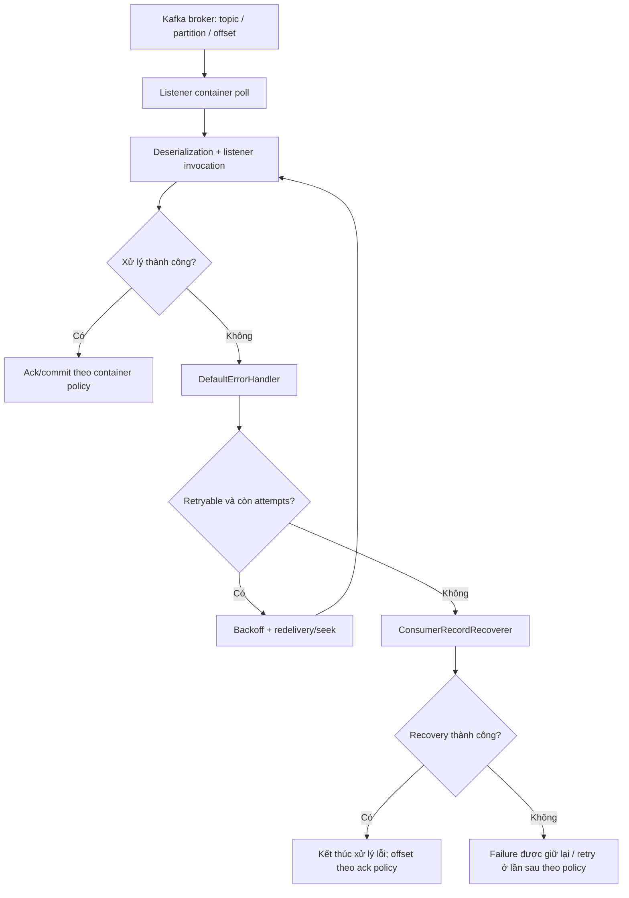

# Thay đổi DefaultErrorHandler trong Spring Kafka: nâng cấp và tương thích

Khi nâng cấp Spring Kafka, một trong những thay đổi dễ tác động tới độ tin cậy của consumer là **chuyển từ error handler cũ sang `DefaultErrorHandler`** hoặc thay đổi cấu hình của handler đang sử dụng. Một cấu hình trông tương đương về cú pháp vẫn có thể làm số lần retry, thứ tự xử lý, offset commit, hành vi DLT (dead-letter topic) và thời gian consumer bị chặn thay đổi.

Ví dụ: service xử lý sự kiện đơn hàng, một bản ghi gây lỗi database tạm thời. Ở phiên bản cũ, record được seek để đọc lại; ở phiên bản mới, handler có thể sử dụng cơ chế giữ records để gửi lại listener mà không thực hiện broker seek thực tế trong một số cấu hình. Nếu lúc nâng cấp team vừa đổi `ack-mode`, vừa thay số lần retry và cả cách publish DLT, một lỗi nhỏ có thể dẫn tới **mất record chưa xử lý, replay bất ngờ hoặc backlog tăng**.

Bài học thuộc **Spring Kafka Reliability Operations → Nâng cấp và tương thích**, hướng dẫn cách hiểu `DefaultErrorHandler`, chuyển đổi từ handler legacy, quản lý các đặc tính theo phiên bản, kiểm thử failure path và rollout an toàn. Ví dụ tập trung vào **Spring Kafka 2.8+ và 3.x**, thường dùng cùng Spring Boot 3.x ở nhánh 3.x. API chi tiết, tên property và default behavior phải được đối chiếu với **phiên bản Spring Kafka thực tế** đang nâng cấp; không nên sao chép giá trị mặc định từ một tài liệu của phiên bản khác.

> **Nguyên tắc:** Nâng cấp error handler là thay đổi *delivery semantics*. Phải chứng minh bằng integration test rằng một record thành công, retryable, permanent-invalid và thất bại khi publish DLT đều dẫn tới offset và dữ liệu nghiệp vụ đúng như contract.

## 1. DefaultErrorHandler nằm ở đâu?

Trong Spring Kafka, `@KafkaListener` thường chạy trong một listener container. Container poll Kafka records, chuyển chúng tới listener và quản lý acknowledgment/offset theo cấu hình. Khi listener hoặc quá trình chuyển đổi dữ liệu gặp lỗi được container đưa cho handler, một **CommonErrorHandler** có thể quyết định:

- Thử xử lý lại record/batch theo chính sách retry và backoff.
- Seek hoặc giữ các record cần gửi lại theo cơ chế hỗ trợ ở phiên bản đang dùng.
- Chuyển record không xử lý được sang một recoverer, thường là `DeadLetterPublishingRecoverer`.
- Ném lỗi để container xử lý tiếp thay vì coi bản ghi đã recover.
- Ảnh hưởng đến việc container có thể commit offset sau một lần recovery thành công.

`DefaultErrorHandler` là implementation phổ biến của interface `CommonErrorHandler` dành cho **record listener** và có hỗ trợ xử lý lỗi **batch listener** theo cơ chế tương ứng.



Sơ đồ khái quát, **không phải lời hứa rằng mọi retry đều poll lại broker ngay**. Từ các phiên bản hỗ trợ `seekAfterError=false`, Spring Kafka có thể giữ những records còn lại để gửi lại listener mà không seek thực tế, trong khi vẫn thực hiện các thao tác poll cần thiết cho consumer. Với batch listener, hành vi còn tùy cách exception chỉ rõ record lỗi.

### Các lớp cần phân biệt

| Thành phần | Trách nhiệm |
|---|---|
| `DefaultErrorHandler` | Điều phối retry/backoff và recovery khi container xử lý exception |
| `CommonErrorHandler` | Hợp đồng chung để listener container tích hợp error handler |
| `DeadLetterPublishingRecoverer` | Gửi record thất bại sang DLT qua Kafka producer |
| `BackOff` | Định nghĩa độ trễ và số lần thử lại |
| `RetryListener` | Quan sát retry/recovery attempt |
| `ErrorHandlingDeserializer` | Chuyển lỗi deserialize thành thông tin có thể được container xử lý |
| `AfterRollbackProcessor` | Xử lý các record sau rollback khi listener container dùng Kafka transaction |
| `@RetryableTopic` | Mô hình non-blocking retry qua các retry topics, khác retry tại container |

**Không nhầm Kafka client producer retry với listener retry.** `retries` của Kafka producer xử lý lỗi gửi Kafka ở tầng client; nó không quyết định listener có được gọi lại vì business exception hay không.

## 2. Dòng thời gian nâng cấp và ảnh hưởng

Một số mốc chính:

| Dòng phiên bản | Điều cần biết khi nâng cấp |
|---|---|
| **Trước Spring Kafka 2.8** | Phổ biến `SeekToCurrentErrorHandler` cho record listener và các handler riêng cho batch/container; API error handler phân tán hơn |
| **Từ 2.8** | Introduced `CommonErrorHandler` và `DefaultErrorHandler` để thống nhất xử lý record/batch; dùng API `setCommonErrorHandler(...)` |
| **Từ 2.9** | Có thêm lựa chọn như `setSeekAfterError(false)` để retain/resubmit records thay vì seek thực tế trong những trường hợp hỗ trợ |
| **Spring Kafka 3.x** | Tiếp tục dựa trên CommonErrorHandler; nhiều API legacy đã bị loại bỏ theo nhánh nâng cấp; hệ sinh thái chuyển sang Spring Framework 6 / Java 17 |

Đây là **bản đồ chuyển đổi ở mức khái niệm**. Không giả định tất cả method của 3.x đều xuất hiện ở 2.8.x; cũng không suy luận rằng mọi default như backoff, fatal exception list hoặc trạng thái retry reset giống hệt nhau giữa tất cả patch version.

### 2.1. Tại sao việc thay class không đủ?

Đoạn code có thể đổi từ `SeekToCurrentErrorHandler` sang `DefaultErrorHandler` nhưng vẫn sai nếu:

1. Dùng nhầm constructor làm số lần retry khác kỳ vọng.
2. Thay `setErrorHandler(...)` nhưng quên đổi nơi đăng ký trên container factory.
3. Không cấu hình lại recoverer, dẫn tới record bị log và “recover” theo mặc định thay vì vào DLT.
4. Thay đổi consumer `ack-mode` hoặc auto-commit cùng lúc, ảnh hưởng offset.
5. Dùng batch listener nhưng chỉ kiểm thử record listener.
6. Có lỗi deserialization trước listener, nên logic business error handler không nhìn thấy payload theo cách team dự kiến.
7. Container đang dùng Kafka transactions, nên lỗi cần xét trong đường rollback và after-rollback processing khác.

Nâng cấp phải xem **toàn bộ đường đi record từ poll → listener → transaction → retry/recover → commit**, không chỉ diff tên class.

## 3. Migration cơ bản từ SeekToCurrentErrorHandler

### 3.1. Cách cấu hình legacy

Ở các dự án Spring Kafka cũ, có thể thấy cấu hình dạng:

```java
// MINH HỌA CÚ PHÁP LEGACY - không dùng trong dự án Kafka 3.x mới.
SeekToCurrentErrorHandler handler =
        new SeekToCurrentErrorHandler(
                recoverer,
                new FixedBackOff(1_000L, 2L));

factory.setErrorHandler(handler);
```

Các class/import legacy phụ thuộc version cũ. Đừng dùng code này làm ví dụ chạy trên 3.x. Mục đích chỉ là nhận diện đường config cần chuyển đổi.

### 3.2. Cách cấu hình CommonErrorHandler

Với Spring Kafka 2.8+:

```java
import org.springframework.kafka.listener.CommonErrorHandler;
import org.springframework.kafka.listener.DefaultErrorHandler;
import org.springframework.util.backoff.FixedBackOff;

CommonErrorHandler handler = new DefaultErrorHandler(
        recoverer,
        new FixedBackOff(1_000L, 2L));

factory.setCommonErrorHandler(handler);
```

Ý nghĩa của `new FixedBackOff(1_000L, 2L)` trong đường retry thông thường:

- Đợi khoảng 1 giây giữa các lần thử.
- Cho phép tối đa **2 lần retry** sau lần xử lý đầu.
- Record có thể được thử tối đa **3 lần gọi listener** nếu mọi lần đều thất bại, trước khi đi tới recoverer.

Đây là ví dụ cơ bản, không tính lỗi ở chính recoverer hoặc các retry/transaction khác. Khi chuyển từ constructor legacy nhận `maxFailures` hoặc cấu hình retry tự viết, **không chuyển một con số mà không so sánh số listener invocations**: cách đếm failures/retries có thể khác nhau.

### 3.3. Bảng ánh xạ migration

| Cấu hình cũ/thói quen cũ | Hướng chuyển đổi | Cần kiểm thử |
|---|---|---|
| `SeekToCurrentErrorHandler` | `DefaultErrorHandler` | Số attempt, seek/redelivery, recovery |
| `factory.setErrorHandler(...)` | `factory.setCommonErrorHandler(...)` | Factory mà `@KafkaListener` thực sự dùng |
| Logging recoverer mặc định | `DeadLetterPublishingRecoverer` nếu cần DLT | Record vào đúng DLT, không chỉ log |
| Hard-coded retry count | `FixedBackOff` hoặc policy phù hợp | Attempt count và tổng thời gian |
| Phân loại lỗi legacy | `addNotRetryableExceptions(...)` / classifier | Lỗi permanent không retry |
| Listener-level callback logging | `RetryListener`/Micrometer | Retry và recovery counters |
| Batch error handling cũ | `DefaultErrorHandler` với xử lý batch | Có/không `BatchListenerFailedException` |
| Error handler cho transactional listener | Xem `AfterRollbackProcessor` | Rollback, resend, transaction semantics |

Không áp dụng phép ánh xạ một cách máy móc cho `@RetryableTopic` hoặc listener transactional: hai trường hợp này có cơ chế đặc thù cần xem riêng.

## 4. Một cấu hình DefaultErrorHandler hoàn chỉnh

Giả sử ứng dụng nhận JSON đơn hàng đã được deserialize thành dạng String trong ví dụ, ghi vào database và chuyển lỗi không thể xử lý sang topic `orders.v1.DLT`.

### 4.1. Dependencies nền

Ví dụ Gradle cho Spring Boot 3.x:

```groovy
dependencies {
    implementation 'org.springframework.boot:spring-boot-starter'
    implementation 'org.springframework.kafka:spring-kafka'
    implementation 'org.springframework.boot:spring-boot-starter-actuator'

    testImplementation 'org.springframework.boot:spring-boot-starter-test'
    testImplementation 'org.springframework.kafka:spring-kafka-test'
}
```

Spring Boot BOM quản lý phiên bản Spring Kafka và những thư viện tương thích. Không tùy ý pin riêng Spring Kafka 2.x vào một ứng dụng Spring Boot 3.x đang dùng Framework 6/Java 17. Nếu có nhu cầu override version, phải kiểm tra compatibility matrix của chính cặp version được chọn và test end-to-end.

### 4.2. Kafka configuration

```yaml
spring:
  kafka:
    bootstrap-servers: "${KAFKA_BOOTSTRAP_SERVERS:localhost:9092}"

    consumer:
      group-id: orders-worker
      enable-auto-commit: false
      auto-offset-reset: earliest
      key-deserializer: org.apache.kafka.common.serialization.StringDeserializer
      value-deserializer: org.apache.kafka.common.serialization.StringDeserializer

    producer:
      acks: all
      key-serializer: org.apache.kafka.common.serialization.StringSerializer
      value-serializer: org.apache.kafka.common.serialization.StringSerializer
      properties:
        "[enable.idempotence]": "true"

    listener:
      ack-mode: record

app:
  kafka:
    order-topic: orders.v1
    order-dlt: orders.v1.DLT
    retry:
      interval-ms: 1000
      max-retries: 2
```

Ở đây `app.kafka.*` là property do ứng dụng đọc, **không tự động được Spring Kafka tiêu thụ**. Với production nên truyền bootstrap servers/credential qua deployment hoặc secret manager, không hard-code giá trị nhạy cảm. `auto-offset-reset=earliest` giúp test trên một group mới nhìn thấy dữ liệu sẵn có; ở production cần chọn chính sách reset offset theo contract, không copy mặc định của lab.

### 4.3. Bean DefaultErrorHandler có DLT

```java
import org.apache.kafka.common.TopicPartition;
import org.springframework.beans.factory.annotation.Value;
import org.springframework.context.annotation.Bean;
import org.springframework.context.annotation.Configuration;
import org.springframework.kafka.core.KafkaTemplate;
import org.springframework.kafka.listener.DefaultErrorHandler;
import org.springframework.kafka.listener.DeadLetterPublishingRecoverer;
import org.springframework.util.backoff.FixedBackOff;

@Configuration
public class OrderKafkaErrorConfiguration {

    @Bean
    DefaultErrorHandler orderErrorHandler(
            KafkaTemplate<Object, Object> kafkaTemplate,
            @Value("${app.kafka.order-dlt}") String dltTopic,
            @Value("${app.kafka.retry.interval-ms}") long intervalMs,
            @Value("${app.kafka.retry.max-retries}") long maxRetries) {

        DeadLetterPublishingRecoverer recoverer =
                new DeadLetterPublishingRecoverer(
                        kafkaTemplate,
                        (record, ex) -> new TopicPartition(
                                dltTopic, record.partition()));

        DefaultErrorHandler handler = new DefaultErrorHandler(
                recoverer,
                new FixedBackOff(intervalMs, maxRetries));

        handler.addNotRetryableExceptions(
                InvalidOrderEventException.class);

        handler.setRetryListeners(
                (record, exception, deliveryAttempt) -> {
                    // Ghi counter/metric có cardinality thấp.
                    // Không log payload nếu chứa dữ liệu nhạy cảm.
                });

        return handler;
    }
}
```

`InvalidOrderEventException` là exception nghiệp vụ ứng dụng cần định nghĩa. `KafkaTemplate<Object,Object>` chỉ là kiểu phụ thuộc minh họa; trong dự án thật phải bảo đảm **producer factory/serializer thực tế phù hợp với kiểu key/value đưa vào DLT**. Nếu chỉ tiêu thụ và gửi lại chuỗi, có thể dùng template cho String; nếu dùng `ErrorHandlingDeserializer`, DLT có thể cần gửi byte array của payload lỗi và serializer xử lý được nhiều kiểu.

**Lưu ý quan trọng về DLT partition:** resolver dùng `record.partition()`, vì vậy **DLT cần có partition tương ứng**. Nếu topic gốc có 12 partitions nhưng DLT chỉ có 3, publish lỗi từ partition 9 sẽ thất bại. Có thể thay resolver để Kafka producer tự chọn partition bằng quy tắc phù hợp, nhưng cần hiểu ảnh hưởng tới ordering và khả năng tra cứu.

### 4.4. Kết nối handler với container factory

Spring Boot có thể tự phát hiện bean `CommonErrorHandler` trong cấu hình hỗ trợ, nhưng nếu ứng dụng tự tạo nhiều listener factories, cần gắn rõ handler vào **factory đang được listener sử dụng**.

```java
import org.springframework.context.annotation.Bean;
import org.springframework.kafka.config.ConcurrentKafkaListenerContainerFactory;
import org.springframework.kafka.core.ConsumerFactory;
import org.springframework.kafka.listener.CommonErrorHandler;

@Bean
ConcurrentKafkaListenerContainerFactory<String, String>
        orderKafkaListenerContainerFactory(
                ConsumerFactory<String, String> consumerFactory,
                CommonErrorHandler errorHandler) {

    var factory =
            new ConcurrentKafkaListenerContainerFactory<String, String>();
    factory.setConsumerFactory(consumerFactory);
    factory.setCommonErrorHandler(errorHandler);
    return factory;
}
```

Nếu dùng custom factory thay cho Boot auto-configured factory, hãy kiểm tra **các thiết lập mà Boot trước đó đã áp dụng**: converter, container properties, concurrency, ack mode, observation, record interceptor, transactions và customizers. Một lựa chọn khác là sử dụng `ConcurrentKafkaListenerContainerFactoryConfigurer` của Spring Boot để giữ những thiết lập auto-configured rồi ghi đè error handler.

Ví dụ annotation:

```java
@KafkaListener(
        id = "orders-listener",
        idIsGroup = false,
        topics = "${app.kafka.order-topic}",
        containerFactory = "orderKafkaListenerContainerFactory")
public void onOrder(String jsonPayload) {
    orderService.process(jsonPayload);
}
```

`orderService` là service nghiệp vụ giả định. `idIsGroup=false` tránh việc listener ID tự thay thế group ID. Không để một phần listener dùng factory mới còn phần khác âm thầm dùng factory cũ với error handler khác.

## 5. Số lần retry và backoff: lỗi migration phổ biến nhất

Các thuật ngữ **attempts**, **retries** và **failures** thường bị sử dụng khác nhau:

```text
Lần gọi listener đầu tiên → FAILED
Retry #1 sau 1000 ms     → FAILED
Retry #2 sau 1000 ms     → FAILED
Recoverer                → DLT (hoặc xử lý khác)
```

Trong ví dụ `FixedBackOff(1000L, 2L)`, có hai lần thử thêm sau lần gọi đầu. Không cấu hình `max-retries=3` chỉ vì sản phẩm ghi “tối đa ba lần xử lý”, nếu thực sự team muốn **tổng ba attempts**.

| Cấu hình backoff | Số retry sau lần đầu, theo mô hình thông thường | Số lần listener được thử tối đa |
|---|---:|---:|
| `FixedBackOff(0L, 0L)` | 0 | 1 |
| `FixedBackOff(1000L, 1L)` | 1 | 2 |
| `FixedBackOff(1000L, 2L)` | 2 | 3 |
| `FixedBackOff(2000L, 4L)` | 4 | 5 |

Các số chỉ áp dụng cho đường xử lý retry thông thường, **không bao gồm**: Kafka client producer retry, HTTP client retry bên trong handler, lỗi khi publish DLT, rollback transaction, hoặc reset retry state do exception thay đổi. Khi cần khẳng định, kiểm thử **số lần listener được gọi** trên version cụ thể.

### 5.1. Mặc định của DefaultErrorHandler không phải hợp đồng nghiệp vụ

Nếu chỉ viết:

```java
DefaultErrorHandler handler = new DefaultErrorHandler();
```

Spring Kafka sẽ dùng recoverer/backoff mặc định của version đó. Trong các nhánh thường dùng, default có thể bao gồm một số lần retry không delay và recovery bằng logging; **đừng dựa vào số retry mặc định** cho hệ thống critical. Luôn cấu hình explicit retry budget, recoverer và loại exception không retryable để tránh thay đổi hành vi khi nâng cấp thư viện.

### 5.2. Tổng ngân sách retry lồng nhau

Nếu listener gọi HTTP client cũng có retry, tổng số request có thể tăng nhanh:

```text
DefaultErrorHandler: 1 initial + 2 retries = 3 lần listener
HTTP client: mỗi lần listener thử tối đa 4 requests

Tệ nhất có thể: 3 × 4 = 12 HTTP requests / event
```

Đây là mô hình khi các tầng retry độc lập và luôn dùng hết hạn mức. Nếu API đang trả 503 hoặc 429, retry nóng có thể làm outage kéo dài. Cần xác định **ai sở hữu retry**, thời gian chờ có giới hạn, timeout mỗi operation và ngân sách thời gian theo SLA/`max.poll.interval.ms`.

### 5.3. Exponential backoff

Với dependency tạm quá tải, có thể dùng chính sách exponential backoff:

```java
import org.springframework.retry.backoff.ExponentialBackOffPolicy;

ExponentialBackOffPolicy backOff =
        new ExponentialBackOffPolicy();
backOff.setInitialInterval(500L);
backOff.setMultiplier(2.0);
backOff.setMaxInterval(5_000L);

DefaultErrorHandler handler =
        new DefaultErrorHandler(recoverer, backOff);
```

`ExponentialBackOffPolicy` là thành phần Spring Retry, còn `DefaultErrorHandler` nhận một `BackOff` theo hợp đồng được hỗ trợ trong phiên bản. **Với cách cấu hình cụ thể, cần kiểm tra type BackOff phù hợp**: `ExponentialBackOffPolicy` thường thuộc Spring Retry `BackOffPolicy`, không đồng nhất với `org.springframework.util.backoff.BackOff`. Để tránh dùng nhầm API, có thể dùng `ExponentialBackOff` của Spring Framework:

```java
import org.springframework.util.backoff.ExponentialBackOff;

ExponentialBackOff backOff = new ExponentialBackOff();
backOff.setInitialInterval(500L);
backOff.setMultiplier(2.0);
backOff.setMaxInterval(5_000L);
backOff.setMaxAttempts(3);

DefaultErrorHandler handler =
        new DefaultErrorHandler(recoverer, backOff);
```

Đây là ví dụ đúng hướng API `org.springframework.util.backoff.BackOff`; trong dự án thực nên chọn một đoạn cấu hình **đã xác nhận tương thích** và bỏ nhánh minh họa dùng type khác. Với nhiều worker, có thể cần jitter để tránh tất cả retry cùng lúc; chọn cách hỗ trợ jitter theo thư viện/version đang sử dụng.

## 6. Retryable và not-retryable exceptions

Không phải lỗi nào cũng có cơ hội phục hồi khi gọi lại cùng record:

| Loại lỗi | Chính sách thường hợp lý | Lý do |
|---|---|---|
| Kafka listener gặp DB deadlock tạm | Retry có backoff | Transaction có thể thành công khi lock giải phóng |
| HTTP 503/429 từ dependency | Retry có giới hạn, chú ý quota | Dịch vụ có thể hồi phục |
| JSON sai schema hoặc invalid field | Không retry, DLT/quarantine | Payload không tự sửa sau 1 giây |
| Unsupported event version | Không retry nóng; DLT/alert | Cần sửa producer/consumer/schema |
| Business duplicate đã xử lý | Tùy idempotency contract | Có thể là duplicate hợp lệ hoặc dữ liệu mâu thuẫn |
| Lỗi code/NullPointerException | Không retry mù | Cần fix code, không phải hạ tầng |
| Auth 401 do token hết hạn | Refresh credential theo contract | Cần phân biệt lỗi tạm với permission sai |
| DLT publish fail | Không coi record đã recover | Tránh mất record lỗi |

`DefaultErrorHandler` có danh sách fatal/not-retryable exceptions mặc định theo version, nhất là các lỗi conversion/deserialization/argument resolution nhất định. Khi migrate, đừng phỏng đoán danh sách này từ một patch version khác; nên liệt kê **exception nghiệp vụ** bắt buộc không retry.

Ví dụ:

```java
handler.addNotRetryableExceptions(
        InvalidOrderEventException.class,
        UnsupportedSchemaVersionException.class);
```

Hai exception là custom class của ứng dụng. Nếu một exception bọc lỗi transient trong nguyên nhân sâu (`cause`), cách phân loại theo loại bọc/chuỗi cause cần được kiểm chứng. Không mặc định một tên exception tùy ý sẽ được unwrap đúng.

### 6.1. Sự khác biệt giữa recover và swallow

Khi handler đã hết retry và recoverer **trả về bình thường**, handler có thể coi lỗi đã được xử lý để container tiếp tục. Điều đó chỉ an toàn nếu “recover thành công” thật sự có nghĩa **bản ghi đã được lưu ở nơi chịu trách nhiệm tiếp theo** như DLT hoặc quarantine bền vững.

Nếu recoverer chỉ ghi:

```java
(record, exception) -> log.error(
        "Failed order offset={}", record.offset(), exception);
```

thì record có nguy cơ được bỏ qua khỏi luồng chính mà **không có nơi lưu để replay**, dù log rất rõ. Với giao dịch quan trọng, nên có DLT hoặc durable recovery store cùng ownership và alert, không chỉ logging recoverer.

## 7. DefaultErrorHandler và DLT

`DeadLetterPublishingRecoverer` thường được dùng khi một record không thể xử lý trong giới hạn retry. Nó gửi sang một topic lỗi cùng metadata phục vụ điều tra.

```text
orders.v1 partition=2 offset=418
  listener → exception permanent
  DefaultErrorHandler → DeadLetterPublishingRecoverer
  orders.v1.DLT partition=2, payload + headers lỗi
  monitoring alert → runbook replay/quarantine
```

Trong nhiều cấu hình Spring Kafka, DLT record được bổ sung headers mô tả topic/partition/offset gốc, exception type/message và các metadata khác. Danh sách/định dạng headers phụ thuộc version, cách custom recoverer và payload, nên consumer DLT cần kiểm thử với event thực tế.

### 7.1. DLT phải là một nhánh được giám sát

Một luồng reliability tối thiểu:

1. DLT topic được tạo trước deploy, đúng cluster/môi trường.
2. Partition mapping hợp lệ.
3. Producer có quyền WRITE và serializer phù hợp.
4. Recovery publish failure **không bị nuốt**.
5. Có metric/cảnh báo DLT arrivals và backlog.
6. Có owner xử lý record permanent và quy trình replay riêng.
7. Khi replay, giữ business idempotency key để không tạo side effect trùng.

Không reset offset hoặc replay toàn bộ DLT trong production khi chưa xác định nguyên nhân và ảnh hưởng downstream.

### 7.2. Publish DLT cũng có thể thất bại

Các tình huống:

- DLT chưa tồn tại hoặc resolver chọn partition không hợp lệ.
- Producer thiếu WRITE ACL.
- Kafka cluster không sẵn sàng hoặc request timeout.
- Serializer không hỗ trợ payload (nhất là lỗi deserialization với raw bytes).
- Delivery result chưa thực sự được xác nhận.

Khi recoverer ném lỗi, error handler/container không nên coi record đã recover thành công. Chính sách state/backoff sau recoverer failure tùy version; trong những nhánh có `setResetStateOnRecoveryFailure(...)`, có thể điều chỉnh việc reset backoff, nhưng phải thử bằng integration test.

Không coi một lời gọi `kafkaTemplate.send(...)` được chấp nhận là bằng chứng record đã tồn tại trên DLT nếu luồng publish bất đồng bộ và không chờ/kiểm tra kết quả theo policy. Cần chọn recoverer behavior phù hợp delivery guarantee mong muốn và cảnh báo khi publish thất bại.

### 7.3. Topic DLT không phải cơ chế retry vô hạn

Một record vào DLT thường cần:

- Phân loại lỗi, quyết định sửa dữ liệu hoặc code.
- Xem original topic, partition, offset, event ID.
- Xác định đã có side effect nào xảy ra trước exception không.
- Replay có kiểm soát vào topic thích hợp hoặc một công cụ backfill.
- Giữ audit: record đã replay khi nào, ai phê duyệt, kết quả ra sao.

Nếu retry được xử lý qua `@RetryableTopic` và các retry topics, cần phân biệt **non-blocking retry pipeline** với DefaultErrorHandler trong container. Không vô tình bật cả hai để mỗi lần ở retry topic lại bị retry thêm nhiều lần trong container.

## 8. Ack mode, offset commit và recovery

Đây là vùng thay đổi nhạy cảm nhất khi nâng cấp. Một record được recover không đồng nghĩa tất cả cấu hình offset đều giống nhau.

### 8.1. Các trạng thái cần phân biệt

```text
1. Kafka broker đã giao record cho consumer.
2. Listener nhận record.
3. Side effect nghiệp vụ (DB/API) có thể đã được commit.
4. Error handler retry/recover.
5. Container ghi nhận xử lý thành công theo ack policy.
6. Consumer group committed offset tiến tới vị trí mới.
```

Nếu crash xảy ra sau khi DB commit nhưng **trước khi offset được commit**, record có thể được giao lại khi consumer khởi động. `DefaultErrorHandler` không tự biến JDBC và Kafka offsets thành một transaction atomic.

### 8.2. Auto commit và ack mode

Một cấu hình minh họa cho record listener:

```yaml
spring:
  kafka:
    consumer:
      enable-auto-commit: false
    listener:
      ack-mode: record
```

Với `enable-auto-commit=false`, container kiểm soát offset commit theo ack mode, thay vì client commit định kỳ độc lập với logic xử lý. `ack-mode=record` thích hợp để mô phỏng record listener xử lý tuần tự; nhưng chọn mode nào còn phụ thuộc throughput và transaction contract.

Không đổi `enable-auto-commit` hay `ack-mode` đồng thời với migration handler mà không test. Nếu project đang dùng `BATCH`, `MANUAL` hoặc `MANUAL_IMMEDIATE`, cần viết kịch bản riêng cho từng mode.

### 8.3. `ackAfterHandle`

`DefaultErrorHandler` có cấu hình như `setAckAfterHandle(boolean)` để kiểm soát việc container có commit offset sau khi handler **trả về bình thường** theo đường xử lý tương ứng. Nó không thay thế hoàn toàn ack-mode và không nên coi là “commit ngay mọi lúc” cho mọi cấu hình.

Ví dụ một số hệ thống muốn recovery vào DLT được coi là hoàn tất để tránh mắc kẹt ở record permanent; ở hệ khác, chỉ ghi log mà commit offset sẽ làm mất khả năng replay.

**Không đặt `setAckAfterHandle(false)` chỉ để cảm thấy an toàn hơn.** Nếu handler tiếp tục gặp cùng poison-pill và offset không tiến, partition có thể bị kẹt. Quyết định cần xuất phát từ hợp đồng DLT/offset và phải quan sát committed offsets trên broker.

### 8.4. `commitRecovered` với MANUAL_IMMEDIATE

Với một số đường xử lý manual acknowledgment, `DefaultErrorHandler` hỗ trợ `setCommitRecovered(true)`, thường có điều kiện liên quan `AckMode.MANUAL_IMMEDIATE`.

```java
DefaultErrorHandler handler =
        new DefaultErrorHandler(recoverer, new FixedBackOff(1000L, 2L));

handler.setCommitRecovered(true);
```

Đây **không phải** thiết lập bắt buộc cho mọi listener. Nếu ứng dụng dùng `MANUAL_IMMEDIATE`, cần xác minh lúc nào offset của recovered record được commit, các records trước/sau trong cùng poll batch xử lý ra sao và recoverer có thực sự thành công.

Không suy luận rằng `setCommitRecovered(true)` làm một bản ghi gửi DLT và offset commit trở thành **một transaction atomic**; đây là hai thao tác có những điều kiện riêng nếu không dùng cơ chế transaction được thiết kế phù hợp.

## 9. Seek after error: phiên bản 2.9+ và hệ quả

Các bản Spring Kafka hỗ trợ `setSeekAfterError(false)` cho phép error handler dùng cơ chế **giữ lại những record chưa được xử lý và submit lại** trong container, thay vì luôn thực hiện broker seek để reread từ offset.

```java
// Chỉ dùng nếu phiên bản Spring Kafka đang chạy hỗ trợ API này.
DefaultErrorHandler handler =
        new DefaultErrorHandler(recoverer, new FixedBackOff(1000L, 2L));

handler.setSeekAfterError(false);
```

### So sánh khái niệm

| Cơ chế | Ý tưởng | Điểm cần kiểm thử |
|---|---|---|
| Seek-based | Consumer được seek về offset cần xử lý lại | Poll/assignment, offset, thứ tự redelivery |
| Retain-and-resubmit | Container giữ records cần gửi lại listener, có poll cần thiết | Buffer, pausing/poll, redelivery, memory |

Không đồng nhất “không seek” với “không poll” hoặc “đã commit offset”. Chế độ retain vẫn cần tương tác với Kafka consumer để đáp ứng liveness/rebalance semantics.

Khi nâng cấp 2.8 → 2.9/3.x, chỉ thay đổi cơ chế này nếu có lý do và có test:

- Record lỗi được gọi lại đúng số attempt.
- Các record sau nó trên cùng partition không bị xử lý sai thứ tự.
- Rebalance/crash trong thời gian backoff không làm mất record.
- Consumer lag, max.poll.interval, memory và thread use trong giới hạn.
- DLT recovery và offset sau recovery như kỳ vọng.

## 10. Record listener và batch listener không giống nhau

Với **record listener**, exception thường gắn trực tiếp với một `ConsumerRecord`. Error handler có thể retry/recover record đó, rồi tiếp tục theo chính sách container.

Với **batch listener**, một lời gọi nhận **nhiều records**. Khi exception xảy ra, framework cần biết **record nào** gây lỗi nếu muốn xử lý chính xác một item. `BatchListenerFailedException` cung cấp thông tin record/index thất bại trong những trường hợp được hỗ trợ.

### 10.1. Batch listener ví dụ

```java
import java.util.List;
import org.apache.kafka.clients.consumer.ConsumerRecord;
import org.springframework.kafka.annotation.KafkaListener;
import org.springframework.kafka.listener.BatchListenerFailedException;

@KafkaListener(
        topics = "orders.v1",
        containerFactory = "batchKafkaListenerContainerFactory")
public void onOrders(List<ConsumerRecord<String, String>> records) {
    for (int index = 0; index < records.size(); index++) {
        ConsumerRecord<String, String> record = records.get(index);
        try {
            processOrder(record.value());
        } catch (PermanentOrderException ex) {
            throw new BatchListenerFailedException(
                    "Invalid order in batch",
                    ex,
                    index);
        }
    }
}
```

`PermanentOrderException` và `processOrder` là phần nghiệp vụ minh họa. Container factory cho batch listener phải bật chế độ batch và tích hợp CommonErrorHandler tương ứng.

### 10.2. Hành vi khi chỉ rõ record lỗi

Khi `BatchListenerFailedException` chỉ ra index/record, `DefaultErrorHandler` có thể áp dụng recovery cho phần liên quan, đồng thời xử lý những record đã thành công trước đó và những record còn lại theo semantics của version/ack mode.

Nếu batch listener ném một exception **không chỉ rõ record lỗi**, handler có thể phải dùng fallback retry cho **toàn batch**. Điều này dễ gây replay hàng loạt. Vì thế:

- Không mặc định một exception từ batch listener có nghĩa “chỉ retry một item”.
- Nếu cần độ cô lập record, xử lý record-by-record hoặc ném `BatchListenerFailedException` đúng index.
- Khi cùng một batch có DB writes đã commit từng phần, phải có idempotency.
- Kiểm thử batch listener với cả record ở đầu, giữa và cuối batch.
- Không dùng batch listener làm ví dụ tương đương với record listener khi nâng cấp handler.

## 11. Transactional listener và AfterRollbackProcessor

Nếu listener container dùng **Kafka transaction**, failure path không chỉ là CommonErrorHandler thông thường. Với transaction, exception có thể dẫn tới rollback và chuyển xử lý sang **`AfterRollbackProcessor`**; Spring Kafka có `DefaultAfterRollbackProcessor` để điều phối việc seek/recovery sau rollback theo contract.

```text
Kafka consumer + container transaction
  listener xử lý
    ├─ thành công → commit Kafka transaction
    └─ exception → rollback transaction
                  → AfterRollbackProcessor xử lý redelivery/recovery
```

Vì vậy:

1. Kiểm tra listener factory có transaction manager/Kafka transaction configuration không.
2. Nếu có, không mặc định thay `SeekToCurrentErrorHandler` bằng `DefaultErrorHandler` là bước migration đúng cho mọi failure.
3. Đối chiếu cách `DefaultAfterRollbackProcessor` hoạt động và API phù hợp version.
4. Kiểm thử transaction rollback, offset, consumer rebalance và DLT publish.
5. Ghi rõ liệu luồng cần Kafka→Kafka exactly-once semantics hay chỉ at-least-once với DB/API.

**Kafka transaction không tự bao phủ một transaction JDBC hoặc external HTTP request**. Nếu handler đã gửi tiền qua API rồi Kafka transaction abort, API vẫn có thể đã xử lý thành công. Cần business idempotency và reconciliation.

## 12. Lỗi deserialization: DefaultErrorHandler không tự sửa được mọi tình huống

Một lỗi JSON deserialization có thể xảy ra **trước khi listener nhận được record hợp lệ**. Nếu client deserializer trực tiếp ném exception mà container chưa có record để đưa vào error handler, cấu hình `DefaultErrorHandler` cho business exception chưa đủ.

Spring Kafka cung cấp `ErrorHandlingDeserializer` để lưu thông tin lỗi deserialize theo cơ chế header và cho container xử lý phù hợp.

Ví dụ:

```yaml
spring:
  kafka:
    consumer:
      key-deserializer: org.apache.kafka.common.serialization.StringDeserializer
      value-deserializer: org.springframework.kafka.support.serializer.ErrorHandlingDeserializer
      properties:
        "[spring.deserializer.value.delegate.class]": org.springframework.kafka.support.serializer.JsonDeserializer
        "[spring.json.trusted.packages]": "com.example.orders.events"
        "[spring.json.value.default.type]": "com.example.orders.events.OrderEvent"
```

Đây là mẫu cấu hình để consumer JSON có thể xử lý lỗi deserialize theo đường Spring Kafka hỗ trợ. **Tên class và kiểu payload phải tồn tại trong ứng dụng**; với schema registry/Avro/Protobuf, delegate deserializer và DLT serializer cần thiết kế riêng.

### 12.1. DLT producer cần hỗ trợ raw bytes khi deserialize lỗi

Khi `ErrorHandlingDeserializer` gặp payload lỗi, dữ liệu đưa tới recoverer/DLT có thể là **raw bytes**, trong khi payload bình thường là DTO hoặc String. Nếu DLT KafkaTemplate chỉ có `JsonSerializer<OrderEvent>` hoặc chỉ StringSerializer, việc publish record lỗi có thể thất bại.

Cần xây producer factory/serializer hỗ trợ đúng các kiểu thực tế, có thể dùng cấu hình serializer theo type hoặc nhiều templates như API version cho phép. Đừng test DLT chỉ với `throw new IllegalArgumentException()` trong listener, vì test đó không bao phủ **deserialization failure path**.

### 12.2. Không log toàn bộ payload lỗi

Event thất bại có thể chứa dữ liệu cá nhân, header Authorization hoặc nội dung nhạy cảm. Khi gửi DLT, cần áp dụng retention, ACL và bảo vệ log/trace. Để điều tra, thường chỉ cần topic, partition, offset, event ID/correlation ID và exception type; raw payload chỉ được truy cập trong hệ thống có quyền phù hợp.

## 13. Interaction với @RetryableTopic

`@RetryableTopic` là cơ chế **non-blocking retries** dùng retry topics và DLT theo sơ đồ khác với retry trực tiếp trong container:

```text
Blocking retry với DefaultErrorHandler:
  orders.v1 → listener failed → backoff / redelivery cùng pipeline
                                → DLT nếu hết retry

Non-blocking retry topics:
  orders.v1 → retry topic 1 → retry topic 2 → DLT
```

Nếu team đang dùng `@RetryableTopic` hoặc `RetryTopicConfiguration`, cần kiểm tra:

- Retry attempts và DLT của **retry-topic framework** là bao nhiêu?
- Container-level DefaultErrorHandler còn được áp dụng thế nào ở mỗi listener/retry topic?
- Có retry lồng nhau làm tăng số lần gọi không?
- Có ràng buộc với Kafka transactions hoặc listener mode không?
- Khi non-blocking retry, ordering theo partition/key có còn phù hợp nghiệp vụ không?

**Không coi @RetryableTopic là một lựa chọn thay tên DefaultErrorHandler**. Đây là thay đổi **topology và timing** của event flow. Cần migration plan và test riêng.

## 14. Quản lý retry state và thay đổi loại exception

Trong một số nhánh Spring Kafka, `DefaultErrorHandler` hỗ trợ cấu hình reset retry state khi **exception type thay đổi** hoặc khi **recoverer thất bại**. Ví dụ:

```text
Attempt 1: database timeout
Attempt 2: JSON conversion error
Attempt 3: ...
```

Nếu exception type chuyển từ transient sang permanent, việc tiếp tục dùng chung bộ đếm retry cũ có thể không còn hợp lý. Tuy nhiên reset retry state cũng có thể kéo dài tổng số attempts. Khi nâng cấp:

1. Kiểm tra default của `resetStateOnExceptionChange` ở version đích.
2. Quyết định có thay đổi behavior hay giữ tương thích với version cũ.
3. Test chuỗi exception A → B, không chỉ A → A.
4. Test recoverer/DLT publish fail rồi Kafka hoạt động lại.
5. Giới hạn tổng thời gian khôi phục và cảnh báo khi records bị kẹt.

Ví dụ method chỉ dùng ở phiên bản có hỗ trợ:

```java
handler.setResetStateOnExceptionChange(true);
```

Không sao chép method từ một ví dụ 3.x sang Spring Kafka 2.8.x mà chưa xác nhận API. Một thay đổi mặc định ở patch/version có thể ảnh hưởng đáng kể tới retry volume, nên test behavioral contract là quan trọng hơn việc cố “giữ y nguyên code”.

## 15. Cách triển khai migration từng bước

### Bước 1 — Chụp baseline trước upgrade

Ghi lại:

- Spring Boot, Spring Kafka, Kafka client và Java versions.
- Class error handler hiện tại và nơi đăng ký.
- Record listener hay batch listener; có transaction không.
- Retry attempts, backoff, fatal exception classification.
- DLT topic naming, partitions, ACL và serializer.
- Ack mode, `enable-auto-commit`, transaction config.
- Dữ liệu đầu ra, idempotency và consumer group/offset.
- Metrics retry, error, DLT, consumer lag và rebalance.

Nếu không có baseline, migration dễ bị đánh giá chỉ bằng “application khởi động được” và bỏ sót behavior lúc failure.

### Bước 2 — Chuyển handler nhưng giữ nguyên policy

Đổi sang `DefaultErrorHandler` và `setCommonErrorHandler(...)`, giữ nguyên nhóm exception, backoff, DLT, ack/commit và cấu hình consumer group. Không vừa migration handler vừa thay group ID/topic; group mới có thể thay đổi vị trí đọc, khiến kết quả test không so sánh được.

### Bước 3 — Thiết lập behavioral contract thành test

Với từng case, ghi rõ kỳ vọng:

```text
Case A: good event
  listener calls = 1
  DLT records = 0
  business DB records = 1

Case B: transient event, fail twice then succeed
  listener calls = 3
  DLT records = 0
  business DB records = 1

Case C: permanent invalid event
  listener calls = 1 nếu notRetryable config áp dụng
  DLT records = 1
  business DB records = 0

Case D: retry exhausted
  listener calls theo retry budget
  DLT records = 1 nếu recovery thành công

Case E: DLT publish fails
  record không bị coi là đã recover hoàn toàn
  có log/metric alert và hướng xử lý
```

Những số trong case là **kỳ vọng test của cấu hình minh họa**, không phải mặc định của tất cả version.

### Bước 4 — Test trên broker và datasource có thật trong test

Unit test chỉ kiểm tra phương thức Java chưa đủ để chứng minh broker offset và DLT. Dùng `@EmbeddedKafka` hoặc Kafka Testcontainers, datasource test, producer/consumer thật và kiểm tra:

- Retry attempts/độ trễ.
- Topic + partition + headers của DLT.
- Consumer committed offset trước/sau recovery.
- Output DB không có duplicate.
- Rebalance/crash không làm mất record.
- ErrorHandlingDeserializer path.

### Bước 5 — Rollout theo môi trường

Triển khai dev → staging → production với **cùng artifact** đã kiểm thử. Ở staging, mô phỏng broker timeout, DLT ACL bị từ chối, poison-pill và rebalance. Production nên canary/rolling rollout, theo dõi retry throughput, DLT rate, consumer lag và số record bị replay.

### Bước 6 — Chuẩn bị rollback

Rollback ứng dụng **không rollback committed Kafka offsets**. Nếu phiên bản mới đã recover rồi commit offset của record lỗi, quay lại image cũ không tự đọc record đó nữa. Vì vậy kế hoạch rollback phải xác định:

- Records nào đã được xử lý/đưa vào DLT ở phiên bản mới.
- Offset group đang ở đâu.
- Có cần replay một subset không và có idempotency không.
- DLT headers/serializer giữa version cũ và mới có còn tương thích.
- Khi nào cần cô lập group/topic để tránh double processing.

Không tự ý chạy lệnh reset offsets trên production mà không dừng consumer, xác định partition/range và phê duyệt của data owner.

## 16. Integration test gợi ý với EmbeddedKafka

Một test có ích là kiểm tra **poison pill được gửi đúng một lần sang DLT** sau khi hết retry.

### 16.1. Test fixtures

Ví dụ dùng các topics:

```text
orders.test.v1       partitions=2
orders.test.v1.DLT   partitions=2

DefaultErrorHandler:
  FixedBackOff(100ms, 2L)
  DLT recoverer

Listener:
  payload "ok"  → persist thành công
  payload "bad" → ném InvalidOrderEventException
```

Một listener test:

```java
import java.util.concurrent.atomic.AtomicInteger;
import org.springframework.kafka.annotation.KafkaListener;
import org.springframework.stereotype.Component;

@Component
public class TestOrdersListener {

    private final AtomicInteger failedCalls = new AtomicInteger();

    @KafkaListener(
            topics = "orders.test.v1",
            groupId = "orders-test-consumer")
    public void onOrder(String payload) {
        if ("bad".equals(payload)) {
            failedCalls.incrementAndGet();
            throw new InvalidOrderEventException("Synthetic invalid order");
        }
        // Test sink ghi kết quả thành công.
    }

    public int failedCalls() {
        return failedCalls.get();
    }
}
```

Nếu test cấu hình `InvalidOrderEventException` là **not retryable**, `failedCalls` sẽ có kỳ vọng là **1**, không phải 3. Muốn kiểm tra retry exhaustion, dùng một exception *retryable* riêng như `TransientOrderException` luôn được ném, rồi assert khoảng 3 listener calls với `FixedBackOff(100,2)`.

### 16.2. Skeleton integration test

```java
import static org.assertj.core.api.Assertions.assertThat;

import java.time.Duration;
import java.util.UUID;

import org.apache.kafka.clients.consumer.Consumer;
import org.apache.kafka.common.serialization.StringDeserializer;
import org.junit.jupiter.api.Test;
import org.springframework.beans.factory.annotation.Autowired;
import org.springframework.boot.test.context.SpringBootTest;
import org.springframework.kafka.core.DefaultKafkaConsumerFactory;
import org.springframework.kafka.core.KafkaTemplate;
import org.springframework.kafka.test.EmbeddedKafkaBroker;
import org.springframework.kafka.test.context.EmbeddedKafka;
import org.springframework.kafka.test.utils.KafkaTestUtils;

@SpringBootTest
@EmbeddedKafka(
        partitions = 2,
        topics = {"orders.test.v1", "orders.test.v1.DLT"},
        bootstrapServersProperty = "spring.kafka.bootstrap-servers")
class ErrorHandlerIntegrationTest {

    @Autowired
    KafkaTemplate<String, String> template;

    @Autowired
    EmbeddedKafkaBroker broker;

    @Test
    void invalidEventGoesToDlt() throws Exception {
        String group = "dlt-inspector-" + UUID.randomUUID();
        var props = KafkaTestUtils.consumerProps(group, "false", broker);
        props.put("auto.offset.reset", "earliest");

        try (Consumer<String, String> dltConsumer =
                     new DefaultKafkaConsumerFactory<>(
                             props,
                             new StringDeserializer(),
                             new StringDeserializer())
                             .createConsumer()) {

            broker.consumeFromAnEmbeddedTopic(
                    dltConsumer, "orders.test.v1.DLT");

            template.send("orders.test.v1", "id-1", "bad").get();

            var recovered = KafkaTestUtils.getSingleRecord(
                    dltConsumer,
                    "orders.test.v1.DLT",
                    Duration.ofSeconds(15));

            assertThat(recovered.value()).isEqualTo("bad");
            assertThat(recovered.topic())
                    .isEqualTo("orders.test.v1.DLT");
        }
    }
}
```

Đây là skeleton minh họa. Test thực phải **nối đúng bean DefaultErrorHandler với listener container**, dùng topic names/serializers của fixture, có dependency `spring-kafka-test`, và bảo đảm auto-configured producer/consumer trỏ về embedded broker. Với Spring Kafka version không hỗ trợ một overload của `KafkaTestUtils.getSingleRecord`, dùng signature của version đó để có tương đương assertion. Không nên dựa vào test chỉ chạy một lần trên laptop; thêm timeout hữu hạn và cách cô lập consumer group/test data để tránh flakiness.

### 16.3. Cần thêm test offset và delivery attempts

Test DLT có record là **chưa đủ**. Sau khi recovery thành công:

1. Produce một event hợp lệ ngay sau poison pill vào **cùng partition**.
2. Assert consumer xử lý tiếp event hợp lệ.
3. Dùng AdminClient/consumer group metadata để xác nhận committed offset tiến theo policy.
4. Crash/restart listener giữa retry và recovery; xác minh record có thể được xử lý lại, không bị mất.
5. Kiểm tra output nghiệp vụ là idempotent khi replay.

Nếu chỉ assert DLT sau 15 giây mà không kiểm tra offset, một thay đổi `ackAfterHandle` có thể khiến poison pill lặp liên tục và làm partition tắc, dù DLT đã nhận record.

## 17. Test matrix cho nâng cấp

| Test case | Điều cần assert | Nguy cơ nếu thiếu |
|---|---|---|
| Good record | Listener 1 lần, output đúng | Regression cấu hình cơ bản |
| Transient lỗi một lần | Retry rồi thành công, không DLT | Retry không kích hoạt |
| Retry exhaustion | Đúng attempt budget, DLT 1 lần | Gửi lặp quá nhiều hoặc chuyển DLT quá sớm |
| Not-retryable business exception | Không retry nóng, quarantine/DLT | Poison-pill làm lag tăng |
| DLT topic thiếu partition | Failure được phát hiện và không mất record | Recoverer thất bại âm thầm |
| DLT thiếu WRITE ACL | Có alert, offset không bị xử lý sai | Mất event không recover được |
| Consumer group restart | Không thiếu/trùng output | Offset/ack thay đổi |
| Crash sau DB commit trước offset commit | Replay an toàn, DB dedup | Duplicate side effect |
| Deserializer lỗi | ErrorHandlingDeserializer + DLT payload/headers | Lỗi trước listener làm poll loop |
| Batch listener record lỗi giữa batch | Đúng index; record khác được xử lý hợp đồng | Replay hoặc skip nguyên batch |
| Batch listener không có index lỗi | Fallback behavior được hiểu | Không dự đoán được số record replay |
| Transactional listener | AfterRollbackProcessor/Kafka transaction đúng | Dùng nhầm DefaultErrorHandler |
| Exception đổi loại qua retry | Retry budget theo kỳ vọng | Reset state làm retry kéo dài |
| DLT publish fail rồi hồi phục | Recovery retry đúng, không mất data | Bỏ qua record khi DLT chưa nhận |
| Seek-based vs retained records | Ordering/lag/rebalance đúng | Regression khi đổi `seekAfterError` |
| Production rollout/rollback | Group/offset không đổi ngoài ý muốn | Replay hoặc mất backlog |

## 18. Quan sát DefaultErrorHandler trong production

Không nên chỉ đo `consumer lag`. Thêm metrics có cardinality thấp:

| Metric/signal | Ý nghĩa |
|---|---|
| Listener failure count theo exception class | Phân biệt lỗi dữ liệu và hạ tầng |
| Retry delivery attempts | Xác định retry budget có đang bị sử dụng nhiều |
| Retry/backoff duration | Đo thời gian partition bị chậm bởi lỗi |
| DLT publish success/failure | Kiểm tra recovery thực sự hoàn thành |
| DLT backlog/retention | Record lỗi có owner và được xử lý kịp không |
| Consumer committed offsets | Xem offset tiến đúng sau recovered record |
| Group rebalance count | Xem retry/rollout có gây thay đổi assignment không |
| Record processing latency p95/p99 | Phát hiện regression throughput |
| DB/API idempotency duplicate count | Theo dõi replay và side effect |

`RetryListener` giúp ghi nhận exception và số attempt. Có thể gắn đồng hồ Micrometer, nhưng nên tránh tag theo `record.key()`, offset, event ID, exception message hoặc payload vì gây cardinality rất cao và có thể lộ dữ liệu.

### 18.1. Log vận hành nên chứa gì?

```text
service=orders-worker
group=orders-worker-prod
topic=orders.v1
partition=2
offset=418
exceptionClass=TransientDatabaseException
deliveryAttempt=3
action=retry_exhausted
dltTopic=orders.v1.DLT
```

Không log Kafka SASL JAAS, token, passwords hoặc payload nhạy cảm. Khi cần correlation, dùng event ID không nhạy cảm và trace ID; không nhầm payload với metadata an toàn để log.

## 19. Các lỗi migration hay gặp và cách xử lý

| Triệu chứng sau upgrade | Nguyên nhân có thể | Việc cần làm |
|---|---|---|
| Code không compile ở `setErrorHandler(...)` | API container factory đã chuyển sang CommonErrorHandler | Dùng `setCommonErrorHandler(...)` |
| Có bean handler nhưng listener vẫn retry mặc định | Listener dùng factory khác | Xác định containerFactory của từng listener |
| Lỗi permanent bị gọi nhiều lần | Chưa cấu hình not-retryable/classifier | Add exception rule và test attempt |
| Lỗi transient đi thẳng DLT | Fatal classification hoặc policy sai | Kiểm tra exception type/cause và backoff |
| Số attempts tăng sau upgrade | Nhầm retries với total attempts; reset state | Assert số listener invocations |
| DLT không nhận record | Recoverer chưa gắn, producer/ACL/serializer sai | Test publish và recovery failure |
| DLT nhận record nhưng partition vẫn kẹt | Ack/commit policy không tiến offset | Kiểm tra `ackAfterHandle`, ack mode, broker offsets |
| DLT publish lỗi rồi record bị lặp liên tục | Recoverer failure và backoff reset | Sửa DLT/ACL, test recovery path |
| Bad JSON không đi qua handler | Lỗi xảy ra ở deserializer trước listener | Dùng `ErrorHandlingDeserializer` đúng |
| Batch listener retry cả batch | Exception không xác định record/index | Dùng `BatchListenerFailedException` hoặc đổi strategy |
| Transaction rollback path khác kỳ vọng | Dùng Kafka transaction và AfterRollbackProcessor | Kiểm tra transactional error processing |
| Consumer lag tăng vì retry | Blocking retries giữ partition lâu | Điều chỉnh budget, xử lý poison-pill/DLT |
| Có duplicate DB sau retry | DB commit trước Kafka offset commit | Unique key/idempotent writer |
| Rollback image không đọc lại records | Offsets đã tiến ở bản mới | Lập replay/reconciliation plan |

## 20. Bài tập thiết kế: nâng cấp một consumer đơn hàng

Một consumer đang dùng Spring Kafka cũ với chính sách:

```text
Group: orders-worker-prod
Topic: orders.v1 (8 partitions)
Listener: record mode
Lỗi DB deadlock: retry 2 lần, delay 1 giây
Lỗi business invalid: không retry, vào DLT
DLT: orders.v1.DLT (8 partitions)
Consumer ack: RECORD, auto-commit=false
Writer: DB upsert theo (eventId, orderId)
```

Nhiệm vụ migration:

1. Chuyển handler legacy sang `DefaultErrorHandler`/`CommonErrorHandler`.
2. Giữ `FixedBackOff(1000L, 2L)` hoặc chính sách tương đương dựa trên **số lần gọi listener**.
3. Gắn `DeadLetterPublishingRecoverer` tới DLT với partition hợp lệ.
4. Phân loại business invalid thành not-retryable.
5. Xác minh listener factory và `ack-mode` không thay đổi.
6. Test DB deadlock một lần rồi thành công, invalid event vào DLT và DLT publish failure.
7. Test crash sau DB commit trước offset commit, bảo đảm upsert không tạo dữ liệu trùng.
8. Rollout staging với các failure scenarios, canary production và theo dõi DLT/lag.

### Một kết quả tốt cần chứng minh

```text
Event A (hợp lệ):
  listener 1 lần → DB commit → offset tiến

Event B (deadlock attempt 1, thành công attempt 2):
  listener 2 lần → DB record duy nhất → không DLT

Event C (invalid):
  listener 1 lần → DLT một record → offset theo recovery policy

Event D (deadlock mãi):
  listener số lần theo retry budget → DLT một record

Event E (DLT thiếu WRITE ACL):
  recovery failure được phát hiện → không coi đã xử lý xong
```

Nếu test chỉ chứng minh các bean Spring khởi động được thì chưa đủ. **Behavioral compatibility** nghĩa là ứng dụng giữ đúng hợp đồng retry, offset, DLT và side effect sau khi thay library.

## 21. Checklist trước khi merge nâng cấp

- [ ] Đã ghi lại phiên bản Spring Boot, Spring Kafka, Kafka client và Java trước/sau.
- [ ] Đã xác định listener record/batch và có Kafka transactions hay không.
- [ ] Mọi listener sử dụng đúng container factory và `CommonErrorHandler`.
- [ ] Retry/backoff explicit, không dựa vào default của thư viện.
- [ ] Không nhầm max retries với tổng số attempts.
- [ ] Có danh sách not-retryable/fatal exceptions theo contract nghiệp vụ.
- [ ] DLT topic, partitions, serializer, ACL và retention được kiểm tra.
- [ ] Recoverer publish failure được quan sát; không coi logging là durable recovery.
- [ ] `enable-auto-commit`, `ack-mode` và commit recovered được đánh giá rõ.
- [ ] Đã quyết định có dùng `seekAfterError=false` không, đúng version hỗ trợ.
- [ ] Với batch listener, đã thử `BatchListenerFailedException` và fallback.
- [ ] Với transactional listener, đã kiểm tra `AfterRollbackProcessor`.
- [ ] Với deserialization error, đã dùng/test `ErrorHandlingDeserializer` đúng.
- [ ] Đã rà soát tương tác với `@RetryableTopic` và retry lồng nhau.
- [ ] Integration test kiểm tra số attempts, DLT, offset và business output.
- [ ] Đã kiểm thử crash/replay và DB/API idempotency.
- [ ] Group ID, topic subscription và partition count không đổi ngoài kế hoạch.
- [ ] Có dashboard/cảnh báo cho retry, DLT, lag, rebalance và publish failure.
- [ ] Có kế hoạch canary, rollback, đối soát dữ liệu và replay khi cần.

## 22. Tổng kết

**`DefaultErrorHandler`** là cơ chế xử lý lỗi chủ đạo theo hợp đồng `CommonErrorHandler` trong Spring Kafka hiện đại. Khi nâng cấp từ các handler cũ, điều quan trọng không phải chỉ đổi `SeekToCurrentErrorHandler` thành `DefaultErrorHandler` hoặc đổi tên method trên container factory, mà là **giữ nguyên — hoặc thay đổi có chủ đích — hành vi delivery**: retry bao nhiêu lần, chờ bao lâu, record nào được coi là permanent, khi nào publish DLT, lúc nào offset tiến và chuyện gì xảy ra khi recovery cũng lỗi.

Hệ thống đáng tin cậy cần **policy explicit, DLT bền vững và được giám sát, writer idempotent, test failure/replay trên Kafka thật, kiểm tra transactional/batch/deserialization paths và rollout có thể rollback an toàn**. Khi các đặc tính này được kiểm chứng, việc thay đổi DefaultErrorHandler mới thực sự là một nâng cấp tương thích, thay vì một thay đổi cú pháp có nguy cơ làm sai dữ liệu.
