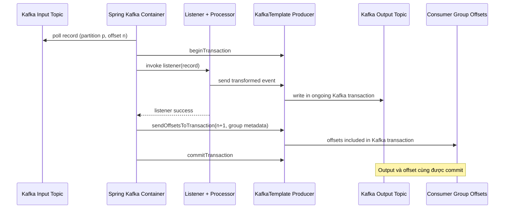
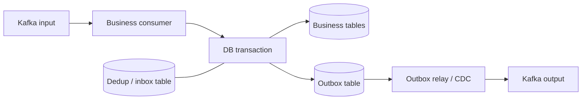

# Thêm transaction cho read-process-write trong Spring Kafka

Khi triển khai pipeline **read → process → write** với Kafka, câu hỏi quan trọng là: nếu service đã đọc một record, đã gửi kết quả nhưng bị crash trước khi commit offset, record đó có bị xử lý lặp không? Ngược lại, nếu offset đã được ghi nhận nhưng output chưa thật sự tồn tại ở topic đích, dữ liệu có bị mất không?

**Kafka transaction** giúp giải quyết một phần quan trọng của bài toán: trong luồng **đọc từ Kafka → xử lý → ghi trở lại Kafka**, các output records và consumer offsets tương ứng có thể được đưa vào **cùng một Kafka transaction**. Nếu transaction bị abort, output chưa commit sẽ không hiển thị với consumer có `isolation.level=read_committed` và offset đầu vào không được commit như một kết quả thành công.

Đây là bài thuộc **Spring Kafka Reliability Operations → Thực hành vận hành**, hướng dẫn xây dựng, tiêm lỗi, quan sát và vận hành một pipeline transactional. Ví dụ sử dụng Spring Boot 3.x, Spring Kafka 3.x, Java 17 và một Kafka broker hỗ trợ transactions. Ngoài phần Kafka→Kafka, bài cũng phân biệt rõ trường hợp **Kafka → database/API → Kafka**, nơi Kafka transaction **không bao phủ** các side effect ngoài Kafka.

> **Thông điệp cốt lõi:** “Exactly once” trong Kafka read-process-write là một **bảo đảm có phạm vi**, không phải cam kết mọi logic nghiệp vụ hay mọi hệ thống bên ngoài chỉ được gọi đúng một lần. Consumer vẫn có thể **thực thi lại** code; điều Kafka transaction giúp bảo vệ là **kết quả ghi Kafka và offset đã commit được quan sát nhất quán** theo đúng điều kiện.

## 1. Mục tiêu thực hành và kết quả mong đợi

Trong lab, ta xây dựng ứng dụng `orders-rpw-worker`:

1. Consumer nhận đơn hàng từ topic `orders.input.v1`.
2. Processor chuẩn hóa payload và tạo event kết quả.
3. `KafkaTemplate` gửi event tới `orders.processed.v1`.
4. Listener container đưa **offset của record nguồn** vào Kafka transaction cùng các message đầu ra.
5. Khi xử lý thành công, Kafka transaction commit; consumer `read_committed` nhìn thấy output và group offset tiến.
6. Khi xảy ra lỗi sau khi gọi send nhưng trước khi listener hoàn tất, transaction abort; output của attempt lỗi không trở thành dữ liệu đã commit và record nguồn có thể được giao lại.

Kịch bản minh họa dùng record có key `ORDER-42`:

| Lượt xử lý | Đọc input | Ghi output trong transaction | Kết thúc transaction | Consumer `read_committed` nhìn thấy |
|---|---|---|---|---|
| Attempt 1 | `ORDER-42` | Đã gọi send | **ABORT** do lỗi giả lập | Không thấy output attempt 1 |
| Attempt 2 | `ORDER-42` được giao lại | Gửi lại output | **COMMIT** | Một output đã commit |
| Group offset | Có thể được giữ nguyên sau abort | Đưa offset tiếp theo vào transaction thành công | Commit cùng transaction | Có thể resume sau record đã xử lý |

Số attempt và thời điểm gửi lại được cấu hình bởi container/after-rollback policy, không phải tính chất tự động “luôn retry đúng hai lần” của Kafka.

## 2. Transaction giải quyết chính xác vấn đề nào?

### 2.1. Không có Kafka transaction

Một pipeline thông thường:

```text
Poll input record offset 100
  → transform
  → produce output message
  → output được broker ghi thành công
  → JVM crash trước khi commit consumer offset 101

Sau restart:
  consumer group vẫn có committed offset 100
  → đọc lại record offset 100
  → tạo output lần nữa
```

Nếu output topic hoặc downstream không có cơ chế deduplication, hai output events giống nhau có thể xuất hiện.

Chiều ngược lại cũng nguy hiểm: nếu offset đầu vào được commit **trước khi** output được xác nhận, crash có thể làm input bị coi là đã tiêu thụ nhưng output không tồn tại.

### 2.2. Có Kafka transaction



Khi listener ném exception, transaction có thể abort; records được Kafka producer ghi trong transaction chưa commit sẽ không hiển thị với `read_committed` consumer, và group offset trong transaction đó không được xác nhận.

**Không diễn giải sơ đồ thành “Kafka đọc record chỉ đúng một lần”.** Listener có thể chạy nhiều lần với cùng record khi abort/restart/rebalance. Điều bảo đảm là các kết quả Kafka đã commit và các offsets liên quan được quản lý theo giao dịch, trong phạm vi Kafka và cấu hình đã chọn.

### 2.3. Ma trận bảo đảm

| Kịch bản | Kafka transaction giúp gì? | Còn trách nhiệm nào? |
|---|---|---|
| Kafka input → Kafka output | Gắn output và consumed offsets vào một Kafka transaction | Producer/consumer config, transaction ID, timeout, exception path |
| Kafka input → JDBC database | Không tạo transaction chung tự động | Database idempotency, outbox/inbox hoặc reconciliation |
| Kafka input → HTTP API | Không rollback HTTP call | Idempotency key, query status, compensation |
| Kafka input → gửi email | Không “thu hồi” email đã gửi | Thiết kế outbox, dedup và nghiệp vụ cho phép replay |
| Kafka input → Kafka + database | Kafka transaction và DB transaction riêng | Giải quyết failure window giữa hai commit |
| Kafka output → consumer không `read_committed` | Output abort có thể được quan sát theo isolation level | Đặt isolation level phù hợp cho các consumer cần committed-only |

## 3. Các cấu kiện cần nắm

| Thành phần | Vai trò |
|---|---|
| `KafkaTransactionManager` | Điều phối Kafka producer transaction trong Spring |
| `DefaultKafkaProducerFactory` | Tạo/cấp transactional producers với `transactional.id` |
| `KafkaTemplate` | Gửi records tham gia transaction đang hoạt động |
| `KafkaMessageListenerContainer` / concurrent container | Mở transaction khi listener xử lý và quản lý offsets |
| `sendOffsetsToTransaction` | Đưa consumed offsets vào transaction Kafka |
| `transaction-id-prefix` | Nền tảng đặt transactional IDs cho producer |
| `enable.idempotence` | Hỗ trợ producer idempotence, cần thiết cho transactional behavior |
| `isolation.level=read_committed` | Consumer không phát ra data từ các transaction aborted |
| `AfterRollbackProcessor` | Điều phối redelivery/recovery sau rollback của Kafka transaction |
| `DeadLetterPublishingRecoverer` | Đưa record lỗi sang DLT theo recovery policy |

Trong Spring Kafka hiện đại, khi listener container được cấu hình với `KafkaTransactionManager`, container có thể **tự đưa offsets vào producer transaction** khi listener hoàn tất thành công. Vì vậy ở ví dụ chuẩn không cần tự gọi `sendOffsetsToTransaction(...)` từ business listener.

**Không gọi `kafkaTemplate.executeInTransaction(...)` bên trong một listener đã được container mở transaction chỉ để “bật transaction thêm lần nữa”.** Hãy để template tham gia transaction hiện có; transaction lồng không chủ ý sẽ làm semantics khó đoán. `executeInTransaction(...)` thích hợp hơn khi ứng dụng chủ động gửi message **ngoài** một container-managed transaction.

## 4. Điều kiện trước khi bắt đầu lab

Bạn cần:

- JDK 17+.
- Một project Spring Boot 3.x với dependency `spring-kafka`.
- Kafka broker hỗ trợ transaction, có hai topics input/output và quyền produce/consume.
- Môi trường local: Docker Compose, Testcontainers hoặc broker thử nghiệm đều được.
- Quyền xem metadata topic, consumer group offsets và ứng dụng logs.

### 4.1. Kafka broker local một node

Kafka transactions cần internal transaction-state topic. Với một broker local, cấu hình Kafka broker cần cho phép replication/min ISR tương thích:

```properties
# CHỈ CHO LAB MỘT BROKER
transaction.state.log.replication.factor=1
transaction.state.log.min.isr=1
```

Trong production multi-broker, không sao chép các giá trị 1 này một cách máy móc. Transaction-state log và các topic nghiệp vụ cần replication, availability và `min.insync.replicas` theo SLO thực tế. Nếu broker không thể khởi tạo transaction coordinator, producer có thể lỗi khi gọi `initTransactions()` dù gửi non-transactional records vẫn được.

### 4.2. Tạo các topics

Ví dụ shell nếu Kafka CLI có sẵn:

```bash
kafka-topics.sh --bootstrap-server localhost:9092 \
  --create --if-not-exists \
  --topic orders.input.v1 --partitions 2 --replication-factor 1

kafka-topics.sh --bootstrap-server localhost:9092 \
  --create --if-not-exists \
  --topic orders.processed.v1 --partitions 2 --replication-factor 1

kafka-topics.sh --bootstrap-server localhost:9092 \
  --describe --topic orders.input.v1
```

Với môi trường có ba broker hoặc production, đặt replication factor phù hợp và tạo topic bằng IaC/provisioning được quản lý. Consumer/producer không nên mặc nhiên được quyền tạo topic chỉ vì tên bị gõ sai.

## 5. Cấu trúc project

```text
kafka-rpw-transaction-lab/
├── settings.gradle
├── build.gradle
└── src/
    ├── main/
    │   ├── java/com/example/rpw/
    │   │   ├── RpwApplication.java
    │   │   ├── OrderProcessingListener.java
    │   │   └── LabFailureGate.java
    │   └── resources/
    │       └── application.yml
    └── test/
        └── java/com/example/rpw/
            └── KafkaRpwTransactionIntegrationTest.java
```

Phần lab dùng String payload để dễ theo dõi transaction, không dùng database hay schema registry trong đường xử lý chính. Việc dùng String không có nghĩa hệ thống thực nên bỏ schema validation; production có thể dùng Avro/Protobuf/JSON schema và kiểm soát version.

### 5.1. Gradle

`settings.gradle`:

```groovy
rootProject.name = 'kafka-rpw-transaction-lab'
```

`build.gradle`:

```groovy
plugins {
    id 'java'
    id 'org.springframework.boot' version '3.3.5'
    id 'io.spring.dependency-management' version '1.1.6'
}

group = 'com.example'
version = '0.0.1-SNAPSHOT'

java {
    toolchain {
        languageVersion = JavaLanguageVersion.of(17)
    }
}

repositories {
    mavenCentral()
}

dependencies {
    implementation 'org.springframework.boot:spring-boot-starter'
    implementation 'org.springframework.kafka:spring-kafka'
    implementation 'org.springframework.boot:spring-boot-starter-actuator'

    testImplementation 'org.springframework.boot:spring-boot-starter-test'
    testImplementation 'org.springframework.kafka:spring-kafka-test'
}

tasks.named('test') {
    useJUnitPlatform()
}
```

Các version là **ví dụ thuộc hệ Spring Boot 3.x**, không được coi là “latest”. Trong dự án thực nên chọn bộ version đã được tổ chức phê duyệt và dùng BOM của Spring Boot để tránh mismatch giữa Spring Kafka, Spring Framework, Kafka client và Java.

## 6. Bật Kafka transaction bằng application.yml

File `src/main/resources/application.yml`:

```yaml
spring:
  application:
    name: kafka-rpw-worker

  kafka:
    bootstrap-servers: "${KAFKA_BOOTSTRAP_SERVERS:localhost:9092}"

    consumer:
      group-id: orders-rpw-worker
      enable-auto-commit: false
      auto-offset-reset: earliest
      key-deserializer: org.apache.kafka.common.serialization.StringDeserializer
      value-deserializer: org.apache.kafka.common.serialization.StringDeserializer
      properties:
        "[isolation.level]": "read_committed"

    producer:
      key-serializer: org.apache.kafka.common.serialization.StringSerializer
      value-serializer: org.apache.kafka.common.serialization.StringSerializer
      acks: all
      transaction-id-prefix: "orders-rpw-${HOSTNAME:local}-"
      properties:
        "[enable.idempotence]": "true"
        "[delivery.timeout.ms]": "120000"

    listener:
      ack-mode: record
      concurrency: 1

app:
  topics:
    input: orders.input.v1
    output: orders.processed.v1
```

### 6.1. Tác dụng của từng thuộc tính

**`spring.kafka.producer.transaction-id-prefix`** là điểm chính để Spring Boot cấu hình transactional producer factory và `KafkaTransactionManager` khi dùng auto-configuration phù hợp. Spring Boot thường cũng gắn transaction manager vào listener container factory do nó cấu hình. Nếu bạn tự khai báo custom container factory, cần kiểm tra factory đó **thật sự dùng Kafka transaction manager**; chỉ đặt property mà listener dùng factory khác thì không đủ.

**`enable-auto-commit=false`** tránh Kafka consumer tự commit offset theo chu kỳ mà không quan tâm business listener đã xong hay chưa. Offset phải được container xử lý như một phần Kafka transaction.

**`read_committed`** quan trọng với consumer cần đảm bảo không nhìn thấy output từ transaction bị abort. Với một read-process-write chain, consumer đầu vào có `read_committed` còn giúp tránh đọc những transaction của upstream chưa commit/đã abort.

**`acks=all`** yêu cầu broker xác nhận theo cơ chế in-sync replicas, phù hợp producer cần độ bền. Kafka transactional producer còn có các ràng buộc về idempotence, retries, max in-flight; dùng version và cấu hình tương thích.

**`ack-mode=record`** cho phép listener container xử lý record mode theo chính sách ack phù hợp. Khi transaction đang hoạt động, container chịu trách nhiệm đưa offset vào transaction. Không tự gọi `Acknowledgment.acknowledge()` ở ví dụ này nếu không có lý do dùng manual mode.

**`auto-offset-reset=earliest`** chỉ giúp đọc từ đầu khi group chưa có committed offset hợp lệ. Nó không làm group đang có offset tự đọc lại lịch sử trong mỗi lần restart. Ở production, cần chọn `earliest/latest/none` phù hợp với bootstrap policy, không sao chép thẳng cài đặt lab.

### 6.2. Transaction ID prefix phải được thiết kế theo instance

Một Kafka producer transactional cần `transactional.id`. Spring Kafka producer factory có thể tạo nhiều producer với các ID bắt nguồn từ một prefix.

Với hai pod:

```text
Pod A: orders-rpw-orders-worker-6c9f-a-
Pod B: orders-rpw-orders-worker-6c9f-b-
```

Mỗi pod nên có prefix **duy nhất giữa những instance đồng thời hoạt động**. Nếu hai process dùng trùng transactional ID, Kafka có thể fence producer cũ, gây `ProducerFencedException` hoặc lỗi transaction.

Trong Kubernetes, `HOSTNAME` thường là pod name; cần xác minh giá trị thực, lifecycle và cách rollout. Có thể inject một stable pod identity/instance ID do deployment cấp. Không dùng một prefix chung cố định cho mọi replica mà không biết producer factory đang cấp IDs và khả năng va chạm.

**Fencing có ích cho việc loại bỏ producer zombie**, nhưng fencing phát sinh ngoài ý muốn do trùng ID cũng làm pipeline gián đoạn. Khi thay prefix qua deploy, phải hiểu kết quả với producer cũ đang chạy, transactional ID expiration và broker policy.

### 6.3. Kiểm tra Boot có gắn manager cho container chưa

Trong Spring Boot 3.x, cấu hình `transaction-id-prefix` tạo điều kiện cho auto-configuration transactional producer và Kafka transaction manager. Nhưng nếu có custom factory:

```java
@Bean
ConcurrentKafkaListenerContainerFactory<String, String> customFactory(
        ConsumerFactory<String, String> consumerFactory,
        KafkaTransactionManager<String, String> kafkaTxManager) {

    var factory =
            new ConcurrentKafkaListenerContainerFactory<String, String>();
    factory.setConsumerFactory(consumerFactory);
    factory.getContainerProperties()
            .setKafkaAwareTransactionManager(kafkaTxManager);
    return factory;
}
```

Đây là mẫu cho Spring Kafka 3.x khi API `setKafkaAwareTransactionManager` hiện diện. Tên method/interface có thay đổi ở một số nhánh version, vì vậy code custom factory cần đối chiếu với version đích. Nếu sử dụng Boot-managed `kafkaListenerContainerFactory`, thường **không cần tự tạo factory** chỉ để bật transaction; custom factory còn có thể bỏ mất những customizer/ack/observation settings mà Boot đã cấu hình.

Về mặt vận hành, nên xác nhận qua log/tracing Kafka producer khởi tạo transaction và integration test chứng minh **abort làm output không nhìn thấy**. Chỉ kiểm tra rằng bean `KafkaTransactionManager` tồn tại là chưa đủ.

## 7. Code xử lý read-process-write

### 7.1. Spring Boot application

`src/main/java/com/example/rpw/RpwApplication.java`:

```java
package com.example.rpw;

import org.springframework.boot.SpringApplication;
import org.springframework.boot.autoconfigure.SpringBootApplication;

@SpringBootApplication
public class RpwApplication {

    public static void main(String[] args) {
        SpringApplication.run(RpwApplication.class, args);
    }
}
```

### 7.2. Listener nhận và ghi Kafka trong transaction

`src/main/java/com/example/rpw/OrderProcessingListener.java`:

```java
package com.example.rpw;

import java.util.Locale;

import org.apache.kafka.clients.consumer.ConsumerRecord;
import org.springframework.beans.factory.ObjectProvider;
import org.springframework.beans.factory.annotation.Value;
import org.springframework.kafka.annotation.KafkaListener;
import org.springframework.kafka.core.KafkaTemplate;
import org.springframework.stereotype.Component;

@Component
public class OrderProcessingListener {

    private final KafkaTemplate<String, String> template;
    private final ObjectProvider<LabFailureGate> failureGate;
    private final String outputTopic;

    public OrderProcessingListener(
            KafkaTemplate<String, String> template,
            ObjectProvider<LabFailureGate> failureGate,
            @Value("${app.topics.output}") String outputTopic) {
        this.template = template;
        this.failureGate = failureGate;
        this.outputTopic = outputTopic;
    }

    @KafkaListener(
            id = "orders-rpw-listener",
            idIsGroup = false,
            topics = "${app.topics.input}")
    public void onOrder(ConsumerRecord<String, String> record) {
        String orderId = record.key();
        if (orderId == null || orderId.isBlank()) {
            throw new IllegalArgumentException(
                    "Missing business order key");
        }

        // Pure transformation: cùng input tạo cùng output.
        String normalized = record.value()
                .strip()
                .toUpperCase(Locale.ROOT);
        String output = "PROCESSED:" + normalized;

        // KafkaTemplate tham gia transaction do listener container mở.
        // Không tự commit offset hoặc mở một transaction riêng.
        template.send(outputTopic, orderId, output);

        // Chỉ có bean này khi profile "lab" được bật.
        // Lỗi sau send khiến Kafka transaction của attempt abort.
        LabFailureGate gate = failureGate.getIfAvailable();
        if (gate != null && gate.shouldFailOnce(orderId)) {
            throw new IllegalStateException(
                    "LAB: fail after Kafka send, before commit");
        }
    }
}
```

Giải thích:

1. Listener container poll record và mở Kafka transaction trước khi gọi listener nếu transaction manager đã được gắn đúng.
2. `OrderProcessingListener` thực hiện **transformation thuần** trên String.
3. `KafkaTemplate.send(...)` gửi event đến output topic bằng producer tham gia transaction của container.
4. Listener trả về bình thường → container có thể đưa offsets vào Kafka transaction và commit.
5. Listener ném exception → transaction abort; không commit offset trong transaction đó.

**`KafkaTemplate.send(...)` thường là bất đồng bộ** và ở Spring Kafka 3.x trả về future. Không có nghĩa network đã xác nhận thành công ngay tại dòng gọi send. Khi container commit transaction, Kafka producer phải hoàn tất các send phù hợp; send failure có thể làm commit thất bại. Với lab, ta cố ý ném exception **sau lời gọi send**, không khẳng định record đã được broker nhận trước exception — nếu record đã được ghi trong transaction abort, consumer `read_committed` vẫn không nhìn thấy; nếu chưa kịp gửi, cũng không có output đã commit.

Nếu yêu cầu gọi send và chờ ack trong listener:

```java
template.send(outputTopic, orderId, output)
        .get(5, java.util.concurrent.TimeUnit.SECONDS);
```

Cách này dễ quan sát trạng thái send hơn trong test nhỏ nhưng có thể làm giảm throughput do blocking mỗi message. Nó vẫn **không thay thế Kafka transaction commit**. Ở production có thể gửi bất đồng bộ theo batch và để transaction/producer xử lý send results, với giới hạn timeout và monitoring rõ ràng.

### 7.3. Fault injection chỉ dùng cho lab

`src/main/java/com/example/rpw/LabFailureGate.java`:

```java
package com.example.rpw;

import java.util.concurrent.atomic.AtomicInteger;
import java.util.concurrent.atomic.AtomicReference;

import org.springframework.context.annotation.Profile;
import org.springframework.stereotype.Component;

@Component
@Profile("lab")
public class LabFailureGate {

    private final AtomicReference<String> failKey =
            new AtomicReference<>();

    private final AtomicInteger seenAttempts =
            new AtomicInteger();

    public void arm(String key) {
        seenAttempts.set(0);
        failKey.set(key);
    }

    public boolean shouldFailOnce(String key) {
        if (!key.equals(failKey.get())) {
            return false;
        }

        seenAttempts.incrementAndGet();
        return failKey.compareAndSet(key, null);
    }

    public int seenAttempts() {
        return seenAttempts.get();
    }
}
```

Bean này chỉ được tạo khi profile `lab` active; không có endpoint HTTP để từ xa bật failure trong production. Tên `failKey` và counter phục vụ test, không phải persistence. Nếu JVM bị kill, flag trong memory mất; việc phục hồi trong production phải dựa trên Kafka transaction/offset và business idempotency chứ không dựa vào flag này.

Với record `ORDER-42`, lần xử lý đầu bị ném exception. Trong chính sách rollback/redelivery phù hợp, lần xử lý kế tiếp dùng lại record đó và không còn ném lỗi. Test cần chờ retry/recovery theo thời gian hữu hạn và so sánh output thực.

## 8. Transaction boundary trên listener container

Thông thường, transaction do Kafka listener container điều phối. Một lần gọi listener xử lý record với Kafka producer transaction gắn vào thread/container:

```text
Kafka poll
  ↓
Container begins Kafka transaction
  ↓
Listener transforms record
  ↓
KafkaTemplate.send(output)
  ↓
Listener returns successfully
  ↓
Container sends consumed offsets into transaction
  ↓
Commit Kafka transaction
```

Đường failure:

```text
Kafka poll
  ↓
Container begins Kafka transaction
  ↓
Listener sends output record
  ↓
Exception escapes listener
  ↓
Abort Kafka transaction
  ↓
After-rollback processing / redelivery
  ↓
Input record may be delivered again
```

Không cố dùng `@Transactional` với một JDBC `PlatformTransactionManager` để “bọc” những thao tác Kafka này nếu không xác định rõ manager nào được sử dụng. Trong ứng dụng có nhiều transaction managers, cần chỉ rõ dependency và thảo luận **hai transaction khác nhau**.

### 8.1. Kafka EOS V2

Các phiên bản Spring Kafka hiện đại dùng cơ chế transaction Kafka với broker/client hỗ trợ để phối hợp producer writes và consumed offsets. Khi đọc tài liệu cũ có những thuật ngữ như EOSMode V1/ALPHA/BETA, cần xem phiên bản cụ thể; Spring Kafka 3.x tập trung vào cơ chế **EOS V2**. Đừng sao chép cấu hình thuộc phiên bản cũ chỉ vì có chữ “exactly once”.

Ý nghĩa thực tế của transactional consume-transform-produce là:

- Một record đầu vào có thể **được listener gọi nhiều lần**.
- Kết quả Kafka abort không hiển thị với `read_committed` consumer.
- Offsets được commit cùng transaction Kafka chứa output tương ứng.
- Cần ổn định group IDs, transaction IDs và consumer assignment.
- Không tự mở transaction thứ hai để commit offset ở thread khác.

### 8.2. Consumer isolation level

Consumer có `isolation.level=read_committed` chỉ trả các message đã được commit, không trả records thuộc transaction aborted. Điều này khác với **`read_uncommitted`**, vốn có thể đọc records kể cả từ transaction đã abort.

Ví dụ:

```text
Output log:
  Offset 10: TX-A writes "PROCESSED:ORDER-42" (ABORTED)
  Offset 11: TX-B writes "PROCESSED:ORDER-42" (COMMITTED)

Consumer read_uncommitted:
  có thể nhìn thấy record thuộc TX-A và TX-B

Consumer read_committed:
  chỉ thấy record của TX-B
```

Đây là ví dụ hành vi theo isolation semantics; offset được gán cho các record/transaction control markers theo Kafka log thực tế, và một record aborted có thể vẫn chiếm vị trí trong log. **Đừng suy luận output sẽ có offsets liên tục** chỉ vì consumer read_committed chỉ thấy committed records.

### 8.3. Điểm cần chú ý khi có transaction đang mở

Kafka `read_committed` consumer bị giới hạn bởi **Last Stable Offset (LSO)**, liên quan transaction còn đang mở. Một transaction bị giữ quá lâu có thể khiến consumer không được giao cả những records phía sau nó trong partition, dù chúng đã có trong log.

Vì vậy không để một Kafka transaction bao gồm thao tác HTTP chờ hàng phút hoặc business computation không giới hạn. Transaction duration, producer transaction timeout, max.poll.interval và downstream SLA phải được thiết kế nhất quán.

## 9. Kiểm thử transaction bằng Kafka thật trong môi trường test

Để chứng minh transactional guarantee, test phải tương tác với broker Kafka có transaction coordinator hoạt động. Mock `KafkaTemplate` chỉ cho biết method đã được gọi, **không chứng minh aborted output bị che hoặc offset commit đúng**.

Có thể dùng **Spring Kafka EmbeddedKafka** hoặc **Testcontainers Kafka**. Ví dụ dưới đây dùng embedded broker với một node và cấu hình transaction-state replication/min ISR cho lab.

### 9.1. Tạo test application context

`src/test/java/com/example/rpw/KafkaRpwTransactionIntegrationTest.java`:

```java
package com.example.rpw;

import static org.assertj.core.api.Assertions.assertThat;

import java.time.Duration;
import java.util.Map;
import java.util.UUID;

import org.apache.kafka.clients.consumer.Consumer;
import org.apache.kafka.clients.consumer.ConsumerConfig;
import org.apache.kafka.common.serialization.StringDeserializer;
import org.junit.jupiter.api.Test;
import org.springframework.beans.factory.annotation.Autowired;
import org.springframework.boot.test.context.SpringBootTest;
import org.springframework.kafka.core.DefaultKafkaConsumerFactory;
import org.springframework.kafka.core.KafkaTemplate;
import org.springframework.kafka.test.EmbeddedKafkaBroker;
import org.springframework.kafka.test.context.EmbeddedKafka;
import org.springframework.kafka.test.utils.KafkaTestUtils;
import org.springframework.test.context.ActiveProfiles;

@SpringBootTest(properties = {
        "app.topics.input=orders.input.lab",
        "app.topics.output=orders.processed.lab",
        "spring.kafka.consumer.group-id=orders-rpw-test",
        "spring.kafka.consumer.auto-offset-reset=earliest",
        "spring.kafka.consumer.properties[isolation.level]=read_committed",
        "spring.kafka.producer.transaction-id-prefix=orders-rpw-test-"
})
@ActiveProfiles("lab")
@EmbeddedKafka(
        partitions = 2,
        topics = {"orders.input.lab", "orders.processed.lab"},
        bootstrapServersProperty = "spring.kafka.bootstrap-servers",
        brokerProperties = {
                "transaction.state.log.replication.factor=1",
                "transaction.state.log.min.isr=1"
        })
class KafkaRpwTransactionIntegrationTest {

    @Autowired KafkaTemplate<String, String> kafkaTemplate;
    @Autowired EmbeddedKafkaBroker embeddedKafka;
    @Autowired LabFailureGate failureGate;

    @Test
    void abortedAttemptIsHiddenAndRedeliveryCommitsOneOutput()
            throws Exception {

        String key = "ORDER-" + UUID.randomUUID();
        failureGate.arm(key);

        Map<String, Object> props = KafkaTestUtils.consumerProps(
                "output-inspector-" + UUID.randomUUID(),
                "false",
                embeddedKafka);
        props.put(
                ConsumerConfig.ISOLATION_LEVEL_CONFIG,
                "read_committed");
        props.put(
                ConsumerConfig.AUTO_OFFSET_RESET_CONFIG,
                "earliest");

        try (Consumer<String, String> observer =
                     new DefaultKafkaConsumerFactory<>(
                             props,
                             new StringDeserializer(),
                             new StringDeserializer())
                             .createConsumer()) {

            embeddedKafka.consumeFromAnEmbeddedTopic(
                    observer, "orders.processed.lab");

            // KafkaTemplate của app là transactional. Khi gửi từ
            // test thread ngoài listener, mở transaction riêng.
            kafkaTemplate.executeInTransaction(ops -> {
                ops.send("orders.input.lab", key, "  new-order  ");
                return null;
            });

            var output = KafkaTestUtils.getSingleRecord(
                    observer,
                    "orders.processed.lab",
                    Duration.ofSeconds(30));

            assertThat(output.key()).isEqualTo(key);
            assertThat(output.value())
                    .isEqualTo("PROCESSED:NEW-ORDER");
        }
    }
}
```

Đây là integration test skeleton có thể triển khai với bộ version tương thích. Việc chọn tên topic và consumer group cố định cho listener nhưng key input ngẫu nhiên giúp test nhận dạng dữ liệu. Để tránh nhiễu giữa nhiều test chạy đồng thời, nên dùng application context/broker cô lập hoặc group/topic test khác nhau.

**Điều test trên kiểm chứng trực tiếp:** observer `read_committed` nhận được output đã commit với key và payload mong đợi. Để khẳng định chặt chẽ rằng attempt đầu **đã abort** và input được listener xử lý lại, cần bổ sung thêm instrumentation/test condition bên dưới. Chỉ nhìn thấy một output trong một lời gọi `getSingleRecord` chưa đủ để chứng minh cả failure path.

### 9.2. Bổ sung assertion về retry/abort

Với `LabFailureGate` trên, `seenAttempts()` tăng khi key đang được arm. Sau khi lần đầu ném lỗi, key được xóa, nên lần xử lý tiếp theo **không tăng** counter theo cách code hiện tại. Để đếm toàn bộ deliveries, một cách đơn giản là bổ sung một `ConcurrentHashMap<String, AtomicInteger>` trong listener test probe và tăng counter ngay đầu `onOrder(...)`.

Ví dụ một probe chỉ cho test:

```java
@Component
@Profile("lab")
public class DeliveryProbe {
    private final ConcurrentHashMap<String, AtomicInteger> counts =
            new ConcurrentHashMap<>();

    public void seen(String key) {
        counts.computeIfAbsent(
                key, ignored -> new AtomicInteger()).incrementAndGet();
    }

    public int count(String key) {
        var counter = counts.get(key);
        return counter == null ? 0 : counter.get();
    }
}
```

Trong listener có thể inject `ObjectProvider<DeliveryProbe>` và gọi `probe.seen(orderId)` trước xử lý khi profile lab bật. Sau khi output đã commit, test chờ đến khi `count(key) >= 2` bằng một polling helper/awaitility có timeout hữu hạn.

Một test **đủ mạnh** nên assert:

- Lần đầu listener nhận record và ném exception.
- Producer transaction đầu được abort theo metric/log/instrumentation.
- Listener nhận lại cùng input (hoặc một execution khác sau restart) và xử lý thành công.
- Consumer `read_committed` chỉ nhận **một output đã commit** cho key.
- Consumer group offset của input partition tiến sau commit cuối.
- Không có DLT record nếu retry lần sau thành công.

Để đếm output đúng một bản, sau khi nhận record đầu, tiếp tục poll đủ thời gian giới hạn và lọc theo key của test; **không chỉ gọi `getSingleRecord` một lần rồi suy luận topic không có bản thứ hai**.

### 9.3. Kiểm tra committed offset

Một cách xác minh qua công cụ CLI khi job đang chạy:

```bash
kafka-consumer-groups.sh \
  --bootstrap-server localhost:9092 \
  --group orders-rpw-test \
  --describe
```

Cần biết topic partition chứa key kiểm thử, offset của record đầu và committed offset của group. Nếu record có offset `n`, sau xử lý thành công, offset commit của group thường là **`n + 1`** cho partition đó, bởi committed offset biểu diễn **vị trí đọc tiếp theo**, không phải ID record cuối.

Không khẳng định group offset chỉ từ log listener “xử lý thành công”. Đọc group committed offsets từ broker/AdminClient sau khi Kafka transaction commit. Với test có nhiều partitions/records, phải so đúng partition.

### 9.4. Vì sao cần broker test hỗ trợ transaction?

Một fake producer có thể trả `CompletableFuture.completedFuture(...)` rồi test pass, nhưng không mô phỏng:

- Transaction coordinator và `initTransactions()`.
- Abort markers và `read_committed` isolation.
- Transactional ID fencing giữa producer instances.
- `sendOffsetsToTransaction` và group offsets.
- Timeout khi commit transaction.
- Rebalance và re-delivery sau crash.

Những điểm này liên quan trực tiếp reliability, nên integration test sử dụng Kafka broker thật (dù trong container) là bắt buộc trước khi khẳng định guarantee.

## 10. Thử lỗi thực tế ở từng vị trí

| Điểm tiêm lỗi | Kỳ vọng với Kafka→Kafka transaction | Bằng chứng cần thu |
|---|---|---|
| Trước khi gọi send | Transaction abort; không có output | Output count và offset |
| Sau khi gọi send, trước listener return | Transaction abort; output attempt lỗi không visible ở `read_committed` | Transaction abort, redelivery |
| Send future thất bại | Transaction không commit thành công | Producer error, offset không tiến sai |
| Khi commit transaction | Commit may fail/uncertain; cần xác định qua broker | Transaction state, output/offset, restart |
| JVM kill khi transaction mở | Broker abort/fence theo timeout/lifecycle; record có thể replay | Group offset, consumer lag, producer logs |
| Producer transactional ID bị fence | Producer cũ không tiếp tục ghi bằng identity đó | Fenced errors và lifecycle |
| Rebalance giữa xử lý | Assignment có thể đổi, record được giao lại | Lag, rebalance logs, output dedup |
| Output topic thiếu quyền WRITE | Transaction/send lỗi, không commit output/offset thành công | ACL error, alert |
| Consumer `read_uncommitted` | Có thể thấy record thuộc transaction abort | So sánh observer isolation modes |

### 10.1. Lỗi xảy ra trước commit

Đây là trường hợp cơ bản. Listener ném exception, container rollback Kafka transaction. Không được viết code:

```java
try {
    kafkaTemplate.send(topic, key, payload);
    dangerousOperation();
} catch (Exception ex) {
    log.warn("Ignoring failure", ex);
}
```

Nếu đã nuốt exception, listener **trả về bình thường**, container có thể coi xử lý thành công và commit Kafka transaction/offset mặc dù `dangerousOperation()` lỗi. Một exception quan trọng phải được **ném ra ngoài listener** hoặc được chuyển thành một kết quả nghiệp vụ được kiểm soát rõ ràng.

### 10.2. Lỗi trong commit transaction

Một lỗi khi commit có thể gây **outcome không chắc chắn ở phía client**: connection có thể đứt khi broker đang xử lý commit. Không tự suy ra “commit báo lỗi nên chắc chắn rollback”. Thiết kế phải dựa vào Kafka transaction coordinator, fencing, committed offset và consumer `read_committed` khi phục hồi.

Nếu ứng dụng có thêm side effect ngoài Kafka, tình huống ambiguous còn nguy hiểm hơn: có thể cần đối soát cả Kafka và downstream.

### 10.3. Lỗi khi producer bị fence

Kafka dùng transactional ID cùng cơ chế producer epoch để ngăn producer “zombie” tiếp tục ghi sau khi identity được tái cấp. Khi gặp `ProducerFencedException`, không nên retry cùng producer như một lỗi mạng thông thường.

Quy trình:

1. Xác định transactional ID/prefix và instance nào đang dùng.
2. Kiểm tra hai pods có vô tình dùng cùng prefix/identity không.
3. Kiểm tra rolling restart, producer cache, broker timeout và transaction expiration.
4. Để framework thay/đóng producer theo đường recovery được hỗ trợ.
5. Theo dõi consumer lag và redelivery; không tự commit offset bằng consumer khác để “bỏ qua lỗi”.

Không log username, password, JAAS config khi điều tra fencing; transactional ID và pod identity thường đủ để khoanh vùng.

## 11. Error handler cho listener transactional

Với listener container không transactional, `DefaultErrorHandler` thường được dùng để xử lý exceptions. Nhưng khi **Kafka transaction** được bật, việc rollback là phần quan trọng của cơ chế phục hồi.

Trong Spring Kafka, **`DefaultAfterRollbackProcessor`** hỗ trợ xử lý những records sau khi transaction đã rollback. Nó có thể seek để redeliver, theo dõi failures/backoff và chọn recovery path khi retry cạn, tùy cấu hình và phiên bản.

```text
Transactional listener:
  exception
  → abort Kafka transaction
  → AfterRollbackProcessor
  → seek/redelivery or recovery according to policy
```

### 11.1. Phân biệt hai cơ chế

| Cơ chế | Vai trò điển hình |
|---|---|
| `DefaultErrorHandler` | Xử lý lỗi listener/container, đặc biệt phổ biến cho đường non-transactional |
| `DefaultAfterRollbackProcessor` | Xử lý record/batch sau **Kafka transaction rollback** |
| `DeadLetterPublishingRecoverer` | Recover vào DLT, có thể được sử dụng bởi cơ chế phù hợp |
| `@RetryableTopic` | Non-blocking retry topology bằng retry topics, cần xét tương thích với transactions |

Không giả định thêm một bean `DefaultErrorHandler` là đủ để transactional listener đạt đúng retry/DLT policy. Các listener container có thể xử lý Kafka transaction failure bằng các cơ chế khác, và nhiều cấu hình error handler không nên “swallow” exception khiến transaction tiếp tục commit.

### 11.2. Retry lâu trong Kafka transaction

Blocking backoff quá lâu có thể giữ thread/container ở đường xử lý lỗi, làm tăng lag và tương tác với poll interval/heartbeat. Khi không có khả năng hồi phục nhanh, cần cân nhắc fail/recover, tách retry topic hoặc vận hành DLT với runbook.

Nếu ứng dụng cần giữ ordering nghiêm ngặt theo key/partition, non-blocking retry topics có thể thay đổi thời điểm xử lý tương đối giữa records; không coi chúng là tương đương tuyệt đối với blocking redelivery.

### 11.3. DLT trong bối cảnh transaction

Nếu một record permanent-invalid cần được đưa sang DLT và offset đầu vào cần tiến, phải thiết kế thời điểm **gửi DLT, xác nhận publish và commit offset**. Với transactional recovery, có thể cần một **Kafka transaction mới** để gửi DLT và offsets sau rollback, theo khả năng và cấu hình của `DefaultAfterRollbackProcessor` trong version cụ thể.

Không đơn giản:

```java
catch (Exception ex) {
    kafkaTemplate.send(dlt, record.value());
    return; // Coi như đã recover
}
```

vì đây có thể làm container commit transaction chính trong khi business logic chưa đạt, hoặc không kiểm soát được việc DLT publish thất bại. DLT cần serializer, partitions, ACL, retry/failure metrics và ownership rõ ràng.

**Trong lab chính, không cấu hình DLT** để dễ chứng minh abort và redelivery một lần. Khi thêm DLT, hãy làm thành bài thử riêng với expected offsets và committed DLT records.

## 12. Không nhầm Kafka transaction với database transaction

Nhiều ứng dụng xử lý theo mẫu:

```text
Kafka order event
  → đọc thông tin khách hàng từ PostgreSQL
  → cập nhật order_status trong PostgreSQL
  → gửi order_processed event sang Kafka
```

Ở đây có **hai hệ thống lưu trữ độc lập**:

1. Kafka transaction quản lý Kafka output và Kafka input offsets.
2. Database transaction quản lý các INSERT/UPDATE trong PostgreSQL.

Nếu cả hai được dùng trong một lần xử lý, thông thường **không có một distributed transaction atomic chung** giữa Kafka và database.

### 12.1. Failure windows khi DB commit trước Kafka

```text
1. Consume event E
2. Begin DB transaction
3. UPDATE order_status = PROCESSED
4. DB COMMIT thành công
5. Kafka output/offset transaction COMMIT lỗi

Kafka có thể giao lại E sau restart.
DB đã ghi tác dụng nghiệp vụ của E.
```

Nếu handler không idempotent, lần xử lý lại có thể tăng số dư, gửi email hoặc tạo đơn hàng trùng.

### 12.2. Failure windows khi Kafka commit trước DB

```text
1. Consume event E
2. Produce output Kafka và commit consumed offset
3. DB UPDATE/COMMIT lỗi

Input offset có thể đã tiến.
DB chưa có thay đổi mong muốn.
```

Đây là lý do **thứ tự commit không tự tạo atomicity**. Chọn DB-first hay Kafka-first chỉ thay đổi **phía có nguy cơ thành công trước** khi phía còn lại thất bại.

### 12.3. `@Transactional` không tự làm hai hệ thống trở thành một

Một method có `@Transactional` (JDBC) cùng listener transactional (Kafka) có thể mở các transaction được đồng bộ hoặc lồng nhau theo cách Spring hỗ trợ, nhưng không bảo đảm distributed two-phase commit giữa hai resource.

Không viết tài liệu vận hành rằng “cả DB và Kafka sẽ rollback cùng nhau” nếu chưa có cơ chế thật sự bảo đảm điều đó. Spring Kafka hỗ trợ việc đồng bộ transaction và chọn commit order cho một số pattern, nhưng failure window vẫn tồn tại giữa các commits.

## 13. Pattern an toàn cho Kafka → DB: idempotent consumer / inbox

Nếu mục tiêu chỉ là **Kafka input → JDBC DB** mà không gửi output Kafka, có thể xử lý DB trong một transaction và dùng business id/event ID để deduplicate.

Ví dụ schema:

```sql
CREATE TABLE processed_event (
    event_id VARCHAR(100) PRIMARY KEY,
    processed_at TIMESTAMP NOT NULL
);

CREATE TABLE order_projection (
    order_id VARCHAR(100) PRIMARY KEY,
    status VARCHAR(30) NOT NULL
);
```

Một transaction DB:

```text
Consume Kafka event eventId=E-123
  Begin DB transaction
    INSERT processed_event(E-123) nếu chưa có
    UPDATE order_projection(...) theo business logic
  Commit DB transaction

Container commit Kafka offset sau đó
```

Nếu crash sau DB commit nhưng trước offset commit, event sẽ được đọc lại. Lần thứ hai thấy `event_id=E-123` đã tồn tại và **không áp dụng side effect nghiệp vụ thêm một lần**.

**Cần làm atomic trong database:** ghi dedup key và cập nhật bảng nghiệp vụ phải nằm **trong cùng transaction DB**. Nếu ghi processed_event trước rồi nghiệp vụ fail trong transaction khác, lần retry có thể bị đánh dấu “đã xử lý” dù dữ liệu chưa đúng.

Khi duplicate key xuất hiện, phải phân biệt:

- Replay hợp lệ của cùng event/version.
- Một event ID bị tái sử dụng với payload khác.
- Race giữa hai consumers/transactions.

Với dữ liệu nhạy cảm, cân nhắc lưu payload hash/version để phát hiện xung đột thay vì âm thầm nuốt mọi unique violation.

## 14. Pattern Kafka → DB → Kafka: Transactional Outbox

Khi vừa cập nhật DB vừa cần phát sự kiện Kafka, **transactional outbox** thường là lựa chọn dễ lý giải về tính đúng đắn.



Trong **một transaction DB**:

1. Kiểm tra event ID đã được xử lý chưa.
2. Cập nhật business tables.
3. Ghi một outbox row chứa event sẽ được publish.
4. Đánh dấu event đã xử lý.
5. Commit DB transaction.

Sau đó relay (poller hoặc CDC như Debezium) xuất outbox row lên Kafka:

```sql
CREATE TABLE outbox_event (
    event_id VARCHAR(100) PRIMARY KEY,
    aggregate_id VARCHAR(100) NOT NULL,
    event_type VARCHAR(100) NOT NULL,
    payload CLOB NOT NULL,
    created_at TIMESTAMP NOT NULL,
    published_at TIMESTAMP NULL
);
```

### 14.1. Outbox giải quyết và chưa giải quyết gì?

**Giải quyết:** business DB update và quyết định phát sự kiện được ghi cùng **một DB commit**. Không tồn tại trạng thái “DB đã commit nhưng quyết định phải publish event chưa bao giờ được lưu”.

**Chưa tự bảo đảm exactly once publish:** relay có thể gửi Kafka thành công rồi crash trước khi đánh dấu `published_at`. Sau restart, nó có thể publish cùng outbox event một lần nữa. Vì vậy message cần **event ID ổn định** và consumer downstream phải có deduplication/idempotency.

Nếu dùng CDC, cần quản lý snapshot, schema, connector offsets, topic partitioning và ordering. Outbox là lựa chọn kiến trúc, không phải một flag cấu hình Kafka transaction.

### 14.2. Khi nào không cần outbox?

Với pipeline **thuần Kafka→Kafka**, không cập nhật DB/API và transformation có thể replay, Kafka transaction có thể là cách phù hợp và ít thành phần hơn.

Với pipeline có DB là source of truth và phải publish event nhất quán với business transaction, outbox thường đáng cân nhắc. Quyết định phụ thuộc latency, throughput, số hệ thống và yêu cầu nghiệp vụ.

## 15. Idempotency cho side effect ngoài Kafka

Các hệ thống có HTTP API, email, billing hoặc object storage phải nhận thức rằng Kafka transaction **không rollback** side effect của chúng.

### 15.1. API timeout after commit

```text
Kafka event ORDER-42
  → HTTP POST /capture-payment (server đã commit)
  → response timeout
  → listener throws
  → Kafka transaction abort
  → ORDER-42 được redeliver
  → HTTP POST /capture-payment lần nữa
```

Nếu API không hỗ trợ idempotency, khách hàng có thể bị tính tiền hai lần dù Kafka transaction hoạt động **hoàn toàn đúng**.

Giải pháp:

- Gửi idempotency key ổn định, ví dụ `payment:ORDER-42`.
- Tra cứu trạng thái tại downstream sau timeout ambiguous.
- Có dedup store ở phía nhận hoặc orchestration.
- Dùng outbox/command log và reconciliation nếu operation cần đảm bảo cao.
- Không tự động retry vô hạn một API có side effect.

### 15.2. Xử lý file/object storage

Nếu listener ghi một object lên cloud storage rồi Kafka transaction abort, object **vẫn có thể tồn tại**. Dùng immutable object key theo event ID, checksum/version và publish marker hoặc manifest khi dữ liệu thực sự hoàn tất.

Không để consumer downstream coi việc một file tạm xuất hiện là bằng chứng toàn pipeline commit.

## 16. Timeout và throughput của transactional read-process-write

Kafka transaction có chi phí so với non-transactional messaging:

- Khởi tạo transactional producer/transaction coordinator.
- Begin/commit/abort transaction.
- Ghi transaction markers và offsets.
- Điều phối với group coordinator.
- Số transaction đồng thời, producer cache và network.
- Thời gian mở transaction ảnh hưởng Last Stable Offset và consumer lag.

Các tham số nên xem:

| Tham số/giới hạn | Ý nghĩa vận hành |
|---|---|
| `transaction.timeout.ms` | Thời gian transaction có thể mở trước khi bị broker timeout |
| `transaction.max.timeout.ms` trên broker | Giới hạn timeout tối đa client được phép yêu cầu |
| `max.poll.interval.ms` | Khoảng thời gian poll xử lý trước khi consumer bị coi không đáp ứng tiến độ |
| `delivery.timeout.ms` | Ngân sách producer delivery |
| `request.timeout.ms` | Timeout request client tới broker |
| `spring.kafka.listener.concurrency` | Số listener consumer đồng thời mỗi application instance |
| Replicas × concurrency | Tổng mức song song và khả năng tạo transactional producers |
| Topic partitions | Giới hạn hữu ích của parallel consumption |
| Broker/producer metrics | Transaction abort/commit latency và throughput |

Ví dụ một listener vừa đọc record vừa gọi API mất 90 giây có thể khiến Kafka transaction giữ mở quá lâu, backlog bị dồn và tương tác với poll/transaction timeout. Cân nhắc:

1. Chia xử lý CPU dài ra khỏi đoạn transaction nếu logic cho phép.
2. Không mở Kafka transaction rồi chờ người dùng/HTTP lâu.
3. Tính timeout và retry/backoff theo SLA toàn pipeline.
4. Đo thời gian commit và abort thực tế, không chỉ handler processing time.
5. Giới hạn concurrency theo số partitions, Kafka producer capacity và downstream.

**Không tăng transaction timeout vô hạn** để che handler bị kẹt. Cần xác định bottleneck và ranh giới công việc hợp lý.

## 17. Cách theo dõi trong production

| Nhóm | Tín hiệu | Vì sao quan trọng |
|---|---|---|
| Producer transaction | Commit/abort count, latency, errors | Phát hiện transaction bị rollback nhiều |
| Producer | Send failures, delivery timeout, buffer waiting | Phân biệt broker issue với business error |
| Consumer | Lag, committed offset, poll interval | Xem nguồn bị kẹt hoặc offset không tiến |
| Group | Rebalance count, partitions assigned | Crash/restart và scale có làm replay không |
| Listener | Processing duration, exception class | Khoanh vùng lỗi |
| DLT/recovery | Recovery success/failure, backlog | Không mất record permanent |
| Business data | Distinct event IDs, duplicate count | Xác minh side effect chính xác |
| Runtime | CPU, heap, GC, threads | Phân biệt I/O với application saturation |
| Security | Authentication errors, ACL denies | Xác định thiếu quyền READ/WRITE/transaction |

Ví dụ log cấu trúc:

```text
service=orders-rpw-worker
group=orders-rpw-worker
topic=orders.input.v1
partition=1
offset=1287
businessKey=ORDER-42
transactionOutcome=ABORT
exceptionClass=IllegalStateException
attempt=1
```

**Chỉ ghi `transactionOutcome=COMMIT` khi có tín hiệu thực sự xác nhận commit** (ví dụ instrumentation ở container/producer), không suy diễn từ việc listener method trả về. Với listener exception, tránh log raw sensitive payload/credentials. Không đưa event ID, offset hoặc transactional ID có cardinality cao vào tất cả metric tags.

### 17.1. Consumer lag không kể toàn bộ câu chuyện

Một group có committed offset tiến chậm có thể do:

- Transaction abort lặp lại.
- Output topic/ACL hoặc producer transaction coordinator lỗi.
- Handler CPU/DB/API chậm.
- Nhiều open transactions làm `read_committed` consumer bị giới hạn bởi LSO.
- Rebalance liên tục, producer fenced hoặc pod restart loop.
- Retry policy đang giữ partition trên poison pill.

Khi xử lý lag, kết hợp log transaction, listener exception, broker health và output throughput. **Tăng concurrency** không giúp nếu transactional producer bị fence hoặc output broker không hoạt động.

## 18. Vận hành deployment với transactional.id

### 18.1. Quy tắc cho từng môi trường

| Môi trường | Transactional ID prefix | Cảnh báo |
|---|---|---|
| Local | `orders-rpw-local-{developer}-{instance}-` | Không chia sẻ tùy tiện giữa hai process |
| CI/Test | `orders-rpw-test-{test-run-id}-` | Tránh test song song fence lẫn nhau |
| Staging | `orders-rpw-staging-{pod-id}-` | ACL và cluster riêng |
| Production | `orders-rpw-prod-{pod-id}-` | Duy nhất cho concurrent instances; có audit |

Kafka client có thể tạo nhiều transactional IDs với suffix dựa trên prefix. Tên thực cần kiểm tra theo producer factory/version; quan trọng là **không va chạm giữa các process đồng thời**.

### 18.2. Rolling restart

Với rolling deployment:

1. Pod mới tham gia group và transaction producers được khởi tạo.
2. Pod cũ có thể đang xử lý transaction và giữ partitions.
3. Container shutdown cần có thời gian phù hợp để hoàn tất/abort transaction.
4. Kafka rebalances partitions, một số records chưa commit có thể redeliver.
5. Producer zombie bị broker fence khi transactional identity được tái sử dụng theo cơ chế Kafka.

Không dựa vào “graceful shutdown luôn hoàn tất” để bỏ idempotency: node có thể mất nguồn hoặc container bị kill ngoài dự kiến.

### 18.3. Dấu hiệu cấu hình sai

| Triệu chứng | Khả năng nguyên nhân | Việc cần kiểm tra |
|---|---|---|
| `ProducerFencedException` liên tục khi scale | Va chạm transactional IDs/prefix | Pod identity, prefix, producer cache |
| `TimeoutException` khi initTransactions | Transaction coordinator/broker chưa sẵn sàng | Broker internal topics, ACL, network |
| Read_committed consumer không thấy output | Transaction chưa commit/đã abort | Producer transaction metrics, LSO, errors |
| Input offset tiến dù output thiếu | Listener/container không thực sự transactional | Factory wiring, auto-commit, logs |
| Output thấy trùng trên read_uncommitted | Aborted records vẫn có trong log | Chuyển observer yêu cầu committed-only sang read_committed |
| Transactions abort thường xuyên | Handler lỗi, timeout, rebalance | Root cause, transaction duration |
| Chỉ một pod lỗi khi rollout | Prefix/credential khác, producer fenced | Config effective, broker ACL, pod lifecycle |
| Kafka→DB ghi trùng dù bật EOS | DB ngoài Kafka transaction | Dedup/inbox, outbox và commit order |

## 19. Runbook: transaction commit thất bại

Khi alert “Kafka transaction commit failed”:

### Bước 1 — Xác định phạm vi

Thu thập:

- Deployment/pod ID, service version, active profile.
- Topic, partition, offset, consumer group.
- Transactional ID (không phải credential), producer instance.
- Exception root cause: fenced, timeout, authorization, rebalance.
- Thời điểm commit attempt, abort attempt, last successful offset.
- Output topic/DB/API side effects liên quan business key.

### Bước 2 — Xem consumer và producer có còn hoạt động?

Kiểm tra pod/thread, broker transaction coordinator, group assignment và consumer lag. Nếu metadata/log cho thấy offset không tiến, **không tự reset offset** khi chưa đối chiếu dữ liệu.

### Bước 3 — Kiểm tra output đã commit

Dùng consumer `read_committed` với một **group quan sát riêng** để tìm event ID/key; có thể kết hợp query qua hệ thống index/event store thay vì quét toàn topic. Nếu nguồn là Kafka→Kafka thuần túy, output aborted không được xem là đã commit. Nếu có DB/API, đối soát chúng **riêng biệt**.

### Bước 4 — Sửa nguyên nhân

- Fencing: khắc phục transactional ID collision hoặc lifecycle sai.
- Timeout: kiểm tra broker/transaction coordinator, transaction duration và đường mạng.
- ACL: cấp quyền đúng topic/group/transactional ID theo policy.
- Poison pill: dùng rollback/retry/DLT theo hợp đồng.
- Rebalance loop: xử lý pod restarts, poll interval, concurrency.

### Bước 5 — Khôi phục và xác minh

Sau khi broker/app ổn định, để container/producer khôi phục theo cơ chế đã thiết kế. Xem consumed offsets, output count/keys, DLT/backlog và transaction metrics. Chỉ tuyên bố recovery xong khi **output đã commit phù hợp input đã xử lý** và không có side effect sai.

**Không dùng lệnh reset offset trên production như một thao tác chữa lỗi transaction mặc định.** Rewind offset có thể replay nghiệp vụ và cần quyền sở hữu dữ liệu/rollback plan rõ ràng.

## 20. Các bài thử mở rộng

### Bài A — So sánh read_committed và read_uncommitted

Đưa lỗi sau send để transaction đầu abort, lần sau commit. Tạo hai observer groups:

- Consumer A đặt `isolation.level=read_committed`.
- Consumer B đặt `isolation.level=read_uncommitted`.

So sánh records nhìn thấy theo key. Dự kiến B **có thể** thấy cả record abort và commit; A chỉ thấy committed output. Chú ý Kafka log offsets không nhất thiết liên tục đối với A.

### Bài B — Tắt container transaction có kiểm soát

Trong một **test context độc lập**, tắt transactional producer/container transaction và chạy cùng failure scenario. Quan sát output duplicate nếu producer gửi thành công nhưng consumer offset chưa commit rồi record bị redeliver.

Không chỉnh config production để “thử xem khác nhau” khi consumer đang xử lý traffic thật. Dùng Kafka test broker riêng và group/topic riêng để không gây tác dụng nghiệp vụ.

### Bài C — Thay đổi độ dài transaction

Giả lập processor sleep ngắn có kiểm soát, tăng thời gian trước commit, đo latency và `read_committed` output lag. Không cố ý tạo transaction quá dài trong shared broker; chỉ dùng test với timeout nhỏ và tài nguyên độc lập.

### Bài D — Thêm DLT

Cấu hình transactional after-rollback recovery cho một loại lỗi permanent. Kiểm thử record được gửi DLT đúng một lần **theo semantics đã chọn**, DLT producer có ACL, output topic không có business event cho record invalid và offset đầu vào tiến theo recovery contract.

### Bài E — Thêm database

Tạo bảng `processed_event(event_id primary key)` và business table trong H2/PostgreSQL test. Tiêm crash sau DB commit nhưng trước Kafka transaction commit. Kiểm chứng nếu không có dedup thì DB side effect có thể chạy hai lần; thêm inbox/idempotency để đảm bảo một lần áp dụng nghiệp vụ.

### Bài F — Kafka → DB → Kafka qua outbox

Thực hiện DB transaction ghi business row + outbox row; relay xuất event lên Kafka. Tiêm failure sau Kafka send trước khi mark outbox published. Xác nhận relay có thể gửi lại nhưng downstream dedup theo stable event ID, và không có business row nào thiếu outbox entry.

## 21. Checklist trước khi đưa vào production

| Câu hỏi | Dấu hiệu đạt |
|---|---|
| Workload có thật sự là Kafka→Kafka không? | Xác định rõ các side effect ngoài Kafka |
| Transaction manager có gắn vào listener container không? | Có integration test abort/commit |
| KafkaTemplate có tham gia transaction hiện có không? | Không mở transaction thứ hai ngoài ý muốn |
| Transactional ID prefix có unique mỗi instance không? | Không va chạm trong replicas/rolling deploy |
| Broker hỗ trợ transaction coordinator không? | Init/commit/abort test thành công |
| Consumer offsets có nằm trong transaction không? | Verify group offsets sau success/abort |
| `enable-auto-commit=false` chưa? | Container kiểm soát offsets |
| Consumer downstream cần committed-only đã đặt `read_committed` chưa? | Không quan sát aborted outputs |
| Timeout transaction và poll có hợp lý không? | Thử failure/slow handler trong giới hạn |
| Retry/AfterRollbackProcessor có policy rõ không? | Tránh poison pill/retry storm |
| DLT nếu dùng có bền vững và đúng transaction/recovery không? | Test publish failure/offset |
| Có test producer fenced hoặc pod restart không? | Biết cách recovery, không reset offset tùy ý |
| DB/API writer có idempotency chưa? | Replay không nhân đôi business side effects |
| Có metric transaction commits/aborts/errors không? | Phát hiện rollback tăng bất thường |
| Có monitoring consumer lag, group và producer errors không? | Có alert và runbook |
| Có deployment guard cho topic/group/cluster/ACL không? | Không kết nối nhầm môi trường |
| Có kế hoạch rollback/replay dựa trên dữ liệu không? | Không coi rollback image là rollback offset |

## 22. Những hiểu lầm cần tránh

**“Bật `transaction-id-prefix` là đủ để có exactly-once toàn ứng dụng.”** Không đúng. Phải kiểm tra listener container dùng transaction manager, output gửi trong transaction đó, offsets được đưa vào transaction và consumer downstream dùng isolation level phù hợp.

**“Listener xử lý record đúng một lần.”** Không đúng. Trong lỗi/abort/restart, business code vẫn có thể được gọi lại. Kafka EOS bảo vệ kết quả Kafka được commit chứ không biến việc thực thi code thành exactly-once tuyệt đối.

**“Gọi `KafkaTemplate.send(...)` xong là output chắc chắn tồn tại.”** Không đúng. Send bất đồng bộ có thể lỗi; transaction có thể abort hoặc chưa commit. Consumer `read_committed` chỉ thấy output committed.

**“Có `@Transactional` JDBC thì Kafka+DB commit atomically.”** Không đúng. Đây là hai transaction/resource khác nhau; tồn tại failure window giữa hai commits nếu không có cơ chế phân tán tương ứng.

**“Tăng timeout transaction sẽ chữa lag.”** Không hẳn. Timeout cao có thể khiến open transaction chậm được abort, làm consumer read_committed phải đợi LSO và giữ tài nguyên lâu hơn.

**“DLT publish một lần là chắc offset đã commit.”** Không mặc định. Recovery path cần được kiểm chứng về DLT acknowledgment, Kafka transaction và consumed offsets.

**“Rollback image sẽ rollback Kafka offsets.”** Không đúng. Offsets đã commit ở broker không tự quay lại theo version ứng dụng; việc replay cần quyết định dữ liệu và idempotency.

## 23. Kết luận

Đối với pipeline **Kafka → process → Kafka**, transaction là công cụ quan trọng để gắn **output records và consumed offsets vào cùng một đơn vị commit/abort**. Spring Kafka hỗ trợ mô hình này qua `KafkaTransactionManager`, transactional producer factory, `KafkaTemplate` và listener container được cấu hình đúng. Khi tiêm lỗi sau send nhưng trước commit, đầu ra chưa commit không hiển thị với `read_committed` consumer, record có thể được xử lý lại, và một attempt thành công sau đó tạo kết quả Kafka đã commit.

Để vận hành an toàn, phải làm rõ **transaction scope, transactional ID uniqueness, error/recovery path, consumer isolation, broker timeouts, observability và tests với Kafka thật**. Khi workflow còn ghi database, gửi HTTP hoặc tạo side effect bên ngoài Kafka, hãy bổ sung **idempotency, inbox/outbox hoặc reconciliation** thay vì tuyên bố exactly-once vượt ra ngoài phạm vi Kafka. Thiết kế tốt là thiết kế có thể **chứng minh điều gì đã commit, điều gì bị abort và cách phục hồi khi process chết đúng thời điểm bất lợi nhất**.
