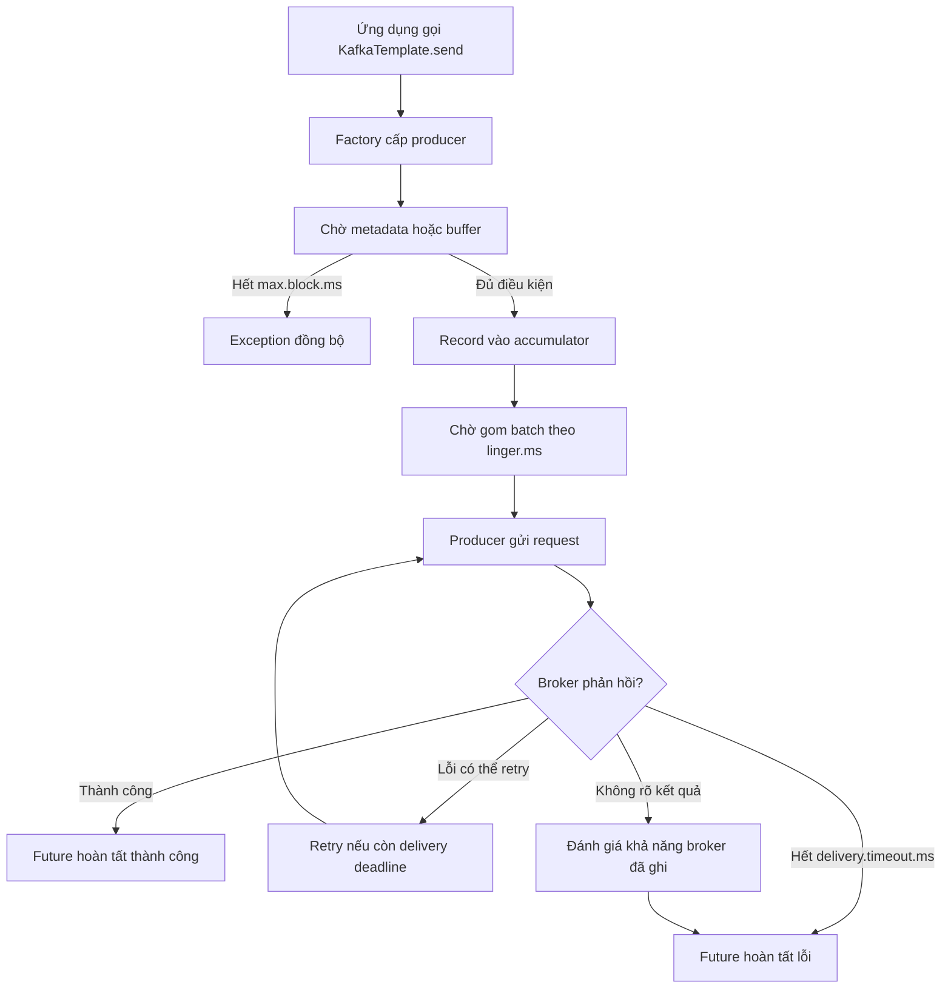

# Xử lý send timeout

Trong Spring Kafka, `send timeout` là tình huống producer không hoàn tất việc gửi message trong thời gian mong đợi. Lỗi có thể xuất hiện ngay trong lúc gọi `KafkaTemplate.send()`, xuất hiện bất đồng bộ qua future sau khi phương thức đã trả về, hoặc chỉ được nhìn thấy khi code ứng dụng chờ future bằng một deadline riêng. Ba trường hợp này có nguyên nhân và cách xử lý khác nhau.

Điều quan trọng nhất khi xử lý timeout là xác định message đã đi đến đâu. Một timeout không phải lúc nào cũng chứng minh broker chưa ghi message. Nếu broker đã ghi bản ghi nhưng acknowledgement bị mất trên đường về, producer có thể hết thời gian chờ dù dữ liệu đã được lưu. Gửi lại ngay bằng một sự kiện mới có thể tạo tác động nghiệp vụ trùng lặp.

Trong phạm vi vận hành producer của Spring Kafka, cần kiểm soát các timeout ở Kafka client, cách `KafkaTemplate` trả kết quả, deadline của ứng dụng, chính sách retry và khả năng chống xử lý trùng ở consumer. Nội dung dưới đây trình bày cách phân biệt các lớp timeout, thu thập bằng chứng và khôi phục luồng publish an toàn.

## 1. Phân biệt các lớp timeout

Kafka producer có nhiều mốc thời gian. Không nên thay đổi tất cả cùng lúc khi thấy một exception có chữ `TimeoutException`.

| Thuộc tính hoặc deadline | Phạm vi | Ý nghĩa |
|---|---|---|
| `max.block.ms` | Lời gọi đồng bộ `send()` và một số API cần metadata/buffer | Giới hạn thời gian caller bị chặn khi producer chờ metadata hoặc chờ cấp phát bộ đệm record. Nếu hết thời gian trước khi `send()` trả future, phương thức có thể ném exception trực tiếp. |
| `request.timeout.ms` | Một request gửi đến broker | Giới hạn thời gian producer chờ phản hồi cho một request. Request timeout có thể khiến producer thử lại nếu lỗi có thể retry và vẫn còn thời gian giao record. |
| `delivery.timeout.ms` | Toàn bộ vòng đời gửi một record | Giới hạn tổng thời gian từ khi record sẵn sàng gửi đến khi gửi thành công hoặc thất bại, gồm chờ batch, request và retry. Khi hết hạn, future của record có thể hoàn tất với lỗi timeout. |
| `linger.ms` | Gom batch trước khi gửi | Thời gian producer có thể chờ thêm để gom nhiều record vào batch. Đây không phải deadline gửi cuối cùng, nhưng có tính vào thời gian giao record. |
| Deadline chờ của ứng dụng | Code gọi `Future.get(timeout, unit)` hoặc cơ chế timeout riêng | Chỉ giới hạn thời gian code ứng dụng chờ kết quả. Nó không tự động hủy việc gửi ở Kafka client. |
| `transaction.timeout.ms` | Kafka transaction | Giới hạn thời gian transaction được phép mở theo cấu hình broker/client. Transaction có thể bị abort dù một lần gửi record riêng lẻ đã nhận acknowledgement. |

### `max.block.ms`: timeout trước khi nhận được future

`KafkaProducer.send()` là API bất đồng bộ sau khi record đã được chấp nhận vào quy trình gửi. Tuy nhiên, lời gọi ban đầu vẫn có thể chặn khi producer cần metadata của topic/partition hoặc cần chờ bộ đệm để chứa record. `max.block.ms` giới hạn thời gian chờ ở những bước này.

Nếu metadata không lấy được vì broker không truy cập được, topic chưa có metadata, DNS/network lỗi hoặc cluster đang không phản hồi, `send()` có thể hết `max.block.ms` và ném exception trực tiếp. Tương tự, khi buffer đầy do producer gửi nhanh hơn khả năng broker tiếp nhận, thread gọi `send()` có thể phải chờ buffer và cuối cùng hết thời gian.

Trong trường hợp này, code có thể chưa nhận được `CompletableFuture` để đăng ký callback. Vì vậy cần bắt exception ngay tại lời gọi `KafkaTemplate.send()`.

### `request.timeout.ms`: timeout của một lần trao đổi

Sau khi record được đưa vào bộ đệm và producer gửi request đến broker, client chờ phản hồi. `request.timeout.ms` giới hạn thời gian chờ phản hồi cho request đó. Nếu request timeout do mạng chậm, broker quá tải hoặc response bị mất, producer có thể retry theo cấu hình và theo loại lỗi.

Request timeout không phải tổng deadline của record. Một record có thể trải qua nhiều request/retry trước khi thành công hoặc hết `delivery.timeout.ms`.

### `delivery.timeout.ms`: deadline cuối cùng của record

`delivery.timeout.ms` giới hạn tổng thời gian producer cố gắng giao một record. Khoảng thời gian này bao gồm thời gian chờ batch, các lần gửi request và retry. Khi deadline hết, producer hoàn tất future với lỗi; ứng dụng cần ghi nhận kết quả và quyết định bước tiếp theo.

Kafka yêu cầu `delivery.timeout.ms` không nhỏ hơn tổng `request.timeout.ms` và `linger.ms`. Nếu cấu hình không đáp ứng ràng buộc này, producer có thể từ chối cấu hình khi khởi tạo.

### Deadline chờ của ứng dụng không phải timeout gửi

Ví dụ:

```java
SendResult<String, OrderEvent> result =
        kafkaTemplate.send("orders.events", event.orderId(), event)
                .get(2, TimeUnit.SECONDS);
```

Nếu `get()` ném `java.util.concurrent.TimeoutException` sau hai giây, điều đó chỉ nói rằng thread hiện tại đã chờ đủ hai giây mà chưa thấy kết quả. Future có thể vẫn đang chạy và Kafka producer vẫn có thể giao message thành công sau đó. Không nên coi lỗi chờ cục bộ này là bằng chứng message thất bại rồi gửi lại ngay.

Hủy hoặc timeout một future ở tầng ứng dụng cũng không bảo đảm thu hồi record đã được đưa vào bộ đệm hoặc request đã được gửi đến broker. Nếu cần deadline nghiệp vụ, hãy quản lý trạng thái chờ và trạng thái gửi riêng, đồng thời giữ định danh sự kiện ổn định.

## 2. Luồng gửi và các điểm timeout có thể xuất hiện

Luồng gửi thông thường có thể mô tả như sau:



Sơ đồ nhấn mạnh hai điểm xử lý khác nhau: exception đồng bộ xảy ra trước khi lời gọi trả future; lỗi giao record thường được báo qua future sau đó. Một timeout do code chờ future có thể xuất hiện ở bên ngoài luồng Kafka này.

## 3. Đọc lỗi từ Spring Kafka đúng cách

### Bắt cả lỗi đồng bộ và lỗi bất đồng bộ

Với Spring Kafka 3.x, `KafkaTemplate.send()` trả về `CompletableFuture<SendResult<K, V>>`. Có hai nơi cần quan sát:

- `try/catch` quanh lời gọi `send()` để bắt lỗi xảy ra trước khi future được trả về, ví dụ lỗi cấu hình, serialize hoặc chờ metadata/buffer.
- `whenComplete()` hoặc callback tương ứng để bắt kết quả gửi sau khi future được tạo, gồm lỗi request, retry hết hạn và delivery timeout.

Ví dụ:

```java
public void publish(OrderEvent event) {
    try {
        CompletableFuture<SendResult<String, OrderEvent>> future =
                kafkaTemplate.send("orders.events", event.orderId(), event);

        future.whenComplete((result, exception) -> {
            if (exception != null) {
                publishMetrics.recordFailure(event.eventId(), exception);
                log.error("Kafka publish failed; eventId={}",
                        event.eventId(), exception);
                return;
            }

            RecordMetadata metadata = result.getRecordMetadata();
            publishMetrics.recordSuccess(
                    event.eventId(), metadata.topic(),
                    metadata.partition(), metadata.offset());
        });
    }
    catch (RuntimeException exception) {
        publishMetrics.recordFailure(event.eventId(), exception);
        log.error("Kafka send could not be started; eventId={}",
                event.eventId(), exception);
        throw exception;
    }
}
```

Đây là ví dụ minh họa cho Spring Kafka 3.x; các phiên bản cũ có thể dùng `ListenableFuture`. `publishMetrics` và `log` đại diện cho thành phần quan sát của ứng dụng. Callback nên ngắn, tránh thao tác blocking hoặc gọi dịch vụ chậm trên thread hoàn tất gửi. Nếu cần xử lý tiếp, hãy chuyển công việc sang executor có giới hạn và có backpressure.

### Không chỉ nhìn tên exception

`TimeoutException` có thể xuất hiện ở nhiều tầng. Khi điều tra, cần ghi nhận:

- Exception class đầy đủ và nguyên nhân lồng bên trong (`cause`).
- Exception xuất hiện ngay tại `send()` hay trong future.
- Topic, partition nếu đã biết, key và `eventId`.
- Thời điểm bắt đầu gửi, thời điểm timeout và deadline đang áp dụng.
- Producer client ID, application instance, broker endpoint nếu log có.
- Số lần retry và metadata của record nếu đã được broker xác nhận.

Với lỗi bất đồng bộ, Spring Kafka có thể cung cấp `KafkaProducerException` cùng `ProducerRecord` đã thất bại. Hãy tận dụng thông tin này để xác định message cụ thể thay vì chỉ ghi một dòng “send timeout”. Không ghi payload nhạy cảm vào log.

### Future.get(timeout) và future hoàn tất lỗi

Phân biệt các tình huống sau:

| Quan sát | Diễn giải | Hành động |
|---|---|---|
| `send()` ném exception trước khi trả future | Producer chưa cấp được future cho lời gọi đó; có thể do metadata, buffer, serializer hoặc cấu hình | Xem stack trace và producer metrics; phân loại lỗi trước khi retry. |
| Future hoàn tất exceptional với delivery timeout | Producer đã nhận record vào quy trình gửi nhưng không hoàn tất trong deadline | Kiểm tra request/retry/broker/network; coi kết quả nghiệp vụ là chưa chắc chắn nếu acknowledgement có thể bị mất. |
| `future.get(2, SECONDS)` ném `TimeoutException` | Code ứng dụng ngừng chờ sau hai giây; future có thể vẫn chưa hoàn tất | Giữ tham chiếu future hoặc callback để nhận kết quả cuối; không tự động gửi lại chỉ vì hết thời gian chờ. |
| Future hoàn tất thành công | Broker đã xác nhận theo `acks` được cấu hình | Ghi metadata; consumer vẫn có thể chưa xử lý message. |
| Transaction gửi thành công nhưng transaction chưa commit | Record đã được gửi trong transaction nhưng chưa chắc đã hiển thị với consumer `read_committed` | Chờ kết quả commit/abort; không coi callback gửi riêng lẻ là hoàn tất transaction. |

## 4. Nguyên nhân thường gặp và cách nhận diện

### Broker không sẵn sàng hoặc cluster thiếu tài nguyên

Broker dừng, partition không có leader, controller đang xử lý sự cố hoặc broker quá tải có thể làm producer không lấy được metadata hay không nhận được phản hồi kịp thời. Kiểm tra trạng thái broker, leader của partition, offline partition, under-replicated partition, request latency, CPU, disk và network.

Nếu producer dùng `acks=all`, lỗi liên quan ISR hoặc `min.insync.replicas` có thể khiến broker từ chối ghi. Đây thường là lỗi cấu hình/khả năng dự phòng, không phải một timeout đơn giản cần tăng deadline. Kiểm tra replication factor, ISR và `min.insync.replicas` trước khi thay đổi chính sách.

### Mạng, DNS và TLS/SASL

Packet loss, latency tăng, route không ổn định, DNS phân giải chậm hoặc kết nối bị firewall đóng có thể khiến request hoặc response bị trễ. TLS handshake, chứng thư hết hạn, SASL credential sai và ACL không phù hợp thường tạo lỗi kết nối/xác thực rõ ràng, nhưng cũng có thể kéo theo retry và timeout ở các bước khác.

Kiểm tra từ chính môi trường chạy ứng dụng: DNS bootstrap và broker advertised listeners, khả năng mở kết nối, thời hạn chứng thư, cấu hình truststore/keystore, SASL mechanism và quyền ghi topic. Broker có thể trả advertised listener là hostname mà ứng dụng không phân giải được dù bootstrap server ban đầu truy cập được.

### Buffer producer bị áp lực

Producer gom record vào buffer trước khi gửi. Nếu tốc độ publish vượt tốc độ broker tiếp nhận trong thời gian dài, buffer có thể đầy. Thread gọi `send()` khi đó chờ cấp phát buffer và có thể hết `max.block.ms`.

Nguyên nhân thường gặp gồm broker chậm, network bão hòa, record quá lớn, số lượng producer tăng bất thường, batch chưa được gửi kịp hoặc ứng dụng phát message quá nhanh. Kiểm tra `buffer.memory`, `bufferpool-wait-time`, `buffer-available-bytes`, request latency, batch size và số producer vật lý. Tăng `buffer.memory` chỉ kéo dài thời gian chịu backlog; nếu tốc độ gửi luôn lớn hơn tốc độ xử lý, buffer cuối cùng vẫn đầy.

### Topic/partition metadata chậm hoặc không hợp lệ

Topic chưa được tạo, topic name sai, partition chưa có leader hoặc broker metadata không cập nhật được có thể làm producer chờ metadata. Kiểm tra topic tồn tại, partition assignment, leader availability, ACL và log broker. Không tạo topic tự động trong production nếu chính sách hạ tầng yêu cầu quản lý topic tập trung.

### Serialization và partitioner

Serializer hoặc partitioner chạy trong luồng gọi `send()`. Một số lỗi ở đây xảy ra trước khi future được trả về và không được khắc phục bằng cách tăng `delivery.timeout.ms`. Kiểm tra kiểu payload, schema, serializer, partitioner tùy chỉnh và thời gian xử lý của chúng. Tránh thực hiện I/O hoặc logic nghiệp vụ nặng bên trong serializer/partitioner.

### Message quá lớn hoặc xử lý batch không phù hợp

Record vượt giới hạn `max.request.size`, `message.max.bytes` hoặc giới hạn replica/fetch tương ứng có thể bị broker từ chối. Tăng timeout không giải quyết được giới hạn kích thước. Kiểm tra kích thước serialized record, compression, giới hạn producer/broker/topic và chính sách payload. Với payload lớn, cân nhắc lưu object ở object storage rồi publish reference có kiểm soát.

## 5. Cấu hình timeout và retry cho producer

Ví dụ cấu hình Spring Boot:

```yaml
spring:
  kafka:
    producer:
      acks: all
      properties:
        "enable.idempotence": true
        "max.in.flight.requests.per.connection": 5
        "max.block.ms": 10000
        "request.timeout.ms": 30000
        "delivery.timeout.ms": 120000
        "linger.ms": 5
        "retry.backoff.ms": 500
```

Các giá trị trên chỉ là điểm bắt đầu để minh họa quan hệ giữa các thuộc tính; cần hiệu chỉnh theo SLA, latency thực tế, kích thước record, tốc độ publish và chính sách cluster. `delivery.timeout.ms` phải lớn hơn hoặc bằng `request.timeout.ms + linger.ms`. Không chọn timeout quá thấp khiến producer từ bỏ các request vẫn có khả năng thành công, cũng không đặt timeout quá cao khiến ứng dụng giữ trạng thái pending lâu hơn mức nghiệp vụ chấp nhận.

### Chọn timeout theo SLA

Hãy xác định trước:

1. Ứng dụng chấp nhận chờ bao lâu trước khi báo trạng thái publish chưa xác định?
2. Mạng và broker có p95/p99 request latency bao nhiêu trong điều kiện bình thường và lúc tải cao?
3. Bao lâu để một broker/partition phục hồi trong các sự cố thường gặp?
4. Hệ thống có outbox hoặc hàng đợi bền vững để giữ sự kiện trong thời gian Kafka gián đoạn không?
5. Consumer có thể xử lý duplicate theo `eventId` không?

`request.timeout.ms` nên đủ lớn so với độ trễ request bình thường và mức biến động có thể chấp nhận. `delivery.timeout.ms` phải bao phủ thời gian chờ batch và số lần retry dự kiến, nhưng vẫn nằm trong giới hạn thời gian mà ứng dụng có thể giữ sự kiện pending. `max.block.ms` cần đủ cho metadata/buffer trong điều kiện vận hành bình thường; nếu nó thường xuyên hết hạn, phải điều tra nguyên nhân thay vì chỉ tăng giá trị.

### Retry phía Kafka client

Kafka producer tự retry một số lỗi được xem là có thể khắc phục. Các lần retry bị giới hạn bởi deadline giao record và chính sách client. Khi bật idempotence, producer phối hợp sequence number để loại bỏ duplicate do retry nội bộ trong phạm vi producer session.

Không nên giảm retry nội bộ quá thấp chỉ để lỗi xuất hiện nhanh hơn nếu workload cần chịu các gián đoạn ngắn. Cũng không nên retry vô hạn ở nhiều tầng. Khi Kafka client đã retry đến `delivery.timeout.ms`, ứng dụng cần một quyết định tiếp theo có giới hạn và có thể quan sát.

## 6. Retry ở tầng ứng dụng sau timeout

Retry tầng ứng dụng khác với retry nội bộ Kafka producer. Một lần gọi `KafkaTemplate.send()` mới là một lần gửi mới từ góc nhìn ứng dụng, có thể tạo record mới dù nội dung giống hệt lần trước. Vì vậy, cần phân loại lỗi và bảo vệ nghiệp vụ trước khi triển khai retry.

### Phân loại lỗi trước khi retry

| Nhóm lỗi | Ví dụ | Hướng xử lý |
|---|---|---|
| Lỗi tạm thời | Network disconnect ngắn, broker leader đang bầu lại, request timeout có thể hồi phục | Retry có giới hạn với exponential backoff và jitter sau khi đánh giá kết quả lần gửi trước. |
| Buffer/metadata pressure | `max.block.ms` hết hạn, producer buffer cạn | Giảm tốc độ publish, kiểm tra broker/network và backpressure; retry ngay với cùng tốc độ có thể làm tình trạng nặng hơn. |
| Lỗi xác thực/quyền | Credential sai, TLS trust lỗi, ACL thiếu quyền | Dừng retry dày đặc; cảnh báo và sửa cấu hình hoặc quyền truy cập. |
| Lỗi dữ liệu | Serialization failure, schema không hợp lệ, record vượt giới hạn | Không retry cùng payload; sửa dữ liệu hoặc đưa vào luồng xử lý lỗi phù hợp. |
| Lỗi cấu hình | Topic sai, serializer không tương thích, partitioner lỗi | Sửa cấu hình/code trước khi gửi lại. |
| Kết quả không chắc chắn | Timeout sau khi request có thể đã đến broker nhưng response bị mất | Dùng cùng `eventId`, kiểm tra trạng thái nếu có thể và bảo đảm consumer idempotent trước khi retry. |

### Backoff, jitter và giới hạn retry

Khi nhiều instance cùng gặp timeout, retry đồng loạt có thể tạo một đợt tải mới lên broker đang phục hồi. Exponential backoff tăng dần khoảng cách giữa các lần thử; jitter thêm biến thiên ngẫu nhiên để các instance không đồng bộ lại. Cần đặt số lần retry tối đa, thời gian tối đa và giới hạn tốc độ.

Không thực hiện vòng lặp retry blocking trên callback thread của Kafka producer. Nếu cần retry tầng ứng dụng, đưa sự kiện vào một executor/queue có giới hạn hoặc lưu vào outbox bền vững, rồi xử lý theo lịch retry. Khi queue đầy, phải có backpressure hoặc cơ chế từ chối rõ ràng; không tạo một hàng đợi in-memory không giới hạn.

### Giữ nguyên định danh sự kiện

Nếu publish cùng một sự kiện nhiều lần, giữ nguyên `eventId` và correlation ID. Consumer nên lưu `eventId` với unique constraint hoặc dùng một cơ chế idempotency tương đương trong cùng transaction với tác động nghiệp vụ. Nhờ đó, nếu broker đã nhận lần gửi đầu nhưng producer không nhận được acknowledgement, lần gửi lại vẫn không nhân đôi tác động nghiệp vụ.

Kafka idempotent producer giúp chống duplicate do retry nội bộ của producer; nó không thay thế idempotency ở tầng nghiệp vụ khi ứng dụng tự gọi `send()` lại sau timeout hoặc sau khi process khởi động lại.

### Transactional outbox cho publish quan trọng

Nếu ứng dụng cập nhật database rồi publish event, có một khoảng trống giữa commit database và acknowledgement Kafka. Với sự kiện quan trọng, transactional outbox giúp ghi thay đổi nghiệp vụ và bản ghi outbox trong cùng transaction database. Một publisher riêng đọc outbox, gửi Kafka và đánh dấu trạng thái đã publish sau khi nhận kết quả. Khi timeout không rõ kết quả, publisher có thể gửi lại cùng event ID; consumer vẫn cần idempotency.

Outbox biến sự kiện chưa gửi thành dữ liệu bền vững có thể retry sau khi Kafka phục hồi. Cần theo dõi tuổi bản ghi outbox, số bản ghi pending, tốc độ publish và số lần retry để phát hiện backlog.

## 7. Xử lý timeout trong luồng có Kafka transaction

Khi dùng Kafka transaction, cần phân biệt acknowledgement của một record với kết quả transaction. Future gửi record có thể hoàn tất thành công trong khi transaction vẫn đang mở. Record chưa hiển thị cho consumer dùng `isolation.level=read_committed` cho đến khi transaction commit.

Nếu transaction timeout hoặc commit thất bại, transaction có thể bị abort. Không được đánh dấu sự kiện nghiệp vụ đã hoàn tất chỉ dựa trên future gửi record; cần chờ kết quả commit transaction. Khi gặp lỗi trong transaction, thực hiện rollback/abort theo transaction manager và xử lý exception theo chính sách của ứng dụng.

Timeout transaction có thể liên quan đến:

- Transaction mở quá lâu do xử lý nghiệp vụ hoặc gọi dịch vụ ngoài bên trong transaction.
- Broker/network chậm khiến commit/abort không hoàn tất.
- Transaction ID xung đột, producer bị fencing.
- Cấu hình `transaction.timeout.ms` không phù hợp với thời gian xử lý.

Giữ transaction ngắn, tránh gọi API ngoài lâu trong transaction và theo dõi commit/abort latency. Không tăng `transaction.timeout.ms` vô hạn để che giấu transaction bị treo.

## 8. Quan sát và cảnh báo send timeout

Để xử lý nhanh, cần kết hợp metrics producer, broker, network và trạng thái nghiệp vụ.

| Lớp | Metrics/log cần theo dõi | Dấu hiệu |
|---|---|---|
| Kafka producer | `record-error-rate`, `record-retry-rate`, `request-latency-avg/max`, `bufferpool-wait-time`, `buffer-available-bytes`, `record-queue-time-avg` | Retry tăng, request chậm, buffer cạn hoặc record nằm lâu trong queue. |
| Spring Kafka | Kết quả future của `KafkaTemplate`, exception class, topic, event ID, send duration | Phân biệt lỗi đồng bộ và lỗi bất đồng bộ, xác định message cụ thể. |
| Broker | Request handler idle, request queue time, produce request latency, ISR, offline/under-replicated partitions, disk/network | Broker quá tải, partition mất leader hoặc replication suy giảm. |
| Network/security | Kết nối, reconnect, DNS, TLS handshake, SASL và ACL errors | Lỗi đường truyền hoặc xác thực. |
| Ứng dụng | Số event pending, retry count, outbox age, publish success/error rate | Xác định tác động đến SLA và backlog sự kiện. |

Tên metric và cách expose phụ thuộc phiên bản Kafka client, broker và hệ thống giám sát. Có thể thu thập metrics client qua JMX hoặc tích hợp Micrometer phù hợp. Không đặt cảnh báo chỉ dựa trên tổng số exception; hãy tách theo exception class, topic, producer instance và tỷ lệ lỗi.

Các cảnh báo nên tập trung vào:

- Tỷ lệ send failure hoặc delivery timeout vượt ngưỡng trong một cửa sổ thời gian.
- `bufferpool-wait-time` tăng kéo dài hoặc buffer available giảm sát 0.
- Request latency p95/p99 tăng so với baseline.
- Retry rate tăng liên tục dù throughput publish giảm.
- Outbox pending hoặc tuổi event vượt SLA.
- Broker có offline partition, ISR shrink hoặc under-replicated partition.

Log nên chứa `eventId`, topic, key phù hợp, producer client ID, thời điểm bắt đầu/kết thúc, loại timeout, số lần retry và exception chain. Tránh log secret hoặc toàn bộ payload. Trace context nên truyền qua Kafka headers để liên kết request gốc với lần publish và consumer.

## 9. Runbook khi send timeout xảy ra

### Bước 1: Xác định timeout thuộc tầng nào

1. Xem exception xảy ra trực tiếp tại `KafkaTemplate.send()` hay trong future.
2. Nếu code dùng `Future.get(timeout)`, xác định đó là deadline chờ cục bộ hay lỗi future thực sự.
3. Ghi nhận `max.block.ms`, `request.timeout.ms`, `delivery.timeout.ms`, `linger.ms` và deadline ứng dụng tại thời điểm lỗi.
4. Ghi lại topic, `eventId`, producer instance, exception class, timestamp và số lần retry.

### Bước 2: Kiểm tra sức khỏe Kafka cluster

1. Xác nhận bootstrap servers và advertised listeners có thể truy cập từ pod/VM chạy ứng dụng.
2. Kiểm tra broker, controller, partition leader, offline partition và under-replicated partition.
3. Kiểm tra ISR và `min.insync.replicas` nếu producer dùng `acks=all`.
4. Đối chiếu produce request latency, request queue, disk, CPU và network của broker.
5. Kiểm tra DNS, firewall, TLS/SASL và ACL nếu có lỗi kết nối hoặc xác thực.

### Bước 3: Kiểm tra producer client và ứng dụng

1. Đọc `bufferpool-wait-time`, `buffer-available-bytes`, retry rate và request latency.
2. Kiểm tra số producer vật lý, thread, kết nối và việc có tạo factory/template theo request hay không.
3. Kiểm tra record size, serializer, partitioner và schema.
4. Đối chiếu tốc độ publish với tốc độ broker tiếp nhận; kiểm tra queue/outbox có tăng không.
5. Xác định có callback hoặc code chờ future blocking làm nghẽn thread pool không.

### Bước 4: Đánh giá kết quả gửi có chắc chắn hay không

1. Nếu `send()` thất bại trước khi future được trả về vì metadata/buffer, xử lý theo lỗi tương ứng và không giả định record đã được enqueue.
2. Nếu future thất bại sau request hoặc hết delivery deadline, coi kết quả broker có thể chưa xác định nếu acknowledgement bị mất.
3. Nếu chỉ deadline `Future.get()` của ứng dụng hết hạn, tiếp tục quan sát future/callback hiện có; đừng gửi lại ngay.
4. Nếu transaction đang mở, kiểm tra kết quả commit/abort trước khi đánh dấu sự kiện hoàn tất.
5. Đối chiếu `eventId` với trạng thái outbox hoặc consumer idempotency nếu có.

### Bước 5: Khôi phục có kiểm soát

1. Khắc phục nguyên nhân gốc như broker quá tải, network, ACL, topic metadata hoặc serializer.
2. Nếu backlog tăng, giảm tốc độ publish hoặc dùng backpressure; tránh tăng tốc retry đồng loạt.
3. Retry có giới hạn với exponential backoff và jitter cho lỗi tạm thời.
4. Giữ nguyên `eventId` và dùng cơ chế idempotency ở consumer để chống tác động trùng.
5. Theo dõi send success rate, request latency, retry, buffer wait và tuổi event cho đến khi trở lại baseline.

## 10. Bảng tra cứu nhanh theo triệu chứng

| Triệu chứng | Khả năng cần kiểm tra đầu tiên | Hướng xử lý |
|---|---|---|
| `send()` chặn lâu rồi ném `TimeoutException` | Metadata chưa có hoặc producer buffer không cấp phát được trong `max.block.ms` | Kiểm tra broker metadata, topic/leader, network và buffer pressure. |
| Future thất bại sau một khoảng thời gian gần `delivery.timeout.ms` | Request/retry không hoàn tất trong tổng deadline | Kiểm tra request latency, broker health, retry và response path. |
| `Future.get(2s)` timeout nhưng callback chưa chạy | Deadline chờ cục bộ ngắn hơn thời gian giao record | Không gửi lại ngay; tiếp tục quan sát future và quyết định theo SLA. |
| `bufferpool-wait-time` tăng, buffer available thấp | Producer gửi nhanh hơn broker tiếp nhận hoặc record/batch quá lớn | Giảm tốc độ, kiểm tra broker/network, record size và số producer. |
| `NotEnoughReplicas` hoặc lỗi ISR | ISR thấp hơn `min.insync.replicas` | Khôi phục replica và đánh giá chính sách độ bền trước khi thay đổi cấu hình. |
| Lỗi serialize xuất hiện ngay tại send | Payload/schema/serializer không hợp lệ hoặc code serialize chậm | Sửa dữ liệu/schema/serializer; timeout dài hơn không giải quyết nguyên nhân. |
| Timeout kèm broker đã ghi record nhưng client không nhận response | Response path bị gián đoạn hoặc request outcome không xác định | Giữ event ID, chống duplicate ở consumer và kiểm tra trạng thái nghiệp vụ. |
| Transaction commit timeout hoặc fencing | Transaction dài, broker chậm hoặc transactional ID xung đột | Kiểm tra transaction lifecycle, prefix/instance ID và kết quả abort/commit. |

## 11. Bảng kiểm soát trước khi đưa producer vào production

| Điểm kiểm soát | Câu hỏi cần trả lời | Bằng chứng nên có |
|---|---|---|
| Timeout | `max.block.ms`, `request.timeout.ms` và `delivery.timeout.ms` đã được chọn theo SLA chưa? | Cấu hình hiệu lực, latency p95/p99 và deadline nghiệp vụ. |
| Future | Cả lỗi đồng bộ và bất đồng bộ có được xử lý không? | Log exception chain, callback/future outcome và metric. |
| Retry | Kafka client và ứng dụng có tổng số lần retry/time budget rõ ràng không? | Retry policy, backoff, jitter và retry count. |
| Idempotency | Timeout không rõ kết quả có thể được gửi lại an toàn không? | Event ID ổn định, inbox/deduplication hoặc outbox. |
| Backpressure | Producer có giới hạn queue và tốc độ khi broker chậm không? | Queue depth, buffer metrics và cơ chế throttle. |
| Broker | Replication, ISR, leader và tài nguyên broker đáp ứng workload không? | Topic config, ISR, broker metrics và alert. |
| Observability | Có thể truy từ event ID đến exception, partition và kết quả gửi không? | Structured logs, trace headers và dashboard. |
| Transaction | Có phân biệt send acknowledgement với transaction commit không? | Transaction outcome, commit/abort metrics và fencing logs. |

Send timeout cần được xử lý như một tín hiệu về deadline và trạng thái giao nhận. Khi phân biệt được timeout đồng bộ, timeout của request, delivery timeout và deadline chờ của ứng dụng, đội vận hành có thể xác định đúng điểm nghẽn. Kết hợp quan sát producer/broker, retry có giới hạn, backpressure và định danh sự kiện ổn định sẽ giúp khôi phục publish mà vẫn kiểm soát được nguy cơ mất hoặc xử lý trùng message.
