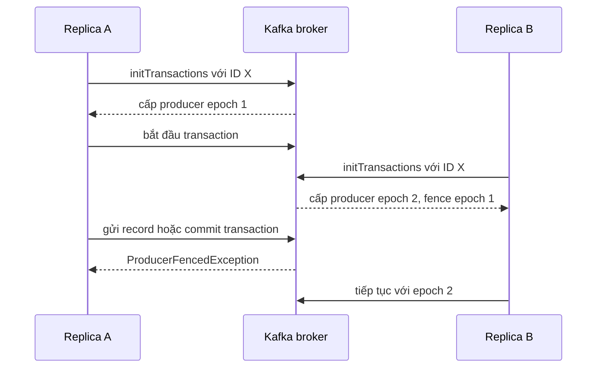

# Đặt transactionIdPrefix duy nhất theo instance

Khi dùng Kafka transactions trong Spring Kafka, mỗi producer transactional cần một `transactional.id` riêng trên cùng Kafka cluster. Spring Kafka cung cấp thuộc tính `transactionIdPrefix` để tạo các ID này. Prefix phải duy nhất giữa các application instance đang hoạt động đồng thời và phải được tạo từ danh tính của instance đang chạy.

Đây là cấu hình vận hành quan trọng khi triển khai consumer hoặc producer transactional với nhiều replica. Nếu hai instance dùng chung prefix, các producer có thể nhận cùng `transactional.id`. Kafka sẽ fence producer cũ khi một producer khác khởi tạo transaction với cùng ID. Hậu quả thường thấy là transaction bị abort, listener phát sinh `ProducerFencedException` hoặc `InvalidProducerEpochException`, và luồng xử lý có thể gián đoạn.

## 1. `transactionIdPrefix` dùng để làm gì?

Trong Kafka, `transactional.id` định danh một producer transactional qua nhiều phiên làm việc. Producer dùng ID này để khởi tạo transaction, khôi phục trạng thái transaction và cho broker biết producer nào đang sở hữu quyền ghi với ID đó. Khi một producer mới khởi tạo với cùng `transactional.id`, Kafka tăng producer epoch và fence producer cũ. Cơ chế này giúp ngăn một producer cũ tiếp tục ghi transaction sau khi một producer mới đã tiếp quản cùng danh tính.

Spring Kafka đặt prefix trên `DefaultKafkaProducerFactory`. Factory tạo `transactional.id` thực tế bằng cách nối prefix với một hậu tố do factory quản lý. Hậu tố phân biệt các transactional producer được tạo từ cùng factory; prefix phân biệt factory hoặc application instance với các instance khác.

Ví dụ, giả sử hai replica cùng chạy service `order-service`:

| Application instance | `transactionIdPrefix` | Một ID được factory tạo |
|---|---|---|
| Replica 0 | `prod-order-service-orders-0-` | `prod-order-service-orders-0-0` |
| Replica 1 | `prod-order-service-orders-1-` | `prod-order-service-orders-1-0` |

Hai prefix khác nhau nên các ID do hai factory tạo ra không đụng nhau. Hậu tố `0` trong ví dụ chỉ minh họa một producer được tạo bởi mỗi factory; factory có thể tạo thêm producer với hậu tố khác khi cần.

Nếu cả hai replica cùng dùng `prod-order-service-`, mỗi factory có thể bắt đầu từ cùng một hậu tố. Khi đó chúng có thể cùng cố sử dụng `prod-order-service-0`. Producer khởi tạo sau có thể fence producer đang dùng ID đó. Đây là xung đột danh tính ở cấp Kafka, không phải lỗi do record đầu vào hoặc do nội dung transaction.

## 2. Phạm vi cần bảo đảm tính duy nhất

Prefix cần duy nhất trong phạm vi các transactional producer cùng kết nối tới một Kafka cluster. Tên service hoặc tên ứng dụng thường giống nhau giữa các replica, vì vậy chỉ dùng tên service không đủ.

Một prefix thực tế thường kết hợp:

- Môi trường triển khai, chẳng hạn `dev`, `staging` hoặc `prod`.
- Tên ứng dụng hoặc workload, chẳng hạn `order-service`.
- Namespace, tenant hoặc nhóm triển khai nếu nhiều môi trường cùng dùng một Kafka cluster.
- ID riêng của instance, chẳng hạn tên Pod, StatefulSet ordinal, hostname hoặc instance ID do nền tảng cấp.

Có thể biểu diễn quy tắc như sau:

```text
transactionIdPrefix = environment
                    + application
                    + namespace
                    + instanceId
                    + separator
```

Ví dụ:

```text
prod-order-service-commerce-orders-0-
prod-order-service-commerce-orders-1-
```

Không cần đưa mọi thành phần này vào prefix nếu một thành phần đã bảo đảm tính duy nhất trong phạm vi Kafka cluster. Tuy nhiên, khi nhiều namespace hoặc nhiều môi trường chia sẻ cùng cluster, thêm thông tin triển khai giúp tránh trùng tên và giúp người vận hành nhận diện producer dễ hơn.

Tính duy nhất cần được xét trên toàn bộ transactional producer kết nối cùng cluster, không chỉ trong một process. Nếu một ứng dụng tự tạo nhiều `DefaultKafkaProducerFactory` độc lập, các factory đó cũng cần những prefix không tạo ra cùng dải ID.

## 3. Cấu hình bằng Spring Boot

Spring Boot cung cấp thuộc tính `spring.kafka.producer.transaction-id-prefix`. Khi thuộc tính này được đặt, producer factory do Boot cấu hình có thể tạo transactional producer.

```yaml
spring:
  application:
    name: order-service
  kafka:
    producer:
      transaction-id-prefix: ${APP_ENV}-${spring.application.name}-${POD_NAMESPACE}-${POD_NAME}-
```

Các placeholder phải được cấp giá trị riêng theo từng instance. Ví dụ, `POD_NAME` và `POD_NAMESPACE` có thể được đưa vào container bằng Kubernetes Downward API. Khi chạy local, cần cấp một `POD_NAME` hoặc `INSTANCE_ID` riêng cho từng process nếu nhiều process cùng kết nối tới một Kafka cluster.

Một lựa chọn khác là để nền tảng triển khai tạo sẵn toàn bộ prefix và truyền vào biến môi trường:

```yaml
spring:
  kafka:
    producer:
      transaction-id-prefix: ${KAFKA_TRANSACTION_ID_PREFIX}
```

Khi đó, mỗi instance nhận một giá trị `KAFKA_TRANSACTION_ID_PREFIX` riêng. Cách này làm rõ ranh giới giữa cấu hình ứng dụng và danh tính instance do nền tảng cấp. Tránh đặt một giá trị cố định trong ConfigMap dùng chung cho tất cả replica.

### Ví dụ Kubernetes Downward API

Với Kubernetes, tên Pod là duy nhất trong namespace tại cùng thời điểm. Có thể đưa tên Pod và namespace vào biến môi trường:

```yaml
spec:
  template:
    spec:
      containers:
        - name: order-service
          env:
            - name: APP_ENV
              value: prod
            - name: POD_NAME
              valueFrom:
                fieldRef:
                  fieldPath: metadata.name
            - name: POD_NAMESPACE
              valueFrom:
                fieldRef:
                  fieldPath: metadata.namespace
```

Kết hợp với cấu hình Spring Boot ở trên, mỗi Pod có prefix riêng, ví dụ:

```text
prod-order-service-commerce-order-service-0-
prod-order-service-commerce-order-service-1-
```

Đối với StatefulSet, tên Pod thường chứa ordinal ổn định như `order-service-0` hoặc `order-service-1`. Điều này hữu ích khi cần cùng một logical instance tiếp tục dùng danh tính transaction sau khi Pod được khởi động lại. Với Deployment, tên Pod thường được tạo mới khi replica được thay thế; vẫn bảo đảm các Pod đang chạy đồng thời có ID riêng, nhưng danh tính có thể thay đổi giữa các lần thay thế.

Không nên đặt giá trị mặc định chung như `local-` hoặc `order-service-` cho môi trường có nhiều replica. Nếu thiếu `POD_NAME` hoặc `INSTANCE_ID`, ứng dụng production nên thất bại sớm khi khởi động thay vì âm thầm dùng một prefix có nguy cơ trùng.

## 4. Chọn instance ID: duy nhất và có chủ đích

Instance ID cần phân biệt mọi instance có thể chạy đồng thời trên cùng Kafka cluster. Nguồn ID phù hợp tùy cách triển khai:

| Môi trường | Nguồn ID thường dùng | Lưu ý |
|---|---|---|
| Kubernetes StatefulSet | Pod name hoặc ordinal | Có thể giữ danh tính ổn định qua lần restart của cùng ordinal |
| Kubernetes Deployment | Pod name | Các Pod đang tồn tại có tên riêng; Pod thay thế có thể có tên mới |
| VM hoặc máy chủ cố định | Hostname hoặc instance ID của máy | Đảm bảo hostname không bị dùng chung bởi nhiều process transactional |
| Container trên nền tảng điều phối | Task ID hoặc instance ID do nền tảng cấp | Không dùng tên service chung cho mọi task |
| Chạy local nhiều process | ID riêng theo process hoặc developer | Cần tránh các process trên nhiều máy cùng dùng một giá trị |

Có hai đặc tính cần cân nhắc khi chọn ID:

1. **Không trùng giữa các instance đồng thời.** Đây là yêu cầu bắt buộc để tránh producer fencing ngoài ý muốn.
2. **Ổn định qua lần restart của cùng logical instance khi cần fencing.** Nếu producer cũ có thể còn sống trong lúc instance mới khởi động, dùng lại danh tính transaction của logical instance đó cho phép Kafka fence producer cũ. Nếu mỗi lần khởi động đều tạo một UUID hoàn toàn mới, producer mới không dùng cùng `transactional.id` để fence producer cũ.

Vì vậy, một ID ngẫu nhiên mới ở mỗi lần khởi động có thể tránh va chạm giữa process đang chạy, nhưng không phải lúc nào cũng là lựa chọn vận hành tốt nhất. Với workload có identity ổn định như StatefulSet ordinal hoặc VM cố định, nên cân nhắc dùng ID ổn định cho cùng logical instance. Với workload ephemeral, dùng ID duy nhất theo Pod/task và dựa vào cơ chế điều phối để kết thúc instance cũ đúng cách.

Không chia sẻ một ID ổn định giữa hai replica đang hoạt động. Ví dụ, tất cả Pod cùng nhận `INSTANCE_ID=orders` từ một biến môi trường tĩnh sẽ tạo ra cùng prefix, dù số replica tăng từ một lên nhiều.

## 5. Vì sao prefix trùng gây `ProducerFencedException`?

Kafka dùng `transactional.id` để quản lý producer epoch. Khi producer khởi tạo transaction với một ID, broker xác lập epoch hiện hành cho ID đó. Nếu producer khác khởi tạo với cùng ID, epoch mới thay thế epoch cũ. Các thao tác tiếp theo từ producer cũ bị từ chối vì producer đó đã bị fence.

Luồng lỗi có thể diễn ra như sau:



Đây là hành vi bảo vệ tính đúng đắn của transaction. Kafka không cho hai producer cùng sở hữu một `transactional.id` và ghi transaction như hai chủ thể độc lập. Khi prefix bị trùng, một instance có thể liên tục làm mất hiệu lực producer của instance còn lại, dẫn đến lỗi lặp lại hoặc gián đoạn khó đoán.

Các biểu hiện vận hành có thể gồm:

- `ProducerFencedException` khi gửi record, commit hoặc thực hiện thao tác transaction.
- `InvalidProducerEpochException` hoặc lỗi liên quan đến producer epoch.
- Transaction bị abort và listener container phải xử lý lại record theo cơ chế retry.
- Lỗi xuất hiện khi tăng replica, rolling update hoặc khởi động đồng thời nhiều instance.
- Một replica hoạt động bình thường trong khi replica khác liên tục ghi log lỗi, sau đó tình trạng có thể đổi khi producer khác khởi tạo lại.

Không nên xử lý triệu chứng bằng cách chỉ tăng retry hoặc timeout. Nếu nguyên nhân là hai instance dùng cùng ID, retry có thể lặp lại sau mỗi lần producer khác giành quyền sở hữu ID. Cần sửa nguồn tạo prefix để các instance có danh tính riêng.

## 6. Prefix không phải `client.id` hay `group.id`

Các thuộc tính sau phục vụ mục đích khác nhau:

| Thuộc tính | Mục đích | Có thay thế được `transactionIdPrefix` không? |
|---|---|---|
| `transactionIdPrefix` của Spring Kafka | Tạo dải `transactional.id` cho transactional producer của factory | Đây là thuộc tính cần cấu hình cho bài toán này |
| Kafka `transactional.id` | Danh tính thực tế của một transactional producer | Được tạo từ prefix và hậu tố do factory quản lý |
| `client.id` | Nhận diện client trong log, metric và quota liên quan | Không; hai producer có `client.id` khác nhau vẫn có thể trùng `transactional.id` |
| Consumer `group.id` | Xác định consumer group và tiến độ offset dùng chung | Không; nhiều consumer group vẫn có thể có producer transaction ID trùng |
| `group.instance.id` | Định danh static member của consumer group | Không; đây là cơ chế membership của consumer group |

Đặt `client.id` duy nhất giúp quan sát dễ hơn nhưng không giải quyết được fencing do `transactional.id` trùng. Tương tự, mỗi replica có `group.id` riêng hay chung không quyết định tính duy nhất của transactional producer.

Khi dùng Spring Kafka, nên cấu hình `spring.kafka.producer.transaction-id-prefix` hoặc đặt prefix trên `DefaultKafkaProducerFactory`. Không nên tự đặt một `transactional.id` cố định chung trong producer properties rồi kỳ vọng factory tự phân biệt các instance. Factory cần quyền tạo các ID transactional theo prefix và hậu tố của nó.

## 7. Prefix duy nhất là điều kiện cần, không tự bật mọi transaction

Đặt `transactionIdPrefix` làm cho producer factory có khả năng tạo transactional producer. Điều này không có nghĩa mọi lời gọi `KafkaTemplate.send()` hoặc mọi `@KafkaListener` tự động chạy trong một transaction theo cách ứng dụng mong muốn.

Ứng dụng vẫn cần cấu hình luồng transaction phù hợp:

- Với producer, thao tác gửi phải tham gia transaction do Spring Kafka quản lý hoặc được thực hiện trong `KafkaTemplate.executeInTransaction(...)`.
- Với listener consume-transform-produce, listener container cần được cấu hình transaction manager hoặc cơ chế transaction tương ứng của phiên bản Spring Kafka đang dùng.
- Producer dùng để gửi output phải tham gia cùng transaction với offset đầu vào nếu mục tiêu là commit output và offset một cách nguyên tử.
- Consumer downstream cần `isolation.level=read_committed` nếu chỉ muốn đọc record thuộc transaction đã commit.

Ví dụ cấu hình prefix trong Spring Boot:

```yaml
spring:
  kafka:
    producer:
      transaction-id-prefix: ${KAFKA_TRANSACTION_ID_PREFIX}
    consumer:
      properties:
        isolation.level: read_committed
```

Thuộc tính `isolation.level` là cấu hình consumer đọc dữ liệu transactional. Nó không tạo prefix cho producer và cũng không sửa được xung đột ID. Hai phần cần được cấu hình đúng cho hai vai trò riêng.

Nếu ứng dụng tự tạo `DefaultKafkaProducerFactory`, hãy đặt prefix trên factory đó và bảo đảm mỗi factory transactional kết nối cùng cluster có một dải ID riêng. Với Spring Boot, ưu tiên dùng property chuẩn để tránh một cấu hình custom vô tình ghi đè factory do auto-configuration tạo.

## 8. Quy trình triển khai an toàn

Trước khi triển khai hoặc tăng số replica, hãy xác định rõ nguồn instance ID và kiểm tra giá trị thực tế được truyền vào từng instance.

1. Chọn thành phần nhận diện môi trường, ứng dụng và instance. Đảm bảo instance ID khác nhau giữa mọi replica đang chạy đồng thời trên cùng Kafka cluster.
2. Truyền instance ID qua nền tảng triển khai. Với Kubernetes, dùng Downward API để lấy Pod name và namespace thay vì đặt một chuỗi cố định cho toàn Deployment.
3. Tạo `transaction-id-prefix` từ các thành phần đó. Giữ dấu phân cách cuối prefix để dễ đọc ID được tạo ra.
4. Log prefix hiệu lực khi ứng dụng khởi động. Prefix không phải secret, nhưng không ghi kèm credential hoặc cấu hình nhạy cảm vào cùng log.
5. Kiểm tra manifest hoặc cấu hình đã render cho nhiều replica. Xác nhận mỗi replica có giá trị khác nhau và không có fallback chung khi thiếu biến môi trường.
6. Triển khai thử với nhiều replica và quan sát log transaction. Kiểm tra không xuất hiện fencing ngoài dự kiến khi scale hoặc rolling update.

Ví dụ log lúc khởi động:

```text
Kafka transactional producer prefix: prod-order-service-commerce-order-service-0-
```

Trong thực tế, có thể ghi log qua một bean cấu hình hoặc log ngay sau khi bind `KafkaProperties`. Không cần tự tạo producer chỉ để in ID; mục tiêu là quan sát giá trị prefix mà ứng dụng đã resolve trước khi tạo producer transactional.

## 9. Chẩn đoán khi gặp producer fencing

Khi xuất hiện `ProducerFencedException`, hãy bắt đầu bằng việc xác định `transactional.id` của producer lỗi và so sánh prefix giữa các instance đang kết nối cùng cluster.

| Kiểm tra | Câu hỏi cần trả lời | Hướng xử lý |
|---|---|---|
| Prefix theo instance | Hai Pod/process có log cùng prefix không? | Sửa nguồn cấp `INSTANCE_ID`, `POD_NAME` hoặc biến cấu hình |
| Replica trong rolling update | Instance cũ và mới có dùng chung danh tính không? | Xác định đây là fencing có chủ đích khi tiếp quản hay va chạm ngoài ý muốn giữa hai replica |
| ConfigMap/Secret dùng chung | Prefix có được đặt tĩnh cho toàn bộ Deployment không? | Chuyển phần instance ID sang metadata riêng của từng Pod |
| Nhiều producer factory | Có factory độc lập nào tạo cùng dải ID không? | Cấp prefix khác nhau cho từng factory hoặc hợp nhất về một factory phù hợp |
| Local và production cùng cluster | Một process local có dùng prefix production không? | Tách namespace môi trường hoặc cấp ID local riêng |
| Khởi động lại instance | Instance mới có đang tiếp quản danh tính của producer cũ không? | Kiểm tra vòng đời process cũ và xác nhận việc fencing có đúng mục đích |

Một số nguyên tắc xử lý:

- Không tắt transaction chỉ để che lỗi fencing nếu luồng nghiệp vụ đang dựa vào transaction để bảo đảm output và offset nguyên tử.
- Không đổi sang một prefix ngẫu nhiên mới ở mọi lần retry trong khi ứng dụng đang chạy; việc đó làm mất khả năng nhận diện và tiếp quản producer cũ theo cùng transactional identity.
- Không tăng `transaction.timeout.ms` với kỳ vọng nó sửa được hai instance dùng chung ID. Timeout và identity giải quyết hai vấn đề khác nhau.
- Sau khi sửa cấu hình, triển khai lại theo cách bảo đảm mỗi replica nhận đúng prefix của nó; theo dõi lỗi fencing và trạng thái transaction sau rollout.

## 10. Ví dụ đối chiếu cấu hình sai và đúng

### Sai: mọi replica dùng chung tên service

```yaml
spring:
  application:
    name: order-service
  kafka:
    producer:
      transaction-id-prefix: ${spring.application.name}-
```

Khi có ba replica, cả ba đều nhận prefix `order-service-`. Mỗi factory có thể sinh cùng hậu tố ban đầu và tạo ra các `transactional.id` trùng nhau.

### Đúng: thêm instance ID riêng

```yaml
spring:
  application:
    name: order-service
  kafka:
    producer:
      transaction-id-prefix: ${APP_ENV}-${spring.application.name}-${POD_NAMESPACE}-${POD_NAME}-
```

Giả sử ba Pod nhận tên `order-service-0`, `order-service-1` và `order-service-2`. Prefix được resolve thành ba giá trị riêng:

```text
prod-order-service-commerce-order-service-0-
prod-order-service-commerce-order-service-1-
prod-order-service-commerce-order-service-2-
```

Factory tiếp tục thêm hậu tố riêng cho từng producer mà nó tạo. Như vậy, các ID được tạo trong cùng factory được phân biệt bằng hậu tố, còn ID giữa các instance được phân biệt bằng prefix.

## 11. Checklist vận hành

- [ ] Mọi transactional producer kết nối cùng Kafka cluster có dải `transactional.id` không giao nhau.
- [ ] Prefix chứa instance ID riêng, không chỉ chứa tên ứng dụng hoặc tên Deployment.
- [ ] Nguồn instance ID được cấp từ nền tảng và không rơi về một giá trị mặc định chung trong production.
- [ ] Khi cần restart fencing, cùng logical instance có thể dùng lại danh tính ổn định sau khi khởi động lại.
- [ ] Nhiều producer factory độc lập không tạo cùng dải ID.
- [ ] `client.id`, `group.id` và `group.instance.id` không bị nhầm là giải pháp thay thế cho transactional ID.
- [ ] Listener container, producer và `KafkaTemplate` đã được cấu hình tham gia transaction theo đúng mục tiêu nghiệp vụ.
- [ ] Log khởi động giúp xác định prefix hiệu lực của từng instance.
- [ ] Scale-out và rolling update đã được quan sát để phát hiện fencing ngoài dự kiến.

Đặt `transactionIdPrefix` duy nhất theo instance giúp Spring Kafka tạo transactional producer có danh tính riêng trên Kafka cluster. Quy tắc cần giữ xuyên suốt vòng đời triển khai là mỗi logical instance có một identity rõ ràng, mọi instance hoạt động đồng thời không chia sẻ identity, và việc tái sử dụng identity sau restart phải là quyết định có chủ đích để Kafka có thể fence producer cũ khi cần.
