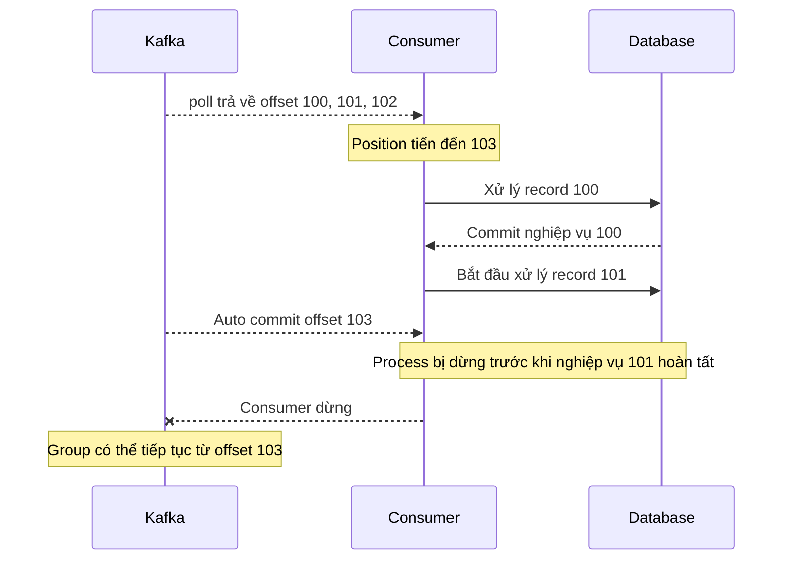

# enable.auto.commit

`enable.auto.commit` là thuộc tính của Kafka consumer quyết định client có tự động commit offset theo chu kỳ hay để ứng dụng/container kiểm soát thời điểm commit. Đây là một cấu hình quan trọng đối với consumer bền vững vì offset cho Kafka biết consumer group sẽ tiếp tục đọc từ vị trí nào sau khi khởi động lại hoặc rebalance.

Khi bật auto commit, Kafka client định kỳ ghi nhận vị trí đọc hiện tại của consumer. Client không biết nghiệp vụ trong listener đã hoàn tất hay chưa; nó chỉ biết vị trí consumer đã tiến đến đâu sau các lần `poll()`. Vì vậy, thời điểm commit có thể không trùng với thời điểm ứng dụng hoàn tất xử lý từng record. Nếu offset được commit trước khi tác động nghiệp vụ được lưu bền vững, message có thể bị bỏ qua sau sự cố. Nếu nghiệp vụ hoàn tất nhưng offset chưa được commit, message có thể được giao lại và tạo xử lý trùng.

Trong Spring Kafka, từ phiên bản 2.3, `enable.auto.commit` được đặt thành `false` nếu ứng dụng không cấu hình rõ thuộc tính này. Khi tắt auto commit, listener container quản lý offset theo `AckMode` như `RECORD`, `BATCH` hoặc `MANUAL`. Đây thường là lựa chọn phù hợp cho ứng dụng production cần gắn việc commit với kết quả xử lý.

## 1. Offset và auto commit hoạt động như thế nào?

Mỗi partition có một dãy offset tăng dần. Khi consumer gọi `poll()`, Kafka trả về các record và consumer position tiến đến vị trí tiếp theo cần đọc. Offset được commit là vị trí tiếp theo mà consumer group sẽ đọc khi khởi động lại, không phải offset của record cuối cùng đã xử lý.

Ví dụ, consumer nhận các record có offset `100`, `101` và `102`. Nếu commit offset `103`, Kafka hiểu rằng group đã xác nhận tiến đến vị trí sau record `102`; lần đọc tiếp theo bắt đầu từ `103`.

```text
Partition 0:
  offset:       100   101   102   103   104
  record:        A     B     C     D     E
  poll trả về:  [ A     B     C ]
  position:                         103
  committed offset:                 103
```

`enable.auto.commit=true` yêu cầu Kafka client tự động commit vị trí consumer theo chu kỳ. Chu kỳ được điều khiển bởi `auto.commit.interval.ms`, mặc định của Kafka consumer là 5000 ms. Khi client commit, nó ghi offset tiếp theo cho từng partition đang được quản lý.

Điểm quan trọng là consumer client không nhận được tín hiệu riêng rằng một giao dịch database hoặc một thao tác nghiệp vụ bên ngoài đã thành công. Nó chỉ có position và trạng thái consumer. Vì thế auto commit không phải là cơ chế xác nhận nghiệp vụ.

### Các thuộc tính liên quan

| Thuộc tính | Vai trò | Quan hệ với `enable.auto.commit` |
|---|---|---|
| `enable.auto.commit` | Bật/tắt việc Kafka client tự động commit offset | Chọn client tự commit hay để ứng dụng/container quản lý. |
| `auto.commit.interval.ms` | Chu kỳ auto commit | Chỉ có tác dụng khi auto commit được bật. |
| `auto.offset.reset` | Chọn vị trí bắt đầu khi group chưa có offset hợp lệ | Không bật/tắt commit và không tua lại offset đã commit. |
| `group.id` | Định danh consumer group | Offset được lưu theo group và partition. |
| `max.poll.records` | Giới hạn số record trả về trong một lần poll | Ảnh hưởng kích thước batch và khoảng cách giữa position với tiến độ nghiệp vụ. |
| `max.poll.interval.ms` | Giới hạn thời gian giữa các lần poll | Xử lý quá lâu có thể khiến consumer bị xem là không còn hoạt động và dẫn đến rebalance. |

## 2. Bật auto commit: tiện lợi và rủi ro

Kafka consumer client có mặc định `enable.auto.commit=true` nếu ứng dụng sử dụng trực tiếp cấu hình mặc định của Kafka client. Với Spring Kafka 2.3 trở lên, framework đặt thuộc tính này thành `false` khi chưa được cấu hình rõ. Nếu ứng dụng tự tạo `ConsumerFactory`, truyền properties tùy chỉnh hoặc dùng Kafka client trực tiếp, cần kiểm tra cấu hình hiệu lực thay vì suy luận từ mặc định của Kafka hay Spring Boot.

Ví dụ cấu hình bật auto commit:

```yaml
spring:
  kafka:
    consumer:
      group-id: orders-service
      enable-auto-commit: true
      properties:
        "auto.commit.interval.ms": 5000
```

Khi bật, Kafka client tự quản lý lịch commit. Ứng dụng không thể dựa vào việc listener trả về để yêu cầu một commit theo từng record thông qua `AckMode` của Spring container. `AckMode` của listener container không còn là cơ chế điều khiển commit khi Kafka client đang auto commit.

### Cửa sổ có thể mất xử lý

Giả sử một poll trả về nhiều record. Consumer position đã tiến qua các record vừa trả về, nhưng listener còn đang thực hiện tác động nghiệp vụ. Nếu auto commit ghi nhận position sau một record mà nghiệp vụ chưa hoàn tất, rồi process dừng đột ngột, group có thể khởi động từ offset mới và bỏ qua record đó.



Đây là cửa sổ rủi ro của auto commit: offset phản ánh tiến độ poll, còn nghiệp vụ có thể mới hoàn tất một phần. Hành vi cụ thể phụ thuộc chu kỳ poll, thời gian xử lý và cách consumer chạy; không nên thiết kế dựa trên giả định rằng auto commit luôn đợi listener hoàn tất.

### Cửa sổ có thể xử lý trùng

Nếu nghiệp vụ đã hoàn tất nhưng offset chưa được auto commit, process có thể dừng trước lần commit tiếp theo. Khi consumer group khởi động lại, Kafka giao lại record từ offset đã commit trước đó. Listener thực hiện lại tác động nghiệp vụ.

Ví dụ, database đã tạo đơn hàng từ event `order-created-42`, nhưng consumer dừng trước khi offset mới được lưu. Sau restart, cùng event có thể được đọc lại. Nếu service không có idempotency, hệ thống có thể tạo đơn hàng hoặc gửi thông báo hai lần.

Do đó, auto commit có thể tạo cả hai loại kết quả không mong muốn tùy thời điểm sự cố:

- Commit đi trước tác động nghiệp vụ: message có thể bị bỏ qua, tương tự hành vi at-most-once.
- Tác động nghiệp vụ đi trước commit: message có thể được giao lại, tạo xử lý trùng, tương tự hành vi at-least-once.

Auto commit không cung cấp exactly-once cho nghiệp vụ. Nó không tạo transaction nguyên tử giữa Kafka offset và database, file system, HTTP API hay hệ thống bên ngoài.

## 3. Vì sao Spring Kafka thường tắt auto commit?

Spring Kafka sử dụng listener container để quản lý vòng đời consumer và điều phối việc commit offset. Khi `enable.auto.commit=false`, container biết listener đã xử lý record hoặc batch nào và có thể commit theo `AckMode` được cấu hình.

Từ Spring Kafka 2.3, framework đặt `enable.auto.commit=false` nếu ứng dụng không khai báo thuộc tính này. Điều đó giúp hành vi mặc định của listener container phù hợp với việc commit dựa trên kết quả xử lý. Nếu cấu hình `enable.auto.commit=true` một cách tường minh, Kafka client sẽ tự commit và container không dùng `AckMode` để quyết định thời điểm commit.

Ví dụ cấu hình consumer cho record listener:

```yaml
spring:
  kafka:
    consumer:
      group-id: orders-service
      enable-auto-commit: false
      auto-offset-reset: earliest
    listener:
      ack-mode: record
      concurrency: 3
```

Trong ví dụ này:

- `enable-auto-commit: false` giao quyền kiểm soát commit cho listener container.
- `ack-mode: record` yêu cầu container commit sau khi listener xử lý thành công từng record.
- `auto-offset-reset: earliest` chỉ áp dụng khi group không có offset hợp lệ; nó không reset offset đã commit.
- `concurrency: 3` tạo tối đa ba consumer worker trong container; số worker có thể thực sự nhận partition còn phụ thuộc số partition được gán cho group.

### AckMode và thời điểm commit

Khi auto commit bị tắt, Spring Kafka dùng `ContainerProperties.AckMode` để quyết định thời điểm commit. Các chế độ thường gặp:

| AckMode | Hành vi |
|---|---|
| `RECORD` | Với record listener, container commit sau khi listener xử lý thành công từng record. |
| `BATCH` | Container commit sau khi xử lý toàn bộ record được trả về trong một lần poll. Đây là chế độ mặc định của listener container. |
| `TIME` | Commit khi đã qua khoảng thời gian cấu hình và các record liên quan đã được xử lý theo quy tắc container. |
| `COUNT` | Commit khi số record đã xử lý đạt ngưỡng cấu hình. |
| `COUNT_TIME` | Kết hợp điều kiện thời gian và số record. |
| `MANUAL` | Listener gọi `Acknowledgment.acknowledge()`; container quản lý việc commit các acknowledgement theo quy tắc của chế độ manual. |
| `MANUAL_IMMEDIATE` | Yêu cầu commit ngay khi `acknowledge()` được gọi trên consumer thread; nếu gọi từ thread khác, acknowledgement được xử lý theo cơ chế hàng đợi của container. |

`RECORD` thường dễ hiểu với nghiệp vụ xử lý từng message vì commit bám theo kết quả listener của từng record. `BATCH` giảm số lần commit nhưng có thể phát lại một phần batch nếu lỗi xảy ra trước khi batch được xác nhận. Chọn chế độ dựa trên mức chấp nhận duplicate, chi phí commit và cách listener xử lý lỗi.

### Ví dụ record listener

```java
@KafkaListener(topics = "orders.events")
public void onOrderEvent(OrderEvent event) {
    orderService.processIdempotently(event);
}
```

Với `enable-auto-commit=false` và `AckMode.RECORD`, container xử lý record rồi commit offset theo kết quả listener. Nếu `processIdempotently()` ném exception, việc commit record đó phụ thuộc error handler và chính sách retry/recovery đã cấu hình. Không nên bắt rồi nuốt exception nếu nghiệp vụ chưa hoàn tất, vì container có thể hiểu listener đã xử lý thành công và tiến hành commit.

## 4. Manual acknowledgement khi cần kiểm soát rõ hơn

Một số ứng dụng cần quyết định rõ thời điểm xác nhận sau khi xử lý database hoặc một bước nghiệp vụ khác. Khi đó có thể dùng `AckMode.MANUAL` hoặc `MANUAL_IMMEDIATE`, đồng thời tắt auto commit.

```yaml
spring:
  kafka:
    consumer:
      enable-auto-commit: false
    listener:
      ack-mode: manual
```

Listener có thể nhận `Acknowledgment`:

```java
@KafkaListener(topics = "orders.events")
public void onOrderEvent(
        OrderEvent event,
        Acknowledgment acknowledgment) {

    // Phương thức chỉ trả về sau khi transaction database hoàn tất.
    orderService.processIdempotently(event);

    // Xác nhận sau khi nghiệp vụ đã được lưu bền vững.
    acknowledgment.acknowledge();
}
```

`MANUAL` chuyển quyền quyết định thời điểm acknowledge cho listener, nhưng container vẫn quản lý việc commit theo ngữ nghĩa của chế độ manual. `MANUAL_IMMEDIATE` có thể commit ngay khi acknowledgement được gọi trên consumer thread. Không gọi acknowledge trong `finally`, vì như vậy record vẫn có thể được xác nhận dù xử lý nghiệp vụ thất bại.

Nếu xử lý bất đồng bộ, không acknowledge ngay sau khi chỉ gửi công việc vào executor. Hãy đợi công việc hoàn tất và có kết quả bền vững trước khi xác nhận. Nếu cần xử lý song song, phải thiết kế rõ thứ tự hoàn tất theo partition, số lượng công việc đang chạy, hành vi khi shutdown và cách container quản lý offset. Acknowledge sai thứ tự có thể làm offset tiến qua record chưa hoàn tất.

## 5. Kết hợp offset commit với database và hệ thống bên ngoài

Tắt auto commit và commit sau listener thành công giúp kiểm soát thời điểm offset tốt hơn, nhưng không tự tạo transaction nguyên tử giữa Kafka và database.

Một tình huống phổ biến:

1. Consumer nhận event từ Kafka.
2. Ứng dụng cập nhật database và commit transaction database.
3. Process dừng trước khi container commit offset.
4. Sau restart, Kafka giao lại event.

Đây là hành vi at-least-once. Để tránh tác động trùng, consumer có thể dùng inbox/deduplication table. Lưu `eventId` với unique constraint trong cùng transaction database với cập nhật nghiệp vụ. Nếu event được giao lại, ứng dụng phát hiện `eventId` đã được xử lý và không lặp tác động.

Ví dụ logic service:

```java
@Transactional
public void processIdempotently(OrderEvent event) {
    boolean firstDelivery = inboxRepository.insertIfAbsent(event.eventId());
    if (!firstDelivery) {
        return;
    }

    orderRepository.apply(event);
}
```

`insertIfAbsent` cần được triển khai bằng unique constraint hoặc thao tác database tương đương có tính nguyên tử. Việc kiểm tra trước rồi insert sau bằng hai thao tác không bảo vệ được race condition khi có nhiều consumer hoặc retry đồng thời. Ghi inbox và cập nhật nghiệp vụ phải nằm trong cùng transaction database để tránh trường hợp lưu dấu đã xử lý nhưng cập nhật nghiệp vụ thất bại.

Nếu consumer gọi API ngoài, có thể dùng idempotency key ở API đích hoặc ghi yêu cầu vào outbox trong transaction database. Kafka offset commit không thể rollback một HTTP request đã thành công.

### Kafka transaction

Kafka transaction có thể kết hợp việc ghi record sang Kafka và commit offset của record đầu vào trong cùng transaction Kafka, thường được sử dụng cho mô hình consume-transform-produce. Consumer downstream dùng `isolation.level=read_committed` để chỉ đọc record thuộc transaction đã commit.

Kafka transaction không tự bao trùm database hoặc dịch vụ HTTP. Khi kết hợp transaction manager với database transaction, cần hiểu thứ tự commit và các cửa sổ lỗi giữa hai resource. Với cập nhật database rồi publish event, transactional outbox thường là cách rõ ràng để bảo đảm sự kiện được lưu cùng thay đổi nghiệp vụ.

## 6. Phân biệt enable.auto.commit với auto.offset.reset

Hai thuộc tính này thường bị nhầm lẫn vì đều liên quan đến offset, nhưng mục đích hoàn toàn khác nhau:

| Thuộc tính | Câu hỏi được trả lời | Ví dụ |
|---|---|---|
| `enable.auto.commit` | Ai và khi nào commit offset? | Kafka client tự commit định kỳ hay listener container commit sau xử lý. |
| `auto.offset.reset` | Nếu group chưa có offset hợp lệ thì bắt đầu từ đâu? | `earliest` đọc từ offset sớm nhất còn được giữ; `latest` bắt đầu từ dữ liệu mới theo quy tắc của client. |

Đặt `auto.offset.reset=earliest` không có nghĩa consumer luôn đọc lại từ đầu. Nếu group đã có committed offset hợp lệ, consumer tiếp tục từ offset đó. Tương tự, đặt `enable.auto.commit=false` không tự reset hoặc xóa committed offset hiện có; nó chỉ tắt cơ chế auto commit của client.

Muốn tua lại dữ liệu, cần dùng quy trình reset offset riêng cho đúng consumer group, topic và partition. Không dùng `auto.offset.reset` như công cụ tua lại group đang có offset.

## 7. Hành vi khi lỗi, retry và rebalance

Khi auto commit tắt, listener container có thể giữ quyền kiểm soát offset trong khi error handler retry record. Nếu listener ném exception, container có thể retry tại chỗ, seek lại partition hoặc chuyển record sang DLT tùy cấu hình. Khi record được recovery thành công theo chính sách, container mới quyết định commit offset phù hợp.

Với auto commit bật, client có thể commit position theo lịch riêng. Nếu error handler bắt lỗi rồi tiếp tục mà không điều chỉnh vị trí consumer phù hợp, commit có thể đi qua record lỗi. Điều này làm việc retry và DLT khó dự đoán hơn vì commit không còn được gắn với quyết định xử lý của container.

Rebalance cũng cần được xem xét. Khi member rời group hoặc partition được giao cho member khác, consumer mới tiếp tục từ committed offset. Nếu offset đã được auto commit quá xa so với tiến độ nghiệp vụ, member mới có thể bỏ qua record chưa hoàn tất. Nếu offset chưa được commit dù nghiệp vụ đã hoàn tất, member mới có thể nhận lại record và tạo duplicate.

`max.poll.records` và `max.poll.interval.ms` ảnh hưởng đến kích thước batch và thời gian xử lý. Nếu listener xử lý quá lâu giữa các lần poll, consumer có thể vượt `max.poll.interval.ms`, rời group và gây rebalance. Tăng `max.poll.interval.ms` không thay thế cho việc quản lý offset chính xác; cần đo thời gian xử lý thực tế và điều chỉnh batch size/concurrency phù hợp.

## 8. Khi nào có thể dùng auto commit?

Auto commit có thể phù hợp với consumer đơn giản, chẳng hạn đọc dữ liệu phục vụ hiển thị tạm thời hoặc thống kê có thể tái tạo, nơi việc bỏ qua một lượng nhỏ record hoặc đọc lại record không gây tác động đáng kể. Ngay cả trong trường hợp này, cần hiểu rõ dữ liệu được dùng để làm gì và cách hệ thống chịu được lỗi.

Không nên chọn auto commit chỉ vì muốn giảm code commit offset. Với luồng nghiệp vụ như thanh toán, tạo đơn hàng, trừ tồn kho, gửi email, phát hành hóa đơn hoặc cập nhật trạng thái quan trọng, thời điểm commit phải gắn với kết quả nghiệp vụ. Nên tắt auto commit và dùng listener container acknowledgement cùng idempotency.

Nếu một consumer chỉ ghi log hoặc chuyển dữ liệu sang hệ thống khác, cần xác định log/chuyển tiếp có phải kết quả bền vững không. Nếu việc chuyển tiếp thất bại nhưng offset đã commit, dữ liệu có thể bị bỏ qua. Nếu chuyển tiếp thành công nhưng offset chưa commit, record có thể được xử lý lại. Đích nhận cần hỗ trợ idempotency hoặc có transaction phù hợp.

## 9. Cấu hình tham khảo cho các mô hình consumer

### Record listener với commit sau từng record

```yaml
spring:
  kafka:
    consumer:
      group-id: order-service
      enable-auto-commit: false
      auto-offset-reset: earliest
    listener:
      ack-mode: record
```

Đây là lựa chọn dễ hiểu cho listener xử lý từng record đồng bộ. Container commit sau khi listener hoàn tất record. Nếu listener thất bại, error handler quyết định retry/recovery và ảnh hưởng đến offset.

### Batch listener với commit sau batch

```yaml
spring:
  kafka:
    consumer:
      group-id: analytics-service
      enable-auto-commit: false
      max-poll-records: 200
    listener:
      type: batch
      ack-mode: batch
```

Batch listener nhận danh sách record trong một lần poll. Container commit sau khi batch được xử lý theo chế độ đã cấu hình. Cần bảo đảm xử lý lỗi một phần của batch rõ ràng; nếu một record lỗi, không nên đánh dấu toàn bộ batch hoàn tất khi các record còn lại chưa được xử lý đúng.

### Manual acknowledgement

```yaml
spring:
  kafka:
    consumer:
      group-id: settlement-service
      enable-auto-commit: false
    listener:
      ack-mode: manual
```

Listener chỉ acknowledge sau khi thao tác nghiệp vụ hoàn tất. Cần kiểm soát thread gọi `acknowledge()`, thứ tự record và lifecycle của công việc bất đồng bộ.

### Cấu hình Kafka client trực tiếp

Nếu tạo `KafkaConsumer` trực tiếp thay vì dùng Spring listener container, có thể tắt auto commit bằng properties:

```java
Properties properties = new Properties();
properties.put(ConsumerConfig.BOOTSTRAP_SERVERS_CONFIG, bootstrapServers);
properties.put(ConsumerConfig.GROUP_ID_CONFIG, "orders-service");
properties.put(ConsumerConfig.ENABLE_AUTO_COMMIT_CONFIG, false);
properties.put(ConsumerConfig.AUTO_OFFSET_RESET_CONFIG, "earliest");

KafkaConsumer<String, OrderEvent> consumer =
        new KafkaConsumer<>(properties, keyDeserializer, valueDeserializer);
```

Khi dùng Kafka client trực tiếp, ứng dụng phải tự quản lý việc poll, xử lý, commit, rebalance và đóng consumer. Ví dụ commit đồng bộ sau khi xử lý thành công:

```java
while (running) {
    ConsumerRecords<String, OrderEvent> records =
            consumer.poll(Duration.ofMillis(500));

    for (ConsumerRecord<String, OrderEvent> record : records) {
        orderService.processIdempotently(record.value());
    }

    consumer.commitSync();
}
```

Đây là mô hình minh họa cho xử lý tuần tự. Nếu một record ném exception, vòng lặp không đến `commitSync()`; sau restart, các record chưa commit có thể được giao lại. Với xử lý song song hoặc nhiều partition, cần quản lý offset theo partition và chỉ commit vị trí liên tục đã hoàn tất; không commit vượt qua record chưa xử lý. Kafka consumer không thread-safe, vì vậy các thao tác consumer như poll, commit và seek phải tuân theo quy tắc thread ownership của client.

## 10. Runbook khi offset tiến không đúng kỳ vọng

### Message bị bỏ qua sau khi consumer restart

1. Xác định group ID, topic, partition và offset hiện tại.
2. Đối chiếu committed offset với offset cuối cùng mà nghiệp vụ đã hoàn tất.
3. Kiểm tra `enable.auto.commit` và `auto.commit.interval.ms` trong cấu hình hiệu lực.
4. Kiểm tra listener có bắt rồi nuốt exception hoặc chạy công việc bất đồng bộ rồi trả về sớm không.
5. Xác định chính sách phục hồi: reset offset có kiểm soát, replay từ DLT/outbox hoặc xử lý bù nghiệp vụ.
6. Sau khi khắc phục, tắt auto commit nếu cần gắn commit với kết quả listener và kiểm tra error handler.

### Message được xử lý lặp lại

1. Ghi nhận `eventId`, topic, partition, offset và thời điểm xử lý của các lần lặp.
2. So sánh thời điểm commit offset với thời điểm transaction nghiệp vụ hoàn tất.
3. Kiểm tra listener có bị restart, rebalance hoặc mất kết nối trước khi commit không.
4. Bổ sung inbox/deduplication hoặc idempotency key tại hệ thống đích.
5. Xác nhận retry và replay không tạo thêm tác động nghiệp vụ.

### Offset commit vượt qua record lỗi

1. Kiểm tra `enable.auto.commit` có đang bật không.
2. Kiểm tra error handler có retry, recover hoặc bỏ qua record lỗi theo cấu hình nào.
3. Xem listener có bắt exception nhưng không ném lại dù xử lý thất bại không.
4. Tắt auto commit và dùng `AckMode` phù hợp để container kiểm soát commit.
5. Kiểm tra retry/DLT và xác minh offset sau mỗi tình huống lỗi.

### Consumer lag tăng sau khi tắt auto commit

1. Kiểm tra container có commit theo `AckMode` đã cấu hình không.
2. Kiểm tra listener có xử lý quá lâu, batch quá lớn hoặc error handler retry kéo dài không.
3. Đối chiếu commit latency, processing latency, rebalance và số record được poll.
4. Điều chỉnh `max.poll.records`, concurrency và downstream capacity theo số đo.
5. Xác nhận committed offset tiến đều sau khi listener xử lý thành công.

## 11. Bảng kiểm soát enable.auto.commit

| Giai đoạn | Câu hỏi vận hành | Bằng chứng cần theo dõi |
|---|---|---|
| Cấu hình | Auto commit có được bật/tắt đúng chủ đích không? | Consumer properties hiệu lực và phiên bản Spring Kafka. |
| Poll | Consumer position tiến đến đâu sau mỗi poll? | Records returned, partition assignment và position. |
| Xử lý | Listener đã hoàn tất tác động nghiệp vụ trước khi commit chưa? | Processing result, database transaction và event ID. |
| Commit | Offset được commit bởi Kafka client hay listener container? | `enable.auto.commit`, AckMode, committed offsets và commit latency. |
| Lỗi | Retry/recovery có giữ offset đúng vị trí không? | Exception, retry count, DLT và seek behavior. |
| Rebalance | Member mới có thể đọc lại hoặc bỏ qua record nào không? | Group events, committed offset, partition assignment và lag. |
| Tác động ngoài Kafka | Có chống duplicate khi event được giao lại không? | Inbox, unique constraint, idempotency key hoặc outbox. |

Đối với consumer xử lý nghiệp vụ, tắt `enable.auto.commit` và để Spring Kafka listener container commit theo kết quả listener thường giúp kiểm soát tiến độ rõ ràng hơn. Dù dùng `RECORD`, `BATCH` hay manual acknowledgement, ứng dụng vẫn cần idempotency vì process có thể dừng sau khi nghiệp vụ hoàn tất nhưng trước khi offset được commit. Khi hiểu rõ sự khác nhau giữa consumer position, committed offset và kết quả nghiệp vụ, đội vận hành có thể điều tra việc mất hoặc lặp message dựa trên bằng chứng cụ thể.
