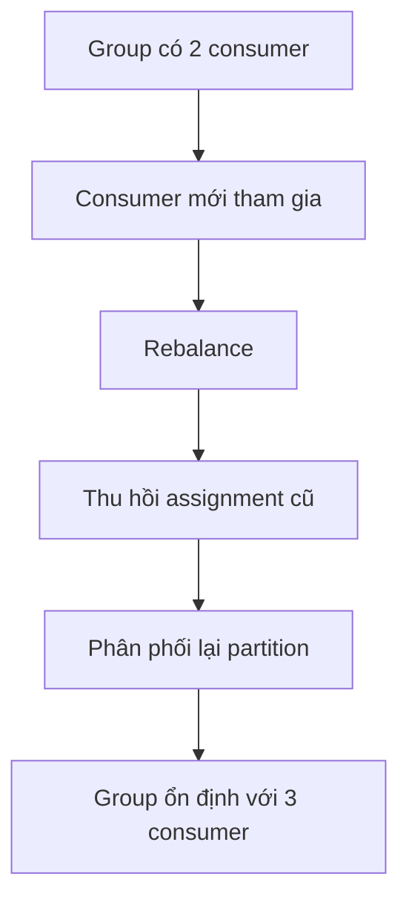

# Một partition chỉ có một consumer trong group

Trong Kafka, một partition tại một thời điểm chỉ được gán cho tối đa một consumer member của cùng một consumer group. Quy tắc này giúp group chia tải mà vẫn giữ thứ tự đọc trong từng partition. Một consumer có thể nhận nhiều partition, nhưng hai consumer thuộc cùng group không đồng thời sở hữu cùng một partition trong assignment ổn định.

Phạm vi của quy tắc rất quan trọng: nó áp dụng **trong một consumer group**. Nếu hai ứng dụng dùng hai `group.id` khác nhau, cả hai group đều có thể đọc cùng một partition. Đây là cách Kafka hỗ trợ nhiều subscriber độc lập cùng nhận một luồng sự kiện.

## 1. Quy tắc phân công partition

Kafka phân phối các partition của topic cho các member đang tham gia cùng consumer group. Mỗi partition có một owner trong assignment của group. Một member có thể được giao một hoặc nhiều partition, tùy số partition, số member, subscription và partition assignor.

Ví dụ, topic `orders` có sáu partition và group `order-projection` có ba consumer member:

```text
Topic orders
  P0   P1   P2   P3   P4   P5
   |    |    |    |    |    |
   v    v    v    v    v    v
Consumer group: order-projection

  Consumer A: P0, P1
  Consumer B: P2, P3
  Consumer C: P4, P5
```

Đây là một assignment minh họa khi số partition chia đều cho các member. Partition assignor quyết định cách phân phối thực tế; không nên dựa vào thứ tự P0, P1 hay một mapping cố định nếu ứng dụng không chủ động kiểm soát assignment.

Nếu group có sáu partition nhưng chỉ có hai member, mỗi member có thể nhận ba partition. Nếu group có sáu member, mỗi member có thể nhận một partition. Nếu group có tám member, ít nhất hai member sẽ không được giao partition nào của topic này.

| Số partition của topic | Số consumer member trong group | Số member có thể xử lý topic này đồng thời |
|---:|---:|---:|
| 1 | 1 | 1 |
| 1 | 4 | 1; 3 member còn lại không có partition của topic này |
| 3 | 2 | 2; một member có thể nhận hai partition |
| 6 | 3 | Tối đa 3 |
| 6 | 6 | Tối đa 6 |
| 6 | 9 | Tối đa 6; 3 member không có partition của topic này |

Với một group chỉ subscribe một topic, số consumer thực sự có thể xử lý topic cùng lúc không vượt quá số partition của topic. Khi group subscribe nhiều topic, cần xét tổng số partition được subscribe và assignment của từng topic; một member có thể nhận partition từ nhiều topic.

## 2. Một partition không thể được chia cho hai member cùng group

Giả sử partition `P0` chứa các record offset 100, 101, 102 và 103. Nếu `P0` được gán cho Consumer A trong group `order-projection`, Consumer B thuộc cùng group sẽ không được giao `P0` trong assignment đó.

```text
orders-P0: 100 -> 101 -> 102 -> 103 -> 104 -> ...
             |
             +---- Consumer A (group order-projection)

Consumer B (cùng group): không được gán orders-P0
```

Điều này cho phép Kafka duy trì thứ tự record trong partition đối với một consumer group. Consumer có thể xử lý nhiều partition song song, nhưng Kafka không chia một partition thành nhiều luồng consumer member độc lập trong cùng group.

Quy tắc này không có nghĩa một consumer chỉ xử lý một partition. Ngược lại, khi số partition lớn hơn số member, một member thường nhận nhiều partition. Ví dụ, một consumer duy nhất trong group có thể đọc cả sáu partition của topic.

## 3. `group.id` xác định phạm vi chia tải

Các consumer có cùng `group.id` tham gia cùng một group và chia nhau các partition. Các consumer có `group.id` khác nhau tạo thành các group độc lập; mỗi group có assignment và committed offset riêng.

Ví dụ một topic có ba partition và hai nhóm subscriber:

```text
                         Topic: order-events
                         P0     P1     P2
                          |      |      |
             +------------+------+------+------------+
             |                                      |
             v                                      v
     Group: order-projection                Group: fraud-detection
       Consumer A                              Consumer X
       Consumer B                              Consumer Y
       (A và B chia P0-P2)                     (X và Y chia P0-P2)
```

Mỗi partition chỉ có một owner trong từng group. Vì vậy, `P0` có thể được Consumer A của group `order-projection` đọc đồng thời với Consumer X của group `fraud-detection`. Hai group không tranh quyền sở hữu partition của nhau và có thể đọc cùng một record độc lập.

Đây là khác biệt giữa hai mục tiêu:

- **Scale out một công việc:** chạy nhiều consumer với cùng `group.id` để chia partition và tăng khả năng xử lý song song.
- **Phát sự kiện đến nhiều ứng dụng:** mỗi ứng dụng dùng một `group.id` riêng để mỗi group nhận đầy đủ luồng sự kiện.

Không tạo một `group.id` mới cho từng replica nếu mục tiêu là chia tải giữa các replica. Làm như vậy khiến mỗi replica trở thành một subscriber độc lập và mỗi replica có thể đọc toàn bộ topic.

## 4. Cấu hình consumer group trong Spring Kafka

Spring Kafka dùng `group.id` để đăng ký consumer vào group. Có thể khai báo qua Spring Boot:

```yaml
spring:
  kafka:
    consumer:
      group-id: order-projection
      enable-auto-commit: false
```

Hoặc đặt group ID trực tiếp trên listener:

```java
@KafkaListener(
        topics = "order-events",
        groupId = "order-projection"
)
public void handle(OrderEvent event) {
    orderProjectionService.apply(event);
}
```

Các listener cần chia tải cùng nhau phải tham gia cùng group. Nếu `groupId` trên annotation được đặt, nó xác định group cho listener đó. Nếu không đặt riêng, listener có thể dùng group ID từ consumer factory hoặc cấu hình Spring Boot.

### Tăng số consumer bằng `concurrency`

Với Spring Kafka, `ConcurrentMessageListenerContainer` có thể tạo nhiều child container. Mỗi child container quản lý một Kafka consumer riêng. Các consumer này cùng tham gia group nếu dùng chung group ID.

Có thể cấu hình concurrency qua Spring Boot:

```yaml
spring:
  kafka:
    consumer:
      group-id: order-projection
    listener:
      concurrency: 3
```

Hoặc cấu hình listener container factory:

```java
@Bean
ConcurrentKafkaListenerContainerFactory<String, OrderEvent>
orderListenerContainerFactory(
        ConsumerFactory<String, OrderEvent> consumerFactory) {

    var factory = new ConcurrentKafkaListenerContainerFactory<String, OrderEvent>();
    factory.setConsumerFactory(consumerFactory);
    factory.setConcurrency(3);
    return factory;
}
```

Khi listener dùng factory này, concurrency bằng ba tạo tối đa ba consumer member cho listener container. Kafka sẽ phân phối các partition mà group subscribe cho các member đó. `concurrency` không tạo thêm partition và không thể làm một partition được xử lý bởi ba consumer member cùng lúc.

Với một topic có một partition, `concurrency: 3` vẫn chỉ cho phép một child consumer nhận partition đó. Hai child consumer còn lại không có partition của topic này để xử lý. Với topic có sáu partition, ba child consumer có thể cùng hoạt động và mỗi consumer có thể nhận hai partition nếu assignment được chia đều.

## 5. Consumer nhận nhiều partition như thế nào?

Một Kafka consumer member có thể được giao nhiều partition. Khi một member nhận nhiều partition, nó poll các partition đó và listener container chuyển record cho listener theo cơ chế của container.

Ví dụ group có một member và topic có bốn partition:

```text
Topic orders
  P0   P1   P2   P3
   \    |    |   /
    \   |    |  /
     v  v    v v
       Consumer A
       (group order-projection)
```

Consumer A có thể đọc record từ cả bốn partition. Thứ tự được bảo đảm trong từng partition; không có một thứ tự tổng thể được bảo đảm giữa record thuộc các partition khác nhau. Ví dụ, record offset 20 của P2 có thể được listener nhận trước hoặc sau record offset 45 của P0.

Khi một partition có nhiều record, consumer đọc theo thứ tự offset của partition đó. Nếu nghiệp vụ cần thứ tự theo đơn hàng hoặc aggregate, producer thường cần dùng key ổn định để các event cùng key được ghi vào cùng partition. Kafka chỉ bảo đảm thứ tự trong partition đó; tăng số partition hoặc thay đổi key có thể ảnh hưởng cách phân phối event.

## 6. Điều gì xảy ra khi số consumer lớn hơn số partition?

Giả sử topic `payments` có hai partition nhưng ứng dụng cấu hình sáu consumer trong cùng group:

```text
payments: P0, P1

Group payment-service:
  Consumer A -> P0
  Consumer B -> P1
  Consumer C -> không có partition
  Consumer D -> không có partition
  Consumer E -> không có partition
  Consumer F -> không có partition
```

Chỉ hai consumer có thể xử lý topic này tại một thời điểm ổn định. Các consumer còn lại vẫn là member của group nhưng không được giao partition của topic. Tăng số Pod hoặc tăng `concurrency` vượt quá số partition không làm throughput của một topic tăng tương ứng.

Consumer không có assignment có thể vẫn hữu ích nếu group subscribe thêm topic khác có partition chưa được giao. Tuy nhiên, nếu chỉ subscribe `payments`, các consumer dư thừa không xử lý record nào từ topic này.

Khi lập kế hoạch scale, nên so sánh số partition với concurrency thực tế. Nếu số partition là giới hạn, cần cân nhắc tăng partition hoặc thay đổi thiết kế xử lý. Tăng partition có tác động tới phân phối key, vì vậy không nên xem đây là thay đổi cấu hình hoàn toàn không ảnh hưởng dữ liệu.

## 7. Khi nào cần tăng số partition?

Số partition là giới hạn song song theo partition của một topic trong một consumer group. Nếu một topic có một partition, group chỉ có một consumer member nhận partition đó. Muốn có nhiều consumer member cùng xử lý topic, topic cần có nhiều partition.

Ví dụ, hệ thống order cần tối đa bốn consumer xử lý đồng thời:

```text
orders: 4 partitions

Group order-projection:
  Consumer A -> P0
  Consumer B -> P1
  Consumer C -> P2
  Consumer D -> P3
```

Việc tăng partition có một số hệ quả cần đánh giá:

- Kafka có thể thực hiện rebalance để phân phối lại partition cho các consumer member.
- Với producer dùng key, phép ánh xạ key sang partition có thể thay đổi khi số partition thay đổi. Các event mới của cùng key có thể được ghi vào partition khác so với event cũ.
- Kafka chỉ bảo đảm thứ tự trong một partition. Nếu cùng aggregate bị chuyển sang partition khác sau khi tăng partition, ứng dụng cần xem xét tác động đến thứ tự giữa các event cũ và mới.
- Mỗi partition có chi phí tài nguyên và vận hành trên broker, như log segment, file handle, metadata và công việc replication.
- Số partition cần phù hợp với throughput, kích thước record, số broker, replication factor và khả năng xử lý của downstream.

Vì vậy, hãy thiết kế số partition dựa trên throughput mục tiêu, mức song song cần thiết và yêu cầu ordering. Không nên tăng partition chỉ để làm cho con số concurrency lớn hơn.

## 8. Partition assignment và rebalance

Khi consumer tham gia group, rời group hoặc group thay đổi subscription, Kafka có thể thực hiện rebalance. Trong quá trình này, assignment cũ được thu hồi và assignment mới được tạo để phân phối partition cho các member hiện tại.

Các tình huống thường kích hoạt rebalance gồm:

- Một consumer mới khởi động và tham gia group.
- Một consumer dừng, bị lỗi hoặc mất kết nối.
- Consumer không poll trong thời gian vượt `max.poll.interval.ms`.
- Subscription của group thay đổi.
- Số partition của topic được subscribe thay đổi.
- Consumer bị xem là không còn hoạt động theo cơ chế heartbeat và session timeout.

Ví dụ khi group mở rộng từ hai lên ba consumer:



Sau rebalance, một partition có thể được giao cho consumer member khác. Consumer cũ cần hoàn tất hoặc dừng công việc liên quan đến partition bị thu hồi theo lifecycle của container. Offset đã commit xác định vị trí group tiếp tục đọc; record chưa commit có thể được đọc lại bởi owner mới.

Rebalance có thể làm tăng độ trễ tạm thời vì consumer phải tham gia lại group và nhận assignment mới. Nếu ứng dụng liên tục scale, restart hoặc vượt `max.poll.interval.ms`, group có thể rebalance thường xuyên và throughput giảm.

### Range, RoundRobin, Sticky và CooperativeSticky

Partition assignor quyết định cách phân phối partition cho các member. Một số chiến lược phổ biến gồm:

| Assignor | Đặc điểm khái quát | Khi cân nhắc |
|---|---|---|
| Range | Phân phối theo từng topic, thường gom các partition liền nhau cho member | Cấu hình đơn giản; với nhiều topic có thể tạo phân phối không đều tổng thể |
| RoundRobin | Phân phối lần lượt partition của các topic cho member | Có thể tạo assignment cân bằng hơn khi subscription tương thích |
| Sticky | Cố giữ partition ở member cũ nếu có thể, đồng thời cố gắng cân bằng assignment | Hạn chế thay đổi owner không cần thiết khi membership đổi |
| CooperativeSticky | Kết hợp tính ổn định của sticky với rebalance hợp tác, cho phép thu hồi từng phần | Giảm thời gian dừng toàn group khi ứng dụng và cấu hình hỗ trợ |

Tên và khả năng sử dụng assignor phụ thuộc phiên bản Kafka client và cấu hình triển khai. Không nên giả định mọi consumer đều dùng cùng một chiến lược nếu ứng dụng có nhiều loại client hoặc subscription khác nhau. Khi thay đổi assignor, cần triển khai tương thích giữa các member và quan sát quá trình rebalance.

## 9. Giữ xử lý an toàn khi partition đổi owner

Vì partition có thể chuyển sang member khác sau rebalance, consumer cần xử lý đúng thời điểm partition bị revoke hoặc lost. Spring Kafka quản lý vòng đời consumer và listener container, nhưng ứng dụng vẫn cần tránh để công việc bất đồng bộ tiếp tục ghi tác động nghiệp vụ sau khi listener đã trả về và offset đã được commit.

Với xử lý đồng bộ thông thường, listener hoàn tất công việc trước khi container xác nhận offset theo `AckMode`. Nếu listener khởi chạy một tác vụ nền rồi trả về ngay, container có thể xem record đã xử lý xong trong khi tác vụ vẫn chạy. Khi partition được giao cho consumer khác, tác vụ cũ có thể tiếp tục chạy song song với lần xử lý lại của owner mới.

Ví dụ không an toàn:

```java
@KafkaListener(topics = "orders", groupId = "order-projection")
public void handle(OrderEvent event) {
    executor.submit(() -> orderService.apply(event));
    // Listener trả về trước khi tác vụ nghiệp vụ hoàn tất.
}
```

Trong ví dụ này, listener trả về ngay sau khi submit. Container có thể commit offset trước khi `orderService.apply()` hoàn tất. Nếu ứng dụng dừng hoặc partition được giao lại, tác động nghiệp vụ có thể bị mất hoặc lặp.

Một cách đơn giản hơn là xử lý đồng bộ trong listener:

```java
@KafkaListener(topics = "orders", groupId = "order-projection")
public void handle(OrderEvent event) {
    orderService.apply(event); // chỉ trả về sau khi nghiệp vụ hoàn tất
}
```

Nếu cần xử lý song song bất đồng bộ, phải thiết kế rõ việc theo dõi completion, thứ tự offset, pause/resume partition và acknowledgment. Không được xác nhận offset vượt qua record có công việc chưa hoàn tất. Với nghiệp vụ ghi database hoặc gọi dịch vụ ngoài, idempotency vẫn cần thiết để chịu được record được giao lại.

## 10. Tối ưu concurrency trong Spring Kafka

`concurrency` nên dựa trên số partition, thời gian xử lý record và khả năng chịu tải của hệ thống phụ trợ. Tăng concurrency có thể cải thiện throughput khi topic có đủ partition và downstream còn tài nguyên. Nếu partition ít, consumer bổ sung sẽ không tăng mức song song của topic.

Một số điểm cần cân nhắc:

- **Số partition:** concurrency lớn hơn số partition của một topic không giúp topic đó có thêm consumer member hoạt động.
- **Thời gian xử lý:** listener xử lý lâu có thể cần điều chỉnh `max.poll.interval.ms`, nhưng tăng timeout không thay thế việc xử lý đúng rebalance.
- **Downstream capacity:** nhiều consumer đồng thời có thể làm database hoặc HTTP service quá tải.
- **Ordering:** các partition khác nhau được xử lý song song; nếu nghiệp vụ cần thứ tự toàn cục, cần xem lại partitioning và mô hình xử lý.
- **Tài nguyên process:** mỗi child container có consumer riêng, dùng kết nối mạng, buffer và tài nguyên tương ứng.
- **Số replica:** tổng concurrency trên tất cả replica mới là số consumer member tiềm năng trong group. Ví dụ ba Pod, mỗi Pod concurrency hai, có thể tạo sáu member.

Ví dụ ba replica cùng chạy cấu hình concurrency hai:

```text
Pod A: consumer A1, consumer A2
Pod B: consumer B1, consumer B2
Pod C: consumer C1, consumer C2

Tổng cộng: tối đa 6 consumer member trong cùng group
```

Nếu topic có bốn partition, tối đa bốn member có thể nhận partition của topic đó trong assignment ổn định. Hai member còn lại không nhận partition của topic này. Cần tính concurrency ở cấp toàn deployment, không chỉ nhìn giá trị `spring.kafka.listener.concurrency` của một Pod.

## 11. Static membership và giảm rebalance không cần thiết

Kafka hỗ trợ static membership qua `group.instance.id`. Một member có static identity có thể giữ danh tính qua lần restart ngắn hạn; điều này có thể giảm rebalance không cần thiết khi instance khởi động lại trong giới hạn cấu hình.

Trong một group, `group.instance.id` phải duy nhất cho từng static member đang hoạt động. Nếu hai consumer đồng thời dùng cùng static ID, Kafka có thể loại một member khỏi group hoặc phát sinh lỗi liên quan đến duplicate member identity. Cần tạo ID từ danh tính instance ổn định, chẳng hạn StatefulSet ordinal, và bảo đảm các replica khác nhau nhận giá trị khác nhau.

Static membership không thay đổi quy tắc một partition chỉ có một owner trong group. Nó chỉ ảnh hưởng cách Kafka nhận diện member và quản lý membership khi member rời hoặc quay lại. Nó cũng không thay thế `transactional.id` của producer; hai loại ID phục vụ hai cơ chế khác nhau.

Chỉ bật static membership khi vòng đời instance và ID được quản lý rõ ràng. Với workload có Pod name thay đổi liên tục, cần đánh giá liệu static identity có thực sự ổn định và có lợi hay không.

## 12. Quan sát assignment và consumer group

Khi cần xác nhận partition được giao cho consumer nào, hãy quan sát assignment thực tế thay vì chỉ nhìn số replica hoặc cấu hình concurrency.

Kafka cung cấp lệnh `kafka-consumer-groups` để xem trạng thái group:

```bash
kafka-consumer-groups.sh \
  --bootstrap-server kafka-1:9092 \
  --describe \
  --group order-projection
```

Kết quả thường thể hiện topic, partition, current offset, log end offset, lag và thông tin consumer/member hoặc host tùy phiên bản Kafka. Có thể dùng kết quả này để kiểm tra:

- Mỗi partition của topic có một assignment trong group hay chưa.
- Consumer member nào đang sở hữu partition.
- Có member nào không được giao partition hay không.
- Lag có tập trung vào một partition hoặc một member hay không.
- Assignment có thay đổi liên tục do rebalance hay không.

Trong Spring Kafka, có thể quan sát log lifecycle của listener container, sự kiện partition assigned/revoked và các metric consumer. Khi cần chi tiết assignment, ứng dụng có thể đăng ký listener hoặc event handler phù hợp với phiên bản Spring Kafka để ghi nhận partition được giao và bị thu hồi.

Các chỉ số vận hành hữu ích gồm:

- Consumer group lag theo partition.
- Số consumer member và số partition đang được giao.
- Tần suất và thời gian rebalance.
- Thời gian xử lý listener theo partition hoặc loại event.
- Số lần poll, số record mỗi poll và thời gian giữa các lần poll.
- Lỗi commit offset và số lần retry.

Nếu một partition có lag tăng liên tục trong khi các partition khác ổn định, nguyên nhân có thể là key phân phối lệch, một số record xử lý lâu hoặc downstream không đồng đều. Thêm consumer member không nhất thiết giải quyết được hot partition vì partition đó vẫn chỉ có một owner trong group.

## 13. Các hiểu nhầm thường gặp

| Hiểu nhầm | Cách hiểu đúng |
|---|---|
| Mỗi consumer chỉ được đọc một partition | Một consumer có thể nhận nhiều partition |
| Tăng số consumer luôn tăng throughput | Consumer dư so với partition sẽ không nhận thêm partition của topic đó |
| Một partition chỉ có một consumer trên toàn cluster | Quy tắc áp dụng trong từng group; nhiều group độc lập có thể đọc cùng partition |
| Tăng `concurrency` tạo thêm partition | `concurrency` chỉ tạo thêm consumer member trong group |
| Hai consumer cùng group có thể chia đôi một partition | Một partition được gán cho tối đa một member trong assignment ổn định |
| Có thể dùng group ID khác nhau cho các replica để scale | Group ID khác nhau tạo subscriber độc lập; mỗi group đọc toàn bộ partition được subscribe |
| Rebalance không ảnh hưởng xử lý | Rebalance có thể thu hồi và giao lại partition, làm record chưa commit được đọc lại |
| Một partition có một owner nghĩa là thứ tự toàn topic được bảo đảm | Kafka bảo đảm thứ tự trong từng partition; không có thứ tự tổng thể giữa nhiều partition |

## 14. Ví dụ chọn topology theo mục tiêu

### Một ứng dụng cần scale xử lý order

Topic `order-events` có tám partition. Chạy bốn replica của service, mỗi replica concurrency hai. Cả tám consumer member dùng cùng `group.id=order-projection`. Kafka có thể phân phối tám partition cho tám member; mỗi member xử lý một partition nếu assignment cân bằng.

### Hai ứng dụng độc lập cùng cần nhận order event

Service `order-projection` và `fraud-detection` dùng hai group ID khác nhau. Mỗi group có consumer member riêng và tự chia tám partition trong nội bộ group. Cả hai service đều nhận tất cả event cần thiết, độc lập với tiến độ của service còn lại.

### Topic chỉ có một partition nhưng cần throughput cao hơn

Tăng replica từ một lên mười không tạo thêm song song theo partition. Cần xác định liệu có thể tăng partition mà vẫn giữ yêu cầu ordering hay không. Nếu tất cả event cần thứ tự toàn cục, một partition có thể là quyết định có chủ đích và giới hạn song song là hệ quả của yêu cầu đó. Nếu chỉ cần thứ tự theo key, có thể dùng nhiều partition và key ổn định để song song giữa các aggregate.

## 15. Hướng dẫn triển khai

Khi thiết kế consumer group, hãy thực hiện theo trình tự sau:

1. Xác định service nào là một subscriber độc lập. Mỗi subscriber độc lập cần group ID riêng.
2. Xác định các replica nào cùng chia tải một công việc. Các replica đó phải dùng chung group ID.
3. Chọn số partition theo throughput và mức song song cần thiết, đồng thời giữ yêu cầu ordering theo key.
4. Đặt concurrency dựa trên tổng số partition có thể được giao cho group và khả năng chịu tải của downstream.
5. Triển khai thử và kiểm tra assignment thực tế, bao gồm member dư thừa và phân phối partition không đều.
6. Theo dõi lag, rebalance và thời gian xử lý để điều chỉnh số partition hoặc concurrency.
7. Kiểm tra listener hoàn tất công việc trước khi offset được xác nhận; dùng idempotency để chịu được record được giao lại sau lỗi hoặc rebalance.

Quy tắc một partition chỉ có một consumer member trong cùng group là nền tảng cho cách Kafka chia tải và giữ thứ tự trong partition. Khi scale một consumer, hãy phối hợp đúng `group.id`, số partition và concurrency; khi cần nhiều subscriber độc lập, hãy dùng group riêng cho từng subscriber. Cách tổ chức này giúp dự đoán được member nào xử lý record, giới hạn song song ở đâu và rebalance ảnh hưởng đến ứng dụng như thế nào.
