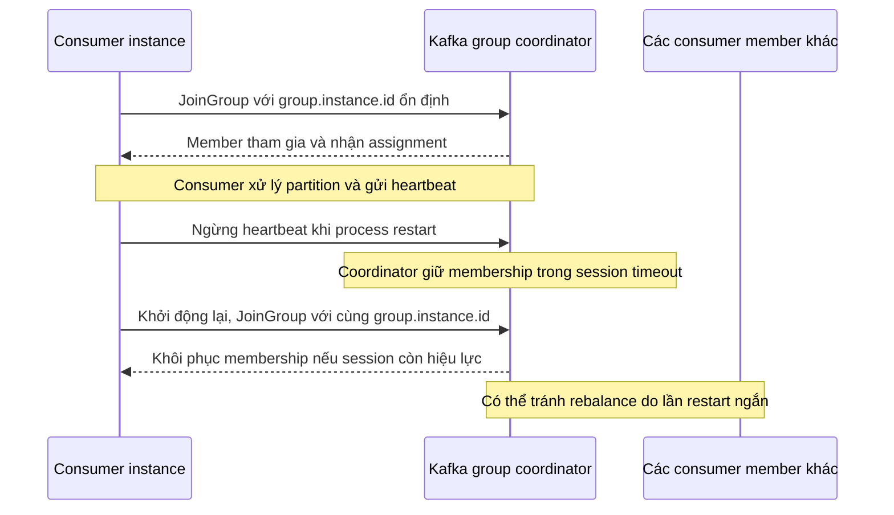

# Static membership

Static membership là cơ chế giúp Kafka nhận diện một consumer instance bằng một định danh ổn định qua các lần restart. Thay vì coi mỗi lần khởi động là một member mới, consumer có thể dùng `group.instance.id` để báo với group coordinator rằng nó là cùng một instance đã tham gia trước đó.

Trong consumer group thông thường, member thường có định danh do coordinator cấp cho phiên tham gia hiện tại. Khi process dừng, mất heartbeat hoặc rời group, coordinator có thể bắt đầu rebalance để phân phối lại partition. Với static membership, `group.instance.id` đại diện cho danh tính ổn định của instance. Nếu instance khởi động lại và tham gia lại trong thời gian session còn hiệu lực, Kafka có thể giữ membership và tránh một đợt rebalance chỉ vì lần restart ngắn đó.

Static membership hữu ích với consumer chạy thành các instance ổn định, chẳng hạn StatefulSet, VM có định danh cố định hoặc dịch vụ có số replica được quản lý rõ. Nó giúp giảm rebalance trong các lần restart hoặc rolling deployment ngắn. Tuy nhiên, cơ chế này thay đổi cách Kafka phát hiện member đã mất: partition có thể tiếp tục được giữ cho member trong thời gian chờ session timeout. Vì vậy, cấu hình sai có thể làm failover chậm hoặc gây xung đột định danh.

## 1. Static membership là gì?

Kafka consumer group phân phối partition cho các consumer member. Mỗi member xử lý các partition được gán và duy trì heartbeat với group coordinator để chứng minh nó còn hoạt động.

Với dynamic membership, member thường tham gia bằng một định danh do Kafka quản lý cho phiên hiện tại. Khi member rời group hoặc bị phát hiện mất kết nối, coordinator cập nhật thành viên và có thể thực hiện rebalance. Khi một process mới khởi động, nó thường được xem là một lần tham gia mới.

Static membership bổ sung thuộc tính `group.instance.id` để định danh một consumer instance ổn định. Khi thuộc tính này được cấu hình:

- Consumer trở thành static member của group.
- Định danh instance được giữ ổn định qua các lần restart.
- Coordinator có thể giữ chỗ membership trong khoảng `session.timeout.ms` khi member tạm thời không gửi heartbeat.
- Nếu cùng instance khởi động lại và tham gia lại trước khi session hết hạn, nó có thể tiếp tục membership mà không tạo rebalance chỉ vì lần restart đó.
- Nếu session hết hạn hoặc group thay đổi theo cách khác, coordinator vẫn có thể thực hiện rebalance.

Static membership được Kafka giới thiệu từ dòng Kafka 2.3 theo KIP-345. Cả client và broker cần hỗ trợ tính năng này; hãy xác nhận phiên bản Kafka client, broker và Spring Kafka của hệ thống trước khi bật trong production.

## 2. Phân biệt các định danh trong consumer group

Các thuộc tính sau có mục đích khác nhau và không thể thay thế cho nhau:

| Thuộc tính | Phạm vi | Ý nghĩa |
|---|---|---|
| `group.id` | Consumer group | Tên nhóm consumer cùng chia sẻ offset và phối hợp nhận partition. |
| `group.instance.id` | Một static member trong group | Định danh ổn định của một instance qua các lần restart. |
| `member.id` | Một lần tham gia group | Định danh member trong giao thức group; Kafka quản lý giá trị này. |
| `client.id` | Kafka client | Nhãn phục vụ log, metrics, quota hoặc chẩn đoán client. |
| `group.protocol` | Cơ chế group protocol | Chọn giao thức phối hợp consumer group được client/broker hỗ trợ; không phải định danh instance. |

`group.instance.id` phải duy nhất giữa các consumer instance đang hoạt động trong cùng một `group.id`. Hai group khác nhau có thể có các static member dùng cùng chuỗi ID, nhưng trong một group không được có hai process đồng thời đại diện cho cùng một ID.

Ví dụ, một dịch vụ có group ID `orders-service` và ba instance có thể dùng:

| Instance | `group.id` | `group.instance.id` |
|---|---|---|
| Consumer 0 | `orders-service` | `orders-consumer-0` |
| Consumer 1 | `orders-service` | `orders-consumer-1` |
| Consumer 2 | `orders-service` | `orders-consumer-2` |

Khi instance `orders-consumer-1` restart, nó phải dùng lại đúng ID đó. Nếu khởi động lại với một ID mới mỗi lần, Kafka sẽ coi đó là một static member khác và lợi ích giữ membership qua restart bị mất.

Không dùng một giá trị chung như `orders-consumer` cho tất cả pod. Điều đó tạo xung đột vì nhiều process sẽ cùng tuyên bố một static identity. Cũng không dùng UUID ngẫu nhiên tạo mới ở mỗi lần khởi động nếu mục tiêu là giữ danh tính qua restart.

## 3. Coordinator xử lý restart như thế nào?

Với dynamic membership, một member rời group thường làm coordinator cập nhật group membership và khởi động rebalance. Với static membership, Kafka có thể giữ member trong group đến khi `session.timeout.ms` hết hạn, kể cả khi process đã dừng hoặc gọi close. Điều này tạo một khoảng thời gian để cùng instance khởi động lại và tiếp tục với static ID cũ.



Nếu instance quay lại trước khi session hết hạn và group không có thay đổi khác buộc phải rebalance, coordinator có thể nhận diện lại static member đó mà không phân phối lại toàn bộ partition. Nếu instance không quay lại trước khi session timeout hết hạn, coordinator loại member khỏi group và thực hiện rebalance để partition có thể được giao cho member khác.

Static membership không bảo đảm partition luôn ở đúng consumer trong mọi tình huống. Rebalance vẫn có thể xảy ra khi số member thay đổi, subscription thay đổi, topic/partition thay đổi, session hết hạn, assignor hoặc group protocol yêu cầu phân phối lại.

### Lợi ích và chi phí của khoảng chờ

Trong thời gian coordinator giữ membership của static member đã mất heartbeat, partition có thể vẫn được xem là thuộc về member đó. Các member khác không nhất thiết được phép xử lý thay các partition này ngay lập tức. Điều này giảm rebalance khi restart ngắn nhưng có thể làm một phần workload tạm ngừng nếu instance không quay lại.

Do đó, static membership đổi một phần chi phí rebalance lấy một khoảng thời gian chờ để phục hồi member. Với hệ thống cần failover nhanh, `session.timeout.ms` quá dài có thể làm thời gian gián đoạn tăng lên. Với hệ thống thường restart ngắn và nhạy với rebalance, một khoảng chờ phù hợp có thể giảm việc chuyển partition không cần thiết.

## 4. Cấu hình group.instance.id trong Spring Kafka

Spring Boot cho phép truyền thuộc tính Kafka client qua `spring.kafka.consumer.properties`. Ví dụ cấu hình một consumer instance:

```yaml
spring:
  kafka:
    consumer:
      group-id: orders-service
      properties:
        "[group.instance.id]": orders-consumer-0
        "[session.timeout.ms]": 45000
        "[heartbeat.interval.ms]": 3000
    listener:
      concurrency: 1
```

Các giá trị `session.timeout.ms` và `heartbeat.interval.ms` chỉ là ví dụ. Giá trị thực tế phải nằm trong giới hạn broker và phù hợp với thời gian restart, độ trễ mạng, thời gian phát hiện lỗi mà dịch vụ chấp nhận. `heartbeat.interval.ms` phải thấp hơn `session.timeout.ms`; thông lệ thường đặt heartbeat interval không quá khoảng một phần ba session timeout.

Nếu tạo `ConsumerFactory` bằng Java, có thể thêm thuộc tính trực tiếp:

```java
Map<String, Object> consumerProperties = new HashMap<>();
consumerProperties.put(ConsumerConfig.BOOTSTRAP_SERVERS_CONFIG, bootstrapServers);
consumerProperties.put(ConsumerConfig.GROUP_ID_CONFIG, "orders-service");
consumerProperties.put(
        ConsumerConfig.GROUP_INSTANCE_ID_CONFIG, "orders-consumer-0");
consumerProperties.put(ConsumerConfig.SESSION_TIMEOUT_MS_CONFIG, 45_000);
consumerProperties.put(ConsumerConfig.HEARTBEAT_INTERVAL_MS_CONFIG, 3_000);

ConsumerFactory<String, OrderEvent> consumerFactory =
        new DefaultKafkaConsumerFactory<>(consumerProperties);
```

Trong ví dụ này, ID `orders-consumer-0` phải được cung cấp từ cấu hình triển khai hoặc một nguồn định danh ổn định. Không hard-code cùng giá trị vào mọi replica của một dịch vụ chạy nhiều instance.

### Dùng ConcurrentMessageListenerContainer

Khi Spring Kafka dùng `ConcurrentMessageListenerContainer`, một container cha có thể tạo nhiều consumer con theo `concurrency`. Mỗi consumer con là một member riêng của group và cần `group.instance.id` riêng. Các phiên bản Spring Kafka hỗ trợ static membership cho concurrent container sẽ thêm suffix theo chỉ số consumer con vào base `group.instance.id` để tạo ID riêng. Cần kiểm tra hành vi của phiên bản đang chạy và log/effective consumer properties sau khi triển khai.

Ví dụ, một base ID có thể được mở rộng thành các ID con theo chỉ số container. Dù framework hỗ trợ suffix, base ID vẫn phải duy nhất giữa các instance ứng dụng. Nếu hai pod cùng dùng base ID giống nhau, các ID con tương ứng vẫn có thể xung đột.

Nếu dùng `concurrency: 1`, chỉ có một consumer con trong container và việc định danh đơn giản hơn. Nếu tăng concurrency, hãy tính tổng số static member trên toàn bộ các replica, kiểm tra ID thực tế của từng consumer con và bảo đảm không có hai member trùng nhau trong cùng group.

## 5. Chọn static ID ổn định theo môi trường triển khai

Định danh static member cần tồn tại qua restart của cùng một logical instance. Cách cấp ID phụ thuộc nền tảng triển khai:

| Môi trường | Cách tạo ID phù hợp | Lưu ý |
|---|---|---|
| Kubernetes StatefulSet | Tên workload cộng ordinal, ví dụ `orders-consumer-0` | Pod ordinal ổn định qua lần tạo lại pod cùng StatefulSet. |
| VM cố định | Tên node hoặc instance ID được quản lý ổn định | Tránh dùng hostname có thể thay đổi khi tái tạo máy. |
| Bare metal | Định danh node do hệ thống triển khai quản lý | Bảo đảm một ID không được cấp cho hai process cùng lúc. |
| Kubernetes Deployment với pod ephemeral | Chỉ dùng khi có cơ chế cấp và giữ identity ổn định | Pod name thường đổi khi recreate; ID ngẫu nhiên mới làm mất lợi ích static membership. |
| Autoscaling với replica thay đổi liên tục | Đánh giá kỹ lợi ích so với dynamic membership | Phải cấp/revoke ID an toàn và tránh trùng khi scale hoặc thay thế instance. |

Với StatefulSet có ba replica, có thể đặt base ID lần lượt theo ordinal. Khi pod `orders-consumer-1` được tạo lại trên node khác, nó vẫn dùng cùng static ID. Khi scale từ ba lên bốn replica, instance mới phải nhận một ID chưa được dùng trong group.

Không lấy `group.id` làm `group.instance.id` cho tất cả member. `group.id` xác định group; `group.instance.id` xác định một member cụ thể bên trong group. Hai giá trị phục vụ hai cấp định danh khác nhau.

### Rolling deployment

Static membership có thể giảm rebalance khi từng instance restart nhanh hơn session timeout. Một quy trình rolling deployment cần:

1. Giữ nguyên static ID cho logical instance được thay thế.
2. Chỉ chạy một process với một static ID tại một thời điểm.
3. Cho listener dừng nhận công việc mới và hoàn tất xử lý đang chạy theo shutdown policy.
4. Khởi động lại instance trong khoảng session timeout đã chọn nếu muốn giữ membership.
5. Theo dõi group membership, assignment và consumer lag trong lúc rollout.
6. Xác nhận không có `FencedInstanceIdException` hoặc partition bị giữ lâu do member không quay lại.

Nếu triển khai tạo process mới trước khi process cũ dừng hẳn và cả hai dùng cùng static ID, Kafka có thể fence một trong hai. Hãy cấu hình rollout để tránh chạy đồng thời hai chủ sở hữu của cùng identity.

## 6. Điều chỉnh session.timeout.ms và heartbeat.interval.ms

`session.timeout.ms` là khoảng thời gian coordinator chờ heartbeat trước khi xem member đã mất. Với static member, khoảng này cũng là thời gian giữ membership khi member tạm thời không heartbeat. Đây là tham số quan trọng để cân bằng giữa khả năng chịu restart ngắn và tốc độ phát hiện sự cố thật.

`heartbeat.interval.ms` quy định tần suất consumer gửi heartbeat. Heartbeat cần đủ thường xuyên để phát hiện member còn hoạt động, đồng thời tránh quá nhạy với jitter mạng nhỏ. Thông lệ phổ biến là heartbeat interval thấp hơn session timeout và thường không vượt quá khoảng một phần ba giá trị session timeout.

Broker giới hạn giá trị session timeout bằng các cấu hình như `group.min.session.timeout.ms` và `group.max.session.timeout.ms`. Consumer gửi giá trị ngoài giới hạn có thể bị từ chối khi tham gia group. Hãy kiểm tra cấu hình broker và policy của nền tảng trước khi thay đổi.

### Chọn session timeout theo thời gian restart

Hãy đo thời gian từ khi process cũ ngừng heartbeat đến khi process mới sẵn sàng tham gia group. Thời gian này có thể bao gồm:

- Thời gian dừng listener và hoàn tất record đang xử lý.
- Thời gian JVM shutdown hoặc container termination.
- Thời gian scheduler tạo pod/VM mới.
- Thời gian tải cấu hình, khởi tạo Spring ApplicationContext và kết nối Kafka.
- Thời gian DNS, TLS/SASL và metadata sẵn sàng.

Nếu muốn giữ membership qua restart, session timeout cần lớn hơn thời gian gián đoạn thông thường có thể dự kiến, có thêm biên cho biến động. Nhưng session timeout càng dài thì khi instance chết thật, group càng lâu mới giải phóng partition cho member khác.

Ví dụ, nếu restart bình thường mất khoảng 20 giây, session timeout 45 giây có thể tạo khoảng đệm. Nếu process chết hẳn, group có thể phải chờ gần hết khoảng session trước khi rebalance. Các con số phải dựa trên phép đo và giới hạn broker; không sao chép cấu hình ví dụ một cách máy móc.

### Quan hệ với max.poll.interval.ms

`max.poll.interval.ms` giới hạn thời gian giữa các lần gọi `poll()`. Nó phản ánh tiến độ ứng dụng lấy record và xử lý batch. `session.timeout.ms` phản ánh thời gian coordinator chờ heartbeat.

Với dynamic member, vượt `max.poll.interval.ms` có thể khiến consumer rời group và partition được phân phối lại. Với static member, khi vượt `max.poll.interval.ms`, client ngừng heartbeat; coordinator chờ đến khi `session.timeout.ms` hết trước khi loại member và phân phối lại partition. Vì vậy static membership có thể kéo dài thời gian partition bị giữ khi listener bị treo hoặc xử lý quá lâu.

Không tăng `max.poll.interval.ms` hoặc `session.timeout.ms` chỉ để che giấu listener chậm. Hãy đo thời gian xử lý batch, giảm `max.poll.records`, tối ưu downstream hoặc thiết kế xử lý bất đồng bộ có kiểm soát. Bảo đảm consumer tiếp tục poll đúng nhịp và commit offset sau khi nghiệp vụ hoàn tất.

## 7. Static membership và các chiến lược rebalance

Static membership và partition assignor giải quyết hai vấn đề liên quan nhưng khác nhau:

- Static membership giữ danh tính member ổn định và có thể tránh rebalance khi cùng instance quay lại trong session timeout.
- Partition assignor quyết định partition được phân phối cho các member khi group thực hiện assignment.

`RangeAssignor`, `RoundRobinAssignor` và `CooperativeStickyAssignor` là các chiến lược assignment khác nhau. `CooperativeStickyAssignor` hỗ trợ rebalance hợp tác, giảm số partition phải thu hồi và chuyển giao trong một lần rebalance. Nó có thể bổ sung lợi ích cho static membership, nhưng không thay thế `group.instance.id` và cũng không loại bỏ mọi rebalance.

Rebalance vẫn có thể xuất hiện khi:

- Static member không quay lại trước khi session timeout hết hạn.
- Số replica tăng hoặc giảm.
- Topic subscription hoặc pattern subscription thay đổi.
- Số partition của topic thay đổi.
- Member bị fencing do trùng `group.instance.id`.
- Group protocol hoặc assignment strategy yêu cầu phân phối lại.
- Coordinator/broker gặp sự cố hoặc group metadata thay đổi.

Không nên kỳ vọng static membership giữ nguyên assignment bất kể thay đổi hạ tầng. Hãy quan sát partition assignment thực tế sau mỗi lần triển khai hoặc scale.

## 8. Static membership ảnh hưởng gì đến offset và delivery guarantee?

Static membership chỉ thay đổi cách nhận diện member và quản lý group membership. Nó không thay đổi ý nghĩa của offset, cơ chế commit, acknowledgement của producer hoặc bảo đảm giao nhận của listener.

Các điểm sau vẫn cần được thiết kế riêng:

- `enable.auto.commit` quyết định Kafka client có tự commit offset định kỳ hay không.
- Spring Kafka `AckMode` quyết định listener container commit sau record, batch hoặc manual acknowledgement khi auto commit tắt.
- Idempotency vẫn cần thiết vì consumer có thể xử lý lại record sau khi nghiệp vụ hoàn tất nhưng offset chưa commit.
- Kafka transaction vẫn cần cấu hình riêng nếu muốn kết hợp consume-transform-produce và commit offset trong một transaction Kafka.
- Retry và DLT vẫn do error handler/retry topic policy quyết định.

Ví dụ, một static member restart trước session timeout có thể giữ membership và tránh rebalance, nhưng nếu process dừng sau khi database commit và trước khi offset commit, record vẫn có thể được giao lại. Static membership không ngăn duplicate nghiệp vụ. Consumer vẫn cần `eventId`, inbox hoặc idempotency key ở hệ thống đích.

## 9. Theo dõi static membership trong production

Để biết static membership đang giúp ích hay đang làm chậm failover, cần quan sát cả trạng thái group và trạng thái ứng dụng.

| Phạm vi | Tín hiệu cần theo dõi | Ý nghĩa |
|---|---|---|
| Group membership | `group.id`, `group.instance.id`, member ID, số member và trạng thái join/sync | Xác nhận identity có duy nhất và member có tham gia đúng group. |
| Rebalance | Số lần rebalance, thời gian rebalance, partition revoked/assigned | Đánh giá static membership có giảm rebalance do restart không. |
| Heartbeat/session | Heartbeat failure, session timeout, thời gian member vắng mặt | Phát hiện member chết, mạng chập chờn hoặc session timeout quá dài/ngắn. |
| Poll/listener | Poll interval, processing duration, `max.poll.interval.ms` violation | Phát hiện consumer không poll đúng nhịp hoặc listener bị treo. |
| Partition/lag | Assignment theo member, lag theo partition, tuổi record | Phát hiện partition bị giữ nhưng không được xử lý hoặc consumer mất cân bằng. |
| Lỗi identity | `FencedInstanceIdException` và lỗi join group | Phát hiện ID bị trùng hoặc hai process cùng dùng một identity. |
| Deployment | Restart duration, rollout overlap, số replica và ID theo instance | Đối chiếu lỗi group với lịch triển khai hoặc autoscaling. |

Log của ứng dụng nên ghi `group.id`, `group.instance.id`, `client.id`, application instance, thời điểm start/stop, partition assignment và lý do rebalance. Không ghi credential hoặc thông tin bí mật. Nếu Spring Kafka dùng concurrency, cần log ID hiệu lực của từng consumer con để phát hiện suffix hoặc cấu hình trùng.

Đặt cảnh báo cho rebalance tăng đột biến, `FencedInstanceIdException`, member vắng mặt quá lâu, lag tăng ở partition đang được giữ và thời gian failover vượt SLA. Một rebalance ngắn trong rollout có thể bình thường; cần đánh giá theo baseline và tác động thực tế.

## 10. Runbook theo tình huống

### Rolling restart vẫn tạo rebalance nhiều lần

1. Xác nhận consumer có cấu hình `group.instance.id` hay không và client/broker có hỗ trợ static membership.
2. Kiểm tra ID có giữ nguyên qua restart của cùng logical instance không.
3. Đo thời gian từ khi process ngừng heartbeat đến khi process mới tham gia group.
4. So sánh thời gian đó với `session.timeout.ms` và kiểm tra session có hết hạn trước khi instance quay lại không.
5. Kiểm tra subscription, partition count, assignor và các member khác có thay đổi cùng lúc không.
6. Điều chỉnh rollout hoặc session timeout dựa trên số đo; theo dõi rebalance và lag sau thay đổi.

### Xuất hiện FencedInstanceIdException

1. Ghi lại `group.id`, `group.instance.id`, client ID, pod/VM và timestamp của exception.
2. Tìm tất cả process đang chạy với cùng `group.instance.id` trong group.
3. Kiểm tra rollout overlap, autoscaling, replica restart và cách tạo identity.
4. Dừng process cũ hoặc process dùng sai ID theo quy trình deployment.
5. Cấp ID duy nhất cho từng logical instance và khởi động lại consumer.
6. Xác nhận mỗi member tham gia group với một static ID riêng và không còn lỗi fencing.

### Partition bị giữ lâu khi consumer không hoạt động

1. Kiểm tra member có phải static member và `group.instance.id` nào đang sở hữu partition.
2. Kiểm tra heartbeat cuối cùng, `session.timeout.ms` và thời điểm member ngừng hoạt động.
3. Xác định process có đang restart chậm, bị treo hoặc mất network không.
4. Nếu instance không thể quay lại, chờ session timeout theo policy hoặc xử lý dừng/recovery theo quy trình quản trị group.
5. Sau khi partition được gán lại, kiểm tra lag và xác nhận consumer mới tiếp tục từ committed offset.

### Consumer bị treo nhưng chưa được thay thế

1. Kiểm tra thời gian xử lý giữa các lần poll và `max.poll.interval.ms`.
2. Xem log thread dump, downstream latency và các lời gọi blocking.
3. Kiểm tra static member có đang chờ session timeout trước khi coordinator loại bỏ nó không.
4. Khắc phục listener bị treo, giảm batch size hoặc tách công việc dài thành quy trình có kiểm soát.
5. Theo dõi partition assignment và failover time sau khi consumer phục hồi.

### Scale replica làm ID bị trùng

1. Liệt kê toàn bộ replica và `group.instance.id` hiệu lực.
2. Xác định ID nào bị dùng bởi nhiều process trong cùng group.
3. Kiểm tra template/StatefulSet/Deployment có dùng ordinal hoặc instance ID ổn định không.
4. Cấp ID riêng cho replica mới trước khi đưa vào group.
5. Kiểm tra lại ID của các consumer con nếu listener container có concurrency lớn hơn một.

## 11. Quy trình triển khai static membership

Không nên bật static membership đồng loạt mà chưa kiểm tra identity và hành vi restart. Một quy trình triển khai có kiểm soát gồm:

1. Xác nhận phiên bản Kafka broker, Kafka client và Spring Kafka hỗ trợ static membership.
2. Xác định logical consumer instance và nguồn cấp ID ổn định qua restart.
3. Tạo danh sách ID cho tất cả replica và consumer con; kiểm tra tính duy nhất trong group.
4. Đo thời gian restart thực tế và chọn `session.timeout.ms` phù hợp với giới hạn broker.
5. Kiểm tra `heartbeat.interval.ms`, `max.poll.interval.ms`, shutdown timeout và thời gian xử lý listener.
6. Thử nghiệm trên môi trường staging: restart một member trong session timeout, restart lâu hơn session timeout, dừng đột ngột và thử tình huống ID trùng.
7. Theo dõi rebalance, partition assignment, lag và exception trong từng thử nghiệm.
8. Triển khai theo từng nhóm nhỏ, xác nhận ổn định rồi mới mở rộng.

Trong thử nghiệm, cần xác nhận cả hai phía: restart ngắn có giảm rebalance không, và khi member chết thật thì partition có được giải phóng trong thời gian SLA chấp nhận được không. Nếu chỉ kiểm tra trường hợp restart ngắn, hệ thống có thể bỏ sót rủi ro failover bị trì hoãn do session timeout quá dài.

## 12. Bảng kiểm soát static membership

| Giai đoạn | Câu hỏi vận hành | Bằng chứng nên lưu |
|---|---|---|
| Định danh | Mỗi instance trong group có `group.instance.id` riêng và ổn định không? | Mapping replica/ordinal với static ID. |
| Cấu hình | Kafka client, broker và Spring Kafka có hỗ trợ tính năng không? | Version, effective consumer properties và broker session limits. |
| Restart | Instance có quay lại trước khi session timeout hết không? | Restart duration, heartbeat timeline và join events. |
| Failover | Nếu instance chết thật, partition được giao lại trong SLA không? | Session expiry, rebalance duration và lag. |
| Concurrency | Consumer con có ID riêng sau khi container tạo nhiều child không? | Effective `group.instance.id` của từng consumer. |
| Scale/rollout | Không có hai process cùng sở hữu một static ID tại một thời điểm? | Deployment overlap, replica list và fencing exceptions. |
| Poll/process | Listener có poll đúng nhịp và xử lý trong `max.poll.interval.ms` không? | Poll interval, processing duration và thread health. |
| Delivery | Offset commit và idempotency có được quản lý độc lập với membership không? | Committed offsets, event ID và kết quả nghiệp vụ. |

Static membership phù hợp khi consumer có identity ổn định và các lần restart ngắn thường gây rebalance tốn kém. Hiệu quả phụ thuộc vào việc cấp ID duy nhất, giữ ID qua restart và chọn session timeout phù hợp. Khi triển khai, hãy theo dõi đồng thời rebalance reduction và failover latency; giảm rebalance chỉ có ích khi group vẫn phục hồi member mất thật trong thời gian hệ thống chấp nhận.
