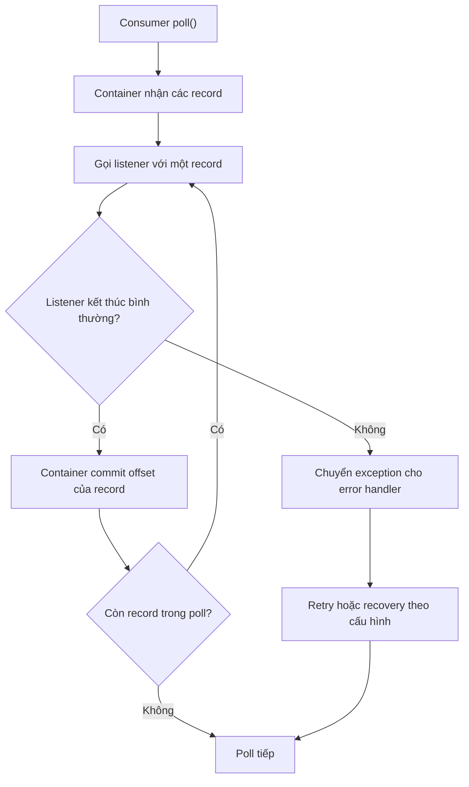

# AckMode RECORD trong Spring Kafka

`AckMode.RECORD` yêu cầu listener container của Spring Kafka ghi nhận offset sau khi listener xử lý thành công từng record. Đây là lựa chọn phù hợp khi ứng dụng muốn tiến độ commit bám sát từng message và muốn giới hạn số record có thể bị phát lại sau một sự cố.

AckMode này áp dụng cho **record listener**: container gọi listener một lần cho mỗi `ConsumerRecord`. Khi phương thức listener kết thúc bình thường, container xem record đó đã được xử lý và commit offset tương ứng. Nếu listener ném exception, luồng xử lý lỗi quyết định việc retry hoặc phục hồi; record chưa được xem là thành công chỉ vì nó đã được lấy ra từ Kafka.

`RECORD` không tự tạo exactly-once cho nghiệp vụ và cũng không thay thế idempotency. Nó xác định thời điểm container commit offset. Ứng dụng vẫn phải thiết kế cách xử lý lỗi, tác dụng phụ và khôi phục phù hợp.

## 1. AckMode là gì?

Kafka consumer đọc record theo partition và theo dõi vị trí đọc. Với consumer group, Kafka lưu committed offset cho từng partition để consumer có thể tiếp tục từ vị trí đã xác nhận sau khi restart hoặc rebalance.

Trong Spring Kafka, listener container quản lý vòng lặp consumer và có thể quản lý việc commit offset. `ContainerProperties.AckMode` xác định container ghi nhận tiến độ xử lý theo cách nào.

Một điểm quan trọng: Kafka commit offset của **record kế tiếp cần đọc**, không phải offset của record vừa xử lý. Nếu listener xử lý thành công record có offset `42`, vị trí commit thông thường là `43`.

Ví dụ:

| Record đã xử lý | Offset của record | Offset được commit |
|---|---:|---:|
| Record A | 40 | 41 |
| Record B | 41 | 42 |
| Record C | 42 | 43 |

Committed offset được lưu theo consumer group và partition. Không có một offset toàn cục duy nhất đại diện cho toàn bộ topic.

## 2. RECORD hoạt động như thế nào?

Khi consumer gọi `poll()`, Kafka có thể trả về nhiều record từ một hoặc nhiều partition. Với record listener, Spring Kafka lần lượt chuyển từng record cho phương thức listener. Ở chế độ `RECORD`, container commit offset sau khi listener trả về thành công cho từng record.

Luồng xử lý cơ bản:



Giả sử một partition trả về các record có offset 100, 101 và 102:

1. Listener xử lý record 100 và trả về bình thường. Container commit vị trí 101.
2. Listener xử lý record 101 và trả về bình thường. Container commit vị trí 102.
3. Listener bắt đầu xử lý record 102.

Nếu ứng dụng dừng trước khi xử lý xong record 102, consumer khởi động lại có thể tiếp tục từ offset 102, miễn là commit trước đó đã thành công. Hai record 100 và 101 không cần bị phát lại.

Điểm cốt lõi là **mỗi lần listener trả về thành công là một ranh giới xử lý để container commit**. Container không đợi toàn bộ các record của lần `poll()` hoàn tất như trong `AckMode.BATCH`.

## 3. Cấu hình AckMode.RECORD

Có thể cấu hình qua Spring Boot hoặc trực tiếp trên listener container factory. Chọn một cách cấu hình phù hợp với ứng dụng; nếu có nhiều factory, bảo đảm listener dùng đúng factory đã đặt AckMode.

### 3.1. Cấu hình bằng Spring Boot

Ví dụ trong `application.yml`:

```yaml
spring:
  kafka:
    bootstrap-servers: localhost:9092
    consumer:
      group-id: billing-service
      enable-auto-commit: false
    listener:
      ack-mode: record
```

Các thuộc tính quan trọng:

- `consumer.group-id`: consumer group sở hữu committed offset.
- `consumer.enable-auto-commit: false`: để listener container kiểm soát thời điểm commit.
- `listener.ack-mode: record`: commit sau khi từng record listener xử lý thành công.

Spring Kafka tự đặt `enable.auto.commit=false` theo mặc định từ phiên bản 2.3, trừ khi ứng dụng cấu hình ghi đè. Khai báo tường minh giúp ý định cấu hình dễ đọc và tránh phụ thuộc vào giá trị mặc định của một phiên bản hoặc cấu hình khác.

### 3.2. Cấu hình bằng listener container factory

Nếu tự tạo `ConcurrentKafkaListenerContainerFactory`, đặt AckMode trên `ContainerProperties`:

```java
@Configuration
public class KafkaListenerConfiguration {

    @Bean
    public ConcurrentKafkaListenerContainerFactory<String, OrderCreated>
            kafkaListenerContainerFactory(
                    ConsumerFactory<String, OrderCreated> consumerFactory) {

        ConcurrentKafkaListenerContainerFactory<String, OrderCreated> factory =
                new ConcurrentKafkaListenerContainerFactory<>();

        factory.setConsumerFactory(consumerFactory);
        factory.getContainerProperties().setAckMode(
                ContainerProperties.AckMode.RECORD
        );

        return factory;
    }
}
```

Listener mặc định có thể sử dụng factory tên `kafkaListenerContainerFactory`. Nếu ứng dụng có nhiều factory, chỉ định rõ factory tương ứng:

```java
@KafkaListener(
    topics = "orders.created",
    groupId = "billing-service",
    containerFactory = "kafkaListenerContainerFactory"
)
public void consume(OrderCreated event) {
    // Xử lý event
}
```

Cấu hình AckMode trên một factory không tự áp dụng cho listener đang dùng factory khác. Khi kiểm tra một listener, cần xác nhận cả tên `containerFactory` và cấu hình thực tế của factory đó.

## 4. Viết record listener với RECORD

Một record listener nhận một message trong mỗi lần gọi:

```java
@Component
public class OrderCreatedListener {

    private final BillingService billingService;

    public OrderCreatedListener(BillingService billingService) {
        this.billingService = billingService;
    }

    @KafkaListener(
        topics = "orders.created",
        groupId = "billing-service"
    )
    public void onOrderCreated(OrderCreated event) {
        billingService.createPendingPayment(event);
    }
}
```

Khi `createPendingPayment()` hoàn tất và listener trả về bình thường, container có thể commit offset của record. Nếu phương thức nghiệp vụ ném exception, container chuyển lỗi sang cơ chế xử lý lỗi đã cấu hình.

Có thể nhận trực tiếp `ConsumerRecord` nếu cần metadata như topic, partition, key, timestamp hoặc offset:

```java
@KafkaListener(
    topics = "orders.created",
    groupId = "billing-service"
)
public void onOrderCreated(
        ConsumerRecord<String, OrderCreated> record) {

    log.info(
        "Processing topic={}, partition={}, offset={}, key={}",
        record.topic(),
        record.partition(),
        record.offset(),
        record.key()
    );

    billingService.createPendingPayment(record.value());
}
```

Với `AckMode.RECORD`, listener không cần gọi `Acknowledgment.acknowledge()`. Container tự quyết định thời điểm commit dựa trên kết quả trả về của listener.

### Ranh giới thành công của listener

Container chỉ quan sát được kết quả thực thi listener. Vì vậy, listener phải chỉ trả về bình thường khi công việc cần thiết của record đã đạt trạng thái thành công theo thiết kế.

Ví dụ sau có thể gây mất xử lý:

```java
@KafkaListener(topics = "orders.created")
public void onOrderCreated(OrderCreated event) {
    executor.submit(() -> billingService.createPendingPayment(event));
    // Listener trả về ngay, trong khi công việc nền chưa hoàn tất.
}
```

Với cách viết này, container có thể commit offset ngay sau khi tác vụ được gửi vào executor. Nếu tiến trình dừng trước khi tác vụ nền hoàn tất, Kafka có thể không phát lại record vì offset đã được commit.

Nếu cần xử lý bất đồng bộ, hãy dùng kiểu listener bất đồng bộ được Spring Kafka hỗ trợ trong phiên bản đang chạy, hoặc thiết kế acknowledgement tường minh sao cho offset chỉ được xác nhận sau khi tác vụ hoàn tất. Không để listener trả về sớm trong khi vẫn kỳ vọng container chờ công việc nền.

## 5. So sánh RECORD với các AckMode thường gặp

| AckMode | Thời điểm ghi nhận offset | Phù hợp khi |
|---|---|---|
| `RECORD` | Sau khi listener xử lý thành công từng record | Cần tiến độ commit theo từng message |
| `BATCH` | Sau khi tất cả record từ một lần `poll()` được xử lý | Muốn giảm tần suất commit và chấp nhận phạm vi phát lại lớn hơn |
| `TIME` | Khi đạt khoảng thời gian cấu hình | Muốn commit theo chu kỳ thời gian |
| `COUNT` | Khi đạt số record cấu hình | Muốn commit sau một số lượng record |
| `COUNT_TIME` | Khi đạt điều kiện số lượng hoặc thời gian | Muốn kết hợp hai ngưỡng |
| `MANUAL` | Listener gọi acknowledge; container xử lý commit theo cơ chế manual | Nghiệp vụ cần quyết định rõ thời điểm xác nhận |
| `MANUAL_IMMEDIATE` | Listener gọi acknowledge để yêu cầu commit ngay khi được gọi trên consumer thread | Cần kiểm soát acknowledgement tường minh và thời điểm commit |

`RECORD` và `BATCH` là hai lựa chọn container-managed thường được cân nhắc trực tiếp nhất.

### RECORD

Với record listener, container gọi listener riêng cho mỗi record và commit sau mỗi lần xử lý thành công. Nếu poll trả về nhiều record cùng partition, các offset đã xử lý thành công trước đó có thể được xác nhận trước khi record tiếp theo hoàn tất.

### BATCH

Với `BATCH`, container đợi listener xử lý xong các record được trả về trong một lần poll rồi mới commit tiến độ của batch. Nếu lỗi xảy ra trước khi batch hoàn tất, nhiều record đã xử lý thành công trong batch đó có thể phải được đọc lại.

### MANUAL và MANUAL_IMMEDIATE

Hai chế độ manual yêu cầu listener nhận `Acknowledgment` và gọi `acknowledge()` theo logic của ứng dụng. Chúng phù hợp khi điều kiện xác nhận không thể biểu diễn đơn giản bằng việc listener trả về thành công.

`AckMode.RECORD` dành cho record listener. Với batch listener, một lần callback đại diện cho cả batch nên không thể dùng `RECORD` để biến mỗi phần tử trong batch thành một lần listener return độc lập. Hãy chọn `BATCH` hoặc cơ chế xử lý lỗi/acknowledgement dành cho batch listener.

## 6. RECORD ảnh hưởng thế nào đến redelivery?

`RECORD` thường thu hẹp số record có thể bị phát lại so với `BATCH`, vì offset được commit thường xuyên hơn. Tuy nhiên, nó vẫn thường thuộc mô hình at-least-once: một record có thể được giao lại nếu tác dụng phụ đã hoàn tất nhưng commit offset chưa được broker lưu thành công.

Xét ba record liên tiếp trong cùng partition:

| Tình huống | Offset đã commit | Điều có thể xảy ra khi restart |
|---|---:|---|
| Record 100 đã xử lý thành công | 101 | Tiếp tục từ 101 |
| Record 101 đã xử lý thành công | 102 | Tiếp tục từ 102 |
| Record 102 đã tạo tác dụng phụ nhưng tiến trình dừng trước commit | 102 | Record 102 có thể được giao lại |
| Commit offset 103 của record 102 đã thành công | 103 | Tiếp tục từ 103 |

Tình huống cuối cùng trước khi commit là điểm cần quan tâm nhất: ứng dụng có thể đã ghi dữ liệu vào database hoặc gọi dịch vụ bên ngoài, nhưng Kafka chưa biết việc xử lý đã hoàn tất. Khi record được giao lại, tác dụng phụ có thể bị thực hiện lần nữa.

### 6.1. Ví dụ về xử lý trùng lặp

Giả sử listener nhận event tạo thanh toán:

1. Listener ghi một payment vào database.
2. Database commit thành công.
3. Ứng dụng dừng trước khi Kafka commit offset.
4. Consumer khởi động lại và nhận lại cùng event.
5. Listener tạo payment lần thứ hai nếu nghiệp vụ không chống trùng.

`AckMode.RECORD` không thể tự giải quyết khoảng thời gian giữa bước 2 và bước 3.

### 6.2. Làm cho handler idempotent

Một cách phổ biến là dùng event ID hoặc business key duy nhất để bảo đảm cùng một event chỉ tạo tác dụng phụ một lần.

Ví dụ về ý tưởng:

```java
@Transactional
public void createPendingPayment(OrderCreated event) {
    if (processedEventRepository.existsByEventId(event.eventId())) {
        return;
    }

    paymentRepository.save(
        Payment.pending(event.orderId(), event.amount())
    );

    processedEventRepository.save(
        ProcessedEvent.of(event.eventId())
    );
}
```

Ví dụ này cần được triển khai với ràng buộc unique phù hợp trong database và trong cùng transaction nghiệp vụ. Chỉ kiểm tra `exists` ở ứng dụng mà không có ràng buộc đồng thời có thể vẫn tạo trùng khi nhiều luồng xử lý cùng event.

Các lựa chọn khác gồm inbox table, idempotency key, upsert có điều kiện hoặc thiết kế nghiệp vụ có thể thực hiện lại an toàn.

## 7. Xử lý exception và retry

Khi listener ném exception, container chuyển quyền xử lý cho error handler. Chính sách cụ thể phụ thuộc loại handler, backoff, recoverer và cấu hình container.

Một luồng xử lý lỗi có thể gồm:

1. Listener nhận record và ném exception.
2. Error handler phân loại exception.
3. Lỗi tạm thời được retry theo backoff đã cấu hình.
4. Nếu xử lý thành công ở lần retry, record được xem là đã xử lý.
5. Nếu hết retry, recoverer có thể chuyển record sang DLT hoặc thực hiện một hành động phục hồi khác.
6. Việc commit offset sau recovery phụ thuộc cấu hình error handler và container.

Ví dụ khai báo listener có thể giữ logic nghiệp vụ đơn giản:

```java
@KafkaListener(topics = "orders.created", groupId = "billing-service")
public void onOrderCreated(OrderCreated event) {
    billingService.createPendingPayment(event);
}
```

Nếu `createPendingPayment()` ném exception, listener không nên âm thầm bỏ qua lỗi nếu record chưa thực sự được xử lý. Khi catch exception rồi không ném lại, container thấy listener kết thúc bình thường và có thể commit offset theo `RECORD`.

Ví dụ không phù hợp:

```java
@KafkaListener(topics = "orders.created")
public void onOrderCreated(OrderCreated event) {
    try {
        billingService.createPendingPayment(event);
    } catch (Exception ex) {
        log.error("Cannot process order", ex);
        // Không ném lại exception và không có recovery.
    }
}
```

Nếu lỗi đã được xử lý hoàn toàn theo một chính sách có chủ đích, listener có thể trả về. Nếu lỗi còn cần retry hoặc recovery, hãy để exception đến error handler hoặc chuyển lỗi theo cơ chế đã thiết kế.

### 7.1. Retry không giới hạn có thể làm consumer bị kẹt

Một lỗi dữ liệu cố định thường không thể giải quyết bằng cách retry mãi. Hãy phân biệt:

- Lỗi tạm thời: timeout, dịch vụ phụ thuộc tạm ngừng, lỗi kết nối.
- Lỗi dữ liệu: schema không hợp lệ, trường bắt buộc bị thiếu, giá trị không thể chuyển đổi.
- Lỗi nghiệp vụ: trạng thái đơn hàng không cho phép thao tác.
- Lỗi hệ thống: database hoặc dependency không hoạt động.

Xác định số lần retry, backoff, exception được retry và hành động sau khi hết retry. Với DLT, cần giám sát lượng record, quyền truy cập, retention và quy trình điều tra/replay.

### 7.2. Retry có thể ảnh hưởng thứ tự

Kafka giữ thứ tự record trong một partition. Nhưng khi một record được chuyển sang retry topic hoặc được phục hồi theo một luồng khác, record tiếp theo trong partition gốc có thể được xử lý trước record đang retry.

Nếu thứ tự theo `orderId` hoặc aggregate là yêu cầu nghiệp vụ, hãy đánh giá chiến lược retry, partition key và cách phục hồi. `AckMode.RECORD` tự nó không bảo đảm thứ tự nghiệp vụ xuyên qua nhiều topic retry.

## 8. Auto commit và container-managed commit

Để `AckMode.RECORD` hoạt động như dự kiến, cần để Spring Kafka listener container quản lý offset. Kafka consumer có thuộc tính `enable.auto.commit`; khi bật, Kafka client có thể commit offset định kỳ độc lập với kết quả xử lý của listener.

Nếu auto commit diễn ra trong khi listener vẫn đang xử lý record, consumer có thể lưu một offset vượt quá công việc đã hoàn tất. Khi ứng dụng gặp sự cố, record chưa xử lý có thể không được giao lại như mong muốn.

Vì vậy, với listener container quản lý acknowledgement, hãy đặt:

```properties
enable.auto.commit=false
```

Trong Spring Boot:

```yaml
spring:
  kafka:
    consumer:
      enable-auto-commit: false
    listener:
      ack-mode: record
```

Không nên bật auto commit rồi giả định `AckMode.RECORD` vẫn kiểm soát được thời điểm commit. Kiểm tra cấu hình consumer thực tế, nhất là khi ứng dụng có nhiều `ConsumerFactory` hoặc factory riêng.

## 9. Hiệu năng và concurrency

### 9.1. Tần suất commit

`RECORD` commit sau mỗi record listener xử lý thành công. So với `BATCH`, tần suất commit cao hơn có thể làm tăng số lần trao đổi với broker, chi phí xử lý và độ trễ ở throughput lớn.

Spring Kafka cho phép cấu hình commit đồng bộ hoặc bất đồng bộ thông qua container properties. Mặc định và hành vi chi tiết cần được kiểm tra theo phiên bản đang dùng. Nếu dùng commit bất đồng bộ, cần quan sát callback/lỗi commit và hiểu cách nó ảnh hưởng đến việc phát lại sau sự cố.

Chọn `RECORD` khi lợi ích của tiến độ commit theo từng message đáng giá hơn chi phí commit. Nếu throughput là ưu tiên chính, hãy benchmark `RECORD` và `BATCH` trên workload tương đương.

### 9.2. Listener concurrency

Có thể cấu hình số consumer thread qua listener container factory:

```java
factory.setConcurrency(3);
```

Concurrency tạo nhiều consumer trong cùng listener container. Kafka phân phối partition cho các consumer trong group. Một partition tại một thời điểm chỉ được gán cho một consumer trong group, vì vậy tăng concurrency vượt số partition không tạo thêm khả năng xử lý song song cho topic đó.

Trong mỗi consumer, record listener thường xử lý record tuần tự theo thứ tự nhận từ partition. Nếu ứng dụng tự chuyển công việc sang thread pool, phải quản lý lại ranh giới hoàn tất và acknowledgement như đã trình bày ở trên.

### 9.3. Thời gian xử lý và max.poll.interval.ms

Record listener chạy trong luồng xử lý của consumer. Nếu xử lý quá lâu, consumer có thể không gọi `poll()` kịp trong khoảng `max.poll.interval.ms`, khiến group xem consumer là không còn hoạt động và thực hiện rebalance.

Dù `RECORD` đã commit các record trước đó, record đang xử lý hoặc chưa được xác nhận vẫn có thể được giao lại sau rebalance. Hãy đo thời gian xử lý, điều chỉnh `max.poll.interval.ms` và `max.poll.records` theo workload, đồng thời giữ thời gian xử lý trong giới hạn vận hành có thể kiểm soát.

## 10. RECORD và Kafka transaction

Trong cấu hình không dùng Kafka transaction, container commit offset theo cơ chế commit của consumer sau khi listener hoàn tất record.

Khi dùng transactional listener container, việc ghi offset có thể được phối hợp với Kafka transaction. Khi đó, offset được đưa vào transaction và được xác nhận cùng transaction theo cấu hình. Ranh giới transaction cụ thể phụ thuộc listener type và cấu hình producer/container; không nên suy ra toàn bộ hành vi transaction chỉ từ tên `AckMode.RECORD`.

Kafka transaction có thể hỗ trợ luồng consume-process-produce trong Kafka. Ví dụ, consumer đọc event, xử lý và ghi event kết quả; transaction giúp phối hợp việc ghi output với offset đầu vào trong phạm vi Kafka.

Nếu listener cập nhật database bên ngoài rồi commit Kafka offset, Kafka transaction không tự biến hai hệ thống thành một transaction nguyên tử. Vẫn cần outbox/inbox, idempotency hoặc một giao thức phối hợp phù hợp để xử lý sự cố giữa hai hệ thống.

## 11. Kiểm thử AckMode.RECORD

Kiểm thử nên chứng minh thời điểm commit và hành vi phát lại, thay vì chỉ xác nhận listener đã được gọi.

Một kịch bản kiểm thử có thể thực hiện như sau:

1. Khởi chạy Kafka broker dùng cho integration test.
2. Tạo topic có ít nhất một partition và một consumer group cố định.
3. Gửi ba record liên tiếp vào cùng partition.
4. Dùng record listener với `AckMode.RECORD` và ghi lại offset đã xử lý.
5. Sau khi listener hoàn tất record đầu tiên, kiểm tra committed offset của group.
6. Xác nhận committed offset là offset kế tiếp sau record đã hoàn tất.
7. Tạo lỗi trong một record và kiểm tra error handler thực hiện retry/recovery theo cấu hình.
8. Dừng consumer ở ranh giới giữa xử lý nghiệp vụ và commit để kiểm tra khả năng phát lại.
9. Xác nhận handler idempotent không tạo tác dụng phụ trùng lặp.

Có thể dùng `AdminClient` để đọc committed offsets của consumer group trong bài kiểm thử. Khi kiểm tra, phải đối chiếu đúng group ID, topic và partition. Offset trong Kafka là vị trí kế tiếp cần đọc, vì vậy kết quả luôn lớn hơn offset của record cuối cùng đã được commit thành công một đơn vị.

### Các tình huống nên có trong integration test

| Tình huống | Điều cần xác nhận |
|---|---|
| Listener trả về bình thường | Offset của record được commit |
| Listener ném exception | Error handler nhận exception; offset tuân theo retry/recovery đã cấu hình |
| Retry thành công | Record được xử lý thành công và tiến độ được commit |
| Hết retry, chuyển DLT | Record được phục hồi theo chính sách; offset gốc được xử lý đúng cấu hình |
| Ứng dụng dừng trước commit | Record có thể được giao lại |
| Tác dụng phụ thành công nhưng commit thất bại | Xử lý lại không tạo tác dụng phụ trùng |
| Nhiều partition và concurrency | Thứ tự trong từng partition được giữ theo thiết kế |
| Rebalance khi listener đang chạy | Record chưa xác nhận được phục hồi đúng cách |

Không nên chỉ kiểm tra số lần listener được gọi. Cần kiểm tra committed offset, tác dụng phụ trong database, retry/DLT và khả năng xử lý lại sau restart.

## 12. Giám sát trong production

Khi dùng `RECORD`, theo dõi cả tiến độ Kafka và kết quả nghiệp vụ:

- Consumer group lag theo topic và partition.
- Committed offset và tốc độ tăng offset.
- Thời gian xử lý mỗi record, đặc biệt p95/p99.
- Số lần listener thất bại và số lần retry.
- Số record được chuyển vào DLT.
- Commit failure hoặc timeout.
- Số lần rebalance và thời gian consumer không poll.
- Tỷ lệ event trùng bị idempotency layer chặn.
- Số tác vụ nghiệp vụ thành công so với số record được tiêu thụ.

Nếu lag tăng dù listener không báo lỗi, hãy xem xét thời gian xử lý, concurrency, số partition, commit latency và tình trạng dependency. Nếu lag thấp nhưng tác dụng phụ bị thiếu, kiểm tra auto commit, cách catch exception, tác vụ bất đồng bộ và vị trí commit so với ranh giới hoàn tất nghiệp vụ.

## 13. Lỗi cấu hình và cách chẩn đoán

**Đặt AckMode.RECORD nhưng listener dùng batch.** RECORD được thiết kế cho record listener. Xác nhận listener nhận một record mỗi lần gọi; nếu nhận một danh sách record, hãy chọn AckMode và error handling phù hợp cho batch listener.

**Bật enable.auto.commit.** Auto commit có thể ghi offset độc lập với listener. Đặt `enable.auto.commit=false` để container quản lý tiến độ.

**Bắt exception rồi không ném lại.** Listener kết thúc bình thường nên container có thể commit record dù nghiệp vụ thất bại. Chuyển lỗi tới error handler hoặc thực hiện recovery có chủ đích.

**Gửi tác vụ sang executor rồi trả về.** Container có thể commit trước khi tác vụ hoàn tất. Dùng mô hình async listener hoặc manual acknowledgement được hỗ trợ và chỉ xác nhận sau khi công việc kết thúc.

**Nghĩ rằng RECORD loại bỏ duplicate.** Sự cố sau khi database commit nhưng trước Kafka offset commit vẫn có thể làm record được giao lại. Dùng event ID và idempotent handler.

**Tăng concurrency nhưng topic có quá ít partition.** Số consumer hoạt động đồng thời bị giới hạn bởi partition được phân bổ. Xem xét partition count và throughput thực tế.

**Xử lý record quá lâu.** Consumer có thể vượt `max.poll.interval.ms` và bị rebalance. Đo thời gian xử lý, điều chỉnh cấu hình poll và chia nhỏ công việc khi phù hợp.

**Không kiểm tra listener đang dùng factory nào.** Một factory có thể được đặt RECORD trong khi listener thực tế dùng factory khác. Kiểm tra `containerFactory` và cấu hình runtime.

## 14. Khi nào nên chọn AckMode.RECORD?

Chọn `RECORD` khi:

- Listener xử lý từng record độc lập.
- Muốn commit offset ngay sau khi từng record xử lý thành công.
- Muốn giảm phạm vi record có thể bị phát lại khi một record sau đó gặp lỗi hoặc tiến trình dừng.
- Chấp nhận chi phí commit thường xuyên hơn so với `BATCH`.
- Có thể giữ công việc nghiệp vụ đồng bộ trong ranh giới listener hoặc dùng mô hình async/acknowledgement được hỗ trợ.

Cân nhắc `BATCH` khi:

- Throughput là ưu tiên và chi phí commit theo từng record đáng kể.
- Có thể chấp nhận phát lại nhiều record hơn sau sự cố.
- Listener xử lý batch và nghiệp vụ được thiết kế cho batch.

Cân nhắc `MANUAL` hoặc `MANUAL_IMMEDIATE` khi:

- Điều kiện xác nhận do logic nghiệp vụ quyết định rõ ràng.
- Cần xác nhận sau một thao tác bất đồng bộ hoặc sau một bước xử lý đặc thù.
- Nhóm phát triển có thể quản lý chính xác vòng đời acknowledgement và thread thực hiện ack.

Trước khi triển khai, hãy xác nhận listener type, factory thực tế, `enable.auto.commit`, error handler, commit strategy và cách xử lý tác dụng phụ. `AckMode.RECORD` hữu ích nhất khi ranh giới “listener hoàn tất thành công” trùng với ranh giới mà ứng dụng muốn xác nhận record đã được xử lý.

## 15. Tài liệu cần đối chiếu theo phiên bản

Các thuộc tính và hành vi chi tiết có thể thay đổi theo phiên bản Spring Kafka, Spring Boot và Kafka client. Khi triển khai hoặc nâng cấp, đối chiếu tài liệu đúng phiên bản về:

- `ContainerProperties.AckMode` và listener container.
- Record listener so với batch listener.
- Error handler, retry, recoverer và DLT.
- Consumer `enable.auto.commit`, commit đồng bộ/bất đồng bộ và offset.
- Transactional listener container và Kafka transaction.
- Spring Boot `spring.kafka.listener.*` và `spring.kafka.consumer.*`.

Đừng chỉ dựa vào cấu hình YAML để kết luận runtime đang dùng RECORD. Xác nhận factory được listener sử dụng và quan sát committed offset trong integration test hoặc môi trường staging trước khi đưa thay đổi vào production.
