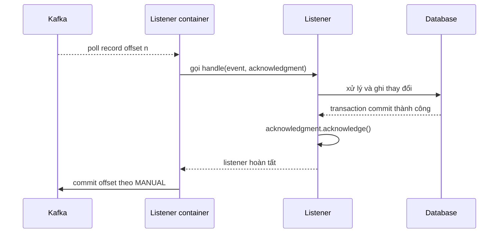

# AckMode MANUAL

Trong Spring Kafka, `AckMode.MANUAL` giao cho listener trách nhiệm xác nhận rằng record đã được xử lý thành công. Listener nhận một đối tượng `Acknowledgment` và gọi `acknowledge()` sau khi công việc nghiệp vụ hoàn tất. Listener container tiếp nhận xác nhận đó rồi quản lý việc commit offset theo semantics của chế độ manual.

Chế độ này hữu ích khi thời điểm xác nhận cần gắn với một bước cụ thể trong nghiệp vụ, chẳng hạn chỉ xác nhận sau khi database transaction đã commit hoặc sau khi một quy trình xử lý nhiều bước đã ghi nhận kết quả bền vững. Tuy nhiên, `MANUAL` không tự tạo transaction phân tán giữa Kafka và database, cũng không bảo đảm listener chỉ chạy một lần. Consumer vẫn có thể nhận lại record nếu ứng dụng dừng trước khi offset được commit.

## 1. Ý nghĩa của MANUAL

Ở chế độ `RECORD`, container tự commit offset sau khi từng record listener trả về thành công. Ở chế độ `BATCH`, container commit offset sau khi toàn bộ record từ một lần `poll()` được xử lý. Với `MANUAL`, listener chủ động gọi `Acknowledgment.acknowledge()` để báo rằng record hoặc batch đã hoàn tất. Container xếp các xác nhận này vào tiến trình commit và commit offset khi các record từ lần poll tương ứng đã được xác nhận.

Điểm quan trọng là `MANUAL` không có nghĩa mỗi lần gọi `acknowledge()` đều lập tức gửi một lệnh commit tới broker. Semantics của nó tương tự `BATCH`: các xác nhận được quản lý cùng nhóm record đã nhận trong lần poll. Nếu cần commit ngay tại thời điểm gọi acknowledge trên consumer thread, đó là mục đích của `MANUAL_IMMEDIATE`.

| AckMode | Ai quyết định thời điểm xác nhận? | Ý nghĩa commit |
|---|---|---|
| `RECORD` | Container | Commit sau khi từng record listener hoàn tất thành công |
| `BATCH` | Container | Commit sau khi xử lý xong các record của một lần poll |
| `MANUAL` | Listener gọi `acknowledge()`; container quản lý commit | Xác nhận được xếp hàng; commit theo semantics tương tự batch khi các record của poll đã được xác nhận |
| `MANUAL_IMMEDIATE` | Listener gọi `acknowledge()` | Commit ngay khi gọi trên consumer thread; lời gọi từ thread khác được chuyển cho container xử lý |

Chọn `MANUAL` khi ứng dụng cần chủ động quyết định record đã sẵn sàng được xác nhận hay chưa, nhưng vẫn muốn container điều phối commit theo batch của lần poll. Chọn `MANUAL_IMMEDIATE` khi yêu cầu nghiệp vụ thực sự cần commit ngay tại thời điểm xác nhận và ứng dụng kiểm soát được thread gọi. Không nên chọn chế độ manual chỉ vì tên gọi có vẻ linh hoạt hơn; mỗi chế độ có semantics và hệ quả vận hành riêng.

## 2. Cấu hình MANUAL trong Spring Boot

Spring Boot cho phép đặt ack mode trong cấu hình listener:

```yaml
spring:
  kafka:
    consumer:
      group-id: payment-service
      enable-auto-commit: false
    listener:
      ack-mode: manual
```

Với Spring Kafka từ phiên bản 2.3, nếu `enable.auto.commit` không được khai báo, framework mặc định đặt thành `false` để listener container quản lý commit. Khai báo tường minh vẫn hữu ích vì làm rõ rằng ứng dụng không muốn Kafka consumer tự commit offset theo lịch độc lập với kết quả xử lý của listener.

Nếu tự cấu hình `ConcurrentKafkaListenerContainerFactory`, có thể đặt chế độ trên `ContainerProperties`:

```java
@Bean
ConcurrentKafkaListenerContainerFactory<String, PaymentEvent>
paymentKafkaListenerContainerFactory(
        ConsumerFactory<String, PaymentEvent> consumerFactory) {

    var factory = new ConcurrentKafkaListenerContainerFactory<String, PaymentEvent>();
    factory.setConsumerFactory(consumerFactory);
    factory.getContainerProperties()
            .setAckMode(ContainerProperties.AckMode.MANUAL);
    return factory;
}
```

Khi có nhiều listener factory, cần chắc chắn listener đang sử dụng đúng factory có `AckMode.MANUAL`. Có thể chỉ định factory trên `@KafkaListener` bằng `containerFactory`. Cấu hình một factory không tự động thay đổi ack mode của các factory khác.

## 3. Nhận Acknowledgment trong listener

Spring Kafka có thể truyền `Acknowledgment` vào tham số listener. Listener gọi `acknowledge()` sau khi thao tác cần bảo vệ đã hoàn tất:

```java
@KafkaListener(
        topics = "payments",
        groupId = "payment-service",
        containerFactory = "paymentKafkaListenerContainerFactory")
public void handle(
        PaymentEvent event,
        Acknowledgment acknowledgment) {

    paymentService.processAndCommit(event);
    acknowledgment.acknowledge();
}
```

Trong ví dụ này, `processAndCommit()` cần chỉ trả về sau khi kết quả nghiệp vụ đã được lưu bền vững. Nếu nó ghi database, transaction database phải commit trước khi listener gọi `acknowledge()`. Nếu phương thức chỉ gửi công việc sang một executor rồi trả về ngay, container có thể nhận được acknowledge trong khi công việc thực tế chưa hoàn tất; điều đó làm mất mục tiêu của việc xác nhận thủ công.

Trình tự mong muốn:



Nếu listener gặp exception trước khi acknowledge, record chưa được xác nhận. Error handler của container sẽ quyết định retry, recovery hoặc hành động khác. Nếu listener gọi acknowledge trước rồi mới thực hiện một thao tác có thể thất bại, ứng dụng có nguy cơ commit offset cho record mà nghiệp vụ chưa hoàn tất. Vì vậy, thứ tự các lệnh trong listener là một phần của delivery guarantee.

## 4. Commit theo poll và ảnh hưởng đến nhiều record

Kafka consumer thường nhận một nhóm record từ một hoặc nhiều partition trong một lần `poll()`. Với `MANUAL`, container quản lý các xác nhận của nhóm record này và commit theo semantics tương tự `BATCH` khi những record cần thiết đã được xác nhận.

Ví dụ một lần poll nhận ba record liên tiếp trong cùng partition:

```text
poll() trả về: offset 10, 11, 12

Listener xử lý và acknowledge offset 10
Listener xử lý và acknowledge offset 11
Offset 12 chưa được acknowledge

Container chưa thể tiến committed offset vượt qua record chưa xác nhận.
```

Committed offset biểu thị vị trí tiếp theo cần đọc. Khi offset `10`, `11`, `12` đã được xử lý và xác nhận, container có thể commit vị trí tiếp theo là `13`. Nếu ứng dụng dừng trước khi xác nhận record cuối cùng, các record chưa được commit có thể được đọc lại sau khi consumer khởi động lại hoặc partition được giao cho member khác.

Một listener có thể xử lý các record thuộc nhiều partition trong cùng poll. Kafka lưu offset độc lập theo partition, vì vậy tiến độ commit cũng được quản lý riêng cho từng partition. Không nên suy luận rằng commit offset của partition A có nghĩa record ở partition B cũng đã được xử lý.

Với batch listener, listener nhận cả danh sách record và có thể xác nhận batch sau khi tất cả phần tử đã hoàn tất:

```java
@KafkaListener(topics = "inventory-events", groupId = "inventory-projection")
public void handleBatch(
        List<InventoryEvent> events,
        Acknowledgment acknowledgment) {

    inventoryService.applyBatch(events);
    acknowledgment.acknowledge();
}
```

Trong ví dụ này, `applyBatch()` cần hoàn tất toàn bộ batch trước khi acknowledge. Nếu xử lý từng phần tử độc lập và một phần tử thất bại, listener cần xác định rõ cách xử lý phần đã thành công, phần thất bại và offset tương ứng. Chỉ gọi acknowledge sau khi cả batch đạt trạng thái mà nghiệp vụ cho phép xác nhận.

## 5. Xử lý lỗi và retry

Nếu listener ném exception trước khi gọi acknowledge, container không nhận được xác nhận thành công từ listener cho record đó. `CommonErrorHandler` hoặc error handler được cấu hình có thể retry, seek để đọc lại, chuyển record sang Dead Letter Topic (DLT) hoặc thực hiện recovery theo chính sách ứng dụng.

Ví dụ listener không nuốt lỗi:

```java
@KafkaListener(topics = "orders", groupId = "order-projection")
public void handle(
        OrderEvent event,
        Acknowledgment acknowledgment) {

    orderProjectionService.apply(event); // ném exception nếu xử lý thất bại
    acknowledgment.acknowledge();
}
```

Khi `apply()` thất bại, dòng acknowledge không được thực thi. Exception được chuyển về container để error handler xử lý. Ngược lại, đoạn code sau có thể tạo ra mất record:

```java
@KafkaListener(topics = "orders", groupId = "order-projection")
public void unsafeHandle(
        OrderEvent event,
        Acknowledgment acknowledgment) {

    try {
        orderProjectionService.apply(event);
    }
    catch (RuntimeException ex) {
        log.error("Không xử lý được order event", ex);
    }

    acknowledgment.acknowledge();
}
```

Ở ví dụ không an toàn, exception bị bắt và listener vẫn gọi acknowledge. Container không thể biết nghiệp vụ thất bại nên có thể commit offset. Chỉ nên bắt exception rồi acknowledge khi ứng dụng đã hoàn tất một quy trình recovery có chủ đích và có thể chứng minh record đã được xử lý hoặc lưu giữ bền vững ở nơi khác.

### Ví dụ cấu hình DefaultErrorHandler

```java
@Bean
DefaultErrorHandler orderErrorHandler(KafkaTemplate<Object, Object> template) {
    var recoverer = new DeadLetterPublishingRecoverer(template);
    return new DefaultErrorHandler(
            recoverer,
            new FixedBackOff(1_000L, 3L));
}

@Bean
ConcurrentKafkaListenerContainerFactory<String, OrderEvent>
orderKafkaListenerContainerFactory(
        ConsumerFactory<String, OrderEvent> consumerFactory,
        DefaultErrorHandler orderErrorHandler) {

    var factory = new ConcurrentKafkaListenerContainerFactory<String, OrderEvent>();
    factory.setConsumerFactory(consumerFactory);
    factory.setCommonErrorHandler(orderErrorHandler);
    factory.getContainerProperties()
            .setAckMode(ContainerProperties.AckMode.MANUAL);
    return factory;
}
```

Đây là ví dụ dùng `DefaultErrorHandler` trong các phiên bản Spring Kafka hiện đại. Cần cấu hình serializer phù hợp cho producer gửi DLT, bảo đảm topic đích tồn tại và giám sát lỗi publish DLT. Khi recoverer publish thành công và error handler đánh dấu record đã recover, container có thể tiến offset qua record đó. Hãy xem việc chuyển record sang DLT là một kết quả recovery được lưu bền vững, không phải bằng chứng rằng nghiệp vụ ban đầu đã thành công.

Chính sách retry cần phân biệt lỗi tạm thời với lỗi dữ liệu không thể khắc phục. Timeout tới dịch vụ phụ trợ có thể phù hợp với retry có backoff; dữ liệu sai định dạng có thể cần DLT để tránh chặn partition quá lâu. Retry quá nhiều lần có thể làm tăng consumer lag và ảnh hưởng thời gian xử lý các record phía sau.

## 6. MANUAL và MANUAL_IMMEDIATE

Hai chế độ thường bị nhầm vì cả hai đều dùng `Acknowledgment`:

| Thuộc tính | `MANUAL` | `MANUAL_IMMEDIATE` |
|---|---|---|
| Cách listener xác nhận | Gọi `acknowledge()` | Gọi `acknowledge()` |
| Thời điểm commit | Xác nhận được xếp hàng; commit theo semantics batch khi các record từ poll được xác nhận | Commit ngay nếu acknowledge được gọi trên consumer thread |
| Gọi từ thread khác | Không nên tùy tiện chuyển việc xác nhận sang thread khác; phải tuân theo cơ chế async ack nếu bật | Yêu cầu commit được chuyển cho container xử lý; không còn đảm bảo commit đồng bộ ngay tại lệnh gọi |
| Phù hợp khi | Muốn listener quyết định record đã hoàn tất nhưng vẫn commit theo poll | Cần commit ngay tại thời điểm xác nhận trên consumer thread |

Ví dụ cấu hình `MANUAL_IMMEDIATE`:

```java
factory.getContainerProperties()
        .setAckMode(ContainerProperties.AckMode.MANUAL_IMMEDIATE);
```

Không nên thay `MANUAL` bằng `MANUAL_IMMEDIATE` chỉ để hy vọng giảm duplicate. Nếu database đã commit nhưng ứng dụng dừng trước khi Kafka commit offset, record vẫn có thể được giao lại tùy thời điểm và trạng thái commit. Muốn tránh lặp tác động database, ứng dụng vẫn cần idempotency hoặc một giải pháp transaction phù hợp.

Một điểm cần chú ý: khi `acknowledge()` được gọi từ một thread khác thread consumer, hành vi commit phụ thuộc ack mode và cấu hình async acknowledgment. Nếu cần xử lý bất đồng bộ, hãy thiết kế rõ cơ chế phối hợp và kiểm tra hành vi theo phiên bản Spring Kafka đang sử dụng; không giả định rằng gọi `acknowledge()` từ bất kỳ thread nào cũng lập tức commit.

## 7. Acknowledgment với xử lý bất đồng bộ

Một tình huống thường gặp là listener chuyển record sang executor để xử lý lâu hơn. Listener không được acknowledge ngay khi vừa submit tác vụ, vì lúc đó công việc chưa hoàn tất. Có hai cách tiếp cận chính:

1. Chờ tác vụ hoàn tất trong luồng listener rồi mới acknowledge. Cách này đơn giản, dễ hiểu về thứ tự xử lý, nhưng listener chiếm thời gian xử lý lâu hơn và cần cấu hình poll/timeout phù hợp.
2. Dùng cơ chế asynchronous acknowledgments được hỗ trợ trong các phiên bản Spring Kafka phù hợp, cho phép các record được xác nhận không theo thứ tự. Container sẽ giữ consumer ở trạng thái pause cho đến khi nhận đủ xác nhận còn thiếu từ lần poll trước.

Từ Spring Kafka 2.8, có thể bật `asyncAcks` trên container properties:

```java
factory.getContainerProperties().setAsyncAcks(true);
```

Khi bật, ứng dụng có thể acknowledge các record từ cùng poll theo thứ tự hoàn tất khác với thứ tự nhận. Container theo dõi các offset còn thiếu và tạm dừng việc lấy thêm record cho đến khi các xác nhận cần thiết được nhận. Điều này cho phép xử lý song song nhưng có thể làm giảm throughput nếu một tác vụ chậm giữ lại các xác nhận phía sau.

Ví dụ minh họa cách chuyển công việc sang executor:

```java
@KafkaListener(topics = "documents", groupId = "document-indexer")
public void handle(
        DocumentEvent event,
        Acknowledgment acknowledgment) {

    executor.execute(() -> {
        try {
            documentIndexer.indexAndCommit(event);
            acknowledgment.acknowledge();
        }
        catch (RuntimeException ex) {
            log.error("Indexing failed for event {}", event.id(), ex);
            // Không acknowledge: để chính sách lỗi/recovery được thiết kế riêng.
        }
    });
}
```

Đây chỉ là phác thảo luồng phối hợp. Trong ứng dụng thực tế, cần quản lý exception từ tác vụ nền, giới hạn số tác vụ đang chạy, xử lý shutdown và đảm bảo executor không làm mất công việc đã nhận. Nếu lỗi xảy ra trong thread nền, exception không tự động quay lại listener container như exception được ném trực tiếp từ listener; cần một cơ chế báo lỗi và recovery rõ ràng. Không acknowledge trong nhánh lỗi nếu record chưa được xử lý hoặc lưu giữ bền vững.

`asyncAcks` có các giới hạn cần biết. Nó yêu cầu acknowledgment được gửi cho những record thuộc poll tương ứng; container có thể pause consumer khi còn acknowledgment thiếu. Một record chưa được acknowledge có thể khiến tiến độ của các record sau chưa được commit. Cơ chế này không cho phép ứng dụng tùy ý bỏ qua record lỗi. Với async acknowledgment, cần đọc kỹ giới hạn tương thích của phiên bản Spring Kafka và tránh kết hợp với `nack()` theo cách không được hỗ trợ.

Nếu workload không cần song song bất đồng bộ, chờ tác vụ hoàn tất rồi acknowledge thường dễ vận hành hơn. Nếu cần xử lý song song, hãy kiểm soát số lượng công việc đang chạy và quan sát thời gian consumer bị pause do thiếu acknowledgment.

## 8. MANUAL không tự tạo exactly-once

Giả sử listener cập nhật database rồi gọi acknowledge:

```text
Kafka gửi record offset 25
        |
        v
Listener cập nhật database
        |
        v
Database commit thành công
        |
        | Ứng dụng dừng trước khi Kafka commit offset
        v
Consumer khởi động lại và đọc lại offset 25
```

Database đã lưu thay đổi nhưng Kafka chưa ghi nhận tiến độ mới. Khi record được gửi lại, listener có thể thực hiện cùng tác động lần thứ hai. `MANUAL` giúp ứng dụng đặt thời điểm xác nhận sau bước nghiệp vụ, nhưng không thể gộp transaction database với commit offset Kafka một cách tự động.

### Dùng idempotency hoặc Inbox pattern

Một giải pháp phổ biến là gán `eventId` ổn định cho mỗi event và lưu dấu đã xử lý trong cùng database transaction với thay đổi nghiệp vụ:

```java
@Transactional
public void apply(OrderEvent event) {
    boolean firstDelivery = processedEventRepository.insertIfAbsent(event.id());
    if (!firstDelivery) {
        return;
    }

    orderRepository.apply(event);
}
```

`insertIfAbsent()` cần được thực hiện dựa trên unique constraint và thao tác nguyên tử. Nếu transaction rollback, cả dấu event và thay đổi nghiệp vụ rollback; record có thể được retry. Nếu transaction commit, lần giao lại thấy event đã tồn tại và không lặp tác động. Sau khi phương thức này trả về thành công, listener mới gọi `acknowledge()`.

Với luồng consume-transform-produce chỉ nằm trong Kafka, Kafka transaction có thể phối hợp output record và offset đầu vào trong cùng transaction. Khi dùng Spring Kafka transaction, cần cấu hình producer factory có `transactionIdPrefix`, listener container tham gia transaction và `KafkaTemplate` gửi output trong transaction đó. Consumer downstream cần `isolation.level=read_committed` nếu chỉ muốn đọc output đã commit. `AckMode.MANUAL` tự nó không thay thế cấu hình transaction này.

## 9. Commit sync/async và cấu hình liên quan

Container thường dùng `commitSync()` để commit offset theo mặc định. Có thể thay đổi hành vi bằng `ContainerProperties.setSyncCommits(false)` để dùng `commitAsync()`, nhưng cần cân nhắc semantics lỗi và khả năng quan sát commit. Commit bất đồng bộ có thể giúp giảm thời gian chờ broker, nhưng callback và lỗi commit cần được xử lý phù hợp. Không thay đổi chế độ commit chỉ vì dùng `MANUAL`; ack mode quyết định khi nào offset đủ điều kiện commit, còn sync/async quyết định cách gửi yêu cầu commit.

Một số thuộc tính liên quan:

| Thuộc tính | Vai trò | Khi vận hành MANUAL |
|---|---|---|
| `enable.auto.commit=false` | Tắt auto commit của Kafka consumer | Để container quản lý offset theo acknowledgment |
| `ack-mode=manual` | Chọn `AckMode.MANUAL` | Listener phải gọi `acknowledge()` sau khi xử lý xong |
| `syncCommits` | Chọn commit sync hay async | Ảnh hưởng cách container gửi yêu cầu commit tới broker |
| `syncCommitTimeout` | Timeout cho commit đồng bộ | Cần phù hợp với độ trễ và cấu hình broker |
| `asyncAcks` | Cho phép xác nhận không theo thứ tự trong các phiên bản hỗ trợ | Consumer có thể bị pause cho tới khi đủ ack của poll |
| `max.poll.interval.ms` | Giới hạn thời gian giữa các lần poll | Cần tính đến thời gian xử lý và retry để tránh rebalance ngoài ý muốn |

Với xử lý lâu, `max.poll.interval.ms` cần đủ lớn cho thời gian xử lý dự kiến, nhưng tăng timeout không thay thế việc kiểm soát thời gian xử lý và backlog. Nếu consumer không poll đủ lâu, Kafka có thể thực hiện rebalance; record chưa commit có thể được đọc lại ở consumer khác.

## 10. Các lỗi triển khai thường gặp

### Gọi acknowledge trước khi nghiệp vụ hoàn tất

```java
acknowledgment.acknowledge();
paymentService.charge(event);
```

Nếu charge thất bại sau khi offset đã được xác nhận, record có thể bị bỏ qua khi consumer chạy lại. Hãy chuyển acknowledge xuống sau khi kết quả đã được lưu bền vững.

### Bắt exception rồi vẫn acknowledge

Nếu listener ghi log lỗi nhưng vẫn xác nhận record, container có thể commit offset. Chỉ làm như vậy khi nhánh lỗi đã hoàn tất một quy trình recovery được lưu bền vững, ví dụ publish DLT thành công và chính sách xác định record được xem là recovered.

### Nghĩ rằng một acknowledge lập tức commit

`MANUAL` xếp xác nhận vào tiến trình commit tương tự batch. Nếu cần commit ngay trên consumer thread, tìm hiểu `MANUAL_IMMEDIATE` và tác động của nó đến throughput, ordering và commit behavior.

### Xác nhận một batch khi mới xử lý một phần

Với batch listener, acknowledge toàn bộ batch khi một số record chưa hoàn tất có thể làm mất cơ hội đọc lại các record đó. Cần thiết kế xử lý từng phần và recovery phù hợp với semantics của batch.

### Chạy tác vụ nền rồi kết thúc listener

Nếu listener trả về mà không đợi công việc hoàn tất, container có thể tiếp tục xử lý hoặc commit theo các xác nhận đã nhận trong khi tác vụ nền còn chạy. Dùng cơ chế async acknowledgment phù hợp hoặc chờ tác vụ hoàn tất trước khi xác nhận.

### Dùng MANUAL để thay cho idempotency

Ứng dụng vẫn có khoảng thời gian giữa commit nghiệp vụ và commit offset. Nếu record được gửi lại trong khoảng đó, side effect có thể lặp. Dùng event ID, unique constraint hoặc idempotency key cho các tác động cần chống trùng.

## 11. Quan sát và vận hành

Để vận hành consumer dùng `MANUAL`, cần quan sát cả Kafka và trạng thái xử lý nghiệp vụ:

- Consumer group lag theo partition, đặc biệt khi listener xử lý chậm hoặc retry kéo dài.
- Tần suất commit, lỗi commit và độ trễ từ lúc nhận record đến lúc offset được commit.
- Số lượng exception từ listener, retry, record được recover và tốc độ tăng của DLT.
- Số event duplicate bị phát hiện bởi inbox table hoặc unique constraint.
- Thời gian consumer bị pause khi sử dụng asynchronous acknowledgments.
- Số lần rebalance và các trường hợp vượt `max.poll.interval.ms`.

Log xử lý nên có topic, partition, offset, key hoặc event ID, consumer group và nguyên nhân lỗi. Tránh ghi toàn bộ payload nhạy cảm. Với DLT, cần có cảnh báo khi số record tăng bất thường và quy trình replay có kiểm soát. Khi replay, giữ nguyên event ID để cơ chế idempotency có thể nhận diện event đã được áp dụng.

Một runbook đơn giản khi consumer lag tăng có thể thực hiện theo thứ tự:

1. Xác định partition có lag và kiểm tra consumer group có đang rebalance liên tục không.
2. So sánh thời gian listener xử lý với `max.poll.interval.ms` và thời gian retry.
3. Kiểm tra listener có gọi `acknowledge()` sau khi công việc hoàn tất hay đang chờ tác vụ nền.
4. Kiểm tra các acknowledgment còn thiếu nếu bật `asyncAcks`; một record chưa được xác nhận có thể giữ consumer ở trạng thái pause.
5. Kiểm tra lỗi commit, retry và DLT để phân biệt backlog do xử lý chậm với backlog do record lỗi.
6. Sau khi khắc phục, xác nhận lag giảm và các record được xử lý đúng một quy trình recovery đã định.

## 12. Khi nào nên dùng MANUAL?

| Tình huống | Có phù hợp với MANUAL? | Lý do |
|---|---|---|
| Chỉ xác nhận sau khi database transaction commit | Có | Listener kiểm soát điểm xác nhận sau khi nghiệp vụ bền vững |
| Một record cần hoàn tất nhiều bước đồng bộ | Có | Có thể chỉ acknowledge sau bước cuối cùng |
| Listener xử lý batch và chỉ muốn xác nhận khi cả batch hoàn tất | Có | Một xác nhận có thể gắn với kết quả của batch listener |
| Cần commit ngay sau mỗi acknowledge trên consumer thread | Cân nhắc `MANUAL_IMMEDIATE` | `MANUAL` không cam kết commit ngay tại lệnh gọi |
| Xử lý bất đồng bộ, hoàn tất không theo thứ tự | Có điều kiện | Cần cơ chế `asyncAcks` được hỗ trợ, quản lý task và lỗi đầy đủ |
| Muốn database và Kafka offset commit nguyên tử chỉ bằng AckMode | Không đủ | Cần idempotency/inbox hoặc giải pháp transaction phù hợp |

`MANUAL` phù hợp khi listener cần chủ động xác nhận kết quả xử lý và chấp nhận việc container commit theo nhóm record của poll. Hãy đặt `acknowledge()` sau khi tác động nghiệp vụ đã hoàn tất, để exception được chuyển tới error handler khi xử lý thất bại, và bảo vệ side effect ngoài Kafka bằng idempotency. Khi hiểu rõ ba phần này, `AckMode.MANUAL` trở thành công cụ kiểm soát offset hữu ích trong consumer Spring Kafka có yêu cầu reliability.
