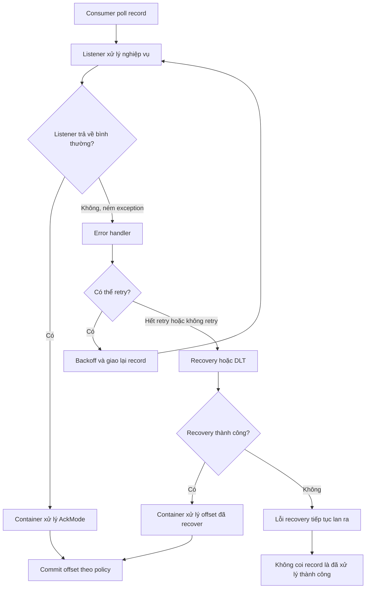
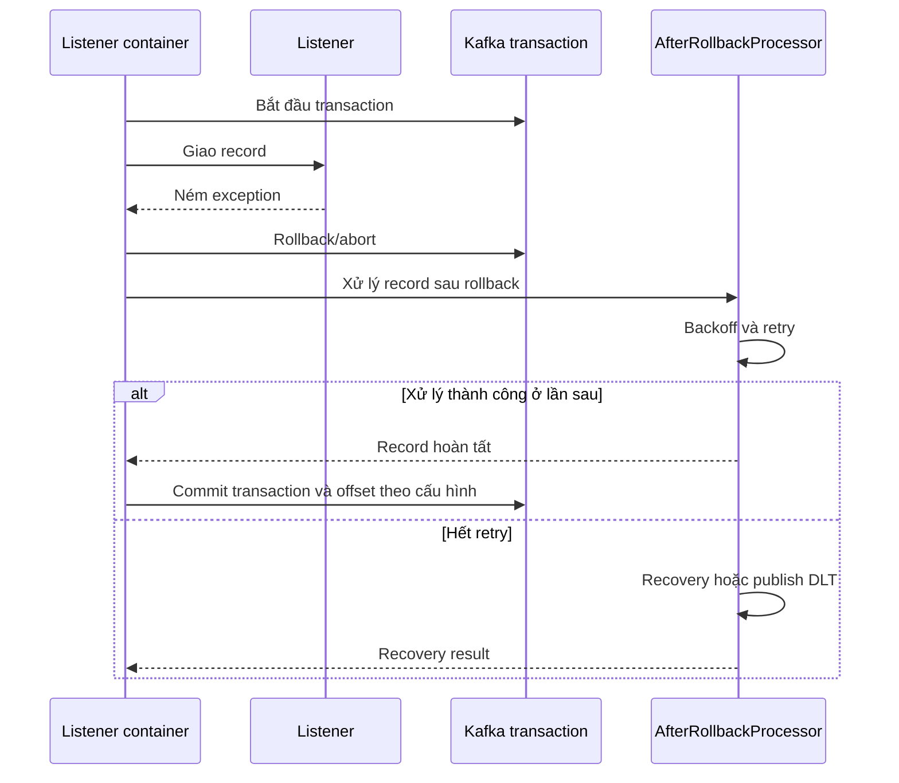

# Offset commit khi listener ném exception

Trong Spring Kafka, khi listener ném exception, offset của record lỗi có được commit hay không phụ thuộc vào cách listener container xử lý lỗi. Container có thể retry record, chuyển record sang dead-letter topic (DLT), bỏ qua record theo chính sách recovery hoặc dừng xử lý để chờ can thiệp. Mỗi lựa chọn có ảnh hưởng khác nhau đến vị trí consumer group sẽ đọc tiếp sau restart hoặc rebalance.

Điểm cần phân biệt là **listener thất bại**, **error handler xử lý được lỗi** và **offset được commit** là ba sự kiện riêng. Listener ném exception không đồng nghĩa offset chắc chắn được commit hoặc chắc chắn không được commit. Container và error handler quyết định việc đó dựa trên `AckMode`, retry policy, kết quả recovery và transaction configuration.

Với consumer xử lý nghiệp vụ, thường tắt `enable.auto.commit` để Spring Kafka listener container kiểm soát offset. Khi listener ném exception, container có thể giữ record ở trạng thái chưa hoàn tất, gọi error handler để retry hoặc recovery, rồi chỉ commit theo chính sách đã cấu hình. Cách này giúp vận hành giải thích được vì sao một record được đọc lại, chuyển DLT hoặc được xem là đã xử lý.

## 1. Điều gì xảy ra khi listener ném exception?

Một record listener thường được gọi theo luồng sau:

1. Consumer poll record từ partition.
2. Listener container chuyển record cho phương thức `@KafkaListener`.
3. Listener thực hiện nghiệp vụ.
4. Nếu listener trả về bình thường, container xử lý acknowledgement và commit offset theo `AckMode`.
5. Nếu listener ném exception, container chuyển lỗi đến error handler.
6. Error handler quyết định retry, recovery, DLT hoặc để lỗi tiếp tục lan ra.
7. Sau khi error handler hoàn tất, container quyết định offset nào có thể commit theo cấu hình.



Nếu listener tự bắt exception rồi trả về bình thường, container thường coi lần gọi đó là thành công. Ví dụ dưới đây có thể làm offset tiến dù database update thất bại:

```java
@KafkaListener(topics = "orders.events")
public void onOrderEvent(OrderEvent event) {
    try {
        orderService.process(event);
    }
    catch (RuntimeException exception) {
        log.error("Could not process order event", exception);
        // Listener kết thúc bình thường; container không biết nghiệp vụ thất bại.
    }
}
```

Nếu muốn container retry hoặc đưa record vào DLT, hãy để exception được ném ra ngoài listener sau khi ghi nhận thông tin cần thiết:

```java
@KafkaListener(topics = "orders.events")
public void onOrderEvent(OrderEvent event) {
    orderService.process(event); // Exception truyền về listener container.
}
```

Không nên bắt rồi nuốt exception chỉ để tránh log lỗi. Nếu cần chuyển lỗi thành trạng thái nghiệp vụ hợp lệ, hãy xử lý rõ ràng và chỉ trả về bình thường khi record thực sự đã được xử lý theo định nghĩa của hệ thống.

## 2. Offset commit phụ thuộc AckMode

Offset commit là vị trí tiếp theo mà consumer group sẽ đọc trong partition. Nếu record có offset `50` được xử lý thành công, commit offset `51` nghĩa là group đã xác nhận đến sau record `50`.

Spring Kafka listener container có các `AckMode` khác nhau. Với `enable.auto.commit=false`, container dùng AckMode để quản lý thời điểm commit:

| AckMode | Khi listener thành công | Khi listener ném exception |
|---|---|---|
| `RECORD` | Commit sau khi xử lý thành công từng record. | Record lỗi đi qua error handler; record đó chưa được coi là thành công cho đến khi retry/recovery được xử lý. |
| `BATCH` | Commit sau khi xử lý thành công toàn bộ records của một lần poll. | Container/error handler quản lý các offset đã xử lý trước lỗi và record cần retry/recovery; có thể phát lại phần chưa hoàn tất. |
| `TIME` | Commit theo chu kỳ thời gian sau khi các record liên quan được xử lý. | Error handler và container quyết định phần offset nào đã hoàn tất; không commit chỉ vì listener ném lỗi. |
| `COUNT` | Commit khi số record đã xử lý đạt ngưỡng. | Tương tự, record lỗi phải được xử lý qua error handler trước khi offset tương ứng được xác nhận. |
| `COUNT_TIME` | Commit theo ngưỡng số record hoặc thời gian. | Cần xem xét offset đã hoàn tất và phần đang retry/recover. |
| `MANUAL` | Listener gọi `Acknowledgment.acknowledge()` sau khi xử lý. | Nếu listener ném exception trước khi acknowledge, record không được xác nhận theo luồng manual thông thường. |
| `MANUAL_IMMEDIATE` | Acknowledge trên consumer thread yêu cầu commit ngay. | Nếu chưa acknowledge, error handler quyết định retry/recovery; nếu đã acknowledge trước khi ném exception, offset có thể đã được commit. |

`BATCH` là AckMode mặc định của listener container. Với record listener, `RECORD` thường dễ liên hệ commit với từng record hơn. `BATCH` giảm số lần commit nhưng có thể phát lại nhiều record hơn nếu batch chưa hoàn tất. Với batch listener, cần thiết kế cách xác định record lỗi trong batch.

Từ Spring Kafka 2.3, framework đặt `enable.auto.commit=false` nếu ứng dụng không cấu hình rõ thuộc tính này. Khi tự tạo `ConsumerFactory` hoặc truyền properties trực tiếp, hãy kiểm tra giá trị hiệu lực. Nếu bật `enable.auto.commit=true`, Kafka client có thể commit theo chu kỳ độc lập với kết quả listener; lúc đó không thể dựa vào AckMode để kiểm soát chính xác thời điểm commit.

### Ví dụ cấu hình record listener

```yaml
spring:
  kafka:
    consumer:
      group-id: orders-service
      enable-auto-commit: false
      auto-offset-reset: earliest
    listener:
      ack-mode: record
```

Với cấu hình này, container commit sau khi record listener xử lý thành công. Nếu listener ném exception, error handler sẽ quyết định retry hoặc recovery. `auto-offset-reset` chỉ áp dụng khi group chưa có offset hợp lệ; nó không tua lại offset đã commit.

## 3. Error handler quyết định retry và recovery

Spring Kafka dùng error handler ở listener container để xử lý exception. Với record listener, `DefaultErrorHandler` là lựa chọn phổ biến trong Spring Kafka 2.8 trở lên. Ở các phiên bản cũ hơn, ứng dụng có thể gặp `SeekToCurrentErrorHandler`. Cần chọn API tương ứng với phiên bản đang chạy.

`DefaultErrorHandler` có thể:

- Phân loại exception có thể retry và exception không nên retry.
- Thực hiện retry với `BackOff`.
- Seek hoặc định vị lại consumer để record được giao lại theo chính sách.
- Gọi recoverer khi hết retry hoặc exception không retry.
- Trả quyền điều khiển về container sau khi recovery thành công để container xử lý offset.

### Retry có giới hạn

Ví dụ dưới đây cấu hình ba lần retry sau lần xử lý ban đầu, chờ một giây giữa các lần thử, sau đó chuyển record sang DLT:

```java
@Bean
DefaultErrorHandler kafkaErrorHandler(
        KafkaTemplate<Object, Object> kafkaTemplate) {

    DeadLetterPublishingRecoverer recoverer =
            new DeadLetterPublishingRecoverer(
                    kafkaTemplate,
                    (record, exception) -> new TopicPartition(
                            record.topic() + ".DLT",
                            record.partition()));

    DefaultErrorHandler handler = new DefaultErrorHandler(
            recoverer,
            new FixedBackOff(1_000L, 3L));

    handler.addNotRetryableExceptions(
            IllegalArgumentException.class);

    return handler;
}
```

Các import chính gồm `DefaultErrorHandler`, `DeadLetterPublishingRecoverer`, `FixedBackOff` và `TopicPartition`. Topic DLT phải được tạo và có partition phù hợp với resolver. Nếu gửi record về đúng partition nguồn, DLT cần có đủ partition tương ứng. Producer dùng để publish DLT phải serialize được payload và giữ các header cần thiết.

`FixedBackOff(1_000L, 3L)` biểu diễn khoảng chờ cố định một giây và số lần retry được cấu hình sau lần xử lý đầu tiên. Tổng số lần listener có thể được gọi là lần đầu cộng số lần retry, nếu không có thay đổi từ error handler hoặc exception classification.

Với lỗi tạm thời như database timeout, retry có backoff có thể giúp dịch vụ phục hồi. Với lỗi dữ liệu như payload không hợp lệ hoặc schema không tương thích, retry cùng một payload thường không giải quyết được nguyên nhân. Những lỗi này nên được phân loại không retry hoặc chuyển DLT để điều tra.

### Recovery thành công và offset commit

Khi retry đã hết, recoverer có thể chuyển record sang DLT hoặc thực hiện một hành động recovery khác. Nếu recovery hoàn tất và error handler trả về bình thường, container có thể xem record đã được xử lý theo chính sách recovery và commit offset tương ứng.

Với `CommonErrorHandler`/`DefaultErrorHandler`, hành vi `ackAfterHandle` mặc định cho phép container commit offset sau khi error handler xử lý xong và trả về bình thường. Có thể cấu hình thay đổi hành vi này khi cần. Cần hiểu rõ sự khác nhau giữa:

- Listener xử lý nghiệp vụ thành công.
- Error handler retry và listener thành công ở một lần thử sau.
- Recoverer đã lưu record vào DLT hoặc thực hiện recovery thành công.

Trong trường hợp thứ ba, offset có thể được commit vì record đã được chuyển sang luồng xử lý lỗi theo chính sách. Đây không có nghĩa nghiệp vụ gốc đã thành công; hệ thống phải theo dõi DLT và quy trình replay.

Nếu recoverer thất bại, ví dụ publish DLT không thành công, lỗi recovery cần được truyền ra để container không âm thầm coi record đã được xử lý. Cần cấu hình và kiểm tra hành vi khi gửi DLT thất bại theo phiên bản Spring Kafka, đồng thời cảnh báo khi recovery exception xuất hiện.

`DefaultErrorHandler` cũng hỗ trợ `commitRecovered` trong các cấu hình phù hợp; khi dùng cơ chế này, container cần `AckMode.MANUAL_IMMEDIATE`. Chỉ bật khi hiểu rõ thời điểm commit recovered record và kiểm tra API của phiên bản đang sử dụng. Không trộn `commitRecovered`, `ackAfterHandle` và manual acknowledgement mà không xác định rõ thành phần nào chịu trách nhiệm commit.

### Không retry một số exception

Có thể khai báo exception không retry bằng `addNotRetryableExceptions(...)`. Những exception này đi thẳng đến recovery policy thay vì lặp lại nhiều lần. Chọn loại exception dựa trên nguyên nhân:

- Validation failure hoặc payload sai định dạng thường không retry.
- Lỗi mạng tạm thời hoặc database timeout có thể retry có giới hạn.
- Lỗi xác thực, ACL hoặc cấu hình thường cần sửa nguyên nhân và cảnh báo thay vì retry dày đặc.
- Lỗi nghiệp vụ phụ thuộc dữ liệu chưa sẵn sàng có thể cần retry có thời hạn hoặc luồng chờ riêng.

## 4. Điều gì xảy ra với record trước và sau record lỗi?

Một lần `poll()` có thể trả về nhiều record, kể cả từ nhiều partition. Nếu một record lỗi, container cần xử lý offset đã hoàn tất trước đó và giữ record lỗi cùng phần chưa xử lý ở trạng thái phù hợp.

Với record listener và `AckMode.RECORD`, container có thể commit các record trước đó đã xử lý thành công. Record lỗi được giao cho error handler. Tùy cách handler seek/retry và cách listener tiếp tục, các record phía sau có thể được đọc lại hoặc xử lý sau khi record lỗi được phục hồi.

Với `AckMode.BATCH`, container thường commit theo batch. Khi một record trong batch thất bại, các offset trước đó đã hoàn tất có thể được commit trước khi error handler xử lý phần còn lại. Sau recovery, container tiếp tục quản lý offset theo batch và error handler. Vì vậy không nên giả định rằng một exception luôn làm toàn bộ poll bị phát lại từ đầu hoặc luôn làm mọi record sau lỗi bị bỏ qua; hành vi phụ thuộc loại listener, error handler và phiên bản.

### Batch listener

Với batch listener, phương thức nhận một danh sách record. Nếu listener ném exception thông thường, error handler có thể không biết chính xác record nào trong batch gây lỗi, do đó toàn bộ batch có thể được giao lại.

Để xác định record lỗi, listener có thể ném `BatchListenerFailedException` kèm record hoặc index tương ứng. Error handler có thể commit phần trước record lỗi đã xử lý thành công, retry/recover record lỗi và xử lý phần còn lại theo policy.

Ví dụ minh họa:

```java
@KafkaListener(topics = "orders.events")
public void onBatch(List<ConsumerRecord<String, OrderEvent>> records) {
    for (int index = 0; index < records.size(); index++) {
        ConsumerRecord<String, OrderEvent> record = records.get(index);
        try {
            orderService.processIdempotently(record.value());
        }
        catch (RuntimeException exception) {
            throw new BatchListenerFailedException(
                    "Could not process order event", exception, index);
        }
    }
}
```

API constructor và cách xác định record có thể khác theo phiên bản Spring Kafka. Dùng overload phù hợp với phiên bản dự án và bảo đảm batch listener được cấu hình đúng kiểu. Nếu xử lý record song song trong batch, cần quản lý index và thứ tự hoàn tất rõ ràng; không đánh dấu batch hoàn tất khi còn record chưa thành công.

## 5. Manual acknowledgement và exception

Khi dùng `AckMode.MANUAL` hoặc `MANUAL_IMMEDIATE`, listener nhận `Acknowledgment` và chủ động gọi `acknowledge()`. Quy tắc quan trọng là chỉ acknowledge sau khi tác động nghiệp vụ đã hoàn tất theo định nghĩa của hệ thống.

```java
@KafkaListener(topics = "orders.events")
public void onOrderEvent(
        OrderEvent event,
        Acknowledgment acknowledgment) {

    orderService.processIdempotently(event);
    acknowledgment.acknowledge();
}
```

Nếu `processIdempotently()` ném exception, dòng `acknowledge()` không được chạy. Error handler nhận exception và quyết định retry hoặc recovery. Đây là cách tránh commit một record mà nghiệp vụ chưa hoàn tất.

Không đặt `acknowledgment.acknowledge()` trong `finally`:

```java
try {
    orderService.process(event);
}
finally {
    acknowledgment.acknowledge(); // Nguy hiểm: vẫn chạy khi process() thất bại.
}
```

Với `MANUAL`, acknowledgement được container tích lũy và commit theo ngữ nghĩa manual/batch. Với `MANUAL_IMMEDIATE`, acknowledgement trên consumer thread yêu cầu commit ngay. Nếu gọi acknowledgement từ thread khác, hành vi được xử lý qua cơ chế của container và có thể không còn là commit tức thời. Không dùng acknowledgement bất đồng bộ nếu chưa thiết kế rõ việc giữ partition, thứ tự hoàn tất và xử lý khi shutdown.

Nếu listener đã acknowledge rồi sau đó ném exception, offset có thể đã được commit tùy chế độ và thời điểm gọi. Vì vậy, không acknowledge trước khi hoàn tất mọi bước cần bảo đảm.

## 6. Listener ném exception trong Kafka transaction

Với transactional listener container, listener chạy trong Kafka transaction. Nếu listener ném exception, transaction có thể bị rollback/abort. Offset không được commit như một transaction thành công; record được xử lý theo `AfterRollbackProcessor`.

`DefaultAfterRollbackProcessor` là thành phần Spring Kafka dùng để xử lý record sau rollback. Nó có thể seek để giao lại record, thực hiện retry/backoff và recovery sau khi hết số lần thử. Nếu dùng DLT, recovery có thể được cấu hình để publish record lỗi. Với cấu hình transactional nâng cao, recovery record và offset có thể được commit trong một transaction mới.

Luồng khái quát:



Không áp dụng nguyên xi hành vi của `DefaultErrorHandler` cho transactional listener. Với transaction, cần xem xét `AfterRollbackProcessor`, transaction manager, timeout, retry và recovery transaction. Nếu listener gọi dịch vụ ngoài database rồi ném exception, Kafka rollback không thể hoàn tác tác động ngoài Kafka; nghiệp vụ vẫn cần idempotency hoặc một mô hình phối hợp như outbox/inbox.

## 7. DLT và ý nghĩa của việc commit sau recovery

DLT giữ record không thể xử lý trong luồng chính để đội vận hành điều tra. Khi recoverer publish record sang DLT thành công và error handler xem recovery hoàn tất, offset nguồn có thể được commit để consumer tiếp tục với record kế tiếp.

Điều đó tạo ra một ranh giới vận hành: record đã rời luồng retry chính và được lưu vào luồng lỗi. Đội vận hành cần có quy trình theo dõi, sửa nguyên nhân và replay.

Thông tin cần giữ khi chuyển DLT gồm:

- Topic, partition và offset nguồn.
- Key, timestamp và header gốc.
- `eventId` hoặc correlation ID.
- Exception class, thông điệp lỗi và số lần retry.
- Thời điểm recovery và trạng thái publish DLT.

Nếu DLT publish thất bại, không nên commit offset nguồn như thể recovery đã thành công. Hãy xác nhận recoverer có phát hiện lỗi send result và ném exception khi DLT publish không thành công. Với `DeadLetterPublishingRecoverer`, có thể cấu hình kiểm tra kết quả gửi theo API của phiên bản Spring Kafka đang dùng.

Replay DLT phải dùng cùng `eventId` để consumer chống duplicate. Trước khi replay hàng loạt, sửa nguyên nhân gốc, thử với một số record, giới hạn tốc độ và theo dõi kết quả nghiệp vụ.

## 8. Retry topic và non-blocking retry

Spring Kafka hỗ trợ retry topic qua `@RetryableTopic` trong các phiên bản phù hợp. Khi listener ném exception, framework có thể publish record sang retry topic với thời gian chờ và sau đó chuyển sang topic tiếp theo hoặc DLT.

Trong mô hình này, offset của topic gốc có thể được commit sau khi record được chuyển thành công sang retry topic. Việc commit nguồn có nghĩa record đã được bàn giao cho luồng retry, không có nghĩa nghiệp vụ gốc đã thành công.

Non-blocking retry giúp một record lỗi không chặn toàn bộ partition trong thời gian backoff dài. Tuy nhiên, record mới hơn cùng key có thể được xử lý trước record đang retry. Nếu nghiệp vụ yêu cầu thứ tự nghiêm ngặt, cần cân nhắc tác động và chọn blocking retry hoặc một thiết kế giữ thứ tự phù hợp.

Không kết hợp blocking retry, retry topic và retry tầng ứng dụng mà không tính tổng số lần thử và deadline. Nếu mỗi tầng retry độc lập, một lỗi có thể tạo số lần gửi lớn hơn dự kiến.

## 9. Idempotency và khoảng trống giữa nghiệp vụ với offset

Ngay cả khi tắt auto commit, có một cửa sổ lỗi thường gặp:

1. Listener cập nhật database thành công.
2. Process dừng trước khi offset được commit.
3. Consumer group khởi động lại và nhận lại record.
4. Listener thực hiện nghiệp vụ lần nữa.

Đây là hành vi at-least-once. Để tránh tác động trùng, nên dùng `eventId` ổn định và ghi dấu đã xử lý trong cùng transaction database với cập nhật nghiệp vụ.

Ví dụ bảng inbox có unique constraint trên `event_id`. Service thực hiện insert và cập nhật nghiệp vụ trong cùng transaction. Nếu insert báo event đã tồn tại, service kết thúc mà không lặp tác động. Cần dùng thao tác insert nguyên tử hoặc upsert phù hợp; không thực hiện một câu query kiểm tra rồi insert bằng hai bước không được bảo vệ, vì hai consumer có thể xử lý cùng event đồng thời.

Nếu listener gọi API ngoài, hãy dùng idempotency key mà API đích hỗ trợ hoặc ghi yêu cầu ra outbox trong transaction database. Offset commit không thể rollback một API call đã thành công.

## 10. Cấu hình tham khảo

### Record listener với retry và DLT

```yaml
spring:
  kafka:
    consumer:
      group-id: orders-service
      enable-auto-commit: false
    listener:
      ack-mode: record
```

```java
@Bean
DefaultErrorHandler errorHandler(
        KafkaTemplate<Object, Object> kafkaTemplate) {
    DeadLetterPublishingRecoverer recoverer =
            new DeadLetterPublishingRecoverer(kafkaTemplate);

    DefaultErrorHandler handler = new DefaultErrorHandler(
            recoverer,
            new ExponentialBackOffWithMaxRetries(3));

    handler.addNotRetryableExceptions(
            IllegalArgumentException.class);
    return handler;
}
```

Ví dụ dùng exponential backoff với tối đa ba lần retry. Hãy chọn multiplier, initial interval và maximum interval theo SLA nếu cần kiểm soát cụ thể. DLT topic cần tồn tại và serializer phải tương thích. Cấu hình error handler có thể được đăng ký trực tiếp cho listener container factory hoặc thông qua cơ chế cấu hình của ứng dụng.

### Manual acknowledgement

```yaml
spring:
  kafka:
    consumer:
      enable-auto-commit: false
    listener:
      ack-mode: manual
```

Listener chỉ gọi `acknowledge()` sau khi service hoàn tất. Nếu exception xảy ra trước đó, error handler xử lý record. Cần kiểm tra chính sách commit recovered record khi kết hợp manual mode.

### Transactional listener

Với listener container transactional, cấu hình `transaction-id-prefix` và Kafka transaction manager phù hợp. Listener exception làm transaction rollback; cấu hình `DefaultAfterRollbackProcessor` để quy định retry và recovery. Không bật auto commit để thay thế transaction offset management.

## 11. Runbook khi listener ném exception và offset không như mong đợi

### Record bị bỏ qua dù listener báo lỗi

1. Kiểm tra listener có bắt rồi nuốt exception không.
2. Kiểm tra `enable.auto.commit` có đang bật không.
3. Xác định `AckMode` và error handler thực tế của listener container.
4. Kiểm tra error handler có xem exception là non-retryable hoặc recovery đã hoàn tất không.
5. Xác nhận recoverer có publish DLT thành công và container có commit offset sau recovery không.
6. Đối chiếu committed offset với topic, partition và record nguồn.

### Record bị giao lại nhiều lần

1. Ghi nhận topic, partition, offset, `eventId` và exception class.
2. Kiểm tra retry count, backoff và error handler có seek/re-poll record hay không.
3. Kiểm tra recovery có thất bại khi publish DLT không.
4. Xác định có rebalance hoặc restart làm record chưa commit được giao lại không.
5. Kiểm tra consumer idempotency để bảo đảm lần giao lại không lặp tác động nghiệp vụ.

### Offset commit dù database transaction thất bại

1. Kiểm tra service có ném exception ra khỏi listener không.
2. Kiểm tra listener có `catch` exception mà không ném lại không.
3. Xác nhận database transaction thực sự rollback và exception không bị chuyển thành kết quả thành công.
4. Tắt auto commit và chọn AckMode phù hợp.
5. Kiểm tra error handler không recovery hoặc bỏ qua record sai chính sách.

### DLT có record nhưng offset nguồn chưa tiến

1. Kiểm tra kết quả publish DLT và metadata của record đích.
2. Kiểm tra recoverer có ném exception sau khi gửi DLT thất bại hoặc lỗi xử lý header/serializer không.
3. Kiểm tra `ackAfterHandle`, `commitRecovered` và AckMode.
4. Kiểm tra transaction/AfterRollbackProcessor nếu listener đang chạy transactional.
5. Xác minh record DLT có thể replay và không tạo duplicate trước khi cho consumer tiếp tục.

### Batch listener phát lại quá nhiều record

1. Kiểm tra listener đang nhận batch hay từng record.
2. Xác định exception có chỉ ra index/record lỗi qua `BatchListenerFailedException` không.
3. Kiểm tra error handler và cách container xử lý phần batch đã thành công.
4. Nếu cần, cung cấp record lỗi rõ ràng và bảo đảm các record trước đó có thể commit an toàn.
5. Dùng idempotency để chịu được record bị giao lại trong quá trình retry.

## 12. Bảng kiểm soát offset commit khi có exception

| Điểm kiểm soát | Câu hỏi cần trả lời | Bằng chứng vận hành |
|---|---|---|
| Exception propagation | Listener có ném lỗi ra container khi nghiệp vụ thất bại không? | Stack trace, listener log và exception class. |
| Auto commit | Kafka client có tự commit độc lập không? | `enable.auto.commit` trong consumer properties hiệu lực. |
| AckMode | Container commit theo record, batch hay manual? | `ContainerProperties.AckMode` và listener type. |
| Retry | Record được retry bao nhiêu lần và theo backoff nào? | Retry count, backoff và error handler logs. |
| Recovery | Record đã được publish DLT hoặc xử lý recovery thành công chưa? | DLT metadata, recoverer send result và recovery exception. |
| Commit | Offset nào được commit sau lỗi hoặc recovery? | Committed offset theo group/topic/partition và commit logs. |
| Transaction | Exception có rollback Kafka transaction không? | Transaction manager, abort/commit result và AfterRollbackProcessor. |
| Duplicate | Nếu record được giao lại, nghiệp vụ có idempotent không? | Event ID, inbox/unique constraint hoặc idempotency key. |

Khi listener ném exception, offset chỉ nên tiến theo một chính sách đã xác định: xử lý thành công sau retry, recovery đã lưu record vào DLT, hoặc một quyết định bỏ qua có chủ đích và có dấu vết. Tắt auto commit, để container/error handler quản lý offset, kiểm soát kết quả recovery và thiết kế idempotency giúp hệ thống xử lý lỗi có thể dự đoán được. Đội vận hành cần đối chiếu exception, retry, DLT và committed offset để giải thích chính xác vì sao record được đọc lại hoặc consumer đã chuyển sang record tiếp theo.
