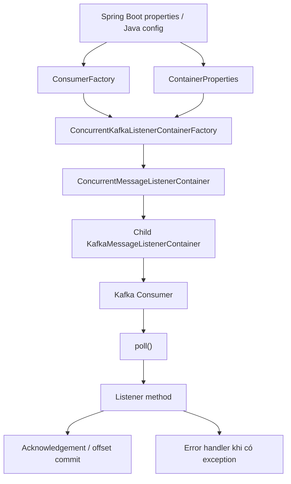

# ContainerProperties trong Spring Kafka

`ContainerProperties` là lớp cấu hình các hành vi vận hành của listener container trong Spring Kafka. Nó quyết định container đăng ký topic hoặc partition nào, commit offset theo cách nào, chờ `poll()` bao lâu, phát hiện consumer không hoạt động ra sao, xử lý việc dừng container và phối hợp một số cơ chế nâng cao như acknowledgement bất đồng bộ hoặc transaction.

Lớp này nằm ở tầng listener container, phía trên Kafka Java Consumer. Nó không thay thế `ConsumerFactory` và cũng không chứa toàn bộ cấu hình của Kafka client. Muốn cấu hình `bootstrap.servers`, deserializer, `max.poll.interval.ms`, `max.poll.records`, security hoặc các thuộc tính consumer khác, ứng dụng vẫn cấu hình `ConsumerFactory` hoặc Spring Boot `spring.kafka.consumer.*`.

Trong ứng dụng Spring Boot, các thuộc tính `spring.kafka.listener.*` thường được dùng để cấu hình listener container. Khi cần kiểm soát chi tiết hơn, có thể cấu hình `ContainerProperties` thông qua `ConcurrentKafkaListenerContainerFactory` hoặc tạo container trực tiếp.

## 1. Vị trí của ContainerProperties trong kiến trúc

Một listener container kết nối listener nghiệp vụ với Kafka consumer. Container chịu trách nhiệm gọi `poll()`, chuyển record đến listener, quản lý acknowledgement, commit offset, xử lý vòng đời consumer và phát các sự kiện liên quan.

Các thành phần thường phối hợp như sau:

| Thành phần | Trách nhiệm chính |
|---|---|
| `ConsumerFactory` | Tạo Kafka `Consumer` với các thuộc tính client, deserializer và cấu hình kết nối |
| `ContainerProperties` | Cấu hình subscription/assignment và hành vi của listener container |
| `KafkaMessageListenerContainer` | Quản lý một Kafka consumer và vòng lặp xử lý |
| `ConcurrentMessageListenerContainer` | Quản lý nhiều child listener container theo cấu hình concurrency |
| `ConcurrentKafkaListenerContainerFactory` | Tạo và cấu hình container, thường được `@KafkaListener` sử dụng |
| `@KafkaListener` | Khai báo phương thức nhận message và metadata subscription ở cấp listener |
| `CommonErrorHandler` | Xử lý exception phát sinh trong quá trình gọi listener |

Sơ đồ tổng quát:



Có thể hiểu `ContainerProperties` là bộ quy tắc cho cách container vận hành. Nó không phải nơi đặt logic nghiệp vụ của listener và cũng không phải bản sao của tất cả thuộc tính Kafka consumer.

## 2. Khởi tạo ContainerProperties và chọn nguồn message

`ContainerProperties` có các constructor chính cho ba kiểu subscription/assignment.

### 2.1. Subscribe theo danh sách topic

Dùng danh sách topic khi consumer group cần nhận partition do Kafka group coordinator phân bổ:

```java
ContainerProperties properties =
        new ContainerProperties("orders.created", "orders.cancelled");
```

Consumer đăng ký các topic và tham gia cơ chế group management. Kafka phân bổ partition cho các consumer trong group khi khởi tạo hoặc rebalance.

Đây là lựa chọn thường gặp trong các ứng dụng service dùng `@KafkaListener` hoặc listener container thông thường.

### 2.2. Subscribe theo pattern

Có thể đăng ký các topic khớp với một biểu thức chính quy:

```java
ContainerProperties properties =
        new ContainerProperties(Pattern.compile("orders\\..*"));
```

Pattern hữu ích khi số topic có thể thay đổi và tên topic tuân theo một quy ước. Cần kiểm soát phạm vi pattern để consumer không vô tình đăng ký các topic ngoài dự kiến. Việc phát hiện topic mới còn phụ thuộc metadata refresh và cấu hình Kafka client.

### 2.3. Gán partition cụ thể

Khi cần chỉ định chính xác partition, dùng `TopicPartitionOffset`:

```java
ContainerProperties properties = new ContainerProperties(
        new TopicPartitionOffset("orders.created", 0),
        new TopicPartitionOffset("orders.created", 1)
);
```

Cách này dùng explicit assignment. Ứng dụng chịu trách nhiệm xác định partition nào thuộc consumer/container; nó không dùng cơ chế phân bổ partition tự động của group subscription như khi gọi `subscribe()`.

Explicit assignment hữu ích cho tiến trình chuyên dụng, công cụ replay hoặc workload cần kiểm soát partition. Tuy nhiên, cần thiết kế ownership và xử lý khi nhiều tiến trình cùng được cấu hình vào một partition. Không để nhiều consumer độc lập cùng xử lý một partition mà không có cơ chế điều phối rõ ràng.

Có thể chỉ định offset hoặc vị trí bắt đầu thông qua các constructor/tuỳ chọn của `TopicPartitionOffset`, tùy phiên bản Spring Kafka. Khi dùng offset tường minh, cần hiểu rõ semantics của offset, reset policy và hành vi khi offset không còn tồn tại do retention.

## 3. Cấu hình ContainerProperties qua listener container factory

Trong ứng dụng Spring, cách phổ biến là cấu hình factory và lấy `ContainerProperties` từ factory đó:

```java
@Configuration
public class KafkaListenerConfiguration {

    @Bean
    public ConcurrentKafkaListenerContainerFactory<String, OrderEvent>
            kafkaListenerContainerFactory(
                    ConsumerFactory<String, OrderEvent> consumerFactory,
                    CommonErrorHandler commonErrorHandler) {

        var factory =
                new ConcurrentKafkaListenerContainerFactory<String, OrderEvent>();

        factory.setConsumerFactory(consumerFactory);
        factory.setConcurrency(3);
        factory.setCommonErrorHandler(commonErrorHandler);

        ContainerProperties containerProperties =
                factory.getContainerProperties();

        containerProperties.setAckMode(ContainerProperties.AckMode.RECORD);
        containerProperties.setPollTimeout(1_000);
        containerProperties.setSyncCommitTimeout(Duration.ofSeconds(5));
        containerProperties.setMissingTopicsFatal(false);
        containerProperties.setIdleEventInterval(60_000L);
        containerProperties.setLogContainerConfig(true);

        return factory;
    }
}
```

Ví dụ cần các import tương ứng như `ContainerProperties`, `ConcurrentKafkaListenerContainerFactory`, `ConsumerFactory`, `CommonErrorHandler` và `Duration`. Bean `CommonErrorHandler` phải được cung cấp trong cấu hình ứng dụng.

Các điểm cần lưu ý:

- `factory.setConcurrency(3)` cấu hình số consumer con mà concurrent container quản lý. Đây là thuộc tính của factory/container, không phải một thuộc tính bên trong `ContainerProperties`.
- `factory.getContainerProperties()` trả về bộ cấu hình container mà factory sử dụng khi tạo listener container.
- Cấu hình phải được đặt trước khi container khởi động để hành vi ban đầu nhất quán.
- Listener phải dùng đúng factory này. Nếu có nhiều factory, kiểm tra thuộc tính `containerFactory` trên `@KafkaListener`.

Ví dụ listener:

```java
@Component
public class OrderEventListener {

    @KafkaListener(
        topics = "orders.created",
        groupId = "billing-service",
        containerFactory = "kafkaListenerContainerFactory"
    )
    public void onOrderCreated(OrderEvent event) {
        // Xử lý nghiệp vụ
    }
}
```

Nếu listener dùng factory khác, các thiết lập trong ví dụ trên không tự động áp dụng cho listener đó.

## 4. Các nhóm thuộc tính quan trọng

Các thuộc tính của `ContainerProperties` có thể được nhóm theo mục đích vận hành. API và các giá trị mặc định có thể thay đổi theo phiên bản Spring Kafka; hãy đối chiếu Javadoc của phiên bản đang được Spring Boot quản lý.

### 4.1. Acknowledgement và offset commit

Nhóm này quyết định thời điểm và cách container xác nhận tiến độ xử lý.

| Thuộc tính | Ý nghĩa |
|---|---|
| `ackMode` | Chọn `RECORD`, `BATCH`, `TIME`, `COUNT`, `COUNT_TIME`, `MANUAL` hoặc `MANUAL_IMMEDIATE` |
| `ackCount` | Ngưỡng số record dùng với các AckMode dựa trên count |
| `ackTime` | Ngưỡng thời gian dùng với các AckMode dựa trên time |
| `syncCommits` | Chọn commit đồng bộ hay bất đồng bộ |
| `syncCommitTimeout` | Timeout áp dụng cho synchronous commit |
| `commitCallback` | Callback nhận kết quả của asynchronous commit |
| `commitLogLevel` | Mức log dùng cho các thông báo commit |
| `asyncAcks` | Cho phép manual acknowledgement của các record trong một poll hoàn tất không theo thứ tự, với các giới hạn của cơ chế này |

Ví dụ:

```java
ContainerProperties properties = factory.getContainerProperties();

properties.setAckMode(ContainerProperties.AckMode.RECORD);
properties.setSyncCommits(true);
properties.setSyncCommitTimeout(Duration.ofSeconds(5));
properties.setCommitLogLevel(LogIfLevelEnabled.Level.DEBUG);
```

Với `RECORD`, container commit sau khi từng record listener hoàn tất thành công. Với `BATCH`, tiến độ thường được commit sau khi xử lý xong các record được trả về trong một lần poll. `ackCount` và `ackTime` chủ yếu có ý nghĩa với các AckMode tương ứng; không nên đặt chúng với kỳ vọng thay đổi hành vi của `RECORD`.

Nếu dùng asynchronous commit, hãy cấu hình và quan sát callback để phát hiện commit failure. Asynchronous commit có thể giảm thời gian chờ của consumer thread, nhưng ứng dụng cần hiểu thứ tự callback và khả năng phát lại khi có lỗi.

`asyncAcks` là tuỳ chọn nâng cao dành cho manual acknowledgement. Nó cho phép acknowledge các record trong một poll theo thứ tự hoàn tất khác với thứ tự nhận, nhưng container phải theo dõi các offset còn thiếu và có thể tạm dừng consumer cho tới khi đủ acknowledgement. Điều này ảnh hưởng đến throughput và redelivery khi ứng dụng gặp sự cố. Chỉ bật khi listener thực sự cần xử lý bất đồng bộ và đã kiểm thử cách commit, pause/resume và phục hồi. Không nhầm `asyncAcks` với việc container tự biến một listener đồng bộ thành bất đồng bộ.

### 4.2. Polling và nhịp hoạt động

| Thuộc tính | Ý nghĩa |
|---|---|
| `pollTimeout` | Thời gian tối đa container chờ trong một lần `poll()` |
| `idleBetweenPolls` | Khoảng nghỉ bổ sung giữa các lần poll |
| `noPollThreshold` | Hệ số dùng để xác định consumer có thể không poll trong khoảng thời gian bất thường |
| `monitorInterval` | Chu kỳ kiểm tra trạng thái poll/consumer của container |
| `consumerStartTimeout` | Thời gian container chờ consumer thread bắt đầu |
| `pauseImmediate` | Điều khiển thời điểm pause có hiệu lực so với các record còn lại của poll hiện tại |

`pollTimeout` không phải là thời gian tối đa cho phép listener xử lý một record. Nó là thời gian chờ của thao tác poll khi broker chưa trả dữ liệu. Thời gian xử lý record còn chịu ảnh hưởng bởi logic listener và cấu hình Kafka consumer như `max.poll.interval.ms`.

Ví dụ:

```java
ContainerProperties properties = factory.getContainerProperties();

properties.setPollTimeout(1_000);
properties.setIdleBetweenPolls(250);
properties.setMonitorInterval(10);
properties.setNoPollThreshold(3.0f);
```

Nếu xử lý record mất nhiều thời gian, hãy xem xét `max.poll.interval.ms`, `max.poll.records`, concurrency và khả năng tách công việc. Chỉ tăng `pollTimeout` không giải quyết được listener xử lý quá lâu.

`monitorInterval` và `noPollThreshold` hỗ trợ phát hiện trạng thái consumer có thể không poll đúng nhịp. Chúng phục vụ theo dõi và cảnh báo; không thay thế heartbeat, session timeout hoặc cơ chế phát hiện thành viên group của Kafka.

### 4.3. Idle event và quan sát container

Container có thể phát sự kiện khi không nhận record trong một khoảng thời gian. Các thuộc tính thường dùng gồm:

- `idleEventInterval`: khoảng thời gian để phát idle event ở cấp container khi không có record.
- `idlePartitionEventInterval`: khoảng thời gian để phát sự kiện cho partition không có dữ liệu mới.
- `logContainerConfig`: yêu cầu ghi log cấu hình container khi khởi động.

Ví dụ:

```java
ContainerProperties properties = factory.getContainerProperties();

properties.setIdleEventInterval(60_000L);
properties.setIdlePartitionEventInterval(120_000L);
properties.setLogContainerConfig(true);
```

Ứng dụng có thể lắng nghe các sự kiện idle để theo dõi topic không có traffic, phát hiện nguồn dữ liệu ngừng gửi hoặc cập nhật dashboard. Idle không nhất thiết là lỗi: topic có thể đơn giản không có message trong thời gian đó.

Sự kiện idle không phải bằng chứng rằng consumer group đang lag hoặc container đã chết. Hãy kết hợp với consumer lag, trạng thái container, log và metrics.

### 4.4. Topic và lỗi xác thực

Một số thiết lập điều khiển hành vi khi container khởi động hoặc gặp lỗi kết nối/quyền truy cập:

| Thuộc tính | Ý nghĩa |
|---|---|
| `missingTopicsFatal` | Quyết định container có dừng khởi động khi topic được cấu hình chưa tồn tại hay không |
| `authExceptionRetryInterval` | Khoảng chờ trước khi thử lại khi gặp lỗi xác thực/ủy quyền thuộc nhóm được hỗ trợ |

Ví dụ:

```java
ContainerProperties properties = factory.getContainerProperties();

properties.setMissingTopicsFatal(false);
properties.setAuthExceptionRetryInterval(Duration.ofSeconds(10));
```

Nếu đặt `missingTopicsFatal(false)`, container có thể tiếp tục chờ topic xuất hiện thay vì thất bại ngay khi khởi động. Điều này hữu ích trong môi trường mà topic được tạo bởi một quy trình triển khai khác. Đổi lại, nếu tên topic sai, listener có thể ở trạng thái không nhận message trong thời gian dài. Hãy có cảnh báo cho topic không tồn tại và kiểm tra quyền truy cập.

`authExceptionRetryInterval` không thay thế cấu hình bảo mật. Ứng dụng vẫn cần cấu hình đúng SASL, SSL, credentials và ACL trong Kafka client. Nếu không có khả năng khôi phục quyền truy cập, retry liên tục chỉ kéo dài thời gian phát hiện sự cố.

### 4.5. Shutdown và vòng đời

Các thuộc tính liên quan đến dừng container giúp xác định ứng dụng có thời gian hoàn tất công việc đang chạy hay không.

| Thuộc tính | Ý nghĩa |
|---|---|
| `shutdownTimeout` | Thời gian chờ khi container dừng một cách có trật tự |
| `stopImmediate` | Điều khiển việc dừng sau record hiện tại hay sau các record còn lại của poll |
| `consumerStartTimeout` | Giới hạn thời gian chờ consumer thread bắt đầu |

Ví dụ:

```java
ContainerProperties properties = factory.getContainerProperties();

properties.setShutdownTimeout(15_000L);
properties.setStopImmediate(true);
```

Shutdown cần được thiết kế cùng với thời gian xử lý nghiệp vụ, timeout của dependency và thời gian dừng của ứng dụng. Nếu listener gọi dịch vụ ngoài mà không có timeout, container có thể không dừng đúng hạn dù đã đặt `shutdownTimeout`.

`stopImmediate` thay đổi ranh giới công việc container cố hoàn tất khi dừng. Hãy kiểm thử với record đang xử lý và các record khác trong poll hiện tại để hiểu chính xác số record được xử lý trước khi dừng theo phiên bản đang dùng.

### 4.6. Rebalance và transaction

Container properties còn có các điểm tích hợp dành cho use case nâng cao:

- `consumerRebalanceListener`: cho phép ứng dụng nhận callback khi partition được thu hồi hoặc phân bổ trong group subscription. Dùng để lưu/khôi phục trạng thái theo partition hoặc điều phối tài nguyên gắn với assignment.
- `transactionManager` hoặc `KafkaAwareTransactionManager` tùy API/phiên bản: tích hợp transaction với listener container.
- `transactionDefinition`: cung cấp thuộc tính transaction cho transaction do container khởi tạo.
- `subBatchPerPartition`: với batch listener trong một số cấu hình transaction, cho phép chia batch theo partition.

Các thuộc tính này ảnh hưởng đến semantics của xử lý và cần được kiểm tra cùng listener type, transaction manager và phiên bản Spring Kafka. Không nên thêm transaction manager chỉ để “bật exactly-once” mà chưa xác định rõ phạm vi transaction.

Kafka transaction có thể phối hợp việc consume và produce trong Kafka. Nó không tự tạo transaction nguyên tử với database hoặc HTTP service bên ngoài. Nếu listener cập nhật database, cần thiết kế outbox/inbox hoặc idempotency phù hợp.

## 5. Cấu hình bằng Spring Boot

Spring Boot ánh xạ nhiều thuộc tính listener vào cấu hình container. Ví dụ:

```yaml
spring:
  kafka:
    bootstrap-servers: localhost:9092
    consumer:
      group-id: billing-service
      enable-auto-commit: false
      max-poll-records: 100
      properties:
        max.poll.interval.ms: 300000
    listener:
      ack-mode: record
      concurrency: 3
      poll-timeout: 1s
      missing-topics-fatal: false
      idle-event-interval: 60s
      monitor-interval: 10s
      no-poll-threshold: 3
      shutdown-timeout: 15s
      log-container-config: true
```

Trong ví dụ này:

- `spring.kafka.consumer.*` chứa cấu hình Kafka consumer như group ID, auto commit và thuộc tính client.
- `spring.kafka.listener.*` chứa cấu hình listener container như AckMode, concurrency, poll timeout và shutdown.
- `max.poll.interval.ms` là thuộc tính Kafka client, dù nó ảnh hưởng trực tiếp đến khả năng vận hành của listener.
- `concurrency` là số consumer con do concurrent listener container quản lý.

Tên property và kiểu dữ liệu được Spring Boot bind có thể thay đổi giữa các phiên bản. Đặc biệt, các tuỳ chọn mới như `async-acks`, `idle-between-polls` hoặc các thuộc tính quan sát cần đối chiếu với metadata cấu hình của Spring Boot đang dùng.

Nếu cần cấu hình không được expose qua Spring Boot properties, có thể khai báo factory bean và chỉnh `ContainerProperties` trực tiếp. Tránh cấu hình cùng một thuộc tính ở nhiều nơi mà không rõ giá trị nào thắng.

## 6. Phân biệt ContainerProperties với ConsumerConfig

Đây là nhầm lẫn thường gặp khi cấu hình Kafka.

| Nhu cầu | Nơi cấu hình thường dùng |
|---|---|
| Broker bootstrap servers | `ConsumerConfig.BOOTSTRAP_SERVERS_CONFIG` / `spring.kafka.bootstrap-servers` |
| Consumer group ID | Consumer properties hoặc group ID trên listener |
| Key/value deserializer | `ConsumerFactory` / `spring.kafka.consumer.*` |
| `max.poll.records` | Kafka consumer properties |
| `max.poll.interval.ms` | Kafka consumer properties |
| `session.timeout.ms` và heartbeat | Kafka consumer properties |
| Security protocol, SASL, SSL | Kafka client properties |
| AckMode | `ContainerProperties` / `spring.kafka.listener.ack-mode` |
| Poll timeout của container | `ContainerProperties` / `spring.kafka.listener.poll-timeout` |
| Idle event interval | `ContainerProperties` / listener properties tương ứng |
| Shutdown timeout của container | `ContainerProperties` / listener properties tương ứng |
| Synchronous commit timeout | `ContainerProperties` |

Kafka consumer properties được chuyển đến Kafka client khi `ConsumerFactory` tạo consumer. Container properties điều khiển cách Spring quản lý consumer đó. Hai lớp cấu hình liên quan chặt chẽ nhưng không thể thay thế nhau.

Ví dụ, đặt `pollTimeout` thành 2 giây không đồng nghĩa `max.poll.interval.ms` là 2 giây. Một thuộc tính điều khiển thời gian chờ trong một lần poll; thuộc tính còn lại giới hạn khoảng thời gian giữa các lần poll trước khi consumer bị coi là không còn hoạt động trong group.

## 7. Kết hợp ContainerProperties với concurrency

`ConcurrentKafkaListenerContainerFactory` có thể tạo một `ConcurrentMessageListenerContainer` gồm nhiều child container. Mỗi child quản lý một Kafka consumer riêng.

Ví dụ:

```java
factory.setConcurrency(4);
factory.getContainerProperties().setAckMode(
        ContainerProperties.AckMode.RECORD
);
```

Với topic có bốn partition và concurrency bằng bốn, mỗi consumer có thể được gán một partition nếu group assignment cho phép. Nếu topic chỉ có hai partition, tối đa hai consumer trong group có thể nhận partition của topic đó tại cùng thời điểm; hai consumer còn lại không tăng throughput cho topic này.

Concurrency cần được chọn dựa trên:

- Số partition của các topic được consume.
- Thời gian xử lý trung bình và độ biến thiên của listener.
- Khả năng chịu tải của database và dịch vụ phụ thuộc.
- Tài nguyên CPU, memory và số kết nối.
- Thứ tự nghiệp vụ cần giữ trong từng partition.

Không tăng concurrency chỉ để “dùng hết CPU”. Nếu dependency phía sau đã bão hòa, thêm consumer có thể làm tăng contention và retry mà không cải thiện throughput.

## 8. Ví dụ cấu hình theo hai use case

### 8.1. Listener xử lý từng record và commit sau mỗi record

Đây là mô hình thường gặp với service xử lý event độc lập:

```java
@Bean
ConcurrentKafkaListenerContainerFactory<String, OrderEvent>
        orderListenerFactory(
                ConsumerFactory<String, OrderEvent> consumerFactory) {

    var factory =
            new ConcurrentKafkaListenerContainerFactory<String, OrderEvent>();

    factory.setConsumerFactory(consumerFactory);
    factory.setConcurrency(3);

    ContainerProperties cp = factory.getContainerProperties();
    cp.setAckMode(ContainerProperties.AckMode.RECORD);
    cp.setPollTimeout(1_000);
    cp.setSyncCommits(true);
    cp.setMissingTopicsFatal(false);

    return factory;
}
```

Cấu hình này có ý nghĩa khi mỗi listener call hoàn tất nghiệp vụ cho một record. Nếu nghiệp vụ ghi database, handler vẫn phải idempotent vì có thể xảy ra tình huống database commit thành công nhưng offset Kafka chưa được commit.

### 8.2. Listener cần theo dõi trạng thái idle

Một service có thể cần phát hiện topic ngừng có dữ liệu để cập nhật dashboard:

```java
@Bean
ConcurrentKafkaListenerContainerFactory<String, TelemetryEvent>
        telemetryListenerFactory(
                ConsumerFactory<String, TelemetryEvent> consumerFactory) {

    var factory =
            new ConcurrentKafkaListenerContainerFactory<String, TelemetryEvent>();

    factory.setConsumerFactory(consumerFactory);

    ContainerProperties cp = factory.getContainerProperties();
    cp.setPollTimeout(1_000);
    cp.setIdleEventInterval(30_000L);
    cp.setIdlePartitionEventInterval(60_000L);
    cp.setMonitorInterval(10);
    cp.setNoPollThreshold(3.0f);

    return factory;
}
```

Ứng dụng có thể lắng nghe các container idle event để ghi nhận trạng thái. Cần phân biệt “không có record mới” với “consumer không poll được”. Kết hợp idle event với log, consumer lag và metrics để tránh cảnh báo sai.

## 9. Những lỗi cấu hình thường gặp

**Đặt thuộc tính consumer trong ContainerProperties.** Các thuộc tính như deserializer, `max.poll.records` và `max.poll.interval.ms` thuộc Kafka consumer configuration. Hãy đặt chúng trong `ConsumerFactory` hoặc `spring.kafka.consumer.*`.

**Cấu hình factory nhưng listener dùng factory khác.** Các thuộc tính container chỉ áp dụng cho container được tạo từ factory đó. Kiểm tra `containerFactory` trên `@KafkaListener` và tên bean thực tế.

**Nhầm pollTimeout với max.poll.interval.ms.** Poll timeout là thời gian chờ dữ liệu của một lần poll; max poll interval giới hạn khoảng thời gian giữa các lần poll. Listener xử lý lâu cần được xem xét theo max poll interval.

**Đặt ackCount hoặc ackTime nhưng dùng RECORD.** Hai ngưỡng này phục vụ các AckMode dựa trên count/time. Chúng không biến RECORD thành commit theo batch hoặc theo thời gian.

**Bật asyncAcks mà không quản lý tác vụ bất đồng bộ.** Container phải chờ các acknowledgement còn thiếu và có thể pause consumer. Nếu task lỗi hoặc không bao giờ hoàn tất, tiến độ có thể bị đình trệ.

**Dùng idle event như health check duy nhất.** Topic ít traffic có thể idle bình thường. Theo dõi cả trạng thái container, consumer lag, lỗi poll và metrics.

**Đặt missingTopicsFatal=false nhưng không giám sát topic.** Container có thể chờ một topic chưa được tạo. Nếu tên topic sai, ứng dụng vẫn chạy nhưng không nhận được dữ liệu như kỳ vọng.

**Dừng container quá nhanh.** Shutdown timeout ngắn hơn thời gian xử lý nghiệp vụ có thể khiến công việc bị gián đoạn. Thiết kế timeout của listener, dependency và shutdown cùng nhau.

**Tăng concurrency vượt quá số partition.** Consumer dư không tạo thêm xử lý song song cho topic. Hãy kiểm tra partition assignment và năng lực hệ thống phụ thuộc.

**Dùng transaction mà không xác định phạm vi.** Kafka transaction không bao trùm tự động database và dịch vụ ngoài. Xác định rõ phần nào nằm trong transaction và phần nào cần idempotency/outbox.

## 10. Cách kiểm thử cấu hình ContainerProperties

Kiểm thử nên xác nhận container thực sự hoạt động theo cấu hình mong muốn, thay vì chỉ kiểm tra bean đã được tạo.

Một quy trình integration test có thể gồm:

1. Khởi chạy Kafka broker dùng cho test.
2. Tạo topic và partition theo kịch bản.
3. Khởi tạo listener container factory với `ContainerProperties` cần kiểm tra.
4. Khởi động listener và chờ container nhận assignment.
5. Gửi record và xác nhận listener xử lý.
6. Kiểm tra committed offset khi thử AckMode.
7. Gửi record lỗi để xác nhận error handler, retry và DLT.
8. Dừng container trong khi listener đang xử lý để kiểm tra shutdown và redelivery.
9. Kiểm tra idle event hoặc hành vi pattern subscription nếu đó là mục tiêu cấu hình.

Các khía cạnh nên kiểm thử:

| Nhóm cấu hình | Bằng chứng cần kiểm tra |
|---|---|
| Topic subscription | Container nhận đúng topic/partition |
| Explicit assignment | Consumer chỉ xử lý partition được chỉ định |
| AckMode | Committed offset khớp với ranh giới xử lý |
| Polling | Consumer tiếp tục poll theo cấu hình và không bị rebalance ngoài dự kiến |
| Error handler | Retry/recovery/DLT diễn ra theo chính sách |
| Idle events | Event phát ra khi đạt khoảng idle đã cấu hình |
| Missing topics | Hành vi startup phù hợp với lựa chọn fatal/non-fatal |
| Concurrency | Số consumer và partition assignment đúng kỳ vọng |
| Shutdown | Container dừng trong giới hạn thời gian và không tạo mất dữ liệu ngoài dự kiến |

Với các cấu hình phụ thuộc thời gian, dùng điều kiện chờ có timeout trong test thay vì sleep cố định dài. Đảm bảo test cô lập group ID và topic để committed offset từ lần chạy trước không làm sai kết quả.

## 11. Checklist cấu hình trước production

Trước khi đưa listener container vào production, xác nhận các điểm sau:

- Chọn đúng constructor/subscription mode: topic list, pattern hay explicit partition assignment.
- Xác nhận listener đang sử dụng đúng container factory.
- Cấu hình `ConsumerFactory` riêng cho broker, deserializer, security và consumer properties.
- Chọn AckMode theo delivery semantics và cách xử lý nghiệp vụ.
- Đặt `enable.auto.commit=false` khi container quản lý commit.
- Đặt `pollTimeout`, `max.poll.interval.ms` và `max.poll.records` dựa trên thời gian xử lý.
- Chọn concurrency dựa trên partition count và năng lực dependency.
- Cấu hình error handler, retry, backoff và DLT.
- Quyết định cách xử lý missing topic và xác thực.
- Theo dõi idle, consumer lag, commit failure, rebalance và listener latency.
- Đặt shutdown timeout đủ cho listener và dependency dừng có trật tự.
- Kiểm thử restart, rebalance, retry, duplicate và shutdown trên broker test/staging.

## 12. Kết luận về vai trò của ContainerProperties

`ContainerProperties` là điểm cấu hình trọng tâm cho hành vi listener container: nguồn topic/partition, acknowledgement, commit, polling, idle events, theo dõi consumer, shutdown và một số tích hợp transaction/rebalance. Nó hoạt động cùng `ConsumerFactory`, listener container factory và error handler để tạo nên luồng consume có thể vận hành được.

Khi cấu hình, hãy phân biệt rõ thuộc tính thuộc Kafka client với thuộc tính thuộc Spring container. Sau đó xác nhận listener dùng đúng factory và kiểm thử hành vi thực tế của offset, retry, rebalance và shutdown. Cách này giúp các quyết định vận hành được thể hiện rõ trong cấu hình và dễ kiểm soát khi hệ thống thay đổi phiên bản hoặc tải.

## 13. Tài liệu tham chiếu theo phiên bản

Đối chiếu tài liệu đúng phiên bản đang chạy khi dùng `ContainerProperties`, vì API và default có thể thay đổi giữa các bản Spring Kafka:

- Spring for Apache Kafka Reference: Listener Containers, Container Properties, Acknowledgment và Error Handling.
- Spring Kafka Javadoc: `org.springframework.kafka.listener.ContainerProperties`, `KafkaMessageListenerContainer`, `ConcurrentMessageListenerContainer` và `TopicPartitionOffset`.
- Spring Boot Reference: Kafka properties, đặc biệt nhóm `spring.kafka.consumer.*` và `spring.kafka.listener.*`.
- Apache Kafka documentation: Consumer configuration, group management, offset commit và transaction.

Ưu tiên phiên bản Spring Kafka do Spring Boot dependency management quản lý. Nếu nâng cấp Spring Kafka hoặc ghi đè Kafka client thủ công, hãy xác nhận tính tương thích và kiểm thử lại các hành vi container phụ thuộc phiên bản.
