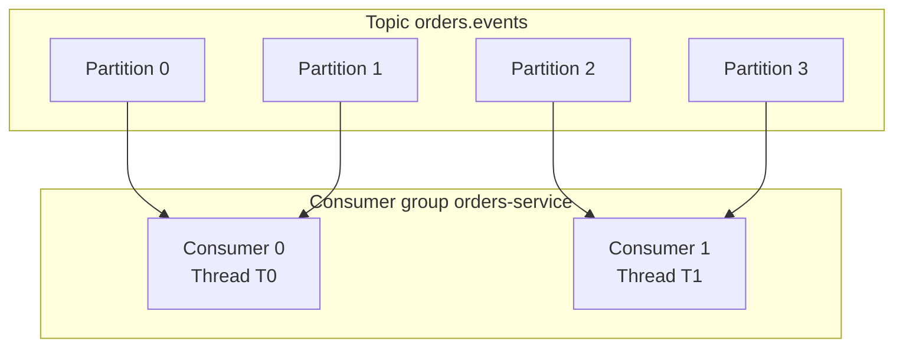
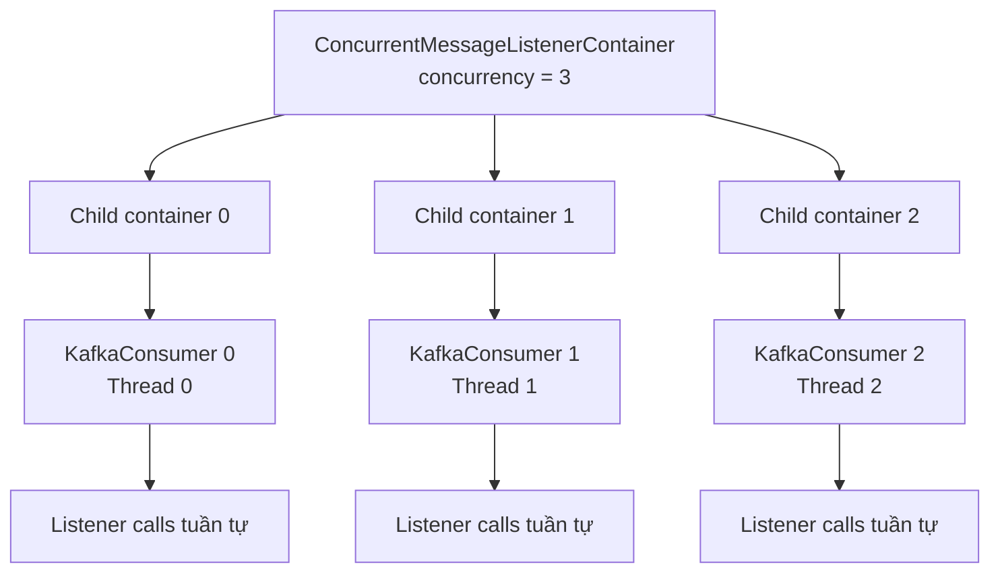

# Một consumer thread xử lý partition

Trong Kafka, partition là đơn vị phân phối tải và bảo toàn thứ tự của message. Trong một consumer group, tại một thời điểm, một partition chỉ được gán cho tối đa một consumer member. Consumer đó đọc các record của partition và xử lý chúng trên consumer thread của mình.

Một consumer thread có thể được gán nhiều partition. Với listener đồng bộ mặc định của Spring Kafka, thread đó gọi listener lần lượt cho các record mà consumer poll được. Vì vậy, một thread có thể luân phiên xử lý record từ nhiều partition, nhưng các lời gọi listener trên thread đó vẫn diễn ra tuần tự. Kafka không tạo một thread riêng cho từng partition.

Mô hình này ảnh hưởng trực tiếp đến thứ tự xử lý, thông lượng và cách scale consumer. Nếu một partition có nhiều record hoặc một record xử lý chậm, các partition khác được gán cho cùng consumer thread cũng phải chờ thread hoàn tất công việc hiện tại. Muốn tăng khả năng xử lý song song, cần cân đối số partition, số consumer thread, concurrency của Spring Kafka và năng lực của hệ thống phụ trợ.

## 1. Quan hệ giữa topic, partition, consumer và thread

Topic có thể gồm một hoặc nhiều partition. Mỗi partition là một log có thứ tự riêng và có offset tăng dần. Producer chọn partition theo key, partitioner hoặc partition được chỉ định. Consumer group chia các partition của topic cho các member để xử lý song song.

Trong mô hình consumer thông thường:

- Trong mô hình subscribe theo group, một Kafka consumer tham gia một consumer group và có một consumer thread sở hữu vòng lặp `poll()`.
- Một consumer có thể nhận nhiều partition cùng lúc.
- Trong cùng một group, một partition chỉ được gán cho tối đa một consumer tại một thời điểm.
- Một partition không được chia đồng thời cho nhiều consumer member trong cùng group để xử lý song song mặc định.
- Một consumer thread có thể xử lý record từ các partition khác nhau theo từng lượt poll.
- Các consumer group khác nhau có thể đọc cùng một topic độc lập; giới hạn một consumer cho mỗi partition chỉ áp dụng bên trong một group.

Ví dụ topic `orders.events` có bốn partition và consumer group có hai consumer:



Trong ví dụ này, thread `T0` xử lý lần lượt record của partition 0 và partition 1. Thread `T1` xử lý lần lượt record của partition 2 và partition 3. Không có một thread riêng cho mỗi partition.

### Một partition chỉ có một owner trong group

Kafka dùng group coordinator và partition assignor để quyết định consumer nào sở hữu partition. Khi group ổn định, assignment được giữ cho đến khi có thay đổi như consumer tham gia/rời group, subscription thay đổi hoặc số partition thay đổi.

Nếu group có ít consumer hơn số partition, một consumer sẽ được gán nhiều partition. Nếu group có nhiều consumer hơn số partition, một số consumer không nhận được partition và ở trạng thái nhàn rỗi. Thêm consumer không tự chia nhỏ một partition thành nhiều phần xử lý song song.

### Một thread có thể xử lý nhiều partition

Giả sử consumer `C0` được gán partition 0 và partition 1. Một lần `poll()` có thể trả về record của cả hai partition. Với record listener đồng bộ, container gọi listener cho các record theo luồng xử lý của consumer đó. Khi listener đang xử lý một record, cùng consumer thread không đồng thời gọi listener cho record khác.

Các record từ hai partition có thể được xen kẽ trong các lần poll. Kafka chỉ bảo đảm thứ tự trong từng partition, không tạo thứ tự toàn cục giữa partition 0 và partition 1. Ứng dụng không nên dựa vào thứ tự thời gian hoặc thứ tự xuất hiện của các record từ nhiều partition khi chúng được xử lý bởi cùng consumer.

## 2. Consumer thread bảo vệ thứ tự xử lý như thế nào?

Kafka ghi record theo thứ tự trong mỗi partition. Consumer đọc record theo offset tăng dần trong partition đó. Với listener đồng bộ, một consumer thread xử lý record tuần tự nên thứ tự gọi listener trong cùng partition được giữ theo thứ tự đọc.

Ví dụ partition 0 có các record `A`, `B`, `C` và partition 1 có `X`, `Y`:

```text
Partition 0:  A(10) -> B(11) -> C(12)
Partition 1:  X(20) -> Y(21)

Một consumer thread có thể xử lý:
  A(10) -> X(20) -> B(11) -> Y(21) -> C(12)

Thứ tự trong từng partition vẫn là:
  P0: A -> B -> C
  P1: X -> Y

Không có cam kết về thứ tự toàn cục giữa P0 và P1.
```

Điều này quan trọng với nghiệp vụ có trạng thái. Nếu mọi thay đổi của một đơn hàng phải được xử lý đúng thứ tự, producer nên dùng `orderId` làm key để các event của cùng đơn hàng vào cùng partition. Consumer thread sẽ xử lý các record của partition theo thứ tự. Không nên chia cùng partition cho nhiều worker độc lập nếu chưa có cơ chế giữ thứ tự hoàn tất và commit offset.

### Thứ tự gọi listener và thứ tự hoàn tất nghiệp vụ

Với listener đồng bộ, container đợi phương thức listener trả về trước khi tiếp tục xử lý record tiếp theo trên consumer thread. Nếu listener gọi service và service hoàn tất công việc đồng bộ, thứ tự gọi và hoàn tất thường trùng nhau.

Nếu listener gửi công việc sang executor rồi trả về ngay, thứ tự gọi listener vẫn tuần tự nhưng công việc nghiệp vụ có thể hoàn tất không theo thứ tự. Ví dụ listener nhận `A`, sau đó `B`; executor có thể hoàn tất `B` trước `A`. Khi đó hệ thống có thể phá vỡ thứ tự nghiệp vụ dù Kafka vẫn đọc đúng thứ tự partition.

Muốn offload công việc sang thread khác, cần xác định rõ:

- Mỗi partition có được xử lý tuần tự hay không.
- Có thể chạy song song giữa các partition nhưng giữ tuần tự trong từng partition không.
- Offset chỉ được acknowledge sau khi tất cả công việc đứng trước nó trong partition đã hoàn tất như thế nào.
- Điều gì xảy ra khi một worker thất bại, timeout hoặc ứng dụng shutdown.
- Consumer có được phép tiếp tục poll khi các công việc trước đó còn pending không.

Spring Kafka có các tính năng xử lý bất đồng bộ và `asyncAcks` ở những phiên bản phù hợp, nhưng chúng thay đổi cách container theo dõi acknowledgement và có thể pause consumer cho đến khi các acknowledgement còn thiếu được hoàn tất. Không nên tự tạo executor rồi acknowledge ngay nếu công việc chưa bền vững. Với phần lớn listener nghiệp vụ cần giữ thứ tự, xử lý đồng bộ trên consumer thread là mô hình đơn giản để bắt đầu.

## 3. Spring Kafka tổ chức consumer thread

Spring Kafka listener container sở hữu Kafka consumer và vòng lặp poll. Khi ứng dụng dùng `@KafkaListener`, container nhận record rồi gọi phương thức listener.

`KafkaConsumer` không thread-safe. Các thao tác như `poll()`, `commitSync()`, `commitAsync()`, `seek()` và quản lý subscription/assignment phải tuân thủ quy tắc thread ownership của Kafka client. Spring Kafka container thực hiện các thao tác này trên consumer thread được quản lý. Không lấy reference đến consumer rồi gọi tùy tiện từ thread nghiệp vụ khác.

Với `ConcurrentMessageListenerContainer`, Spring Kafka tạo một container con cho mỗi consumer worker theo cấu hình `concurrency`. Mỗi container con có consumer và consumer thread riêng. Container cha phối hợp các container con và quản lý lifecycle.



Mỗi child container chạy consumer riêng. Nếu `concurrency=3`, Spring Kafka tạo ba consumer worker cho listener container đó. Tùy số partition và assignment, mỗi worker có thể nhận một hoặc nhiều partition, hoặc không nhận partition nào.

### Cấu hình concurrency qua Spring Boot

Ví dụ:

```yaml
spring:
  kafka:
    consumer:
      group-id: orders-service
      enable-auto-commit: false
      max-poll-records: 100
    listener:
      concurrency: 3
      ack-mode: record
```

`concurrency: 3` yêu cầu listener container tạo ba consumer worker. Nó không yêu cầu Kafka tạo ba partition và cũng không bảo đảm mỗi worker có đúng một partition. Assignment phụ thuộc tổng partition được subscribe và các member khác trong cùng group.

Có thể đặt concurrency riêng cho listener:

```java
@KafkaListener(
        id = "ordersListener",
        topics = "${app.kafka.orders-topic}",
        groupId = "orders-service",
        concurrency = "3")
public void onOrderEvent(OrderEvent event) {
    orderService.processIdempotently(event);
}
```

Giá trị `concurrency` trên `@KafkaListener` áp dụng cho listener đó và có thể ghi đè giá trị concurrency từ container factory. Cần tránh khai báo concurrency khác nhau mà không hiểu tổng số consumer sẽ tham gia cùng group.

### Khai báo ConcurrentKafkaListenerContainerFactory

Nếu cần factory riêng, có thể cấu hình concurrency tại factory:

```java
@Bean
ConcurrentKafkaListenerContainerFactory<String, OrderEvent>
ordersKafkaListenerContainerFactory(
        ConsumerFactory<String, OrderEvent> consumerFactory) {

    ConcurrentKafkaListenerContainerFactory<String, OrderEvent> factory =
            new ConcurrentKafkaListenerContainerFactory<>();

    factory.setConsumerFactory(consumerFactory);
    factory.setConcurrency(3);
    factory.getContainerProperties().setAckMode(
            ContainerProperties.AckMode.RECORD);

    return factory;
}
```

Listener có thể chọn factory này bằng thuộc tính `containerFactory`:

```java
@KafkaListener(
        topics = "${app.kafka.orders-topic}",
        containerFactory = "ordersKafkaListenerContainerFactory")
public void onOrderEvent(OrderEvent event) {
    orderService.processIdempotently(event);
}
```

Tên bean, kiểu key/value và serializer phải khớp cấu hình ứng dụng. Ví dụ dùng `AckMode.RECORD` để thể hiện commit sau mỗi record listener xử lý thành công; vẫn cần error handler và idempotency cho tình huống retry/rebalance.

## 4. Số partition giới hạn mức song song trong một group

Trong một consumer group, một partition chỉ được giao cho tối đa một consumer member. Vì vậy, số consumer worker có thể hoạt động hữu ích không vượt quá số partition được subscribe trong group.

Ví dụ một topic có bốn partition:

| Consumer worker trong group | Số partition | Hệ quả |
|---:|---:|---|
| 1 | 4 | Một consumer thread xử lý cả bốn partition theo lượt poll. |
| 2 | 4 | Có thể phân phối khoảng hai partition cho mỗi worker, tùy assignor. |
| 4 | 4 | Có thể có một partition trên mỗi worker. |
| 6 | 4 | Tối đa bốn worker nhận partition; hai worker còn lại nhàn rỗi. |

Nếu có nhiều instance ứng dụng, cần tính tổng số consumer trong group, không chỉ concurrency của một instance. Ví dụ bốn pod, mỗi pod `concurrency=3`, tạo tổng cộng mười hai consumer member trong cùng group nếu chúng dùng chung `group.id`. Với topic có tám partition, tối đa tám consumer nhận partition; ít nhất bốn consumer không có assignment trong trạng thái group ổn định.

Nếu một listener subscribe nhiều topic, số partition liên quan là tổng partition của các topic được subscribe trong group. Cách phân phối cụ thể phụ thuộc partition assignor và subscription của các member.

### Khi cần tăng thông lượng

Nếu một consumer thread xử lý nhiều partition và downstream còn năng lực, tăng concurrency có thể tăng song song giữa các partition. Tuy nhiên, nếu concurrency đã bằng hoặc lớn hơn số partition, tăng thêm consumer không giúp tăng số partition được xử lý đồng thời.

Muốn tăng mức song song vượt giới hạn hiện tại, có thể tăng số partition của topic nếu nghiệp vụ và chính sách dữ liệu cho phép. Cần xem xét:

- Partition count mới có đủ để phân phối đến số consumer mong muốn không.
- Producer key/partitioner có giữ được yêu cầu thứ tự theo thực thể không.
- Việc tăng partition có làm thay đổi ánh xạ key sang partition không.
- Consumer state, retention, storage, replication và chi phí broker có đáp ứng không.
- Downstream database/API có chịu được mức concurrency cao hơn không.

Với partitioner dựa trên hash key, tăng số partition có thể làm một key được ánh xạ sang partition khác đối với các message mới. Các message cũ của key vẫn ở partition cũ, vì vậy thứ tự theo key có thể bị chia qua hai partition trong giai đoạn chuyển tiếp. Đây là lý do tăng partition cần được đánh giá như một thay đổi thiết kế, không chỉ là thao tác scale đơn giản.

## 5. Một consumer thread nhận nhiều partition: tác động hiệu năng

Khi một consumer sở hữu nhiều partition, một lần `poll()` có thể trả về record từ nhiều partition. Container gọi listener cho các record đó trên consumer thread. Nếu listener xử lý chậm, toàn bộ partition đang được gán cho consumer có thể bị ảnh hưởng.

Ví dụ consumer `C0` được gán partition 0 và partition 1. Partition 0 có một record cần gọi dịch vụ ngoài mất 3 giây. Trong thời gian listener đang xử lý record này, thread `C0` chưa thể gọi listener cho record tiếp theo từ partition 1. Partition 1 có thể tăng lag dù bản thân dữ liệu của nó không có vấn đề.

Đây là hiện tượng một partition nóng hoặc một record chậm ảnh hưởng các partition khác cùng consumer. Cần phân tích lag theo partition và thời gian xử lý listener, không chỉ nhìn tổng lag của group.

### `max.poll.records` và thời gian xử lý poll

`max.poll.records` giới hạn số record consumer trả về trong một lần poll, tính tổng trên các partition được gán. Với listener đồng bộ, container có thể phải gọi listener cho nhiều record trước lần poll tiếp theo. Nếu mỗi record mất thời gian dài, tổng thời gian xử lý có thể vượt `max.poll.interval.ms`.

Ví dụ `max.poll.records=100` và thời gian xử lý trung bình 200 ms/record. Trong trường hợp mọi record đều xử lý tuần tự, một batch có thể cần khoảng 20 giây, chưa kể network, database, GC và retry. Cần dùng p95/p99 hoặc thời gian xử lý tối đa thực tế để đặt biên an toàn, không chỉ dựa trên trung bình.

Nếu thời gian giữa các lần poll vượt `max.poll.interval.ms`, consumer có thể bị xem là không còn tiến triển và group thực hiện rebalance. Khi đó partition có thể được giao cho member khác; record chưa commit có thể được xử lý lại.

### Hot partition và skew

Partition có tải không đồng đều khi một số key tạo nhiều message hơn các key khác. Nếu mọi message của một key nóng đi vào cùng partition, consumer sở hữu partition đó có thể quá tải trong khi consumer khác nhàn rỗi.

Các hướng xử lý gồm:

- Xem xét key có thực sự cần giữ thứ tự theo toàn bộ thực thể không.
- Phân phối key hợp lý để tránh một partition nhận phần lớn lưu lượng.
- Tăng partition khi phù hợp với yêu cầu thứ tự và khả năng vận hành.
- Tối ưu thời gian xử lý record và truy vấn downstream.
- Giới hạn batch size để consumer có thời gian poll đều.
- Scale consumer theo partition assignment và năng lực downstream.

Không đổi key tùy tiện nếu thứ tự theo đơn hàng, tài khoản hoặc thực thể là một yêu cầu nghiệp vụ.

## 6. Một partition có thể được xử lý song song không?

Theo mô hình consumer group mặc định, một partition được gán cho một consumer member. Consumer thread đó đọc partition theo thứ tự. Kafka không tự chia một partition cho nhiều consumer trong cùng group để xử lý song song.

Nếu cần tăng tốc một partition nóng, có thể cân nhắc offload xử lý sang worker pool, nhưng phải tách rõ việc đọc, xử lý và commit offset. Nếu worker xử lý record song song, record offset cao hơn có thể hoàn tất trước record offset thấp hơn. Nếu commit offset cao hơn trước, Kafka có thể bỏ qua record thấp hơn khi restart dù công việc đó chưa hoàn tất.

Ví dụ:

```text
Partition 0:  A(offset 10) -> B(offset 11) -> C(offset 12)

Worker pool nhận:
  Worker 1: A (chậm 3 giây)
  Worker 2: B (nhanh 100 ms)
  Worker 3: C (nhanh 200 ms)

Thứ tự hoàn tất có thể là: B -> C -> A
```

Nếu consumer commit offset `13` khi `B` và `C` đã xong nhưng `A` chưa xong, sau restart Kafka có thể bắt đầu từ `13` và không giao lại `A`. Vì vậy, khi xử lý song song trong cùng partition, cần cơ chế theo dõi completion theo offset và chỉ commit offset tiếp theo của chuỗi liên tục đã hoàn tất.

Các lựa chọn thiết kế:

1. Giữ xử lý tuần tự trong partition, tăng số partition để tăng song song giữa các key.
2. Dùng worker pool nhưng duy trì một hàng đợi riêng theo partition và bảo đảm thứ tự trong từng hàng.
3. Dùng cơ chế acknowledgement bất đồng bộ có hỗ trợ của Spring Kafka ở phiên bản phù hợp, hiểu rõ `asyncAcks`, việc pause consumer và cách xử lý lỗ hổng acknowledgement.
4. Chuyển tác vụ nặng sang một topic/queue xử lý riêng nếu nghiệp vụ cho phép tách thứ tự hoặc có khóa điều phối khác.

Không gọi `KafkaConsumer` trực tiếp từ worker thread. Kafka consumer không thread-safe; các thao tác consumer vẫn phải được thực hiện trên consumer thread do container quản lý. Worker thread chỉ nên xử lý dữ liệu đã được chuyển giao và báo kết quả qua cơ chế phối hợp an toàn.

## 7. Rebalance và vòng đời consumer thread

Khi group membership hoặc partition assignment thay đổi, Kafka thực hiện rebalance. Container có thể nhận callback partition revoked/assigned, dừng xử lý partition cũ và tiếp tục với assignment mới.

Các nguyên nhân phổ biến:

- Thêm hoặc bỏ application instance.
- Tăng/giảm `concurrency` hoặc scale deployment.
- Consumer restart hoặc mất kết nối.
- Listener xử lý quá lâu và vượt `max.poll.interval.ms`.
- Topic subscription hoặc partition count thay đổi.
- Session timeout hoặc heartbeat thất bại.

Khi partition bị revoke, ứng dụng cần bảo đảm các công việc đang xử lý được hoàn tất hoặc được giữ ở trạng thái có thể retry an toàn. Với xử lý đồng bộ trên consumer thread, container có thể phối hợp shutdown/revoke theo lifecycle. Với công việc offload sang worker pool, phải có cơ chế dừng nhận công việc mới, đợi công việc hiện tại hoặc lưu trạng thái pending và không commit offset vượt tiến độ.

### Cooperative rebalance

Các assignor như `CooperativeStickyAssignor` hỗ trợ rebalance hợp tác, trong đó partition chỉ bị thu hồi khi cần thay đổi assignment. Cơ chế này có thể giảm lượng partition bị dừng đồng thời trong các lần rebalance. Nó không thay thế yêu cầu một partition chỉ có một consumer owner trong group tại một thời điểm.

### Static membership

`group.instance.id` có thể giúp giữ membership qua một số lần restart ngắn và giảm rebalance. Static membership không thay đổi quan hệ giữa partition và consumer thread: mỗi partition vẫn chỉ thuộc một member trong group. Nếu instance không quay lại trước session timeout, coordinator vẫn có thể loại member và phân phối lại partition.

## 8. Chọn concurrency theo partition và năng lực downstream

Concurrency nên được chọn dựa trên ba yếu tố:

- Số partition có thể được gán cho group.
- Thời gian xử lý record và thông lượng cần đạt.
- Năng lực database, HTTP service, thread pool và các hệ thống phụ trợ.

Ví dụ topic có 12 partition, ứng dụng chạy ba pod và mỗi pod `concurrency=2`. Tổng group có sáu consumer, do đó mỗi consumer có thể nhận khoảng hai partition tùy assignor. Nếu tăng concurrency lên bốn mỗi pod, group có 12 consumer và có thể có một consumer trên mỗi partition. Nếu tăng lên sáu mỗi pod, group có 18 consumer nhưng tối đa 12 consumer nhận partition; sáu consumer còn lại không có việc.

Không nên tăng concurrency mà không đo downstream. Nhiều consumer thread đồng thời có thể tạo nhiều truy vấn database, connection, HTTP request và log hơn. Nếu downstream bắt đầu throttle hoặc timeout, thời gian listener tăng, consumer có thể vượt poll interval và tạo thêm rebalance.

### Ước lượng thông lượng

Giả sử mỗi consumer thread xử lý tuần tự với thời gian trung bình `t` giây cho một record. Thông lượng lý thuyết đơn giản của một thread xấp xỉ:

\[
\text{throughput}_{thread} \approx \frac{1}{t}
\]

Nếu `t = 0.05` giây, một thread có thể xử lý khoảng 20 record/giây trong điều kiện lý tưởng. Với `n` consumer thread có partition assignment và downstream đủ năng lực:

\[
\text{throughput}_{group} \approx n \times \frac{1}{t}
\]

Đây chỉ là ước lượng để hiểu tác động của concurrency. Thông lượng thực tế còn phụ thuộc batch fetch, thời gian poll, kích thước record, serializer, network, commit, rebalance, partition skew và giới hạn downstream. Số thread hữu ích không vượt quá số partition được phân phối cho group.

### Thử nghiệm tăng concurrency

Tăng concurrency theo từng bước và ghi nhận:

- Consumer lag theo partition trước và sau thay đổi.
- Record processing latency p50/p95/p99.
- Số consumer có assignment và số consumer nhàn rỗi.
- Database pool utilization, query latency và lỗi downstream.
- Rebalance count, poll interval và commit latency.
- Throughput producer và consumer.

Nếu throughput không tăng nhưng downstream latency và rebalance tăng, concurrency có thể đã vượt năng lực của hệ thống phụ trợ.

## 9. Quan sát consumer thread và partition assignment

Để điều tra một consumer thread đang xử lý nhiều partition, cần liên kết trạng thái group với metrics của listener và downstream.

| Phạm vi | Chỉ số/log cần theo dõi | Điều cần phát hiện |
|---|---|---|
| Group | `group.id`, member ID, consumer count, partition assignment | Consumer nào sở hữu partition nào; có consumer nhàn rỗi không. |
| Thread/container | Listener ID, thread name, container state, concurrency | Số worker thực tế và consumer thread có bị treo không. |
| Partition | Lag theo partition, records consumed, tuổi record | Partition nóng hoặc backlog tập trung. |
| Listener | Processing duration p50/p95/p99, exception, retry | Một record chậm làm các partition cùng consumer bị chặn. |
| Poll | `max.poll.records`, thời gian giữa poll, poll duration | Consumer có nguy cơ vượt `max.poll.interval.ms` không. |
| Commit | Commit latency, committed offset và acknowledgement | Offset có tiến theo kết quả xử lý không. |
| Downstream | DB pool, query latency, HTTP latency, throttle | Consumer chậm do hệ thống phụ trợ. |
| Rebalance | Số lần, thời gian và partition revoked/assigned | Assignment có ổn định không. |

Log nên có `group.id`, listener ID, thread name, topic, partition, offset, key phù hợp, event ID và processing duration. Với nhiều consumer worker, thread name và partition giúp tìm worker đang xử lý record chậm. Tránh log payload nhạy cảm.

Consumer lag cần được phân tích theo partition. Tổng lag có thể tăng vì một partition nóng trong khi các partition khác vẫn theo kịp. Khi lag chỉ tăng ở partition cụ thể, kiểm tra key distribution, assignment và thời gian xử lý của consumer sở hữu partition đó.

## 10. Runbook theo tình huống

### Một consumer thread bị chậm và nhiều partition cùng tăng lag

1. Xác định consumer member và thread đang sở hữu các partition có lag tăng.
2. Kiểm tra listener processing latency và record nào đang chiếm nhiều thời gian.
3. Kiểm tra database/API latency, connection pool, lock và downstream throttling.
4. Đối chiếu `max.poll.records` và tổng thời gian xử lý giữa các lần poll với `max.poll.interval.ms`.
5. Tối ưu thao tác chậm, giảm batch size hoặc tăng concurrency nếu còn partition và downstream capacity.
6. Theo dõi lag riêng từng partition sau thay đổi.

### Tăng concurrency nhưng có consumer không nhận partition

1. Đếm tổng số partition được subscribe trong group.
2. Đếm tổng số consumer từ tất cả pod/instance và concurrency của từng listener.
3. So sánh số consumer với số partition; consumer dư sẽ không có assignment.
4. Nếu cần thêm parallelism, đánh giá tăng partition và tác động đến key ordering.
5. Điều chỉnh concurrency để tránh tạo consumer dư thừa.

### Một partition nóng trong khi các partition khác ít tải

1. Kiểm tra lag và throughput theo partition.
2. Xác định key nào tạo nhiều record và partitioner đang phân phối key ra sao.
3. Kiểm tra có một key nóng cần giữ thứ tự nghiêm ngặt hay không.
4. Cân nhắc thay đổi key strategy, tăng partition hoặc tách workload nếu nghiệp vụ cho phép.
5. Kiểm tra tác động đến thứ tự key và dữ liệu cũ khi thay đổi partition count.

### Consumer vượt max.poll.interval.ms

1. Đo thời gian xử lý batch thực tế, đặc biệt p95/p99 và các record chậm bất thường.
2. Kiểm tra `max.poll.records`, listener blocking và downstream latency.
3. Giảm số record mỗi poll hoặc tối ưu công việc để consumer gọi poll đúng nhịp.
4. Chỉ điều chỉnh `max.poll.interval.ms` khi thời gian xử lý dài là yêu cầu có chủ đích và đã đánh giá rebalance/failover.
5. Theo dõi rebalance, duplicate delivery và committed offset sau khi thay đổi.

### Thứ tự nghiệp vụ bị đảo khi dùng worker pool

1. Ghi lại partition, offset và event ID của các record bị hoàn tất sai thứ tự.
2. Xác định listener có trả về trước khi công việc nền hoàn tất không.
3. Kiểm tra offset có được acknowledge/commit trước khi các record đứng trước hoàn tất không.
4. Duy trì hàng đợi tuần tự theo partition hoặc chuyển về xử lý đồng bộ.
5. Nếu dùng async acknowledgement, kiểm tra `asyncAcks`, pause behavior và xử lý offset gap theo phiên bản Spring Kafka.
6. Bổ sung idempotency và kiểm thử restart/rebalance khi còn công việc pending.

## 11. Bảng kiểm soát một consumer thread xử lý partition

| Điểm kiểm soát | Câu hỏi cần trả lời | Bằng chứng vận hành |
|---|---|---|
| Ownership | Consumer member nào sở hữu từng partition? | Group assignment và member ID. |
| Threading | Mỗi consumer có một consumer thread quản lý poll và listener không? | Thread name, container state và consumer metrics. |
| Ordering | Thứ tự trong partition có được giữ qua xử lý và commit không? | Topic/partition/offset, event ID và processing timeline. |
| Concurrency | Tổng consumer thread có phù hợp số partition không? | Replica count, concurrency và partition count. |
| Poll | Listener có hoàn tất đủ nhanh để tiếp tục poll không? | Processing duration, `max.poll.records` và `max.poll.interval.ms`. |
| Hot partition | Tải có bị lệch theo partition hoặc key không? | Lag, throughput và key distribution theo partition. |
| Downstream | Database/API có chịu được số worker đồng thời không? | Pool utilization, latency và throttle/error rate. |
| Rebalance | Partition có bị chuyển giao thường xuyên hoặc giữ quá lâu không? | Rebalance events, assignment và session/poll metrics. |
| Offset | Commit chỉ tiến qua các record đã hoàn tất theo policy không? | AckMode, committed offset và pending work. |

Trong Spring Kafka, một consumer thread xử lý các record từ những partition được gán cho consumer đó. Mô hình này giữ thứ tự xử lý trong từng partition khi listener chạy đồng bộ, nhưng không tạo thứ tự toàn cục giữa các partition. Muốn tăng thông lượng, hãy phối hợp partition count, concurrency và năng lực downstream; nếu chuyển xử lý sang nhiều thread trong cùng partition, phải quản lý thứ tự hoàn tất và offset commit một cách rõ ràng.
