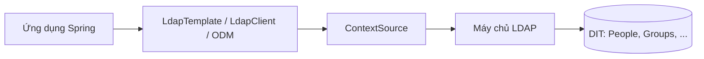

# LDAP là gì và vì sao phù hợp với dữ liệu phân cấp

## Mục tiêu bài học

Sau bài này, bạn có thể:

- Giải thích LDAP là gì, phân biệt **giao thức LDAP**, **máy chủ thư mục** và **Spring LDAP**.
- Đọc được cấu trúc cây thư mục, một **entry**, các **attribute**, **DN/RDN** và **schema** cơ bản.
- Hiểu cách chọn nhánh để tìm kiếm bằng **base DN**, **search scope** và **LDAP filter**.
- Giải thích vì sao LDAP hiệu quả với danh bạ, tài khoản và nhóm có cấu trúc phân cấp; nhận ra những bài toán nên dùng cơ sở dữ liệu khác.
- Hình dung đường đi của một yêu cầu từ ứng dụng Java qua `ContextSource`, `LdapTemplate` hoặc `LdapClient` đến máy chủ LDAP, cùng những lưu ý an toàn đầu tiên.

## 1. Bài toán: tìm một người trong hệ thống tổ chức

Giả sử công ty có hàng nghìn nhân viên, nhiều phòng ban và nhiều ứng dụng nội bộ. Mỗi ứng dụng đều cần biết: tài khoản `lan` có tồn tại không, tên hiển thị và email của người đó là gì, họ thuộc những nhóm nào, và có thể xác thực tài khoản không.

Nếu mỗi ứng dụng tự duy trì một bảng người dùng riêng, thông tin dễ lệch nhau. Một **dịch vụ thư mục** (directory service) tập trung thông tin định danh và cung cấp cách tra cứu nhất quán. Thay vì hỏi từng ứng dụng, các ứng dụng có thể tra cứu cùng một nguồn dữ liệu thư mục, theo quyền được cấp.

LDAP (*Lightweight Directory Access Protocol*) là giao thức tiêu chuẩn để **truy cập và thao tác dữ liệu trong dịch vụ thư mục**. Nó định nghĩa cách client kết nối, xác thực (bind), tìm kiếm, đọc, thêm, sửa, đổi tên/chuyển vị trí và xóa entry. LDAP cũng có mô hình tên và dữ liệu thư mục: mỗi entry có tên phân biệt (DN) và tập thuộc tính.

Ba khái niệm thường bị nhầm:

| Khái niệm | Vai trò | Ví dụ |
| --- | --- | --- |
| **LDAP** | Giao thức và mô hình truy cập dữ liệu thư mục | Lệnh tìm kiếm với base DN và filter |
| **LDAP server / directory server** | Phần mềm lưu trữ, lập chỉ mục, xác thực và thực thi thao tác LDAP | OpenLDAP, 389 Directory Server, Microsoft Active Directory Domain Services (AD DS) |
| **Spring LDAP** | Thư viện Java/Spring giúp ứng dụng làm việc với LDAP thuận tiện hơn | `ContextSource`, `LdapTemplate`, `LdapClient`, LDAP ODM |

**LDAP không phải tên của một cơ sở dữ liệu cụ thể.** AD DS có hỗ trợ LDAP nhưng còn nhiều tính năng riêng của Active Directory; hai khái niệm này không đồng nghĩa. Spring LDAP là thư viện ở phía ứng dụng, không phải máy chủ LDAP.

## 2. Cây thư mục: dữ liệu được tổ chức như thế nào?

LDAP tổ chức các entry trong **Directory Information Tree (DIT)**, tức cây thông tin thư mục. Mỗi entry có một cha trong không gian tên (ngoại trừ các entry gốc phù hợp với cấu hình máy chủ). Tên đầy đủ của một entry chứa đường đi từ entry đó đến gốc tên liên quan.

Ví dụ, một tổ chức sử dụng không gian tên `dc=example,dc=org`:

```text
dc=example,dc=org
├── ou=People
│   ├── uid=lan
│   └── uid=mai
└── ou=Groups
    └── cn=Engineering
```

Đây là **cây tên**. Nó không bắt buộc phải sao chép toàn bộ sơ đồ tổ chức của doanh nghiệp. Thư mục có thể chia theo người dùng, nhóm, dịch vụ hoặc đơn vị tổ chức tùy nhu cầu quản trị.

### 2.1. Entry, attribute và objectClass

Một **entry** gần giống một bản ghi có tên riêng; mỗi entry chứa các **attribute** (thuộc tính). Một attribute có thể có một hoặc nhiều giá trị, tùy quy tắc schema.

Ví dụ entry của nhân viên Lan:

```ldif
dn: uid=lan,ou=People,dc=example,dc=org
objectClass: inetOrgPerson
uid: lan
cn: Lan Nguyen
sn: Nguyen
givenName: Lan
mail: lan@example.org
```

- `dn`: tên duy nhất của entry trong cây thư mục.
- `uid`: mã định danh người dùng; ở ví dụ này được chọn làm phần tên của entry.
- `cn`, `sn`, `givenName`, `mail`: các thuộc tính mô tả người đó.
- `objectClass: inetOrgPerson`: lớp đối tượng quy định nhóm thuộc tính được phép và bắt buộc. Chẳng hạn `inetOrgPerson` kế thừa yêu cầu về `cn` và `sn`.

**Schema** là tập quy tắc định nghĩa loại thuộc tính, cú pháp, quy tắc so sánh và các object class. Không nên xem một entry LDAP là một map tùy ý có thể thêm bất cứ trường nào: máy chủ có thể từ chối giá trị hoặc thuộc tính không phù hợp schema.

Định dạng văn bản trong ví dụ là **LDIF** (*LDAP Data Interchange Format*), thường dùng để xuất, nhập hoặc trình bày entry. LDIF là định dạng dữ liệu; nó không phải giao thức kết nối LDAP.

### 2.2. DN và RDN: địa chỉ của entry

Xét chuỗi:

```text
uid=lan,ou=People,dc=example,dc=org
```

| Thành phần | Ý nghĩa |
| --- | --- |
| `uid=lan` | **RDN** (*Relative Distinguished Name*) của entry Lan so với cha trực tiếp |
| `ou=People` | Nhánh chứa các entry người dùng |
| `dc=example,dc=org` | Hậu tố tên thư mục (thường được dùng làm **base DN**) |
| Toàn chuỗi | **DN** (*Distinguished Name*) xác định vị trí entry trong cây |

**Đọc DN từ trái sang phải: entry cụ thể trước, rồi đến các cấp cha.** Dấu phẩy nối các thành phần RDN, không phải dấu phân cách tùy ý trong giá trị. RDN cũng có thể gồm nhiều thành phần; các ví dụ trong bài dùng RDN một thành phần để dễ đọc.

DN là **địa chỉ**, còn attribute là **dữ liệu**. Nếu chuyển một người từ `ou=People` sang nhánh khác, DN của họ thay đổi dù những thuộc tính như tên, email có thể giữ nguyên. Vì vậy, không nên thiết kế DN dựa trên thông tin biến động thường xuyên như chức danh, tên nhóm dự án hay phòng ban tạm thời.

> Lưu ý: DN có quy tắc escaping riêng (RFC 4514). Ví dụ, dấu phẩy nằm *trong giá trị* của một RDN phải được escape; không được ghép DN bằng cách nối chuỗi từ dữ liệu người dùng chưa xử lý.

### 2.3. Một cây có thể chứa cả người và nhóm

Các entry dưới đây minh họa một tập dữ liệu nhỏ, đủ để hình dung mối liên hệ giữa tên trong cây và quan hệ thành viên:

```ldif
dn: dc=example,dc=org
objectClass: domain
dc: example

dn: ou=People,dc=example,dc=org
objectClass: organizationalUnit
ou: People

dn: uid=lan,ou=People,dc=example,dc=org
objectClass: inetOrgPerson
uid: lan
cn: Lan Nguyen
sn: Nguyen
mail: lan@example.org

dn: uid=mai,ou=People,dc=example,dc=org
objectClass: inetOrgPerson
uid: mai
cn: Mai Tran
sn: Tran
mail: mai@example.org

dn: ou=Groups,dc=example,dc=org
objectClass: organizationalUnit
ou: Groups

dn: cn=Engineering,ou=Groups,dc=example,dc=org
objectClass: groupOfNames
cn: Engineering
member: uid=lan,ou=People,dc=example,dc=org
member: uid=mai,ou=People,dc=example,dc=org
```

Nhóm `Engineering` nằm dưới `ou=Groups`, nhưng thành viên nằm dưới `ou=People`. Các giá trị `member` tham chiếu DN của người dùng: **quan hệ thành viên không đòi hỏi entry thành viên phải nằm dưới entry nhóm**. Điều này giúp kết hợp một không gian tên phân cấp với các nhóm theo vai trò hoặc dự án, vốn có thể giao cắt nhau.

Không nên mặc định mọi server tự động cập nhật tất cả giá trị `member` khi một DN người dùng được đổi tên hoặc chuyển nhánh. Cách xử lý tham chiếu khi rename/move tùy khả năng và cấu hình của directory server; ứng dụng phải kiểm tra hành vi thực tế.

## 3. Tìm kiếm trong LDAP: khoanh vùng trước, lọc sau

Một truy vấn LDAP thường có ba phần:

1. **Base DN**: điểm bắt đầu tìm kiếm, ví dụ `ou=People,dc=example,dc=org`.
2. **Scope**: phạm vi duyệt từ điểm bắt đầu.
3. **Filter**: điều kiện chọn entry dựa trên attribute.

Scope phổ biến:

| Scope | Entry được xem xét | Trường hợp áp dụng |
| --- | --- | --- |
| `BASE` | Chỉ chính entry tại base DN | Đọc thông tin của một entry đã biết DN |
| `ONELEVEL` | Các con trực tiếp của base DN, không gồm base | Liệt kê người dùng đặt trực tiếp dưới `ou=People` |
| `SUBTREE` | Base DN và mọi hậu duệ của nó | Tìm cả các nhánh con dưới `ou=People` |

Ví dụ, với **base DN** `ou=People,dc=example,dc=org`, **scope** `SUBTREE`, **filter**:

```ldap
(&(objectClass=inetOrgPerson)(uid=lan))
```

LDAP server sẽ xét phạm vi cây đã chọn, rồi trả các entry thỏa **đồng thời** hai điều kiện. Một số mẫu filter quan trọng:

```ldap
(uid=lan)                                     # uid bằng lan
(mail=*)                                      # có thuộc tính mail
(&(objectClass=inetOrgPerson)(sn=Nguyen))     # AND
(|(sn=Nguyen)(sn=Tran))                       # OR
(!(uid=lan))                                  # NOT
```

Các phần `# ...` ở trên là chú thích để giải thích, **không nằm trong chuỗi filter LDAP thật**. Ví dụ filter thực tế chỉ là `(uid=lan)`.

Phần biểu thức dùng `&` (AND), `|` (OR), `!` (NOT). Sự kết hợp base DN và scope giới hạn **nơi tìm**, còn filter quyết định **entry nào khớp**. Chọn nhánh hợp lý thường quan trọng hơn việc luôn tìm từ gốc lớn nhất của thư mục.

Tham số điều khiển như giới hạn số kết quả, thời gian chờ, thuộc tính cần trả về cũng ảnh hưởng hiệu năng và an toàn vận hành. LDAP có khả năng tìm kiếm với index do server cung cấp, nhưng không có bảo đảm mọi truy vấn đều nhanh: hiệu quả phụ thuộc schema, index, phạm vi, khối lượng dữ liệu và cấu hình máy chủ.

### Ví dụ chạy `ldapsearch`

Giả sử máy chủ chấp nhận kết nối TLS trên cổng 636 và tài khoản dịch vụ có quyền chỉ đọc:

```bash
ldapsearch \
  -H ldaps://ldap.example.org:636 \
  -D "cn=svc-reader,ou=Services,dc=example,dc=org" \
  -W \
  -b "ou=People,dc=example,dc=org" \
  -s sub \
  "(&(objectClass=inetOrgPerson)(uid=lan))" \
  cn mail
```

`-b` chọn base DN, `-s sub` chọn `SUBTREE`, biểu thức trong dấu nháy là filter, còn `cn mail` là những thuộc tính cần trả về. `-W` yêu cầu nhập mật khẩu qua prompt, tránh viết mật khẩu vào câu lệnh. Đây là ví dụ minh họa; cần có máy chủ, entry dịch vụ và quyền truy cập tương ứng mới chạy được.

**Phân biệt escaping:** filter có quy tắc escape riêng (RFC 4515), trong đó các ký tự đặc biệt như `*`, `(`, `)`, dấu gạch chéo ngược và NUL cần được xử lý đúng khi là dữ liệu đầu vào. DN tuân theo quy tắc khác (RFC 4514). Không dùng một hàm escape chung cho cả DN và filter, và không xây dựng filter bằng nối trực tiếp input chưa kiểm tra.

## 4. Vì sao mô hình phân cấp phù hợp với dịch vụ thư mục?

LDAP đặc biệt phù hợp khi dữ liệu có **không gian tên ổn định**, cần tra cứu thường xuyên và có thể chia theo các nhánh quản trị rõ ràng.

### 4.1. Tên phản ánh vị trí, hỗ trợ tra cứu theo nhánh

Với một hệ thống có nhiều tổ chức hoặc miền quản trị:

```text
dc=example,dc=org
├── ou=People
│   ├── ou=Hanoi
│   └── ou=Danang
└── ou=Groups
```

Một yêu cầu tìm tài khoản thuộc nhánh `ou=Hanoi,ou=People,...` có thể bắt đầu tại nhánh đó thay vì quét toàn bộ cây. Cấu trúc tên giúp **khoanh vùng** truy vấn khi phân vùng dữ liệu có ý nghĩa. Tuy nhiên, không nên phân nhánh quá sâu chỉ vì có thể tạo cây: việc đổi tổ chức thường xuyên sẽ làm DN thay đổi và khiến quản trị khó hơn.

### 4.2. Đơn vị quản trị có thể gắn với nhánh

Nhiều directory server cho phép định nghĩa chính sách truy cập hoặc phân quyền quản trị theo phạm vi cây, chẳng hạn một nhóm vận hành chỉ được sửa entry trong một nhánh. Cách cấu hình ACL cụ thể phụ thuộc sản phẩm máy chủ. **Bản thân việc một entry nằm trong nhánh không tự động cấp quyền cho người dùng hoặc ứng dụng.**

### 4.3. Mô hình thuộc tính phù hợp hồ sơ định danh

Hồ sơ người dùng, địa chỉ email, số điện thoại và danh sách nhóm thường là những dữ liệu có cấu trúc khá ổn định và được **đọc nhiều hơn cập nhật**. Entry với thuộc tính đa trị phù hợp cho các thông tin như nhiều số liên lạc hoặc nhiều giá trị thành viên nhóm. Schema chung còn giúp nhiều hệ thống hiểu dữ liệu theo quy ước thống nhất.

### 4.4. Giao thức chung giúp nhiều ứng dụng cùng tích hợp

Ứng dụng Java, công cụ quản trị và hệ thống xác thực có thể cùng sử dụng thao tác LDAP chuẩn, nếu máy chủ hỗ trợ và quyền cho phép. Khi tổ chức đã có directory server, ứng dụng Spring có thể truy xuất hồ sơ và kiểm tra thông tin tài khoản mà không cần sao chép toàn bộ dữ liệu người dùng sang cơ sở dữ liệu riêng.

### 4.5. Cấu trúc cây không loại trừ quan hệ chéo

Các nhóm như `Engineering`, `OnCall`, `ProjectA` không nhất thiết tương ứng với nhánh trên DIT. Một người có thể thuộc nhiều nhóm; quan hệ đó thường được biểu diễn bằng thuộc tính tham chiếu hoặc cơ chế nhóm khác của server. **Cây giải quyết bài toán định danh và phạm vi**, trong khi membership giải quyết quan hệ giữa các entry.

## 5. Khi nào LDAP không phải lựa chọn phù hợp nhất?

LDAP là giao thức hướng thư mục, không nhằm thay thế mọi cơ sở dữ liệu nghiệp vụ.

| Bài toán | LDAP có phù hợp? | Lý do |
| --- | --- | --- |
| Danh bạ nhân sự, tài khoản, thông tin nhóm | **Thường phù hợp** | Tra cứu theo định danh, thuộc tính và nhánh |
| Nhiều hệ thống cùng đọc một nguồn danh tính | **Thường phù hợp** | Giao thức truy cập thống nhất, quyền tập trung |
| Ủy quyền quản trị theo các đơn vị tổ chức | **Có thể phù hợp** | Phân chia namespace theo nhánh, tùy ACL của server |
| Đơn hàng, thanh toán, quản lý tồn kho | **Thường không** | Quan hệ phức tạp, giao dịch nghiệp vụ, ràng buộc liên bảng |
| Phân tích dữ liệu với nhiều phép JOIN và tổng hợp | **Thường không** | LDAP không có mô hình truy vấn quan hệ tương đương SQL |
| Nhật ký sự kiện với tần suất ghi cao | **Thường không** | Nên dùng hệ lưu trữ thiết kế cho chuỗi sự kiện và khối lượng ghi lớn |
| Cơ cấu tổ chức thay đổi liên tục, DN gắn với chức danh | **Cần cân nhắc** | Rename/move gây biến động tên tham chiếu và luồng tích hợp |

Ví dụ, danh sách tài khoản đăng nhập có thể đặt trong LDAP, trong khi đơn hàng của cùng người dùng nên lưu ở hệ quản trị dữ liệu nghiệp vụ. Có thể liên kết chúng bằng một mã định danh ổn định do hệ thống thiết kế; không nên coi DN là khóa nghiệp vụ vĩnh viễn nếu entry có thể đổi tên hoặc chuyển nhánh.

Ngay cả khi LDAP hỗ trợ thêm, sửa, xóa và một số server cung cấp mở rộng giao dịch riêng, ứng dụng vẫn không nên giả định có **giao dịch đa bản ghi, JOIN hoặc ràng buộc khóa ngoại** giống cơ sở dữ liệu quan hệ.

## 6. Luồng một ứng dụng Spring làm việc với LDAP

Trong module **SPRING_LDAP**, chúng ta sử dụng Spring LDAP để thực hiện các thao tác lên entry trong dịch vụ thư mục: cấu hình kết nối, truy vấn theo DN/filter, xác thực, cập nhật và kiểm thử.



Các thành phần chính:

- **`ContextSource`**: cấu hình và cung cấp LDAP context/kết nối cho thao tác; khai báo URL, base DN, danh tính bind và các thiết lập liên quan.
- **`LdapTemplate`**: API dạng template cho tìm kiếm, đọc, thêm, sửa, đổi tên và xóa entry, đồng thời hỗ trợ xử lý lỗi qua hệ ngoại lệ của Spring.
- **`LdapClient`**: API fluent cho các thao tác LDAP trong những phiên bản Spring LDAP có cung cấp API này.
- **LDAP ODM** (*Object-Directory Mapping*): ánh xạ entry và attribute sang các lớp Java khi mô hình dữ liệu và bài toán phù hợp.

### Ví dụ cấu hình `ContextSource` và tìm kiếm

Đoạn code sau chỉ minh họa đường đi của một truy vấn. Giả sử ứng dụng đã có dependency Spring LDAP, DNS đến máy chủ hoạt động và chứng chỉ TLS của máy chủ được JVM tin cậy:

```java
import org.springframework.context.annotation.Bean;
import org.springframework.context.annotation.Configuration;
import org.springframework.ldap.core.LdapTemplate;
import org.springframework.ldap.core.support.LdapContextSource;
import org.springframework.ldap.core.ContextSource;

@Configuration
class LdapConfiguration {
    @Bean
    LdapContextSource contextSource() {
        LdapContextSource source = new LdapContextSource();
        source.setUrl("ldaps://ldap.example.org:636");
        source.setBase("dc=example,dc=org");
        source.setUserDn("cn=svc-reader,ou=Services,dc=example,dc=org");
        source.setPassword(System.getenv("LDAP_BIND_PASSWORD"));
        return source;
    }

    @Bean
    LdapTemplate ldapTemplate(ContextSource contextSource) {
        return new LdapTemplate(contextSource);
    }
}
```

Sau khi inject `LdapTemplate` vào service, có thể tìm người dùng theo `uid` bằng builder:

```java
import static org.springframework.ldap.query.LdapQueryBuilder.query;

// ldapTemplate được inject từ Spring
var users = ldapTemplate.search(
    query().base("ou=People")
           .where("objectClass").is("inetOrgPerson")
           .and("uid").is(uidFromRequest),
    (javax.naming.directory.Attributes attrs) ->
        (String) attrs.get("cn").get()
);
```

Ở đây, `ou=People` là **base tương đối** với `dc=example,dc=org` đã cấu hình trong `ContextSource`. Kết quả `users` là danh sách tên hiển thị cho những entry khớp truy vấn, không phải phép xác thực mật khẩu. Query builder giúp tạo biểu thức filter theo cấu trúc API thay vì nối chuỗi input trực tiếp.

Mã trên cố ý tập trung vào khái niệm. Trong triển khai thật, cần kiểm soát giá trị `LDAP_BIND_PASSWORD` khi khởi động, xử lý attribute thiếu, timeout, giới hạn số kết quả, quyền đọc và ngoại lệ kết nối. Không hardcode mật khẩu vào source hoặc log.

### Tìm kiếm và xác thực là hai việc khác nhau

**Search** cho phép ứng dụng đọc entry/attribute phù hợp quyền truy cập. **Bind** là thao tác client đưa danh tính và thông tin xác thực đến máy chủ LDAP để được kiểm tra và thiết lập ngữ cảnh quyền. Tìm được một entry `uid=lan` không chứng minh người đang đăng nhập biết mật khẩu của Lan.

Trong hệ thống ứng dụng:

1. Dùng account dịch vụ có quyền tối thiểu để tìm DN của tài khoản, nếu quy trình xác thực yêu cầu.
2. Xác thực theo cơ chế thích hợp với directory server (thường là bind với danh tính của người dùng, hoặc tích hợp cơ chế nhận dạng hiện có).
3. Xác định quyền truy cập ứng dụng bằng chính sách riêng, có thể tham khảo nhóm/role nhưng cần kiểm tra membership và quy tắc ánh xạ cụ thể.

Một thuộc tính nhóm không tự động có nghĩa là ứng dụng đã được ủy quyền đầy đủ. Cần phân biệt **authentication** (ai đang truy cập) với **authorization** (được phép làm gì).

## 7. Những nguyên tắc an toàn và vận hành ngay từ đầu

| Vấn đề | Nguyên tắc thực hành |
| --- | --- |
| **Bảo mật kết nối** | Dùng LDAPS hoặc StartTLS với kiểm tra chứng chỉ và tên máy chủ phù hợp. LDAPS thường dùng cổng 636; StartTLS nâng cấp kết nối LDAP hiện có, thường qua cổng 389. |
| **Mật khẩu và tài khoản dịch vụ** | Giữ bí mật trong secret manager/biến môi trường được bảo vệ; dùng quyền tối thiểu và không log credential. |
| **LDAP injection** | Dùng API tạo filter/DN và quy tắc escape theo ngữ cảnh; không ghép input người dùng trực tiếp vào cú pháp LDAP. |
| **Giới hạn và timeout** | Giới hạn kết quả, thời gian chờ và scope; tránh truy vấn `SUBTREE` trên nhánh quá rộng khi không cần. |
| **Pooling** | Cân nhắc tái sử dụng context/kết nối theo cơ chế hỗ trợ; kiểm tra tương tác giữa pooling, TLS và danh tính bind trước khi bật trong production. |
| **Xử lý lỗi** | Phân biệt không tìm thấy entry, sai thông tin xác thực, thiếu quyền, lỗi schema và lỗi mạng; không suy mọi lỗi thành “mật khẩu sai”. |
| **Kiểm thử** | Dùng directory test riêng hoặc môi trường tích hợp kiểm soát được, với mẫu entry/nhóm và ca kiểm thử quyền truy cập, TLS, lỗi kết nối. |

**Quan trọng:** Kết nối tới `ldap://` và gửi mật khẩu trước khi thiết lập TLS có thể làm lộ thông tin xác thực trên đường truyền. TLS cần được xác minh thực sự, bao gồm chuỗi tin cậy chứng chỉ; không tắt kiểm tra chứng chỉ để làm cho ví dụ “chạy được”.

## 8. Tình huống áp dụng: thiết kế cây cho cổng nhân sự

Một đội phát triển cần xây dựng cổng nội bộ với yêu cầu:

- Tìm hồ sơ theo `uid`, họ tên hoặc email.
- Hiển thị nhóm mà nhân viên tham gia.
- Cho phép một số nhóm quản trị chỉnh sửa dữ liệu trong phạm vi được giao.
- Tích hợp thông tin tài khoản từ một directory server có sẵn.

Thiết kế ban đầu có thể dùng `ou=People` cho hồ sơ và `ou=Groups` cho nhóm, chọn `uid` hoặc một định danh tương đối ổn định làm RDN, dùng `member` hay schema nhóm thích hợp để biểu diễn quan hệ. Khi cổng tra cứu người dùng, truy vấn ở `ou=People`; khi kiểm tra nhóm, truy vấn ở `ou=Groups` hoặc sử dụng cơ chế membership được server hỗ trợ.

Trước khi triển khai, đội cần trả lời một số câu hỏi thiết kế:

- Người dùng có thường xuyên được chuyển nhánh không? Nếu có, DN đang được tham chiếu ở đâu?
- Directory server nào đang sử dụng, có schema và cấu trúc nhóm nào?
- Những attribute nào được phép đọc? Account dịch vụ có đủ quyền tối thiểu chưa?
- Ứng dụng nhận dạng người dùng bằng bind LDAP, qua SSO hay phương thức khác?
- Có yêu cầu đồng bộ dữ liệu nghiệp vụ vào hệ thống khác không, và định danh liên kết được chọn là gì?

Ví dụ này cho thấy điểm mạnh cốt lõi của LDAP: **một không gian tên có thứ bậc để quản lý và tìm kiếm entry**, kết hợp các attribute và liên kết nhóm để phục vụ nhiều ứng dụng. Các nghiệp vụ như tính lương hay xử lý đơn hàng vẫn nên sử dụng kho dữ liệu thiết kế cho bài toán tương ứng.

## 9. Tự kiểm tra kiến thức

**Câu 1.** DN của `uid=lan,ou=People,dc=example,dc=org` là gì và RDN trực tiếp của entry này là gì?

**Đáp án:** DN là toàn bộ chuỗi; RDN trực tiếp là `uid=lan`.

**Câu 2.** Từ `ou=People,dc=example,dc=org`, chọn `BASE` hay `SUBTREE` để tìm tất cả người dùng trong các nhánh con?

**Đáp án:** `SUBTREE`. `BASE` chỉ xét entry `ou=People`.

**Câu 3.** Vì sao không nên suy ra người dùng đã được xác thực chỉ vì query `(uid=lan)` tìm thấy entry?

**Đáp án:** Search chỉ xác nhận entry khớp điều kiện và có thể đọc theo quyền hiện tại; xác thực đòi hỏi quy trình kiểm tra thông tin định danh/credential thích hợp.

**Câu 4.** Một người có thể thuộc hai nhóm nằm ở hai nhánh khác nhau không?

**Đáp án:** Có. Quan hệ nhóm được biểu diễn qua thuộc tính như `member` hoặc cơ chế khác; vị trí entry trong DIT không giới hạn người đó chỉ thuộc một nhóm.

**Câu 5.** Dữ liệu đơn hàng cần JOIN, cập nhật giao dịch thường xuyên có nên mặc định đặt trong LDAP không?

**Đáp án:** Không. LDAP chủ yếu tối ưu cho mô hình truy cập dữ liệu thư mục; cơ sở dữ liệu nghiệp vụ thường phù hợp hơn với các ràng buộc và giao dịch như vậy.

## Tổng kết

- **LDAP** cung cấp một cách chuẩn để ứng dụng truy cập dịch vụ thư mục, với dữ liệu được định danh bằng **DN** trong cây **DIT**.
- Entry chứa attribute và chịu quy tắc **schema**; tìm kiếm kết hợp **base DN**, **scope** và **filter**.
- LDAP phát huy thế mạnh ở dữ liệu định danh và danh bạ có phân cấp tương đối ổn định, tra cứu thường xuyên và phân quyền theo phạm vi; quan hệ nhóm có thể biểu diễn chéo các nhánh.
- **Spring LDAP** giúp đưa mô hình đó vào ứng dụng Spring qua `ContextSource`, `LdapTemplate`, `LdapClient` hoặc ODM. Khi triển khai, cần quan tâm TLS, quản lý credential, escaping, phân quyền, pooling và kiểm thử.

### Tài liệu chuẩn để học sâu hơn

- RFC 4510 — Tổng quan đặc tả kỹ thuật LDAP.
- RFC 4511 — Giao thức LDAP.
- RFC 4512 — Mô hình thông tin thư mục.
- RFC 4514 — Cách biểu diễn DN dưới dạng chuỗi.
- RFC 4515 — Cách biểu diễn search filter dưới dạng chuỗi.
- RFC 2849 — Định dạng LDIF.
