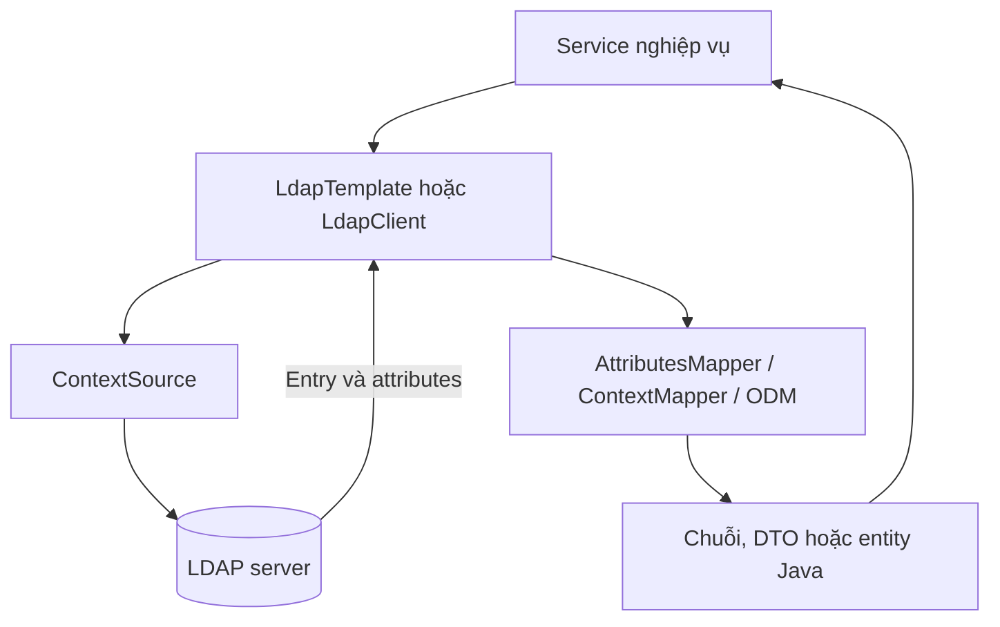

# Vai trò của ContextSource, LdapTemplate và mô hình mapping trong Spring LDAP

Khi ứng dụng Java cần tra cứu tài khoản nhân viên, nhóm hoặc đơn vị tổ chức từ LDAP, có ba câu hỏi cần được giải quyết: **kết nối tới thư mục bằng cách nào**, **gửi thao tác LDAP ra sao**, và **biến entry LDAP thành dữ liệu Java như thế nào**. Spring LDAP phân chia các trách nhiệm này qua `ContextSource`, `LdapTemplate` và các cơ chế mapping.

Đây là bức tranh tổng thể trước khi đi sâu vào cấu hình, tìm kiếm, xác thực và cập nhật entry. Các thành phần cũng áp dụng cho thư mục dùng LDAP như OpenLDAP hoặc Microsoft Active Directory, dù schema, quyền truy cập và một số thuộc tính cụ thể có thể khác nhau.

## 1. Một luồng truy cập LDAP đi qua những lớp nào?

Giả sử hệ thống nhân sự cần tìm người dùng có `uid=an` trong cây thư mục:

```text
dc=example,dc=org
└── ou=people
    ├── uid=an
    │   ├── objectClass: inetOrgPerson
    │   ├── cn: Nguyễn Văn An
    │   ├── sn: Nguyễn
    │   └── mail: an@example.org
    └── uid=binh
        └── ...
```

DN đầy đủ của entry đầu tiên là `uid=an,ou=people,dc=example,dc=org`. DN (*Distinguished Name*) xác định vị trí của entry trong cây; `uid`, `cn`, `mail` là các thuộc tính nằm trong entry. `objectClass` liên quan đến schema, quyết định những thuộc tính nào được yêu cầu hoặc được phép xuất hiện. Ví dụ này giả định server có schema `inetOrgPerson` và cho phép dùng `uid` trong RDN.



Trong đó:

| Thành phần | Trách nhiệm chính | Câu hỏi mà nó trả lời |
| --- | --- | --- |
| `ContextSource` | Tạo và quản lý cách lấy `DirContext` để giao tiếp với LDAP, mang cấu hình kết nối và thông tin bind | Kết nối đến server nào, với danh tính nào, dưới base DN nào? |
| `LdapTemplate` | Thực thi các thao tác tìm kiếm, đọc, thêm, sửa, xóa và hỗ trợ xác thực; bao bọc phần việc lặp lại khi dùng JNDI | Cần thực hiện thao tác LDAP nào? |
| `AttributesMapper<T>` | Chuyển tập thuộc tính của một kết quả thành giá trị Java | Chỉ cần dữ liệu thuộc tính nào? |
| `ContextMapper<T>` | Chuyển kết quả có cả ngữ cảnh entry và DN thành đối tượng Java | Cần thuộc tính cùng danh tính/vị trí entry ra sao? |
| ODM (*Object-Directory Mapping*) | Ánh xạ class Java được chú thích bằng annotation tới entry LDAP | Muốn làm việc với entry như entity có cấu trúc như thế nào? |

Một cách nhìn khác: `ContextSource` là **hạ tầng truy cập**, `LdapTemplate` là **bộ thực thi**, còn mapper hoặc ODM là **ranh giới chuyển đổi dữ liệu**. Lập trình viên có thể thay cách mapping mà không phải tự viết lại logic mở và đóng kết nối LDAP.

## 2. `ContextSource`: nơi xác định kết nối và phạm vi tên

Spring LDAP dùng interface `org.springframework.ldap.core.ContextSource` để trừu tượng hóa việc cấp các ngữ cảnh JNDI (`DirContext`). Triển khai thông dụng là `LdapContextSource`.

Một `LdapContextSource` thường cần:

- **URL**: địa chỉ LDAP, chẳng hạn `ldaps://ldap.example.org:636`.
- **Base DN**: gốc làm việc, chẳng hạn `dc=example,dc=org`.
- **Bind DN và mật khẩu**: danh tính mà ứng dụng dùng khi đọc/ghi thư mục, chẳng hạn tài khoản dịch vụ có quyền đọc `ou=people`.
- **Thiết lập môi trường**: timeout, TLS, pooling và các thuộc tính JNDI phù hợp với triển khai.

Ví dụ cấu hình chủ động trong ứng dụng Spring:

```java
import org.springframework.beans.factory.annotation.Value;
import org.springframework.context.annotation.Bean;
import org.springframework.context.annotation.Configuration;
import org.springframework.ldap.core.ContextSource;
import org.springframework.ldap.core.LdapTemplate;
import org.springframework.ldap.core.support.LdapContextSource;

@Configuration
public class DirectoryConfiguration {

    @Bean
    LdapContextSource contextSource(
            @Value("${app.ldap.url}") String url,
            @Value("${app.ldap.base}") String base,
            @Value("${app.ldap.bind-dn}") String bindDn,
            @Value("${app.ldap.bind-password}") String password) {

        LdapContextSource source = new LdapContextSource();
        source.setUrl(url);
        source.setBase(base);
        source.setUserDn(bindDn);
        source.setPassword(password);
        return source;
    }

    @Bean
    LdapTemplate ldapTemplate(ContextSource contextSource) {
        return new LdapTemplate(contextSource);
    }
}
```

Với cấu hình ứng dụng tương ứng:

```yaml
app:
  ldap:
    url: ldaps://ldap.example.org:636
    base: dc=example,dc=org
    bind-dn: cn=directory-reader,ou=service,dc=example,dc=org
    bind-password: ${LDAP_BIND_PASSWORD}
```

Mật khẩu ở đây lấy từ biến môi trường hoặc hệ thống quản lý bí mật; không ghi mật khẩu thật vào mã nguồn. Nếu dùng Spring Boot và cơ chế auto-configuration của Spring LDAP, có thể dùng nhóm thuộc tính `spring.ldap.*` thay cho việc tự khai báo các bean tương đương. Chọn một cách cấu hình phù hợp với ứng dụng để tránh nhiều bean trùng vai trò.

### Base DN và DN tương đối

Khi `ContextSource` đã có base DN `dc=example,dc=org`, các DN mà `LdapTemplate` nhận thường được diễn đạt **tương đối với base**:

| Đầu vào trong ứng dụng | DN đầy đủ trên LDAP server |
| --- | --- |
| Base tìm kiếm `ou=people` | `ou=people,dc=example,dc=org` |
| DN entry `uid=an,ou=people` | `uid=an,ou=people,dc=example,dc=org` |
| Base tìm kiếm rỗng | `dc=example,dc=org` |

Lỗi thường gặp là truyền `uid=an,ou=people,dc=example,dc=org` vào một thao tác đã chạy với base `dc=example,dc=org`, khiến phần đuôi bị lặp lại hoặc vị trí tìm kiếm sai. Cần xác định rõ mỗi API đang sử dụng DN tương đối hay DN đầy đủ.

`ContextSource` còn giúp phân biệt hai việc: **bind bằng tài khoản dịch vụ** để thực hiện truy vấn thông thường và **kiểm tra thông tin đăng nhập của người dùng** bằng cơ chế xác thực phù hợp. Tài khoản dịch vụ không mặc nhiên đại diện cho người dùng đang đăng nhập. Với thao tác ghi, quyền cuối cùng vẫn do ACL và chính sách của LDAP server quyết định.

## 3. `LdapTemplate`: lớp thực thi thao tác thư mục

Khi dùng JNDI trực tiếp, ứng dụng phải xử lý việc mở ngữ cảnh, chạy tìm kiếm, duyệt kết quả, đóng tài nguyên và chuyển đổi exception. `LdapTemplate` gom những phần lặp lại đó vào các phương thức ở mức nghiệp vụ.

Những nhóm thao tác thường gặp:

| Nhu cầu | Hướng API tiêu biểu |
| --- | --- |
| Tìm các entry khớp điều kiện | `search(...)` |
| Đọc entry khi đã biết DN | `lookup(...)` |
| Tạo entry | `bind(...)` |
| Thay nội dung hoặc cập nhật thuộc tính | `rebind(...)`, `modifyAttributes(...)` tùy mục tiêu |
| Xóa entry | `unbind(...)` |
| Kiểm tra thông tin xác thực qua LDAP | `authenticate(...)` |

Không phải tài khoản ứng dụng nào cũng có quyền dùng tất cả thao tác trên. Ví dụ, tài khoản chỉ đọc có thể `search` thành công nhưng bị từ chối khi `modifyAttributes`.

### Ví dụ: tìm một người dùng bằng filter an toàn

Ứng dụng có thể tạo `LdapQuery` bằng `LdapQueryBuilder` thay vì tự nối chuỗi filter:

```java
import org.springframework.ldap.query.LdapQuery;
import org.springframework.ldap.query.LdapQueryBuilder;

LdapQuery query = LdapQueryBuilder.query()
        .base("ou=people")
        .where("objectClass").is("inetOrgPerson")
        .and("uid").is(inputUid);
```

Query tương đương về mặt ý nghĩa với filter LDAP:

```text
(&(objectClass=inetOrgPerson)(uid=an))
```

Trong đoạn mã trên, `inputUid` là đầu vào người dùng, có thể chứa các ký tự đặc biệt của LDAP filter. Builder xử lý escape giá trị filter; tuyệt đối không dựng filter bằng cách ghép trực tiếp `"(uid=" + inputUid + ")"`. Đồng thời giới hạn base tìm kiếm và dùng tài khoản chỉ có quyền cần thiết để giảm phạm vi truy cập.

Một thao tác `search` điển hình có ba phần: **vị trí bắt đầu tìm kiếm**, **điều kiện lọc** và **cách ánh xạ kết quả**. Cách ánh xạ sẽ được chọn tùy thứ mà lớp nghiệp vụ cần nhận về.

## 4. Mapping cấp nhẹ: `AttributesMapper<T>`

`AttributesMapper<T>` nhận một đối tượng JNDI `Attributes` từ mỗi entry tìm được. Nó thích hợp khi chỉ cần vài thuộc tính, chẳng hạn lấy danh sách tên hiển thị để xây dựng dropdown.

```java
import java.util.List;
import org.springframework.ldap.core.AttributesMapper;

List<String> displayNames = ldapTemplate.search(
        query,
        (AttributesMapper<String>) attributes ->
                (String) attributes.get("cn").get());
```

Với mỗi kết quả, lambda lấy thuộc tính `cn` và tạo một chuỗi; danh sách trả về chứa các chuỗi đó. Ví dụ giả định mọi entry đúng schema đều có `cn`, như yêu cầu thông thường với `inetOrgPerson`. Với thuộc tính tùy chọn như `mail`, phải kiểm tra `attributes.get("mail") != null` trước khi lấy giá trị. Thuộc tính LDAP cũng có thể đa trị hoặc có dạng nhị phân, vì vậy không nên mặc định mọi giá trị đều là `String`.

**Giới hạn của `AttributesMapper`:** đầu vào chính là tập attributes, không trực tiếp cung cấp DN của kết quả. Nếu nghiệp vụ cần lưu DN để đọc, sửa hoặc phân biệt các entry cùng tên hiển thị, hãy dùng `ContextMapper`.

## 5. Mapping có thông tin entry: `ContextMapper<T>`

`ContextMapper<T>` nhận `DirContextOperations`, từ đó có thể truy cập attributes và DN của entry. Đây thường là lựa chọn tốt cho kết quả tìm kiếm trong các dịch vụ thực tế: trả về DTO gọn, nhưng vẫn giữ định danh thư mục cần thiết.

Ví dụ dùng Java 17 trở lên:

```java
import java.util.List;
import org.springframework.ldap.core.ContextMapper;
import org.springframework.ldap.core.LdapTemplate;
import org.springframework.ldap.query.LdapQuery;
import org.springframework.ldap.query.LdapQueryBuilder;
import org.springframework.stereotype.Service;

record UserSummary(String dn, String uid, String fullName, String email) {}

@Service
public class DirectoryUserService {

    private final LdapTemplate ldapTemplate;

    public DirectoryUserService(LdapTemplate ldapTemplate) {
        this.ldapTemplate = ldapTemplate;
    }

    public List<UserSummary> findByUid(String uid) {
        LdapQuery query = LdapQueryBuilder.query()
                .base("ou=people")
                .where("objectClass").is("inetOrgPerson")
                .and("uid").is(uid);

        return ldapTemplate.search(
                query,
                (ContextMapper<UserSummary>) context -> new UserSummary(
                        context.getDn().toString(),
                        context.getStringAttribute("uid"),
                        context.getStringAttribute("cn"),
                        context.getStringAttribute("mail")));
    }
}
```

Các điểm đáng chú ý:

1. Service chỉ phụ thuộc `LdapTemplate`; cấu hình kết nối đã nằm ở lớp `ContextSource`.
2. `LdapQueryBuilder` xác định OU và filter. `search` có thể trả về **0, 1 hoặc nhiều kết quả**: đừng giả định `uid` là duy nhất trên toàn bộ cây thư mục nếu server và cấu trúc OU không đảm bảo điều đó.
3. `ContextMapper` tạo `UserSummary` nên phần còn lại của ứng dụng không phải phụ thuộc vào `Attributes` hay JNDI.
4. `getDn()` cho biết DN trong ngữ cảnh thao tác hiện tại; khi `ContextSource` có base DN, hãy kiểm tra quy ước DN tương đối trước khi lưu hoặc dùng lại giá trị này.
5. `getStringAttribute("mail")` có thể cho kết quả `null` khi schema hoặc entry không chứa thuộc tính đó; code nghiệp vụ cần có quy tắc xử lý phù hợp.

`ContextMapper` đặc biệt hữu ích khi muốn tra cứu nhiều loại entry hoặc trả về các DTO khác nhau theo từng use case, mà không phải thiết kế một entity ODM cho mỗi kiểu dữ liệu.

## 6. ODM: ánh xạ entry thành entity có annotation

Spring LDAP còn hỗ trợ *Object-Directory Mapping* (ODM), gần với ý tưởng ánh xạ entity nhưng dữ liệu nguồn vẫn là **cây LDAP có DN và schema**, không phải bảng quan hệ. Một class được ánh xạ bằng `@Entry`, thuộc tính bởi `@Attribute`, và định danh DN bởi `@Id`.

```java
import javax.naming.Name;
import org.springframework.ldap.odm.annotations.Attribute;
import org.springframework.ldap.odm.annotations.Entry;
import org.springframework.ldap.odm.annotations.Id;

@Entry(
    base = "ou=people",
    objectClasses = {"top", "person", "organizationalPerson", "inetOrgPerson"}
)
public class DirectoryPerson {

    @Id
    private Name dn;

    @Attribute(name = "uid")
    private String uid;

    @Attribute(name = "cn")
    private String fullName;

    @Attribute(name = "sn")
    private String surname;

    @Attribute(name = "mail")
    private String email;

    public DirectoryPerson() {
        // Constructor không tham số để framework khởi tạo khi mapping.
    }

    // Bổ sung getter/setter cho các trường tùy theo nhu cầu ứng dụng.
}
```

Với cơ chế ODM được Spring LDAP hỗ trợ trong phiên bản đang dùng, ứng dụng có thể làm việc với các phương thức kiểu `ldapTemplate.findAll(DirectoryPerson.class)` và các thao tác ODM khác. Framework sử dụng metadata của class để chuyển đổi giữa LDAP entry và đối tượng Java.

ODM có ích khi cùng một kiểu entry được đọc/ghi ở nhiều chỗ và ứng dụng cần một mô hình nhất quán. Tuy vậy, cần hiểu những giới hạn thực tế:

- `@Entry.objectClasses` phải phù hợp với schema server; trong ví dụ `person` yêu cầu các thuộc tính thiết yếu như `cn` và `sn`.
- `@Id` lưu **DN**, không phải khóa số tự tăng như trong cơ sở dữ liệu quan hệ. Đổi tên RDN hoặc chuyển OU sẽ ảnh hưởng DN.
- Thuộc tính đa trị và các kiểu LDAP đặc biệt cần khai báo kiểu Java/mapping phù hợp; không mặc định mọi entry đều khớp một class.
- Việc `save` hay cập nhật không loại bỏ yêu cầu cấp quyền ghi trên LDAP server, cũng không biến nhiều thao tác LDAP thành một giao dịch cơ sở dữ liệu thông thường.

Đừng coi ODM là lựa chọn mặc định cho mọi truy vấn. Với phép chiếu chỉ cần hai hoặc ba trường, `AttributesMapper` hoặc `ContextMapper` thường dễ kiểm soát hơn.

### Chọn cách mapping nào?

| Tình huống | Lựa chọn phù hợp | Lý do |
| --- | --- | --- |
| Chỉ lấy danh sách `cn` hoặc email | `AttributesMapper` | Ít mã và không cần thông tin DN |
| Tìm nhân viên để hiển thị kèm DN | `ContextMapper` | Có attributes và ngữ cảnh entry |
| Tạo DTO đọc riêng cho API | `ContextMapper` | Kiểm soát rõ trường được phép trả về |
| Quản lý entry `inetOrgPerson` với cấu trúc ổn định | ODM | Dùng lại entity và metadata ánh xạ |
| Cần thao tác LDAP đặc biệt không khớp entity | `LdapTemplate` + callback/mapper phù hợp | Giữ quyền kiểm soát từng thao tác |

## 7. `LdapClient` đứng ở đâu trong bức tranh này?

Trong các phiên bản Spring LDAP có cung cấp `LdapClient`, đây là API theo phong cách *fluent* để biểu diễn thao tác như tìm kiếm và đọc một cách dễ kết hợp hơn. `LdapClient` và `LdapTemplate` đều thuộc lớp **thực thi truy cập LDAP**, dựa trên cấu hình kết nối `ContextSource`; việc chọn API thao tác không thay đổi bản chất DN, filter, schema hoặc quyền truy cập.

Với dự án đã dùng `LdapTemplate`, không cần chuyển đổi chỉ để đổi cú pháp. Nếu chọn `LdapClient` cho dự án mới, hãy đối chiếu phiên bản Spring LDAP và API hỗ trợ của phiên bản đó. Các khái niệm mapping kết quả vẫn cần được thiết kế độc lập với phần kết nối.

## 8. Các lỗi thiết kế thường gặp

| Triệu chứng | Nguyên nhân có thể | Hướng xử lý |
| --- | --- | --- |
| Không tìm thấy `uid=an` dù entry tồn tại | Tìm sai OU, gắn lặp base DN, filter không đúng thuộc tính/schema | Kiểm tra base của `ContextSource`, base của query và DN thực tế |
| Có nhiều kết quả cho một người dùng | `uid` chỉ duy nhất trong một vùng hoặc filter quá rộng | Giới hạn OU, thêm điều kiện và xác định quy tắc duy nhất |
| Kết quả mapping thiếu email | `mail` không tồn tại, không được cấp quyền đọc hoặc không thuộc schema sử dụng | Kiểm tra entry, ACL và xử lý thuộc tính tùy chọn |
| Tìm kiếm thành công, cập nhật thất bại | Bind account chỉ có quyền đọc | Dùng ACL phù hợp, tách tài khoản/tác vụ theo quyền tối thiểu |
| Lỗi kết nối hoặc chứng chỉ | URL, timeout, CA, hostname hoặc TLS không khớp | Dùng LDAPS/StartTLS đúng cấu hình và kiểm tra chuỗi tin cậy |
| Lỗi khi nhận dữ liệu | Ép mọi thuộc tính thành `String` hoặc bỏ qua giá trị đa trị/nhị phân | Kiểm tra kiểu, số lượng giá trị và quy tắc mapping |
| Filter cho kết quả bất thường hoặc bị lợi dụng | Nối input trực tiếp vào cú pháp LDAP filter | Sử dụng query/filter builder có escape giá trị |

Trong môi trường thực tế, cần hạn chế ghi log mật khẩu, thông tin bind và dữ liệu cá nhân; đặt timeout hợp lý; quản lý kết nối và pooling dựa trên tải; và kiểm thử riêng hành vi TLS, xác thực, phân quyền. Pooling phải được thiết kế tương thích với kiểu bind và StartTLS của hệ thống, không bật tùy tiện. Đối với thao tác cập nhật, thử nghiệm trên thư mục kiểm thử trước khi chạy với dữ liệu thật.

## 9. Bài thực hành nhỏ: từ yêu cầu nghiệp vụ tới component

Giả sử API `/directory/users?uid=an` cần trả về `uid`, `cn`, `mail` và DN, không cho phép sửa thư mục. Có thể triển khai theo thứ tự:

1. Cấu hình `ContextSource` với URL bảo mật, base `dc=example,dc=org` và tài khoản dịch vụ **chỉ đọc**.
2. Inject `LdapTemplate` vào service; không tạo kết nối JNDI trực tiếp trong controller.
3. Tạo query dưới `ou=people` với `objectClass=inetOrgPerson` và `uid` bằng tham số API, dùng `LdapQueryBuilder` để escape giá trị.
4. Chọn `ContextMapper` vì response cần DN; ánh xạ thành DTO, bỏ mọi thuộc tính không được yêu cầu (đặc biệt là thuộc tính xác thực hoặc dữ liệu nhạy cảm).
5. Xử lý rõ 0 kết quả, 1 kết quả và nhiều kết quả; kiểm thử ít nhất một trường hợp có `mail` bị thiếu, một đầu vào chứa ký tự đặc biệt và một trường hợp bị từ chối quyền đọc.

Nếu API chỉ hiển thị danh sách tên, có thể chuyển sang `AttributesMapper` mà không cần đổi `ContextSource`. Nếu phát triển chức năng quản lý đầy đủ lifecycle của người dùng, cân nhắc ODM và quyền ghi tương ứng. Như vậy, ba tầng kết nối, thực thi và mapping giữ trách nhiệm riêng, giúp truy vấn LDAP dễ bảo trì và dễ kiểm thử hơn.
