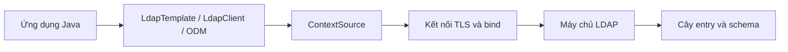

# Đọc dữ liệu thư mục, thay đổi dữ liệu và tìm kiếm dữ liệu

Trong chương **Bức tranh tổng thể** của module **SPRING_LDAP**, ba nhóm thao tác cốt lõi là **đọc một entry**, **tìm các entry thỏa điều kiện** và **thay đổi cây thư mục**. Spring LDAP giúp ứng dụng Java thực hiện các thao tác này thông qua `ContextSource`, `LdapTemplate`, API fluent `LdapClient` hoặc ánh xạ đối tượng (ODM). Hiểu được mối quan hệ giữa DN, thuộc tính, schema và filter là bước đầu để viết chức năng tra cứu tài khoản, đồng bộ hồ sơ, quản lý nhóm và tích hợp xác thực một cách an toàn.

**Sau bài này, bạn có thể:**

- Phân biệt đọc theo DN với tìm kiếm theo filter; xác định phạm vi tìm kiếm trong cây LDAP.
- Hiểu các thao tác `lookup`, `search`, `bind`, `modifyAttributes`, `rename` và `unbind` trong Spring LDAP.
- Viết mã đọc, thêm, sửa và xóa entry bằng `LdapTemplate`, đồng thời kiểm soát DN và filter được tạo từ đầu vào.
- Nhận diện những lỗi thường gặp về quyền truy cập, schema, giới hạn kết quả, kết nối TLS và xử lý cập nhật.

## 1. Dữ liệu LDAP được tổ chức như thế nào?

LDAP (Lightweight Directory Access Protocol) truy cập dữ liệu dưới dạng một **cây entry** (Directory Information Tree, DIT). Mỗi entry có **Distinguished Name (DN)** duy nhất tại một thời điểm, một tập **attribute** và những **objectClass** quy định cấu trúc hợp lệ của entry.

Ví dụ cây thư mục:

```text
dc=example,dc=org
├── ou=people
│   ├── uid=linh
│   └── uid=an
└── ou=groups
    └── cn=developers
```

Một entry người dùng có thể được biểu diễn dưới dạng LDIF:

```ldif
dn: uid=linh,ou=people,dc=example,dc=org
objectClass: top
objectClass: person
objectClass: organizationalPerson
objectClass: inetOrgPerson
uid: linh
cn: Nguyen Linh
sn: Nguyen
mail: linh@example.org
```

Trong ví dụ này:

| Thành phần | Vai trò |
| --- | --- |
| `dc=example,dc=org` | Base DN, gốc logic của vùng dữ liệu mà ứng dụng làm việc. |
| `ou=people` | Nhánh chứa tài khoản; tìm kiếm trên nhánh này có phạm vi nhỏ hơn toàn cây. |
| `uid=linh` | Relative Distinguished Name (RDN) của entry, dùng để phân biệt entry trong cùng nhánh. |
| `uid=linh,ou=people,dc=example,dc=org` | DN đầy đủ, dùng khi truy cập trực tiếp một entry. |
| `objectClass` | Quy định các thuộc tính bắt buộc/được phép theo schema LDAP. |
| `cn`, `sn`, `mail` | Thuộc tính của entry. Một số thuộc tính có thể có nhiều giá trị. |

**DN không phải là thuộc tính tìm kiếm thông thường.** DN định vị entry trong cây; `uid`, `cn` và `mail` là các thuộc tính có thể đưa vào filter. Một entry có thể đổi DN khi đổi RDN hoặc chuyển nhánh. Đồng thời, không nên giả định mọi người dùng đều có DN dạng `uid=...`: Active Directory và các máy chủ LDAP khác có thể dùng cấu trúc, schema và quy tắc tên khác.

## 2. Từ Spring LDAP tới máy chủ thư mục

`ContextSource` cung cấp môi trường kết nối, tài khoản bind và base DN. `LdapTemplate` thực hiện thao tác LDAP, chuyển đổi ngoại lệ và quản lý tài nguyên kết nối. `LdapClient` cung cấp cách viết truy vấn theo chuỗi thao tác (fluent), còn ODM ánh xạ entry thành lớp Java khi phù hợp với mô hình ứng dụng.



Với Spring Boot đã có tích hợp Spring LDAP, cấu hình có thể bắt đầu như sau:

```yaml
spring:
  ldap:
    urls: ${LDAP_URL:ldaps://ldap.example.org:636}
    base: dc=example,dc=org
    username: ${LDAP_BIND_DN}
    password: ${LDAP_BIND_PASSWORD}
```

Ví dụ dùng dependency `spring-boot-starter-data-ldap`. Trong ứng dụng Spring thông thường, có thể tạo `LdapContextSource` và một bean `LdapTemplate` từ `ContextSource`. Cấu hình trên coi `dc=example,dc=org` là base DN: các DN sử dụng trong ví dụ Java bên dưới đều **tương đối với base này**, chẳng hạn `uid=linh,ou=people`. Nếu dùng DN tuyệt đối ở nơi API đang mong DN tương đối, rất dễ nối lặp phần base và nhận lỗi không tìm thấy entry.

Tài khoản bind dùng cho ứng dụng cần quyền tối thiểu đủ để đọc hoặc sửa đúng nhánh được phép. Với môi trường thật, dùng LDAPS hoặc StartTLS có kiểm tra chứng chỉ, quản lý mật khẩu qua secret manager/biến môi trường và xác thực cấu hình TLS trước khi truy cập dữ liệu nhạy cảm. Kết nối thành công không có nghĩa là tài khoản đó được phép thực hiện mọi thao tác.

## 3. Đọc chính xác một entry bằng DN

Khi đã biết DN, thao tác `lookup` phù hợp nhất. LDAP sẽ truy cập entry cụ thể thay vì phải dò nhiều entry trong một nhánh.

```java
import javax.naming.Name;
import javax.naming.NamingException;
import javax.naming.directory.Attributes;

import org.springframework.ldap.core.AttributesMapper;
import org.springframework.ldap.core.LdapTemplate;
import org.springframework.ldap.support.LdapNameBuilder;

record PersonSummary(String uid, String fullName, String email) {}

public class PersonReader {
    private final LdapTemplate ldapTemplate;

    public PersonReader(LdapTemplate ldapTemplate) {
        this.ldapTemplate = ldapTemplate;
    }

    public PersonSummary findOne(String uid) {
        Name dn = LdapNameBuilder.newInstance("ou=people")
                .add("uid", uid)
                .build();

        return ldapTemplate.lookup(dn,
                (AttributesMapper<PersonSummary>) PersonReader::mapPerson);
    }

    private static PersonSummary mapPerson(Attributes attrs)
            throws NamingException {
        String uid = (String) attrs.get("uid").get();
        String cn = (String) attrs.get("cn").get();
        String mail = attrs.get("mail") == null
                ? null : (String) attrs.get("mail").get();
        return new PersonSummary(uid, cn, mail);
    }
}
```

**Điểm cần hiểu:**

1. `LdapNameBuilder` tạo DN từ từng thành phần RDN, giúp xử lý ký tự đặc biệt trong giá trị DN đúng quy tắc. Không nối chuỗi `"uid=" + uid + ",ou=people"` từ đầu vào người dùng.
2. `AttributesMapper` chuyển tập thuộc tính LDAP thành đối tượng Java. Với thuộc tính không bắt buộc như `mail`, phải kiểm tra sự tồn tại trước khi đọc.
3. `lookup` trên DN không tồn tại thường dẫn tới `NameNotFoundException` của Spring LDAP; đây là trường hợp nghiệp vụ cần xử lý rõ (ví dụ trả về kết quả không tìm thấy).
4. Với dữ liệu nhị phân hoặc thuộc tính nhiều giá trị, không thể mặc định ép mọi giá trị về `String`; phải đọc theo kiểu và cardinality mà schema quy định.

Khi cần cả DN của kết quả hoặc muốn thao tác trên entry đã đọc, dùng `ContextMapper`/`DirContextOperations` (chẳng hạn `lookupContext(dn)`). `AttributesMapper` thích hợp hơn khi chỉ cần thuộc tính.

## 4. Tìm kiếm theo filter

Nếu chưa biết DN, hoặc cần danh sách người dùng, hãy dùng `search`. Một truy vấn có ba phần quan trọng: **search base** (bắt đầu từ nhánh nào), **search scope** (duyệt đến đâu) và **filter** (entry nào thỏa điều kiện).

Ví dụ các filter LDAP:

| Filter | Ý nghĩa |
| --- | --- |
| `(uid=linh)` | Entry có `uid` bằng `linh`. |
| `(objectClass=inetOrgPerson)` | Entry thuộc lớp đối tượng `inetOrgPerson`. |
| `(&(objectClass=inetOrgPerson)(uid=linh))` | Cả hai điều kiện cùng đúng (AND). |
| `(\|(sn=Nguyen)(sn=Tran))` | Ít nhất một điều kiện đúng (OR). |
| `(mail=*)` | Có thuộc tính `mail` (presence). |
| `(!(mail=*))` | Không có thuộc tính `mail` (NOT). |

Dùng `LdapQueryBuilder` để xây filter khi giá trị đến từ dữ liệu động:

```java
import java.util.List;
import javax.naming.directory.SearchControls;

import org.springframework.ldap.core.AttributesMapper;
import org.springframework.ldap.core.LdapTemplate;
import org.springframework.ldap.query.LdapQuery;
import org.springframework.ldap.query.LdapQueryBuilder;

public class PersonSearch {
    private final LdapTemplate ldapTemplate;

    public PersonSearch(LdapTemplate ldapTemplate) {
        this.ldapTemplate = ldapTemplate;
    }

    public List<PersonSummary> findByUid(String uid) {
        LdapQuery query = LdapQueryBuilder.query()
                .base("ou=people")
                .searchScope(SearchControls.SUBTREE_SCOPE)
                .countLimit(100)
                .timeLimit(5000)
                .where("objectClass").is("inetOrgPerson")
                .and("uid").is(uid);

        return ldapTemplate.search(query,
                (AttributesMapper<PersonSummary>) attrs ->
                        new PersonSummary(
                                (String) attrs.get("uid").get(),
                                (String) attrs.get("cn").get(),
                                attrs.get("mail") == null
                                        ? null
                                        : (String) attrs.get("mail").get()));
    }
}
```

Ở đây, điều kiện `is(uid)` giúp biểu diễn giá trị như dữ liệu của filter, thay vì tự chèn chuỗi đầu vào vào cú pháp LDAP. Ví dụ người dùng nhập `*` hoặc `)(uid=*)` thì việc nối chuỗi trực tiếp vào filter có thể làm thay đổi ý nghĩa truy vấn. Nên dùng builder, `EqualsFilter` hoặc cơ chế truyền tham số được Spring LDAP hỗ trợ; chỉ cho phép wildcard khi chức năng tìm kiếm thực sự yêu cầu và đã kiểm soát cú pháp.

**Phạm vi tìm kiếm (scope):**

| Scope | Phần được duyệt | Khi nào dùng |
| --- | --- | --- |
| `OBJECT_SCOPE` | Chỉ entry tại search base. | Kiểm tra điều kiện trên entry đã định vị. |
| `ONELEVEL_SCOPE` | Các entry con trực tiếp của base. | Liệt kê thành viên trực tiếp của một OU. |
| `SUBTREE_SCOPE` | Base và toàn bộ các nhánh con. | Tìm trong cây lồng nhau; cần giới hạn hợp lý. |

`countLimit(100)` và `timeLimit(5000)` lần lượt đặt giới hạn số kết quả và thời gian truy vấn phía client theo API; máy chủ có thể áp đặt giới hạn thấp hơn. Nếu có hàng nghìn entry, cần thiết kế **phân trang LDAP phía máy chủ** (ví dụ LDAP Paged Results Control) và xử lý cookie trang; tăng giới hạn đến vô hạn không phải cách thay thế phân trang. Tối ưu truy vấn bằng cách thu hẹp base/scope, chọn thuộc tính được đánh chỉ mục và chỉ lấy những thuộc tính thực sự cần.

Cũng cần phân biệt **tìm thấy nhiều kết quả** với **tìm thấy một kết quả**: `search` thường trả về danh sách. Nếu nghiệp vụ yêu cầu một tài khoản duy nhất theo `uid`, phải quy định và kiểm tra tính duy nhất ở tầng dữ liệu/ứng dụng thay vì mặc nhiên lấy phần tử đầu.

## 5. Thêm mới entry: `bind`

Thêm entry đòi hỏi DN chưa tồn tại, quyền ghi thích hợp và các thuộc tính tuân thủ schema. Với `inetOrgPerson`, những thuộc tính như `cn` và `sn` thường là bắt buộc theo chuỗi object class.

```java
import javax.naming.Name;

import org.springframework.ldap.core.DirContextAdapter;
import org.springframework.ldap.core.LdapTemplate;
import org.springframework.ldap.support.LdapNameBuilder;

public class PersonWriter {
    private final LdapTemplate ldapTemplate;

    public PersonWriter(LdapTemplate ldapTemplate) {
        this.ldapTemplate = ldapTemplate;
    }

    private Name personDn(String uid) {
        return LdapNameBuilder.newInstance("ou=people")
                .add("uid", uid)
                .build();
    }

    public void create(String uid, String cn, String surname, String email) {
        Name dn = personDn(uid);
        DirContextAdapter entry = new DirContextAdapter(dn);

        entry.setAttributeValues("objectClass",
                new String[] {
                    "top", "person", "organizationalPerson", "inetOrgPerson"
                });
        entry.setAttributeValue("uid", uid);
        entry.setAttributeValue("cn", cn);
        entry.setAttributeValue("sn", surname);
        entry.setAttributeValue("mail", email);

        ldapTemplate.bind(entry);
    }
}
```

`bind` trong ngữ cảnh này nghĩa là **tạo entry mới** bằng API của `LdapTemplate`. Cần phân biệt với **authentication bind**, tức đăng nhập vào LDAP bằng DN/mật khẩu: cùng từ “bind” nhưng mục đích và API khác nhau.

Trước khi tạo, ứng dụng nên kiểm tra tính hợp lệ của giá trị, schema áp dụng và quy tắc duy nhất của tài khoản. Một lần kiểm tra “chưa tồn tại” trước đó không thay thế việc xử lý lỗi khi tạo vì giữa hai bước có thể có tiến trình khác vừa tạo cùng DN.

## 6. Sửa thuộc tính: `modifyAttributes`

Thay đổi thuộc tính nên là một thao tác cập nhật có chủ đích. Spring LDAP có thể đọc entry thành `DirContextOperations`, theo dõi các thuộc tính đã thay đổi và gửi các chỉnh sửa đó đến máy chủ:

```java
import org.springframework.ldap.core.DirContextOperations;

// Bên trong PersonWriter:
public void updateEmail(String uid, String newEmail) {
    DirContextOperations entry = ldapTemplate.lookupContext(personDn(uid));
    entry.setAttributeValue("mail", newEmail);
    ldapTemplate.modifyAttributes(entry);
}
```

Khi chỉ cần gửi một thay đổi cụ thể, có thể dùng trực tiếp `ModificationItem` của JNDI:

```java
import javax.naming.directory.BasicAttribute;
import javax.naming.directory.DirContext;
import javax.naming.directory.ModificationItem;

// Bên trong PersonWriter:
public void updatePhone(String uid, String phone) {
    ModificationItem replacePhone = new ModificationItem(
            DirContext.REPLACE_ATTRIBUTE,
            new BasicAttribute("telephoneNumber", phone));

    ldapTemplate.modifyAttributes(
            personDn(uid),
            new ModificationItem[] {replacePhone});
}
```

Ba chế độ sửa thuộc tính của JNDI:

- `ADD_ATTRIBUTE`: thêm thuộc tính hoặc giá trị; có thể lỗi nếu giá trị đã tồn tại hoặc thuộc tính không cho phép nhiều giá trị.
- `REPLACE_ATTRIBUTE`: thay thế các giá trị hiện có của thuộc tính bằng tập giá trị mới.
- `REMOVE_ATTRIBUTE`: bỏ thuộc tính hoặc giá trị được chỉ định; không thể xóa thuộc tính mà schema yêu cầu phải có.

**Không dùng `rebind` như thao tác sửa từng trường** khi không chủ đích thay toàn bộ entry: cách đó có thể làm mất các thuộc tính chưa được đưa vào đối tượng gửi lên. Với thuộc tính nhiều giá trị như `member`, cần hiểu rõ là đang thêm một thành viên, xóa một thành viên hay thay thế toàn bộ danh sách.

LDAP thường không cung cấp giao dịch nhiều entry tương đương một transaction của cơ sở dữ liệu quan hệ. Nếu quy trình cập nhật cả người dùng lẫn nhóm, hãy thiết kế xử lý lỗi từng bước và cơ chế khôi phục/đối soát khi một bước thất bại.

## 7. Đổi DN và xóa entry

Khi tên định danh hoặc vị trí trong cây thay đổi, sử dụng `rename`. Nếu xóa entry, sử dụng `unbind`:

```java
// Bên trong PersonWriter:
public void changeUid(String oldUid, String newUid) {
    ldapTemplate.rename(personDn(oldUid), personDn(newUid));
}

public void delete(String uid) {
    ldapTemplate.unbind(personDn(uid));
}
```

`rename` thực hiện thay đổi DN; việc đổi RDN hoặc chuyển entry sang OU khác có thể bị hạn chế bởi máy chủ và quyền của tài khoản. Sau khi đổi, các tham chiếu DN được lưu ở entry khác (ví dụ giá trị `member` của nhóm) cần được kiểm tra theo hành vi thực tế của hệ thống LDAP. Đừng mặc định mọi liên kết đều được tự động cập nhật.

`unbind` xóa entry. Thông thường không thể xóa entry vẫn còn các entry con nếu máy chủ không hỗ trợ thao tác xóa cây chuyên biệt. Đối với tài khoản nhân sự, quy trình an toàn thường **vô hiệu hóa hoặc chuyển trạng thái** theo schema/chính sách tổ chức trước khi xóa vĩnh viễn; điều này giữ lại khả năng kiểm toán và xử lý các liên kết liên quan.

## 8. Chọn API nào cho từng cách làm?

| API | Điểm mạnh | Lưu ý |
| --- | --- | --- |
| `LdapTemplate` | Bao quát `lookup`, `search`, `bind`, `modifyAttributes`, `rename`, `unbind`; phù hợp khi cần kiểm soát DN và thuộc tính. | Cần tự ánh xạ dữ liệu hoặc dùng mapper. |
| `LdapClient` | API fluent giúp mô tả thao tác và đọc kết quả rõ ràng ở các phiên bản Spring LDAP có hỗ trợ. | Cú pháp cụ thể phụ thuộc phiên bản thư viện; vẫn phải hiểu DN, filter và schema. |
| ODM (`@Entry`, `@Id`, `@Attribute`) | Ánh xạ entry thành Java object, thuận tiện cho mô hình miền ổn định. | Phải khai báo đúng object class, DN, kiểu thuộc tính và cách cập nhật; không che giấu giới hạn của máy chủ. |

Ví dụ hình dạng một lớp ODM:

```java
import javax.naming.Name;
import org.springframework.ldap.odm.annotations.Attribute;
import org.springframework.ldap.odm.annotations.Entry;
import org.springframework.ldap.odm.annotations.Id;

@Entry(base = "ou=people", objectClasses = {
        "top", "person", "organizationalPerson", "inetOrgPerson"
})
public class PersonEntry {
    @Id
    private Name dn;

    @Attribute(name = "uid")
    private String uid;

    @Attribute(name = "cn")
    private String commonName;

    @Attribute(name = "sn")
    private String surname;

    @Attribute(name = "mail")
    private String email;

    // Constructor mặc định, getter/setter theo nhu cầu ODM.
}
```

Cùng một nghiệp vụ có thể triển khai bằng nhiều API; lựa chọn nên dựa trên mức kiểm soát thao tác, cấu trúc entry và phiên bản Spring LDAP đang dùng. Đặc biệt, việc lưu một Java object thông qua ODM không làm thay đổi quy tắc validate schema hay phân quyền của LDAP server.

## 9. Lỗi, bảo mật và tính đúng đắn của thao tác

| Tình huống | Biểu hiện thường gặp | Cách xử lý |
| --- | --- | --- |
| DN không tồn tại | LDAP result code `32` / `NameNotFoundException`. | Kiểm tra base DN, DN tương đối và quy tắc định danh; trả về “không tìm thấy” nếu phù hợp. |
| DN đã tồn tại khi thêm | LDAP result code `68` / `NameAlreadyBoundException`. | Trả lỗi trùng định danh; tránh ghi đè ngoài ý muốn. |
| Không có quyền | LDAP result code `50` / insufficient access rights. | Kiểm tra ACL, tài khoản bind và OU đích; không tự nâng quyền. |
| Vi phạm schema/ràng buộc | LDAP result code `65` (object class violation) hoặc `19` (constraint violation). | Kiểm tra `objectClass`, thuộc tính bắt buộc, kiểu và số lượng giá trị. |
| Sai thông tin xác thực | LDAP result code `49` / invalid credentials. | Kiểm tra tài khoản dịch vụ, mật khẩu và cấu hình bind; không ghi log thông tin bí mật. |
| Lỗi mạng/TLS hoặc giới hạn tìm kiếm | Timeout, connection error, size/time limit exceeded. | Kiểm tra mạng và chứng chỉ; thu hẹp scope/filter, phân trang; áp dụng retry có giới hạn khi phù hợp. |

Một số nguyên tắc khi xây dựng API truy cập thư mục:

1. **Kiểm tra đầu vào theo nghiệp vụ** (định dạng UID, độ dài tên, email) và xây DN/filter bằng API có cơ chế escape phù hợp. Validation không thay thế escaping.
2. **Giới hạn dữ liệu trả về**, đặc biệt là thông tin cá nhân. Không đưa mật khẩu, hash, token hoặc các thuộc tính nhạy cảm vào DTO/log.
3. **Phân quyền tách biệt** giữa chức năng đọc, ghi và xác thực. Tài khoản dịch vụ không nên có quyền quản trị toàn cây nếu chỉ cần quản lý `ou=people`.
4. **Sử dụng TLS đúng cách**, xác minh chứng chỉ và đặt timeout kết nối/truy vấn phù hợp. Nếu dùng pooling, kiểm tra tác động của bind bằng các danh tính khác nhau và bảo đảm không tái sử dụng sai phiên xác thực.
5. **Phân biệt thao tác lặp lại an toàn**: tìm kiếm có thể thử lại sau lỗi tạm thời, còn thao tác tạo/xóa/sửa cần kiểm tra trạng thái thực tế trước khi retry để tránh tác dụng phụ không mong muốn.
6. **Không coi mọi LDAP server giống nhau**: schema, thuộc tính vận hành, quy tắc password, hỗ trợ paged results, member/memberOf và quyền sửa DN có thể khác nhau.

Đối với xác thực người dùng, truy vấn tìm thấy entry chưa chứng minh mật khẩu là đúng. Quy trình thường là tìm DN theo một định danh đáng tin cậy, sau đó thực hiện authentication bind hoặc dùng cơ chế xác thực phù hợp với máy chủ; không so sánh mật khẩu ở ứng dụng bằng cách đọc một thuộc tính LDAP.

## 10. Ví dụ luồng nghiệp vụ: đồng bộ một nhân viên

Giả sử ứng dụng nhân sự muốn đồng bộ người dùng có `uid=linh` vào `ou=people`:

1. **Tìm** bằng filter theo `uid` với search base `ou=people`, scope phù hợp và giới hạn số kết quả.
2. **Nếu chưa có entry**, tạo bằng `bind` với object class/thuộc tính bắt buộc; xử lý trường hợp một tiến trình khác vừa tạo trước.
3. **Nếu đã có entry**, dùng `lookup` hoặc `lookupContext` để xem dữ liệu hiện tại, rồi chỉ sửa các thuộc tính ứng dụng có quyền sở hữu.
4. **Nếu đổi định danh**, thực hiện `rename` theo quy tắc DN của hệ thống và kiểm tra các tham chiếu nhóm.
5. **Đọc lại để xác minh** rằng kết quả đã được lưu đúng; ghi audit theo mức tối thiểu cần thiết và không log dữ liệu nhạy cảm.

Một thay đổi danh bạ tưởng chừng đơn giản có thể ảnh hưởng tới đăng nhập hoặc phân quyền nhóm. Vì vậy cần thống nhất “nguồn dữ liệu chủ” cho từng thuộc tính: ví dụ hệ thống HR quản lý `cn`/`mail`, còn LDAP hoặc hệ thống IAM quản lý trạng thái tài khoản và nhóm. Không nên để hai ứng dụng cùng cập nhật một trường mà không có quy tắc giải quyết xung đột.

## 11. Thực hành và tự kiểm tra

Dùng một LDAP thử nghiệm (ví dụ server test có schema phù hợp), một tài khoản có quyền hạn chế trên OU mẫu và dữ liệu LDIF đã xác định trước. Thực hiện các bước sau:

1. Nạp entry `uid=linh`; xác minh `lookup` bằng DN tương đối `uid=linh,ou=people` trả về `cn` và `mail`.
2. Thử `search` theo `uid`, rồi thay `SUBTREE_SCOPE` bằng `ONELEVEL_SCOPE` để quan sát khi có thêm OU con.
3. Tìm bằng UID chứa ký tự đặc biệt đối với filter; xác nhận điều kiện tìm kiếm vẫn được diễn giải như giá trị đầu vào.
4. Tạo `uid=an` với `bind`, sau đó cố tạo lại cùng DN và xác minh ứng dụng xử lý lỗi trùng.
5. Sửa `mail` bằng `modifyAttributes`; đọc lại để chắc rằng `cn`/`sn` không bị mất.
6. Đổi RDN của một entry thử nghiệm, xác minh DN cũ không còn được tìm thấy và DN mới hoạt động.
7. Xóa entry thử nghiệm, xác minh `lookup` không còn thấy, đồng thời thử thao tác bằng tài khoản chỉ có quyền đọc để quan sát lỗi phân quyền.

**Câu hỏi tự đánh giá:**

- Vì sao `lookup` thường phù hợp hơn `search` khi đã biết DN chính xác?
- Sự khác nhau giữa RDN, DN, search base và base DN trong `ContextSource` là gì?
- Nếu cần thêm một giá trị `member` vào nhóm, vì sao `REPLACE_ATTRIBUTE` có thể gây mất dữ liệu?
- Vì sao giới hạn kết quả và phân trang là hai cơ chế khác nhau?
- Khi `rename` thành công nhưng ứng dụng vẫn không đăng nhập được, cần kiểm tra những liên kết và giả định nào?

### Ghi nhớ

Trong **Spring LDAP**, hãy chọn **`lookup` cho một DN cụ thể, `search` cho điều kiện lọc, `bind` để tạo, `modifyAttributes` để sửa, `rename` để đổi DN và `unbind` để xóa**. Các API chỉ là công cụ; tính đúng đắn phụ thuộc vào việc xây DN/filter an toàn, hiểu schema, xác định đúng phạm vi tìm kiếm, quyền hạn và cách máy chủ LDAP xử lý từng thao tác.
