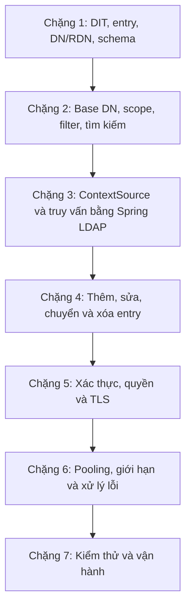
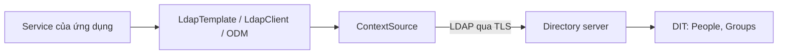

# Lộ trình học từ DN và filter đến vận hành hệ thống thư mục

## Mục tiêu của lộ trình

Để làm việc hiệu quả với **SPRING_LDAP**, người học cần hiểu cả hai phía của một yêu cầu: **dữ liệu thư mục được tổ chức và truy vấn thế nào** và **ứng dụng Spring kết nối, xác thực, cập nhật, xử lý lỗi, kiểm thử cũng như vận hành kết nối đó ra sao**.

Lộ trình này đi từ những khái niệm **DN, schema, LDAP filter** đến thao tác entry bằng **`LdapTemplate`, `LdapClient` hoặc Object-Directory Mapping (ODM)**, rồi mới mở rộng sang **`ContextSource`, authentication, TLS, pooling, xử lý lỗi và vận hành an toàn**.

Sau khi hoàn thành, bạn có thể:

1. Đọc một **Directory Information Tree (DIT)** và xác định chính xác DN, RDN, base DN, phạm vi tìm kiếm của một entry.
2. Viết và kiểm chứng filter LDAP, biết dùng schema và thuộc tính phù hợp để truy vấn.
3. Tạo cấu hình Spring LDAP, đọc và quản lý entry có kiểm soát.
4. Phân biệt xác thực bằng bind, quyền truy cập thư mục và quyền của ứng dụng.
5. Kết nối qua TLS, đánh giá pooling, timeout, lỗi kết nối và giới hạn truy vấn.
6. Thiết lập các kiểm thử đủ để kiểm chứng thao tác nghiệp vụ và các rủi ro khi truy cập directory server.

Đây là một **lộ trình thực hành có mốc kiểm chứng**, không phải danh sách API để học thuộc. Mỗi chặng xây dựng trên kết quả của chặng trước. Nếu chưa tự giải thích được vì sao một truy vấn trả về entry này mà không trả về entry khác, bạn chưa nên chuyển sang tối ưu hóa kết nối hoặc xử lý lỗi ở quy mô production.

## 1. Bản đồ học tập



| Chặng | Câu hỏi trọng tâm | Sản phẩm thực hành | Điều kiện để đi tiếp |
| --- | --- | --- | --- |
| **1. Mô hình dữ liệu** | Một entry nằm ở đâu và được phép có thuộc tính nào? | Cây DIT, file LDIF thử nghiệm | Đọc đúng DN, RDN, schema và quan hệ giữa các entry |
| **2. Tìm kiếm** | Làm sao tìm đúng entry mà không quét thừa? | Bộ truy vấn base/scope/filter | Chứng minh kết quả và kiểm soát trường hợp không tìm thấy |
| **3. Kết nối Spring** | Spring lấy LDAP context và ánh xạ kết quả thế nào? | Ứng dụng có chức năng tìm người dùng | Truy vấn qua `LdapTemplate`; biết vị trí `LdapClient` và ODM |
| **4. Thao tác entry** | Tạo, cập nhật, đổi DN và xóa có tác động gì? | Các thao tác CRUD trong môi trường thử nghiệm | Đọc lại trạng thái, xử lý schema và xung đột |
| **5. Danh tính và an toàn** | Ai được bind, đọc hoặc sửa? Kênh truyền có an toàn? | Cấu hình TLS, account tối thiểu quyền, kiểm tra auth | Không lộ credential; tách được authentication/authorization |
| **6. Độ bền và hiệu năng** | Hệ thống phản ứng ra sao khi server chậm hoặc lỗi? | Cấu hình timeout, giới hạn và chính sách xử lý lỗi | Phân loại lỗi và không tái thử thao tác nguy hiểm vô điều kiện |
| **7. Kiểm thử, vận hành** | Làm sao biết hệ thống đúng và tiếp tục an toàn khi triển khai? | Bộ kiểm thử, checklist vận hành, tài liệu runbook | Kiểm tra được luồng thành công, thất bại và sự cố |

Không có số tuần bắt buộc cho từng chặng. Có thể học chặng 1–3 nhanh nếu đã quen LDAP, nhưng không nên bỏ qua các tiêu chí đầu ra: hiểu cú pháp khác với khả năng phân tích dữ liệu và điều tra lỗi trên một directory server thực tế.

## 2. Bài thực hành xuyên suốt: danh bạ một tổ chức

Hãy dùng một **directory server dành riêng cho học tập**, chẳng hạn môi trường kiểm thử chạy OpenLDAP hoặc dịch vụ thư mục thử nghiệm mà bạn được phép thao tác. Không thực hiện bài học thêm, đổi tên hay xóa entry trên directory server đang phục vụ người dùng thật.

Chúng ta giả định tổ chức có cây tên:

```text
dc=example,dc=org
├── ou=People
│   ├── uid=lan
│   └── uid=minh
├── ou=Groups
│   └── cn=Developers
└── ou=Services
    └── cn=svc-reader
```

Nhánh `People` lưu entry người dùng, `Groups` chứa nhóm, còn `Services` chứa danh tính dịch vụ. Đây là **một quy ước thiết kế minh họa**: LDAP không bắt mọi thư mục có ba nhánh này; cấu trúc, schema và quyền quản trị thực tế phụ thuộc từng sản phẩm/môi trường.

Một số entry có thể biểu diễn bằng LDIF như sau (giả định các entry cha đã tồn tại và schema máy chủ hỗ trợ):

```ldif
dn: uid=lan,ou=People,dc=example,dc=org
objectClass: inetOrgPerson
uid: lan
cn: Lan Nguyen
sn: Nguyen
mail: lan@example.org

dn: uid=minh,ou=People,dc=example,dc=org
objectClass: inetOrgPerson
uid: minh
cn: Minh Tran
sn: Tran
mail: minh@example.org

dn: cn=Developers,ou=Groups,dc=example,dc=org
objectClass: groupOfNames
cn: Developers
member: uid=lan,ou=People,dc=example,dc=org
member: uid=minh,ou=People,dc=example,dc=org
```

Trong toàn bộ lộ trình, ứng dụng ví dụ có ba nhiệm vụ: **tìm người dùng theo mã `uid`**, **đọc nhóm có thành viên đó**, và **quản trị một số thuộc tính của người dùng thử nghiệm**. Việc xác thực và phân quyền sẽ được bổ sung sau khi thao tác đọc/ghi đã rõ ràng.

Để tự đánh giá, lưu lại truy vấn đã chạy, dữ liệu mẫu, kết quả thực tế, lỗi gặp phải và cách sửa; một ghi chép có thể tái hiện sẽ hữu ích hơn việc ghi nhớ nhiều lệnh rời rạc.

## 3. Chặng 1 — Đọc cây LDAP, DN và schema

### Kiến thức cần nắm

LDAP (*Lightweight Directory Access Protocol*) cung cấp cách client truy cập dịch vụ thư mục. Directory server quản lý **entry**, mỗi entry có các **attribute** và tên phân biệt **DN** (*Distinguished Name*). Các entry được đặt trong **DIT**, tức cây thông tin thư mục.

Xét DN:

```text
uid=lan,ou=People,dc=example,dc=org
```

- `uid=lan` là **RDN** (*Relative Distinguished Name*) của entry `lan`.
- `ou=People` là RDN của entry cha.
- `dc=example,dc=org` là hậu tố của không gian tên trong ví dụ.
- Toàn bộ chuỗi là DN. Các thành phần được ghi từ entry cụ thể sang những entry cha.

**DN xác định vị trí entry, không phải chỉ là mã người dùng.** Nếu chuyển `uid=lan` sang nhánh khác, DN thay đổi. Các hệ thống liên kết tài khoản nên cân nhắc một định danh ổn định phù hợp thay vì mặc định dùng DN làm khóa nghiệp vụ bất biến.

Một **schema** quy định các loại attribute, object class, cú pháp và ràng buộc. Chẳng hạn entry thuộc `inetOrgPerson` dùng để mô tả một người, với các yêu cầu về thuộc tính như `cn` và `sn` từ các object class kế thừa. `groupOfNames` là một cách biểu diễn nhóm với thuộc tính `member` tham chiếu đến DN. Không phải mọi sản phẩm đều dùng cùng kiểu nhóm; ví dụ Active Directory có schema và quy ước riêng.

**Bài thực hành 1 — Phân tích DIT**

1. Viết ra DN đầy đủ của hai người, nhóm Developers và tài khoản dịch vụ trong cây ví dụ.
2. Với `uid=lan,ou=People,dc=example,dc=org`, xác định RDN, DN của cha và DN của nhánh gốc.
3. Xác định nhóm Developers có nằm trên đường cha của Lan không. Giải thích vì sao thuộc tính `member` vẫn có thể tham chiếu đến Lan.
4. Thử mô tả hậu quả nếu chuyển `uid=lan` sang `ou=Alumni`: DN nào thay đổi, tham chiếu nào cần kiểm tra?

**Mốc đạt:** Bạn có thể vẽ lại DIT, xác định DN/RDN và giải thích tại sao thay đổi tên hoặc vị trí entry phải được cân nhắc cùng các tham chiếu. Bạn cũng biết cần xem schema trước khi thêm một thuộc tính mới.

## 4. Chặng 2 — Từ base DN đến filter và tìm kiếm

Truy vấn LDAP hiệu quả bắt đầu bằng **chọn đúng nơi tìm**:

| Thành phần | Ý nghĩa | Ví dụ |
| --- | --- | --- |
| **Base DN** | Điểm bắt đầu tìm kiếm | `ou=People,dc=example,dc=org` |
| **Search scope** | Những cấp của cây được xét | `BASE`, `ONELEVEL`, `SUBTREE` |
| **Filter** | Điều kiện của entry cần trả về | `(&(objectClass=inetOrgPerson)(uid=lan))` |
| **Attributes** | Những thuộc tính muốn lấy về | `cn`, `mail` |
| **Giới hạn** | Giới hạn kích thước/thời gian, tùy phía client/server | Chặn truy vấn quá rộng |

Với base DN là `ou=People,dc=example,dc=org`:

- `BASE`: chỉ xét entry `ou=People`.
- `ONELEVEL`: xét các entry con trực tiếp, như `uid=lan` và `uid=minh`.
- `SUBTREE`: xét entry base và toàn bộ hậu duệ.

Những filter cần đọc được ngay:

```text
(uid=lan)
(mail=*)
(&(objectClass=inetOrgPerson)(uid=lan))
(|(uid=lan)(uid=minh))
(!(uid=lan))
```

Trong đó `&` là AND, `|` là OR, `!` là NOT; `(mail=*)` kiểm tra attribute tồn tại. Filter được xây dựng bằng cú pháp LDAP, **không phải biểu thức SQL**.

**Bài thực hành 2 — Tìm cùng một entry theo nhiều cách**

Nếu máy chủ hỗ trợ LDAPS và đã cấu hình chứng chỉ tin cậy, có thể thử lệnh (thay hostname và DN dịch vụ bằng giá trị của môi trường học tập):

```bash
ldapsearch -x \
  -H ldaps://ldap.example.org:636 \
  -D "cn=svc-reader,ou=Services,dc=example,dc=org" \
  -W \
  -b "ou=People,dc=example,dc=org" \
  -s sub \
  "(&(objectClass=inetOrgPerson)(uid=lan))" \
  cn mail
```

Thử thay filter bằng `(uid=minh)` và `(uid=unknown)`. Sau đó đổi scope hoặc base DN và so sánh. Chỉ đổi một yếu tố mỗi lần để hiểu nguyên nhân kết quả.

Đối với từng lần thử, ghi lại:

| Trường hợp | Kết quả dự kiến | Điều cần giải thích |
| --- | --- | --- |
| Base ở People, scope SUBTREE, `uid=lan` | Trả entry Lan nếu tồn tại và tài khoản có quyền đọc | Vì sao tìm được |
| Base ở Groups, scope SUBTREE, `uid=lan` | Không trả entry Lan | Base DN loại trừ nhánh People |
| Base ở People, scope BASE, `uid=lan` | Không trả entry Lan | Scope chỉ xét entry People |
| Base ở People, scope SUBTREE, `uid=unknown` | Danh sách rỗng | Không có entry khớp khác với lỗi kết nối |
| Base ở People, filter `(mail=*)` | Entry có `mail` được phép đọc và khớp điều kiện | Presence filter không kiểm tra giá trị cụ thể |

**Lưu ý về injection:** DN và filter là hai ngữ cảnh escape khác nhau. Quy tắc biểu diễn DN nằm trong RFC 4514; filter trong RFC 4515. Không ghép input thô của người dùng trực tiếp vào `(uid=...)` hoặc DN. Khi đến chặng Spring, hãy dùng query builder và công cụ dựng DN.

**Mốc đạt:** Bạn có thể dự đoán kết quả một filter, giải thích khác biệt giữa ba scope và viết được truy vấn giới hạn đúng nhánh thay vì luôn tìm từ root.

## 5. Chặng 3 — Kết nối Spring LDAP và đọc dữ liệu

Sau khi thao tác tìm kiếm bằng công cụ LDAP được, hãy chuyển cùng truy vấn sang ứng dụng Java. **Spring LDAP** giải quyết việc quản lý LDAP context, thao tác thường gặp và ánh xạ kết quả; nó không thay thế LDAP server.

Sơ đồ luồng truy vấn:



### Các thành phần nên học theo thứ tự

1. **`ContextSource`**: cấu hình URL máy chủ, base DN, danh tính dịch vụ và tùy chọn kết nối; cung cấp context để thực hiện LDAP operations.
2. **`LdapTemplate`**: API dạng template cho search, lookup, bind entry, modify, unbind và rename.
3. **`LdapClient`**: API fluent cho truy vấn/thao tác trong các phiên bản Spring LDAP hỗ trợ API này; kiểm tra tài liệu đúng phiên bản thư viện đang dùng.
4. **LDAP ODM**: ánh xạ entry và attribute sang đối tượng Java khi mapping giúp cấu trúc mã tốt hơn. Cần hiểu schema, DN và định nghĩa mapping trước khi áp dụng.

Với Spring Boot có Spring LDAP dependency và cấu hình tự động tương ứng, ví dụ khai báo (giá trị là minh họa):

```properties
spring.ldap.urls=ldaps://ldap.example.org:636
spring.ldap.base=dc=example,dc=org
spring.ldap.username=cn=svc-reader,ou=Services,dc=example,dc=org
spring.ldap.password=${LDAP_BIND_PASSWORD}
```

Tùy phiên bản Spring Boot/Spring LDAP, dự án có thể dùng starter hoặc cấu hình `LdapContextSource` và `LdapTemplate` bằng bean. Cấu hình trên chưa tự xử lý truststore, timeout hoặc chính sách truy cập; chúng cần được thiết lập và kiểm thử cho môi trường cụ thể.

Ví dụ tìm tên hiển thị, giả định service đã được inject `LdapTemplate`:

```java
import static org.springframework.ldap.query.LdapQueryBuilder.query;

import javax.naming.directory.Attributes;
import org.springframework.ldap.core.LdapTemplate;

class DirectorySearchService {
    private final LdapTemplate ldapTemplate;

    DirectorySearchService(LdapTemplate ldapTemplate) {
        this.ldapTemplate = ldapTemplate;
    }

    java.util.List<String> findDisplayNames(String uid) {
        return ldapTemplate.search(
            query().base("ou=People")
                .where("objectClass").is("inetOrgPerson")
                .and("uid").is(uid),
            (Attributes attrs) -> (String) attrs.get("cn").get()
        );
    }
}
```

`base("ou=People")` là DN **tương đối** với `spring.ldap.base` trong ví dụ. Kết quả tìm được là dữ liệu hồ sơ, **không phải bằng chứng người dùng đã xác thực**. Trong mã thực tế, xử lý thuộc tính thiếu, kết quả rỗng/nhiều entry, giới hạn truy vấn và exceptions thay vì giả định `cn` luôn hiện diện và dễ truy cập.

**Bài thực hành 3 — Thay công cụ dòng lệnh bằng ứng dụng**

- Chạy cùng truy vấn `uid=lan` qua `ldapsearch` và Spring LDAP, so sánh DN/attribute được trả.
- Tạo một hàm tra cứu `uid` không tồn tại; trả kết quả rỗng hoặc trạng thái nghiệp vụ phù hợp, không báo thành lỗi sai mật khẩu.
- Tạo truy vấn chỉ lấy các attribute cần hiển thị và thử input có ký tự đặc biệt để kiểm tra cách builder xử lý filter.
- Đặt base DN ở một nơi nhất quán; ghi rõ trong tài liệu của service DN nào là tương đối và DN nào là tuyệt đối.

**Mốc đạt:** Ứng dụng truy vấn được entry qua `ContextSource` và `LdapTemplate`, biết khi nào nên dùng API fluent hoặc ODM mà không che lấp cách LDAP thực sự hoạt động.

## 6. Chặng 4 — Tạo, sửa, đổi tên và xóa entry

LDAP hỗ trợ các thao tác cập nhật nhưng phải tuân theo schema, cấu trúc cây, quyền truy cập và ràng buộc trên máy chủ. **Không gộp mọi thay đổi thành một thao tác “save object”** nếu chưa hiểu hệ quả.

| Nhu cầu | Thao tác LDAP | Điều cần kiểm tra |
| --- | --- | --- |
| Tạo người dùng mới | Add entry / bind entry trong API template | DN chưa tồn tại, entry cha có sẵn, đủ thuộc tính bắt buộc |
| Đổi email | Modify attributes | Quyền sửa `mail`, cú pháp và số giá trị hợp lệ |
| Chuyển entry sang nhánh khác | Modify DN / rename | Entry cha đích, tên mới, tham chiếu và quyền |
| Xóa người dùng thử nghiệm | Delete / unbind entry trong API template | Đúng DN đích, quyền xóa, quan hệ tham chiếu liên quan |
| Đọc lại sau ghi | Search/lookup | Dữ liệu cuối cùng đúng kỳ vọng |

Trong Spring LDAP, phương thức **`bind` dùng để thêm entry** có tên trùng với thao tác **LDAP Bind dùng để xác thực kết nối**. Cần đọc ngữ cảnh API: “bind entry” không đồng nghĩa “kiểm tra mật khẩu người dùng”.

**Bài thực hành 4 — Vòng đời một entry thử nghiệm**

1. Tạo `uid=trainee01,ou=People,dc=example,dc=org` với schema và thuộc tính bắt buộc.
2. Tìm lại entry và kiểm tra DN, `cn`, `sn`, `mail`.
3. Sửa riêng `mail`; kiểm tra các thuộc tính khác vẫn nguyên vẹn.
4. Thử tạo cùng DN một lần nữa và ghi nhận lỗi trùng entry.
5. Nếu môi trường cho phép, đổi RDN từ `uid=trainee01` thành `uid=trainee02` rồi tìm bằng DN cũ và mới.
6. Xóa entry thử nghiệm cuối cùng và xác nhận tìm kiếm không còn kết quả.

Khi thay đổi DN, hãy kiểm tra các entry nhóm đang tham chiếu DN cũ. Directory server có thể hỗ trợ cập nhật tham chiếu theo cách khác nhau; **không mặc định các giá trị `member` luôn tự đổi theo**.

Các bài ghi/sửa/xóa chỉ chạy với dữ liệu thử nghiệm, tài khoản thử nghiệm và quyền quản trị dành riêng cho môi trường học. Mọi trường hợp lỗi cần được báo đủ thông tin để chẩn đoán, nhưng không được log mật khẩu hoặc dữ liệu bí mật.

**Mốc đạt:** Bạn tạo và sửa được một entry hợp lệ, dự đoán được lỗi do DN/schema/quyền, và hiểu rename ảnh hưởng đến các tham chiếu.

## 7. Chặng 5 — Authentication, authorization và kết nối TLS

Một ứng dụng dùng LDAP cần phân biệt ba vấn đề:

| Vấn đề | Câu hỏi | Ví dụ |
| --- | --- | --- |
| **Authentication** | Danh tính đăng nhập có được xác minh không? | Bind bằng DN và thông tin xác thực hợp lệ |
| **LDAP access control** | LDAP identity đó được đọc/sửa entry nào? | Service account chỉ đọc `ou=People` |
| **Application authorization** | Người đã đăng nhập được phép dùng chức năng nào? | Chỉ quản trị viên được đổi thuộc tính hồ sơ |

Tìm thấy entry `uid=lan` không xác nhận người nhập `lan` biết mật khẩu. Tương tự, LDAP server cho phép đọc thuộc tính nhóm không có nghĩa mọi thành viên nhóm được tự động dùng chức năng quản trị của ứng dụng.

### Luồng xác thực cần hiểu

1. Ứng dụng nhận danh tính người dùng.
2. Nếu thiết kế cần tìm DN từ username, dùng danh tính dịch vụ có quyền tìm kiếm phù hợp.
3. Kiểm tra thông tin xác thực bằng cơ chế directory server hỗ trợ (ví dụ LDAP Bind), hoặc tích hợp với cơ chế SSO của tổ chức nếu đó là kiến trúc đã chọn.
4. Xác định quyền ứng dụng theo chính sách của chính ứng dụng; nếu dùng nhóm LDAP, phải kiểm tra schema và cách truy xuất membership.

Phải xử lý các trường hợp username không tồn tại, nhiều entry khớp, tài khoản bị vô hiệu hóa theo quy định của hệ thống, bind thất bại và lỗi mạng. Phản hồi cho người dùng cuối không nên tiết lộ những chi tiết giúp dò tài khoản.

### Bảo vệ kênh LDAP

Hai phương án TLS phổ biến:

- **LDAPS**: thiết lập TLS ngay từ đầu, thường trên cổng `636`.
- **StartTLS**: bắt đầu bằng kết nối LDAP rồi nâng cấp sang TLS trước khi truyền credential nhạy cảm; thường dùng cổng `389`.

Phải kiểm tra trust chain và tên máy chủ theo cấu hình TLS. Không tắt xác thực chứng chỉ để “sửa lỗi kết nối”. Khi dùng StartTLS, cần bảo đảm việc nâng cấp TLS thành công **trước** thao tác bind có mật khẩu; việc thư viện/client hỗ trợ StartTLS và cách quản lý context phải được kiểm chứng đúng phiên bản.

**Bài thực hành 5 — Ma trận quyền và xác thực**

Thiết lập ít nhất hai danh tính học tập: một account chỉ đọc và một account được quyền cập nhật trong nhánh thử nghiệm. Ghi nhận kết quả mong đợi:

| Tình huống | Kỳ vọng |
| --- | --- |
| Bind bằng credential hợp lệ, kết nối TLS hợp lệ | Có thể xác thực theo chính sách máy chủ |
| Credential sai | Xác thực thất bại; không báo thành entry “không tồn tại” |
| Account chỉ đọc thực hiện search được phép | Trả kết quả |
| Account chỉ đọc cố sửa entry | Bị từ chối theo ACL đã cấu hình |
| TLS không tin cậy chứng chỉ máy chủ | Kết nối không được chấp nhận |
| Tài khoản có quyền ở LDAP nhưng thiếu quyền ứng dụng | Chức năng ứng dụng vẫn từ chối |

**Mốc đạt:** Bạn tự giải thích được kết quả của ma trận trên và kiểm chứng kênh kết nối an toàn, thay vì chỉ nhìn thấy một lần đăng nhập thành công.

## 8. Chặng 6 — Pooling, timeout, tìm kiếm hiệu quả và xử lý lỗi

Một chức năng LDAP hoạt động trên máy phát triển chưa chắc hoạt động ổn định khi tải tăng hoặc directory server gặp sự cố.

### 8.1. Hiệu năng truy vấn

Ưu tiên thu hẹp **base DN**, chọn **scope** phù hợp, chỉ lấy thuộc tính cần thiết và áp dụng giới hạn kích thước/thời gian. Kiểm tra chỉ mục (*index*) do server quản lý cho những thuộc tính thường dùng như `uid` hoặc `mail`; cấu hình index phụ thuộc từng loại directory server.

Khi kết quả nhiều, tìm hiểu **paged results** nếu server/client hỗ trợ. Phân trang không thay thế việc đặt giới hạn quyền và phạm vi tìm kiếm. Đừng giả định mọi truy vấn `SUBTREE` từ root đều có chi phí giống nhau.

### 8.2. Kết nối và pooling

`ContextSource` cung cấp context cho các thao tác. Cơ chế **connection/context pooling** có thể giảm chi phí tạo kết nối trong môi trường có nhiều truy vấn, nhưng cần xác minh:

- Cách lấy và trả context về pool; cơ chế đóng/thu hồi khi server ngắt kết nối.
- Danh tính bind của context: không được tái sử dụng nhầm context mang quyền của người dùng này cho người dùng khác.
- Tương tác với TLS, đặc biệt là StartTLS; không bật pooling chung một cách mù quáng.
- Giới hạn pool, thời gian chờ, cách phát hiện kết nối đã chết và khả năng hoạt động khi một node LDAP không sẵn sàng.

Chỉ bật cơ chế pooling đã được thư viện và loại kết nối cụ thể hỗ trợ, với số liệu kiểm thử làm cơ sở. Pool quá lớn có thể tăng số kết nối mở và làm directory server quá tải.

### 8.3. Phân loại lỗi để chọn cách phản ứng

| Nhóm lỗi | Ví dụ | Cách phản ứng cần cân nhắc |
| --- | --- | --- |
| Không có kết quả tìm kiếm | Search trả danh sách rỗng | Trả kết quả nghiệp vụ “không tìm thấy”; không tự suy là lỗi mạng |
| Entry/DN không tồn tại | LDAP `noSuchObject` (mã 32) | Kiểm tra DN/base và thao tác đang thực hiện |
| Sai credential | `invalidCredentials` (mã 49) | Từ chối xác thực, không tự lặp với cùng credential |
| Thiếu quyền | `insufficientAccessRights` (mã 50) | Kiểm tra ACL và danh tính bind; không tự nâng quyền |
| Vi phạm schema/ràng buộc | `constraintViolation` (mã 19) hoặc mã liên quan | Sửa input/schema, tránh retry vô hạn |
| Entry đã tồn tại | `entryAlreadyExists` (mã 68) | Kiểm tra điều kiện tạo trùng và xử lý xung đột |
| Giới hạn kết quả/thời gian | `sizeLimitExceeded`, `timeLimitExceeded` | Thu hẹp truy vấn hoặc áp dụng cơ chế phân trang thích hợp |
| Lỗi mạng, TLS, timeout | Không nhận được kết quả LDAP tin cậy | Ghi nhận nguyên nhân và trạng thái chưa chắc chắn của thao tác |

Spring LDAP có hệ exception của Spring để bọc lỗi truy cập LDAP, nhưng việc mapping cụ thể phụ thuộc mã lỗi, loại lỗi JNDI và phiên bản thư viện. Trong ứng dụng, nên chuyển lỗi sang ngữ nghĩa nghiệp vụ hợp lý và log đủ ngữ cảnh an toàn (tên thao tác, loại lỗi, thời điểm, correlation ID).

**Cẩn thận với retry của thao tác ghi:** Nếu kết nối đứt sau khi gửi lệnh nhưng trước khi nhận phản hồi, không thể mặc định máy chủ chưa thực hiện thao tác. Trước khi retry thao tác tạo, sửa, xóa, cần có quy tắc xác định trạng thái hiện tại hoặc cơ chế chống lặp phù hợp; không lặp vô điều kiện.

**Bài thực hành 6 — Thử lỗi có chủ đích**

1. Ngắt kết nối server thử nghiệm rồi thực hiện một lệnh search với timeout hợp lý.
2. Tạo lệnh tìm kiếm rộng hơn dữ liệu thử nghiệm, bật giới hạn kết quả và ghi nhận hành vi.
3. Dùng account chỉ đọc để thử thao tác sửa, so sánh với lỗi credential sai.
4. Kiểm tra các bản ghi log: có đủ ngữ cảnh để tìm lỗi nhưng không chứa mật khẩu/token hay dữ liệu nhạy cảm.
5. Nếu bật pooling, đo ít nhất số kết nối, độ trễ truy vấn và hành vi khi kết nối bị cắt; so sánh trước/sau trên cùng workload.

**Mốc đạt:** Bạn giải thích được sự khác biệt giữa kết quả rỗng, lỗi xác thực, lỗi quyền, lỗi schema và lỗi vận hành; biết tránh retry nguy hiểm.

## 9. Chặng 7 — Kiểm thử và vận hành hệ thống thư mục an toàn

Hãy biến bài thực hành thành một dịch vụ nhỏ có thể kiểm chứng. Tối thiểu cần kiểm tra **thành công**, **đầu vào sai**, **thiếu quyền**, **mất kết nối**, **dữ liệu bị thay đổi** và **TLS**.

### 9.1. Cấu trúc kiểm thử nên có

| Tầng kiểm thử | Nội dung | Vì sao cần |
| --- | --- | --- |
| **Unit test** | Logic xử lý kết quả, chọn nhánh, chuyển lỗi, kiểm tra input | Nhanh, không phụ thuộc server |
| **Integration test** | `ContextSource`, search/filter, add/modify/delete, mapping ODM nếu dùng | Chứng minh API tương tác đúng với directory server thử nghiệm |
| **Security test** | Quyền đọc/sửa, bind sai, filter đặc biệt, xác thực chứng chỉ | Phát hiện lỗi an toàn mà happy path không bộc lộ |
| **Resilience test** | Server ngắt kết nối, timeout, kết quả quá lớn, pool chứa connection hỏng | Kiểm tra phản ứng khi điều kiện vận hành thay đổi |

Có thể dùng một LDAP server khởi tạo bằng fixture/LDIF trong môi trường kiểm thử. Công cụ mock hoặc embedded server hữu ích cho những ca cơ bản, nhưng không thay thế toàn bộ kiểm thử với server đích: AD DS, OpenLDAP và các server khác có thể khác schema, ACL, hỗ trợ extension và chính sách kết nối.

Ví dụ những ca tối thiểu cho hàm `findUserByUid`:

```text
Given: uid=lan tồn tại dưới ou=People
When : tìm uid=lan
Then : nhận đúng entry và các thuộc tính được phép đọc

Given: uid=unknown không tồn tại
When : tìm uid=unknown
Then : nhận kết quả rỗng / not-found phù hợp

Given: uid có ký tự đặc biệt của LDAP filter
When : tìm kiếm bằng query builder
Then : không biến input thành một filter mở rộng ngoài ý định

Given: account dịch vụ không được sửa entry
When : yêu cầu cập nhật mail
Then : từ chối với lỗi quyền; dữ liệu không đổi

Given: chứng chỉ LDAP server không tin cậy
When : kết nối bảo mật
Then : TLS handshake thất bại và không gửi credential qua kênh không an toàn
```

### 9.2. Những thông tin cần có khi vận hành

Một tài liệu vận hành tối thiểu nên ghi:

- Địa chỉ directory server và phương thức TLS, cách tin cậy chứng chỉ, thời hạn chứng chỉ và quy trình gia hạn.
- Base DN, nhánh người dùng/nhóm, schema và quy tắc mapping từ LDAP sang dữ liệu ứng dụng.
- Danh tính dịch vụ, phạm vi quyền, nơi quản lý secret và quy trình luân chuyển credential (không ghi giá trị secret vào tài liệu).
- Timeout, giới hạn truy vấn, chính sách pooling, điều kiện retry và cách phát hiện lỗi.
- Chỉ số quan sát: tỉ lệ thành công/thất bại, độ trễ tìm kiếm, lỗi TLS, timeout, thiếu quyền, kết nối sử dụng.
- Quy trình ứng phó khi server không thể truy cập, quá tải hoặc dữ liệu vừa cập nhật chưa quan sát thấy như dự kiến.

Trong môi trường triển khai có nhiều directory server, cần xác nhận tính nhất quán và độ trễ replication dựa trên sản phẩm đang dùng; không nên tự suy mọi node đều phản ánh cập nhật tức thời.

**Bài thực hành 7 — Một lượt nghiệm thu cuối**

Chạy toàn bộ hành trình: kết nối TLS → bind bằng tài khoản được cấp quyền → tìm `uid=lan` → đọc nhóm Developers → thêm một entry thử nghiệm → sửa thuộc tính → đọc xác nhận → xóa entry thử nghiệm → xác nhận không còn → thử lỗi thiếu quyền và timeout.

Lưu log đã lược bỏ thông tin nhạy cảm, bản ghi kết quả kiểm thử và hướng dẫn tái hiện. Với thao tác ghi, luôn xác nhận trên directory server thử nghiệm rằng dữ liệu đã đạt trạng thái cuối mong muốn.

**Mốc đạt:** Người khác có thể làm theo hướng dẫn để chạy thử, xác định lỗi và biết khi nào phải liên hệ người quản trị directory server.

## 10. Các bẫy thường gặp khi học Spring LDAP

1. **Nhầm `uid` với DN.** `uid` chỉ là thuộc tính/RDN được lựa chọn; DN còn chứa vị trí trong DIT.
2. **Tìm thấy tài khoản nghĩa là đã xác thực.** Search chỉ là tra cứu; authentication cần quy trình xác minh danh tính riêng.
3. **Dùng filter như một chuỗi có thể ghép tùy ý.** Filter và DN có quy tắc escape khác nhau; cần builder/escaping đúng ngữ cảnh.
4. **Giả định mọi LDAP server có cùng schema nhóm.** Object class, membership và ACL có thể khác giữa sản phẩm.
5. **Dùng cùng account quyền cao cho tất cả tác vụ.** Quyền đọc, cập nhật và quản trị nên tách theo nhu cầu.
6. **Bật TLS nhưng bỏ qua kiểm tra chứng chỉ.** TLS có hiệu quả bảo vệ khi certificate/trust/hostname được xác minh đúng.
7. **Coi pooling là tối ưu hóa mặc định.** Pooling cần phù hợp với context, danh tính bind, TLS và đặc tính tải.
8. **Dùng retry cho mọi ngoại lệ.** Lỗi ràng buộc, quyền hoặc kết quả ghi chưa rõ trạng thái đòi hỏi xử lý khác nhau.
9. **Chỉ kiểm thử happy path.** Cần kiểm tra dữ liệu thiếu, không có kết quả, credential sai, lỗi quyền, timeout và lỗi TLS.

## 11. Bảng tự đánh giá trước khi chuyển sang hệ thống thật

Đánh dấu khi bạn **tự thực hiện và giải thích được kết quả**, không chỉ chạy lại được một lệnh mẫu.

| Năng lực | Bằng chứng tự kiểm tra |
| --- | --- |
| Đọc dữ liệu thư mục | Chỉ đúng DN/RDN, entry cha và nhánh chứa người/nhóm |
| Tìm kiếm có kiểm soát | Viết được base/scope/filter và giải thích tập kết quả |
| An toàn input | Không ghép chuỗi filter/DN từ input không kiểm tra |
| Kết nối Spring LDAP | Tìm được entry qua `ContextSource` và `LdapTemplate` |
| Lựa chọn API | Giải thích khi nào dùng `LdapClient` hoặc ODM |
| Thao tác entry | Tạo, sửa, đổi DN, xóa trên dữ liệu thử nghiệm và xác minh lại |
| Danh tính và phân quyền | Phân biệt bind, ACL LDAP, quyền ứng dụng |
| Bảo mật đường truyền | Kiểm chứng LDAPS hoặc StartTLS và certificate validation |
| Hiệu năng và ổn định | Có timeout, giới hạn kết quả và phương án quản lý pooling |
| Xử lý lỗi | Phân biệt không tìm thấy, sai credential, thiếu quyền, schema, network |
| Kiểm thử | Có ca tích hợp, ca bảo mật và ca sự cố |
| Vận hành | Có runbook, log/metrics phù hợp và quy trình xử lý sự cố |

Nếu còn thiếu một dòng, hãy quay lại chặng tương ứng. Đặc biệt, nếu chưa phân biệt được lỗi xác thực và lỗi truy cập, việc bổ sung thêm framework hay lớp abstraction sẽ không giúp hệ thống đáng tin cậy hơn.

## 12. Bài tập tổng hợp

**Đề bài:** Xây một dịch vụ danh bạ nội bộ bằng Spring LDAP trên dữ liệu thử nghiệm. Dịch vụ phải tìm được người dùng theo `uid`, liệt kê thông tin nhóm tương ứng, và cho phép cập nhật `mail` chỉ với tài khoản được cấp quyền.

**Yêu cầu hoàn thành:**

1. Mô tả DIT, schema và các DN dùng trong bài.
2. Viết filter tìm người dùng và filter nhóm; giải thích base DN và scope lựa chọn.
3. Cấu hình `ContextSource` với thông tin kết nối lấy từ cấu hình an toàn, sử dụng TLS.
4. Triển khai truy vấn qua `LdapTemplate`; thử nghiệm phương án `LdapClient` hoặc ODM nếu thư viện/mapping đáp ứng.
5. Kiểm chứng thao tác đọc, cập nhật và những trường hợp không tìm thấy hoặc không đủ quyền.
6. Thiết lập timeout, giới hạn truy vấn và chỉ cân nhắc pooling khi có cơ sở thực nghiệm.
7. Viết kiểm thử tích hợp và một hướng dẫn xử lý sự cố ngắn.

**Tiêu chí nghiệm thu:** Không cần một giao diện đẹp hoặc nhiều API HTTP. Thành quả được đánh giá qua tính đúng của DN/filter, tác động thực tế trên entry, phân quyền, TLS, cách xử lý lỗi và khả năng tái hiện kết quả. Mọi thao tác làm thay đổi directory phải diễn ra trong môi trường thử nghiệm được phép sử dụng.

## Nguồn tham khảo chính

- **RFC 4510** — Định hướng bộ đặc tả LDAP.
- **RFC 4511** — LDAP protocol và các thao tác, mã kết quả.
- **RFC 4512** — Mô hình thông tin thư mục.
- **RFC 4514** — Biểu diễn DN dưới dạng chuỗi.
- **RFC 4515** — Biểu diễn LDAP search filter.
- **RFC 2849** — Định dạng LDIF.
- **Spring LDAP Reference Documentation** — Cấu hình context, `LdapTemplate`, `LdapClient`, ODM, transaction và kiểm thử theo phiên bản.
- **Spring Boot Reference Documentation** — Các thuộc tính cấu hình LDAP và tính năng auto-configuration theo phiên bản Spring Boot được sử dụng.

Lộ trình đã hoàn tất khi bạn không chỉ gọi được LDAP API mà còn có thể giải thích **dữ liệu được truy xuất từ nhánh nào, theo quyền nào, qua kết nối được bảo vệ ra sao, và hệ thống cần phản ứng thế nào khi truy vấn hoặc cập nhật gặp lỗi**.
